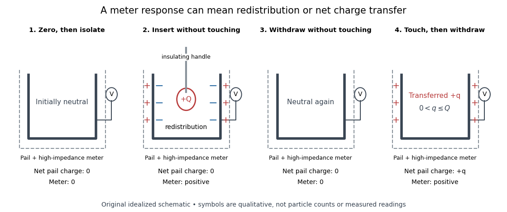

# Electric charge

↑ **Parent:** [Electromagnetism](electromagnetism-split.md)  
ⓦ [Wiki](https://en.wikipedia.org/wiki/Electric_charge)

[Electric charge](electric-charge-split.md) is an additive, signed property of matter that determines its coupling to the [electromagnetic field](electromagnetic-field.md). Write a particle's [electric charge](electric-charge-split.md) as $q$, or a collection's total [electric charge](electric-charge-split.md) as $Q$; the [SI](international-system-of-units.md) unit is the [coulomb](coulomb.md), $\mathrm C$. A stationary test particle in an [electric field](electric-field-split.md) experiences [electric force](electric-force.md) $\mathbf F=q\mathbf E$, while motion adds the magnetic part of the [Lorentz force](lorentz-force.md). [Electric charge](electric-charge-split.md) both produces an [electric field](electric-field-split.md) and determines the response to one. For two stationary point particles in [vacuum](vacuum.md), [Coulomb's law](coulomb-s-law.md) makes like signs repel and opposite signs attract. The choice of which sign to call positive is a convention, used consistently: [protons](proton.md) carry $+e$ and [electrons](electron.md) carry $-e$, where $e$ is the [elementary charge](elementary-charge.md). [Feynman, Leighton and Sands, II.1: electrical forces, fields and the Lorentz force](https://www.feynmanlectures.caltech.edu/II_01.html).

Additivity means adding signed [electric charges](electric-charge-split.md), rather than their magnitudes:

$$
Q=\sum_i q_i,\qquad Q=e(N_p-N_e)
$$

for ordinary matter containing $N_p$ [protons](proton.md), $N_e$ [electrons](electron.md), and electrically neutral [neutrons](neutron-split.md). A toy collection with seven [protons](proton.md) and ten [electrons](electron.md) has $Q=-3e$, however much neutral material accompanies it. [Charge neutrality](charge-neutrality.md) means $Q=0$; it does not mean an absence of charged constituents. Nor does it guarantee an absence of [electric force](electric-force.md): the spatial arrangement of positive and negative [electric charges](electric-charge-split.md) matters, as illustrated by an [electric dipole](electric-dipole.md). This makes a tiny imbalance in an otherwise nearly neutral object physically important. [Feynman, Leighton and Sands, II.1.1: neutrality, imbalance and residual electrical forces](https://www.feynmanlectures.caltech.edu/II_01.html#Ch1-S1).

[Charge conservation](charge-conservation.md) states that a collection closed to transport of [electric charge](electric-charge-split.md) keeps its total signed $Q$. If $n$ [electrons](electron.md) move from object A to object B without other exchange, then $\Delta Q_A=+ne$ and $\Delta Q_B=-ne$; the sum is unchanged. The amount of positive [electric charge](electric-charge-split.md) alone need not be conserved: creation of an [electron](electron.md) and a [Positron](positron.md) adds opposite [electric charges](electric-charge-split.md) with zero sum. These bookkeeping rules let us distinguish separation or transport of [electric charge](electric-charge-split.md) from creation of net [electric charge](electric-charge-split.md). [Feynman, Leighton and Sands, I.4.4: conservation of net charge](https://www.feynmanlectures.caltech.edu/I_04.html#Ch4-S4).

A simple motivating experiment uses two charge-producing paddles, a conducting pail on an insulating support, a grounded outer shield and a high-input-impedance [electrometer](electrometer.md). Zero the pail, then isolate it. Rub the initially neutral paddles together, keeping their charged surfaces away from other objects. Lower each deeply into the pail without touching: the [electrometer](electrometer.md) gives opposite signs. Inserting both together tests cancellation. For a separate contact test, insert one charged paddle without touching and withdraw it: the reading returns to zero. Repeat after zeroing, this time touching the inner wall before withdrawal: a residual reading shows transfer of [electric charge](electric-charge-split.md). Zero the pail and reinsert the paddle to test how much [electric charge](electric-charge-split.md) remains on it. PASCO describes these procedures in [Basic Electrostatics System manual, demonstrations 1A and 1B, printed pp. 13–16](https://cdn.pasco.com/product_document/Basic-Electrostatics-Sys-Manual-ES-9080B1.pdf#page=13).

**[Figure 1](#image-electric-charge-redistribution-versus-transfer-in-a-conducting-pail). Electric charge redistribution versus transfer in a conducting pail**. [Source](electric-charge-transfer-schematic.py). Original qualitative schematic for a positively charged inserted object. Without contact, [electrostatic induction](electrostatic-induction.md) separates negative inner-surface and positive outer-surface [electric charges](electric-charge-split.md), while the pail's total remains zero. Contact can leave net positive [electric charge](electric-charge-split.md) after withdrawal. Symbols are not particle counts; no measured readings are plotted.

The crucial control is withdrawal without contact: a response during insertion can come from [electrostatic induction](electrostatic-induction.md), which redistributes the pail's existing [electric charge](electric-charge-split.md). In the fixed-geometry approximation, the [electrometer](electrometer.md) measures [electric potential difference](electric-potential-difference.md) proportional to enclosed [electric charge](electric-charge-split.md), with conversion set by effective [capacitance](capacitance.md); a voltage reading is not already a measurement in [coulombs](coulomb.md). Opposite readings and their cancellation test additivity and [charge conservation](charge-conservation.md) within resolution. Leakage or accidental contact spoils that interpretation, and contact need not transfer all the paddle's [electric charge](electric-charge-split.md). This macroscopic experiment cannot resolve [elementary charge](elementary-charge.md) steps: that requires the much smaller particles of the [oil drop experiment](oil-drop-experiment.md).

**Table of contents**

- [Electron repulsion](electron-repulsion.md)
- [Free charge](free-charge.md)
- [Charge invariance](charge-invariance.md)
- [Space charge](space-charge.md)
- [Elementary charge](elementary-charge.md)
  - [Oil drop experiment](oil-drop-experiment.md)
    - [Oil drop charge readout and calibration](oil-drop-charge-readout-and-calibration.md)
    - [Charge lattice inference from oil drops](charge-lattice-inference-from-oil-drops.md)
- [Charged particle](charged-particle.md)
- [Electrometer](electrometer.md)
  - [Electroscope](electroscope.md)
- [Electrostatic induction](electrostatic-induction.md)
- [Charge neutrality](charge-neutrality.md)
  - [Gas-efflux test of charge neutrality](gas-efflux-test-of-charge-neutrality.md)
- [Charge conservation](charge-conservation.md)
- [Charge density](charge-density.md)
  - [Linear charge density](linear-charge-density.md)
  - [Line charge](line-charge.md)
- [Electric current](electric-current.md)
  - [Conduction current](conduction-current.md)
  - [Alternating current](alternating-current.md)
  - [Ballistic electron transport](ballistic-electron-transport.md)
    - [Bend resistance](bend-resistance.md)
      - [Nonlocal negative resistance and passivity](nonlocal-negative-resistance-and-passivity.md)
      - [Chiral routing in an unequal-channel ballistic cross](chiral-routing-in-an-unequal-channel-ballistic-cross.md)
      - [Unequal-channel zero-field ballistic cross](unequal-channel-zero-field-ballistic-cross.md)
  - [Diffusion current](diffusion-current.md)
  - [Drift current](drift-current.md)
  - [Direct current](direct-current.md)
  - [Ammeter](ammeter.md)
  - [Galvanometer](galvanometer.md)
    - [Galvanometer readout of an induction pulse](galvanometer-readout-of-an-induction-pulse.md)
    - [Moving-magnet galvanometer](moving-magnet-galvanometer.md)
    - [Moving-coil galvanometer](moving-coil-galvanometer.md)
      - [Critical step response of a galvanometer](critical-step-response-of-a-galvanometer.md)
        - [Critical galvanometer transfer function](critical-galvanometer-transfer-function.md)
      - [Galvanometer radial field](galvanometer-radial-field.md)
      - [Moving-coil galvanometer torque](moving-coil-galvanometer-torque.md)
      - [Galvanometer current sensitivity](galvanometer-current-sensitivity.md)
      - [Galvanometer calibration by half deflection](galvanometer-calibration-by-half-deflection.md)
    - [Galvanometer null detection](galvanometer-null-detection.md)
  - [Conventional current](conventional-current.md)
  - [Ampere](ampere.md)
  - [Current density](current-density.md)
    - [Wire cross-sectional area](wire-cross-sectional-area.md)
    - [Charge carrier](charge-carrier.md)
      - [Drift velocity](drift-velocity.md)
        - [Electron drift velocity](electron-drift-velocity.md)
        - [Alternating-current drift excursion](alternating-current-drift-excursion.md)
      - [Carrier density](carrier-density.md)
      - [Charge carrier mobility](charge-carrier-mobility.md)
        - [Hall mobility](hall-mobility.md)
        - [Hole mobility](hole-mobility.md)
        - [Electron mobility](electron-mobility.md)
    - [Current dipole](current-dipole.md)
      - [Radial current dipole](radial-current-dipole.md)
    - [Four-current](four-current.md)
    - [Surface current density](surface-current-density.md)
      - [Current sheet](current-sheet.md)
        - [Parallel current sheets with a resistive termination](parallel-current-sheets-with-a-resistive-termination.md)
        - [Force on a current sheet from the mean magnetic field](force-on-a-current-sheet-from-the-mean-magnetic-field.md)
        - [Magnetic-field jump across a surface current](magnetic-field-jump-across-a-surface-current.md)
      - [Surface conductivity](surface-conductivity.md)
  - [Line current](line-current.md)
  - [Electromotive force](electromotive-force.md)
    - [Motional electromotive force](motional-electromotive-force.md)
      - [Inductive oscillation of a sliding rod on inclined rails](inductive-oscillation-of-a-sliding-rod-on-inclined-rails.md)
        - [Resistive long-time drift of an inductive sliding rod](resistive-long-time-drift-of-an-inductive-sliding-rod.md)
      - [Magnetic power balance on an expanding circular guide](magnetic-power-balance-on-an-expanding-circular-guide.md)
      - [Electromagnetic braking of a sliding rod](electromagnetic-braking-of-a-sliding-rod.md)
      - [Magnetic flux transport for a moving circuit](magnetic-flux-transport-for-a-moving-circuit.md)
  - [Electrical resistance and conductance](electrical-resistance-and-conductance.md)
    - [Electrical conductance](electrical-conductance.md)
      - [Siemens (unit)](siemens-unit.md)
    - [Electrical resistance](electrical-resistance.md)
      - [Resistance quantum](resistance-quantum.md)
      - [Contact resistance](contact-resistance.md)
      - [Sheet resistance](sheet-resistance.md)
      - [Magnetoresistance](magnetoresistance.md)
        - [Colossal magnetoresistance](colossal-magnetoresistance.md)
        - [Magnetic tunnel junction](magnetic-tunnel-junction.md)
          - [Tunnelling magnetoresistance](tunnelling-magnetoresistance.md)
            - [Density-of-states tunnelling magnetoresistance model](density-of-states-tunnelling-magnetoresistance-model.md)
        - [Kohler's rule](kohler-s-rule.md)
        - [Compensated two-carrier magnetoresistance](compensated-two-carrier-magnetoresistance.md)
        - [Anisotropic magnetoresistance](anisotropic-magnetoresistance.md)
        - [Giant magnetoresistance](giant-magnetoresistance.md)
          - [Mott two-current model](mott-two-current-model.md)
            - [Scattering-weighted spin-channel asymmetry](scattering-weighted-spin-channel-asymmetry.md)
          - [Fe-Cr giant magnetoresistance experiments](fe-cr-giant-magnetoresistance-experiments.md)
          - [Current-in-plane magnetoresistance](current-in-plane-magnetoresistance.md)
            - [CIP thickness-averaged two-current model](cip-thickness-averaged-two-current-model.md)
              - [GMR ratio for identical thickness-averaged layers](gmr-ratio-for-identical-thickness-averaged-layers.md)
              - [Four-layer CIP sheet resistance](four-layer-cip-sheet-resistance.md)
          - [Current-perpendicular-to-plane magnetoresistance](current-perpendicular-to-plane-magnetoresistance.md)
            - [Two-current resistor model](two-current-resistor-model.md)
              - [Magnetoresistance ratio](magnetoresistance-ratio.md)
              - [Common-spacer dilution in the two-current model](common-spacer-dilution-in-the-two-current-model.md)
              - [Two-current model with unequal magnetic layers](two-current-model-with-unequal-magnetic-layers.md)
        - [Spin valve](spin-valve.md)
          - [Spin-valve small-field sensitivity](spin-valve-small-field-sensitivity.md)
          - [Spin-valve read-head noise](spin-valve-read-head-noise.md)
          - [Pseudo spin valve](pseudo-spin-valve.md)
      - [Strain gauge](strain-gauge.md)
      - [Ohm](ohm.md)
      - [Resistor](resistor.md)
        - [Resistor tolerance](resistor-tolerance.md)
      - [Ohm's law](ohm-s-law.md)
        - [Georg Ohm](georg-ohm.md)
        - [Electrical conductivity](electrical-conductivity.md)
          - [Ionic conductivity](ionic-conductivity.md)
            - [Haven ratio](haven-ratio.md)
            - [Ionic migration barrier](ionic-migration-barrier.md)
            - [Nernst-Einstein relation](nernst-einstein-relation.md)
              - [Effective carrier convention in the Nernst-Einstein relation](effective-carrier-convention-in-the-nernst-einstein-relation.md)
          - [Skin effect](skin-effect.md)
            - [Ohmic-conductor complex wavenumber](ohmic-conductor-complex-wavenumber.md)
            - [Metal coating thickness relative to skin depth](metal-coating-thickness-relative-to-skin-depth.md)
            - [Skin-effect surface resistance](skin-effect-surface-resistance.md)
            - [Surface impedance of a good conductor](surface-impedance-of-a-good-conductor.md)
            - [Skin depth](skin-depth.md)
          - [Conductivity tensor](conductivity-tensor.md)
          - [Complex conductivity](complex-conductivity.md)
          - [Electrical resistivity](electrical-resistivity.md)
            - [Strange-metal behaviour](strange-metal-behaviour.md)
            - [Resistivity tensor](resistivity-tensor.md)
            - [Residual resistivity](residual-resistivity.md)
            - [Matthiessen's rule](matthiessen-s-rule.md)
            - [Sheet resistivity](sheet-resistivity.md)
              - [Longitudinal sheet resistivity](longitudinal-sheet-resistivity.md)
          - [Uniaxial conductivity tensor](uniaxial-conductivity-tensor.md)
          - [Electrical conductor](electrical-conductor.md)
          - [Ohmic conductor](ohmic-conductor.md)
            - [Uniform current in a straight homogeneous wire](uniform-current-in-a-straight-homogeneous-wire.md)
            - [Charge relaxation](charge-relaxation.md)
              - [Charge relaxation in an isolated conducting cylinder](charge-relaxation-in-an-isolated-conducting-cylinder.md)
          - [Drude model](drude-model.md)
            - [Momentum relaxation time](momentum-relaxation-time.md)
            - [Drude current relaxation](drude-current-relaxation.md)
            - [Drude frequency response](drude-frequency-response.md)
              - [Drude-Lorentz reflectivity minimum](drude-lorentz-reflectivity-minimum.md)
                - [Carrier effective mass from a reflectivity minimum](carrier-effective-mass-from-a-reflectivity-minimum.md)
            - [Drude conductivity and Hall experiment](drude-conductivity-and-hall-experiment.md)
            - [High-frequency Drude plasma cutoff](high-frequency-drude-plasma-cutoff.md)
        - [Joule heating](joule-heating.md)
          - [Entropy balance of a thermostatted resistor](entropy-balance-of-a-thermostatted-resistor.md)
          - [Resistor power under fixed drive](resistor-power-under-fixed-drive.md)
          - [Local Joule heating rate](local-joule-heating-rate.md)
            - [Joule-heated cylindrical wire](joule-heated-cylindrical-wire.md)
              - [Newton cooling of a Joule-heated wire](newton-cooling-of-a-joule-heated-wire.md)
          - [Electrical calorimetry of a resistor](electrical-calorimetry-of-a-resistor.md)
          - [Watt](watt.md)
      - [Negative differential resistance](negative-differential-resistance.md)

## ↑ Ancestors (4)

1. [Electromagnetism](electromagnetism-split.md)
2. [Branches of physics](branches-of-physics.md)
3. [Physics](physics-split.md)
4. [Codex Wiki](split.md)

## ← Incoming links (462)

- [Acidic permanganate-iron balance](acidic-permanganate-iron-balance.md)
- [Adenosine triphosphate](adenosine-triphosphate.md)
- [Aerobic respiration](aerobic-respiration.md)
- [Aharonov-Bohm effect](aharonov-bohm-effect.md)
- [Amino acid](amino-acid.md)
- [Anderson positron track experiment](anderson-positron-track-experiment.md)
- [Anion](anion.md)
- [Antibonding orbital](antibonding-orbital.md)
- [Antimuon](antimuon.md)
- [Antiproton](antiproton.md)
- [Antiproton mass from momentum and velocity](antiproton-mass-from-momentum-and-velocity.md)
- [Arginine](arginine.md)
- [Aston velocity focusing](aston-velocity-focusing.md)
- [Atomic nucleus](atomic-nucleus-split.md)
- [Atomic number](atomic-number.md)
- [Bardeen-Brattain point-contact transistor experiment](bardeen-brattain-point-contact-transistor-experiment.md)
- [Barkla characteristic X-ray experiment](barkla-characteristic-x-ray-experiment.md)
- [Barnett equivalent magnetic field](barnett-equivalent-magnetic-field.md)
- [Baryons with one isospin-singlet quark](baryons-with-one-isospin-singlet-quark.md)
- [Beta-lactoglobulin](beta-lactoglobulin.md)
- [Biot-Savart law](biot-savart-law.md)
- [Black-hole no-hair theorem](black-hole-no-hair-theorem.md)
- [Bond dipole](bond-dipole.md)
- [Bond-dissociation energy](bond-dissociation-energy.md)
- [Bond polarization](bond-polarization.md)
- [Born-Haber cycle](born-haber-cycle.md)
- [Born-Oppenheimer approximation](born-oppenheimer-approximation.md)
- [Bound charge](bound-charge.md)
- [Bounded two-dimensional capacitor field model](bounded-two-dimensional-capacitor-field-model.md)
- [Bubble-chamber track readout](bubble-chamber-track-readout.md)
- [Buffer capacity measurement](buffer-capacity-measurement.md)
- [Buffer capacity of a monoprotic acid](buffer-capacity-of-a-monoprotic-acid.md)
- [Calibrated two-wire charge centroid](calibrated-two-wire-charge-centroid.md)
- [Capacitance](capacitance.md)
- [Capacitor](capacitor.md)
- [Capacitor energy](capacitor-energy.md)
- [Cathode-ray attenuation with finite detector acceptance](cathode-ray-attenuation-with-finite-detector-acceptance.md)
- [Cation](cation.md)
- [Cavity in a conductor](cavity-in-a-conductor.md)
- [Chain-growth polymerization](chain-growth-polymerization.md)
- [Chamberlain-Segrè antiproton identification](chamberlain-segre-antiproton-identification.md)
- [Charge carrier](charge-carrier.md)
- [Charge carrier mobility](charge-carrier-mobility.md)
- [Charge conservation](charge-conservation.md)
- [Charge-coupled device](charge-coupled-device.md)
- [Charge invariance](charge-invariance.md)
- [Charge lattice inference from oil drops](charge-lattice-inference-from-oil-drops.md)
- [Charge neutrality](charge-neutrality.md)
- [Charge relaxation](charge-relaxation.md)
- [Charge-sign ambiguity of a curved track](charge-sign-ambiguity-of-a-curved-track.md)
- [Charge-to-mass ratio](charge-to-mass-ratio.md)
- [Charged lepton](charged-lepton.md)
- [Charged particle](charged-particle.md)
- [Charged relativistic dust](charged-relativistic-dust.md)
- [Chemical element](chemical-element.md)
- [Chemical equation](chemical-equation.md)
- [Chemical reaction](chemical-reaction-split.md)
- [Cherenkov radiation](cherenkov-radiation.md)
- [Chloride](chloride.md)
- [Circular-orbit derivation of the Bohr model](circular-orbit-derivation-of-the-bohr-model.md)
- [Citrate](citrate.md)
- [Cockcroft-Walton generator](cockcroft-walton-generator.md)
- [Coion](coion.md)
- [Complementary formulations of renormalized QED](complementary-formulations-of-renormalized-qed.md)
- [Conducting sphere](conducting-sphere.md)
- [Conduction current](conduction-current.md)
- [Conductivity experiment on salt solutions](conductivity-experiment-on-salt-solutions.md)
- [Conductor in electrostatic equilibrium](conductor-in-electrostatic-equilibrium.md)
- [Conjugate acid-base pair](conjugate-acid-base-pair.md)
- [Conjugate base](conjugate-base.md)
- [Conventional current](conventional-current.md)
- [Coordination number](coordination-number.md)
- [Coulomb](coulomb.md)
- [Coulomb potential energy](coulomb-potential-energy.md)
- [Coulomb's law](coulomb-s-law.md)
- [Critically damped RLC response](critically-damped-rlc-response.md)
- [Crystal X-ray spectrometer](crystal-x-ray-spectrometer.md)
- [Curie ionization-current measurement](curie-ionization-current-measurement.md)
- [Current density](current-density.md)
- [Cyclotron gap energy gain](cyclotron-gap-energy-gain.md)
- [Cyclotron resonance condition](cyclotron-resonance-condition.md)
- [Daniell cell](daniell-cell.md)
- [Daniell cell voltage and load experiment](daniell-cell-voltage-and-load-experiment.md)
- [de Broglie wavelength](de-broglie-wavelength.md)
- [Debye-Hückel potential of a charged sphere](debye-huckel-potential-of-a-charged-sphere.md)
- [Deferred charge in CCD readout](deferred-charge-in-ccd-readout.md)
- [Deprotonation](deprotonation.md)
- [Desolvation](desolvation.md)
- [Dielectric](dielectric.md)
- [Dielectric capacitor response](dielectric-capacitor-response.md)
- [Dielectric screening](dielectric-screening.md)
- [Dipole evidence for bond polarization](dipole-evidence-for-bond-polarization.md)
- [Displacement current](displacement-current.md)
- [Dissolution](dissolution.md)
- [Disulfide bond](disulfide-bond.md)
- [Down antiquark](down-antiquark.md)
- [DPPH electron spin resonance experiment](dpph-electron-spin-resonance-experiment.md)
- [Drift chamber](drift-chamber.md)
- [Drude model](drude-model.md)
- [Early CCD charge-transfer experiment](early-ccd-charge-transfer-experiment.md)
- [Earnshaw's theorem](earnshaw-s-theorem.md)
- [Electric battery](electric-battery.md)
- [Electric charge](electric-charge-split.md)
- [Electric current](electric-current.md)
- [Electric dipole](electric-dipole.md)
- [Electric dipole moment](electric-dipole-moment.md)
- [Electric double layer](electric-double-layer.md)
- [Electric field of a uniformly charged ball](electric-field-of-a-uniformly-charged-ball.md)
- [Electric field of a uniformly charged spherical shell](electric-field-of-a-uniformly-charged-spherical-shell.md)
- [Electric flux](electric-flux.md)
- [Electric force](electric-force.md)
- [Electric potential](electric-potential.md)
- [Electric potential difference](electric-potential-difference.md)
- [Electric quadrupole moment](electric-quadrupole-moment.md)
- [Electric susceptibility](electric-susceptibility.md)
- [Electrical insulator](electrical-insulator.md)
- [Electrical reference potential](electrical-reference-potential.md)
- [Electricity](electricity.md)
- [Electro-osmosis](electro-osmosis.md)
- [Electrochemistry](electrochemistry-split.md)
- [Electrode](electrode.md)
- [Electrolysis](electrolysis.md)
- [Electrolyte](electrolyte.md)
- [Electromagnetic coupling of a weak multiplet](electromagnetic-coupling-of-a-weak-multiplet.md)
- [Electromagnetic gauge symmetry](electromagnetic-gauge-symmetry.md)
- [Electromagnetic radiation](electromagnetic-radiation-split.md)
- [Electromagnetism](electromagnetism-split.md)
- [Electrometer](electrometer.md)
- [Electromotive force](electromotive-force.md)
- [Electron accelerating-voltage wavelength](electron-accelerating-voltage-wavelength.md)
- [Electron antineutrino](electron-antineutrino.md)
- [Electron electromagnetic vertex form factors](electron-electromagnetic-vertex-form-factors.md)
- [Electron hole](electron-hole.md)
- [Electron-hole pair](electron-hole-pair.md)
- [Electron-hole recombination](electron-hole-recombination.md)
- [Electron transfer and ionic character](electron-transfer-and-ionic-character.md)
- [Electronegativity](electronegativity-split.md)
- [Electroscope](electroscope.md)
- [Electrostatic acceleration energy gain](electrostatic-acceleration-energy-gain.md)
- [Electrostatic accelerator](electrostatic-accelerator.md)
- [Electrostatic boundary conditions at a conductor](electrostatic-boundary-conditions-at-a-conductor.md)
- [Electrostatic energy of a uniformly charged solid sphere](electrostatic-energy-of-a-uniformly-charged-solid-sphere.md)
- [Electrostatic equilibrium](electrostatic-equilibrium.md)
- [Electrostatic induction](electrostatic-induction.md)
- [Electrostatic model of ionic binding](electrostatic-model-of-ionic-binding.md)
- [Electrostatic screening](electrostatic-screening.md)
- [Electrostatics](electrostatics-split.md)
- [Elementary charge](elementary-charge.md)
- [Ernest Rutherford](ernest-rutherford.md)
- [Exciton](exciton.md)
- [Farad](farad.md)
- [Faraday constant](faraday-constant.md)
- [Faraday cup](faraday-cup.md)
- [Faraday's ice pail experiment](faraday-s-ice-pail-experiment.md)
- [Faraday's laws of electrolysis](faraday-s-laws-of-electrolysis.md)
- [Finite battery charge reservoir](finite-battery-charge-reservoir.md)
- [Finite titrant response of a buffer](finite-titrant-response-of-a-buffer.md)
- [Fixed-target antiproton production threshold](fixed-target-antiproton-production-threshold.md)
- [Fixed-voltage capacitor energy balance](fixed-voltage-capacitor-energy-balance.md)
- [Formal charge](formal-charge.md)
- [Fractional quantum Hall effect](fractional-quantum-hall-effect.md)
- [Fractionally charged Laughlin quasihole](fractionally-charged-laughlin-quasihole.md)
- [Frank-Tamm formula](frank-tamm-formula.md)
- [Gas slip correction to Stokes drag](gas-slip-correction-to-stokes-drag.md)
- [Gate control of graphene carrier density](gate-control-of-graphene-carrier-density.md)
- [Gauge-invariant Josephson phase](gauge-invariant-josephson-phase.md)
- [Gauge-invariant right-handed neutrino Majorana mass](gauge-invariant-right-handed-neutrino-majorana-mass.md)
- [Gauss's law](gauss-s-law.md)
- [Gaussian surface](gaussian-surface.md)
- [Gel electrophoresis](gel-electrophoresis.md)
- [Gell-Mann and Zweig quark models](gell-mann-and-zweig-quark-models.md)
- [Gell-Mann--Nishijima formula](gell-mann-nishijima-formula.md)
- [Glycine protonation](glycine-protonation.md)
- [Glycine speciation model](glycine-speciation-model.md)
- [Glycine titration](glycine-titration.md)
- [HCl and DCl harmonic stretch comparison](hcl-and-dcl-harmonic-stretch-comparison.md)
- [Hess cosmic-ray balloon experiment](hess-cosmic-ray-balloon-experiment.md)
- [Hofstadter nuclear electron scattering experiment](hofstadter-nuclear-electron-scattering-experiment.md)
- [Hydration shell](hydration-shell.md)
- [Hydrochloric acid](hydrochloric-acid.md)
- [Hydrophilicity](hydrophilicity.md)
- [Ideal weak electrolyte dilution law](ideal-weak-electrolyte-dilution-law.md)
- [Image charge at a dielectric interface](image-charge-at-a-dielectric-interface.md)
- [Inorganic phosphate](inorganic-phosphate.md)
- [Interface conditions for electromagnetic fields](interface-conditions-for-electromagnetic-fields.md)
- [Intrinsic nuclear quadrupole moment](intrinsic-nuclear-quadrupole-moment.md)
- [Iodide](iodide.md)
- [Ion](ion.md)
- [Ion channel](ion-channel.md)
- [Ion trap](ion-trap.md)
- [Ionic strength](ionic-strength.md)
- [Isoelectric point](isoelectric-point.md)
- [Isotope](isotope.md)
- [Joseph John Thomson](joseph-john-thomson.md)
- [Josephson effect](josephson-effect.md)
- [Junction capacitance](junction-capacitance.md)
- [Kerr-Newman metric](kerr-newman-metric.md)
- [Lambda baryon](lambda-baryon.md)
- [Lambda c baryon](lambda-c-baryon.md)
- [Lateral stability of a spring-supported charge in a wedge](lateral-stability-of-a-spring-supported-charge-in-a-wedge.md)
- [Lawrence-Livingston cyclotron experiment](lawrence-livingston-cyclotron-experiment.md)
- [LC circuit](lc-circuit.md)
- [Lenard cathode-ray window experiment](lenard-cathode-ray-window-experiment.md)
- [Lepton](lepton.md)
- [Lewis structure](lewis-structure.md)
- [Linear charge density](linear-charge-density.md)
- [Lithium proton reaction energy](lithium-proton-reaction-energy.md)
- [Lorentz force](lorentz-force.md)
- [Lysine](lysine.md)
- [Madelung constant](madelung-constant.md)
- [Magnesium isotope mass spectrum](magnesium-isotope-mass-spectrum.md)
- [Magnetic field](magnetic-field-split.md)
- [Magnetic rigidity](magnetic-rigidity.md)
- [Magnetic spectrometer](magnetic-spectrometer.md)
- [Magnetically charged conical pendulum](magnetically-charged-conical-pendulum.md)
- [Magnetomechanical angular momentum balance](magnetomechanical-angular-momentum-balance.md)
- [Marie Curie](marie-curie.md)
- [Mass spectrometry](mass-spectrometry.md)
- [Mass spectrum](mass-spectrum.md)
- [Mass-to-charge ratio](mass-to-charge-ratio.md)
- [Maxwell equations](maxwell-equations-split.md)
- [Mechanical mobility](mechanical-mobility.md)
- [Membrane capacitance](membrane-capacitance.md)
- [Membrane charge separation](membrane-charge-separation.md)
- [Membrane potential](membrane-potential-split.md)
- [Meson-baryon scattering](meson-baryon-scattering.md)
- [Microscopic dielectric polarization](microscopic-dielectric-polarization.md)
- [Millikan photoelectric experiment](millikan-photoelectric-experiment.md)
- [Molecular dipole cancellation](molecular-dipole-cancellation.md)
- [Molecular ion](molecular-ion.md)
- [Molecular orbital](molecular-orbital.md)
- [Molecular orbital theory](molecular-orbital-theory.md)
- [Molecule](molecule-split.md)
- [Motional electromotive force](motional-electromotive-force.md)
- [Muon](muon.md)
- [Muon antineutrino](muon-antineutrino.md)
- [N-type semiconductor](n-type-semiconductor.md)
- [Net ionic equation](net-ionic-equation.md)
- [Neuron](neuron.md)
- [Neutral current](neutral-current.md)
- [Neutral particle](neutral-particle.md)
- [Neutron](neutron-split.md)
- [Nitrate](nitrate.md)
- [Noether charge of a complex scalar field](noether-charge-of-a-complex-scalar-field.md)
- [Noether current of scalar electrodynamics](noether-current-of-scalar-electrodynamics.md)
- [Nonelectrolyte](nonelectrolyte.md)
- [Nuclear charge distribution](nuclear-charge-distribution.md)
- [Nuclear charge form factor](nuclear-charge-form-factor.md)
- [Oil drop charge readout and calibration](oil-drop-charge-readout-and-calibration.md)
- [Oil drop experiment](oil-drop-experiment.md)
- [Omega baryon discovery experiment](omega-baryon-discovery-experiment.md)
- [Overdamped RLC response](overdamped-rlc-response.md)
- [Oxidation state](oxidation-state.md)
- [Oxidation state sum rule](oxidation-state-sum-rule.md)
- [P orbital](p-orbital.md)
- [Parallel current sheets with a resistive termination](parallel-current-sheets-with-a-resistive-termination.md)
- [Parallel-plate capacitor](parallel-plate-capacitor.md)
- [Partial atomic charge](partial-atomic-charge.md)
- [Particle accelerator](particle-accelerator-split.md)
- [Particle detection](particle-detection-split.md)
- [Solution](past-exam-of-the-advanced-quantum-physics-course-of-the-university-of-cambridge/2022/section-b/4/a/solution.md)
- [Solution](past-exam-of-the-chemistry-a-course-of-the-university-of-cambridge/2022/paper-1/a4/b/i/solution.md)
- [Solution](past-exam-of-the-chemistry-a-course-of-the-university-of-cambridge/2023/paper-1/a1/c/solution.md)
- [Solution](past-exam-of-the-chemistry-a-course-of-the-university-of-cambridge/2023/paper-1/a5/a/i/solution.md)
- [Solution](past-exam-of-the-chemistry-b-course-of-the-university-of-cambridge/2024/paper-2/b6/a/solution.md)
- [Solution](past-exam-of-the-chemistry-b-course-of-the-university-of-cambridge/2025/paper-2/b10/a/ii/solution.md)
- [Solution](past-exam-of-the-chemistry-b-course-of-the-university-of-cambridge/2025/paper-2/b6/b/i/solution.md)
- [Solution](past-exam-of-the-chemistry-b-course-of-the-university-of-cambridge/2025/paper-2/b7/b/i/solution.md)
- [Solution](past-exam-of-the-chemistry-b-course-of-the-university-of-cambridge/2025/paper-2/b8/b/ii/solution.md)
- [Solution](past-exam-of-the-chemistry-course-of-the-year-1-of-the-natural-sciences-course-of-the-university-of-cambridge/2022/paper-1/2/e/solution.md)
- [Solution](past-exam-of-the-chemistry-course-of-the-year-1-of-the-natural-sciences-course-of-the-university-of-cambridge/2025/2/a/i/solution.md)
- [Solution](past-exam-of-the-chemistry-course-of-the-year-1-of-the-natural-sciences-course-of-the-university-of-cambridge/2025/6/a/i/solution.md)
- [Solution](past-exam-of-the-gauge-field-theory-course-of-the-university-of-cambridge/2012/paper-1/1/solution.md)
- [Solution](past-exam-of-the-mathematics-course-of-the-university-of-cambridge/2002/iii/paper-66/1/solution.md)
- [Solution](past-exam-of-the-mathematics-course-of-the-university-of-cambridge/2003/iii/paper-45/1/solution.md)
- [Solution](past-exam-of-the-mathematics-course-of-the-university-of-cambridge/2003/iii/paper-49/3/solution.md)
- [Solution](past-exam-of-the-mathematics-course-of-the-university-of-cambridge/2004/iii/paper-57/1/solution.md)
- [Solution](past-exam-of-the-mathematics-course-of-the-university-of-cambridge/2005/iii/paper-53/2/solution.md)
- [Solution](past-exam-of-the-mathematics-course-of-the-university-of-cambridge/2005/iii/paper-62/1/solution.md)
- [Solution](past-exam-of-the-mathematics-course-of-the-university-of-cambridge/2006/ib/paper-1/16g/solution.md)
- [Solution](past-exam-of-the-mathematics-course-of-the-university-of-cambridge/2006/iii/paper-48/4/solution.md)
- [Solution](past-exam-of-the-mathematics-course-of-the-university-of-cambridge/2007/ib/paper-4/7e/solution.md)
- [Solution](past-exam-of-the-mathematics-course-of-the-university-of-cambridge/2007/iii/paper-52/4/solution.md)
- [Solution](past-exam-of-the-mathematics-course-of-the-university-of-cambridge/2008/iii/paper-63/2/solution.md)
- [Solution](past-exam-of-the-mathematics-course-of-the-university-of-cambridge/2009/iii/paper-56/2/b/solution.md)
- [Solution](past-exam-of-the-mathematics-course-of-the-university-of-cambridge/2010/iii/paper-43/3/solution.md)
- [Solution](past-exam-of-the-mathematics-course-of-the-university-of-cambridge/2010/iii/paper-45/1/solution.md)
- [Solution](past-exam-of-the-mathematics-course-of-the-university-of-cambridge/2012/iii/paper-58/section-i/v/solution.md)
- [Solution](past-exam-of-the-mathematics-course-of-the-university-of-cambridge/2013/ib/paper-2/6d/solution.md)
- [Solution](past-exam-of-the-mathematics-course-of-the-university-of-cambridge/2014/ia/paper-4/3c/solution.md)
- [Solution](past-exam-of-the-mathematics-course-of-the-university-of-cambridge/2014/iii/paper-45/2/solution.md)
- [Solution](past-exam-of-the-mathematics-course-of-the-university-of-cambridge/2015/iii/paper-44/4/solution.md)
- [Solution](past-exam-of-the-mathematics-course-of-the-university-of-cambridge/2015/iii/paper-75/1/solution.md)
- [Solution](past-exam-of-the-mathematics-course-of-the-university-of-cambridge/2016/ia/paper-4/3b/v/solution.md)
- [Solution](past-exam-of-the-mathematics-course-of-the-university-of-cambridge/2016/ia/paper-4/3b/vii/solution.md)
- [Solution](past-exam-of-the-mathematics-course-of-the-university-of-cambridge/2016/ib/paper-1/16d/a/solution.md)
- [Solution](past-exam-of-the-mathematics-course-of-the-university-of-cambridge/2017/iii/paper-301/3/solution.md)
- [Solution](past-exam-of-the-mathematics-course-of-the-university-of-cambridge/2017/iii/paper-305/3/a/ii/solution.md)
- [Solution](past-exam-of-the-mathematics-course-of-the-university-of-cambridge/2017/iii/paper-305/3/a/iii/solution.md)
- [Solution](past-exam-of-the-mathematics-course-of-the-university-of-cambridge/2017/iii/paper-305/3/a/iv/solution.md)
- [Solution](past-exam-of-the-mathematics-course-of-the-university-of-cambridge/2017/iii/paper-312/2/iii/solution.md)
- [Solution](past-exam-of-the-mathematics-course-of-the-university-of-cambridge/2019/ia/paper-4/11a/a/ii/solution.md)
- [Solution](past-exam-of-the-mathematics-course-of-the-university-of-cambridge/2019/ib/paper-2/6a/solution.md)
- [Solution](past-exam-of-the-mathematics-course-of-the-university-of-cambridge/2020/ii/paper-4/36d/a/solution.md)
- [Solution](past-exam-of-the-mathematics-course-of-the-year-1-of-the-natural-sciences-course-of-the-university-of-cambridge/2002/paper-2/3/b/solution.md)
- [Solution](past-exam-of-the-mathematics-course-of-the-year-2-of-the-natural-sciences-course-of-the-university-of-cambridge/2017/paper-1/4/d/solution.md)
- [Solution](past-exam-of-the-mphil-in-micro-and-nanotechnology-enterprise-course-of-the-university-of-cambridge/2017/paper-1/section-b/12/i/solution.md)
- [Solution](past-exam-of-the-mphil-in-micro-and-nanotechnology-enterprise-course-of-the-university-of-cambridge/2017/paper-1/section-b/12/iii/b/solution.md)
- [Solution](past-exam-of-the-optics-and-electrodynamics-course-of-the-university-of-cambridge/2017/4/solution.md)
- [Four-vectors and experimental charge invariance](past-exam-of-the-optics-and-electrodynamics-course-of-the-university-of-cambridge/2018/section-b/b4/four-vectors-and-experimental-charge-invariance.md)
- [Solution](past-exam-of-the-particle-and-nuclear-physics-course-of-the-university-of-cambridge/2012/paper-1/2/b/solution.md)
- [Solution](past-exam-of-the-particle-and-nuclear-physics-course-of-the-university-of-cambridge/2012/paper-1/3/solution.md)
- [Solution](past-exam-of-the-particle-and-nuclear-physics-course-of-the-university-of-cambridge/2019/section-b/5/solution.md)
- [Solution](past-exam-of-the-physics-a-course-of-the-university-of-cambridge/2017/paper-1/section-c/c10/solution.md)
- [Solution](past-exam-of-the-physics-a-course-of-the-university-of-cambridge/2018/paper-2/section-b/b6/c/solution.md)
- [Solution](past-exam-of-the-physics-a-course-of-the-university-of-cambridge/2018/paper-2/section-d/d12/solution.md)
- [Solution](past-exam-of-the-physics-a-course-of-the-university-of-cambridge/2019/paper-2/section-d/d13/a/solution.md)
- [Solution](past-exam-of-the-physics-a-course-of-the-university-of-cambridge/2021/paper-2/section-c/c8/d/solution.md)
- [Solution](past-exam-of-the-physics-b-course-of-the-university-of-cambridge/2015/paper-1/section-b/b6/solution.md)
- [Solution](past-exam-of-the-physics-b-course-of-the-university-of-cambridge/2015/paper-1/section-b/b7/solution.md)
- [Solution](past-exam-of-the-physics-b-course-of-the-university-of-cambridge/2015/paper-1/section-b/b9/solution.md)
- [Solution](past-exam-of-the-physics-b-course-of-the-university-of-cambridge/2016/paper-2/section-b/b6/a/solution.md)
- [Solution](past-exam-of-the-physics-b-course-of-the-university-of-cambridge/2016/paper-2/section-b/b6/c/solution.md)
- [Solution](past-exam-of-the-physics-b-course-of-the-university-of-cambridge/2016/paper-2/section-b/b7/solution.md)
- [Solution](past-exam-of-the-physics-b-course-of-the-university-of-cambridge/2018/paper-2/section-b/b6/b/solution.md)
- [Solution](past-exam-of-the-physics-b-course-of-the-university-of-cambridge/2021/paper-1/section-c/c8/e/solution.md)
- [Solution](past-exam-of-the-physics-b-course-of-the-university-of-cambridge/2022/paper-1/section-a/a3/solution.md)
- [Solution](past-exam-of-the-physics-b-course-of-the-university-of-cambridge/2022/paper-1/section-a/a4/solution.md)
- [Solution](past-exam-of-the-physics-b-course-of-the-university-of-cambridge/2022/paper-2/section-b/b7/a/solution.md)
- [Solution](past-exam-of-the-physics-course-of-the-year-1-of-the-natural-sciences-course-of-the-university-of-cambridge/2012/paper-1/section-e/e14/solution.md)
- [Solution](past-exam-of-the-physics-course-of-the-year-1-of-the-natural-sciences-course-of-the-university-of-cambridge/2016/paper-1/section-a/a4/solution.md)
- [Solution](past-exam-of-the-physics-course-of-the-year-1-of-the-natural-sciences-course-of-the-university-of-cambridge/2016/paper-1/section-c/c10/c/solution.md)
- [Solution](past-exam-of-the-physics-course-of-the-year-1-of-the-natural-sciences-course-of-the-university-of-cambridge/2016/paper-1/section-c/c10/solution.md)
- [Solution](past-exam-of-the-physics-course-of-the-year-1-of-the-natural-sciences-course-of-the-university-of-cambridge/2016/paper-1/section-e/e15/b/solution.md)
- [Solution](past-exam-of-the-physics-course-of-the-year-1-of-the-natural-sciences-course-of-the-university-of-cambridge/2016/paper-1/section-e/e15/d/solution.md)
- [Solution](past-exam-of-the-physics-course-of-the-year-1-of-the-natural-sciences-course-of-the-university-of-cambridge/2017/section-e/15/d/solution.md)
- [Solution](past-exam-of-the-physics-course-of-the-year-1-of-the-natural-sciences-course-of-the-university-of-cambridge/2018/section-a/6/solution.md)
- [Solution](past-exam-of-the-physics-course-of-the-year-1-of-the-natural-sciences-course-of-the-university-of-cambridge/2018/section-e/15/a/solution.md)
- [Solution](past-exam-of-the-physics-course-of-the-year-1-of-the-natural-sciences-course-of-the-university-of-cambridge/2018/section-e/15/b/solution.md)
- [Solution](past-exam-of-the-physics-course-of-the-year-1-of-the-natural-sciences-course-of-the-university-of-cambridge/2019/section-b/10/solution.md)
- [Solution](past-exam-of-the-physics-course-of-the-year-1-of-the-natural-sciences-course-of-the-university-of-cambridge/2021/section-b/10/c/solution.md)
- [Solution](past-exam-of-the-physics-course-of-the-year-1-of-the-natural-sciences-course-of-the-university-of-cambridge/2021/section-b/10/d/solution.md)
- [Solution](past-exam-of-the-physics-course-of-the-year-1-of-the-natural-sciences-course-of-the-university-of-cambridge/2022/section-a/5/solution.md)
- [Solution](past-exam-of-the-quantum-condensed-matter-course-of-the-university-of-cambridge/2007/section-b/b1/c/solution.md)
- [Solution](past-exam-of-the-quantum-condensed-matter-course-of-the-university-of-cambridge/2013/2/c/solution.md)
- [Solution](past-exam-of-the-quantum-condensed-matter-course-of-the-university-of-cambridge/2013/3/solution.md)
- [Solution](past-exam-of-the-quantum-condensed-matter-course-of-the-university-of-cambridge/2014/1/a/solution.md)
- [Solution](past-exam-of-the-quantum-condensed-matter-course-of-the-university-of-cambridge/2014/2/a/solution.md)
- [Solution](past-exam-of-the-quantum-condensed-matter-course-of-the-university-of-cambridge/2014/2/b/solution.md)
- [Solution](past-exam-of-the-quantum-condensed-matter-course-of-the-university-of-cambridge/2014/4/solution.md)
- [Solution](past-exam-of-the-relativity-course-of-the-university-of-cambridge/2019/section-b/b4/solution.md)
- [Solution](past-exam-of-the-relativity-course-of-the-university-of-cambridge/2021/section-b/4/a/solution.md)
- [Solution](past-exam-of-the-soft-condensed-matter-course-of-the-university-of-cambridge/2018/section-b/b2/solution.md)
- [Solution](past-exam-of-the-soft-condensed-matter-course-of-the-university-of-cambridge/2019/section-b/b4/solution.md)
- [Solution](past-exam-of-the-soft-condensed-matter-course-of-the-university-of-cambridge/2019/section-b/b6/solution.md)
- [Solution](past-exam-of-the-soft-condensed-matter-course-of-the-university-of-cambridge/2021/section-a/1/solution.md)
- [Solution](past-exam-of-the-soft-condensed-matter-course-of-the-university-of-cambridge/2022/section-b/6/b/solution.md)
- [Solution](past-exam-of-the-soft-condensed-matter-course-of-the-university-of-cambridge/2022/section-b/6/e/solution.md)
- [Solution](past-exam-of-the-soft-matter-and-biological-physics-course-of-the-university-of-cambridge/2012/paper-1/1/solution.md)
- [Solution](past-exam-of-the-soft-matter-and-biological-physics-course-of-the-university-of-cambridge/2013/paper-1/3/a/solution.md)
- [Solution](past-exam-of-the-theoretical-physics-i-course-of-the-university-of-cambridge/2016/paper-1/2/d/solution.md)
- [Past light cone](past-light-cone.md)
- [Paul trap Mathieu parameters](paul-trap-mathieu-parameters.md)
- [Penning trap](penning-trap.md)
- [Permanganate](permanganate.md)
- [Permittivity](permittivity-split.md)
- [Phosphatidylcholine](phosphatidylcholine.md)
- [Phospholipid](phospholipid.md)
- [Photoelectric effect](photoelectric-effect.md)
- [Photoelectric saturation current](photoelectric-saturation-current.md)
- [Piezoelectric crystal](piezoelectric-crystal.md)
- [Pion-nucleon octet channels](pion-nucleon-octet-channels.md)
- [Plasma screening](plasma-screening.md)
- [Plasmon](plasmon.md)
- [Polar molecule](polar-molecule.md)
- [Polyatomic ion](polyatomic-ion.md)
- [Polymerization](polymerization.md)
- [Polymerization-active site](polymerization-active-site.md)
- [Poynting theorem](poynting-theorem.md)
- [Precipitation after equal-volume mixing](precipitation-after-equal-volume-mixing.md)
- [Precipitation (chemistry)](precipitation-chemistry.md)
- [Proper-vertex Ward-Takahashi identity in QED](proper-vertex-ward-takahashi-identity-in-qed.md)
- [Proportional counter](proportional-counter.md)
- [Proton-motive force](proton-motive-force.md)
- [Pycnometer density measurement](pycnometer-density-measurement.md)
- [Quantum electrodynamics](quantum-electrodynamics.md)
- [Quark model](quark-model.md)
- [Quark-model baryon-decuplet construction](quark-model-baryon-decuplet-construction.md)
- [Quark-model constituent bookkeeping](quark-model-constituent-bookkeeping.md)
- [Quasineutrality](quasineutrality.md)
- [Radical anion](radical-anion.md)
- [Radical cation](radical-cation.md)
- [Radical (chemistry)](radical-chemistry.md)
- [Radical ion](radical-ion.md)
- [Redox](redox.md)
- [Redox electron balance](redox-electron-balance.md)
- [Refractive index and wavelength](refractive-index-and-wavelength.md)
- [Regulator limit of the one-loop magnetic form factor](regulator-limit-of-the-one-loop-magnetic-form-factor.md)
- [Resonance (chemistry)](resonance-chemistry.md)
- [Resonance structure](resonance-structure.md)
- [Resonant series RLC response](resonant-series-rlc-response.md)
- [Reversal potential](reversal-potential.md)
- [RF-averaged trapping potential](rf-averaged-trapping-potential.md)
- [Richardson hot-wire emission experiment](richardson-hot-wire-emission-experiment.md)
- [Rutherford differential cross-section](rutherford-differential-cross-section.md)
- [Rutherford model](rutherford-model.md)
- [Rutherford scattering](rutherford-scattering.md)
- [Salt bridge](salt-bridge.md)
- [Salt (chemistry)](salt-chemistry.md)
- [Saponification](saponification.md)
- [Saponification of triglycerides](saponification-of-triglycerides.md)
- [Screening effect](screening-effect.md)
- [Seebeck coefficient](seebeck-coefficient.md)
- [Semiconductor](semiconductor-split.md)
- [Series RLC circuit](series-rlc-circuit.md)
- [Shielded toroidal-flux electron interference](shielded-toroidal-flux-electron-interference.md)
- [Shot noise](shot-noise.md)
- [Shot noise counting model](shot-noise-counting-model.md)
- [Shot noise departures from Poisson statistics](shot-noise-departures-from-poisson-statistics.md)
- [Sodium chloride](sodium-chloride.md)
- [Solubility product and material balance](solubility-product-and-material-balance.md)
- [Solvation](solvation.md)
- [Space charge](space-charge.md)
- [Spark-excited damped oscillation](spark-excited-damped-oscillation.md)
- [Spectroscopic measurement of hydration dynamics](spectroscopic-measurement-of-hydration-dynamics.md)
- [Stoichiometry of ionic compounds](stoichiometry-of-ionic-compounds.md)
- [Stopping potential](stopping-potential.md)
- [Strange antiquark](strange-antiquark.md)
- [Strong acid titration model](strong-acid-titration-model.md)
- [Structure-function scaling versus elastic suppression](structure-function-scaling-versus-elastic-suppression.md)
- [Super Proton-Antiproton Synchrotron](super-proton-antiproton-synchrotron.md)
- [Superconducting carrier density from London screening](superconducting-carrier-density-from-london-screening.md)
- [Superconducting flux quantum](superconducting-flux-quantum.md)
- [Surface state](surface-state.md)
- [Tau-pair electron-muon missing-energy signature](tau-pair-electron-muon-missing-energy-signature.md)
- [Tau (particle)](tau-particle.md)
- [Temporal summation](temporal-summation.md)
- [Thermoelectric effect](thermoelectric-effect-split.md)
- [Thomson charge-to-mass experiment](thomson-charge-to-mass-experiment.md)
- [Three-step model of high harmonic generation](three-step-model-of-high-harmonic-generation.md)
- [Torsion balance](torsion-balance.md)
- [Triplet charged-current closure on electromagnetic charge](triplet-charged-current-closure-on-electromagnetic-charge.md)
- [Trypsin](trypsin.md)
- [Trypsin cleavage specificity](trypsin-cleavage-specificity.md)
- [Tsui-Störmer-Gossard fractional Hall experiment](tsui-stormer-gossard-fractional-hall-experiment.md)
- [Two-pion charge-conjugation parity](two-pion-charge-conjugation-parity.md)
- [U-spin](u-spin.md)
- [Underdamped RLC response](underdamped-rlc-response.md)
- [Vacuum permittivity](vacuum-permittivity.md)
- [Velocity-selected magnetic mass analyzer](velocity-selected-magnetic-mass-analyzer.md)
- [Velocity selector](velocity-selector.md)
- [Volt](volt.md)
- [Weak acid dissociation fraction](weak-acid-dissociation-fraction.md)
- [Weak acid mass and charge balances](weak-acid-mass-and-charge-balances.md)
- [Weak-field Zeeman splitting](weak-field-zeeman-splitting.md)
- [Weak isospin](weak-isospin.md)
- [Weinberg angle](weinberg-angle.md)
- [Western blot separation](western-blot-separation.md)
- [X-ray photoelectron spectroscopy](x-ray-photoelectron-spectroscopy.md)
- [Zeeman discovery experiment of 1896](zeeman-discovery-experiment-of-1896.md)
- [Zinc-copper displacement experiment](zinc-copper-displacement-experiment.md)
- [Zwitterion](zwitterion.md)
