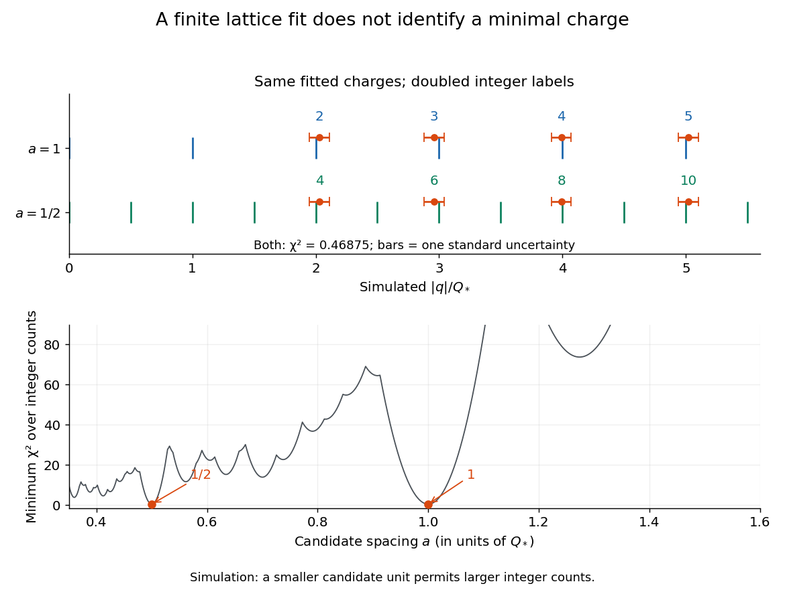
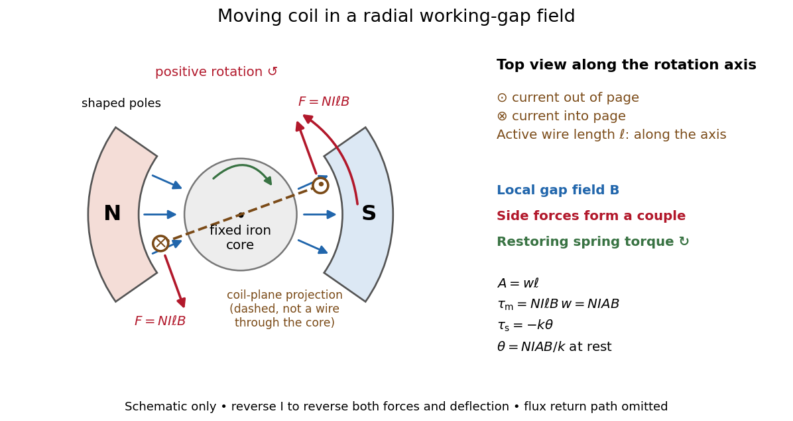

# Electric charge

↑ **Parent:** [Electromagnetism](electromagnetism.md)  
ⓦ [Wiki](https://en.wikipedia.org/wiki/Electric_charge)

[Electric charge](electric-charge.md) is an additive, signed property of matter that determines its coupling to the [electromagnetic field](electromagnetism.md#electromagnetic-field). Write a particle's [electric charge](electric-charge.md) as $q$, or a collection's total [electric charge](electric-charge.md) as $Q$; the [SI](physics.md#international-system-of-units) unit is the [coulomb](physics.md#coulomb), $\mathrm C$. A stationary test particle in an [electric field](electric-field.md) experiences [electric force](electric-field.md#electric-force) $\mathbf F=q\mathbf E$, while motion adds the magnetic part of the [Lorentz force](relativistic-electromagnetism.md#lorentz-force). [Electric charge](electric-charge.md) both produces an [electric field](electric-field.md) and determines the response to one. For two stationary point particles in [vacuum](physics.md#vacuum), [Coulomb's law](electrostatics.md#coulomb-s-law) makes like signs repel and opposite signs attract. The choice of which sign to call positive is a convention, used consistently: [protons](physics.md#proton) carry $+e$ and [electrons](physics.md#electron) carry $-e$, where $e$ is the [elementary charge](#elementary-charge). [Feynman, Leighton and Sands, II.1: electrical forces, fields and the Lorentz force](https://www.feynmanlectures.caltech.edu/II_01.html).

Additivity means adding signed [electric charges](electric-charge.md), rather than their magnitudes:

$$
Q=\sum_i q_i,\qquad Q=e(N_p-N_e)
$$

for ordinary matter containing $N_p$ [protons](physics.md#proton), $N_e$ [electrons](physics.md#electron), and electrically neutral [neutrons](neutron.md). A toy collection with seven [protons](physics.md#proton) and ten [electrons](physics.md#electron) has $Q=-3e$, however much neutral material accompanies it. [Charge neutrality](#charge-neutrality) means $Q=0$; it does not mean an absence of charged constituents. Nor does it guarantee an absence of [electric force](electric-field.md#electric-force): the spatial arrangement of positive and negative [electric charges](electric-charge.md) matters, as illustrated by an [electric dipole](electrostatics.md#electric-dipole). This makes a tiny imbalance in an otherwise nearly neutral object physically important. [Feynman, Leighton and Sands, II.1.1: neutrality, imbalance and residual electrical forces](https://www.feynmanlectures.caltech.edu/II_01.html#Ch1-S1).

[Charge conservation](#charge-conservation) states that a collection closed to transport of [electric charge](electric-charge.md) keeps its total signed $Q$. If $n$ [electrons](physics.md#electron) move from object A to object B without other exchange, then $\Delta Q_A=+ne$ and $\Delta Q_B=-ne$; the sum is unchanged. The amount of positive [electric charge](electric-charge.md) alone need not be conserved: creation of an [electron](physics.md#electron) and a [Positron](physics.md#positron) adds opposite [electric charges](electric-charge.md) with zero sum. These bookkeeping rules let us distinguish separation or transport of [electric charge](electric-charge.md) from creation of net [electric charge](electric-charge.md). [Feynman, Leighton and Sands, I.4.4: conservation of net charge](https://www.feynmanlectures.caltech.edu/I_04.html#Ch4-S4).

A simple motivating experiment uses two charge-producing paddles, a conducting pail on an insulating support, a grounded outer shield and a high-input-impedance [electrometer](#electrometer). Zero the pail, then isolate it. Rub the initially neutral paddles together, keeping their charged surfaces away from other objects. Lower each deeply into the pail without touching: the [electrometer](#electrometer) gives opposite signs. Inserting both together tests cancellation. For a separate contact test, insert one charged paddle without touching and withdraw it: the reading returns to zero. Repeat after zeroing, this time touching the inner wall before withdrawal: a residual reading shows transfer of [electric charge](electric-charge.md). Zero the pail and reinsert the paddle to test how much [electric charge](electric-charge.md) remains on it. PASCO describes these procedures in [Basic Electrostatics System manual, demonstrations 1A and 1B, printed pp. 13–16](https://cdn.pasco.com/product_document/Basic-Electrostatics-Sys-Manual-ES-9080B1.pdf#page=13).

**[Figure 1](#image-electric-charge-redistribution-versus-transfer-in-a-conducting-pail). Electric charge redistribution versus transfer in a conducting pail**. [Source](electric-charge-transfer-schematic.py). Original qualitative schematic for a positively charged inserted object. Without contact, [electrostatic induction](#electrostatic-induction) separates negative inner-surface and positive outer-surface [electric charges](electric-charge.md), while the pail's total remains zero. Contact can leave net positive [electric charge](electric-charge.md) after withdrawal. Symbols are not particle counts; no measured readings are plotted.

The crucial control is withdrawal without contact: a response during insertion can come from [electrostatic induction](#electrostatic-induction), which redistributes the pail's existing [electric charge](electric-charge.md). In the fixed-geometry approximation, the [electrometer](#electrometer) measures [electric potential difference](electric-field.md#electric-potential-difference) proportional to enclosed [electric charge](electric-charge.md), with conversion set by effective [capacitance](electromagnetism.md#capacitance); a voltage reading is not already a measurement in [coulombs](physics.md#coulomb). Opposite readings and their cancellation test additivity and [charge conservation](#charge-conservation) within resolution. Leakage or accidental contact spoils that interpretation, and contact need not transfer all the paddle's [electric charge](electric-charge.md). This macroscopic experiment cannot resolve [elementary charge](#elementary-charge) steps: that requires the much smaller particles of the [oil drop experiment](#oil-drop-experiment).

**Table of contents**

- [Electron repulsion](#electron-repulsion)
- [Free charge](#free-charge)
- [Charge invariance](#charge-invariance)
- [Space charge](#space-charge)
- [Elementary charge](#elementary-charge)
  - [Oil drop experiment](#oil-drop-experiment)
    - [Oil drop charge readout and calibration](#oil-drop-charge-readout-and-calibration)
    - [Charge lattice inference from oil drops](#charge-lattice-inference-from-oil-drops)
- [Charged particle](#charged-particle)
- [Electrometer](#electrometer)
  - [Electroscope](#electroscope)
- [Electrostatic induction](#electrostatic-induction)
- [Charge neutrality](#charge-neutrality)
  - [Gas-efflux test of charge neutrality](#gas-efflux-test-of-charge-neutrality)
- [Charge conservation](#charge-conservation)
- [Charge density](#charge-density)
  - [Linear charge density](#linear-charge-density)
  - [Line charge](#line-charge)
- [Electric current](#electric-current)
  - [Conduction current](#conduction-current)
  - [Alternating current](#alternating-current)
  - [Ballistic electron transport](#ballistic-electron-transport)
    - [Bend resistance](#bend-resistance)
      - [Nonlocal negative resistance and passivity](#nonlocal-negative-resistance-and-passivity)
      - [Chiral routing in an unequal-channel ballistic cross](#chiral-routing-in-an-unequal-channel-ballistic-cross)
      - [Unequal-channel zero-field ballistic cross](#unequal-channel-zero-field-ballistic-cross)
  - [Diffusion current](#diffusion-current)
  - [Drift current](#drift-current)
  - [Direct current](#direct-current)
  - [Ammeter](#ammeter)
  - [Galvanometer](#galvanometer)
    - [Galvanometer readout of an induction pulse](#galvanometer-readout-of-an-induction-pulse)
    - [Moving-magnet galvanometer](#moving-magnet-galvanometer)
    - [Moving-coil galvanometer](#moving-coil-galvanometer)
      - [Critical step response of a galvanometer](#critical-step-response-of-a-galvanometer)
        - [Critical galvanometer transfer function](#critical-galvanometer-transfer-function)
      - [Galvanometer radial field](#galvanometer-radial-field)
      - [Moving-coil galvanometer torque](#moving-coil-galvanometer-torque)
      - [Galvanometer current sensitivity](#galvanometer-current-sensitivity)
      - [Galvanometer calibration by half deflection](#galvanometer-calibration-by-half-deflection)
    - [Galvanometer null detection](#galvanometer-null-detection)
  - [Conventional current](#conventional-current)
  - [Ampere](#ampere)
  - [Current density](#current-density)
    - [Wire cross-sectional area](#wire-cross-sectional-area)
    - [Charge carrier](#charge-carrier)
      - [Drift velocity](#drift-velocity)
        - [Electron drift velocity](#electron-drift-velocity)
        - [Alternating-current drift excursion](#alternating-current-drift-excursion)
      - [Carrier density](#carrier-density)
      - [Charge carrier mobility](#charge-carrier-mobility)
        - [Hall mobility](#hall-mobility)
        - [Hole mobility](#hole-mobility)
        - [Electron mobility](#electron-mobility)
    - [Current dipole](#current-dipole)
      - [Radial current dipole](#radial-current-dipole)
    - [Four-current](#four-current)
    - [Surface current density](#surface-current-density)
      - [Current sheet](#current-sheet)
        - [Parallel current sheets with a resistive termination](#parallel-current-sheets-with-a-resistive-termination)
        - [Force on a current sheet from the mean magnetic field](#force-on-a-current-sheet-from-the-mean-magnetic-field)
        - [Magnetic-field jump across a surface current](#magnetic-field-jump-across-a-surface-current)
      - [Surface conductivity](#surface-conductivity)
  - [Line current](#line-current)
  - [Electromotive force](#electromotive-force)
    - [Motional electromotive force](#motional-electromotive-force)
      - [Inductive oscillation of a sliding rod on inclined rails](#inductive-oscillation-of-a-sliding-rod-on-inclined-rails)
        - [Resistive long-time drift of an inductive sliding rod](#resistive-long-time-drift-of-an-inductive-sliding-rod)
      - [Magnetic power balance on an expanding circular guide](#magnetic-power-balance-on-an-expanding-circular-guide)
      - [Electromagnetic braking of a sliding rod](#electromagnetic-braking-of-a-sliding-rod)
      - [Magnetic flux transport for a moving circuit](#magnetic-flux-transport-for-a-moving-circuit)
  - [Electrical resistance and conductance](#electrical-resistance-and-conductance)
    - [Electrical conductance](#electrical-conductance)
      - [Siemens (unit)](#siemens-unit)
    - [Electrical resistance](#electrical-resistance)
      - [Resistance quantum](#resistance-quantum)
      - [Contact resistance](#contact-resistance)
      - [Sheet resistance](#sheet-resistance)
      - [Magnetoresistance](#magnetoresistance)
        - [Colossal magnetoresistance](#colossal-magnetoresistance)
        - [Magnetic tunnel junction](#magnetic-tunnel-junction)
          - [Tunnelling magnetoresistance](#tunnelling-magnetoresistance)
            - [Density-of-states tunnelling magnetoresistance model](#density-of-states-tunnelling-magnetoresistance-model)
        - [Kohler's rule](#kohler-s-rule)
        - [Compensated two-carrier magnetoresistance](#compensated-two-carrier-magnetoresistance)
        - [Anisotropic magnetoresistance](#anisotropic-magnetoresistance)
        - [Giant magnetoresistance](#giant-magnetoresistance)
          - [Mott two-current model](#mott-two-current-model)
            - [Scattering-weighted spin-channel asymmetry](#scattering-weighted-spin-channel-asymmetry)
          - [Fe-Cr giant magnetoresistance experiments](#fe-cr-giant-magnetoresistance-experiments)
          - [Current-in-plane magnetoresistance](#current-in-plane-magnetoresistance)
            - [CIP thickness-averaged two-current model](#cip-thickness-averaged-two-current-model)
              - [GMR ratio for identical thickness-averaged layers](#gmr-ratio-for-identical-thickness-averaged-layers)
              - [Four-layer CIP sheet resistance](#four-layer-cip-sheet-resistance)
          - [Current-perpendicular-to-plane magnetoresistance](#current-perpendicular-to-plane-magnetoresistance)
            - [Two-current resistor model](#two-current-resistor-model)
              - [Magnetoresistance ratio](#magnetoresistance-ratio)
              - [Common-spacer dilution in the two-current model](#common-spacer-dilution-in-the-two-current-model)
              - [Two-current model with unequal magnetic layers](#two-current-model-with-unequal-magnetic-layers)
        - [Spin valve](#spin-valve)
          - [Spin-valve small-field sensitivity](#spin-valve-small-field-sensitivity)
          - [Spin-valve read-head noise](#spin-valve-read-head-noise)
          - [Pseudo spin valve](#pseudo-spin-valve)
      - [Strain gauge](#strain-gauge)
      - [Ohm](#ohm)
      - [Resistor](#resistor)
        - [Resistor tolerance](#resistor-tolerance)
      - [Ohm's law](#ohm-s-law)
        - [Georg Ohm](#georg-ohm)
        - [Electrical conductivity](#electrical-conductivity)
          - [Ionic conductivity](#ionic-conductivity)
            - [Haven ratio](#haven-ratio)
            - [Ionic migration barrier](#ionic-migration-barrier)
            - [Nernst-Einstein relation](#nernst-einstein-relation)
              - [Effective carrier convention in the Nernst-Einstein relation](#effective-carrier-convention-in-the-nernst-einstein-relation)
          - [Skin effect](#skin-effect)
            - [Ohmic-conductor complex wavenumber](#ohmic-conductor-complex-wavenumber)
            - [Metal coating thickness relative to skin depth](#metal-coating-thickness-relative-to-skin-depth)
            - [Skin-effect surface resistance](#skin-effect-surface-resistance)
            - [Surface impedance of a good conductor](#surface-impedance-of-a-good-conductor)
            - [Skin depth](#skin-depth)
          - [Conductivity tensor](#conductivity-tensor)
          - [Complex conductivity](#complex-conductivity)
          - [Electrical resistivity](#electrical-resistivity)
            - [Strange-metal behaviour](#strange-metal-behaviour)
            - [Resistivity tensor](#resistivity-tensor)
            - [Residual resistivity](#residual-resistivity)
            - [Matthiessen's rule](#matthiessen-s-rule)
            - [Sheet resistivity](#sheet-resistivity)
              - [Longitudinal sheet resistivity](#longitudinal-sheet-resistivity)
          - [Uniaxial conductivity tensor](#uniaxial-conductivity-tensor)
          - [Electrical conductor](#electrical-conductor)
          - [Ohmic conductor](#ohmic-conductor)
            - [Uniform current in a straight homogeneous wire](#uniform-current-in-a-straight-homogeneous-wire)
            - [Charge relaxation](#charge-relaxation)
              - [Charge relaxation in an isolated conducting cylinder](#charge-relaxation-in-an-isolated-conducting-cylinder)
          - [Drude model](#drude-model)
            - [Momentum relaxation time](#momentum-relaxation-time)
            - [Drude current relaxation](#drude-current-relaxation)
            - [Drude frequency response](#drude-frequency-response)
              - [Drude-Lorentz reflectivity minimum](#drude-lorentz-reflectivity-minimum)
                - [Carrier effective mass from a reflectivity minimum](#carrier-effective-mass-from-a-reflectivity-minimum)
            - [Drude conductivity and Hall experiment](#drude-conductivity-and-hall-experiment)
            - [High-frequency Drude plasma cutoff](#high-frequency-drude-plasma-cutoff)
        - [Joule heating](#joule-heating)
          - [Entropy balance of a thermostatted resistor](#entropy-balance-of-a-thermostatted-resistor)
          - [Resistor power under fixed drive](#resistor-power-under-fixed-drive)
          - [Local Joule heating rate](#local-joule-heating-rate)
            - [Joule-heated cylindrical wire](#joule-heated-cylindrical-wire)
              - [Newton cooling of a Joule-heated wire](#newton-cooling-of-a-joule-heated-wire)
          - [Electrical calorimetry of a resistor](#electrical-calorimetry-of-a-resistor)
          - [Watt](#watt)
      - [Negative differential resistance](#negative-differential-resistance)

## Electron repulsion

↑ **Parent:** [Electric charge](electric-charge.md)

[Electron repulsion](#electron-repulsion) is the repulsive electrostatic interaction between [electrons](physics.md#electron). In a metal complex it affects pairing costs and many-electron transition energies, so a measured absorption maximum is not always identical to a one-electron orbital splitting.

## Free charge

↑ **Parent:** [Electric charge](electric-charge.md)

In macroscopic [electromagnetism](electromagnetism.md), [free charge](#free-charge) is the part of the [charge density](#charge-density) represented explicitly as $\rho_f$, separately from [bound charge](electromagnetism.md#bound-charge) associated with the [electric polarization](electromagnetism.md#polarization-density) of matter. The [electric displacement field](electromagnetism.md#electric-displacement-field) satisfies $\nabla\cdot\mathbf D=\rho_f$. The word free does not imply zero [force](force.md) or zero [energy](energy.md): it distinguishes this source from the polarization response in the chosen material description.

## Charge invariance

↑ **Parent:** [Electric charge](electric-charge.md)  
ⓦ [Wiki](https://en.wikipedia.org/wiki/Charge_invariance)

[Charge invariance](#charge-invariance) means that the total [electric charge](electric-charge.md) of a specified collection of particles is unchanged by a [Lorentz transformation](special-relativity.md#lorentz-transformation). It differs from [conservation of electric charge](#charge-conservation), which compares the same isolated system at different times. For a convective charge distribution with rest density $\rho_0$, the [four-current](#four-current) is $J^\mu=\rho_0U^\mu$, where $U^\mu$ is its [four-velocity](special-relativity.md#four-velocity); its measured [charge density](#charge-density) increases under a boost while the simultaneous spatial volume contracts, leaving total charge unchanged.

## Space charge

↑ **Parent:** [Electric charge](electric-charge.md)  
ⓦ [Wiki](https://en.wikipedia.org/wiki/Space_charge)

[Electric charge](electric-charge.md) distributed through a region, whose own [electric field](electric-field.md) can alter the motion of further [charged particles](#charged-particle).

## Elementary charge

↑ **Parent:** [Electric charge](electric-charge.md)  
ⓦ [Wiki](https://en.wikipedia.org/wiki/Elementary_charge)

The [elementary charge](#elementary-charge) is the positive magnitude $e$ of the [electron](physics.md#electron)'s [electric charge](electric-charge.md), not the signed [electric charge](electric-charge.md) of the [electron](physics.md#electron) itself:

$$
q_{\mathrm{electron}}=-e,\qquad q_{\mathrm{proton}}=+e,\qquad e=1.602176634\times10^{-19}\,\mathrm C\quad\text{exactly in SI}.
$$

Since the 2019 revision of the [SI](physics.md#international-system-of-units), this numerical value defines the [ampere](#ampere) together with the definition of the second; $1\,\mathrm C=1\,\mathrm{A\,s}$. Thus today's numerical exactness is a choice of units, whereas measured [electric charges](electric-charge.md) still have experimental uncertainty. An [oil drop experiment](#oil-drop-experiment) can test [charge quantization](standard-model.md#charge-quantization) and the apparatus calibration; it does not supply a new uncertain defining value of $e$ in today's [SI](physics.md#international-system-of-units). [BIPM, The International System of Units, ninth edition, sections 2.2 and 2.3.1, the ampere](https://www.bipm.org/documents/20126/41483022/SI-Brochure-9-EN.pdf).

For ordinary isolated [chemical atoms](physics.md#atom-physics), [ions](chemistry.md#ion) and charged objects whose net [electric charge](electric-charge.md) is counted through [protons](physics.md#proton) and [electrons](physics.md#electron), [charge quantization](standard-model.md#charge-quantization) gives $Q=ne$ with signed [integer](integer.md) $n$. A neutral [chemical atom](physics.md#atom-physics) that loses two [electrons](physics.md#electron) becomes an [ion](chemistry.md#ion) of [electric charge](electric-charge.md) $+2e$. A toy object with $10^9$ excess [electrons](physics.md#electron) has $Q=-0.1602176634\,\mathrm{nC}$. Conversely, the scale $1\,\mathrm{nC}/e\simeq6.24\times10^9$ explains why laboratory [electric charge](electric-charge.md) often looks continuous: billions of microscopic increments fit into a small macroscopic amount. Averaged [charge density](#charge-density) is a continuum description, not a claim that each particle has an arbitrarily divisible [electric charge](electric-charge.md).

The ordinary-matter qualifier matters. In the [Standard Model](standard-model.md), [quarks](standard-model.md#quark) have [electric charges](electric-charge.md) $+2e/3$ or $-e/3$, and [antiquarks](standard-model.md#antiquark) have the opposite signs. [Confinement](standard-model.md#confinement) means these are constituents of [hadrons](physics.md#hadron), not isolated fractionally charged particles collected by an [oil drop experiment](#oil-drop-experiment). The usual valence [quark](standard-model.md#quark) sums give $2(2e/3)-e/3=e$ for a [proton](physics.md#proton) and $2e/3-2(e/3)=0$ for a [neutron](neutron.md). Thus [elementary charge](#elementary-charge) should not be defined as the smallest nonzero [electric charge](electric-charge.md) of every constituent in particle theory. [Amsler, DeGrand and Krusche, Particle Data Group, Quark Model, sections 15.1–15.2 and table 15.1](https://pdg.lbl.gov/2022/reviews/rpp2022-rev-quark-model.pdf).

The beautiful experimental idea behind the [oil drop experiment](#oil-drop-experiment) is to determine a microscopic [electric charge](electric-charge.md) by watching a visible carrier move. In his 1913 paper, Millikan timed the descent and electrically driven ascent of individual oil drops, repeatedly changing a drop's [electric charge](electric-charge.md) through capture of air [ions](chemistry.md#ion). His apparatus used parallel plates separated by $16\,\mathrm{mm}$, a roughly $5300\,\mathrm V$ source, and an optical scale to measure travel distances. He reported multiple relationships among a given drop's inferred [electric charges](electric-charge.md). He also found that uncorrected [Stokes's law](stokes-flow.md#stokes-s-law) gave a size-dependent inferred elementary unit, and introduced a pressure-dependent slip correction. These were measured relationships with calibration and model uncertainties, not exact readings of today's defined $e$. [R. A. Millikan, On the Elementary Electrical Charge and the Avogadro Constant, Physical Review 2 (1913), 109–143, especially pp. 109–112 and 115–116](https://grundpraktikum.physik.uni-saarland.de/gpalt/Anleitungen/Ergaenzungen/Versuche/Millikan/Millikan%20-%20On%20the%20Elementary%20Electrical%20Charge%20and%20the%20Avogadro%20Constant.pdf).

**[Figure 2](#image-oil-drop-experiment-apparatus-and-terminal-force-balances). Oil drop experiment: apparatus and terminal force balances**. [Source](electric-charge-oil-drop-forces.py). Original schematic for a negative drop between a positive upper plate and negative lower plate. The [electric field](electric-field.md) points downward and the [electric force](electric-field.md#electric-force) upward. [Drag](fluid-mechanics.md#drag-physics) opposes each direction of motion; [buoyancy](fluid-mechanics.md#buoyancy) remains upward. Geometry and arrow lengths are not to scale, and no historical measurements are recreated.

A modern instructional implementation sprays low-volatility oil of known [density](fluid-mechanics.md#density) through a plate aperture, illuminates the drops, and follows one through a calibrated optical scale. Measure the plate spacing $d$, [electric potential difference](electric-field.md#electric-potential-difference) $V$, air [temperature](temperature.md) and [pressure](pressure.md). Time a fixed distance $L$ with the [electric field](electric-field.md) off to get a terminal falling speed $v_f=L/t_f$. Then choose the field polarity to drive the same drop upward and measure $v_r=L/t_r$. Repeat timings at a fixed [electric charge](electric-charge.md), and compare before and after an ion-capture event. The same drop is especially useful because its [radius](topology.md#radius) and [mass](classical-mechanics.md#mass) need not be inferred anew for each charge state. [PASCO, Millikan Oil Drop Apparatus AP-8210B manual, introduction, theory and experimental procedure](https://cdn.pasco.com/product_document/Millikan-Oil-Drop-Manual-AP-8210B.pdf).

Here is the leading continuum model, retaining [buoyancy](fluid-mechanics.md#buoyancy). Assume a drop shaped as a [sphere](euclidean-geometry.md#sphere) of [radius](topology.md#radius) $a$, oil and air [densities](fluid-mechanics.md#density) $\rho_o$ and $\rho_a$, air [dynamic viscosity](dynamic-viscosity.md) $\eta$, and [gravitational acceleration](newton-s-law-of-universal-gravitation.md#gravitational-acceleration) $g$. Define the downward effective weight $W$ and positive [linear drag](fluid-mechanics.md#linear-drag) coefficient $k$ by

$$
W=\frac{4\pi a^3}{3}(\rho_o-\rho_a)g,\qquad k=6\pi\eta a,\qquad E\simeq\frac{|V|}{d}.
$$

At [terminal velocity](classical-mechanics.md#terminal-velocity), the net [force](force.md) vanishes. Falling with no [electric field](electric-field.md), the upward [drag force](fluid-mechanics.md#drag-physics) balances weight minus [buoyancy](fluid-mechanics.md#buoyancy). Rising with the [electric force](electric-field.md#electric-force) upward, the [drag force](fluid-mechanics.md#drag-physics) reverses and joins the downward effective weight:

$$
kv_f=W,\qquad |q|E=W+kv_r=k(v_f+v_r).
$$

Consequently the uncorrected estimates are

$$
a=\sqrt{\frac{9\eta v_f}{2(\rho_o-\rho_a)g}},\qquad |q|=\frac{6\pi\eta a(v_f+v_r)d}{|V|}.
$$

The observed direction of response, with known field polarity, supplies the sign of $q$. A suspended drop gives the alternative balance $|q|E=W$, but it still requires a determination of $W$: balancing a drop alone does not determine its [electric charge](electric-charge.md).

For an explicitly invented continuum example, stipulate $a=1\,\mu\mathrm m$, $\rho_o=900\,\mathrm{kg\,m^{-3}}$, $\rho_a=1.2\,\mathrm{kg\,m^{-3}}$, $\eta=1.8\times10^{-5}\,\mathrm{Pa\,s}$, $g=9.81\,\mathrm{m\,s^{-2}}$, $q=-5e$ and a downward $E=10^5\,\mathrm{V\,m^{-1}}$. The balances predict $W\simeq3.69\times10^{-14}\,\mathrm N$, $v_f\simeq0.109\,\mathrm{mm\,s^{-1}}$ and $v_r\simeq0.127\,\mathrm{mm\,s^{-1}}$. Substituting those speeds recovers $|q|=5e$ within rounding. This checks the algebra; it is not a precision prediction for real micrometre drops, which need a slip correction.

The inference has two distinct parts. Compare inferred [electric charges](electric-charge.md) or charge changes with a common unit, seeking $q_i\simeq n_i e$ within uncertainty, rather than demanding exact ratios of rounded measurements. Then establish the absolute scale through [electric field](electric-field.md), [density](fluid-mechanics.md#density), [dynamic viscosity](dynamic-viscosity.md) and distance/time calibration. If the observed steps are all even multiples, their common spacing alone cannot exclude an unobserved smaller unit. Air motion, evaporation and mistimed crossings can alter inferred [electric charge](electric-charge.md) without an ion-capture event. Small [Reynolds number](dynamic-viscosity.md#reynolds-number) supports [Stokes's law](stokes-flow.md#stokes-s-law), but does not by itself justify its no-slip continuum coefficient: a significant ratio of air [mean free path](ideal-gas.md#mean-free-path) to drop [radius](topology.md#radius) requires a slip correction. Millikan's comparison of different drop sizes and pressures addressed that systematic limitation; the modern PASCO manual also includes the correction. Agreement supports [charge quantization](standard-model.md#charge-quantization) for the observed carriers within experimental resolution, rather than proving a universal statement about every possible particle.

Multiplying $e$ by the [Avogadro constant](physics.md#avogadro-constant) gives the [Faraday constant](physics.md#faraday-constant), $F=N_Ae$, the [electric charge](electric-charge.md) per [mole](physics.md#mole-unit) of singly charged carriers. This connects counting individual [electric charges](electric-charge.md) with bulk [electrochemistry](electrochemistry.md). [NIST, CODATA 2022 defining constants and Faraday constant](https://physics.nist.gov/cuu/pdf/wall_2022.pdf).

### Oil drop experiment

↑ **Parent:** [Elementary charge](#elementary-charge)

The [oil drop experiment](#oil-drop-experiment) infers an oil drop's [electric charge](electric-charge.md) from its motion under [gravity](physics.md#gravity), [buoyancy](fluid-mechanics.md#buoyancy), [drag](fluid-mechanics.md#drag-physics) and a calibrated [electric field](electric-field.md). Repeated changes of a single drop's [electric charge](electric-charge.md) reveal discrete steps; see the model, experimental procedure and limitations in [elementary charge](#elementary-charge).

#### Oil drop charge readout and calibration

↑ **Parent:** [Oil drop experiment](#oil-drop-experiment)

[Robert Andrews Millikan](physicist.md#robert-andrews-millikan)'s 1911 protocol alternated electrically driven ascent with timed descent after short-circuiting the plates; a changed ascent [speed](classical-mechanics.md#speed) signalled [ion](chemistry.md#ion) capture.[pp. 352–353](physics-bibliography.md#the-isolation-of-an-ion-a-precision-measurement-of-its-charge-and-the-correction-of-stokes’s-law-by-robert-andrews-millikan)

His 1913 refinements checked voltage before and after runs, calibrated optical distance and the clock, compared independent air-[dynamic viscosity](dynamic-viscosity.md) measurements, and varied [pressure](pressure.md) to test slip.[pp. 112–118](physics-bibliography.md#on-the-elementary-electrical-charge-and-the-avogadro-constant-by-robert-andrews-millikan) His 1924 lecture describes suppressing [convection](convection.md), switching the [electric field](electric-field.md), neutralizing drops, and reproducing smallest observed electrical [speed](classical-mechanics.md#speed) increments.[Nobel Lectures, Physics 1922–1941; pp. 56–60](physics-bibliography.md#nobel-lectures-physics-1922-1941/the-electron-and-the-light-quant-from-the-experimental-point-of-view-by-robert-andrews-millikan)

[Harvey Fletcher](physicist.md#harvey-fletcher)'s posthumous account recalls building the first oil apparatus and measuring with [Robert Andrews Millikan](physicist.md#robert-andrews-millikan); priority for suggesting oil remains uncertain.[pp. 44–47](physics-bibliography.md#my-work-with-millikan-on-the-oil-drop-experiment-by-harvey-fletcher)

To interpret the readout, keep one drop and one [electric field](electric-field.md) polarity. Let $u_i$ be its signed upward [terminal velocity](classical-mechanics.md#terminal-velocity) in charge state $i$, and let $v_f>0$ be its field-off falling [speed](classical-mechanics.md#speed). Use the [linear drag](fluid-mechanics.md#linear-drag) coefficient $k$ already defined in [elementary charge](#elementary-charge), with any required [gas slip correction to Stokes drag](stokes-flow.md#gas-slip-correction-to-stokes-drag) included. Provided the drop's [radius](topology.md#radius), surrounding air and [electric field](electric-field.md) remain fixed, its electrical [speed](classical-mechanics.md#speed) increment is

$$
S_i=u_i+v_f,\qquad |q_i|=\frac{k}{E}S_i,\qquad
\frac{|q_i|}{|q_j|}=\frac{S_i}{S_j},\qquad
\Delta|q|=\frac{k}{E}(u_{i+1}-u_i).
$$

These relations apply while the [electric force](electric-field.md#electric-force) points upward in every state. A drop may still descend, with $u_i<0$, when that [force](force.md) is too weak to support it. A held drop has $u_i=0$ and therefore $S_i=v_f$, rather than zero electrical response. A neutral drop has $S_i=0$: its signed [terminal velocity](classical-mechanics.md#terminal-velocity) agrees with field-off descent. Thus neither raw upward [speed](classical-mechanics.md#speed) nor the ability to hold a drop is itself a count of [electrons](physics.md#electron).

The ratios cancel a fixed $k/E$, even if its value is poorly known. This is why relative [charge quantization](standard-model.md#charge-quantization) and absolute [measurement calibration](physics.md#measurement-calibration) are different questions. A changed field-off $v_f$ warns that evaporation, air motion or another change has spoiled comparison of charge states. A stable $v_f$ is useful evidence but cannot exclude every compensating change. Repeat field-off checks around a proposed jump, allow the [terminal velocity under linear drag](classical-mechanics.md#terminal-velocity-under-linear-drag) to settle after switching, and propagate [measurement uncertainty](physics.md#measurement-uncertainty) in both the field-on and field-off readings. Reusing a single estimate of $v_f$ gives the different $S_i$ a shared [covariance](variance.md#covariance).

**[Figure 3](#oil-drop-charge-jump-series). Simulated repeated electric charge states and resolved charge changes of one drop**. Original chosen noisy readings in an arbitrary reference [electric charge](electric-charge.md) $Q_*$, with four state means and their stipulated [standard uncertainties](physics.md#standard-uncertainty). These are a simulation, not measurements by [Robert Andrews Millikan](physicist.md#robert-andrews-millikan) or [Harvey Fletcher](physicist.md#harvey-fletcher). Acquisition order is not elapsed [time](classical-mechanics.md#time-in-physics); connecting lines only group observations made in the same state.

#### Charge lattice inference from oil drops

↑ **Parent:** [Oil drop experiment](#oil-drop-experiment)

An [integer](integer.md) pattern must survive the stated [measurement uncertainty](physics.md#measurement-uncertainty). For an original simulated example, choose a reference [electric charge](electric-charge.md) $Q_*>0$, define $y_i=|q_i|/Q_*$, and stipulate state means

$$
\mathbf y=(2.03,\ 2.96,\ 5.02,\ 3.99),\qquad
\sigma_i=0.08.
$$

Here each $\sigma_i$ is an independent [standard uncertainty](physics.md#standard-uncertainty) of a state mean, before shared calibration effects. The generator constructs repeated noisy observations with these means; the numbers are deliberately chosen, not historical data. There is no conversion of $Q_*$ to [coulombs](physics.md#coulomb) and no measured value of the [elementary charge](#elementary-charge) in this example.

For a candidate spacing $a>0$ in units of $Q_*$ and proposed [integers](integer.md) $n_i$, use [weighted least squares](normal-linear-model.md#weighted-least-squares):

$$
\chi^2(a,\mathbf n)=\sum_i\frac{(y_i-n_i a)^2}{\sigma_i^2},\qquad
\widehat a=\frac{\sum_i n_i y_i/\sigma_i^2}{\sum_i n_i^2/\sigma_i^2},\qquad
u(\widehat a)=\left(\sum_i\frac{n_i^2}{\sigma_i^2}\right)^{-1/2}.
$$

The last two expressions follow by differentiating the quadratic in $a$ and propagating the independent errors. They are conditional on fixed, correct [integer](integer.md) assignments and the stated error model. They do not include uncertainty from choosing those assignments. For $\mathbf n=(2,3,5,4)$, they give $\widehat a=1$, $u(\widehat a)\simeq0.01089$, and $\chi^2=0.46875$. Such a small residual is compatible with this chosen error scale; it is not evidence that the errors vanish. A [chi-squared distribution](probability-distribution.md#chi-squared-distribution) interpretation additionally needs the appropriate [normal distribution](probability-distribution.md#normal-distribution) error model and allowance for the fitted parameter; searching many assignments changes that interpretation.

**[Figure 4](#oil-drop-charge-lattice-identifiability). Finite noisy electric charges fit a candidate unit and its subdivisions**. Original calculation for the simulated state means above. Horizontal bars show one [standard uncertainty](physics.md#standard-uncertainty). Both spacings $a=1$ and $a=1/2$ have exactly the same fitted locations and residuals when the [integer](integer.md) labels double. The lower curve minimizes over [integers](integer.md) separately at every candidate spacing; a low residual alone cannot identify the [elementary charge](#elementary-charge).

The obstruction is [identifiability](statistical-model.md#identifiability): replacing $(a,n_i)$ by $(a/m,mn_i)$ for any positive [integer](integer.md) $m$ leaves every predicted reading unchanged. In particular, an $e$-spaced pattern also fits an $e/2$ lattice using even indices. Even the coarsest well-fitting spacing need not be the physical unit: a dataset containing only even charge states can have twice that unit. Worse, if arbitrarily fine spacings and unrestricted [integers](integer.md) are allowed, rounding each $y_i/a$ gives

$$
\min_{\mathbf n}\chi^2(a,\mathbf n)
\leq\frac{a^2}{4}\sum_i\frac1{\sigma_i^2}\longrightarrow0
\quad\text{as }a\longrightarrow0.
$$

Consequently a finite fit cannot prove a minimal transferable [electric charge](electric-charge.md). Reproducible smallest observed jumps supply additional evidence; interpreting them as single-carrier transfers requires independent physical support. One visibly abrupt transition could contain several unresolved transfers. In the simulation the successive differences are $0.93$, $2.06$, and $-1.03$, each with [standard uncertainty](physics.md#standard-uncertainty) $\sqrt2(0.08)\simeq0.1131$. These support changes near $a,2a,-a$ conditional on that unit; they equally support $2,4,-2$ units of $a/2$. Neighboring differences share a state reading and are therefore correlated, even though the state means were stipulated independent.

A shared scale error can preserve every apparent [integer](integer.md) relation. To first order, an independent fractional scale [standard uncertainty](physics.md#standard-uncertainty) $s$ adds $s^2a^2n_i n_j$ to the [covariance matrix](variance.md#covariance-matrix) of the $y_i$. For the simulation, stipulating $s=0.02$ changes the conditional uncertainty of $\widehat a$ to approximately $\sqrt{0.01089^2+0.02^2}=0.02277$, despite the same residual pattern. Repeating timings cannot average away this common scale contribution. In the uncorrected continuum model in [elementary charge](#elementary-charge), holding the other measured inputs fixed gives $|q|\propto\eta^{3/2}$, so a small fractional error in air [dynamic viscosity](dynamic-viscosity.md) causes $3/2$ times that fractional error in inferred [electric charge](electric-charge.md). The [gas slip correction to Stokes drag](stokes-flow.md#gas-slip-correction-to-stokes-drag) requires its own propagation. Pattern agreement, drop-stability controls and absolute [measurement calibration](physics.md#measurement-calibration) together make the inference persuasive within resolution.

## Charged particle

↑ **Parent:** [Electric charge](electric-charge.md)  
ⓦ [Wiki](https://en.wikipedia.org/wiki/Charged_particle)

A [charged particle](#charged-particle) carries nonzero [electric charge](electric-charge.md).

## Electrometer

↑ **Parent:** [Electric charge](electric-charge.md)

An [electrometer](#electrometer) measures small [electric potential differences](electric-field.md#electric-potential-difference) or [electric charges](electric-charge.md) while drawing very little [electric current](#electric-current). The conducting-pail experiment in [electric charge](electric-charge.md) uses a voltage response to infer [electric charge](electric-charge.md) with a fixed effective [capacitance](electromagnetism.md#capacitance).

### Electroscope

↑ **Parent:** [Electrometer](#electrometer)  
ⓦ [Wiki](https://en.wikipedia.org/wiki/Electroscope)

An [electroscope](#electroscope) indicates [electric charge](electric-charge.md) through the deflection of conducting leaves or fibers.

## Electrostatic induction

↑ **Parent:** [Electric charge](electric-charge.md)

[Electrostatic induction](#electrostatic-induction) is redistribution of [electric charge](electric-charge.md) in response to an external charged object. An isolated [electrical conductor](#electrical-conductor) can acquire positive and negative surface regions while its total [electric charge](electric-charge.md) stays fixed; see the contact control in [electric charge](electric-charge.md).

## Charge neutrality

↑ **Parent:** [Electric charge](electric-charge.md)

A system is charge neutral when its total positive and negative [electric charge](electric-charge.md) cancel.

### Gas-efflux test of charge neutrality

↑ **Parent:** [Charge neutrality](#charge-neutrality)

A sensitive [charge neutrality](#charge-neutrality) test lets nominally neutral gas escape from an electrically isolated vessel connected to an [electrometer](#electrometer). A net charge per escaping molecule would leave a measurable opposite charge on the vessel. Removing stray ions and charged particles is essential. Hydrogen and helium measurements constrain charge imbalance despite different particle binding and internal motions, providing evidence for velocity-independent additive charge rather than a charge proportional to relativistic particle energy. The 1960 experiment used this efflux principle. [Search for a Small Charge Carried by Molecules (1960), gas-efflux apparatus and hydrogen/helium measurements](https://doi.org/10.1103/PhysRevLett.5.562)

## Charge conservation

↑ **Parent:** [Electric charge](electric-charge.md)  
ⓦ [Wiki](https://en.wikipedia.org/wiki/Charge_conservation)

[Charge conservation](#charge-conservation) says that the total signed [electric charge](electric-charge.md) of an isolated collection stays constant. More generally, a collection closed to [electric charge](electric-charge.md) exchange has constant total [electric charge](electric-charge.md), even if [energy](energy.md) crosses its boundary. This is the charge bookkeeping relevant to a [closed system](thermodynamics.md#closed-system) or an [isolated system](thermodynamics.md#isolated-system); isolation from [energy](energy.md) exchange is not required. Positive and negative [electric charge](electric-charge.md) count with opposite signs. Creating or removing an [electron](physics.md#electron) and a [Positron](physics.md#positron) together is compatible with [charge conservation](#charge-conservation), because their combined [electric charge](electric-charge.md) is zero. [Feynman, Leighton and Sands, The Feynman Lectures on Physics, I.4.4: net charge conservation](https://www.feynmanlectures.caltech.edu/I_04.html#Ch4-S4).

Imagine a fixed box initially containing [electric charge](electric-charge.md) $Q(0)=10\,\mu\mathrm C$. Stipulate incoming [conventional current](#conventional-current) $I_{\mathrm{in}}=3\,\mu\mathrm A$ and outgoing [conventional current](#conventional-current) $I_{\mathrm{out}}=1\,\mu\mathrm A$ throughout $0\le t\le2\,\mathrm s$, with no other boundary transport. Since one [ampere](#ampere) is one [coulomb](physics.md#coulomb) per second, the stored [electric charge](electric-charge.md) grows at $2\,\mu\mathrm{C/s}$:

$$
\frac{dQ}{dt}=I_{\mathrm{in}}-I_{\mathrm{out}}=2\,\mu\mathrm{C/s},\qquad Q(t)=10\,\mu\mathrm C+(2\,\mu\mathrm{C/s})t,\qquad Q(2\,\mathrm s)=14\,\mu\mathrm C.
$$

If instead the outgoing [electric current](#electric-current) also equals $3\,\mu\mathrm A$, the stored [electric charge](electric-charge.md) remains $10\,\mu\mathrm C$ while [electric charge](electric-charge.md) passes through. These are stipulated transport examples; constant terminal [electric currents](#electric-current) alone do not guarantee a time-independent interior [charge density](#charge-density).

**[Figure 5](#image-signed-electric-current-through-a-fixed-control-volume). Signed electric current through a fixed control volume**. [Source](charge-conservation-control-volume.py). The dashed box is an accounting boundary. Outward [unit normals](differential-geometry.md#unit-normal) point left at the inlet and right at the outlet: the respective contributions to outward [electric current](#electric-current) are $-I_{\mathrm{in}}$ and $+I_{\mathrm{out}}$. Arrow lengths are schematic.

**[Figure 6](#image-stored-electric-charge-with-unequal-and-balanced-terminal-electric-currents). Stored electric charge with unequal and balanced terminal electric currents**. [Source](charge-storage-versus-steady-current.py). Synthetic curves from the stipulated rates over $0\le t\le2\,\mathrm s$, with the same initial [electric charge](electric-charge.md); these are not measurements. Balanced transport keeps total [electric charge](electric-charge.md) fixed, and is compatible with steady transport.

Locally, [charge conservation](#charge-conservation) is the [charge continuity equation](maxwell-equations.md#charge-continuity-equation), an instance of the general [continuity equation](mathematical-physics.md#continuity-equation):

$$
\partial_t\rho+\nabla\cdot\mathbf J=0.
$$

Here $\rho(\mathbf r,t)$ is signed volume [charge density](#charge-density) and $\mathbf J(\mathbf r,t)$ is [current density](#current-density). A positive [divergence](multivariable-calculus.md#divergence) of [current density](#current-density) means net outward transport from a small neighborhood, so its [charge density](#charge-density) decreases. For a fixed [control volume](fluid-mechanics.md#control-volume) $V$ with [closed surface](smooth-manifold.md#closed-surface) $\partial V$ and outward [unit normal](differential-geometry.md#unit-normal) $\mathbf n$, the equivalent integrated balance is

$$
Q_V(t)=\int_V\rho\,dV,\qquad \frac{dQ_V}{dt}=-\oint_{\partial V}\mathbf J\cdot\mathbf n\,dA=-I_{\mathrm{out,net}}.
$$

The [surface integral](multivariable-calculus.md#surface-integral) is signed: incoming positive [electric charge](electric-charge.md) contributes negatively to outward [electric current](#electric-current), and outgoing positive [electric charge](electric-charge.md) contributes positively. Integrate the [charge continuity equation](maxwell-equations.md#charge-continuity-equation) over fixed $V$ and apply the [divergence theorem](multivariable-calculus.md#divergence-theorem) to obtain this balance. Zero net boundary transport gives constant $Q_V$; the global and local statements describe the same [conservation law](mathematical-physics.md#conservation-law) at different scales. [Feynman, Leighton and Sands, II.13.2: local and integrated charge conservation](https://www.feynmanlectures.caltech.edu/II_13.html#Ch13-S2).

In a steady transport state, [charge density](#charge-density) and [current density](#current-density) are time-independent, so the [charge continuity equation](maxwell-equations.md#charge-continuity-equation) reduces to $\nabla\cdot\mathbf J=0$. At an [electrical circuit](electrical-circuit.md) junction, choose each terminal [electric current](#electric-current) $I_k$ positive outward and assume the terminals account for all boundary transport. Then

$$
\sum_k I_k=-\frac{dQ_{\mathrm{junction}}}{dt}.
$$

[Kirchhoff's current law](random-walk.md#kirchhoff-node-law), $\sum_k I_k=0$, follows when accumulation of [electric charge](electric-charge.md) at the junction is negligible. During storage, retain the same balance with its nonzero [derivative](calculus.md#derivative); [charge conservation](#charge-conservation) continues to hold. This makes [charge conservation](#charge-conservation) useful for checking [electrical circuit](electrical-circuit.md) models and for tracking the charging of a [capacitor](electromagnetism.md#capacitor). [Ling, Sanny and Moebs, University Physics II, §10.3: Kirchhoff's junction rule](https://openstax.org/books/university-physics-volume-2/pages/10-3-kirchhoffs-rules).

The beautiful consistency with [Maxwell equations](maxwell-equations.md) is that the [electric field](electric-field.md) and [magnetic field](magnetic-field.md) already enforce this transport balance. For sufficiently smooth fields in vacuum [SI](physics.md#international-system-of-units), take the [divergence](multivariable-calculus.md#divergence) of the [Ampère-Maxwell equation](maxwell-equations.md#ampere-s-circuital-law), use that the [divergence of a curl is zero](multivariable-calculus.md#divergence-of-a-curl-is-zero), and substitute [Gauss's law](maxwell-equations.md#gauss-s-law), $\nabla\cdot\mathbf E=\rho/\epsilon_0$. Constant [vacuum permittivity](permittivity.md#vacuum-permittivity) $\epsilon_0$ gives

$$
0=\nabla\cdot\mathbf J+\epsilon_0\partial_t(\nabla\cdot\mathbf E)=\nabla\cdot\mathbf J+\partial_t\rho.
$$

The [displacement current](maxwell-equations.md#displacement-current) term supplies the part needed when [electric charge](electric-charge.md) accumulates. Historically, Maxwell added that term to extend the steady-current equation; see the existing [charge conservation from Maxwell equations](maxwell-equations.md#charge-conservation-from-maxwell-equations) for this connection. [Feynman, Leighton and Sands, II.18.1: Maxwell's added term and charge conservation](https://www.feynmanlectures.caltech.edu/II_18.html#Ch18-S1).

## Charge density

↑ **Parent:** [Electric charge](electric-charge.md)  
ⓦ [Wiki](https://en.wikipedia.org/wiki/Charge_density)

Charge density is electric charge per unit volume, area, or length according to the dimension of its support.

### Linear charge density

↑ **Parent:** [Charge density](#charge-density)

Linear charge density is [electric charge](electric-charge.md) divided by length along a charged line, or locally $dQ/d\ell$. Its SI unit is coulombs per metre. For a uniformly charged long cylindrical conductor, it equals the total [surface charge density](electrostatics.md#surface-charge-density) integrated around the cylinder's circumference; it need not represent a charge literally supported on a one-dimensional line.

### Line charge

↑ **Parent:** [Charge density](#charge-density)

A line charge is a charge distribution idealized as lying on a curve, described by charge per unit length. An infinite straight line with constant density $\mu$ produces the radial [electric field](electric-field.md) $E_r=\mu/(2\pi\varepsilon_0r)$ by [Gauss's law](maxwell-equations.md#gauss-s-law), and a logarithmic [electrostatic potential](electric-field.md#electric-potential).

## Electric current

↑ **Parent:** [Electric charge](electric-charge.md)  
ⓦ [Wiki](https://en.wikipedia.org/wiki/Electric_current)

An [electric current](#electric-current) measures how quickly signed [electric charge](electric-charge.md) crosses a chosen fixed [oriented surface](differential-geometry.md#oriented-surface) $S$. Choose its [unit normal](differential-geometry.md#unit-normal) $\mathbf n$; positive [electric charge](electric-charge.md) crossing along $\mathbf n$ counts positively, while crossing against it counts negatively. If $Q_{\mathrm{cross}}(t)$ is the accumulated signed [electric charge](electric-charge.md) transported through $S$, then

$$
I_S(t)=\frac{dQ_{\mathrm{cross}}}{dt}=\int_S\mathbf J(\mathbf r,t)\cdot\mathbf n\,dA,\qquad Q_{\mathrm{cross}}(t_2)-Q_{\mathrm{cross}}(t_1)=\int_{t_1}^{t_2}I_S(t)\,dt.
$$

Here $\mathbf J$ is the [current density](#current-density); the [surface integral](multivariable-calculus.md#surface-integral) collects its local normal contributions. Reversing the [unit normal](differential-geometry.md#unit-normal) reverses $I_S$. The [electric current](#electric-current) is a signed [scalar](vector-space.md#scalar) associated with the whole chosen [oriented surface](differential-geometry.md#oriented-surface), whereas [current density](#current-density) is a [vector](vector-space.md#vector) at each point. The [SI](physics.md#international-system-of-units) unit is the [ampere](#ampere), one [coulomb](physics.md#coulomb) per second. [Ling, Sanny and Moebs, University Physics II, §9.1: transported charge and current](https://openstax.org/books/university-physics-volume-2/pages/9-1-electrical-current); [Ling, Sanny and Moebs, §9.2: current density and its surface integral](https://openstax.org/books/university-physics-volume-2/pages/9-2-model-of-conduction-in-metals).

For a constant [electric current](#electric-current) of $2\,\mathrm A$ over a [time](classical-mechanics.md#time-in-physics) interval of $3\,\mathrm s$, the transported [electric charge](electric-charge.md) is $6\,\mathrm C$. This need not be [electric charge](electric-charge.md) accumulating in the wire: in steady transport, [electric charge](electric-charge.md) enters and leaves. For a closed [oriented surface](differential-geometry.md#oriented-surface) with outward [unit normal](differential-geometry.md#unit-normal), [electric charge conservation](#charge-conservation) instead gives $I_{\mathrm{out}}=-dQ_{\mathrm{inside}}/dt$. Keeping transported and enclosed [electric charge](electric-charge.md) distinct connects [electrical circuit](electrical-circuit.md) bookkeeping to the local [continuity equation](mathematical-physics.md#continuity-equation).

### Conduction current

↑ **Parent:** [Electric current](#electric-current)

A [conduction current](#conduction-current) is transport of [electric charge](electric-charge.md) by mobile carriers through matter. For a local isotropic ohmic medium, its [current density](#current-density) is $\mathbf J_c=\sigma\mathbf E$, with [electrical conductivity](#electrical-conductivity) $\sigma$. It differs from [displacement current](maxwell-equations.md#displacement-current) $\partial\mathbf D/\partial t$, which can be nonzero in a capacitor's insulating gap without carriers crossing the gap.

### Alternating current

↑ **Parent:** [Electric current](#electric-current)

An [electric current](#electric-current) that reverses direction periodically. A sinusoidal alternating current has the displayed form, where $I_0$ is its peak [amplitude](wave.md#wave-amplitude), $\omega$ its [angular frequency](lagrangian-mechanics.md#angular-frequency), and $\varphi$ its phase.

### Ballistic electron transport

↑ **Parent:** [Electric current](#electric-current)

Electronic propagation through a device region with few momentum-randomizing scattering events. The [mean free path](ideal-gas.md#mean-free-path) should exceed the relevant trajectory length. Boundary specularity and aperture geometry can matter separately from the bulk mobility; [electron phase coherence](density-matrix.md#electron-phase-coherence) is an additional condition for interference.

#### Bend resistance

↑ **Parent:** [Ballistic electron transport](#ballistic-electron-transport)

A four-terminal [bend resistance](#bend-resistance) uses adjacent current contacts and the other adjacent pair as [voltage](random-walk.md#voltage) probes. It can be negative when a ballistic injector preferentially populates the opposite [voltage](random-walk.md#voltage) probe. Its sign is a nonlocal routing property, not the sign of the total electrical dissipation.

##### Nonlocal negative resistance and passivity

↑ **Parent:** [Bend resistance](#bend-resistance)

For a balanced nonnegative transmission matrix and $I_i=g_0(N_iV_i-\sum_jT_{ij}V_j)$, electrical power obeys

$$
\sum_iI_iV_i=\frac{g_0}{2}\sum_{ij}T_{ij}(V_i-V_j)^2\ge0,
$$

with diagonal reflection included consistently or removed from both sides. A negative four-terminal voltage-to-current ratio is compatible with this positive total power because the measured [voltage](random-walk.md#voltage) pair is not the current source's pair.

##### Chiral routing in an unequal-channel ballistic cross

↑ **Parent:** [Bend resistance](#bend-resistance)

For left-deflected injection in the left 1,top 2,right 3,bottom 4 geometry, use 1 to 2 with $M$ [modes](probability-and-statistics.md#mode-statistics), 2 to 3 with $M$, 3 to 4 with $N$, and 4 to 1 with $M$ plus 4 to 3 with $N-M$. The zero-current probes give $V_2=V_1$ and $V_3=MV_1/N$, hence $R_{14,23}=(h/e^2)(1/M-1/N)$. Reversing the transmission matrix gives equal probe potentials and zero [bend resistance](#bend-resistance). Fixed-lead resistance need not be even in field; reciprocity also exchanges current and [voltage](random-walk.md#voltage) pairs.

##### Unequal-channel zero-field ballistic cross

↑ **Parent:** [Bend resistance](#bend-resistance)

Number the leads left 1,top 2,right 3,bottom 4. Let narrow leads 1,2 have $M$ spin-resolved [modes](probability-and-statistics.md#mode-statistics) and wide leads 3,4 have $N>M$. Straight-through injection sends $M$ [modes](probability-and-statistics.md#mode-statistics) between 1 and 3 and between 2 and 4; each excess $N-M$ [mode](probability-and-statistics.md#mode-statistics) connects 3 and 4. With current 1 to 4, $V_4=0$ and zero current at 2,3, $V_2=0$, $V_3=MV_1/N$ and $I=(e^2/h)M(N-M)V_1/N$. Thus $R_{14,23}=-h/[e^2(N-M)]$. At $N=M$ this ideal network disconnects the current source from its drain.

### Diffusion current

↑ **Parent:** [Electric current](#electric-current)

A [diffusion current](#diffusion-current) results from a spatial [carrier density](#carrier-density) gradient. For semiconductor electrons and holes in one dimension, conventional-current densities are $J_n=eD_n\,dn/dx$ and $J_p=-eD_p\,dp/dx$. Their different signs reflect negative and positive carrier charge. At equilibrium each species' [diffusion current](#diffusion-current) is balanced by its [drift current](#drift-current), giving zero net current while the individual transport contributions need not vanish.

### Drift current

↑ **Parent:** [Electric current](#electric-current)

A [drift current](#drift-current) is an [electric current](#electric-current) caused by the response of mobile charge carriers to an [electric field](electric-field.md). It is distinct from the [diffusion](thermodynamics.md#diffusion) contribution due to concentration gradients. At equilibrium in a [p-n junction](semiconductor.md#p-n-junction), the two contributions cancel although each can be nonzero.

### Direct current

↑ **Parent:** [Electric current](#electric-current)  
ⓦ [Wiki](https://en.wikipedia.org/wiki/Direct_current)

A [direct current](#direct-current) is an [electric current](#electric-current) that flows in one direction; its magnitude may vary with [time](classical-mechanics.md#time-in-physics). A constant or steady [electric current](#electric-current) additionally has a value independent of [time](classical-mechanics.md#time-in-physics). Thus a [direct current](#direct-current) need not be constant. The steady [direct current](#direct-current) model of a [voltage divider](electrical-engineering.md#voltage-divider) assumes a constant input [electric potential difference](electric-field.md#electric-potential-difference) and fixed [electrical resistances](#electrical-resistance).

### Ammeter

↑ **Parent:** [Electric current](#electric-current)

An [ammeter](#ammeter) measures [electric current](#electric-current) through a branch of an [electrical circuit](electrical-circuit.md). Connect it in series; its own finite [electrical resistance](#electrical-resistance) changes the measured branch's [electric current](#electric-current) unless that effect is negligible or corrected.[Measuring Current with an Ammeter, Figure 10.35 and following paragraph: connection and loading](physics-bibliography.md#university-physics-volume-2-by-samuel-j-ling-and-others/10-4-electrical-measuring-instruments)

### Galvanometer

↑ **Parent:** [Electric current](#electric-current)

A [galvanometer](#galvanometer) detects [electric current](#electric-current) through a mechanical response, such as the deflection of a pointer.[Analog and Digital Meters: current-driven pointer response](physics-bibliography.md#university-physics-volume-2-by-samuel-j-ling-and-others/10-4-electrical-measuring-instruments)

A sensitive [galvanometer](#galvanometer) makes a small [electric current](#electric-current) visible; a calibrated deflection also estimates its magnitude. A center-zero scale distinguishes both signs of [electric current](#electric-current). The [moving-coil galvanometer](#moving-coil-galvanometer) rotates a coil in an imposed [magnetic field](magnetic-field.md), whereas a [moving-magnet galvanometer](#moving-magnet-galvanometer) rotates a magnetic needle in the coil's [magnetic field](magnetic-field.md). The spring-balanced model below describes the [moving-coil galvanometer](#moving-coil-galvanometer), not every instrument called a [galvanometer](#galvanometer).

#### Galvanometer readout of an induction pulse

↑ **Parent:** [Galvanometer](#galvanometer)

A small-angle [galvanometer](#galvanometer) model combines its [moment of inertia](rigid-body-dynamics.md#moment-of-inertia) $J_g$, [damping](wave-equation.md#damping) coefficient $b_g$ and restoring coefficient $\kappa_g$ with a torque per [electric current](#electric-current) $K_g$. The resulting [damped harmonic oscillator](analysis.md#damped-harmonic-oscillator) responds to the current pulse through the displayed equation. Its angular deflection $\theta$ can continue after the driving [electric current](#electric-current) has ceased. Inferring the current's detailed time dependence requires the instrument response, rather than equating needle angle with instantaneous current. This is a generic readout model, not a calibration of Faraday's historical instrument.

#### Moving-magnet galvanometer

↑ **Parent:** [Galvanometer](#galvanometer)

#### Moving-coil galvanometer

↑ **Parent:** [Galvanometer](#galvanometer)

A [moving-coil galvanometer](#moving-coil-galvanometer) has a winding that rotates about an axis, a restoring spring, and a pointer or optical readout. In the radial-field construction, a cylindrical iron core and shaped magnetic poles keep the [magnetic field](magnetic-field.md) approximately in the coil's plane as it turns. The resulting [moving-coil galvanometer torque](#moving-coil-galvanometer-torque) is nearly independent of the deflection [angle](geometry-and-topology.md#angle); the spring then converts [electric current](#electric-current) into a proportional settled deflection. [Physics Part I, Class XII, §4.10, printed pp. 129–130, Figure 4.20 and equation (4.26): radial field, iron core, spring and pointer](physics-bibliography.md#physics-part-i-class-xii/moving-charges-and-magnetism)

**[Figure 7](#galvanometer-radial-field-coil-torque). Radial gap field and the force couple on a moving coil**. [Source](galvanometer-radial-field-coil-torque.py). Original top-view schematic: the active wire lengths run perpendicular to the page. Dots indicate outward [conventional current](#conventional-current), crosses inward [conventional current](#conventional-current). Blue arrows show the local [magnetic field](magnetic-field.md); red arrows show the [magnetic force on a current-carrying wire](relativistic-electromagnetism.md#magnetic-force-on-a-current-carrying-wire). Their [force couple](momentum.md#couple-mechanics) turns the coil counterclockwise for the illustrated positive [electric current](#electric-current); the spring supplies the opposite [torque](momentum.md#torque). Only the working gaps are shown, not the complete [magnetic field lines](magnetic-field.md#magnetic-field-line).

##### Critical step response of a galvanometer

↑ **Parent:** [Moving-coil galvanometer](#moving-coil-galvanometer)

For $\ddot\theta+2\omega_0\dot\theta+\omega_0^2\theta=F$ switched on from rest, $\theta(t)=(F/\omega_0^2)[1-(1+\omega_0t)e^{-\omega_0t}]$. [critical damping](wave-equation.md#critical-damping) is the fastest nonoscillatory [step response](control-theory.md#step-response) at fixed [natural frequency](classical-mechanics.md#natural-frequency) within the ordinary second-order model.

###### Critical galvanometer transfer function

↑ **Parent:** [Critical step response of a galvanometer](#critical-step-response-of-a-galvanometer)

With $e^{i\omega t}$ [phasors](wave.md#phasor), [critical damping](wave-equation.md#critical-damping) gives $\Theta(\omega)=F_0/(\omega_0+i\omega)^2$, [amplitude](wave.md#wave-amplitude) $F_0/(\omega_0^2+\omega^2)$ and [phase](wave.md#phase-waves) $-2\arctan(\omega/\omega_0)$. The response strongly suppresses [alternating currents](#alternating-current) well above the mechanical [frequency](wave.md#frequency).

##### Galvanometer radial field

↑ **Parent:** [Moving-coil galvanometer](#moving-coil-galvanometer)

A [galvanometer radial field](#galvanometer-radial-field) is approximately radial about the rotation axis within each narrow working gap. Its direction follows the moving sides of the coil over the useful sweep. Here the [magnetic field](magnetic-field.md) points from the left pole toward the core and from the core toward the right pole; it is not outward everywhere. This geometry keeps the [magnetic force on a current-carrying wire](relativistic-electromagnetism.md#magnetic-force-on-a-current-carrying-wire) tangential, with nearly constant [lever arm](momentum.md#lever-arm). A spatially uniform [magnetic field](magnetic-field.md) in a fixed direction would instead give an [angle](geometry-and-topology.md#angle)-dependent [torque](momentum.md#torque) as the coil turns.

##### Moving-coil galvanometer torque

↑ **Parent:** [Moving-coil galvanometer](#moving-coil-galvanometer)

For a rectangular winding with $N$ turns, active side [length](physics.md#length) $\ell$, side separation $w$, and per-turn [area](differential-geometry.md#surface-area) $A=w\ell$, the [magnetic force on a current-carrying wire](relativistic-electromagnetism.md#magnetic-force-on-a-current-carrying-wire) gives equal and opposite side [forces](force.md) of magnitude $N|I|\ell B$. Their [force couple](momentum.md#couple-mechanics) has [lever arm](momentum.md#lever-arm) $w$. Choosing the positive rotation to match positive [electric current](#electric-current) in the illustration gives the signed [torque](momentum.md#torque) and spring balance

$$
\tau_{\mathrm m}=NIAB,\qquad \tau_{\mathrm s}=-k\theta,\qquad NIAB-k\theta=0,\qquad \theta=\frac{NAB}{k}I.
$$

Here $B$ is the working-gap [magnetic flux density](magnetic-field.md), $k>0$ is the [torsional spring constant](classical-mechanics.md#torsion-constant) in $\mathrm{N\,m/rad}$, and $\theta$ is the deflection [angle](geometry-and-topology.md#angle) in [radians](geometry-and-topology.md#radian) from the no-current zero. The balance holds after motion has settled, within the radial-field and [linear elasticity](elasticity-physics.md#linear-elasticity) ranges. Do not identify $\theta$ with the [angle](geometry-and-topology.md#angle) between a [magnetic dipole moment](electromagnetism.md#magnetic-dipole-moment) and a fixed uniform [magnetic field](magnetic-field.md): that different geometry has [torque](momentum.md#torque) magnitude $NIAB|\sin\alpha|$. [§4.9.1, equations (4.20)–(4.24), and §4.10, equation (4.26): fixed-field versus radial-field torque](physics-bibliography.md#physics-part-i-class-xii/moving-charges-and-magnetism)

For an original illustrative design, choose $N=120$, $A=3.00\times10^{-4}\,\mathrm{m^2}$, $B=0.250\,\mathrm T$, and $k=3.00\times10^{-6}\,\mathrm{N\,m/rad}$. Then $NAB=9.00\times10^{-3}\,\mathrm{N\,m/A}$. At $I=+40.0\,\mathrm{\mu A}$, the magnetic [torque](momentum.md#torque) is $+3.60\times10^{-7}\,\mathrm{N\,m}$ and $\theta=+0.120\,\mathrm{rad}\simeq+6.88^\circ$. Reversing the [electric current](#electric-current) reverses both the [torque](momentum.md#torque) and the deflection, giving $-6.88^\circ$ without changing the [magnetic field](magnetic-field.md).

##### Galvanometer current sensitivity

↑ **Parent:** [Moving-coil galvanometer](#moving-coil-galvanometer)

The [galvanometer current sensitivity](#galvanometer-current-sensitivity) is the change in settled deflection [angle](geometry-and-topology.md#angle) per change in [electric current](#electric-current). In the linear model its [derivative](calculus.md#derivative) is constant, $S_I=NAB/k$. The illustrative design has $S_I=3000\,\mathrm{rad/A}$, or $0.1719^\circ$ per $\mathrm{\mu A}$. A chosen full-scale [angle](geometry-and-topology.md#angle) $\theta_{\max}=0.180\,\mathrm{rad}$ corresponds to $|I|=60.0\,\mathrm{\mu A}$; a straight-line extrapolation beyond that range does not establish real instrument behavior.

**[Figure 8](#galvanometer-calibrated-deflection-current). Illustrative moving-coil calibration, current reversal and finite zero resolution**. [Source](galvanometer-calibrated-deflection-current.py). Calculated deflection for the original design, with selected calibration points and a close view of zero. The shaded band is a stipulated $\pm0.10^\circ$ readout tolerance, corresponding to about $\pm0.582\,\mathrm{\mu A}$; it is not measured noise. Values and points are illustrative model predictions, not observations from a real instrument.

Finite sensitivity and finite readable [angle](geometry-and-topology.md#angle) set different limits. Under the stipulated $0.10^\circ$ tolerance, a reading indistinguishable from zero means $|I|\lesssim0.582\,\mathrm{\mu A}$ only if the zero is stable and the model applies. More turns can increase [galvanometer current sensitivity](#galvanometer-current-sensitivity) while also increasing winding [electrical resistance](#electrical-resistance); the response to an applied [electric potential difference](electric-field.md#electric-potential-difference) depends on both. [Friction](newtonian-mechanics.md#friction), zero drift, departures from the radial [magnetic field](magnetic-field.md), and spring nonlinearity can spoil the calibration. [Damping](wave-equation.md#damping) sets how long one must wait for a settled reading. A rapidly reversing [electric current](#electric-current) can produce little mean pointer deflection even when its instantaneous magnitude is large.

##### Galvanometer calibration by half deflection

↑ **Parent:** [Moving-coil galvanometer](#moving-coil-galvanometer)

NCERT's teaching experiment uses a [moving-coil galvanometer](#moving-coil-galvanometer), a 0–6 V supply, a 0–10 kΩ series [electrical resistance](#electrical-resistance) box $R$, a 0–200 Ω parallel [electrical resistance](#electrical-resistance) box $S$, two switches and a [voltmeter](electric-field.md#voltmeter). With the parallel path open, close the supply switch and record the pointer deflection. Keep $R$ fixed, close the parallel path, and adjust $S$ until the deflection halves. The guide requests repeated settings, clean tight contacts and constant supply [electromotive force](#electromotive-force); it introduces high $R$ before energizing to protect the winding. [Experiment 6, printed pp. 53–58: Figure E 6.1, Procedure 1–5, Precautions and Sources of Errors](physics-bibliography.md#laboratory-manual-physics-class-xii/experiment-6-resistance-and-figure-of-merit-of-a-galvanometer)

Write the winding [electrical resistance](#electrical-resistance) as $R_g$, the supply [electromotive force](#electromotive-force) as $E$, and assume negligible supply internal [electrical resistance](#electrical-resistance). [Ohm's law](#ohm-s-law) gives the two winding [electric currents](#electric-current)

$$
I_1=\frac{E}{R+R_g},\qquad I_2=\frac{ES}{R(R_g+S)+R_gS}.
$$

If proportional deflection gives $I_2=I_1/2$, solving yields $R_g=RS/(R-S)$, requiring $R>S$. The shortcut $R_g\simeq S$ requires $R\gg R_g$; closing the parallel path generally changes the total supply [electric current](#electric-current). For chosen values $R=9900\,\Omega$ and $S=99.0\,\Omega$, the exact result is $R_g=100\,\Omega$, rather than $99\,\Omega$. The manual gives this exact relation and asks how finite supply internal [electrical resistance](#electrical-resistance) affects it. [Experiment 6, printed pp. 54–55, equations (E 6.2), (E 6.8) and (E 6.9); p. 58, Self Assessment 4](physics-bibliography.md#laboratory-manual-physics-class-xii/experiment-6-resistance-and-figure-of-merit-of-a-galvanometer)

As an additional calibration control, record the supply-off zero, apply several small positive and negative [electric currents](#electric-current), and recheck zero after each sequence. With $R_g$ known, calculate each [electric current](#electric-current) from the measured supply [electric potential difference](electric-field.md#electric-potential-difference) and the total series [electrical resistance](#electrical-resistance); plot settled deflection against that [electric current](#electric-current). Equal-magnitude reversed readings should lie equally far from a stable zero. A fitted relation $\theta_{\mathrm{read}}=\theta_0+S_I I$ separates zero offset from [galvanometer current sensitivity](#galvanometer-current-sensitivity). The manual's “figure of merit” is [electric current](#electric-current) per scale division, not the mechanical [torsional spring constant](classical-mechanics.md#torsion-constant) $k$ used above. These reversal and zero checks extend the documented procedure; they are proposed controls, not reported measurements.

#### Galvanometer null detection

↑ **Parent:** [Galvanometer](#galvanometer)

In a [Wheatstone bridge](electrical-engineering.md#wheatstone-bridge), the [galvanometer](#galvanometer) connects the two comparison junctions. Its purpose is to locate a [null measurement](electrical-engineering.md#null-measurement), rather than to measure the branch [electric current](#electric-current) through the unknown [resistor](#resistor). Using [Wheatstone bridge detector loading](electrical-engineering.md#wheatstone-bridge-detector-loading) and [Thévenin's theorem](electrical-engineering.md#thevenin-s-theorem), a settled [moving-coil galvanometer](#moving-coil-galvanometer) with winding [electrical resistance](#electrical-resistance) $R_g$ obeys

$$
I_g=\frac{V_{\mathrm{oc}}}{R_{\mathrm{th}}+R_g},\qquad \theta=S_I\frac{V_{\mathrm{oc}}}{R_{\mathrm{th}}+R_g}.
$$

Here $V_{\mathrm{oc}}$ is the bridge's [open-circuit voltage](electrical-engineering.md#open-circuit-voltage) and $R_{\mathrm{th}}$ its [Thévenin resistance](electrical-engineering.md#thevenin-resistance). For a functioning passive detector with finite positive [electrical resistances](#electrical-resistance), exact $I_g=0$ implies $V_{\mathrm{oc}}=0$, preserving [Wheatstone bridge balance](electrical-engineering.md#wheatstone-bridge-balance). Away from balance, the detector loads the junctions; its [electrical resistance](#electrical-resistance) cannot be ignored.

For the illustrative $R_g=100\,\Omega$, $S_I=3000\,\mathrm{rad/A}$ and a chosen $R_{\mathrm{th}}=1900\,\Omega$, a $1.00\,\mathrm{mV}$ bridge [open-circuit voltage](electrical-engineering.md#open-circuit-voltage) produces $0.500\,\mathrm{\mu A}$ and $0.0859^\circ$. That lies inside the stipulated $0.10^\circ$ zero tolerance. The corresponding resolvable [open-circuit voltage](electrical-engineering.md#open-circuit-voltage) scale is about $1.16\,\mathrm{mV}$, not arbitrarily small. Actual limits also depend on the zero stability and calibration.

Use the detector checks in the [slide-wire resistance bridge experiment](electrical-engineering.md#slide-wire-resistance-bridge-experiment): perturb the comparison to either side of the proposed balance and require opposite signs, while confirming the supply is on. A broken connection, a jammed pointer or an inactive supply can also give a zero reading. Conversely, a healthy bridge detector reads zero while the bridge arms still carry [electric current](#electric-current). A zero deflection alone proves neither a broken conducting path nor infinite sensitivity.

### Conventional current

↑ **Parent:** [Electric current](#electric-current)

[Conventional current](#conventional-current) uses the direction in which positive [electric charge](electric-charge.md) flows. A moving negative [electric charge](electric-charge.md) contributes [electric current](#electric-current) in the opposite direction to its [velocity](classical-mechanics.md#velocity). Thus [electrons](physics.md#electron) drifting left produce [conventional current](#conventional-current) to the right; the convention describes signed [electric charge](electric-charge.md) transport, without requiring positive [charge carriers](#charge-carrier). [Ling, Sanny and Moebs, §9.1: conventional current direction](https://openstax.org/books/university-physics-volume-2/pages/9-1-electrical-current).

### Ampere

↑ **Parent:** [Electric current](#electric-current)  
ⓦ [Wiki](https://en.wikipedia.org/wiki/Ampere)

The [ampere](#ampere) is the [SI](physics.md#international-system-of-units) unit of [electric current](#electric-current). Since 20 May 2019 its definition fixes the [elementary charge](#elementary-charge) exactly at $e=1.602176634\times10^{-19}\,\mathrm C$, with $\mathrm C=\mathrm{A\,s}$. This gives electrical measurements a reference based on a fixed [elementary charge](#elementary-charge). [NIST, Ampere: introduction to the 2019 definition](https://www.nist.gov/si-redefinition/ampere-introduction); [NIST, CODATA value of the elementary charge](https://physics.nist.gov/cuu/Constants/Value/e.html).

### Current density

↑ **Parent:** [Electric current](#electric-current)  
ⓦ [Wiki](https://en.wikipedia.org/wiki/Current_density)

The [current density](#current-density) $\mathbf J(\mathbf r,t)$ describes the amount and direction of local [electric charge](electric-charge.md) transport per [area](differential-geometry.md#surface-area) per [time](classical-mechanics.md#time-in-physics). Its [SI](physics.md#international-system-of-units) unit is $\mathrm{A/m^2}$. Through a small [area element](differential-geometry.md#area-element-of-a-surface) with [unit normal](differential-geometry.md#unit-normal) $\mathbf n$, the contribution to [electric current](#electric-current) is $dI=\mathbf J\cdot\mathbf n\,dA$: the [dot product](inner-product.md#dot-product) selects transport through the surface. A [current density](#current-density) tangent to the surface contributes zero. If [current density](#current-density) is uniform and perpendicular to a wire's transverse slice, its magnitude $j=|\mathbf J|$ satisfies

$$
I=jA,\qquad j=\frac IA\quad\text{with the normal chosen along conventional current}.
$$

Here $A$ is the [wire cross-sectional area](#wire-cross-sectional-area). For nonuniform [current density](#current-density), $I/A$ is only the average normal component, and the [surface integral](multivariable-calculus.md#surface-integral) is needed. [Ling, Sanny and Moebs, §9.2: local current density](https://openstax.org/books/university-physics-volume-2/pages/9-2-model-of-conduction-in-metals).

Consider two separate uniform-flow cases, each carrying [electric current](#electric-current) $I=2\,\mathrm A$. A [wire cross-sectional area](#wire-cross-sectional-area) of $1\,\mathrm{mm^2}=10^{-6}\,\mathrm{m^2}$ gives $j=2\times10^6\,\mathrm{A/m^2}$; doubling the [wire cross-sectional area](#wire-cross-sectional-area) to $2\,\mathrm{mm^2}$ gives $j=10^6\,\mathrm{A/m^2}$. Equal [electric current](#electric-current) can therefore mean different local transport intensity. This distinction matters for [Joule heating](#joule-heating), whose local [power](energy.md#power) per volume depends on [current density](#current-density) and [electric field](electric-field.md).

**[Figure 9](#image-equal-electric-current-through-different-wire-cross-sectional-areas-gives-different-current-densities). Equal electric current through different wire cross-sectional areas gives different current densities**. [Source](current-density-and-wire-area.py). Both cases carry $2\,\mathrm A$ with uniform normal [current density](#current-density). The transverse slices use the same spatial scale; the bars compare $j=I/A$.

For a toy [electron](physics.md#electron) transport model, stipulate mobile [electron number density](statistical-physics.md#electron-number-density) $n=8\times10^{28}\,\mathrm{m^{-3}}$ and [drift velocity](#drift-velocity) $\mathbf v_d=-10^{-4}\,\mathrm{m/s}\,\widehat{\mathbf x}$, with the positive [unit normal](differential-geometry.md#unit-normal) $\widehat{\mathbf x}$. Each [electron](physics.md#electron) has [electric charge](electric-charge.md) $-e$, where the [elementary charge](#elementary-charge) $e=1.602176634\times10^{-19}\,\mathrm C$ is exact in [SI](physics.md#international-system-of-units). These are defined model inputs, rather than measured parameters of a particular material. [NIST, exact elementary charge](https://physics.nist.gov/cuu/Constants/Value/e.html) The [current density](#current-density) and its magnitude are

$$
\mathbf J=n(-e)\mathbf v_d=j\widehat{\mathbf x},\qquad j=ne|\mathbf v_d|=1.2817413072\times10^6\,\mathrm{A/m^2}.
$$

For [wire cross-sectional area](#wire-cross-sectional-area) $A=1\,\mathrm{mm^2}$ and constant transport over [time](classical-mechanics.md#time-in-physics) $10\,\mathrm s$, this gives

$$
I=jA=1.2817413072\,\mathrm A,\qquad \Delta Q_{\mathrm{cross}}=I\Delta t=12.817413072\,\mathrm C.
$$

The two minus signs make [conventional current](#conventional-current) point opposite to the [electron](physics.md#electron) [drift velocity](#drift-velocity). A small [drift velocity](#drift-velocity) can carry an appreciable [electric current](#electric-current) because many [charge carriers](#charge-carrier) contribute; it does not specify the propagation speed of an electrical disturbance.

#### Wire cross-sectional area

↑ **Parent:** [Current density](#current-density)

The [wire cross-sectional area](#wire-cross-sectional-area) is the [area](differential-geometry.md#surface-area) of a slice perpendicular to the wire's axis. For a round wire of radius $a$, it is $A=\pi a^2$. It enters both the uniform-flow formula $I=jA$ for [current density](#current-density) and the formula $R=L/(\sigma A)$ for the [electrical resistance](#electrical-resistance) of a uniform [Ohmic conductor](#ohmic-conductor).

#### Charge carrier

↑ **Parent:** [Current density](#current-density)  
ⓦ [Wiki](https://en.wikipedia.org/wiki/Charge_carrier)

A [charge carrier](#charge-carrier) transports [electric charge](electric-charge.md) by moving: [electrons](physics.md#electron) are one example, and [ions](chemistry.md#ion) are another. For species $s$ with [number density](statistical-physics.md#number-density) $n_s$, [electric charge](electric-charge.md) $q_s$ and mean [velocity](classical-mechanics.md#velocity) $\mathbf v_s$, the transport contributions add as $\mathbf J=\sum_s n_sq_s\mathbf v_s$. A stationary charged background contributes to [charge density](#charge-density) but not to this [current density](#current-density). [Ling, Sanny and Moebs, §9.1: positive and negative carriers](https://openstax.org/books/university-physics-volume-2/pages/9-1-electrical-current).

##### Drift velocity

↑ **Parent:** [Charge carrier](#charge-carrier)  
ⓦ [Wiki](https://en.wikipedia.org/wiki/Drift_velocity)

The [drift velocity](#drift-velocity) is a [charge carrier](#charge-carrier) population's mean [velocity](classical-mechanics.md#velocity) relative to its material's rest frame. It describes the net transport superposed on microscopic motion. For a single species, [current density](#current-density) is $\mathbf J=nq\mathbf v_d$; for [electrons](physics.md#electron), $q=-e$ reverses the direction. It is distinct from the propagation speed of an electrical disturbance. [Ling, Sanny and Moebs, §9.2: drift and transport](https://openstax.org/books/university-physics-volume-2/pages/9-2-model-of-conduction-in-metals).

###### Electron drift velocity

↑ **Parent:** [Drift velocity](#drift-velocity)

The mean [velocity](classical-mechanics.md#velocity) of the [electron](physics.md#electron) population associated with a net [electric current](#electric-current), distinct from random thermal or Fermi motion. Its sign is opposite to conventional current for negative charge carriers. Its usually small magnitude is not the propagation speed of an electromagnetic signal in a [transmission line](electrical-engineering.md#transmission-line).

###### Alternating-current drift excursion

↑ **Parent:** [Drift velocity](#drift-velocity)

For sinusoidal [current density](#current-density) $J(t)=J_{\rm pk}\cos(\omega t)$ and constant [carrier density](#carrier-density) $n$, the [electron](physics.md#electron) [drift velocity](#drift-velocity) is $v_d(t)=-J_{\rm pk}\cos(\omega t)/(ne)$. Its displacement has amplitude $J_{\rm pk}/(ne\omega)$ and zero net change over a full cycle. The distance accumulated by this drift alone in one cycle is $4v_{\rm pk}/\omega=2v_{\rm pk}/(\pi f)$. With an RMS current, $v_{\rm pk}=\sqrt2v_{\rm rms}$. This does not measure the much larger microscopic path due to [Fermi velocity](quantum-ideal-gas-statistics.md#fermi-velocity) and [electron-phonon scattering](quantum-ideal-gas-statistics.md#electron-phonon-scattering).

##### Carrier density

↑ **Parent:** [Charge carrier](#charge-carrier)

A [charge carrier](#charge-carrier) population per unit [volume](geometry-and-topology.md#volume) or, for a sheet, per unit [area](differential-geometry.md#surface-area). The dimensional convention and whether different carrier species are counted separately must be specified.

##### Charge carrier mobility

↑ **Parent:** [Charge carrier](#charge-carrier)

[Charge carrier mobility](#charge-carrier-mobility) is the magnitude of steady [drift velocity](#drift-velocity) per unit weak [electric field](electric-field.md) in a scalar transport model. In the [Drude model](#drude-model), $\mathbf v_d=\operatorname{sgn}(q)\mu\mathbf E$ and $\sigma=n|q|\mu$. The positive [charge carrier mobility](#charge-carrier-mobility) separates ease of motion from the sign of [electric charge](electric-charge.md); its [SI](physics.md#international-system-of-units) unit is $\mathrm{m^2/(V\,s)}$.

###### Hall mobility

↑ **Parent:** [Charge carrier mobility](#charge-carrier-mobility)

A transport quantity obtained by combining longitudinal [electrical conductivity](#electrical-conductivity) and a [Hall coefficient](relativistic-electromagnetism.md#hall-coefficient). It equals single-carrier drift mobility only under the corresponding one-carrier and scattering assumptions. This does not independently determine [effective mass](bloch-s-theorem.md#band-effective-mass) and scattering time.

###### Hole mobility

↑ **Parent:** [Charge carrier mobility](#charge-carrier-mobility)

The positive hole mobility is the magnitude of an [electron hole](quantum-mechanics.md#electron-hole)'s weak-field [drift velocity](#drift-velocity) per unit [electric field](electric-field.md). In an isotropic relaxation-time model, $\mu_h=e\tau_h/m_h^*$, and its contribution to [electrical conductivity](#electrical-conductivity) is $ep\mu_h$. The sign is opposite to an electron's drift because the [electron hole](quantum-mechanics.md#electron-hole) has positive charge.

###### Electron mobility

↑ **Parent:** [Charge carrier mobility](#charge-carrier-mobility)

The positive [electron mobility](#electron-mobility) relates the [drift velocity](#drift-velocity) of conduction [electrons](physics.md#electron) to an [electric field](electric-field.md): $\mathbf v_d=-\mu_e\mathbf E$. In the isotropic [Drude model](#drude-model), $\mu_e=e\tau/m^*$, where $\tau$ is the [momentum relaxation time](#momentum-relaxation-time) and $m^*$ the [band effective mass](bloch-s-theorem.md#band-effective-mass). The minus sign describes negative charge; the [electron mobility](#electron-mobility) itself is positive.

#### Current dipole

↑ **Parent:** [Current density](#current-density)

A [current dipole](#current-dipole) idealizes a localized impressed [electric current density](#current-density) by the displayed [Dirac delta function](distribution-theory.md#dirac-delta-function) distribution. Its moment $\mathbf Q$ has units of current times length. In a homogeneous [volume conductor](electromagnetism.md#volume-conductor) of conductivity $\sigma$, its primary [electric potential](electric-field.md#electric-potential) is $\Psi(\mathbf r;\mathbf r_0)=\mathbf Q\cdot(\mathbf r-\mathbf r_0)/(4\pi\sigma|\mathbf r-\mathbf r_0|^3)$.

##### Radial current dipole

↑ **Parent:** [Current dipole](#current-dipole)

A [radial current dipole](#radial-current-dipole) has moment parallel to its displacement from the sphere centre. The [Sarvas formula](electromagnetism.md#sarvas-formula) gives identically zero exterior [magnetic field](magnetic-field.md) for such a source in a [spherical volume conductor model](electromagnetism.md#spherical-volume-conductor-model), although its [electric potential](electric-field.md#electric-potential) need not vanish. This is a nonuniqueness mechanism for the inverse problem in [magnetoencephalography](biology.md#magnetoencephalography).

#### Four-current

↑ **Parent:** [Current density](#current-density)

The four-current combines charge density and [current density](#current-density) into the [four-vector](special-relativity.md#four-vector) $J^\mu=(c\rho,\boldsymbol J)$. With $x^\mu=(ct,\boldsymbol x)$, its [four-divergence](special-relativity.md#four-divergence) vanishes by the charge [continuity equation](mathematical-physics.md#continuity-equation): $\partial_\mu J^\mu=\partial_t\rho+\nabla\cdot\boldsymbol J=0$. It is the source in the covariant [Maxwell equations](maxwell-equations.md).

#### Surface current density

↑ **Parent:** [Current density](#current-density)  
ⓦ [Wiki](https://en.wikipedia.org/wiki/Surface_current_density)

A surface current density is electric current per unit transverse length confined to a surface. Integrating a thin layer's [current density](#current-density) through its thickness gives $\mathbf K$.

##### Current sheet

↑ **Parent:** [Surface current density](#surface-current-density)  
ⓦ [Wiki](https://en.wikipedia.org/wiki/Current_sheet)

A current sheet idealizes electric current as supported on a surface. It produces a jump in the tangential [magnetic field](magnetic-field.md).

###### Parallel current sheets with a resistive termination

↑ **Parent:** [Current sheet](#current-sheet)

Two broad perfect conductors of width $w$, separated by gap $d\ll w$, carry opposite steady [electric currents](#electric-current) $I$ and connect through a terminating [resistor](#resistor) $R$. Away from edges, [Ampère's circuital law](maxwell-equations.md#ampere-s-circuital-law) and the [superposition principle](vector-space.md#superposition-principle) give gap [magnetic field](magnetic-field.md) magnitude $\mu_0I/w$. Each conductor is an [equipotential](electric-field.md#equipotential), and [Ohm's law](#ohm-s-law) sets their [electric potential difference](electric-field.md#electric-potential-difference) to $IR$. Planar [symmetry](physics.md#symmetry-physics) and charge-free [Gauss's law](maxwell-equations.md#gauss-s-law) then give uniform gap [electric field](electric-field.md) magnitude $IR/d$. Injection parallel to the upper current makes the electric and magnetic [Lorentz forces](relativistic-electromagnetism.md#lorentz-force) opposite. Their cancellation selects [speed](classical-mechanics.md#speed) $Rw/(\mu_0d)$ independent of nonzero [electric charge](electric-charge.md) and of operating current; nonrelativistic [kinetic energy](energy.md#kinetic-energy) is $m[Rw/(\mu_0d)]^2/2$.

###### Force on a current sheet from the mean magnetic field

↑ **Parent:** [Current sheet](#current-sheet)

The [Lorentz force](relativistic-electromagnetism.md#lorentz-force) per unit area on an ideal [current sheet](#current-sheet) is computed using the mean of its limiting [magnetic fields](magnetic-field.md). The sheet's own local [magnetic field](magnetic-field.md) is equal and opposite on its two sides and cancels in this mean. Equivalently, integrate the [Lorentz force density](relativistic-electromagnetism.md#lorentz-force-density) through a thin regularized layer: its self-field contribution averages to zero, leaving the external field acting on the [surface current density](#surface-current-density).

###### Magnetic-field jump across a surface current

↑ **Parent:** [Current sheet](#current-sheet)

For a surface current density $\mathbf K$ on an interface with unit normal $\mathbf n$, [Ampère's law](maxwell-equations.md#ampere-s-circuital-law) gives

$$
\mathbf n\times(\mathbf B_+-\mathbf B_-)=\frac{4\pi}{c}\mathbf K
$$

in Gaussian units, or $\mu_0\mathbf K$ in [SI](physics.md#international-system-of-units) units.

##### Surface conductivity

↑ **Parent:** [Surface current density](#surface-current-density)

For a thin layer with essentially uniform tangential [electric field](electric-field.md), integrating [electrical conductivity](#electrical-conductivity) through its thickness gives the [sheet conductivity](#surface-conductivity) [tensor](multilinear-algebra.md#tensor) $\boldsymbol\sigma_s$. The two-dimensional form of [Ohm's law](#ohm-s-law) is $\mathbf K=\boldsymbol\sigma_s\mathbf E_\parallel$, with [surface current density](#surface-current-density) $\mathbf K$. Its [SI](physics.md#international-system-of-units) unit is $\mathrm S=\mathrm{A/V}$: [amperes](#ampere) per [metre](physics.md#metre) divided by [volts](physics.md#volt) per [metre](physics.md#metre). When response is the same in every in-plane direction, the [sheet conductivity](#surface-conductivity) reduces to a scalar $\Sigma$; for uniform bulk [electrical conductivity](#electrical-conductivity) $\sigma$ and thickness $t$, $\Sigma=\sigma t$.

### Line current

↑ **Parent:** [Electric current](#electric-current)

A line current idealizes an [electric current](#electric-current) as flowing along a curve; its current-density volume integral reduces to $I\,d\ell$ along that curve.

### Electromotive force

↑ **Parent:** [Electric current](#electric-current)  
ⓦ [Wiki](https://en.wikipedia.org/wiki/Electromotive_force)

[Electromotive force](#electromotive-force) is the driving [work](energy.md#work) per unit [electric charge](electric-charge.md) around an [electrical circuit](electrical-circuit.md), measured in [volts](physics.md#volt), despite its name containing "force". For a stationary loop its electromagnetic contribution is $\mathcal E=\oint_C\mathbf E\cdot d\mathbf l$; for a moving [electrical conductor](#electrical-conductor), include the [motional electromotive force](#motional-electromotive-force). A nonzero closed-loop [line integral](multivariable-calculus.md#line-integral) of the [electric field](electric-field.md) cannot be represented by a single-valued [electric potential](electric-field.md#electric-potential) alone. An [electromotive force](#electromotive-force) specifies the drive; the resulting [electric current](#electric-current) also depends on the [electrical resistance](#electrical-resistance) and [self-inductance](electromagnetism.md#self-inductance). [Feynman lectures, II.17.1: emf as a circuit integral](https://www.feynmanlectures.caltech.edu/II_17.html#Ch17-S1).

#### Motional electromotive force

↑ **Parent:** [Electromotive force](#electromotive-force)

[Motional electromotive force](#motional-electromotive-force) is the contribution $\oint_C(\mathbf v\times\mathbf B)\cdot d\mathbf l$ from an [electrical conductor](#electrical-conductor) moving with local [velocity](classical-mechanics.md#velocity) $\mathbf v$ through a [magnetic field](magnetic-field.md). The [cross product](vector-space.md#cross-product) comes from the magnetic part of the [Lorentz force](relativistic-electromagnetism.md#lorentz-force). For a straight rod of length $\ell$, perpendicular to both its [velocity](classical-mechanics.md#velocity) and a uniform [magnetic field](magnetic-field.md), its magnitude is $B\ell v$. The sign depends on the direction of integration along the rod. [OpenStax University Physics 2, §13.3: motional emf](https://openstax.org/books/university-physics-volume-2/pages/13-3-motional-emf).

For a computed example, take $\ell=0.50\,\mathrm m$, [velocity](classical-mechanics.md#velocity) $\mathbf v=2.0\widehat{\mathbf x}\,\mathrm{m/s}$ to the right, and [magnetic field](magnetic-field.md) $\mathbf B=0.40\widehat{\mathbf z}\,\mathrm T$ out of the page. The rod lies along $y$. Then

$$
\mathbf v\times\mathbf B=-0.80\widehat{\mathbf y}\,\mathrm{V/m},\qquad
\int_{\mathrm{top}}^{\mathrm{bottom}}(\mathbf v\times\mathbf B)\cdot d\mathbf l
=B\ell v=0.40\,\mathrm V.
$$

Positive [electric charge](electric-charge.md) is driven downward. For an isolated rod after charge separation has equilibrated, $\mathbf E=-\mathbf v\times\mathbf B$ inside it, and the [electric potential difference](electric-field.md#electric-potential-difference) is $V_{\mathrm{bottom}}-V_{\mathrm{top}}=+0.40\,\mathrm V$; the bottom is positive. This open-circuit statement does not imply a sustained [electric current](#electric-current).

Close the rod's path with stationary U-shaped rails and an [electrical resistance](#electrical-resistance) $R>0$ at the left. With out-of-page [unit normal](differential-geometry.md#unit-normal), the positive loop direction is counterclockwise, hence upward along the rod. If the rod's horizontal position is $x(t)$, the enclosed [area](differential-geometry.md#surface-area) is $A=\ell x$ and the external [magnetic flux](magnetic-field.md#magnetic-flux) is $\Phi_{\mathrm{ext}}=B\ell x$. Thus

$$
\mathcal E_{\mathrm{CCW}}=-B\ell\dot x=-0.40\,\mathrm V,\qquad
I_{\mathrm{CCW}}=-\frac{0.40\,\mathrm V}{R}.
$$

Here the resistive approximation neglects [self-inductance](electromagnetism.md#self-inductance). The negative [electric current](#electric-current) is clockwise, downward along the rod, consistent with the charge-separation calculation and [Lenz's law](maxwell-equations.md#lenz-s-law).

**[Figure 10](#image-motional-electromotive-force-from-a-rod-sliding-right-through-an-out-of-page-magnetic-field). Motional electromotive force from a rod sliding right through an out-of-page magnetic field**. The U-shaped return path closes the [electrical circuit](electrical-circuit.md) to the left of the rod. Increasing [area](differential-geometry.md#surface-area) increases positive [magnetic flux](magnetic-field.md#magnetic-flux); orange arrows show the clockwise induced [electric current](#electric-current). The rod's bottom end is positive in the isolated-rod limit. The [electromotive force](#electromotive-force) has magnitude $0.40\,\mathrm V$, or signed value $-0.40\,\mathrm V$ for counterclockwise orientation.

The closed-loop result illustrates why the moving-circuit form of [Faraday's law of induction](maxwell-equations.md#faraday-s-law-of-induction) includes [motional electromotive force](#motional-electromotive-force): the [magnetic field](magnetic-field.md) is constant in time, so the [electric field](electric-field.md) circulation alone would miss this drive. Its mechanical consequence is [electromagnetic braking of a sliding rod](#electromagnetic-braking-of-a-sliding-rod).

##### Inductive oscillation of a sliding rod on inclined rails

↑ **Parent:** [Motional electromotive force](#motional-electromotive-force)

A vertical field linking a conducting loop on an incline contributes flux $Bl\cos\theta\,s$. For zero resistance and zero initial current, flux conservation gives $LI=Bl\cos\theta\,s$. The uphill magnetic [force](force.md) component then makes the downhill coordinate oscillate about $s_e=mgL\sin\theta/(B^2l^2\cos^2\theta)$. Release from $s=0$ first stops at $2s_e$, not at the force-free point $s_e$. The [energy](energy.md) is stored in the inductor, not dissipated.

###### Resistive long-time drift of an inductive sliding rod

↑ **Parent:** [Inductive oscillation of a sliding rod on inclined rails](#inductive-oscillation-of-a-sliding-rod-on-inclined-rails)

For positive loop resistance, coupled mechanical and circuit equations relax toward constant sliding [speed](classical-mechanics.md#speed) on sufficiently long rails. The steady current balances the downhill gravitational [force](force.md), and [motional electromotive force](#motional-electromotive-force) balances the resistive [voltage](random-walk.md#voltage). The undamped zero-resistance limit has no relaxation, so its late-time limit is singular.

##### Magnetic power balance on an expanding circular guide

↑ **Parent:** [Motional electromotive force](#motional-electromotive-force)

For laboratory [velocity](classical-mechanics.md#velocity) $v\hat r+w\hat\theta$ and field $B\hat z$, $F_{B,r}=qBw$ and $F_{B,\theta}=-qBv$. Their [powers](energy.md#power) are opposite. The field-dependent guide-reaction [power](energy.md#power) is $-qBvw$; the total ideal radial reaction for bead [mass](classical-mechanics.md#mass) $m_b$ and constant expansion [speed](classical-mechanics.md#speed) additionally contributes the ordinary centripetal term $-m_bvw^2/R$.

##### Electromagnetic braking of a sliding rod

↑ **Parent:** [Motional electromotive force](#motional-electromotive-force)

A conducting rod sliding on rails separated by $\ell$ in a transverse magnetic field has induced current magnitude $B\ell v/R$ when self-inductance is neglected and resistance is $R$. The [Lorentz force](relativistic-electromagnetism.md#lorentz-force) opposes motion with magnitude $B^2\ell^2v/R$, so free motion decays exponentially on the displayed time constant. [Joule heating](#joule-heating) integrates to the rod's lost kinetic energy. Current direction follows the [Lenz's law](maxwell-equations.md#lenz-s-law).

##### Magnetic flux transport for a moving circuit

↑ **Parent:** [Motional electromotive force](#motional-electromotive-force)

For a smoothly moving circuit and a divergence-free [magnetic field](magnetic-field.md), the [magnetic flux](magnetic-field.md#magnetic-flux) derivative is $d\Phi/dt=\int_S\partial_t\mathbf B\cdot d\mathbf S-\oint_C(\mathbf v\times\mathbf B)\cdot d\mathbf r$. The minus sign follows by orienting the swept side surface compatibly with the two spanning surfaces. Combining this transport identity with [Faraday's law](maxwell-equations.md#faraday-s-law-of-induction) yields the moving-loop electromotive-force law.

### Electrical resistance and conductance

↑ **Parent:** [Electric current](#electric-current)  
ⓦ [Wiki](https://en.wikipedia.org/wiki/Electrical_resistance_and_conductance)

For an ohmic element, electrical resistance is $R=V/I$ and conductance is its reciprocal $G=I/V$. They describe the same voltage-current response using reciprocal units. The relation $V=IR$ is [Ohm's law](#ohm-s-law).

#### Electrical conductance

↑ **Parent:** [Electrical resistance and conductance](#electrical-resistance-and-conductance)

For an ohmic element with finite nonzero [electrical resistance](#electrical-resistance) $R$, its [electrical conductance](#electrical-conductance) is $G=1/R$: an [electric potential difference](electric-field.md#electric-potential-difference) $\Delta V$ drives [electric current](#electric-current) $I=G\Delta V$. Greater positive [electrical conductance](#electrical-conductance) means a greater [electric current](#electric-current) for the same positive [electric potential difference](electric-field.md#electric-potential-difference). [Electrical conductivity](#electrical-conductivity) is instead a bulk material coefficient relating [current density](#current-density) to [electric field](electric-field.md).

##### Siemens (unit)

↑ **Parent:** [Electrical conductance](#electrical-conductance)  
ⓦ [Wiki](https://en.wikipedia.org/wiki/Siemens_(unit))

#### Electrical resistance

↑ **Parent:** [Electrical resistance and conductance](#electrical-resistance-and-conductance)

[Electrical resistance](#electrical-resistance) measures the [electric potential difference](electric-field.md#electric-potential-difference) needed to drive a given [electric current](#electric-current) through a component. For an [Ohmic conductor](#ohmic-conductor) under fixed material conditions, $R=V/I$ is constant and [Ohm's law](#ohm-s-law) gives $V=IR$. The [SI](physics.md#international-system-of-units) unit is the [ohm](#ohm), $1\,\Omega=1\,\mathrm{V/A}$. At a fixed positive [electric potential difference](electric-field.md#electric-potential-difference), increasing [electrical resistance](#electrical-resistance) reduces [electric current](#electric-current). [Electrical conductance](#electrical-conductance) $G=1/R$ expresses the same response reciprocally. [Ling, Sanny and Moebs, §9.3: resistance and its unit](https://openstax.org/books/university-physics-volume-2/pages/9-3-resistivity-and-resistance).

For a straight uniform wire at rest, with constant [electrical conductivity](#electrical-conductivity) $\sigma>0$, [length](physics.md#length) $L$ and [wire cross-sectional area](#wire-cross-sectional-area) $A$, the uniform [Ohmic conductor](#ohmic-conductor) model gives

$$
R=\frac{L}{\sigma A}=\rho_{\mathrm{el}}\frac LA,\qquad \rho_{\mathrm{el}}=\frac1\sigma.
$$

The [electrical resistivity](#electrical-resistivity) $\rho_{\mathrm{el}}$ characterizes the material; [electrical resistance](#electrical-resistance) also includes geometry. Doubling [length](physics.md#length) doubles $R$, while doubling [wire cross-sectional area](#wire-cross-sectional-area) halves $R$, with material and [temperature](temperature.md) fixed. The uniform-field assumption includes insulated sides and equipotential end faces, as explained in [uniform current in a straight homogeneous wire](#uniform-current-in-a-straight-homogeneous-wire). [Ling, Sanny and Moebs, §9.3: wire geometry and resistivity](https://openstax.org/books/university-physics-volume-2/pages/9-3-resistivity-and-resistance).

As a defined wire example, take $L=1\,\mathrm m$, $A=1\,\mathrm{mm^2}$ and $\sigma=5\times10^5\,(\Omega\,\mathrm m)^{-1}$. Then $R=2\,\Omega$; applying [electric potential difference](electric-field.md#electric-potential-difference) $5\,\mathrm V$ drives [electric current](#electric-current) $2.5\,\mathrm A$. With the same [length](physics.md#length) and material, a second wire of [wire cross-sectional area](#wire-cross-sectional-area) $2\,\mathrm{mm^2}$ has $R=1\,\Omega$ and carries $5\,\mathrm A$ at that same [electric potential difference](electric-field.md#electric-potential-difference). Fixing [electric potential difference](electric-field.md#electric-potential-difference) here differs from fixing [electric current](#electric-current) in the [current density](#current-density) comparison: stating what is held fixed is essential.

##### Resistance quantum

↑ **Parent:** [Electrical resistance](#electrical-resistance)

The scale $R_K=h/e^2\simeq25.8\ \mathrm{k\Omega}$. [Spin degeneracy](statistical-physics.md#spin-degeneracy) perfectly transmitting channels instead have conductance $2e^2/h$. Suppressing charge fluctuations in a simple tunnel-island picture requires [nanowire junction resistance](engineering.md#nanowire-junction-resistance)s large relative to $h/e^2$.

##### Contact resistance

↑ **Parent:** [Electrical resistance](#electrical-resistance)

[Electrical resistance](#electrical-resistance) introduced by a connection between conducting regions. Interface chemistry, contact geometry and microscopic barriers can dominate over the bulk resistance of the connected materials. Four-terminal measurements help separate contact drops from the resistance of a test section.

##### Sheet resistance

↑ **Parent:** [Electrical resistance](#electrical-resistance)

The resistance per square of a uniform thin conducting sheet. For bulk resistivity $\rho$ and film thickness $t$, $R_\square=\rho/t$ and a rectangular stripe has $R=R_\square L/W$. The number of squares is dimensionless and independent of an overall change of lateral scale. Networks and grids use an effective [sheet resistance](#sheet-resistance) that may depend on finite-size connectivity and contacts.

##### Magnetoresistance

↑ **Parent:** [Electrical resistance](#electrical-resistance)  
ⓦ [Wiki](https://en.wikipedia.org/wiki/Magnetoresistance)

A change of [electrical resistance](#electrical-resistance) associated with an applied [magnetic field](magnetic-field.md), with material, [temperature](temperature.md), measuring [electric current](#electric-current) and preparation specified. The response can depend on magnetic history as well as the instantaneous field. A magnetoresistance measurement therefore compares defined states, rather than treating every material as a single-valued function of field magnitude.

###### Colossal magnetoresistance

↑ **Parent:** [Magnetoresistance](#magnetoresistance)

A large field-induced resistivity reduction in correlated magnetic materials. Double exchange links carrier mobility to spin alignment, while lattice coupling, localization and competing phases can magnify the response.

###### Magnetic tunnel junction

↑ **Parent:** [Magnetoresistance](#magnetoresistance)

A junction with magnetic electrodes separated by a thin insulating barrier. Spin-dependent tunnelling can make resistance depend strongly on the relative electrode magnetizations.

###### Tunnelling magnetoresistance

↑ **Parent:** [Magnetic tunnel junction](#magnetic-tunnel-junction)

[tunnelling magnetoresistance](#tunnelling-magnetoresistance) is the dependence of a [magnetic tunnel junction](#magnetic-tunnel-junction)'s [electrical resistance](#electrical-resistance) on the relative [magnetizations](electromagnetism.md#magnetization) of its electrodes. A common convention is $(R_{AP}-R_P)/R_P$, where the subscripts denote antiparallel and parallel alignment. Its magnitude and sign depend on effective spin-polarized transmission through the particular interfaces and barrier.

###### Density-of-states tunnelling magnetoresistance model

↑ **Parent:** [Tunnelling magnetoresistance](#tunnelling-magnetoresistance)

Assume spin-conserving, low-voltage tunnelling and a spin-independent matrix element. Then parallel conductance is proportional to $D_{1\uparrow}D_{2\uparrow}+D_{1\downarrow}D_{2\downarrow}$, while antiparallel conductance has the crossed products. Define $P_i=(D_{i\uparrow}-D_{i\downarrow})/(D_{i\uparrow}+D_{i\downarrow})$. The two conductances are $G_0(1\pm P_1P_2)$; taking their reciprocals and using the resistance-ratio convention proves the displayed formula. Orbital filtering and interface-dependent matrix elements can invalidate a bulk-density-of-states estimate.

<h6 id="kohler-s-rule">Kohler's rule</h6>

↑ **Parent:** [Magnetoresistance](#magnetoresistance)

If one temperature-dependent relaxation scale controls a fixed carrier population and fixed orbital geometry, the [magnetoresistance ratio](#magnetoresistance-ratio) can collapse onto a function of $B/\rho(0,T)$. This is [Kohler's rule](#kohler-s-rule). For the equal-mobility [compensated two-carrier magnetoresistance](#compensated-two-carrier-magnetoresistance) model, $[\rho(B)-\rho(0)]/\rho(0)=(\mu B)^2$ and $\mu=[2ne\rho(0)]^{-1}$. Therefore plotting against $[B/\rho(0)]^2$ gives a common straight line of slope $1/(4n^2e^2)$. A collapse tests the scaling relation; it does not by itself prove this particular microscopic carrier model. Multiple independently varying scattering times or carrier populations can spoil it.

###### Compensated two-carrier magnetoresistance

↑ **Parent:** [Magnetoresistance](#magnetoresistance)

Consider isotropic [electrons](physics.md#electron) and [electron holes](quantum-mechanics.md#electron-hole) with equal density $n$, charges $\mp e$, equal positive [charge carrier mobility](#charge-carrier-mobility) $\mu$, and single-species zero-field [electrical conductivity](#electrical-conductivity) $\sigma_0=ne\mu$. In a transverse magnetic field, opposite Hall conductivity components cancel, while diagonal components add to $2\sigma_0/[1+(\mu B)^2]$. Inverting gives $\rho_{xy}=0$ and $\rho_{xx}=\rho_{yy}=[1+(\mu B)^2]/(2\sigma_0)$. Its large-field growth is $\sigma_0B^2/(2n^2e^2)$. The total zero-field resistivity is $1/(2\sigma_0)$, half the single-species resistivity; confusing these quantities introduces a factor-of-two normalization error.

###### Anisotropic magnetoresistance

↑ **Parent:** [Magnetoresistance](#magnetoresistance)

A dependence of [electrical resistance](#electrical-resistance) on the angle between [electric current](#electric-current) and [magnetization](electromagnetism.md#magnetization).

###### Giant magnetoresistance

↑ **Parent:** [Magnetoresistance](#magnetoresistance)  
ⓦ [Wiki](https://en.wikipedia.org/wiki/Giant_magnetoresistance)

[Giant magnetoresistance](#giant-magnetoresistance) connects the relative [magnetizations](electromagnetism.md#magnetization) of adjacent magnetic layers to their electrical transport. In a suitable magnetic-metal/nonmagnetic-metal stack, aligning the layers can leave one [spin](angular-momentum-operator.md#spin) channel with an easy conducting path through both magnetic layers; opposite alignments make each channel encounter a more resistive layer. [Albert Fert](physicist.md#albert-fert)'s account traces the spin-dependent-conduction idea to [Nevill Mott](physicist.md#nevill-francis-mott) and distinguishes the later device geometries.[pp.1517–1520, spin-dependent conduction and CIP/CPP geometry](physics-bibliography.md#nobel-lecture-origin-development-and-future-of-spintronics-by-albert-fert)

The beauty is that a magnetic arrangement becomes an electrical readout. Preparing reproducible layers, establishing their [magnetizations](electromagnetism.md#magnetization), and measuring [electrical resistance](#electrical-resistance) are separate parts of that inference. The [Fe-Cr giant magnetoresistance experiments](#fe-cr-giant-magnetoresistance-experiments) show how those parts were joined; the [two-current resistor model](#two-current-resistor-model) isolates a simple transport mechanism under stated assumptions.

###### Mott two-current model

↑ **Parent:** [Giant magnetoresistance](#giant-magnetoresistance)

When [spin-flip scattering](angular-momentum-operator.md#spin-flip-scattering) is weak, two spin populations have separately defined current responses and share a terminal electric field. Their [electrical conductivities](#electrical-conductivity) add: $\sigma=\sigma_\uparrow+\sigma_\downarrow$, so $\rho=\rho_\uparrow\rho_\downarrow/(\rho_\uparrow+\rho_\downarrow)$. Spin-dependent band structure and scattering set the channel parameters; being the majority population does not universally imply lower channel resistivity. The model is named for [Nevill Francis Mott](physicist.md#nevill-francis-mott) and is the independent-channel basis for many [giant magnetoresistance](#giant-magnetoresistance) models.

###### Scattering-weighted spin-channel asymmetry

↑ **Parent:** [Mott two-current model](#mott-two-current-model)

A channel's [electrical conductivity](#electrical-conductivity) weights its [density of states](quantum-ideal-gas-statistics.md#density-of-states) by squared velocity and the transport [momentum relaxation time](#momentum-relaxation-time). In an elementary spin-conserving $s$–$d$ scattering model, $\tau_s^{-1}\propto|V_{sd,s}|^2D_{d,s}(E_F)$, so available heavy final states can reduce the current carried by light states. Band filling, defects and interfaces affect the asymmetry; total spin population alone does not determine its sign. A density-of-states sketch without scattering matrix elements is not a universal transport prediction.

###### Fe-Cr giant magnetoresistance experiments

↑ **Parent:** [Giant magnetoresistance](#giant-magnetoresistance)

The 1988 study grew alternating [iron](chemical-substance.md#iron)/[chromium](chemical-substance.md#chromium) layers by [molecular beam epitaxy](engineering.md#molecular-beam-epitaxy) on [gallium arsenide](chemical-substance.md#gallium-arsenide). [Magnetization](electromagnetism.md#magnetization) and [torque](momentum.md#torque) measurements tested the magnetic configuration. An AC [electrical resistance](#electrical-resistance) measurement passed [electric current](#electric-current) along the layers while the applied [magnetic field](magnetic-field.md) changed. Comparing field directions and spacer thicknesses linked the resistance decrease to magnetic saturation. [Electron microscopy](optics.md#electron-microscopy) and surface analysis checked layer formation, while leaving atomic-scale interface roughness unresolved.[pp.2472–2474, preparation, Figs.1–3 and interface limits](physics-bibliography.md#giant-magnetoresistance-of-001-fe⁄-001-cr-magnetic-superlattices-by-mario-norberto-baibich-and-others)

The independent Jülich study used [four-terminal sensing](superconductivity.md#four-terminal-sensing) on epitaxial Fe/Cr/Fe strips. A single [iron](chemical-substance.md#iron) film supplied an [anisotropic magnetoresistance](#anisotropic-magnetoresistance) comparison. [Magneto-optic Kerr effect](electromagnetism.md#magneto-optic-kerr-effect) signals and [Brillouin light scattering](optics.md#brillouin-scattering) from [spin waves](critical-phenomenon.md#spin-wave) identified the layer alignments, rather than inferring them from resistance alone. Field scans along different magnetic axes connected the optical signatures to the resistance changes.[pp.4828–4830, four-point method, reference film and Figs.1–2](physics-bibliography.md#enhanced-magnetoresistance-in-layered-magnetic-structures-with-antiferromagnetic-interlayer-exchange-by-g-binasch-and-others)

[Peter Andreas Grünberg](physicist.md#peter-andreas-grunberg)'s retrospective explains why the preceding [interlayer exchange coupling](electromagnetism.md#interlayer-exchange-coupling) measurements mattered: coupled [spin wave](critical-phenomenon.md#spin-wave) modes supplied signatures of magnetic alignment before that alignment became an electrical signal.[pp.1533–1535, coupled modes and antiferromagnetic interlayer exchange](physics-bibliography.md#nobel-lecture-from-spin-waves-to-giant-magnetoresistance-and-beyond-by-peter-andreas-grunberg)

**[Figure 11](#image-current-along-a-magnetic-multilayer-and-an-independent-check-of-layer-alignment). Current along a magnetic multilayer and an independent check of layer alignment**. [Source](giant-magnetoresistance-in-plane-readout.py). Original functional illustration of current-in-plane transport and a generic four-terminal readout. Two idealized magnetic configurations are shown; dimensions, contact positions and layer count do not reconstruct either historical specimen. Optical probing supplies alignment information independently of the electrical signal.

A resistance curve alone does not reveal the microscopic direction of every magnetic layer. The optical measurements add a different observable, while the reference film tests an orientation-dependent response that can occur without a multilayer. Sample preparation and cross-checks therefore belong to the physical explanation.

###### Current-in-plane magnetoresistance

↑ **Parent:** [Giant magnetoresistance](#giant-magnetoresistance)

The measuring [electric current](#electric-current) flows along the layer planes. This is the geometry of the [Fe-Cr giant magnetoresistance experiments](#fe-cr-giant-magnetoresistance-experiments). Scattering and current paths through an extended stack require a transport description; treating successive layers as ordinary series [resistors](#resistor) would not follow from this geometry.

###### CIP thickness-averaged two-current model

↑ **Parent:** [Current-in-plane magnetoresistance](#current-in-plane-magnetoresistance)

In a model of carriers sampling alternating magnetic and nonmagnetic layers, assume spin conservation, comparable carrier transport weights and negligible extra interface scattering. Averaging relaxation rates by the time spent in each material then gives a channel [electrical resistivity](#electrical-resistivity) $(t_1\rho_{\rm FM,s}+t_2\rho_{\rm NM})/(t_1+t_2)$. Here all constituent resistivities are per spin channel. A long [mean free path](ideal-gas.md#mean-free-path) compared with a period motivates interlayer sampling; it does not by itself prove the other assumptions. This is a homogenized current-in-plane model, rather than an independent parallel-layer limit or a current-perpendicular-to-plane resistor chain.

###### GMR ratio for identical thickness-averaged layers

↑ **Parent:** [CIP thickness-averaged two-current model](#cip-thickness-averaged-two-current-model)

From the [four-layer CIP sheet resistance](#four-layer-cip-sheet-resistance), $R_P=ab/[2D^2(a+b)]$ and $R_{AP}=(a+b)/(8D^2)$. Subtraction gives $R_{AP}-R_P=(a-b)^2/[8D^2(a+b)]\ge0$ for positive channels. The ratio in the title normalizes by the low-resistance state; normalizing by the high-resistance state instead gives $(a-b)^2/(a+b)^2$. Common spacer scattering adds equally to $a,b$, diluting the contrast. The result assumes identical magnetic layers; arbitrary materials need not have the same sign of spin asymmetry.

###### Four-layer CIP sheet resistance

↑ **Parent:** [CIP thickness-averaged two-current model](#cip-thickness-averaged-two-current-model)

Let $D=t_1+t_2$, $a=t_1\rho_L+t_2\rho_N$ and $b=t_1\rho_H+t_2\rho_N$. A square of four layers has total thickness $2D$. For parallel moments its channel [sheet resistances](#sheet-resistance) are $a/(2D^2)$ and $b/(2D^2)$; for antiparallel moments both are $(a+b)/(4D^2)$. Adding parallel spin conductances gives the title. The factor of four-layer thickness is essential; changing the normalization changes the prefactors. The nonmagnetic bulk resistivity would be $\rho_N/2$ when $\rho_N$ is this model's per-spin value.

###### Current-perpendicular-to-plane magnetoresistance

↑ **Parent:** [Giant magnetoresistance](#giant-magnetoresistance)

The measuring [electric current](#electric-current) crosses the layer planes. This geometry motivates the serial-layer paths in the [two-current resistor model](#two-current-resistor-model). A quantitative material calculation can also require interface [electrical resistances](#electrical-resistance), [spin relaxation](angular-momentum-operator.md#spin-relaxation) and [spin accumulation](electrical-engineering.md#spin-accumulation); the circuit below intentionally isolates a smaller set of assumptions.

###### Two-current resistor model

↑ **Parent:** [Current-perpendicular-to-plane magnetoresistance](#current-perpendicular-to-plane-magnetoresistance)

Consider two identical magnetic layers separated by a nonmagnetic layer, between reservoirs that impose the same terminal [electric potential difference](electric-field.md#electric-potential-difference) on both [spin](angular-momentum-operator.md#spin) channels. Neglect [spin-flip scattering](angular-momentum-operator.md#spin-flip-scattering) and assume each layer obeys [Ohm's law](#ohm-s-law). In a magnetic layer, define positive channel [electrical resistances](#electrical-resistance) $a,b>0$. Let the spacer contribute $r\geq0$ to **each** channel. These are circuit parameters, not measured [iron](chemical-substance.md#iron) or [chromium](chemical-substance.md#chromium) resistivities.

For parallel layer [magnetizations](electromagnetism.md#magnetization), one channel meets $a,r,a$ and the other $b,r,b$. For opposite layer [magnetizations](electromagnetism.md#magnetization), each meets one $a$, one $b$, and the spacer. The two channels share the same terminal [electric potential difference](electric-field.md#electric-potential-difference) and run in parallel. Writing $x\parallel y=xy/(x+y)$ gives

$$
R_P=\frac{(2a+r)(2b+r)}{2(a+b+r)},\qquad
R_{AP}=\frac{a+b+r}{2},\qquad
R_{AP}-R_P=\frac{(a-b)^2}{2(a+b+r)}\geq0.
$$

The inequality is algebra, given the specified network. It shows how a difference between spin-channel responses can yield a difference between magnetic configurations even though all the constituent [resistors](#resistor) are ohmic.

For chosen $a=1\,\Omega$, $b=4\,\Omega$, $r=1\,\Omega$, the parallel channels have total [electrical resistances](#electrical-resistance) $3$ and $9\,\Omega$, while the opposite-alignment channels each have $6\,\Omega$. Thus **$R_P=2.25\,\Omega$ and $R_{AP}=3.00\,\Omega$**. At a common terminal [electric potential difference](electric-field.md#electric-potential-difference) $1\,\mathrm V$, the total [electric currents](#electric-current) are $4/9\,\mathrm A$ and $1/3\,\mathrm A$, respectively.

###### Magnetoresistance ratio

↑ **Parent:** [Two-current resistor model](#two-current-resistor-model)

A quoted percentage needs its denominator. Define the resistance increase relative to the low-resistance state by $m=(R_{AP}-R_P)/R_P$. The decrease relative to the high-resistance state is instead $d=(R_{AP}-R_P)/R_{AP}$. For $R_P,R_{AP}>0$,

$$
m=\frac{(a-b)^2}{(2a+r)(2b+r)},\qquad
d=\frac{m}{1+m},\qquad m=\frac{d}{1-d}.
$$

The chosen example has **$m=1/3$ and $d=1/4$**: a $33.3\%$ increase and a $25\%$ decrease describe the same pair of resistances. A paper reporting a field-induced drop relative to its zero-field value need not be using the same percentage convention as a plot normalized by $R_P$.

###### Common-spacer dilution in the two-current model

↑ **Parent:** [Two-current resistor model](#two-current-resistor-model)

Define a dimensionless channel contrast $p=(b-a)/(a+b)$ and spacer ratio $s=r/(a+b)$. Positive $a,b$ give $|p|<1$, and substitution gives the displayed expression. Equal channel responses, $p=0$, eliminate the model's magnetic-configuration signal. Increasing the common spacer resistance at fixed $a,b$ increases the denominator and decreases $m$.

**[Figure 12](#image-two-spin-channels-turn-magnetic-alignment-into-a-different-terminal-resistance). Two spin channels turn magnetic alignment into a different terminal resistance**. [Source](spin-channel-resistor-model-and-spacer-dilution.py). Original CPP circuit and chosen parameter curves, not fits to the historical CIP measurements. The example uses $a=1\,\Omega$, $b=4\,\Omega$, $r=1\,\Omega$. Curves vary the defined contrast $p$ at fixed spacer ratio $s$; this does not assert that changing a real chromium thickness leaves every other material and magnetic property fixed.

This is a controlled comparison within the model. In an actual multilayer, changing a spacer thickness can change the magnetic coupling and the interfaces as well as electrical transport. [Spin-flip scattering](angular-momentum-operator.md#spin-flip-scattering) also mixes the channels that the calculation kept independent.

###### Two-current model with unequal magnetic layers

↑ **Parent:** [Two-current resistor model](#two-current-resistor-model)

Let the first layer have channel resistances $a_1,b_1>0$ and the second $a_2,b_2>0$, with a common spacer $r\geq0$. Define $\Sigma=a_1+b_1+a_2+b_2+2r$. The same circuit rules give

$$
R_P=\frac{(a_1+a_2+r)(b_1+b_2+r)}{\Sigma},\qquad
R_{AP}=\frac{(a_1+b_2+r)(b_1+a_2+r)}{\Sigma}.
$$

Subtracting their numerators gives $(a_1-b_1)(a_2-b_2)$. The sign therefore depends on whether the two layers favor the same global spin channel. With $(a_1,b_1)=(1,4)\,\Omega$, $(a_2,b_2)=(4,1)\,\Omega$ and $r=1\,\Omega$, the values reverse: $R_P=3.00\,\Omega$, $R_{AP}=2.25\,\Omega$. The model's ratio $m$ is then $-1/4$. Positive magnetoresistance was a consequence of the identical-layer assumptions, not a theorem about every two-channel network.

###### Spin valve

↑ **Parent:** [Magnetoresistance](#magnetoresistance)  
ⓦ [Wiki](https://en.wikipedia.org/wiki/Spin_valve)

A device with a reference magnetic layer whose [magnetization](electromagnetism.md#magnetization) is comparatively fixed and another layer whose [magnetization](electromagnetism.md#magnetization) responds more readily to an applied field. The resistance reads their relative alignment. Fert's account describes how such [giant magnetoresistance](#giant-magnetoresistance) sensors entered hard-disk read heads in 1997.[p.1519, spin-valve structure and historical read-head adoption](physics-bibliography.md#nobel-lecture-origin-development-and-future-of-spintronics-by-albert-fert)

###### Spin-valve small-field sensitivity

↑ **Parent:** [Spin valve](#spin-valve)

A [spin valve](#spin-valve) detects a small field by rotating a free layer relative to a pinned magnetic reference. The chain rule separates transport angular response from the magnetic rotational susceptibility. An angular response proportional to $1-\cos\theta$ has zero slope at perfect parallel and antiparallel alignment but a nonzero slope near perpendicular alignment. The smallest detectable field also depends on electronic and magnetic noise, thermal stability, hysteresis and the chosen bias current; a large magnetoresistance ratio alone does not determine sensitivity.

###### Spin-valve read-head noise

↑ **Parent:** [Spin valve](#spin-valve)

Fluctuations that limit the detectable field of a magnetoresistive read sensor. Thermal [magnetization](electromagnetism.md#magnetization) noise, domain jumps, electronic [thermal noise](electrical-engineering.md#thermal-noise) and resistance fluctuations compete with the field-dependent signal; magnetic bias and adequate [anisotropy](continuum-mechanics.md#anisotropy) stability are important.

###### Pseudo spin valve

↑ **Parent:** [Spin valve](#spin-valve)

A [spin valve](#spin-valve) with two ferromagnetic layers of different [magnetic coercivities](critical-phenomenon.md#magnetic-coercivity), allowing separate reversal without requiring one layer to be rigidly exchange-pinned. A continuous weakly coupling spacer permits a controllable antiparallel state.

##### Strain gauge

↑ **Parent:** [Electrical resistance](#electrical-resistance)  
ⓦ [Wiki](https://en.wikipedia.org/wiki/Strain_gauge)

A [strain gauge](#strain-gauge) changes its [electrical resistance](#electrical-resistance) with mechanical deformation, enabling calibrated deformation measurements and [force probe](physics.md#force-probe) readout.

##### Ohm

↑ **Parent:** [Electrical resistance](#electrical-resistance)  
ⓦ [Wiki](https://en.wikipedia.org/wiki/Ohm)

The [ohm](#ohm) is the [SI](physics.md#international-system-of-units) unit of [electrical resistance](#electrical-resistance), one [volt](physics.md#volt) per [ampere](#ampere). A component of [electrical resistance](#electrical-resistance) $2\,\Omega$ needs an [electric potential difference](electric-field.md#electric-potential-difference) of $2\,\mathrm V$ to carry [electric current](#electric-current) $1\,\mathrm A$ under [Ohm's law](#ohm-s-law). [Ling, Sanny and Moebs, §9.3: the ohm](https://openstax.org/books/university-physics-volume-2/pages/9-3-resistivity-and-resistance).

##### Resistor

↑ **Parent:** [Electrical resistance](#electrical-resistance)  
ⓦ [Wiki](https://en.wikipedia.org/wiki/Resistor)

A resistor is an [electrical circuit](electrical-circuit.md) component whose intended behavior is [electrical resistance](#electrical-resistance). An ideal ohmic resistor obeys [Ohm's law](#ohm-s-law), $V=IR$, and converts electrical [energy](energy.md) into heat at [power](energy.md#power) $P=I^2R$ through [Joule heating](#joule-heating). It provides the dissipative term in a [series RLC circuit](electrical-circuit.md#series-rlc-circuit).

###### Resistor tolerance

↑ **Parent:** [Resistor](#resistor)

[Resistor tolerance](#resistor-tolerance) specifies the permissible manufacturing deviation of a [resistor](#resistor)'s [electrical resistance](#electrical-resistance) from its nominal value under stated conditions. For nominal [electrical resistance](#electrical-resistance) $R_{\mathrm{nom}}>0$ and fractional [resistor tolerance](#resistor-tolerance) $0\le\tau<1$, the specified range is $R_{\mathrm{nom}}(1-\tau)\le R\le R_{\mathrm{nom}}(1+\tau)$. This differs from [measurement uncertainty](physics.md#measurement-uncertainty): [resistor tolerance](#resistor-tolerance) describes a component specification, while [measurement uncertainty](physics.md#measurement-uncertainty) describes knowledge of a measured value; the tolerance alone is not a [probability distribution](probability-distribution.md) for that value.

Two nominally equal [resistors](#resistor) can have different actual [electrical resistances](#electrical-resistance), changing their [voltage divider](electrical-engineering.md#voltage-divider) ratio even without an external [electrical load](electrical-engineering.md#electrical-load). In a [loaded voltage divider](electrical-engineering.md#loaded-voltage-divider), use the actual [electrical resistances](#electrical-resistance) to calculate both the unloaded output and the [Thévenin resistance](electrical-engineering.md#thevenin-resistance) governing [voltage divider loading error](electrical-engineering.md#voltage-divider-loading-error). A mismatch from [resistor tolerance](#resistor-tolerance) and a change from [voltmeter loading](electric-field.md#voltmeter-loading) are distinct effects that can occur together.

<h5 id="ohm-s-law">Ohm's law</h5>

↑ **Parent:** [Electrical resistance](#electrical-resistance)  
ⓦ [Wiki](https://en.wikipedia.org/wiki/Ohm's_law)

[Ohm's law](#ohm-s-law) states that an [Ohmic conductor](#ohmic-conductor) has [electric current](#electric-current) proportional to its applied [electric potential difference](electric-field.md#electric-potential-difference), with constant [electrical resistance](#electrical-resistance) under fixed material conditions:

$$
V=IR,\qquad I=\frac VR.
$$

Here $V=\phi(A)-\phi(B)$ is the terminal [electric potential difference](electric-field.md#electric-potential-difference), and positive $I$ enters at $A$ and exits at $B$. This sign convention makes $VI$ the electrical [power](energy.md#power) absorbed. The straight-line relation through the origin lets one constant predict the response at many applied [electric potential differences](electric-field.md#electric-potential-difference). Merely defining $R=V/I$ at one nonzero operating point does not establish [Ohm's law](#ohm-s-law): a component may have a ratio that varies with applied [electric potential difference](electric-field.md#electric-potential-difference). Material and [temperature](temperature.md) must be specified and held fixed; many components have a nonlinear response. [Ling, Sanny and Moebs, §9.4: Ohmic and non-Ohmic responses](https://openstax.org/books/university-physics-volume-2/pages/9-4-ohms-law).

For the ideal [resistor](#resistor) model $R=2\,\Omega$ at [electric potential difference](electric-field.md#electric-potential-difference) $V=5\,\mathrm V$,

$$
I=\frac{5\,\mathrm V}{2\,\Omega}=2.5\,\mathrm A,\qquad P=VI=I^2R=\frac{V^2}{R}=12.5\,\mathrm W.
$$

This [power](energy.md#power) is converted to [internal energy](internal-energy.md) by [Joule heating](#joule-heating); a [watt](#watt) is a [joule](physics.md#joule) per second. If the model holds for [time](classical-mechanics.md#time-in-physics) $10\,\mathrm s$, the transferred [energy](energy.md) is $125\,\mathrm J$. Doubling [electric potential difference](electric-field.md#electric-potential-difference) doubles [electric current](#electric-current) and quadruples [power](energy.md#power) for the same fixed $R$. The model keeps material [temperature](temperature.md) fixed even while calculating [Joule heating](#joule-heating); appreciable changes in [temperature](temperature.md) may require a changing [electrical resistance](#electrical-resistance). [Ling, Sanny and Moebs, §9.5: electrical power and heating](physics-bibliography.md#university-physics-volume-2-by-samuel-j-ling-and-others/9-5-electrical-energy-and-power).

**[Figure 13](#image-ohm-s-law-gives-linear-electric-current-and-quadratic-joule-heating-power-at-fixed-electrical-resistance). Ohm's law gives linear electric current and quadratic Joule heating power at fixed electrical resistance**. [Source](ohmic-wire-voltage-and-current.py). The ideal model holds $R=2\,\Omega$ fixed. At $V=5\,\mathrm V$, the marked values are $I=2.5\,\mathrm A$ and $P=12.5\,\mathrm W$.

In 1827, [Georg Ohm](#georg-ohm) published his mathematical account of electrical transport in _Die galvanische Kette, mathematisch bearbeitet_. On printed page 36, his relation $S=A/L$ expresses [electric current](#electric-current) in terms of total driving tension and a reduced [length](physics.md#length) incorporating [electrical conductivity](#electrical-conductivity) and geometry. This is historical notation: his $A$ is not the [wire cross-sectional area](#wire-cross-sectional-area) used here, and his $L$ is not simply the wire's physical [length](physics.md#length). The striking idea is that material response and geometry can be combined into one quantity governing an [electrical circuit](electrical-circuit.md). [Ohm, Die galvanische Kette, mathematisch bearbeitet (1827), p. 36, original edition](https://archive.org/details/diegalvanischek00ohmgoog).

###### Georg Ohm

↑ **Parent:** [Ohm's law](#ohm-s-law)  
ⓦ [Wiki](https://en.wikipedia.org/wiki/Georg_Ohm)

Author of the 1827 treatise developing the electrical transport relation now called [Ohm's law](#ohm-s-law). [Ohm, original 1827 treatise](https://archive.org/details/diegalvanischek00ohmgoog).

###### Electrical conductivity

↑ **Parent:** [Ohm's law](#ohm-s-law)

[Electrical conductivity](#electrical-conductivity) $\sigma$ measures the local response of [current density](#current-density) to [electric field](electric-field.md). In the rest frame of an [isotropic](continuum-mechanics.md#isotropy) [Ohmic conductor](#ohmic-conductor), the local form of [Ohm's law](#ohm-s-law) is

$$
\mathbf J=\sigma\mathbf E,\qquad [\sigma]=\frac{\mathrm{A/m^2}}{\mathrm{V/m}}=(\Omega\,\mathrm m)^{-1}.
$$

Larger positive [electrical conductivity](#electrical-conductivity) gives larger [current density](#current-density) at the same [electric field](electric-field.md). It is a bulk material coefficient, distinct from the geometry-dependent [electrical conductance](#electrical-conductance) of a whole component and from a sheet's [surface conductivity](#surface-conductivity). [Electrical resistivity](#electrical-resistivity) is $\rho_{\mathrm{el}}=1/\sigma$ in this scalar model. [Ling, Sanny and Moebs, §9.3: conductivity and resistivity](https://openstax.org/books/university-physics-volume-2/pages/9-3-resistivity-and-resistance).

The local and whole-wire forms fit together particularly neatly. For [uniform current in a straight homogeneous wire](#uniform-current-in-a-straight-homogeneous-wire), with [length](physics.md#length) $L$, [wire cross-sectional area](#wire-cross-sectional-area) $A$, constant [electrical conductivity](#electrical-conductivity) and terminal [electric potential difference](electric-field.md#electric-potential-difference) $V$, the axial [electric field](electric-field.md) has magnitude $E=V/L$. Thus

$$
I=jA=\sigma EA=\frac{\sigma A}{L}V,\qquad R=\frac{L}{\sigma A}.
$$

For the defined [electrical resistance](#electrical-resistance) example $\sigma=5\times10^5\,(\Omega\,\mathrm m)^{-1}$, $L=1\,\mathrm m$, $A=10^{-6}\,\mathrm{m^2}$ and $V=5\,\mathrm V$, the local values are $E=5\,\mathrm{V/m}$ and $j=2.5\times10^6\,\mathrm{A/m^2}$; integrating gives $I=2.5\,\mathrm A$. One material law therefore supplies both a spatial description and a terminal relation.

The scalar form requires [isotropy](continuum-mechanics.md#isotropy). In an [anisotropic](continuum-mechanics.md#anisotropy) material the response can instead be a [tensor](multilinear-algebra.md#tensor), $J_i=\sum_j\sigma_{ij}E_j$, and [current density](#current-density) need not be parallel to [electric field](electric-field.md); [uniaxial conductivity tensor](#uniaxial-conductivity-tensor) is one existing example. These statements concern the material's rest frame. A moving [electrical conductor](#electrical-conductor) instead uses the [moving-conductor Ohm law](magnetohydrodynamics.md#moving-conductor-ohm-law).

###### Ionic conductivity

↑ **Parent:** [Electrical conductivity](#electrical-conductivity)

[Electrical conductivity](#electrical-conductivity) arising from motion of [ions](chemistry.md#ion). In a dilute, uncorrelated vacancy model, a mobile [oxygen vacancy](physical-chemistry.md#oxygen-vacancy) has effective charge $+2e$ and moves opposite to the oxygen [ions](chemistry.md#ion) that fill it.

###### Haven ratio

↑ **Parent:** [Ionic conductivity](#ionic-conductivity)

With the explicitly stated convention $H_R=D_{\rm tr}/D_\sigma$, the tracer and collective [diffusion coefficients](brownian-motion.md#diffusion-coefficient) are related by $D_\sigma=D_{\rm tr}/H_R$. The [Nernst-Einstein relation](#nernst-einstein-relation) then gives $\sigma=nq^2D_{\rm tr}/(H_Rk_BT)$. State the convention, since reciprocal definitions can otherwise cause confusion.

###### Ionic migration barrier

↑ **Parent:** [Ionic conductivity](#ionic-conductivity)

The activation free-energy barrier for an [ion](chemistry.md#ion) to hop between sites. [ionic conductivity](#ionic-conductivity) also depends on the concentration of mobile defects and correlations between successive hops.

###### Nernst-Einstein relation

↑ **Parent:** [Ionic conductivity](#ionic-conductivity)

For dilute, independently migrating carriers of number density $n$, charge $q$ and [diffusion coefficient](brownian-motion.md#diffusion-coefficient) $D$, balancing drift with [diffusion](thermodynamics.md#diffusion) gives mobility $D/(k_BT)$ per applied force. Multiplying drift velocity by charge density yields $\sigma=nq^2D/(k_BT)$. State which species defines $n$ and $D$: a vacancy diffusivity must be combined with vacancy density. Correlated motion requires a correction rather than automatic use of a tracer diffusivity.

###### Effective carrier convention in the Nernst-Einstein relation

↑ **Parent:** [Nernst-Einstein relation](#nernst-einstein-relation)

The [density](fluid-mechanics.md#density) and diffusivity in $\sigma=nq^2D/(k_BT)$ must refer to the same carrier species and correlation convention. [Oxygen vacancy](physical-chemistry.md#oxygen-vacancy) diffusivity belongs with vacancy [density](fluid-mechanics.md#density); [tracer diffusion](thermodynamics.md#tracer-diffusion) of oxygen atoms is not automatically the vacancy diffusivity. A transport inversion may determine an effective [density](fluid-mechanics.md#density) without uniquely determining a chemical defect concentration.

###### Skin effect

↑ **Parent:** [Electrical conductivity](#electrical-conductivity)  
ⓦ [Wiki](https://en.wikipedia.org/wiki/Skin_effect)

An alternating [electric current](#electric-current) and its [electromagnetic field](electromagnetism.md#electromagnetic-field) concentrate near a conductor's surface. For a local isotropic good conductor with real [electrical conductivity](#electrical-conductivity) $\sigma$, magnetic permeability $\mu$, and $\sigma\gg\omega\epsilon$, the field penetrates over the [skin depth](#skin-depth) $\delta=\sqrt{2/(\mu\sigma\omega)}$.

###### Ohmic-conductor complex wavenumber

↑ **Parent:** [Skin effect](#skin-effect)

With fields proportional to $e^{i(kz-\omega t)}$, a homogeneous Ohmic medium obeys the displayed relation by combining the two [curl](multivariable-calculus.md#curl) [Maxwell equations](maxwell-equations.md). The physical passive branch has $\operatorname{Im}k\geq0$. For real positive conductivity much larger than $\omega\epsilon$, it reduces to $k=(1+i)/\delta$ with [skin depth](#skin-depth) $\delta=\sqrt{2/(\mu\sigma\omega)}$. Field [amplitude](wave.md#wave-amplitude) and [intensity](wave.md#intensity-physics) then decay with respective [lengths](physics.md#length) $\delta$ and $\delta/2$. A frequency-dependent conductivity must be retained when charge-carrier inertia matters.

###### Metal coating thickness relative to skin depth

↑ **Parent:** [Skin effect](#skin-effect)

A coating substantially thinner than the [skin depth](#skin-depth) does not screen the substrate as a bulk conductor would. Thickness of a few [skin depths](#skin-depth) suppresses the field reaching the substrate exponentially. A unique required thickness additionally needs an allowed residual field or loss criterion.

###### Skin-effect surface resistance

↑ **Parent:** [Skin effect](#skin-effect)

In the normal skin-effect regime of a good conductor, $\delta=\sqrt{2/(\mu\sigma\omega)}$ and the surface resistance is $R_s=1/(\sigma\delta)=\sqrt{\mu\omega/(2\sigma)}$. For identical geometries, resistance ratios depend on the square root of [magnetic permeability](maxwell-equations.md#permeability-electromagnetism) divided by conductivity.

###### Surface impedance of a good conductor

↑ **Parent:** [Skin effect](#skin-effect)

For a wave penetrating a nonmagnetic good conductor in the $+z$ direction with time convention $e^{-i\omega t}$, its [wavenumber](wave-equation.md#wavenumber) is $k=(1+i)/\delta$, with [skin depth](#skin-depth) $\delta=\sqrt{2/(\mu_0\sigma\omega)}$. If $\mathbf E\parallel\widehat{\mathbf x}$, [Faraday's law of induction](maxwell-equations.md#faraday-s-law-of-induction) gives $\mathbf H=[k/(\mu_0\omega)]E_x\widehat{\mathbf y}$. Thus the field ratio is $Z_s=E_x/H_y=(1-i)/(\sigma\delta)$, equal to the displayed expression. Magnetic and electric fields have equal exponential penetration lengths but a phasor phase difference $\pi/4$; $H_y$ has the positive phase relative to $E_x$ in this convention.

###### Skin depth

↑ **Parent:** [Skin effect](#skin-effect)

The [skin depth](#skin-depth) is the distance over which a field amplitude falls by $e^{-1}$ inside a conductor. In the local good-conductor limit, $\delta=\sqrt{2/(\mu\sigma\omega)}$. Intensity then falls by $e^{-2}$ over one [skin depth](#skin-depth); amplitude and intensity penetration lengths differ by a factor two.

###### Conductivity tensor

↑ **Parent:** [Electrical conductivity](#electrical-conductivity)

The [tensor](multilinear-algebra.md#tensor) relating local [current density](#current-density) to [electric field](electric-field.md). Its inverse, when it exists, is the [electrical resistivity](#electrical-resistivity) [tensor](multilinear-algebra.md#tensor); [sheet conductivity](#surface-conductivity) uses [surface current density](#surface-current-density) instead.

###### Complex conductivity

↑ **Parent:** [Electrical conductivity](#electrical-conductivity)

[Complex conductivity](#complex-conductivity) relates the [complex amplitudes](wave.md#complex-amplitude) of [current density](#current-density) and [electric field](electric-field.md) at an [angular frequency](lagrangian-mechanics.md#angular-frequency) $\omega$ in sinusoidal response. Its [modulus](complex-analysis.md#modulus) gives the amplitude ratio, while its [argument](complex-analysis.md#argument-complex-analysis) encodes their relative [phase](wave.md#phase-waves). Both the exponential time convention and whether amplitudes are peak or [root mean square](analysis.md#root-mean-square) values must be stated when interpreting [phase](wave.md#phase-waves) or average [power](energy.md#power).

###### Electrical resistivity

↑ **Parent:** [Electrical conductivity](#electrical-conductivity)

Electrical resistivity is the inverse of scalar [electrical conductivity](#electrical-conductivity) in an isotropic Ohmic medium. In its rest frame, $\mathbf E=\rho_{\rm el}\mathbf j$, so the [electric field](electric-field.md) does work per unit volume $\mathbf j\cdot\mathbf E=\rho_{\rm el}|\mathbf j|^2$. In [Gaussian units](electromagnetism.md#gaussian-units), finite conductivity gives [magnetic diffusivity](magnetohydrodynamics.md#magnetic-diffusivity) $\eta=c^2/(4\pi\sigma)$; neglecting this diffusion is a distinct approximation from neglecting electron inertia in [Hall magnetohydrodynamics](magnetohydrodynamics.md#hall-magnetohydrodynamics).

###### Strange-metal behaviour

↑ **Parent:** [Electrical resistivity](#electrical-resistivity)

A phenomenological label for metallic responses that depart from ordinary Fermi-liquid expectations, commonly including a broad approximately temperature-linear resistivity regime in some cuprates. The observed range depends on doping, field and material. A linear law alone does not uniquely identify the scattering mechanism, and the ordinary metal's high-temperature phonon-linear resistivity is not by itself evidence of the same regime.

###### Resistivity tensor

↑ **Parent:** [Electrical resistivity](#electrical-resistivity)

The [resistivity tensor](#resistivity-tensor) is the matrix relating [electric field](electric-field.md) to [current density](#current-density) in linear local transport. It is the [matrix inverse](matrix-inverse.md) of the [conductivity tensor](#conductivity-tensor), not the componentwise reciprocal. A Hall response produces antisymmetric off-diagonal components. In a multicarrier system, the conductivities add because each species sees the same electric field; invert only after summing the species' conductivity tensors.

###### Residual resistivity

↑ **Parent:** [Electrical resistivity](#electrical-resistivity)

The [residual resistivity](#residual-resistivity) is the low-[temperature](temperature.md) [electrical resistivity](#electrical-resistivity) remaining in a normal [metal](chemical-substance.md#metal) when thermally excited scattering becomes negligible. Static disorder, impurities and boundaries can relax carrier [momentum](momentum.md) without requiring a thermal population of [phonons](quantum-ideal-gas-statistics.md#phonon). Its value depends on sample purity and structure; a superconducting transition is a different phenomenon.

<h6 id="matthiessen-s-rule">Matthiessen's rule</h6>

↑ **Parent:** [Electrical resistivity](#electrical-resistivity)

[Matthiessen's rule](#matthiessen-s-rule) approximates the total [electrical resistivity](#electrical-resistivity) of a [metal](chemical-substance.md#metal) by the sum of separate scattering contributions. For a common parabolic [energy band](bloch-s-theorem.md#energy-band), approximately independent scattering mechanisms give $1/\tau=\sum_j1/\tau_j$ for the respective [momentum relaxation times](#momentum-relaxation-time), and hence $\rho_{\rm el}=m/(ne^2\tau)=\sum_jm/(ne^2\tau_j)$. Correlated scattering, strongly angle-dependent processes or a complicated changing [energy band](bloch-s-theorem.md#energy-band) structure can invalidate the simple addition.

###### Sheet resistivity

↑ **Parent:** [Electrical resistivity](#electrical-resistivity)

The [sheet resistivity](#sheet-resistivity) [tensor](multilinear-algebra.md#tensor) relates tangential [electric field](electric-field.md) to [surface current density](#surface-current-density): $\mathbf E_\parallel=\boldsymbol\rho_s\mathbf K$. It is the [matrix inverse](matrix-inverse.md) of the [sheet conductivity](#surface-conductivity) [tensor](multilinear-algebra.md#tensor), when that inverse exists. Its [SI](physics.md#international-system-of-units) unit is the [ohm](#ohm), rather than the [ohm](#ohm) times [metre](physics.md#metre) used for bulk [electrical resistivity](#electrical-resistivity). With a transverse response, individual [tensor](multilinear-algebra.md#tensor) components are not generally reciprocals of the corresponding [sheet conductivity](#surface-conductivity) components.

###### Longitudinal sheet resistivity

↑ **Parent:** [Sheet resistivity](#sheet-resistivity)

The in-plane dissipative response along an imposed sheet current. In an isotropic Hall system, matrix inversion gives $\rho_{xx}=\sigma_{xx}/(\sigma_{xx}^2+\sigma_{xy}^2)$. It is a sheet quantity in ohms, while a homogeneous strip's measured longitudinal resistance additionally includes its length-to-width ratio.

###### Uniaxial conductivity tensor

↑ **Parent:** [Electrical conductivity](#electrical-conductivity)

A uniaxial [electrical conductivity](#electrical-conductivity) has one distinguished direction $n$ and equal response in its orthogonal plane. Its eigenvalues are $\alpha$ in $n^\perp$ and $\alpha+\gamma$ along $n$, so it is invertible precisely when $\alpha(\alpha+\gamma)\ne0$. For an [electric field](electric-field.md) perpendicular to $n$, the [electric current density](#current-density) is $J=\alpha E$. Positive dissipation requires both eigenvalues to be nonnegative, a physical constraint separate from algebraic invertibility. For $D_{ij}=\epsilon_{ijk}n_k$, one has $D^2=nn^{\mathsf T}-I$, and $\sigma D^2=-\sigma$ is equivalent to $\gamma=-\alpha$; the conductivity then vanishes along $n$.

###### Electrical conductor

↑ **Parent:** [Electrical conductivity](#electrical-conductivity)  
ⓦ [Wiki](https://en.wikipedia.org/wiki/Electrical_conductor)

An electrical conductor supports mobile charge carriers and hence an electric current under a field. In a band description, a partially filled band or available overlapping bands supply nearby accessible states. The contrast with a [band insulator](bloch-s-theorem.md#band-insulator) depends on band filling as well as spectral gaps; [semiconductors](semiconductor.md) provide carriers through thermal excitation or doping.

###### Ohmic conductor

↑ **Parent:** [Electrical conductivity](#electrical-conductivity)

A material whose [current density](#current-density) is proportional to its [electric field](electric-field.md), with proportionality given by its [electrical conductivity](#electrical-conductivity).

###### Uniform current in a straight homogeneous wire

↑ **Parent:** [Ohmic conductor](#ohmic-conductor)

In a homogeneous [Ohmic conductor](#ohmic-conductor), a steady [electric current density](#current-density) obeys $\nabla\cdot\mathbf j=0$ and $\nabla\times\mathbf j=0$. Uniform axial current in a straight cylinder follows if its side is insulated and its flat end faces are equipotentials. The [electric potential](electric-field.md#electric-potential) then solves [Laplace's equation](partial-differential-equation.md#laplace-equation) with those boundary conditions, and uniqueness makes it linear in the axial coordinate. Steadiness alone does not impose these contact conditions: nonuniform end potentials can produce nonuniform current even with an insulating side. Bending also generally redistributes current; in an annular conductor the azimuthal current density is proportional to the inverse radius.

###### Charge relaxation

↑ **Parent:** [Ohmic conductor](#ohmic-conductor)

In a homogeneous [Ohmic conductor](#ohmic-conductor), the [charge continuity equation](maxwell-equations.md#charge-continuity-equation) and [Gauss's law](maxwell-equations.md#gauss-s-law) imply exponential decay of the bulk [charge density](#charge-density), $\rho(t)=\rho(0)e^{-\sigma t/\epsilon}$. For an isolated finite body, bulk charge moves to its boundary; the accumulating [surface charge density](electrostatics.md#surface-charge-density) preserves total [electric charge](electric-charge.md). The formula uses a constant permittivity $\epsilon$ and the corresponding free-charge convention, or $\epsilon_0$ for total charge in the vacuum form of [Gauss's law](maxwell-equations.md#gauss-s-law).

###### Charge relaxation in an isolated conducting cylinder

↑ **Parent:** [Charge relaxation](#charge-relaxation)

A uniform cylindrical volume charge relaxes exponentially under [Ohm's law](#ohm-s-law) and the [continuity equation for electric charge](maxwell-equations.md#charge-continuity-equation). In a cylinder of radius $R$ initially carrying no surface charge, the radial conduction current deposits $\rho_s(t)=R\rho_0(1-e^{-\sigma t/\epsilon_0})/2$ on its surface. Total charge per unit length remains $\pi R^2\rho_0$, so the exterior radial [electric field](electric-field.md) is time independent even though the interior field decays. Neglecting the deposited surface charge violates charge conservation.

###### Drude model

↑ **Parent:** [Electrical conductivity](#electrical-conductivity)

The [Drude model](#drude-model) explains finite [electrical conductivity](#electrical-conductivity) by balancing [charge carrier](#charge-carrier) [acceleration](classical-mechanics.md#acceleration) in an [electric field](electric-field.md) against loss of directed [momentum](momentum.md) through [collisions](classical-mechanics.md#collision). Its useful surprise is that continuous microscopic motion can produce a constant macroscopic [current density](#current-density): the applied [electric field](electric-field.md) continually restores the directed [momentum](momentum.md) lost to the material. The simplest version has one mobile species, constant [number density](statistical-physics.md#number-density) $n$, [electric charge](electric-charge.md) $q$, [mass](classical-mechanics.md#mass) $m>0$, and [momentum relaxation time](#momentum-relaxation-time) $\tau>0$, in a stationary, homogeneous, [isotropic](continuum-mechanics.md#isotropy) material. At zero [magnetic field](magnetic-field.md), its mean [drift velocity](#drift-velocity) and [current density](#current-density) obey

$$
m\frac{d\mathbf v_d}{dt}=q\mathbf E(t)-\frac{m\mathbf v_d}{\tau},\qquad
\mathbf J=nq\mathbf v_d,\qquad
\tau\frac{d\mathbf J}{dt}+\mathbf J=\sigma_0\mathbf E(t),\qquad
\sigma_0=\frac{nq^2\tau}{m}.
$$

For [electrons](physics.md#electron), $q=-e$ with positive [elementary charge](#elementary-charge) $e$, so $\sigma_0=ne^2\tau/m$. The [electron](physics.md#electron) [drift velocity](#drift-velocity) points against a constant [electric field](electric-field.md), whereas [conventional current](#conventional-current) points along it. Random microscopic [velocities](classical-mechanics.md#velocity) can have zero mean without being zero individually; [drift velocity](#drift-velocity) is this population mean, rather than each particle's speed.[pp. 2–3, Eqs. (1.2)–(1.11): collision averaging, electron force, drift and conductivity](physics-bibliography.md#lecture-notes-in-solid-state-3-classical-free-electron-model-for-metals-the-drude-model-by-eytan-grosfeld)

The same [first-order linear differential equation](linear-ordinary-differential-equation.md#first-order-linear-differential-equation) predicts both [Drude current relaxation](#drude-current-relaxation) after switching an [electric field](electric-field.md) and the [Drude frequency response](#drude-frequency-response) to a sinusoidal [electric field](electric-field.md). Together they let a measured [electrical conductivity](#electrical-conductivity) be interpreted in terms of a density, a [mass](classical-mechanics.md#mass), and a time scale; a single constant-field measurement determines only their combination $nq^2\tau/m$.

The original 1900 paper [Zur Elektronentheorie der Metalle by Paul Drude](physics-bibliography.md#zur-elektronentheorie-der-metalle-by-paul-drude) sought a common account of electrical transport and [heat transfer](heat.md#heat-transfer) using mobile charged particles and ideas from the [kinetic theory](kinetic-theory.md) of gases. Its introduction, especially printed pp. 568–569, explains that comparing different transport phenomena could constrain the populations of free and bound charged particles. The modern [momentum relaxation time](#momentum-relaxation-time) formulation above is a useful presentation of the model, not a verbatim translation of the original notation or its historical assumptions about [mass](classical-mechanics.md#mass).[pp. 568–569: motivation for combining transport phenomena; OCR has spelling and formula errors](physics-bibliography.md#zur-elektronentheorie-der-metalle-by-paul-drude)

###### Momentum relaxation time

↑ **Parent:** [Drude model](#drude-model)

The [momentum relaxation time](#momentum-relaxation-time) is the [exponential relaxation time](differential-equation.md#exponential-relaxation-time) of mean directed [momentum](momentum.md) after the driving [electric field](electric-field.md) is removed. In the simplest [Drude model](#drude-model), independent [collisions](classical-mechanics.md#collision) occur with probability $dt/\tau$ during a short [time](classical-mechanics.md#time-in-physics) interval $dt$ and reset the mean [velocity](classical-mechanics.md#velocity) of the collided population to zero. The remaining fraction preserves its previous mean [momentum](momentum.md). To first order in $dt$, averaging gives $d\langle\mathbf p\rangle/dt=q\mathbf E-\langle\mathbf p\rangle/\tau$. This is a population equation: it does not assert that every particle stops at equally spaced instants.[pp. 2–3, Eqs. (1.2)–(1.4): constant collision probability and vanishing post-collision mean momentum](physics-bibliography.md#lecture-notes-in-solid-state-3-classical-free-electron-model-for-metals-the-drude-model-by-eytan-grosfeld)

For real materials, a [collision](classical-mechanics.md#collision) that changes a particle's direction only slightly need not erase its directed [momentum](momentum.md), so the [momentum relaxation time](#momentum-relaxation-time) need not equal the time between all scattering events. This transport time is also distinct from the bulk [charge relaxation](#charge-relaxation) time $\epsilon/\sigma$: one describes loss of directed motion, the other redistribution of [charge density](#charge-density).

###### Drude current relaxation

↑ **Parent:** [Drude model](#drude-model)

Switch on a constant [electric field](electric-field.md) $\mathbf E_0$ at $t=0$. For prescribed initial [current density](#current-density) $\mathbf J(0)$, the exact [Drude model](#drude-model) solution is the displayed formula. For [electrons](physics.md#electron), the corresponding [drift velocity](#drift-velocity) is

$$
\mathbf v_d(t)=-\frac{e\tau}{m}\mathbf E_0+
\left[\mathbf v_d(0)+\frac{e\tau}{m}\mathbf E_0\right]e^{-t/\tau}.
$$

Starting from zero [drift velocity](#drift-velocity), the [current density](#current-density) reaches $1-e^{-1}\approx0.632$ of its limiting value after one [momentum relaxation time](#momentum-relaxation-time). Switching the [electric field](electric-field.md) off at $T$ instead gives $\mathbf J(t)=\mathbf J(T)e^{-(t-T)/\tau}$ for $t\geq T$. A finite step of [electric field](electric-field.md) changes the acceleration immediately but leaves [drift velocity](#drift-velocity) and [current density](#current-density) continuous.

**[Figure 14](#image-exact-drude-current-relaxation-during-and-after-an-electric-field-pulse). Exact Drude current relaxation during and after an electric field pulse**. [Source](drude-electron-drift-current-transient.py). The applied [electric field](electric-field.md) is $E_0\widehat{\mathbf x}$ for $0<t<3\tau$ and zero otherwise, with initially zero [current density](#current-density). The blue curve is $J_x/(\sigma_0E_0)$; the orange curve is $v_{d,x}/v_*$ for [electrons](physics.md#electron), where $v_*=eE_0\tau/m>0$. The opposite signs implement [conventional current](#conventional-current). These are calculated model curves.

More generally, multiplying the [current density](#current-density) equation by an [integrating factor](linear-ordinary-differential-equation.md#integrating-factor) gives

$$
\mathbf J(t)=e^{-(t-t_0)/\tau}\mathbf J(t_0)+\frac{nq^2}{m}\int_{t_0}^{t}e^{-(t-s)/\tau}\mathbf E(s)\,ds.
$$

This is the [causal response of a first-order relaxation equation](linear-ordinary-differential-equation.md#causal-response-of-a-first-order-relaxation-equation): only earlier [electric fields](electric-field.md) enter the [integral](integral.md). It also shows why instantaneous [Ohm's law](#ohm-s-law) is an approximation when the [electric field](electric-field.md) changes appreciably during a [momentum relaxation time](#momentum-relaxation-time).

###### Drude frequency response

↑ **Parent:** [Drude model](#drude-model)

Use physical [electric fields](electric-field.md) $\mathbf E(t)=\operatorname{Re}[\widehat{\mathbf E}e^{-i\omega t}]$ and [current densities](#current-density) $\mathbf J(t)=\operatorname{Re}[\widehat{\mathbf J}e^{-i\omega t}]$, with peak [complex amplitudes](wave.md#complex-amplitude). After the initial transient has decayed, substitution into the [Drude model](#drude-model) equation gives the [complex conductivity](#complex-conductivity)

$$
\sigma(\omega)=\frac{ne^2\tau/m}{1-i\omega\tau},\qquad
\operatorname{Re}\sigma=\frac{\sigma_0}{1+\omega^2\tau^2},\qquad
\operatorname{Im}\sigma=\frac{\sigma_0\omega\tau}{1+\omega^2\tau^2}.
$$

Here the mobile species is [electrons](physics.md#electron). With the alternative $e^{+i\omega t}$ convention, the denominator is $1+i\omega\tau$ and the [imaginary part](complex-analysis.md#imaginary-part) changes sign; the physical response is identical.[p. 2, Eqs. (1)–(11), and pp. 5–6, Eqs. (23)–(27)](physics-bibliography.md#lecture-notes-on-the-electrodynamics-of-metals-and-superconductors)

For $E_x(t)=E_0\cos\omega t$ with $\omega>0$, the real-time [current density](#current-density) is

$$
J_x(t)=\frac{\sigma_0E_0}{\sqrt{1+\omega^2\tau^2}}\cos(\omega t-\phi),\qquad
\phi=\arctan(\omega\tau).
$$

Thus a positive [argument](complex-analysis.md#argument-complex-analysis) of [complex conductivity](#complex-conductivity) in the $e^{-i\omega t}$ convention means that [current density](#current-density) lags the [electric field](electric-field.md). At $\omega\tau=1$, its [real part](complex-analysis.md#real-part) and [imaginary part](complex-analysis.md#imaginary-part) are both $\sigma_0/2$, its [modulus](complex-analysis.md#modulus) is $\sigma_0/\sqrt2$, and the lag is $\pi/4$.

**[Figure 15](#image-drude-frequency-response-dissipative-component-amplitude-and-phase-lag). Drude frequency response: dissipative component, amplitude, and phase lag**. [Source](drude-complex-conductivity-frequency-response.py). Exact dimensionless [Drude model](#drude-model) curves with $e^{-i\omega t}$ time dependence. The [real part](complex-analysis.md#real-part) controls average electrical [power](energy.md#power) absorption; the positive [imaginary part](complex-analysis.md#imaginary-part) describes delayed [current density](#current-density). The dotted line marks $\omega\tau=1$.

For $\omega\tau\ll1$, [complex conductivity](#complex-conductivity) tends to the positive constant $\sigma_0$: [current density](#current-density) nearly follows the [electric field](electric-field.md). For $\omega\tau\gg1$ within this model,

$$
\sigma(\omega)\sim\frac{i ne^2}{m\omega},\qquad
\operatorname{Re}\sigma\sim\frac{ne^2}{m\omega^2\tau},\qquad
\phi\longrightarrow\frac{\pi}{2}.
$$

The [current density](#current-density) amplitude decreases and its response becomes predominantly inertial. Average [power](energy.md#power) absorbed per volume is $\overline p=\tfrac12\operatorname{Re}\sigma\,|\widehat{\mathbf E}|^2\geq0$. These limits describe the material response to a specified local [electric field](electric-field.md), not the complete electromagnetic response of a finite specimen with contacts. The [Drude response](quantum-field-theory.md#drude-response) has its pole at $\omega=-i/\tau$, consistent with the decaying [causal response of a first-order relaxation equation](linear-ordinary-differential-equation.md#causal-response-of-a-first-order-relaxation-equation).

The simple [Drude model](#drude-model) does not predict the microscopic [momentum relaxation time](#momentum-relaxation-time). It neglects [electronic band structure](bloch-s-theorem.md#electronic-band-structure) and [Fermi-Dirac statistics](tensor-product-of-quantum-systems.md#fermi-dirac-statistics); a useful semiclassical extension replaces $m$ by an appropriate [band effective mass](bloch-s-theorem.md#band-effective-mass), but neither a single scalar [mass](classical-mechanics.md#mass) nor one constant [momentum relaxation time](#momentum-relaxation-time) describes every material. Several [charge carriers](#charge-carrier), energy-dependent scattering, and transitions between electronic bands can spoil the simple [Drude frequency response](#drude-frequency-response). A successful low-[angular frequency](lagrangian-mechanics.md#angular-frequency) fit does not justify extrapolation to arbitrarily large [angular frequencies](lagrangian-mechanics.md#angular-frequency).

###### Drude-Lorentz reflectivity minimum

↑ **Parent:** [Drude frequency response](#drude-frequency-response)

A doped [semiconductor](semiconductor.md) at frequencies far below its bound-electron resonances can have

$$
\epsilon_r(\omega)\simeq\epsilon_b-\frac{\omega_{pc}^2}{\omega(\omega+i\gamma_c)},\qquad
\omega_{pc}^2=\frac{n_ce^2}{\epsilon_0m_c^*}.
$$

For a weakly absorbing nonmagnetic half-space adjacent to [vacuum](physics.md#vacuum), the normal-incidence [optical reflectance](radiometry.md#reflectance) is minimized near refractive-index matching, $\epsilon_r\simeq1$. When $\epsilon_b>1$ and $\gamma_c$ is small this gives $\omega_{\min}\simeq\omega_{pc}/\sqrt{\epsilon_b-1}$. The zero of the [real part](complex-analysis.md#real-part) of $\epsilon_r$, near $\omega_{pc}/\sqrt{\epsilon_b}$, is a distinct frequency. Increasing the [carrier density](#carrier-density) shifts the minimum to shorter [wavelength](wave-equation.md#wavelength) if the carrier [effective mass](bloch-s-theorem.md#band-effective-mass) and background response remain fixed. With appreciable loss, the minimum must be found from the full complex [Fresnel equations](electromagnetic-wave.md#fresnel-equations).

###### Carrier effective mass from a reflectivity minimum

↑ **Parent:** [Drude-Lorentz reflectivity minimum](#drude-lorentz-reflectivity-minimum)

For a weakly absorbing doped semiconductor with one dominant carrier species and approximately constant background dielectric function $\epsilon_b>1$, the [Drude model](#drude-model) gives a normal-incidence reflectivity minimum near $\epsilon_r=1$. Thus $\omega_{pc}^2=(\epsilon_b-1)\omega_{\min}^2$, with $\omega_{pc}^2=ne^2/(\epsilon_0m^*)$ and $\omega_{\min}=2\pi c/\lambda_{\min}$. Eliminating the plasma frequency proves the displayed mass estimate. The real-dielectric zero instead has $\omega_0\simeq\omega_{pc}/\sqrt{\epsilon_b}$ and is the nearby screened plasma edge, so its wavelength requires a different denominator. With appreciable loss, fit the full complex [Fresnel equations](electromagnetic-wave.md#fresnel-equations) rather than identifying the minimum with an exactly real dielectric value.

###### Drude conductivity and Hall experiment

↑ **Parent:** [Drude model](#drude-model)

A motivating laboratory realization is [The Hall Effect and Conductivity in Germanium by Rex Tayloe](physics-bibliography.md#the-hall-effect-and-conductivity-in-germanium-by-rex-tayloe). The handout specifies a germanium sample holder with [temperature](temperature.md) and [magnetic field](magnetic-field.md) control, a low-voltage supply, digital meters, and a current-reversing switch. Measure the sample dimensions, map the contacts, and establish the directions of [electric current](#electric-current), [magnetic field](magnetic-field.md), and transverse voltage. At fixed [temperature](temperature.md) and zero [magnetic field](magnetic-field.md), sweep positive and negative [electric currents](#electric-current) and record longitudinal [electric potential differences](electric-field.md#electric-potential-difference). A straight voltage-versus-[electric current](#electric-current) relation tests [Ohm's law](#ohm-s-law); sample geometry converts its [slope](euclidean-geometry.md#slope) to [electrical resistivity](#electrical-resistivity). For the [Hall effect](relativistic-electromagnetism.md#hall-effect), minimize the zero-field transverse offset and measure transverse voltage at all four combinations of $\pm I$ and $\pm B$, repeating for several [electric currents](#electric-current). The readouts test longitudinal proportionality, transverse polarity, and transverse proportionality to [electric current](#electric-current). These are protocol instructions, not reported measurement outcomes.[pp. 1–3, Equipment, Fig. 1, and At room temperature: conductivity sweep and four polarity combinations](physics-bibliography.md#the-hall-effect-and-conductivity-in-germanium-by-rex-tayloe)

For interpreting such measurements, an ideal uniform bar of [wire cross-sectional area](#wire-cross-sectional-area) $A$ with longitudinal sensing contacts separated by $L$ gives $\sigma=L I/(A V_L)$. [Four-terminal sensing](superconductivity.md#four-terminal-sensing) suppresses voltage drops in current contacts when the voltage meter draws negligible [electric current](#electric-current); it does not fix uncertain dimensions or a nonuniform [current density](#current-density). Reverse [electric current](#electric-current) and use $[V_L(+I)-V_L(-I)]/2$ to reject a constant voltage offset. Keep [temperature](temperature.md) stable, allow the [current density](#current-density) to settle, and reduce [electric current](#electric-current) to test for [Joule heating](#joule-heating). Those are controls for interpreting the material coefficient, rather than reasons to assume every measured curve is linear.

For the transverse measurement define $\mathbf J=J_x\widehat{\mathbf x}$, $\mathbf B=B_z\widehat{\mathbf z}$, width $w$ along $y$, and thickness $d$ along $z$. Define $V_H=V(y=-w/2)-V(y=+w/2)=E_yw$, so $J_x=I/(wd)$ gives

$$
R_H=\frac{E_y}{J_xB_z}=\frac{dV_H}{IB_z}.
$$

Extract the part odd in both [electric current](#electric-current) and [magnetic field](magnetic-field.md) using

$$
V_H^{\mathrm{odd}}=\frac{V(+I,+B)-V(-I,+B)-V(+I,-B)+V(-I,-B)}{4}.
$$

This combination rejects a constant offset and longitudinal pickup even in [magnetic field](magnetic-field.md). It cannot reject another signal with the same two reversal symmetries. Check field polarity and magnitude independently; a sign error in the contact map changes the inferred [Hall coefficient](relativistic-electromagnetism.md#hall-coefficient).

For one [Drude model](#drude-model) species in transverse open circuit, the steady [Lorentz force](relativistic-electromagnetism.md#lorentz-force) balance is $0=q(\mathbf E+\mathbf v_d\times\mathbf B)-m\mathbf v_d/\tau$ with $v_{d,y}=0$. Its $y$ component gives $E_y=v_{d,x}B_z$. Consequently

$$
R_H=\frac1{nq},\qquad
R_H=-\frac1{ne}\quad\text{for electrons},\qquad
n=\frac1{e|R_H|},\qquad
\mu=\sigma|R_H|=\frac{e\tau}{m},\qquad
\tau=\frac{m\sigma}{ne^2}.
$$

Longitudinal [electrical conductivity](#electrical-conductivity) and the [Hall coefficient](relativistic-electromagnetism.md#hall-coefficient) therefore separate [number density](statistical-physics.md#number-density) from [charge carrier mobility](#charge-carrier-mobility) in this single-species model. Inferring a [momentum relaxation time](#momentum-relaxation-time) additionally requires an appropriate [mass](classical-mechanics.md#mass). A constant-field longitudinal measurement alone cannot supply all three.

A [Hall coefficient](relativistic-electromagnetism.md#hall-coefficient) is not universally the reciprocal of signed [number density](statistical-physics.md#number-density). For example, adding independent [electron](physics.md#electron) and [electron hole](quantum-mechanics.md#electron-hole) contributions with densities $n,p$ and positive [charge carrier mobilities](#charge-carrier-mobility) $\mu_e,\mu_h$ in the weak-[magnetic field](magnetic-field.md) limit gives

$$
\sigma=e(n\mu_e+p\mu_h),\qquad
R_H=\frac{p\mu_h^2-n\mu_e^2}{e(n\mu_e+p\mu_h)^2}.
$$

The [Hall coefficient](relativistic-electromagnetism.md#hall-coefficient) can vanish even while [electrical conductivity](#electrical-conductivity) is positive, and its sign weights [charge carrier mobility](#charge-carrier-mobility) as well as [number density](statistical-physics.md#number-density). The germanium handout explicitly asks students to track possible transverse sign changes with [temperature](temperature.md); it does not establish a universal single-carrier interpretation. Real [electronic band structure](bloch-s-theorem.md#electronic-band-structure) and unequal scattering also limit that interpretation.[p. 1, Experiment, and p. 3, As a function of temperature: tracking carrier sign and Hall-voltage sign changes](physics-bibliography.md#the-hall-effect-and-conductivity-in-germanium-by-rex-tayloe)

###### High-frequency Drude plasma cutoff

↑ **Parent:** [Drude model](#drude-model)

The [Drude model](#drude-model) relative permittivity is $1-\omega_p^2/[\omega(\omega+i/\tau)]$. At frequencies large compared with the collision rate but below $\omega_p$, its leading real part is negative and the physical spatial wave-number branch has positive imaginary part. The field therefore decays into the conductor; close to the threshold the full complex response must be retained.

###### Joule heating

↑ **Parent:** [Ohm's law](#ohm-s-law)  
ⓦ [Wiki](https://en.wikipedia.org/wiki/Joule_heating)

[Joule heating](#joule-heating) is the dissipative conversion of electrical [work](energy.md#work) into [internal energy](internal-energy.md) in an [electrical conductor](#electrical-conductor). In a metal, the [electric field](electric-field.md) supplies [energy](energy.md) to [charge carriers](#charge-carrier), which transfer it to the material. This makes an immersed [resistor](#resistor) a useful calibrated heater and makes [electrical resistance](#electrical-resistance) a source of losses in wiring. Wind-driven [electric currents](#electric-current) are a proposed source of [heating of an inflated giant planet](exoplanet.md#heating-of-an-inflated-giant-planet).

For a stationary, purely resistive [Ohmic conductor](#ohmic-conductor), use the [passive sign convention](electrical-circuit.md#passive-sign-convention): $V$ is the terminal [electric potential difference](electric-field.md#electric-potential-difference) from the entry to the exit of positive [electric current](#electric-current) $I$. The absorbed electrical [power](energy.md#power) and [Ohm's law](#ohm-s-law) give

$$
P=VI=I^2R=\frac{V^2}{R}\geq0,\qquad R>0.
$$

The last two expressions assume $V=IR$ at the relevant material [temperature](temperature.md). For constant [electrical resistance](#electrical-resistance) and [electric current](#electric-current) over a duration $\Delta t$, the dissipated [energy](energy.md) is $E_{\rm diss}=I^2R\Delta t$; otherwise use $E_{\rm diss}=\int V(t)I(t)\,dt$. In [SI](physics.md#international-system-of-units), $\mathrm{V\,A}=\mathrm W=\mathrm{J/s}$.[§9.5, Power Dissipated by a Resistor and Summary of Relationships: combining terminal power with Ohm's law](physics-bibliography.md#university-physics-volume-2-by-samuel-j-ling-and-others)

Absorbed electrical [power](energy.md#power) $VI$ is more general than [Joule heating](#joule-heating): a [capacitor](electromagnetism.md#capacitor) can store [energy](energy.md), a [battery](electrical-circuit.md#electric-battery) can change its chemical [energy](energy.md), and an [electrical circuit](electrical-circuit.md) can deliver mechanical [work](energy.md#work) or emit [light](optics.md#light). Even a heated [resistor](#resistor) need not show an indefinitely rising [temperature](temperature.md): in a thermal [steady state](dynamical-systems.md#steady-state), its dissipated [power](energy.md#power) leaves by [heat transfer](heat.md#heat-transfer). With the heater inside a [calorimeter](calorimetry.md#calorimeter) boundary, electrical input crosses as [work](energy.md#work); the subsequent [heat transfer](heat.md#heat-transfer) to the room is a different term in the [first law of thermodynamics](first-law-of-thermodynamics.md).

###### Entropy balance of a thermostatted resistor

↑ **Parent:** [Joule heating](#joule-heating)

A [resistor](#resistor) at fixed [temperature](temperature.md) and unchanged [thermodynamic state](thermodynamics.md#thermodynamic-state) has no net [entropy](entropy.md) accumulation. Electrical work becomes [heat](heat.md) at rate $I^2R$, which is exported to the thermostat. In the ideal work-source model the surroundings gain [entropy](entropy.md) at rate $I^2R/T$, equal to the total [entropy production](stochastic-thermodynamics.md#entropy-production). Additional losses inside a real [power](energy.md#power) source add to this idealized budget.

###### Resistor power under fixed drive

↑ **Parent:** [Joule heating](#joule-heating)

Whether increasing [electrical resistance](#electrical-resistance) increases [Joule heating](#joule-heating) depends on what the supply holds fixed. Consider separate ideal [resistor](#resistor) experiments with $R=5\,\Omega$ and $R=10\,\Omega$, each maintained at its specified [temperature](temperature.md). At fixed [electric current](#electric-current) $I_0=1\,\mathrm A$, doubling $R$ changes the required [electric potential difference](electric-field.md#electric-potential-difference) from $5$ to $10\,\mathrm V$ and doubles [power](energy.md#power) from $5$ to $10\,\mathrm W$. At fixed [electric potential difference](electric-field.md#electric-potential-difference) $V_0=5\,\mathrm V$, doubling $R$ halves [electric current](#electric-current) from $1$ to $0.5\,\mathrm A$ and halves [power](energy.md#power) from $5$ to $2.5\,\mathrm W$. These are stipulated model values, not measured data.

**[Figure 16](#joule-heating-fixed-current-fixed-voltage). Increasing electrical resistance has opposite effects on Joule heating under fixed electric current and fixed electric potential difference**. Original calculated comparisons, with $I_0=1\,\mathrm A$ on the left and $V_0=5\,\mathrm V$ on the right. The marked $5$ and $10\,\Omega$ cases are separate ideal experiments. Each lower panel shows the companion quantity that changes when the supply holds the other quantity fixed.

The comparison also predicts feedback when a particular [resistor](#resistor)'s [electrical resistance](#electrical-resistance) rises with [temperature](temperature.md): a supply maintaining [electric current](#electric-current) increases its heating [power](energy.md#power), whereas one maintaining terminal [electric potential difference](electric-field.md#electric-potential-difference) reduces it. Predicting the actual [temperature](temperature.md) still needs the material response $R(T)$ and its [heat transfer](heat.md#heat-transfer) to the surroundings; a nominal supply setting does not establish which drive is actually constant at the [resistor](#resistor).

###### Local Joule heating rate

↑ **Parent:** [Joule heating](#joule-heating)

The [electric field](electric-field.md) does [work](energy.md#work) on matter at local [power](energy.md#power) per [volume](geometry-and-topology.md#volume)

$$
p_{\rm vol}=\mathbf J\cdot\mathbf E,\qquad
[p_{\rm vol}]=\frac{\mathrm A}{\mathrm{m^2}}\frac{\mathrm V}{\mathrm m}
=\mathrm{W\,m^{-3}}.
$$

Here $\mathbf J$ is [current density](#current-density) and the [dot product](inner-product.md#dot-product) includes the relative direction. Positive $\mathbf J\cdot\mathbf E$ means [energy](energy.md) passes from the field to matter; negative means matter supplies [energy](energy.md) to the field. In general this is a [work](energy.md#work) rate, not automatically an irreversible heating rate.[§27–2, equations 27.3–27.5 and the intervening charge-force argument: work on matter per unit volume and its sign in the field-energy balance](physics-bibliography.md#the-feynman-lectures-on-physics-volume-ii-by-richard-feynman-and-others)

For a stationary [isotropic](continuum-mechanics.md#isotropy) [Ohmic conductor](#ohmic-conductor) with real scalar [electrical conductivity](#electrical-conductivity) $\sigma>0$, local [Ohm's law](#ohm-s-law) gives $\mathbf J=\sigma\mathbf E$. Thus the [local Joule heating rate](#local-joule-heating-rate) is

$$
p_{\rm vol}=\sigma|\mathbf E|^2
=\frac{|\mathbf J|^2}{\sigma}
=\rho_{\rm el}|\mathbf J|^2\geq0,\qquad
\rho_{\rm el}=\frac1\sigma.
$$

The [electrical resistivity](#electrical-resistivity) $\rho_{\rm el}$ has units $\Omega\,\mathrm m$, and [electrical conductivity](#electrical-conductivity) has units $(\Omega\,\mathrm m)^{-1}$. These formulas use the material's rest frame and dissipative conduction [current density](#current-density). Moving media, [complex conductivity](#complex-conductivity), and additional storage or transport processes require their appropriate [energy](energy.md) balance rather than this scalar substitution.

For [uniform current in a straight homogeneous wire](#uniform-current-in-a-straight-homogeneous-wire) of [length](physics.md#length) $L$, [wire cross-sectional area](#wire-cross-sectional-area) $A$ and constant [electrical conductivity](#electrical-conductivity), $E=V/L$, $J=I/A$ and $R=L/(\sigma A)$. The [volume integral](multivariable-calculus.md#volume-integral) recovers terminal [power](energy.md#power):

$$
P=\int_{\text{wire}}\mathbf J\cdot\mathbf E\,d^3x
=\frac IA\frac VL(AL)=IV=I^2R.
$$

As a numerical check, the wire already used in [electrical resistance](#electrical-resistance) has $L=1\,\mathrm m$, $A=10^{-6}\,\mathrm{m^2}$, $\sigma=5\times10^5\,(\Omega\,\mathrm m)^{-1}$ and $V=5\,\mathrm V$. It gives $J=2.5\times10^6\,\mathrm{A/m^2}$, $p_{\rm vol}=1.25\times10^7\,\mathrm{W/m^3}$ and $P=12.5\,\mathrm W$, agreeing with $I=2.5\,\mathrm A$ and $R=2\,\Omega$. Concentrating the same [electric current](#electric-current) in a smaller [wire cross-sectional area](#wire-cross-sectional-area) therefore raises the local heating rate if [electrical resistivity](#electrical-resistivity) stays fixed.

###### Joule-heated cylindrical wire

↑ **Parent:** [Local Joule heating rate](#local-joule-heating-rate)

A long wire with uniform current [density](fluid-mechanics.md#density) $I/(\pi a^2)$ generates uniform [heat](heat.md) per volume $H=I^2/(\pi^2a^4\sigma)$. Radial steady conduction obeys $(rT_r)_r=-Hr/k$. Regularity at the centre removes a logarithmic solution, leaving the displayed parabolic [temperature](temperature.md) excess relative to the surface. Conductivity, [electrical conductivity](#electrical-conductivity) and current [density](fluid-mechanics.md#density) are assumed constant.

###### Newton cooling of a Joule-heated wire

↑ **Parent:** [Joule-heated cylindrical wire](#joule-heated-cylindrical-wire)

The surface flux of a uniformly heated cylinder is $Ha/2$. Equating it to the Newton-cooling flux $\alpha[T(a)-T_{\rm air}]$ gives the displayed surface [temperature](temperature.md). The full [temperature](temperature.md) profile adds the internal parabolic excess to this surface value. Electrical power per length equals the surface [heat](heat.md) loss per length in steady state.

###### Electrical calorimetry of a resistor

↑ **Parent:** [Joule heating](#joule-heating)

An electrical [calorimetry](calorimetry.md) experiment asks whether a measured electrical [work](energy.md#work) input accounts for a measured warming. The University of Iowa's demonstration uses an insulated flask containing [water](chemical-substance.md#water), an immersed heater, a [thermometer](temperature.md#thermometer), electrical meters and a timer. Its procedure compares the duration, electrical readings and [temperature](temperature.md) rise. The following low-[power](energy.md#power) measurement design and synthetic readout develop that idea; they are not measurements reported by the demonstration. [Equipment and Procedure: insulated flask, immersed heater, thermometry, electrical meters and timed warming](physics-bibliography.md#5f15-10-electrical-equivalent-of-heat-by-university-of-iowa-department-of-physics-and-astronomy)

Use a covered [calorimeter](calorimetry.md#calorimeter) with weighed [water](chemical-substance.md#water), an immersed [resistor](#resistor), a calibrated [thermometer](temperature.md#thermometer) and gentle stirring. Put an [ammeter](#ammeter) in series with the heater branch and a high-input-[electrical resistance](#electrical-resistance) [voltmeter](electric-field.md#voltmeter) across the immersed [resistor](#resistor)'s terminals. Record $V(t)$, $I(t)$, [temperature](temperature.md) $T(t)$ and room [temperature](temperature.md) $T_a(t)$ before, during and after switching the heater on. Measure the [electric potential difference](electric-field.md#electric-potential-difference) at the heater, rather than at the supply: lead and contact [electrical resistance](#electrical-resistance) outside the receiving boundary can consume [power](energy.md#power) that never reaches the [water](chemical-substance.md#water). Account for [voltmeter loading](electric-field.md#voltmeter-loading) if the [ammeter](#ammeter) also includes the sensing branch's [electric current](#electric-current).[Measuring Current with an Ammeter and Measuring Voltage with a Voltmeter, Figures 10.35–10.36: series current measurement, parallel voltage measurement and instrument resistance](physics-bibliography.md#university-physics-volume-2-by-samuel-j-ling-and-others/10-4-electrical-measuring-instruments)

The electrical readout gives operating [electrical resistance](#electrical-resistance) $R(t)=V(t)/I(t)$ when $I(t)\ne0$, and [power](energy.md#power) $P(t)=V(t)I(t)$. To test [Ohm's law](#ohm-s-law), obtain several pairs at the same [temperature](temperature.md); one ratio alone cannot establish a linear response. For small [electrical resistance](#electrical-resistance), use [four-terminal sensing](superconductivity.md#four-terminal-sensing) to exclude lead drops and reverse [electric current](#electric-current) to test stable offsets from the [thermoelectric effect](thermoelectric-effect.md). Use brief low-[power](energy.md#power) resistance measurements if the intended result is the unheated value: the test itself causes [Joule heating](#joule-heating).

For a covered assembly at approximately constant [pressure](pressure.md), with negligible evaporation, negligible endpoint mechanical [energy](energy.md) changes and no [phase transition](critical-phenomenon.md#phase-transition), take

$$
C_{\rm eff}=m_wc_w+C_{\rm cal},\qquad
E_{\rm el}=\int_{t_0}^{t_1}VI\,dt
=C_{\rm eff}(T_1-T_0)+Q_{\rm loss,out}-W_{\rm stir,on}.
$$

Here $c_w$ is the [water](chemical-substance.md#water)'s [specific heat capacity at constant pressure](heat.md#specific-heat-capacity-at-constant-pressure), $C_{\rm cal}$ is the participating vessel, heater and sensor [heat capacity](heat.md#heat-capacity), $Q_{\rm loss,out}$ is signed outward [heat](heat.md) leakage, and $W_{\rm stir,on}$ is stirring [work](energy.md#work) entering the assembly. The storage term approximates its [enthalpy](enthalpy.md) change; for a rigid fixed-[volume](thermodynamics.md#volume-thermodynamics) receiver use the corresponding [heat capacity at constant volume](heat.md#heat-capacity-at-constant-volume). Calibrate $C_{\rm eff}$ independently if the purpose is to test electrical input against thermal storage. Using the same heating run to define $C_{\rm eff}=E_{\rm el}/\Delta T$ and then claiming it verifies the equality would be circular.

**[Figure 17](#joule-heating-electrical-calorimetry-readout). An immersed resistor connects electrical readings to a corrected calorimeter warming**. Original apparatus schematic and synthetic [temperature](temperature.md) trace, not Joule's original apparatus or a measured dataset. Separate sensing leads indicate the heater-terminal [electric potential difference](electric-field.md#electric-potential-difference); the [ammeter](#ammeter) is in the heater branch. Shading marks $120\,\mathrm s$ of input at $5\,\mathrm W$. The dashed trace suppresses room [heat](heat.md) leakage but keeps the same [heat capacity](heat.md#heat-capacity).

For the synthetic trace, stipulate $V=5\,\mathrm V$, $I=1\,\mathrm A$, $R=5\,\Omega$, $C_{\rm eff}=500\,\mathrm{J/K}$, room [temperature](temperature.md) $20\,{}^\circ\mathrm C$, and loss coefficient $G=0.5\,\mathrm{W/K}$, with negligible stirring input. The heater runs for $120\,\mathrm s$, beginning at room [temperature](temperature.md). The [calorimeter heat-loss correction](calorimetry.md#calorimeter-heat-loss-correction) model is

$$
C_{\rm eff}\frac{dT}{dt}=VI-G(T-T_a),\qquad
\Delta T=\frac{VI}{G}\left(1-e^{-G\Delta t/C_{\rm eff}}\right).
$$

It predicts $E_{\rm el}=600\,\mathrm J$, $\Delta T\approx1.13080\,\mathrm K$, storage $565.398\,\mathrm J$ and outward loss $34.602\,\mathrm J$. Neglecting leakage undercounts deposited [energy](energy.md) by about $5.77\%$; assuming no loss predicts $1.20\,\mathrm K$. After switching off, the excess [temperature](temperature.md) undergoes [exponential decay](analysis.md#exponential-decay) with [time constant](analysis.md#time-constant) $C_{\rm eff}/G=1000\,\mathrm s$. A cooling slope can estimate $G$ only with known $C_{\rm eff}$ and a credible single-[temperature](temperature.md) model.

Controls separate causes of a [temperature](temperature.md) rise. Check the electrical meters' zeros and [thermometer calibration](temperature.md#thermometer-calibration); keep [water](chemical-substance.md#water) [mass](classical-mechanics.md#mass), immersion, lid and stirring fixed between runs. Record a heater-off stirred baseline to estimate sensor drift and stirring input. Repeat cooling runs over the same [temperature](temperature.md) range to estimate environmental [heat transfer](heat.md#heat-transfer); a baseline taken only at room [temperature](temperature.md) cannot measure warming-dependent leakage. Vary [electric current](#electric-current) while keeping $R$ and initial thermal conditions comparable: corrected deposited [energy](energy.md) should scale as $I^2$ for equal durations. An independent [calorimeter calibration](calorimetry.md#calorimeter-calibration) or known reference [heat capacity](heat.md#heat-capacity) makes this a quantitative test rather than a qualitative observation.

Finite sensor response, incomplete [thermal equilibrium](thermal-equilibrium.md), changing $R(T)$ or [heat capacity](heat.md#heat-capacity), evaporation, and imperfect loss corrections limit the inference. A final [temperature](temperature.md) alone cannot distinguish smaller electrical input from larger [heat](heat.md) leakage or a larger participating [heat capacity](heat.md#heat-capacity). Agreement tests the stated assembly and its [energy](energy.md) accounting; it does not show that all electrical [work](energy.md#work) in arbitrary devices becomes [heat](heat.md).

Historically, the Royal Society's archive description of [James Prescott Joule](physicist.md#james-prescott-joule)'s manuscript dated 13 October 1840 records a coil of wire in a jar of [water](chemical-substance.md#water), a [thermometer](temperature.md#thermometer) and a [galvanometer](#galvanometer), and summarizes his inference that warming depends on [electrical resistance](#electrical-resistance) and the square of [electric current](#electric-current) intensity. This electrical experiment precedes [Joule's paddle-wheel experiment](internal-energy.md#joule-s-paddle-wheel-experiment); the input here is electrical [work](energy.md#work), whereas the paddle supplies mechanical [work](energy.md#work). The catalogue, rather than the inaccessible manuscript images, supports this account. [Royal Society Archives, AP/23/34, Description and Date: apparatus, resistance dependence and duplicate-ratio conclusion; manuscript dated 13 October 1840](physics-bibliography.md#archive-catalogue-record-ap-23-34-on-the-production-of-heat-by-voltaic-electricity-by-the-royal-society-archives)

###### Watt

↑ **Parent:** [Joule heating](#joule-heating)  
ⓦ [Wiki](https://en.wikipedia.org/wiki/Watt)

The [watt](#watt) is the [SI](physics.md#international-system-of-units) unit of [power](energy.md#power), one [joule](physics.md#joule) per second. [Joule heating](#joule-heating) at $12.5\,\mathrm W$ transfers $125\,\mathrm J$ of [energy](energy.md) over a [time](classical-mechanics.md#time-in-physics) of $10\,\mathrm s$ if that [power](energy.md#power) stays constant. [Ling, Sanny and Moebs, §9.5: power in watts](physics-bibliography.md#university-physics-volume-2-by-samuel-j-ling-and-others/9-5-electrical-energy-and-power).

##### Negative differential resistance

↑ **Parent:** [Electrical resistance](#electrical-resistance)

A local negative slope $dV/dI<0$ of a [current-voltage characteristic](electrical-circuit.md#current-voltage-characteristic), where the inverse slope exists. This differs from negative $V/I$: a [tunnel diode](semiconductor.md#tunnel-diode) can have positive [electric potential difference](electric-field.md#electric-potential-difference) and positive [electric current](#electric-current) while $dV/dI<0$.

## ↑ Ancestors (4)

1. [Electromagnetism](electromagnetism.md)
2. [Branches of physics](physics.md#branches-of-physics)
3. [Physics](physics.md)
4. [Codex Wiki](README.md)

## ← Incoming links (462)

- [Acidic permanganate-iron balance](chemical-reaction.md#acidic-permanganate-iron-balance)
- [Adenosine triphosphate](molecule.md#adenosine-triphosphate)
- [Aerobic respiration](biology.md#aerobic-respiration)
- [Aharonov-Bohm effect](topological-quantum-matter.md#aharonov-bohm-effect)
- [Amino acid](chemical-substance.md#amino-acid)
- [Anderson positron track experiment](relativistic-electromagnetism.md#anderson-positron-track-experiment)
- [Anion](chemistry.md#anion)
- [Antibonding orbital](chemistry.md#antibonding-orbital)
- [Antimuon](standard-model.md#antimuon)
- [Antiproton](relativistic-quantum-field.md#antiproton)
- [Antiproton mass from momentum and velocity](relativistic-quantum-field.md#antiproton-mass-from-momentum-and-velocity)
- [Arginine](chemical-substance.md#arginine)
- [Aston velocity focusing](chemistry.md#aston-velocity-focusing)
- [Atomic nucleus](atomic-nucleus.md)
- [Atomic number](chemical-substance.md#atomic-number)
- [Bardeen-Brattain point-contact transistor experiment](semiconductor.md#bardeen-brattain-point-contact-transistor-experiment)
- [Barkla characteristic X-ray experiment](electromagnetic-radiation.md#barkla-characteristic-x-ray-experiment)
- [Barnett equivalent magnetic field](electromagnetism.md#barnett-equivalent-magnetic-field)
- [Baryons with one isospin-singlet quark](physics.md#baryons-with-one-isospin-singlet-quark)
- [Beta-lactoglobulin](protein.md#beta-lactoglobulin)
- [Biot-Savart law](electromagnetism.md#biot-savart-law)
- [Black-hole no-hair theorem](black-hole.md#black-hole-no-hair-theorem)
- [Bond dipole](electronegativity.md#bond-dipole)
- [Bond-dissociation energy](chemical-bond.md#bond-dissociation-energy)
- [Bond polarization](electronegativity.md#bond-polarization)
- [Born-Haber cycle](ionic-bonding.md#born-haber-cycle)
- [Born-Oppenheimer approximation](quantum-mechanics.md#born-oppenheimer-approximation)
- [Bound charge](electromagnetism.md#bound-charge)
- [Bounded two-dimensional capacitor field model](electromagnetism.md#bounded-two-dimensional-capacitor-field-model)
- [Bubble-chamber track readout](particle-detection.md#bubble-chamber-track-readout)
- [Buffer capacity measurement](acid-base-chemistry.md#buffer-capacity-measurement)
- [Buffer capacity of a monoprotic acid](acid-base-chemistry.md#buffer-capacity-of-a-monoprotic-acid)
- [Calibrated two-wire charge centroid](particle-detection.md#calibrated-two-wire-charge-centroid)
- [Capacitance](electromagnetism.md#capacitance)
- [Capacitor](electromagnetism.md#capacitor)
- [Capacitor energy](electromagnetism.md#capacitor-energy)
- [Cathode-ray attenuation with finite detector acceptance](relativistic-electromagnetism.md#cathode-ray-attenuation-with-finite-detector-acceptance)
- [Cation](chemistry.md#cation)
- [Cavity in a conductor](electrostatics.md#cavity-in-a-conductor)
- [Chain-growth polymerization](polymer.md#chain-growth-polymerization)
- [Chamberlain-Segrè antiproton identification](relativistic-quantum-field.md#chamberlain-segre-antiproton-identification)
- [Charge carrier](#charge-carrier)
- [Charge carrier mobility](#charge-carrier-mobility)
- [Charge conservation](#charge-conservation)
- [Charge-coupled device](optical-instrument.md#charge-coupled-device)
- [Charge invariance](#charge-invariance)
- [Charge lattice inference from oil drops](#charge-lattice-inference-from-oil-drops)
- [Charge neutrality](#charge-neutrality)
- [Charge relaxation](#charge-relaxation)
- [Charge-sign ambiguity of a curved track](relativistic-electromagnetism.md#charge-sign-ambiguity-of-a-curved-track)
- [Charge-to-mass ratio](relativistic-electromagnetism.md#charge-to-mass-ratio)
- [Charged lepton](standard-model.md#charged-lepton)
- [Charged particle](#charged-particle)
- [Charged relativistic dust](stress-energy-tensor.md#charged-relativistic-dust)
- [Chemical element](chemical-substance.md#chemical-element)
- [Chemical equation](chemical-reaction.md#chemical-equation)
- [Chemical reaction](chemical-reaction.md)
- [Cherenkov radiation](electromagnetic-wave.md#cherenkov-radiation)
- [Chloride](chemistry.md#chloride)
- [Circular-orbit derivation of the Bohr model](mathematical-physics.md#circular-orbit-derivation-of-the-bohr-model)
- [Citrate](chemical-substance.md#citrate)
- [Cockcroft-Walton generator](particle-accelerator.md#cockcroft-walton-generator)
- [Coion](electrostatics.md#coion)
- [Complementary formulations of renormalized QED](perturbative-quantum-field-theory.md#complementary-formulations-of-renormalized-qed)
- [Conducting sphere](electrostatics.md#conducting-sphere)
- [Conduction current](#conduction-current)
- [Conductivity experiment on salt solutions](ionic-bonding.md#conductivity-experiment-on-salt-solutions)
- [Conductor in electrostatic equilibrium](electrostatics.md#conductor-in-electrostatic-equilibrium)
- [Conjugate acid-base pair](acid-base-chemistry.md#conjugate-acid-base-pair)
- [Conjugate base](acid-base-chemistry.md#conjugate-base)
- [Conventional current](#conventional-current)
- [Coordination number](ionic-bonding.md#coordination-number)
- [Coulomb](physics.md#coulomb)
- [Coulomb potential energy](electrostatics.md#coulomb-potential-energy)
- [Coulomb's law](electrostatics.md#coulomb-s-law)
- [Critically damped RLC response](electrical-circuit.md#critically-damped-rlc-response)
- [Crystal X-ray spectrometer](electromagnetic-radiation.md#crystal-x-ray-spectrometer)
- [Curie ionization-current measurement](physics.md#curie-ionization-current-measurement)
- [Current density](#current-density)
- [Cyclotron gap energy gain](particle-accelerator.md#cyclotron-gap-energy-gain)
- [Cyclotron resonance condition](particle-accelerator.md#cyclotron-resonance-condition)
- [Daniell cell](electrochemistry.md#daniell-cell)
- [Daniell cell voltage and load experiment](electrochemistry.md#daniell-cell-voltage-and-load-experiment)
- [de Broglie wavelength](wave-function.md#de-broglie-wavelength)
- [Debye-Hückel potential of a charged sphere](electrostatics.md#debye-huckel-potential-of-a-charged-sphere)
- [Deferred charge in CCD readout](optical-instrument.md#deferred-charge-in-ccd-readout)
- [Deprotonation](acid-base-chemistry.md#deprotonation)
- [Desolvation](ionic-bonding.md#desolvation)
- [Dielectric](permittivity.md#dielectric)
- [Dielectric capacitor response](permittivity.md#dielectric-capacitor-response)
- [Dielectric screening](quantum-mechanics.md#dielectric-screening)
- [Dipole evidence for bond polarization](electronegativity.md#dipole-evidence-for-bond-polarization)
- [Displacement current](maxwell-equations.md#displacement-current)
- [Dissolution](ionic-bonding.md#dissolution)
- [Disulfide bond](covalent-bond.md#disulfide-bond)
- [Down antiquark](standard-model.md#down-antiquark)
- [DPPH electron spin resonance experiment](chemistry.md#dpph-electron-spin-resonance-experiment)
- [Drift chamber](particle-detection.md#drift-chamber)
- [Drude model](#drude-model)
- [Early CCD charge-transfer experiment](optical-instrument.md#early-ccd-charge-transfer-experiment)
- [Earnshaw's theorem](electrostatics.md#earnshaw-s-theorem)
- [Electric battery](electrical-circuit.md#electric-battery)
- [Electric charge](electric-charge.md)
- [Electric current](#electric-current)
- [Electric dipole](electrostatics.md#electric-dipole)
- [Electric dipole moment](electrostatics.md#electric-dipole-moment)
- [Electric double layer](electrostatics.md#electric-double-layer)
- [Electric field of a uniformly charged ball](maxwell-equations.md#electric-field-of-a-uniformly-charged-ball)
- [Electric field of a uniformly charged spherical shell](maxwell-equations.md#electric-field-of-a-uniformly-charged-spherical-shell)
- [Electric flux](electric-field.md#electric-flux)
- [Electric force](electric-field.md#electric-force)
- [Electric potential](electric-field.md#electric-potential)
- [Electric potential difference](electric-field.md#electric-potential-difference)
- [Electric quadrupole moment](electrostatics.md#electric-quadrupole-moment)
- [Electric susceptibility](permittivity.md#electric-susceptibility)
- [Electrical insulator](permittivity.md#electrical-insulator)
- [Electrical reference potential](electric-field.md#electrical-reference-potential)
- [Electricity](electromagnetism.md#electricity)
- [Electro-osmosis](electrostatics.md#electro-osmosis)
- [Electrochemistry](electrochemistry.md)
- [Electrode](electrochemistry.md#electrode)
- [Electrolysis](electrochemistry.md#electrolysis)
- [Electrolyte](electrochemistry.md#electrolyte)
- [Electromagnetic coupling of a weak multiplet](standard-model.md#electromagnetic-coupling-of-a-weak-multiplet)
- [Electromagnetic gauge symmetry](relativistic-quantum-field.md#electromagnetic-gauge-symmetry)
- [Electromagnetic radiation](electromagnetic-radiation.md)
- [Electromagnetism](electromagnetism.md)
- [Electrometer](#electrometer)
- [Electromotive force](#electromotive-force)
- [Electron accelerating-voltage wavelength](wave-function.md#electron-accelerating-voltage-wavelength)
- [Electron antineutrino](standard-model.md#electron-antineutrino)
- [Electron electromagnetic vertex form factors](perturbative-quantum-field-theory.md#electron-electromagnetic-vertex-form-factors)
- [Electron hole](quantum-mechanics.md#electron-hole)
- [Electron-hole pair](quantum-mechanics.md#electron-hole-pair)
- [Electron-hole recombination](quantum-mechanics.md#electron-hole-recombination)
- [Electron transfer and ionic character](ionic-bonding.md#electron-transfer-and-ionic-character)
- [Electronegativity](electronegativity.md)
- [Electroscope](#electroscope)
- [Electrostatic acceleration energy gain](particle-accelerator.md#electrostatic-acceleration-energy-gain)
- [Electrostatic accelerator](particle-accelerator.md#electrostatic-accelerator)
- [Electrostatic boundary conditions at a conductor](electrostatics.md#electrostatic-boundary-conditions-at-a-conductor)
- [Electrostatic energy of a uniformly charged solid sphere](electrostatics.md#electrostatic-energy-of-a-uniformly-charged-solid-sphere)
- [Electrostatic equilibrium](electrostatics.md#electrostatic-equilibrium)
- [Electrostatic induction](#electrostatic-induction)
- [Electrostatic model of ionic binding](ionic-bonding.md#electrostatic-model-of-ionic-binding)
- [Electrostatic screening](electrostatics.md#electrostatic-screening)
- [Electrostatics](electrostatics.md)
- [Elementary charge](#elementary-charge)
- [Ernest Rutherford](physicist.md#ernest-rutherford)
- [Exciton](quantum-mechanics.md#exciton)
- [Farad](electromagnetism.md#farad)
- [Faraday constant](physics.md#faraday-constant)
- [Faraday cup](physics.md#faraday-cup)
- [Faraday's ice pail experiment](electrostatics.md#faraday-s-ice-pail-experiment)
- [Faraday's laws of electrolysis](electrochemistry.md#faraday-s-laws-of-electrolysis)
- [Finite battery charge reservoir](electrical-circuit.md#finite-battery-charge-reservoir)
- [Finite titrant response of a buffer](acid-base-chemistry.md#finite-titrant-response-of-a-buffer)
- [Fixed-target antiproton production threshold](relativistic-quantum-field.md#fixed-target-antiproton-production-threshold)
- [Fixed-voltage capacitor energy balance](electromagnetism.md#fixed-voltage-capacitor-energy-balance)
- [Formal charge](covalent-bond.md#formal-charge)
- [Fractional quantum Hall effect](relativistic-electromagnetism.md#fractional-quantum-hall-effect)
- [Fractionally charged Laughlin quasihole](relativistic-electromagnetism.md#fractionally-charged-laughlin-quasihole)
- [Frank-Tamm formula](electromagnetic-wave.md#frank-tamm-formula)
- [Gas slip correction to Stokes drag](stokes-flow.md#gas-slip-correction-to-stokes-drag)
- [Gate control of graphene carrier density](chemical-substance.md#gate-control-of-graphene-carrier-density)
- [Gauge-invariant Josephson phase](superconductivity.md#gauge-invariant-josephson-phase)
- [Gauge-invariant right-handed neutrino Majorana mass](standard-model.md#gauge-invariant-right-handed-neutrino-majorana-mass)
- [Gauss's law](maxwell-equations.md#gauss-s-law)
- [Gaussian surface](maxwell-equations.md#gaussian-surface)
- [Gel electrophoresis](biology.md#gel-electrophoresis)
- [Gell-Mann and Zweig quark models](physics.md#gell-mann-and-zweig-quark-models)
- [Gell-Mann--Nishijima formula](standard-model.md#gell-mann-nishijima-formula)
- [Glycine protonation](chemical-substance.md#glycine-protonation)
- [Glycine speciation model](chemical-substance.md#glycine-speciation-model)
- [Glycine titration](chemical-substance.md#glycine-titration)
- [HCl and DCl harmonic stretch comparison](molecule.md#hcl-and-dcl-harmonic-stretch-comparison)
- [Hess cosmic-ray balloon experiment](galaxy.md#hess-cosmic-ray-balloon-experiment)
- [Hofstadter nuclear electron scattering experiment](atomic-nucleus.md#hofstadter-nuclear-electron-scattering-experiment)
- [Hydration shell](ionic-bonding.md#hydration-shell)
- [Hydrochloric acid](acid-base-chemistry.md#hydrochloric-acid)
- [Hydrophilicity](physical-chemistry.md#hydrophilicity)
- [Ideal weak electrolyte dilution law](electrochemistry.md#ideal-weak-electrolyte-dilution-law)
- [Image charge at a dielectric interface](electric-field.md#image-charge-at-a-dielectric-interface)
- [Inorganic phosphate](chemical-substance.md#inorganic-phosphate)
- [Interface conditions for electromagnetic fields](electromagnetic-wave.md#interface-conditions-for-electromagnetic-fields)
- [Intrinsic nuclear quadrupole moment](atomic-nucleus.md#intrinsic-nuclear-quadrupole-moment)
- [Iodide](chemical-substance.md#iodide)
- [Ion](chemistry.md#ion)
- [Ion channel](cell-membrane.md#ion-channel)
- [Ion trap](atomic-physics.md#ion-trap)
- [Ionic strength](mixture.md#ionic-strength)
- [Isoelectric point](acid-base-chemistry.md#isoelectric-point)
- [Isotope](chemical-substance.md#isotope)
- [Joseph John Thomson](physicist.md#joseph-john-thomson)
- [Josephson effect](superconductivity.md#josephson-effect)
- [Junction capacitance](semiconductor.md#junction-capacitance)
- [Kerr-Newman metric](black-hole.md#kerr-newman-metric)
- [Lambda baryon](physics.md#lambda-baryon)
- [Lambda c baryon](physics.md#lambda-c-baryon)
- [Lateral stability of a spring-supported charge in a wedge](electric-field.md#lateral-stability-of-a-spring-supported-charge-in-a-wedge)
- [Lawrence-Livingston cyclotron experiment](particle-accelerator.md#lawrence-livingston-cyclotron-experiment)
- [LC circuit](electrical-circuit.md#lc-circuit)
- [Lenard cathode-ray window experiment](relativistic-electromagnetism.md#lenard-cathode-ray-window-experiment)
- [Lepton](standard-model.md#lepton)
- [Lewis structure](covalent-bond.md#lewis-structure)
- [Linear charge density](#linear-charge-density)
- [Lithium proton reaction energy](particle-accelerator.md#lithium-proton-reaction-energy)
- [Lorentz force](relativistic-electromagnetism.md#lorentz-force)
- [Lysine](chemical-substance.md#lysine)
- [Madelung constant](ionic-bonding.md#madelung-constant)
- [Magnesium isotope mass spectrum](chemistry.md#magnesium-isotope-mass-spectrum)
- [Magnetic field](magnetic-field.md)
- [Magnetic rigidity](relativistic-electromagnetism.md#magnetic-rigidity)
- [Magnetic spectrometer](optical-instrument.md#magnetic-spectrometer)
- [Magnetically charged conical pendulum](simple-pendulum.md#magnetically-charged-conical-pendulum)
- [Magnetomechanical angular momentum balance](electromagnetism.md#magnetomechanical-angular-momentum-balance)
- [Marie Curie](physicist.md#marie-curie)
- [Mass spectrometry](chemistry.md#mass-spectrometry)
- [Mass spectrum](chemistry.md#mass-spectrum)
- [Mass-to-charge ratio](chemistry.md#mass-to-charge-ratio)
- [Maxwell equations](maxwell-equations.md)
- [Mechanical mobility](fluid-mechanics.md#mechanical-mobility)
- [Membrane capacitance](neuroscience.md#membrane-capacitance)
- [Membrane charge separation](membrane-potential.md#membrane-charge-separation)
- [Membrane potential](membrane-potential.md)
- [Meson-baryon scattering](standard-model.md#meson-baryon-scattering)
- [Microscopic dielectric polarization](permittivity.md#microscopic-dielectric-polarization)
- [Millikan photoelectric experiment](quantum-mechanics.md#millikan-photoelectric-experiment)
- [Molecular dipole cancellation](electronegativity.md#molecular-dipole-cancellation)
- [Molecular ion](chemistry.md#molecular-ion)
- [Molecular orbital](chemistry.md#molecular-orbital)
- [Molecular orbital theory](chemistry.md#molecular-orbital-theory)
- [Molecule](molecule.md)
- [Motional electromotive force](#motional-electromotive-force)
- [Muon](standard-model.md#muon)
- [Muon antineutrino](standard-model.md#muon-antineutrino)
- [N-type semiconductor](semiconductor.md#n-type-semiconductor)
- [Net ionic equation](chemical-reaction.md#net-ionic-equation)
- [Neuron](neuroscience.md#neuron)
- [Neutral current](standard-model.md#neutral-current)
- [Neutral particle](physics.md#neutral-particle)
- [Neutron](neutron.md)
- [Nitrate](chemistry.md#nitrate)
- [Noether charge of a complex scalar field](scalar-field-theory.md#noether-charge-of-a-complex-scalar-field)
- [Noether current of scalar electrodynamics](relativistic-quantum-field.md#noether-current-of-scalar-electrodynamics)
- [Nonelectrolyte](electrochemistry.md#nonelectrolyte)
- [Nuclear charge distribution](atomic-nucleus.md#nuclear-charge-distribution)
- [Nuclear charge form factor](atomic-nucleus.md#nuclear-charge-form-factor)
- [Oil drop charge readout and calibration](#oil-drop-charge-readout-and-calibration)
- [Oil drop experiment](#oil-drop-experiment)
- [Omega baryon discovery experiment](physics.md#omega-baryon-discovery-experiment)
- [Overdamped RLC response](electrical-circuit.md#overdamped-rlc-response)
- [Oxidation state](chemical-reaction.md#oxidation-state)
- [Oxidation state sum rule](chemical-reaction.md#oxidation-state-sum-rule)
- [P orbital](chemistry.md#p-orbital)
- [Parallel current sheets with a resistive termination](#parallel-current-sheets-with-a-resistive-termination)
- [Parallel-plate capacitor](electromagnetism.md#parallel-plate-capacitor)
- [Partial atomic charge](chemical-bond.md#partial-atomic-charge)
- [Particle accelerator](particle-accelerator.md)
- [Particle detection](particle-detection.md)
- [Solution](past-exam-of-the-advanced-quantum-physics-course-of-the-university-of-cambridge/2022.md#section-b/4/a/solution)
- [Solution](past-exam-of-the-chemistry-a-course-of-the-university-of-cambridge/2022/paper-1.md#a4/b/i/solution)
- [Solution](past-exam-of-the-chemistry-a-course-of-the-university-of-cambridge/2023/paper-1.md#a1/c/solution)
- [Solution](past-exam-of-the-chemistry-a-course-of-the-university-of-cambridge/2023/paper-1.md#a5/a/i/solution)
- [Solution](past-exam-of-the-chemistry-b-course-of-the-university-of-cambridge/2024/paper-2.md#b6/a/solution)
- [Solution](past-exam-of-the-chemistry-b-course-of-the-university-of-cambridge/2025/paper-2.md#b10/a/ii/solution)
- [Solution](past-exam-of-the-chemistry-b-course-of-the-university-of-cambridge/2025/paper-2.md#b6/b/i/solution)
- [Solution](past-exam-of-the-chemistry-b-course-of-the-university-of-cambridge/2025/paper-2.md#b7/b/i/solution)
- [Solution](past-exam-of-the-chemistry-b-course-of-the-university-of-cambridge/2025/paper-2.md#b8/b/ii/solution)
- [Solution](past-exam-of-the-chemistry-course-of-the-year-1-of-the-natural-sciences-course-of-the-university-of-cambridge/2022/paper-1.md#2/e/solution)
- [Solution](past-exam-of-the-chemistry-course-of-the-year-1-of-the-natural-sciences-course-of-the-university-of-cambridge/2025.md#2/a/i/solution)
- [Solution](past-exam-of-the-chemistry-course-of-the-year-1-of-the-natural-sciences-course-of-the-university-of-cambridge/2025.md#6/a/i/solution)
- [Solution](past-exam-of-the-gauge-field-theory-course-of-the-university-of-cambridge/2012/paper-1.md#1/solution)
- [Solution](past-exam-of-the-mathematics-course-of-the-university-of-cambridge/2002/iii/paper-66.md#1/solution)
- [Solution](past-exam-of-the-mathematics-course-of-the-university-of-cambridge/2003/iii/paper-45.md#1/solution)
- [Solution](past-exam-of-the-mathematics-course-of-the-university-of-cambridge/2003/iii/paper-49.md#3/solution)
- [Solution](past-exam-of-the-mathematics-course-of-the-university-of-cambridge/2004/iii/paper-57.md#1/solution)
- [Solution](past-exam-of-the-mathematics-course-of-the-university-of-cambridge/2005/iii/paper-53.md#2/solution)
- [Solution](past-exam-of-the-mathematics-course-of-the-university-of-cambridge/2005/iii/paper-62.md#1/solution)
- [Solution](past-exam-of-the-mathematics-course-of-the-university-of-cambridge/2006/ib/paper-1.md#16g/solution)
- [Solution](past-exam-of-the-mathematics-course-of-the-university-of-cambridge/2006/iii/paper-48.md#4/solution)
- [Solution](past-exam-of-the-mathematics-course-of-the-university-of-cambridge/2007/ib/paper-4.md#7e/solution)
- [Solution](past-exam-of-the-mathematics-course-of-the-university-of-cambridge/2007/iii/paper-52.md#4/solution)
- [Solution](past-exam-of-the-mathematics-course-of-the-university-of-cambridge/2008/iii/paper-63.md#2/solution)
- [Solution](past-exam-of-the-mathematics-course-of-the-university-of-cambridge/2009/iii/paper-56.md#2/b/solution)
- [Solution](past-exam-of-the-mathematics-course-of-the-university-of-cambridge/2010/iii/paper-43.md#3/solution)
- [Solution](past-exam-of-the-mathematics-course-of-the-university-of-cambridge/2010/iii/paper-45.md#1/solution)
- [Solution](past-exam-of-the-mathematics-course-of-the-university-of-cambridge/2012/iii/paper-58.md#section-i/v/solution)
- [Solution](past-exam-of-the-mathematics-course-of-the-university-of-cambridge/2013/ib/paper-2.md#6d/solution)
- [Solution](past-exam-of-the-mathematics-course-of-the-university-of-cambridge/2014/ia/paper-4.md#3c/solution)
- [Solution](past-exam-of-the-mathematics-course-of-the-university-of-cambridge/2014/iii/paper-45.md#2/solution)
- [Solution](past-exam-of-the-mathematics-course-of-the-university-of-cambridge/2015/iii/paper-44.md#4/solution)
- [Solution](past-exam-of-the-mathematics-course-of-the-university-of-cambridge/2015/iii/paper-75.md#1/solution)
- [Solution](past-exam-of-the-mathematics-course-of-the-university-of-cambridge/2016/ia/paper-4.md#3b/v/solution)
- [Solution](past-exam-of-the-mathematics-course-of-the-university-of-cambridge/2016/ia/paper-4.md#3b/vii/solution)
- [Solution](past-exam-of-the-mathematics-course-of-the-university-of-cambridge/2016/ib/paper-1.md#16d/a/solution)
- [Solution](past-exam-of-the-mathematics-course-of-the-university-of-cambridge/2017/iii/paper-301.md#3/solution)
- [Solution](past-exam-of-the-mathematics-course-of-the-university-of-cambridge/2017/iii/paper-305.md#3/a/ii/solution)
- [Solution](past-exam-of-the-mathematics-course-of-the-university-of-cambridge/2017/iii/paper-305.md#3/a/iii/solution)
- [Solution](past-exam-of-the-mathematics-course-of-the-university-of-cambridge/2017/iii/paper-305.md#3/a/iv/solution)
- [Solution](past-exam-of-the-mathematics-course-of-the-university-of-cambridge/2017/iii/paper-312.md#2/iii/solution)
- [Solution](past-exam-of-the-mathematics-course-of-the-university-of-cambridge/2019/ia/paper-4.md#11a/a/ii/solution)
- [Solution](past-exam-of-the-mathematics-course-of-the-university-of-cambridge/2019/ib/paper-2.md#6a/solution)
- [Solution](past-exam-of-the-mathematics-course-of-the-university-of-cambridge/2020/ii/paper-4.md#36d/a/solution)
- [Solution](past-exam-of-the-mathematics-course-of-the-year-1-of-the-natural-sciences-course-of-the-university-of-cambridge/2002/paper-2.md#3/b/solution)
- [Solution](past-exam-of-the-mathematics-course-of-the-year-2-of-the-natural-sciences-course-of-the-university-of-cambridge/2017/paper-1.md#4/d/solution)
- [Solution](past-exam-of-the-mphil-in-micro-and-nanotechnology-enterprise-course-of-the-university-of-cambridge/2017/paper-1.md#section-b/12/i/solution)
- [Solution](past-exam-of-the-mphil-in-micro-and-nanotechnology-enterprise-course-of-the-university-of-cambridge/2017/paper-1.md#section-b/12/iii/b/solution)
- [Solution](past-exam-of-the-optics-and-electrodynamics-course-of-the-university-of-cambridge/2017.md#4/solution)
- [Four-vectors and experimental charge invariance](past-exam-of-the-optics-and-electrodynamics-course-of-the-university-of-cambridge/2018.md#section-b/b4/four-vectors-and-experimental-charge-invariance)
- [Solution](past-exam-of-the-particle-and-nuclear-physics-course-of-the-university-of-cambridge/2012/paper-1.md#2/b/solution)
- [Solution](past-exam-of-the-particle-and-nuclear-physics-course-of-the-university-of-cambridge/2012/paper-1.md#3/solution)
- [Solution](past-exam-of-the-particle-and-nuclear-physics-course-of-the-university-of-cambridge/2019.md#section-b/5/solution)
- [Solution](past-exam-of-the-physics-a-course-of-the-university-of-cambridge/2017/paper-1.md#section-c/c10/solution)
- [Solution](past-exam-of-the-physics-a-course-of-the-university-of-cambridge/2018/paper-2.md#section-b/b6/c/solution)
- [Solution](past-exam-of-the-physics-a-course-of-the-university-of-cambridge/2018/paper-2.md#section-d/d12/solution)
- [Solution](past-exam-of-the-physics-a-course-of-the-university-of-cambridge/2019/paper-2.md#section-d/d13/a/solution)
- [Solution](past-exam-of-the-physics-a-course-of-the-university-of-cambridge/2021/paper-2.md#section-c/c8/d/solution)
- [Solution](past-exam-of-the-physics-b-course-of-the-university-of-cambridge/2015/paper-1.md#section-b/b6/solution)
- [Solution](past-exam-of-the-physics-b-course-of-the-university-of-cambridge/2015/paper-1.md#section-b/b7/solution)
- [Solution](past-exam-of-the-physics-b-course-of-the-university-of-cambridge/2015/paper-1.md#section-b/b9/solution)
- [Solution](past-exam-of-the-physics-b-course-of-the-university-of-cambridge/2016/paper-2.md#section-b/b6/a/solution)
- [Solution](past-exam-of-the-physics-b-course-of-the-university-of-cambridge/2016/paper-2.md#section-b/b6/c/solution)
- [Solution](past-exam-of-the-physics-b-course-of-the-university-of-cambridge/2016/paper-2.md#section-b/b7/solution)
- [Solution](past-exam-of-the-physics-b-course-of-the-university-of-cambridge/2018/paper-2.md#section-b/b6/b/solution)
- [Solution](past-exam-of-the-physics-b-course-of-the-university-of-cambridge/2021/paper-1.md#section-c/c8/e/solution)
- [Solution](past-exam-of-the-physics-b-course-of-the-university-of-cambridge/2022/paper-1.md#section-a/a3/solution)
- [Solution](past-exam-of-the-physics-b-course-of-the-university-of-cambridge/2022/paper-1.md#section-a/a4/solution)
- [Solution](past-exam-of-the-physics-b-course-of-the-university-of-cambridge/2022/paper-2.md#section-b/b7/a/solution)
- [Solution](past-exam-of-the-physics-course-of-the-year-1-of-the-natural-sciences-course-of-the-university-of-cambridge/2012/paper-1.md#section-e/e14/solution)
- [Solution](past-exam-of-the-physics-course-of-the-year-1-of-the-natural-sciences-course-of-the-university-of-cambridge/2016/paper-1.md#section-a/a4/solution)
- [Solution](past-exam-of-the-physics-course-of-the-year-1-of-the-natural-sciences-course-of-the-university-of-cambridge/2016/paper-1.md#section-c/c10/c/solution)
- [Solution](past-exam-of-the-physics-course-of-the-year-1-of-the-natural-sciences-course-of-the-university-of-cambridge/2016/paper-1.md#section-c/c10/solution)
- [Solution](past-exam-of-the-physics-course-of-the-year-1-of-the-natural-sciences-course-of-the-university-of-cambridge/2016/paper-1.md#section-e/e15/b/solution)
- [Solution](past-exam-of-the-physics-course-of-the-year-1-of-the-natural-sciences-course-of-the-university-of-cambridge/2016/paper-1.md#section-e/e15/d/solution)
- [Solution](past-exam-of-the-physics-course-of-the-year-1-of-the-natural-sciences-course-of-the-university-of-cambridge/2017.md#section-e/15/d/solution)
- [Solution](past-exam-of-the-physics-course-of-the-year-1-of-the-natural-sciences-course-of-the-university-of-cambridge/2018.md#section-a/6/solution)
- [Solution](past-exam-of-the-physics-course-of-the-year-1-of-the-natural-sciences-course-of-the-university-of-cambridge/2018.md#section-e/15/a/solution)
- [Solution](past-exam-of-the-physics-course-of-the-year-1-of-the-natural-sciences-course-of-the-university-of-cambridge/2018.md#section-e/15/b/solution)
- [Solution](past-exam-of-the-physics-course-of-the-year-1-of-the-natural-sciences-course-of-the-university-of-cambridge/2019.md#section-b/10/solution)
- [Solution](past-exam-of-the-physics-course-of-the-year-1-of-the-natural-sciences-course-of-the-university-of-cambridge/2021.md#section-b/10/c/solution)
- [Solution](past-exam-of-the-physics-course-of-the-year-1-of-the-natural-sciences-course-of-the-university-of-cambridge/2021.md#section-b/10/d/solution)
- [Solution](past-exam-of-the-physics-course-of-the-year-1-of-the-natural-sciences-course-of-the-university-of-cambridge/2022.md#section-a/5/solution)
- [Solution](past-exam-of-the-quantum-condensed-matter-course-of-the-university-of-cambridge/2007.md#section-b/b1/c/solution)
- [Solution](past-exam-of-the-quantum-condensed-matter-course-of-the-university-of-cambridge/2013.md#2/c/solution)
- [Solution](past-exam-of-the-quantum-condensed-matter-course-of-the-university-of-cambridge/2013.md#3/solution)
- [Solution](past-exam-of-the-quantum-condensed-matter-course-of-the-university-of-cambridge/2014.md#1/a/solution)
- [Solution](past-exam-of-the-quantum-condensed-matter-course-of-the-university-of-cambridge/2014.md#2/a/solution)
- [Solution](past-exam-of-the-quantum-condensed-matter-course-of-the-university-of-cambridge/2014.md#2/b/solution)
- [Solution](past-exam-of-the-quantum-condensed-matter-course-of-the-university-of-cambridge/2014.md#4/solution)
- [Solution](past-exam-of-the-relativity-course-of-the-university-of-cambridge/2019.md#section-b/b4/solution)
- [Solution](past-exam-of-the-relativity-course-of-the-university-of-cambridge/2021.md#section-b/4/a/solution)
- [Solution](past-exam-of-the-soft-condensed-matter-course-of-the-university-of-cambridge/2018.md#section-b/b2/solution)
- [Solution](past-exam-of-the-soft-condensed-matter-course-of-the-university-of-cambridge/2019.md#section-b/b4/solution)
- [Solution](past-exam-of-the-soft-condensed-matter-course-of-the-university-of-cambridge/2019.md#section-b/b6/solution)
- [Solution](past-exam-of-the-soft-condensed-matter-course-of-the-university-of-cambridge/2021.md#section-a/1/solution)
- [Solution](past-exam-of-the-soft-condensed-matter-course-of-the-university-of-cambridge/2022.md#section-b/6/b/solution)
- [Solution](past-exam-of-the-soft-condensed-matter-course-of-the-university-of-cambridge/2022.md#section-b/6/e/solution)
- [Solution](past-exam-of-the-soft-matter-and-biological-physics-course-of-the-university-of-cambridge/2012/paper-1.md#1/solution)
- [Solution](past-exam-of-the-soft-matter-and-biological-physics-course-of-the-university-of-cambridge/2013/paper-1.md#3/a/solution)
- [Solution](past-exam-of-the-theoretical-physics-i-course-of-the-university-of-cambridge/2016/paper-1.md#2/d/solution)
- [Past light cone](special-relativity.md#past-light-cone)
- [Paul trap Mathieu parameters](atomic-physics.md#paul-trap-mathieu-parameters)
- [Penning trap](atomic-physics.md#penning-trap)
- [Permanganate](chemistry.md#permanganate)
- [Permittivity](permittivity.md)
- [Phosphatidylcholine](chemical-substance.md#phosphatidylcholine)
- [Phospholipid](chemical-substance.md#phospholipid)
- [Photoelectric effect](quantum-mechanics.md#photoelectric-effect)
- [Photoelectric saturation current](quantum-mechanics.md#photoelectric-saturation-current)
- [Piezoelectric crystal](quantum-mechanics.md#piezoelectric-crystal)
- [Pion-nucleon octet channels](standard-model.md#pion-nucleon-octet-channels)
- [Plasma screening](physics.md#plasma-screening)
- [Plasmon](physics.md#plasmon)
- [Polar molecule](physical-chemistry.md#polar-molecule)
- [Polyatomic ion](chemistry.md#polyatomic-ion)
- [Polymerization](polymer.md#polymerization)
- [Polymerization-active site](polymer.md#polymerization-active-site)
- [Poynting theorem](electromagnetic-wave.md#poynting-theorem)
- [Precipitation after equal-volume mixing](chemical-reaction.md#precipitation-after-equal-volume-mixing)
- [Precipitation (chemistry)](chemical-reaction.md#precipitation-chemistry)
- [Proper-vertex Ward-Takahashi identity in QED](perturbative-quantum-field-theory.md#proper-vertex-ward-takahashi-identity-in-qed)
- [Proportional counter](physics.md#proportional-counter)
- [Proton-motive force](chemical-potential.md#proton-motive-force)
- [Pycnometer density measurement](thermodynamics.md#pycnometer-density-measurement)
- [Quantum electrodynamics](perturbative-quantum-field-theory.md#quantum-electrodynamics)
- [Quark model](physics.md#quark-model)
- [Quark-model baryon-decuplet construction](physics.md#quark-model-baryon-decuplet-construction)
- [Quark-model constituent bookkeeping](physics.md#quark-model-constituent-bookkeeping)
- [Quasineutrality](physics.md#quasineutrality)
- [Radical anion](chemistry.md#radical-anion)
- [Radical cation](chemistry.md#radical-cation)
- [Radical (chemistry)](chemistry.md#radical-chemistry)
- [Radical ion](chemistry.md#radical-ion)
- [Redox](chemical-reaction.md#redox)
- [Redox electron balance](chemical-reaction.md#redox-electron-balance)
- [Refractive index and wavelength](electromagnetic-wave.md#refractive-index-and-wavelength)
- [Regulator limit of the one-loop magnetic form factor](perturbative-quantum-field-theory.md#regulator-limit-of-the-one-loop-magnetic-form-factor)
- [Resonance (chemistry)](covalent-bond.md#resonance-chemistry)
- [Resonance structure](covalent-bond.md#resonance-structure)
- [Resonant series RLC response](electrical-circuit.md#resonant-series-rlc-response)
- [Reversal potential](membrane-potential.md#reversal-potential)
- [RF-averaged trapping potential](atomic-physics.md#rf-averaged-trapping-potential)
- [Richardson hot-wire emission experiment](thermionic-emission.md#richardson-hot-wire-emission-experiment)
- [Rutherford differential cross-section](atomic-physics.md#rutherford-differential-cross-section)
- [Rutherford model](atomic-physics.md#rutherford-model)
- [Rutherford scattering](atomic-physics.md#rutherford-scattering)
- [Salt bridge](electrochemistry.md#salt-bridge)
- [Salt (chemistry)](ionic-bonding.md#salt-chemistry)
- [Saponification](chemical-reaction.md#saponification)
- [Saponification of triglycerides](chemical-reaction.md#saponification-of-triglycerides)
- [Screening effect](physics.md#screening-effect)
- [Seebeck coefficient](thermoelectric-effect.md#seebeck-coefficient)
- [Semiconductor](semiconductor.md)
- [Series RLC circuit](electrical-circuit.md#series-rlc-circuit)
- [Shielded toroidal-flux electron interference](topological-quantum-matter.md#shielded-toroidal-flux-electron-interference)
- [Shot noise](electrical-engineering.md#shot-noise)
- [Shot noise counting model](electrical-engineering.md#shot-noise-counting-model)
- [Shot noise departures from Poisson statistics](electrical-engineering.md#shot-noise-departures-from-poisson-statistics)
- [Sodium chloride](chemical-substance.md#sodium-chloride)
- [Solubility product and material balance](chemical-reaction.md#solubility-product-and-material-balance)
- [Solvation](ionic-bonding.md#solvation)
- [Space charge](#space-charge)
- [Spark-excited damped oscillation](electrical-engineering.md#spark-excited-damped-oscillation)
- [Spectroscopic measurement of hydration dynamics](ionic-bonding.md#spectroscopic-measurement-of-hydration-dynamics)
- [Stoichiometry of ionic compounds](ionic-bonding.md#stoichiometry-of-ionic-compounds)
- [Stopping potential](quantum-mechanics.md#stopping-potential)
- [Strange antiquark](standard-model.md#strange-antiquark)
- [Strong acid titration model](acid-base-chemistry.md#strong-acid-titration-model)
- [Structure-function scaling versus elastic suppression](standard-model.md#structure-function-scaling-versus-elastic-suppression)
- [Super Proton-Antiproton Synchrotron](particle-accelerator.md#super-proton-antiproton-synchrotron)
- [Superconducting carrier density from London screening](magnetic-field.md#superconducting-carrier-density-from-london-screening)
- [Superconducting flux quantum](quantum-theory.md#superconducting-flux-quantum)
- [Surface state](semiconductor.md#surface-state)
- [Tau-pair electron-muon missing-energy signature](standard-model.md#tau-pair-electron-muon-missing-energy-signature)
- [Tau (particle)](standard-model.md#tau-particle)
- [Temporal summation](neuroscience.md#temporal-summation)
- [Thermoelectric effect](thermoelectric-effect.md)
- [Thomson charge-to-mass experiment](relativistic-electromagnetism.md#thomson-charge-to-mass-experiment)
- [Three-step model of high harmonic generation](laser.md#three-step-model-of-high-harmonic-generation)
- [Torsion balance](classical-mechanics.md#torsion-balance)
- [Triplet charged-current closure on electromagnetic charge](supersymmetric-quantum-mechanics.md#triplet-charged-current-closure-on-electromagnetic-charge)
- [Trypsin](enzyme.md#trypsin)
- [Trypsin cleavage specificity](enzyme.md#trypsin-cleavage-specificity)
- [Tsui-Störmer-Gossard fractional Hall experiment](relativistic-electromagnetism.md#tsui-stormer-gossard-fractional-hall-experiment)
- [Two-pion charge-conjugation parity](quantum-field-theory.md#two-pion-charge-conjugation-parity)
- [U-spin](standard-model.md#u-spin)
- [Underdamped RLC response](electrical-circuit.md#underdamped-rlc-response)
- [Vacuum permittivity](permittivity.md#vacuum-permittivity)
- [Velocity-selected magnetic mass analyzer](chemistry.md#velocity-selected-magnetic-mass-analyzer)
- [Velocity selector](relativistic-electromagnetism.md#velocity-selector)
- [Volt](physics.md#volt)
- [Weak acid dissociation fraction](acid-base-chemistry.md#weak-acid-dissociation-fraction)
- [Weak acid mass and charge balances](acid-base-chemistry.md#weak-acid-mass-and-charge-balances)
- [Weak-field Zeeman splitting](atomic-physics.md#weak-field-zeeman-splitting)
- [Weak isospin](standard-model.md#weak-isospin)
- [Weinberg angle](standard-model.md#weinberg-angle)
- [Western blot separation](protein.md#western-blot-separation)
- [X-ray photoelectron spectroscopy](physical-chemistry.md#x-ray-photoelectron-spectroscopy)
- [Zeeman discovery experiment of 1896](atomic-physics.md#zeeman-discovery-experiment-of-1896)
- [Zinc-copper displacement experiment](chemical-reaction.md#zinc-copper-displacement-experiment)
- [Zwitterion](chemical-substance.md#zwitterion)
