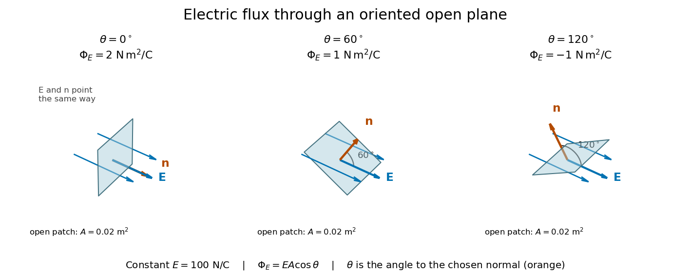
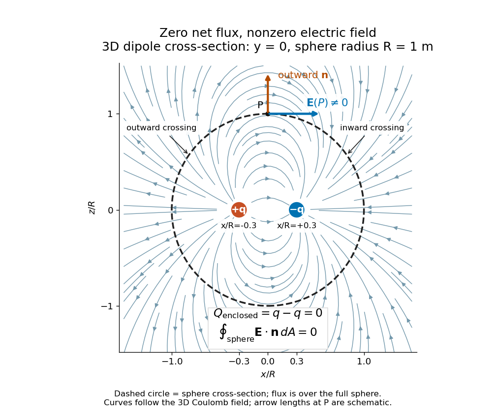

# Electric field

↑ **Parent:** [Electromagnetism](electromagnetism.md)  
ⓦ [Wiki](https://en.wikipedia.org/wiki/Electric_field)

The electric field is the [force](force.md) per unit charge on a stationary test particle.

**Table of contents**

- [Sudden vector-potential pulse](#sudden-vector-potential-pulse)
- [Electric field line](#electric-field-line)
- [Electric force](#electric-force)
  - [Electrostatic force](#electrostatic-force)
- [Electric flux](#electric-flux)
- [Electric potential](#electric-potential)
  - [Grounded-plate potential of a central charged sheet](#grounded-plate-potential-of-a-central-charged-sheet)
  - [Potential of a charged cylindrical shell with angular Fourier data](#potential-of-a-charged-cylindrical-shell-with-angular-fourier-data)
  - [Voltmeter](#voltmeter)
    - [Voltmeter loading](#voltmeter-loading)
  - [Conductive-paper electric potential mapping](#conductive-paper-electric-potential-mapping)
  - [Electrical reference potential](#electrical-reference-potential)
  - [Constrained electrostatic equilibrium](#constrained-electrostatic-equilibrium)
  - [Electrostatic reciprocity identity](#electrostatic-reciprocity-identity)
  - [Image charge](#image-charge)
    - [Image charges in a right-angle conducting wedge](#image-charges-in-a-right-angle-conducting-wedge)
      - [Lateral stability of a spring-supported charge in a wedge](#lateral-stability-of-a-spring-supported-charge-in-a-wedge)
      - [Electrostatic softening above a conducting wedge](#electrostatic-softening-above-a-conducting-wedge)
    - [Image charge at a dielectric interface](#image-charge-at-a-dielectric-interface)
      - [Permittivity convention for transmitted image charges](#permittivity-convention-for-transmitted-image-charges)
    - [Fall time of a charge toward a grounded plane](#fall-time-of-a-charge-toward-a-grounded-plane)
    - [Falling charge above a grounded conducting plane](#falling-charge-above-a-grounded-conducting-plane)
    - [Image charge for a grounded conducting sphere](#image-charge-for-a-grounded-conducting-sphere)
      - [Equal-charge balance around a grounded sphere](#equal-charge-balance-around-a-grounded-sphere)
      - [Image charges for a neutral conducting sphere](#image-charges-for-a-neutral-conducting-sphere)
  - [Electric potential difference](#electric-potential-difference)
    - [Bias voltage](#bias-voltage)
  - [Point charge](#point-charge)
  - [Equipotential](#equipotential)

## Sudden vector-potential pulse

↑ **Parent:** [Electric field](electric-field.md)

In [temporal gauge](relativistic-quantum-field.md#temporal-gauge), a spatially uniform step $\mathbf A(t)=\mathbf A_0\Theta(t)$ gives $\mathbf E=-\mathbf A_0\delta(t)$. A charged scalar Fourier mode retains its canonical [wavevector](elasticity-physics.md#wavevector) while its [kinetic momentum](quantum-theory.md#kinetic-momentum) changes from $\hbar\mathbf k$ to $\hbar\mathbf k-e\mathbf A_0$. The resulting [frequency](wave.md#frequency) jump mixes positive- and negative-frequency modes.

## Electric field line

↑ **Parent:** [Electric field](electric-field.md)

An oriented curve whose tangent points along the local [electric field](electric-field.md). Where the field is nonzero, choosing arc length $s$ gives $d\mathbf r/ds=\mathbf E/|\mathbf E|$. These curves visualize the direction of the [force](force.md) on a positive test charge; they are not generally particle trajectories, since a particle can have inertia and initial velocity. In [electrostatics](electrostatics.md), they are normal to [equipotential surfaces](energy.md#equipotential-surface) and cannot form a closed loop in a region with a single-valued potential that strictly decreases along the line. A field null can separate families of lines.

## Electric force

↑ **Parent:** [Electric field](electric-field.md)

The [electric force](#electric-force) on an [electric charge](electric-charge.md) $q$ is $\mathbf F_E=q\mathbf E$, using the [electric field](electric-field.md) of the other sources and excluding the charge's own self-field. Positive [electric charge](electric-charge.md) gives [force](force.md) along the [electric field](electric-field.md); negative [electric charge](electric-charge.md) reverses it. A field $\mathbf E=400\,\mathrm{N/C}\,\widehat{\mathbf x}$ therefore gives $\mathbf F_E=-8\times10^{-7}\,\mathrm N\,\widehat{\mathbf x}$ on $q=-2\,\mathrm{nC}$. This is the electric part of the [Lorentz force](relativistic-electromagnetism.md#lorentz-force); the magnetic contribution is $q\mathbf v\times\mathbf B$. [OpenStax, University Physics II, §5.4: electric field and force](https://openstax.org/books/university-physics-volume-2/pages/5-4-electric-field).

### Electrostatic force

↑ **Parent:** [Electric force](#electric-force)

The [electric force](#electric-force) exerted by a time-independent [electric field](electric-field.md). For a [point charge](#point-charge), the external field excludes its own singular self-field. The [method of images](mathematics.md#method-of-images) evaluates conductor-induced forces by the image field at the physical charge's position; the fictitious images need not be physical charges in the conductor interior.

## Electric flux

↑ **Parent:** [Electric field](electric-field.md)  
ⓦ [Wiki](https://en.wikipedia.org/wiki/Electric_flux)

[Electric flux](#electric-flux) measures how much [electric field](electric-field.md) crosses a chosen [oriented surface](differential-geometry.md#oriented-surface), with a sign distinguishing the two crossing directions. A strong [electric field](electric-field.md) running along a surface contributes nothing to its [electric flux](#electric-flux): only the [normal component](differential-geometry.md#normal-component) counts. This lets [Gauss's law](maxwell-equations.md#gauss-s-law) turn a potentially complicated [electric field](electric-field.md) into one number recording the net enclosed [electric charge](electric-charge.md).

For a surface $S$ with chosen [unit normal](differential-geometry.md#unit-normal) $\mathbf n$, the [electric flux](#electric-flux) is the [surface integral](multivariable-calculus.md#surface-integral)

$$
\Phi_E(S)=\int_S\mathbf E\cdot\mathbf n\,dA=\int_S\mathbf E\cdot d\mathbf S,\qquad d\mathbf S=\mathbf n\,dA.
$$

Here $dA$ is positive [surface area](differential-geometry.md#surface-area), while $d\mathbf S$ is the [vector area element](differential-geometry.md#vector-area-element). The [dot product](inner-product.md#dot-product) makes [electric flux](#electric-flux) a signed [scalar](vector-space.md#scalar), rather than a [vector](vector-space.md#vector) like the [electric field](electric-field.md). Its [SI](physics.md#international-system-of-units) unit is $\mathrm{N\,m^2/C}$: [electric field](electric-field.md) measured using the [newton](physics.md#newton-unit) per [coulomb](physics.md#coulomb), multiplied by [surface area](differential-geometry.md#surface-area) in square metres. Reversing the [orientation of a surface](differential-geometry.md#orientation-of-a-surface) replaces $\mathbf n$ by $-\mathbf n$ and reverses the [electric flux](#electric-flux). Calling it [electric flux](#electric-flux) does not imply that [electric charge](electric-charge.md) is moving through the surface. [Feynman lectures II.3, §3–2: flux of a vector field](https://www.feynmanlectures.caltech.edu/II_03.html#Ch3-S2).

For an open patch in a [plane](geometry-and-topology.md#plane), with [surface area](differential-geometry.md#surface-area) $A$ and a constant [electric field](electric-field.md), the [unit normal](differential-geometry.md#unit-normal) is constant and the [surface integral](multivariable-calculus.md#surface-integral) simplifies to

$$
\Phi_E=\mathbf E\cdot(A\mathbf n)=EA\cos\theta,\qquad E=|\mathbf E|.
$$

The [angle](geometry-and-topology.md#angle) $\theta$ is between the [electric field](electric-field.md) and the chosen [unit normal](differential-geometry.md#unit-normal), not between the [electric field](electric-field.md) and the [plane](geometry-and-topology.md#plane). The [cosine](geometry-and-topology.md#cosine) describes the signed projected [surface area](differential-geometry.md#surface-area) seen by the [electric field](electric-field.md). Thus [electric flux](#electric-flux) is positive for $0\leq\theta<90^\circ$, zero at $90^\circ$, and negative for $90^\circ<\theta\leq180^\circ$. [Ling, Sanny and Moebs, University Physics II, §6.1: electric flux](https://openstax.org/books/university-physics-volume-2/pages/6-1-electric-flux).

For example, take $E=100\,\mathrm{N/C}$ and $A=0.02\,\mathrm{m^2}$, so $EA=2\,\mathrm{N\,m^2/C}$. Three choices of [angle](geometry-and-topology.md#angle) give

$$
\begin{aligned}
\Phi_E(0^\circ)&=2\cos0^\circ=2\,\mathrm{N\,m^2/C},\\
\Phi_E(60^\circ)&=2\cos60^\circ=1\,\mathrm{N\,m^2/C},\\
\Phi_E(120^\circ)&=2\cos120^\circ=-1\,\mathrm{N\,m^2/C}.
\end{aligned}
$$

Keeping the $60^\circ$ patch fixed and reversing its [unit normal](differential-geometry.md#unit-normal) gives $120^\circ$ and changes $+1$ to $-1\,\mathrm{N\,m^2/C}$. The [electric field](electric-field.md) and physical patch have not changed. If the [electric field](electric-field.md) is instead tangent to the patch, its [dot product](inner-product.md#dot-product) with the [unit normal](differential-geometry.md#unit-normal) vanishes: [electric flux](#electric-flux) is zero even though $E=100\,\mathrm{N/C}$.

**[Figure 1](#image-three-open-patches-in-a-plane-in-a-constant-electric-field-the-angle-to-the-chosen-unit-normal-gives-electric-fluxes-of-2-1-and-minus-1-newton-square-metres-per-coulomb). Three open patches in a plane in a constant electric field: the angle to the chosen unit normal gives electric fluxes of 2, 1 and minus 1 newton square metres per coulomb**.

For a [closed surface](smooth-manifold.md#closed-surface) enclosing a volume $V$, choose the outward [unit normal](differential-geometry.md#unit-normal). [Gauss's law](maxwell-equations.md#gauss-s-law) gives

$$
\Phi_E(\partial V)=\oint_{\partial V}\mathbf E\cdot\mathbf n\,dA=\frac{Q_{\mathrm{enclosed}}}{\varepsilon_0}.
$$

Here $\varepsilon_0$ is the [vacuum permittivity](permittivity.md#vacuum-permittivity), and $Q_{\mathrm{enclosed}}$ is the signed total [electric charge](electric-charge.md) inside. The [electric field](electric-field.md) in the [surface integral](multivariable-calculus.md#surface-integral) includes all sources, including external [electric charges](electric-charge.md). Assume no ideal [point charge](#point-charge) lies on the integration surface. Zero enclosed [electric charge](electric-charge.md) implies zero total [electric flux](#electric-flux); it does **not** imply zero [electric field](electric-field.md) everywhere on the [closed surface](smooth-manifold.md#closed-surface) or inside it. Positive and negative contributions to the [surface integral](multivariable-calculus.md#surface-integral) can cancel. [Ling, Sanny and Moebs, University Physics II, §6.2: outward flux and enclosed charge](https://openstax.org/books/university-physics-volume-2/pages/6-2-explaining-gausss-law).

To see the cancellation with sources inside, place [point charges](#point-charge) $+q$ at $(-a,0,0)$ and $-q$ at $(a,0,0)$, where $q>0$, $a=0.30\,\mathrm m$, and both lie inside the [sphere](euclidean-geometry.md#sphere) of radius $R=1\,\mathrm m$ centered at the origin. This separated pair has the [electric dipole](electrostatics.md#electric-dipole) geometry. Its enclosed [electric charge](electric-charge.md) is $q-q=0$, so its total outward [electric flux](#electric-flux) is zero. At the point $P=(0,0,R)$ on the [sphere](euclidean-geometry.md#sphere), [Coulomb's law](electrostatics.md#coulomb-s-law) and the [superposition principle](vector-space.md#superposition-principle) give the individual [electric fields](electric-field.md)

$$
\mathbf E_+(P)=\frac{kq(a,0,R)}{(R^2+a^2)^{3/2}},\qquad
\mathbf E_-(P)=\frac{kq(a,0,-R)}{(R^2+a^2)^{3/2}},\qquad k=\frac{1}{4\pi\varepsilon_0}.
$$

The $z$ components cancel and the positive $x$ components add:

$$
\mathbf E(P)=\frac{2kqa}{(R^2+a^2)^{3/2}}\widehat{\mathbf x}\approx0.527244\frac{kq}{R^2}\widehat{\mathbf x}\ne\mathbf0.
$$

For the stipulated approximation $k=8.99\times10^9\,\mathrm{N\,m^2/C^2}$ and $q=1\,\mathrm{nC}$, this is about $4.740\,\mathrm{N/C}$ along positive $x$. At $P$, the outward [unit normal](differential-geometry.md#unit-normal) is $\widehat{\mathbf z}$, so this nonzero [electric field](electric-field.md) is tangent to the [sphere](euclidean-geometry.md#sphere). At other points of the [sphere](euclidean-geometry.md#sphere), its [normal component](differential-geometry.md#normal-component) can be positive or negative. The source-field formula applies away from the two [point charges](#point-charge), where the [electric field](electric-field.md) has zero [divergence](multivariable-calculus.md#divergence); it is singular at the sources. [Feynman lectures II.4, §§4–1 and 4–2: electrostatic sources and superposition](https://www.feynmanlectures.caltech.edu/II_04.html#Ch4-S2).

**[Figure 2](#image-cross-section-of-the-three-dimensional-electric-field-of-two-opposite-point-charges-inside-a-unit-radius-sphere-zero-total-electric-flux-coexists-with-a-nonzero-tangential-electric-field-at-the-top). Cross-section of the three-dimensional electric field of two opposite point charges inside a unit-radius sphere: zero total electric flux coexists with a nonzero tangential electric field at the top**.

The diagram shows [streamlines](fluid-mechanics.md#streamline) of the three-dimensional [electric field](electric-field.md) in the section $y=0$. The circle is a cross-section of the [sphere](euclidean-geometry.md#sphere), not the integration surface: [Gauss's law](maxwell-equations.md#gauss-s-law) uses the entire three-dimensional [surface integral](multivariable-calculus.md#surface-integral). A two-dimensional [line integral](multivariable-calculus.md#line-integral) of outward field around that circle would be a different quantity, with units $\mathrm{N\,m/C}$ rather than the [electric flux](#electric-flux) units $\mathrm{N\,m^2/C}$.

## Electric potential

↑ **Parent:** [Electric field](electric-field.md)  
ⓦ [Wiki](https://en.wikipedia.org/wiki/Electric_potential)

In [electrostatics](electrostatics.md), the [electric potential](#electric-potential) $\Phi$ tells us the interaction [potential energy](energy.md#potential-energy) per unit test [electric charge](electric-charge.md) in the [electric field](electric-field.md) of prescribed sources. Its most directly useful quantity is an [electric potential difference](#electric-potential-difference): how much [work](energy.md#work) per unit [electric charge](electric-charge.md) an external agent must supply to move that test [electric charge](electric-charge.md) slowly between two points. This replaces the bookkeeping of a [vector](vector-space.md#vector) [force](force.md) along a path with the difference of two [scalar](vector-space.md#scalar) values. The test [electric charge](electric-charge.md) must be small enough not to rearrange the sources appreciably.

For motion from $A$ to $B$, write $\Delta\Phi=\Phi(B)-\Phi(A)$. With fixed sources and only the [electric force](#electric-force) doing [work](energy.md#work),

$$
\Delta\Phi=-\int_A^B\mathbf E\cdot d\mathbf l,\qquad
\Delta U=q\Delta\Phi,\qquad
W_{\mathrm{field}}=-q\Delta\Phi,\qquad
\Delta K=-\Delta U.
$$

Here $U$ is interaction [potential energy](energy.md#potential-energy), $K$ is [kinetic energy](energy.md#kinetic-energy), and the [line integral](multivariable-calculus.md#line-integral) uses the [electric field](electric-field.md) produced by the other [electric charges](electric-charge.md). For slow transport with unchanged [kinetic energy](energy.md#kinetic-energy), the external [work](energy.md#work) is $W_{\mathrm{ext}}=\Delta U$, so $\Delta\Phi=W_{\mathrm{ext}}/q$ for nonzero $q$. This external [work](energy.md#work) has the opposite sign to the [work](energy.md#work) done by the [electric field](electric-field.md). The [SI](physics.md#international-system-of-units) unit is the [volt](physics.md#volt),

$$
1\,\mathrm V=1\,\mathrm{J/C}.
$$

A [volt](physics.md#volt) measures [energy](energy.md) per unit [electric charge](electric-charge.md), not [energy](energy.md) itself. For example, crossing an [electric potential difference](#electric-potential-difference) of $+5\,\mathrm V$ changes the [potential energy](energy.md#potential-energy) of $q=+2\,\mathrm{nC}$ by $+10\,\mathrm{nJ}$, but changes that of $q=-2\,\mathrm{nC}$ by $-10\,\mathrm{nJ}$. Both test [electric charges](electric-charge.md) encounter the same [electric potential difference](#electric-potential-difference); their opposite signs reverse the [energy](energy.md) change.[§7.2, equations 7.4–7.7: energy per charge, work and potential difference](physics-bibliography.md#university-physics-volume-2-by-samuel-j-ling-and-others/7-2-electric-potential-and-potential-difference)

The [electrostatic potential](#electric-potential) is a [scalar](vector-space.md#scalar) [function](function.md) of position. The [electric field](electric-field.md) is a [conservative vector field](multivariable-calculus.md#conservative-vector-field), and all three components follow from the negative [gradient](multivariable-calculus.md#gradient) of the [electric potential](#electric-potential):

$$
\mathbf E=-\nabla\Phi,\qquad E_x=-\frac{\partial\Phi}{\partial x},\quad E_y=-\frac{\partial\Phi}{\partial y},\quad E_z=-\frac{\partial\Phi}{\partial z}.
$$

The [electric field](electric-field.md) points toward decreasing [electric potential](#electric-potential). A positive test [electric charge](electric-charge.md) feels [electric force](#electric-force) in that direction; a negative test [electric charge](electric-charge.md) feels [electric force](#electric-force) in the opposite direction, since $\mathbf F=q\mathbf E$. A freely accelerated negative test [electric charge](electric-charge.md) therefore moves toward higher [electric potential](#electric-potential) while lowering its [potential energy](energy.md#potential-energy) $U=q\Phi$.[§7.4, equations 7.13–7.15: components and negative gradient](physics-bibliography.md#university-physics-volume-2-by-samuel-j-ling-and-others/7-4-determining-field-from-potential)

Only differences fix physical [electrostatic potentials](#electric-potential): adding the same constant $C_0$ everywhere, $\Phi'=\Phi+C_0$, changes neither the [gradient](multivariable-calculus.md#gradient) nor any [electric potential difference](#electric-potential-difference). Choosing an [electrical reference potential](#electrical-reference-potential) is this elementary [gauge transformation](electromagnetism.md#gauge-transformation). Setting zero at infinity is convenient for finitely many localized [point charges](#point-charge); it is not available for an ideal uniform [electric field](electric-field.md) extending to infinity. There we can choose a finite reference point. Assigning zero at ground is a convention, whereas physically grounding an [electrical conductor](electric-charge.md#electrical-conductor) also allows exchange of [electric charge](electric-charge.md) to impose a boundary value. Zero [electric potential](#electric-potential) at a point never by itself implies zero [electric field](electric-field.md).[§7.3, equation 7.8 and Figure 7.18: infinity and ground references](physics-bibliography.md#university-physics-volume-2-by-samuel-j-ling-and-others/7-3-calculations-of-electric-potential)

For a fixed [point charge](#point-charge) $Q$ at the origin in [vacuum](physics.md#vacuum), choose zero at infinity. [Coulomb's law](electrostatics.md#coulomb-s-law) gives

$$
\Phi(r)=\frac{kQ}{r},\qquad
\mathbf E(r)=\frac{kQ}{r^2}\widehat{\mathbf r},\qquad
k=\frac{1}{4\pi\varepsilon_0},\qquad r>0,
$$

where $\varepsilon_0$ is the [vacuum permittivity](permittivity.md#vacuum-permittivity). Use the stipulated approximation $k=8.99\times10^9\,\mathrm{N\,m^2/C^2}$ and $Q=+2\,\mathrm{nC}$. At $r=0.20\,\mathrm m$,

$$
\Phi=89.9\,\mathrm V,\qquad E_r=449.5\,\mathrm{N/C}.
$$

A test [electric charge](electric-charge.md) $q=-3\,\mathrm{nC}$ has $U=-2.697\times10^{-7}\,\mathrm J$ and radial [electric force](#electric-force) $F_r=-1.3485\times10^{-6}\,\mathrm N$, directed inward. Moving it inward from $r_A=0.20\,\mathrm m$ to $r_B=0.10\,\mathrm m$ raises the [electric potential](#electric-potential) from $89.9$ to $179.8\,\mathrm V$ but lowers its [potential energy](energy.md#potential-energy):

$$
\Delta\Phi=+89.9\,\mathrm V,\qquad
\Delta U=-2.697\times10^{-7}\,\mathrm J,\qquad
W_{\mathrm{field}}=+2.697\times10^{-7}\,\mathrm J.
$$

This is the [Coulomb potential energy](electrostatics.md#coulomb-potential-energy) calculation using [electric potentials](#electric-potential). The source's singular self-field at $r=0$ is excluded; when finding the [force](force.md) on a source [point charge](#point-charge), use only the [electric field](electric-field.md) of the other sources.[§7.3: point-charge potential and scalar superposition](physics-bibliography.md#university-physics-volume-2-by-samuel-j-ling-and-others/7-3-calculations-of-electric-potential)

For a uniform [electric field](electric-field.md) $\mathbf E=300\,\mathrm{V/m}\,\widehat{\mathbf x}$, choose $\Phi(0)=12\,\mathrm V$. Then

$$
\Phi(x)=12\,\mathrm V-(300\,\mathrm{V/m})x,\qquad
\Delta\Phi=-\mathbf E\cdot(\mathbf r_B-\mathbf r_A).
$$

Moving from $x_A=0$ to $x_B=0.04\,\mathrm m$ gives $\Delta\Phi=-12\,\mathrm V$. For $q=+2\,\mathrm{nC}$ the change in [potential energy](energy.md#potential-energy) is $-24\,\mathrm{nJ}$ and the [electric field](electric-field.md) does $+24\,\mathrm{nJ}$ of [work](energy.md#work). For $q=-2\,\mathrm{nC}$, the same prescribed displacement gives $\Delta U=+24\,\mathrm{nJ}$: the external agent must supply that [work](energy.md#work) for slow transport. This uniform [electric field](electric-field.md) approximates the interior of a [parallel-plate capacitor](electromagnetism.md#parallel-plate-capacitor) sufficiently far from the edges; the [fringing field of a capacitor](electromagnetism.md#fringing-field-of-a-capacitor) limits the approximation.[§7.4: voltage gradient in a uniform field](physics-bibliography.md#university-physics-volume-2-by-samuel-j-ling-and-others/7-4-determining-field-from-potential)

**[Figure 3](#electric-potential-work-and-equipotentials). Analytic electric potential models: point charge equipotentials, a uniform electric field, and the sign of the change in potential energy**.

An [equipotential](#equipotential) is a [level set](topology.md#level-set) $\Phi=\text{constant}$. On a smooth [equipotential](#equipotential) with nonzero [gradient](multivariable-calculus.md#gradient), every tangent displacement has $d\Phi=\nabla\Phi\cdot d\mathbf l=0$, so the [electric field](electric-field.md) is normal to the [equipotential](#equipotential). Thus moving a test [electric charge](electric-charge.md) along an [equipotential](#equipotential) requires no net electrical [work](energy.md#work). Around a [point charge](#point-charge), the [equipotentials](#equipotential) are [spheres](euclidean-geometry.md#sphere); the circles in the diagram are their sections, not an assumption of two-dimensional [Coulomb's law](electrostatics.md#coulomb-s-law). A uniform [electric field](electric-field.md) has parallel [plane](geometry-and-topology.md#plane) [equipotentials](#equipotential). For contours separated by the same small [electric potential difference](#electric-potential-difference), smaller normal separation means a stronger [electric field](electric-field.md), approximately $|\mathbf E|\approx|\Delta\Phi|/\Delta n$. At a point where $\nabla\Phi=0$, the [electric field](electric-field.md) is zero and has no direction to call normal.[§7.5, Figures 7.30–7.32: equipotentials, perpendicular field and zero work](physics-bibliography.md#university-physics-volume-2-by-samuel-j-ling-and-others/7-5-equipotential-surfaces-and-conductors)

The [superposition principle](vector-space.md#superposition-principle) adds [electric potentials](#electric-potential) as signed [scalars](vector-space.md#scalar). For finitely many stationary [point charges](#point-charge) $q_j$ at $\mathbf r_j$ in [vacuum](physics.md#vacuum),

$$
\Phi(\mathbf r)=k\sum_j\frac{q_j}{|\mathbf r-\mathbf r_j|},\qquad
\mathbf E(\mathbf r)=k\sum_jq_j\frac{\mathbf r-\mathbf r_j}{|\mathbf r-\mathbf r_j|^3}.
$$

For example, the [electric dipole](electrostatics.md#electric-dipole) with $+q$ at $(a,0,0)$ and $-q$ at $(-a,0,0)$ has zero [electric potential](#electric-potential) everywhere in the midplane $x=0$, yet its [electric field](electric-field.md) at the midpoint is $\mathbf E=-(2kq/a^2)\widehat{\mathbf x}$. With $q=2\,\mathrm{nC}$ and $a=0.10\,\mathrm m$, this is $-3596\,\mathrm{N/C}\,\widehat{\mathbf x}$. At $(2a,0,0)$, the same model gives $\Phi=2kq/(3a)\approx119.867\,\mathrm V$ and $E_x=8kq/(9a^2)\approx1598.222\,\mathrm{N/C}$. Cancellation of [electric potentials](#electric-potential) is quite different from cancellation of [vector](vector-space.md#vector) [electric fields](electric-field.md).

**[Figure 4](#image-computed-dipole-equipotentials-and-electric-field-directions-zero-potential-on-the-vertical-midline-still-permits-a-nonzero-field). Computed dipole equipotentials and electric-field directions: zero potential on the vertical midline still permits a nonzero field**.

A motivating measurement is [conductive-paper electric potential mapping](#conductive-paper-electric-potential-mapping). A documented teaching experiment uses slightly conductive paper on an insulating board, two circular [electrodes](electrochemistry.md#electrode) in highly conducting ink, a steady supply, and a digital [voltmeter](#voltmeter). Connect the supply to the two [electrodes](electrochemistry.md#electrode), keep the [voltmeter](#voltmeter) common lead on the negative [electrode](electrochemistry.md#electrode), and use its other lead as a movable probe. Adjust the supply using the measured [electric potential difference](#electric-potential-difference) between [electrodes](electrochemistry.md#electrode); the published procedure uses $10\,\mathrm V$. The observable is the [voltmeter](#voltmeter) reading $\Phi(P)-\Phi(\mathrm{COM})$ at the probe position $P$. Locate several points reading $2\,\mathrm V$, record their positions on a separate map, and join them into an [equipotential](#equipotential); repeat at other readings. Lift the probe between contacts so it does not damage the paper. This procedure makes the [electrical reference potential](#electrical-reference-potential) concrete: every reading compares two contacts.[Physics 2212, Lab 5: Electric Potential and Field](physics-bibliography.md#physics-2212-laboratory-manual-by-eric-murray/physics-2212-lab-5-electric-potential-and-field)

From neighboring readings infer an [electric field](electric-field.md) component by a [finite difference](finite-difference.md), $E_x\approx-[\Phi(x+h)-\Phi(x)]/h$. Reconstruct two in-plane components with displacements along two independent directions. Alternatively, draw the [electric field](electric-field.md) normal to mapped [equipotentials](#equipotential), toward lower [electric potential](#electric-potential). The second diagram illustrates the same measurement principle with bar [electrodes](electrochemistry.md#electrode) spanning a uniform sheet, insulating top and bottom edges, and a synthetic model $\Phi(x)=(50\,\mathrm{V/m})x$. The model readings $4.0\,\mathrm V$ at $x=0.08\,\mathrm m$ and $5.0\,\mathrm V$ at $x=0.10\,\mathrm m$ imply $E_x=-50\,\mathrm{V/m}$. These values are calculated illustrations, not reported experimental data. The documented circular-[electrode](electrochemistry.md#electrode) experiment similarly estimates the [electric field](electric-field.md) from readings at successive centimetre marks.[Physics 2212, Lab 5: Electric Potential and Field](physics-bibliography.md#physics-2212-laboratory-manual-by-eric-murray/physics-2212-lab-5-electric-potential-and-field)

**[Figure 5](#electric-potential-voltmeter-mapping). Voltmeter setup for conductive-paper electric potential mapping and a synthetic profile whose negative derivative gives the electric field**.

Useful controls include checking the [voltmeter](#voltmeter) zero, checking that the [electric potential difference](#electric-potential-difference) along each painted [electrode](electrochemistry.md#electrode) is negligible, and repeating reference readings to detect supply drift. Reversing the supply should reverse the signs relative to the same reference contact. Contact resistance, leakage [electric currents](electric-charge.md#electric-current), and touching the sheet can distort the map. A [voltmeter](#voltmeter) has finite input [electrical resistance](electric-charge.md#electrical-resistance) and draws a small [electric current](electric-charge.md#electric-current); [voltmeter loading](#voltmeter-loading) changes the quantity being measured if that [electrical resistance](electric-charge.md#electrical-resistance) is insufficiently large relative to the sheet's effective source [electrical resistance](electric-charge.md#electrical-resistance).[EC-2: Electric Fields](physics-bibliography.md#electricity-and-magnetism-laboratory-manual/ec-2-electric-fields)[§10.4, Measuring Voltage with a Voltmeter: parallel connection and large input resistance](physics-bibliography.md#university-physics-volume-2-by-samuel-j-ling-and-others/10-4-electrical-measuring-instruments)

The paper carries a steady [electric current](electric-charge.md#electric-current), so this is a planar analogue rather than a direct measurement of isolated [point charges](#point-charge) in three-dimensional [vacuum](physics.md#vacuum). For constant [electrical conductivity](electric-charge.md#electrical-conductivity), [Ohm's law](electric-charge.md#ohm-s-law) and steady [charge conservation](electric-charge.md#charge-conservation) give $\mathbf j=-\sigma\nabla\Phi$ and $\nabla\cdot\mathbf j=0$, hence the two-dimensional [Laplace equation](partial-differential-equation.md#laplace-equation) away from [electrodes](electrochemistry.md#electrode). Insulating sheet edges impose zero normal [electric current](electric-charge.md#electric-current), while finite [electrodes](electrochemistry.md#electrode) fix boundary values. This derivation explains both the analogy and its limits: inhomogeneous paper, finite boundaries, and finite [electrodes](electrochemistry.md#electrode) can change the contours. One should not fit the three-dimensional [point charge](#point-charge) formula $kQ/r$ to a planar map without testing that model. Small probe spacing resolves spatial variation better, but amplifies uncertainty in the inferred [finite difference](finite-difference.md). The published laboratory instructions explicitly ask students to assess whether their proposed field fit is appropriate.[EC-2: Electric Fields](physics-bibliography.md#electricity-and-magnetism-laboratory-manual/ec-2-electric-fields)[Physics 2212, Lab 5: Electric Potential and Field](physics-bibliography.md#physics-2212-laboratory-manual-by-eric-murray/physics-2212-lab-5-electric-potential-and-field)

The scalar description has a crucial limit. [Faraday's law of induction](maxwell-equations.md#faraday-s-law-of-induction) for a stationary closed path $\Gamma$ says

$$
\oint_\Gamma\mathbf E\cdot d\mathbf l=-\frac{d\Phi_B}{dt},\qquad
\nabla\times\mathbf E=-\frac{\partial\mathbf B}{\partial t},
$$

where $\Phi_B$ is [magnetic flux](magnetic-field.md#magnetic-flux). Nonzero changing [magnetic flux](magnetic-field.md#magnetic-flux) gives nonzero circulation, incompatible with a single-valued [electric potential](#electric-potential) alone. More generally, a scalar [electric potential](#electric-potential) and a [magnetic vector potential](electromagnetism.md#magnetic-vector-potential) together give

$$
\mathbf E=-\nabla\Phi-\frac{\partial\mathbf A}{\partial t},\qquad
\mathbf B=\nabla\times\mathbf A.
$$

Consequently, in the presence of induction, two [voltmeter](#voltmeter) lead routes between the same contacts can produce different readings if the enclosed [magnetic flux](magnetic-field.md#magnetic-flux) changes. This follows by subtracting the two path [line integrals](multivariable-calculus.md#line-integral); it is a deduction from [Faraday's law of induction](maxwell-equations.md#faraday-s-law-of-induction), not a claimed outcome of the paper experiment. The steady setup and negligible induction justify interpreting its readings as [electric potential differences](#electric-potential-difference). Merely introducing a scalar [electric potential](#electric-potential) that depends on [time](classical-mechanics.md#time-in-physics) cannot supply a nonzero [curl](multivariable-calculus.md#curl) of the [electric field](electric-field.md).[§21–3](physics-bibliography.md#the-feynman-lectures-on-physics-volume-ii-by-richard-feynman-and-others/chapter-21-solutions-of-maxwell’s-equations-with-currents-and-charges)

A short mathematical justification connects the statements above. Along a smooth path, the [chain rule](calculus.md#chain-rule) gives $d\Phi=\nabla\Phi\cdot d\mathbf l$. Integrating and using $\mathbf E=-\nabla\Phi$ yields the endpoint formula by the [fundamental theorem for line integrals](multivariable-calculus.md#fundamental-theorem-for-line-integrals), proving [path independence](multivariable-calculus.md#path-independence). Conversely, vanishing circulation around every closed path lets us define $\Phi(P)=-\int_{P_0}^{P}\mathbf E\cdot d\mathbf l$ independently of the route, with $\Phi(P_0)=0$. Zero [curl](multivariable-calculus.md#curl) is a local test; for a continuously differentiable [curl-free vector field](multivariable-calculus.md#irrotational-vector-field), a [simply connected](algebraic-topology.md#simply-connected-space) open region suffices for a global potential. The explicit finite-source formula already gives a global [electric potential](#electric-potential) away from its source points.[Chapter 4: Electrostatics](physics-bibliography.md#the-feynman-lectures-on-physics-volume-ii-by-richard-feynman-and-others/chapter-4-electrostatics)

### Grounded-plate potential of a central charged sheet

↑ **Parent:** [Electric potential](#electric-potential)

An ideal infinite sheet midway between parallel grounded plates has equal fields of magnitude $\sigma/(2\epsilon_0)$ on its two sides, directed from positive sheet charge toward the plates. Integrating over the half-separation d/2 gives the displayed [electric potential](#electric-potential). Each plate carries induced inner-face [surface charge density](electrostatics.md#surface-charge-density) $-\sigma/2$. The potential is triangular between the plates, and the field jumps by $\sigma/\epsilon_0$ across the sheet. Edge fields are excluded.

### Potential of a charged cylindrical shell with angular Fourier data

↑ **Parent:** [Electric potential](#electric-potential)

For an infinite circular cylinder of radius $R$, assume the [electrostatic potential](#electric-potential) is independent of the axial coordinate. An angular [Fourier mode](fourier-analysis.md#fourier-mode) $s_n\cos n\theta$, or $s_n\sin n\theta$, in the prescribed jump $\partial_r\Phi|_{R^+}-\partial_r\Phi|_{R^-}=-\sigma(\theta)$ produces the same angular mode in the potential, multiplied by

$$
\frac{Rs_n}{2n}\begin{cases}(r/R)^n,&r<R,\\(R/r)^n,&r>R.\end{cases}
$$

Here $r_<=\min(r,R)$ and $r_>=\max(r,R)$ in the abbreviated header formula. [Separation of variables](partial-differential-equation.md#separation-of-variables) selects $r^n$ inside by regularity and $r^{-n}$ outside by decay. Continuity equates their boundary values, and the derivative jump is minus $2n/R$ times that value. A nonzero angular mean of the [surface charge density](electrostatics.md#surface-charge-density) introduces a logarithmic term, so zero mean is necessary for a potential decaying at infinity in this two-dimensional reduction.

### Voltmeter

↑ **Parent:** [Electric potential](#electric-potential)  
ⓦ [Wiki](https://en.wikipedia.org/wiki/Voltmeter)

A [voltmeter](#voltmeter) measures an [electric potential difference](#electric-potential-difference) between two contacts; its finite input [electrical resistance](electric-charge.md#electrical-resistance) can cause [voltmeter loading](#voltmeter-loading).

#### Voltmeter loading

↑ **Parent:** [Voltmeter](#voltmeter)

[Voltmeter loading](#voltmeter-loading) is the change in an [electric potential difference](#electric-potential-difference) caused by the [electric current](electric-charge.md#electric-current) drawn by the measuring [voltmeter](#voltmeter).

For a [loaded voltage divider](electrical-engineering.md#loaded-voltage-divider) in steady [direct current](electric-charge.md#direct-current), a [voltmeter](#voltmeter) connected across the lower [resistor](electric-charge.md#resistor) places its finite input [electrical resistance](electric-charge.md#electrical-resistance) $R_m$ in parallel with the lower arm's [electrical resistance](electric-charge.md#electrical-resistance) $R_2$ and any intended [electrical load](electrical-engineering.md#electrical-load) of [electrical resistance](electric-charge.md#electrical-resistance) $R_L$. With positive, fixed [electrical resistances](electric-charge.md#electrical-resistance), an upper [resistor](electric-charge.md#resistor) of [electrical resistance](electric-charge.md#electrical-resistance) $R_1$, and an ideal [voltage source](electrical-engineering.md#voltage-source) supplying [electric potential difference](#electric-potential-difference) $V_{\mathrm{in}}$, [Kirchhoff's current law](random-walk.md#kirchhoff-node-law) and [Ohm's law](electric-charge.md#ohm-s-law) give

$$
\frac{V_{\mathrm{in}}-V_m}{R_1}=\frac{V_m}{R_2}+\frac{V_m}{R_L}+\frac{V_m}{R_m},\qquad
R_p=\left(\frac1{R_2}+\frac1{R_L}+\frac1{R_m}\right)^{-1},\qquad
V_m=V_{\mathrm{in}}\frac{R_p}{R_1+R_p}.
$$

Here $V_m$ is the connected circuit's [electric potential difference](#electric-potential-difference) across the [voltmeter](#voltmeter); omit $1/R_L$ if there is no intended [electrical load](electrical-engineering.md#electrical-load). The parallel connection and need for large input [electrical resistance](electric-charge.md#electrical-resistance) are standard [voltmeter](#voltmeter) operating principles.[§10.4, Measuring Voltage with a Voltmeter: parallel connection and large input resistance](physics-bibliography.md#university-physics-volume-2-by-samuel-j-ling-and-others/10-4-electrical-measuring-instruments)

[Voltmeter loading](#voltmeter-loading) is a bias relative to the target [electrical circuit](electrical-circuit.md) with the [voltmeter](#voltmeter) absent and any intended [electrical load](electrical-engineering.md#electrical-load) still present. [Voltage divider loading error](electrical-engineering.md#voltage-divider-loading-error) instead compares the attached-load output with the wholly unloaded output. An accurate readout of $V_m$, supported by [measurement calibration](physics.md#measurement-calibration), can still differ from either target: calibration accuracy concerns the indication of the connected [electric potential difference](#electric-potential-difference), whereas [voltmeter loading](#voltmeter-loading) changes that [electric potential difference](#electric-potential-difference) itself.

### Conductive-paper electric potential mapping

↑ **Parent:** [Electric potential](#electric-potential)

[Conductive-paper electric potential mapping](#conductive-paper-electric-potential-mapping) uses a [voltmeter](#voltmeter) to locate [equipotentials](#equipotential) on a resistive sheet, then infers the in-plane [electric field](electric-field.md) from the measured [electric potential differences](#electric-potential-difference).

### Electrical reference potential

↑ **Parent:** [Electric potential](#electric-potential)

An [electrical reference potential](#electrical-reference-potential) fixes the arbitrary additive constant of an [electric potential](#electric-potential). Assigning zero to ground makes other potentials differences from that baseline; it does not assert that the [electric field](electric-field.md) vanishes there. If a source calculation gives $\Phi(a)=89.9\,\mathrm V$ and $\Phi(b)=179.8\,\mathrm V$ relative to infinity, choosing $a$ as the zero instead gives $\Phi'(a)=0$ and $\Phi'(b)=89.9\,\mathrm V$, with the same [electric potential difference](#electric-potential-difference). Grounding an [electrical conductor](electric-charge.md#electrical-conductor) additionally connects it to a reservoir that can exchange [electric charge](electric-charge.md) to maintain the prescribed [electric potential](#electric-potential); that physical boundary condition differs from merely relabeling an unchanged solution.[§7.3: potential references, including ground in Figure 7.18](physics-bibliography.md#university-physics-volume-2-by-samuel-j-ling-and-others/7-3-calculations-of-electric-potential); [Feynman lectures II.6, §6–8: a grounded conducting plane](https://www.feynmanlectures.caltech.edu/II_06.html#Ch6-S8).

### Constrained electrostatic equilibrium

↑ **Parent:** [Electric potential](#electric-potential)

A particle constrained to a surface can have a stable minimum of [electrostatic potential](#electric-potential) restricted to that surface even when the unrestricted equilibrium is unstable. Away from source charges, [Laplace's equation](partial-differential-equation.md#laplace-equation) makes the full potential [Hessian matrix](multivariable-calculus.md#hessian-matrix) trace zero, which rules out a positive-definite three-dimensional Hessian but does not rule out a positive-definite restriction to two dimensions. Equal positive charges at the corners of a square give a planar minimum at its centre and an unstable perpendicular direction.

### Electrostatic reciprocity identity

↑ **Parent:** [Electric potential](#electric-potential)

For two [electrostatic potentials](#electric-potential) satisfying the [Poisson equation](partial-differential-equation.md#poisson-s-equation) $\Delta\phi_i=-\rho_i/\varepsilon_0$, [Green's second identity](partial-differential-equation.md#green-second-identity) yields the displayed reciprocity formula. The [product rule for divergence](multivariable-calculus.md#product-rule-for-divergence) applied to $\phi_1\nabla\phi_2-\phi_2\nabla\phi_1$ cancels the cross-gradient terms. The normal points outward from the integration region; for an exterior region this means inward toward the excluded object on its inner boundary. Boundary terms may be removed only under suitable decay or boundary conditions.

### Image charge

↑ **Parent:** [Electric potential](#electric-potential)

An image charge is a fictitious point charge placed outside the physical solution region so that its potential, combined with the real sources, enforces the required conductor boundary values. The [Uniqueness of the Dirichlet problem](analysis.md#uniqueness-of-the-dirichlet-problem) then identifies the constructed potential with the physical one. The image need not describe the actual induced surface-charge distribution.

#### Image charges in a right-angle conducting wedge

↑ **Parent:** [Image charge](#image-charge)

For conducting sheets $y=\pm x$ at common zero potential and a charge in $y>|x|$, successive reflections give two negative images and one positive double-reflection image. On the bisector, the negative images lie at $(\pm y,0)$ and the positive image at $(0,-y)$. Summing their fields gives the displayed downward [force](force.md). Image [forces](force.md) exclude the real charge's self-field; replacing the induced charge by images does not make the images physical particles.

##### Lateral stability of a spring-supported charge in a wedge

↑ **Parent:** [Image charges in a right-angle conducting wedge](#image-charges-in-a-right-angle-conducting-wedge)

The electrostatic bisector [force](force.md) is laterally anti-restoring, with the positive stiffness coefficient on the right. A [spring](elasticity-physics.md#spring) of tension $T$ and [length](physics.md#length) $\ell$ adds transverse restoring stiffness $T/\ell$ when its fixed support is directly above the charge. The displayed inequality therefore distinguishes actual transverse stability from the saddle of a model with only a vertical [spring](elasticity-physics.md#spring) [force](force.md). Axial [spring](elasticity-physics.md#spring) stiffness alone does not specify the transverse verdict. At fixed finite support geometry and positive gravitational load, sufficiently small [electric charge](electric-charge.md) preserves lateral stability: the destabilizing coefficient tends to zero as $q^2$, while the tension term approaches $mg/\ell>0$. The vertical [equilibrium](dynamical-systems.md#equilibrium-point-of-a-dynamical-system) must separately satisfy its own positive-stiffness condition.

##### Electrostatic softening above a conducting wedge

↑ **Parent:** [Image charges in a right-angle conducting wedge](#image-charges-in-a-right-angle-conducting-wedge)

For an attractive [force](force.md) $-\beta/y^2$ and an otherwise linear vertical [spring](elasticity-physics.md#spring), differentiation about the charged [equilibrium](dynamical-systems.md#equilibrium-point-of-a-dynamical-system) $y_e$ reduces the [spring](elasticity-physics.md#spring) stiffness by $2\beta/y_e^3$. If the uncharged height is $y_0$ and the shift is small, the fractional [frequency](wave.md#frequency) change is $-\beta/(ky_0^3)$. Using only the [force](force.md) value, without its [derivative](calculus.md#derivative), would miss this [frequency](wave.md#frequency) shift.

#### Image charge at a dielectric interface

↑ **Parent:** [Image charge](#image-charge)

For a point [electric charge](electric-charge.md) $q$ in a homogeneous medium of [permittivity](permittivity.md) $\epsilon_1$ beside a plane interface with [permittivity](permittivity.md) $\epsilon_2$, its potential on the source side is reproduced by a mirrored [image charge](#image-charge) $q'=q(\epsilon_1-\epsilon_2)/(\epsilon_1+\epsilon_2)$. The interface has no free surface charge; continuity of tangential [electric field](electric-field.md) and normal [electric displacement field](electromagnetism.md#electric-displacement-field) fixes this coefficient.

##### Permittivity convention for transmitted image charges

↑ **Parent:** [Image charge at a dielectric interface](#image-charge-at-a-dielectric-interface)

For a real charge $Q$ in medium 1, the potential in medium 2 can be represented by the source $Q_t=2\epsilon_2Q/(\epsilon_1+\epsilon_2)$ using medium 2's Coulomb prefactor $1/(4\pi\epsilon_2)$. The same potential uses $2\epsilon_1Q/(\epsilon_1+\epsilon_2)$ if medium 1's prefactor is retained instead. These different effective source labels do not change the physical field. A decomposition $Q_t=Q+Q'$ must state which prefactor it uses.

#### Fall time of a charge toward a grounded plane

↑ **Parent:** [Image charge](#image-charge)

The image of a charge $q$ at height $z$ is $-q$ at height $-z$. Their separation is $2z$, giving force $-q^2/(16\pi\varepsilon_0z^2)$. Starting at rest at height $d$, energy conservation gives $\dot z^2=q^2(1/z-1/d)/(8\pi\varepsilon_0m)$. Integrating the reciprocal speed to the plane yields the stated finite time in the electrostatic Newtonian model. The induced-conductor potential energy is $-q^2/(16\pi\varepsilon_0z)$; using the full image-pair energy would double the force incorrectly.

#### Falling charge above a grounded conducting plane

↑ **Parent:** [Image charge](#image-charge)

A real charge of height $z$ has a reflected [image charge](#image-charge) at $-z$. Its acceleration is $\ddot z=-\kappa/z^2$, with $\kappa=q^2/(16\pi\varepsilon_0m)$. Released from rest at height $d$, its ideal-model arrival time is

$$
T=\frac{\pi d^{3/2}}{2\sqrt{2\kappa}}.
$$

The image follows the instantaneous reflected position. The induced-charge energy carries one-half the full real-image pair interaction factor, consistent with this force.

#### Image charge for a grounded conducting sphere

↑ **Parent:** [Image charge](#image-charge)

For a charge $q$ at $\mathbf p$, $R=|\mathbf p|>a$, outside a grounded sphere of radius $a$, the displayed image gives zero potential on the sphere and decay at infinity. On $|\mathbf x|=a$, one has $|\mathbf x-\mathbf p'|=(a/R)|\mathbf x-\mathbf p|$, proving boundary cancellation. The induced force is inward, of magnitude $q^2aR/[4\pi\varepsilon_0(R^2-a^2)^2]$, from [Coulomb's law](electrostatics.md#coulomb-s-law) applied to the image field. The self-field is excluded.

##### Equal-charge balance around a grounded sphere

↑ **Parent:** [Image charge for a grounded conducting sphere](#image-charge-for-a-grounded-conducting-sphere)

Place equal positive [point charges](#point-charge) at distances $d$ on opposite sides of a grounded conducting sphere of radius $a$, and set $x=d/a>1$. Each physical charge has an image $-qa/d$ at distance $a^2/d$ from the centre on its own side. The repulsion from the other physical charge balances attraction to both images precisely when the displayed equation holds. At large $x$, the two sides behave as $1/(4x^2)$ and $2/x^3$, explaining the approximate root $x\simeq8$. A constant nonzero sphere potential adds a central image and changes the force balance.

##### Image charges for a neutral conducting sphere

↑ **Parent:** [Image charge for a grounded conducting sphere](#image-charge-for-a-grounded-conducting-sphere)

A real charge $q$ at $d>a$ outside a spherical conductor of radius $a$ has the usual grounded-sphere [image charge](#image-charge) $q'=-aq/d$ at $x'=a^2/d$. Adding a central image $q_0=-q'$ makes the total image charge zero, representing an isolated neutral conductor. The off-centre pair has zero potential on $r=a$; the central image therefore sets the constant conductor potential to $q/(4\pi\varepsilon_0d)$. Its induced [electric dipole moment](electrostatics.md#electric-dipole-moment) is $p_x=q'x'=-qa^3/d^2$. Keeping the applied central field $\mathbf E_0=-q\widehat{\mathbf x}/(4\pi\varepsilon_0d^2)$ fixed gives $\mathbf p=4\pi\varepsilon_0a^3\mathbf E_0$. As $d\to\infty$, the external field becomes uniform near the sphere; its divergent constant potential can be removed without affecting the [electric field](electric-field.md).

### Electric potential difference

↑ **Parent:** [Electric potential](#electric-potential)

An [electric potential difference](#electric-potential-difference) compares [electric potentials](#electric-potential) at two points. For a move from $a$ to $b$, define $\Delta\Phi=\Phi(b)-\Phi(a)$; the terminal convention $V_{AB}=\Phi(A)-\Phi(B)$ instead means the potential at $A$ relative to $B$, so the order must always be stated. In [electrostatics](electrostatics.md), the [line integral](multivariable-calculus.md#line-integral) of the [electric field](electric-field.md) gives

$$
\Delta\Phi=-\int_a^b\mathbf E\cdot d\mathbf l,\qquad
\Delta U=q\Delta\Phi,\qquad
W_{\mathrm{field}}=q\int_a^b\mathbf E\cdot d\mathbf l=q\bigl(\Phi(a)-\Phi(b)\bigr)=-\Delta U.
$$

Here $\Delta U$ is the change in interaction [potential energy](energy.md#potential-energy) of the test [electric charge](electric-charge.md) $q$ with fixed sources, while $W_{\mathrm{field}}$ is [work](energy.md#work) done by the [electric field](electric-field.md). For an external agent moving the charge slowly without a change in [kinetic energy](energy.md#kinetic-energy), its [work](energy.md#work) is $\Delta U$. A positive [electric charge](electric-charge.md) gains [kinetic energy](energy.md#kinetic-energy) when accelerated toward lower [electric potential](#electric-potential); a negative [electric charge](electric-charge.md) gains [kinetic energy](energy.md#kinetic-energy) when accelerated toward higher [electric potential](#electric-potential). Both motions lower $q\Phi$.[§7.2: potential difference, work, and energy](physics-bibliography.md#university-physics-volume-2-by-samuel-j-ling-and-others/7-2-electric-potential-and-potential-difference)

For example, fix $Q=+2\,\mathrm{nC}$ at the origin and compare distances $r_a=0.20\,\mathrm m$ and $r_b=0.10\,\mathrm m$. With the stipulated approximation $k=8.99\times10^9\,\mathrm{N\,m^2/C^2}$ and zero at infinity,

$$
\Phi(a)=\frac{kQ}{r_a}=89.9\,\mathrm V,\qquad
\Phi(b)=\frac{kQ}{r_b}=179.8\,\mathrm V,\qquad
\Delta\Phi=89.9\,\mathrm V.
$$

Moving $q=-3\,\mathrm{nC}$ inward therefore gives

$$
U_a=-2.697\times10^{-7}\,\mathrm J,\qquad
U_b=-5.394\times10^{-7}\,\mathrm J,\qquad
\Delta U=-2.697\times10^{-7}\,\mathrm J,\qquad
W_{\mathrm{field}}=+2.697\times10^{-7}\,\mathrm J.
$$

If only the [electric force](#electric-force) does [work](energy.md#work), [conservation of energy](mathematical-physics.md#conservation-of-energy) makes the gain in [kinetic energy](energy.md#kinetic-energy) $2.697\times10^{-7}\,\mathrm J$. Direct integration confirms the signs: $\int_{r_a}^{r_b}kQ\,dr/r^2=kQ(1/r_a-1/r_b)=-89.9\,\mathrm V$, which multiplied by the negative test [electric charge](electric-charge.md) gives positive [work](energy.md#work). The [electric potential difference](#electric-potential-difference) is unchanged by choosing a different [electrical reference potential](#electrical-reference-potential).

In an [electrical circuit](electrical-circuit.md), an [electric potential difference](#electric-potential-difference) is the voltage across a component's terminals. In an [electrical network](random-walk.md#electrical-network), a vertex [voltage](random-walk.md#voltage) is specified relative to a reference vertex; its differences across edges drive [current flow](random-walk.md#current-flow). For a uniform [electric field](electric-field.md), the integral reduces to $\Delta\Phi=-\mathbf E\cdot(\mathbf r_b-\mathbf r_a)$. A field $\mathbf E=300\,\mathrm{V/m}\,\widehat{\mathbf x}$ across a displacement $0.04\,\mathrm m\,\widehat{\mathbf x}$ therefore gives $\Delta\Phi=-12\,\mathrm V$, as in the interior approximation for a [parallel-plate capacitor](electromagnetism.md#parallel-plate-capacitor). The [volt](physics.md#volt), measured in [joules](physics.md#joule) per [coulomb](physics.md#coulomb), expresses [energy](energy.md) transfer per unit [electric charge](electric-charge.md), which makes it useful for comparing components without specifying the amount of charge transported.

#### Bias voltage

↑ **Parent:** [Electric potential difference](#electric-potential-difference)

An applied potential difference that sets a device operating condition or shifts reservoir electrochemical potentials. In a multi-terminal device the grounded lead, biased lead and gate reference must be stated; they determine the relation between measured slopes and [capacitances](electromagnetism.md#capacitance).

### Point charge

↑ **Parent:** [Electric potential](#electric-potential)  
ⓦ [Wiki](https://en.wikipedia.org/wiki/Point_charge)

A point charge idealizes electric charge concentrated at one point. In vacuum, a charge $Q$ at the origin has potential $Q/(4\pi\epsilon_0r)$.

### Equipotential

↑ **Parent:** [Electric potential](#electric-potential)  
ⓦ [Wiki](https://en.wikipedia.org/wiki/Equipotential)

An equipotential is a level set of the electric potential. The electric field is normal to every smooth equipotential.

## ↑ Ancestors (4)

1. [Electromagnetism](electromagnetism.md)
2. [Branches of physics](physics.md#branches-of-physics)
3. [Physics](physics.md)
4. [Codex Wiki](README.md)

## ← Incoming links (575)

- [2001 isolated attosecond pulse experiment](laser.md#2001-isolated-attosecond-pulse-experiment)
- [AC Stark shift](mathematical-physics.md#ac-stark-shift)
- [Agarose](chemical-substance.md#agarose)
- [Aharonov-Bohm effect](topological-quantum-matter.md#aharonov-bohm-effect)
- [Alignment of current and field in an axisymmetric conductor](multilinear-algebra.md#alignment-of-current-and-field-in-an-axisymmetric-conductor)
- [Ammonia maser](maser.md#ammonia-maser)
- [Attosecond physics](laser.md#attosecond-physics)
- [Attosecond streaking](laser.md#attosecond-streaking)
- [Bardeen-Brattain point-contact transistor experiment](semiconductor.md#bardeen-brattain-point-contact-transistor-experiment)
- [Beam splitter scattering matrix](optical-instrument.md#beam-splitter-scattering-matrix)
- [Bond dipole](electronegativity.md#bond-dipole)
- [Boosted uniform line charge](relativistic-electromagnetism.md#boosted-uniform-line-charge)
- [Breakdown-limited energy of a conducting sphere](electromagnetism.md#breakdown-limited-energy-of-a-conducting-sphere)
- [Brewster reflection from a tangentially moving dielectric](electromagnetic-wave.md#brewster-reflection-from-a-tangentially-moving-dielectric)
- [Brewster solar elevation](electromagnetic-wave.md#brewster-solar-elevation)
- [Bulk electric-dipole selection rule](optics.md#bulk-electric-dipole-selection-rule)
- [Capacitor](electromagnetism.md#capacitor)
- [Capacitor energy](electromagnetism.md#capacitor-energy)
- [Capacitor gap aspect ratio](electromagnetism.md#capacitor-gap-aspect-ratio)
- [Cavity in a conductor](electrostatics.md#cavity-in-a-conductor)
- [Centrifugal distortion](molecule.md#centrifugal-distortion)
- [Charge and carrier density of an abrupt p-n junction](semiconductor.md#charge-and-carrier-density-of-an-abrupt-p-n-junction)
- [Charge carrier mobility](electric-charge.md#charge-carrier-mobility)
- [Charge conservation](electric-charge.md#charge-conservation)
- [Charge relaxation in an isolated conducting cylinder](electric-charge.md#charge-relaxation-in-an-isolated-conducting-cylinder)
- [Charge-to-mass ratio](relativistic-electromagnetism.md#charge-to-mass-ratio)
- [Charged sheet between grounded parallel plates](electrostatics.md#charged-sheet-between-grounded-parallel-plates)
- [Chemical environment dependence of electronegativity](electronegativity.md#chemical-environment-dependence-of-electronegativity)
- [Circular modes of a charged isotropic oscillator](wave-equation.md#circular-modes-of-a-charged-isotropic-oscillator)
- [Circular polarization](electromagnetic-wave.md#circular-polarization)
- [Cold-plasma radio dispersion](geophysics.md#cold-plasma-radio-dispersion)
- [Complex conductivity](electric-charge.md#complex-conductivity)
- [Complex permittivity](permittivity.md#complex-permittivity)
- [Conducting hemispherical protrusion in a uniform field](electrostatics.md#conducting-hemispherical-protrusion-in-a-uniform-field)
- [Conduction electron](quantum-mechanics.md#conduction-electron)
- [Conductive-paper electric potential mapping](#conductive-paper-electric-potential-mapping)
- [Conductivity experiment on salt solutions](ionic-bonding.md#conductivity-experiment-on-salt-solutions)
- [Conductivity tensor](electric-charge.md#conductivity-tensor)
- [Conductor in electrostatic equilibrium](electrostatics.md#conductor-in-electrostatic-equilibrium)
- [Converse piezoelectric effect](quantum-mechanics.md#converse-piezoelectric-effect)
- [Coulomb excitation](atomic-nucleus.md#coulomb-excitation)
- [Coulomb's law](electrostatics.md#coulomb-s-law)
- [Critical angle for total internal reflection](electromagnetic-wave.md#critical-angle-for-total-internal-reflection)
- [Current density](electric-charge.md#current-density)
- [Cyclotron](particle-accelerator.md#cyclotron)
- [Cyclotron dee](particle-accelerator.md#cyclotron-dee)
- [Cyclotron gap energy gain](particle-accelerator.md#cyclotron-gap-energy-gain)
- [Cyclotron resonance condition](particle-accelerator.md#cyclotron-resonance-condition)
- [Cylindrical screening charge](electrostatics.md#cylindrical-screening-charge)
- [Debye–Hückel approximation](electrostatics.md#debye-huckel-approximation)
- [Depletion approximation](semiconductor.md#depletion-approximation)
- [Depletion-region generation current](semiconductor.md#depletion-region-generation-current)
- [Depolarization factor of a dielectric ellipsoid](electromagnetism.md#depolarization-factor-of-a-dielectric-ellipsoid)
- [Depolarization field](electromagnetism.md#depolarization-field)
- [Dielectric](permittivity.md#dielectric)
- [Dielectric anisotropy of a nematic](critical-phenomenon.md#dielectric-anisotropy-of-a-nematic)
- [Dielectric breakdown](permittivity.md#dielectric-breakdown)
- [Dielectric capacitor response](permittivity.md#dielectric-capacitor-response)
- [Dielectric loss](permittivity.md#dielectric-loss)
- [Dielectric relaxation](permittivity.md#dielectric-relaxation)
- [Dielectric strength](permittivity.md#dielectric-strength)
- [Dipole evidence for bond polarization](electronegativity.md#dipole-evidence-for-bond-polarization)
- [Displacement current](maxwell-equations.md#displacement-current)
- [Drift current](electric-charge.md#drift-current)
- [Drude current relaxation](electric-charge.md#drude-current-relaxation)
- [Drude frequency response](electric-charge.md#drude-frequency-response)
- [Drude model](electric-charge.md#drude-model)
- [Dynamic electric polarizability](electrostatics.md#dynamic-electric-polarizability)
- [Earnshaw's theorem](electrostatics.md#earnshaw-s-theorem)
- [Electric battery](electrical-circuit.md#electric-battery)
- [Electric charge](electric-charge.md)
- [Electric dipole](electrostatics.md#electric-dipole)
- [Electric dipole field](electrostatics.md#electric-dipole-field)
- [Electric-displacement angle from birefringent walk-off](maxwell-equations.md#electric-displacement-angle-from-birefringent-walk-off)
- [Electric-field coupling to nematic order](critical-phenomenon.md#electric-field-coupling-to-nematic-order)
- [Electric field for a radial power-law charge density](maxwell-equations.md#electric-field-for-a-radial-power-law-charge-density)
- [Electric field line](#electric-field-line)
- [Electric field of a uniformly charged ball](maxwell-equations.md#electric-field-of-a-uniformly-charged-ball)
- [Electric field of a uniformly charged spherical shell](maxwell-equations.md#electric-field-of-a-uniformly-charged-spherical-shell)
- [Electric field of a uniformly moving point charge](relativistic-electromagnetism.md#electric-field-of-a-uniformly-moving-point-charge)
- [Electric flux](#electric-flux)
- [Electric force](#electric-force)
- [Electric polarizability](electrostatics.md#electric-polarizability)
- [Electric potential](#electric-potential)
- [Electric potential difference](#electric-potential-difference)
- [Electric susceptibility](permittivity.md#electric-susceptibility)
- [Electrical conductance](electric-charge.md#electrical-conductance)
- [Electrical conductivity](electric-charge.md#electrical-conductivity)
- [Electrical insulator](permittivity.md#electrical-insulator)
- [Electrical reference potential](#electrical-reference-potential)
- [Electrical resistivity](electric-charge.md#electrical-resistivity)
- [Electricity](electromagnetism.md#electricity)
- [Electro-optic Kerr effect](optics.md#electro-optic-kerr-effect)
- [Electro-osmosis](electrostatics.md#electro-osmosis)
- [Electroluminescence](optics.md#electroluminescence)
- [Electrolyte](electrochemistry.md#electrolyte)
- [Electromagnetic aperture angular spectrum](electromagnetic-wave.md#electromagnetic-aperture-angular-spectrum)
- [Electromagnetic field](electromagnetism.md#electromagnetic-field)
- [Electromagnetic matching for an alpha-Omega interface](stellar-astrophysics.md#electromagnetic-matching-for-an-alpha-omega-interface)
- [Electromagnetic radiation](electromagnetic-radiation.md)
- [Electromagnetic wave](electromagnetic-wave.md)
- [Electromagnetic wave equation](electromagnetic-wave.md#electromagnetic-wave-equation)
- [Electromagnetism](electromagnetism.md)
- [Electromotive force](electric-charge.md#electromotive-force)
- [Electron avalanche](atomic-physics.md#electron-avalanche)
- [Electron biprism](optics.md#electron-biprism)
- [Electron-hole pair](quantum-mechanics.md#electron-hole-pair)
- [Electron lens](optics.md#electron-lens)
- [Electron mobility](electric-charge.md#electron-mobility)
- [Electron optics](optics.md#electron-optics)
- [Electronegativity](electronegativity.md)
- [Electrophoresis](physical-chemistry.md#electrophoresis)
- [Electrophoretic mobility](physical-chemistry.md#electrophoretic-mobility)
- [Electrostatic acceleration energy gain](particle-accelerator.md#electrostatic-acceleration-energy-gain)
- [Electrostatic accelerator](particle-accelerator.md#electrostatic-accelerator)
- [Electrostatic boundary conditions at a conductor](electrostatics.md#electrostatic-boundary-conditions-at-a-conductor)
- [Electrostatic energy increase on equal-drop coalescence](electromagnetism.md#electrostatic-energy-increase-on-equal-drop-coalescence)
- [Electrostatic energy of a uniformly charged solid sphere](electrostatics.md#electrostatic-energy-of-a-uniformly-charged-solid-sphere)
- [Electrostatic energy of alternating-charge concentric shells](electrostatics.md#electrostatic-energy-of-alternating-charge-concentric-shells)
- [Electrostatic equilibrium](electrostatics.md#electrostatic-equilibrium)
- [Electrostatic force](#electrostatic-force)
- [Electrostatic-frame derivation of parallel-wire forces](relativistic-electromagnetism.md#electrostatic-frame-derivation-of-parallel-wire-forces)
- [Electrostatic interface boundary conditions](electrostatics.md#electrostatic-interface-boundary-conditions)
- [Electrostatic potential of a uniformly charged disk](electrostatics.md#electrostatic-potential-of-a-uniformly-charged-disk)
- [Electrostatic shielding](electrostatics.md#electrostatic-shielding)
- [Electrostatics](electrostatics.md)
- [Elementary charge](electric-charge.md#elementary-charge)
- [Elliptical polarization](wave.md#elliptical-polarization)
- [Emission-limited thermionic current](thermionic-emission.md#emission-limited-thermionic-current)
- [End-charged ideal polymer in an electric field](mathematical-biology.md#end-charged-ideal-polymer-in-an-electric-field)
- [Evanescent field in total internal reflection](electromagnetic-wave.md#evanescent-field-in-total-internal-reflection)
- [Evanescent penetration depth](electromagnetic-wave.md#evanescent-penetration-depth)
- [Evanescent transverse electric mode in a rectangular waveguide](electromagnetic-wave.md#evanescent-transverse-electric-mode-in-a-rectangular-waveguide)
- [Extraordinary wave](maxwell-equations.md#extraordinary-wave)
- [Faraday effect](electromagnetic-wave.md#faraday-effect)
- [Faraday rotation from circular phases](electromagnetic-wave.md#faraday-rotation-from-circular-phases)
- [Faraday's ice pail experiment](electrostatics.md#faraday-s-ice-pail-experiment)
- [Faraday's law of induction](maxwell-equations.md#faraday-s-law-of-induction)
- [Ferroelectric poling](engineering.md#ferroelectric-poling)
- [Ferroelectricity](engineering.md#ferroelectricity)
- [Field-cooled Meissner experiment](superconductivity.md#field-cooled-meissner-experiment)
- [Field-effect transistor](semiconductor.md#field-effect-transistor)
- [Field electron emission](quantum-mechanics.md#field-electron-emission)
- [Fixed-voltage capacitor energy balance](electromagnetism.md#fixed-voltage-capacitor-energy-balance)
- [Foil capacitor dielectric experiment](permittivity.md#foil-capacitor-dielectric-experiment)
- [Force between hemispheres of a uniformly charged ball](maxwell-equations.md#force-between-hemispheres-of-a-uniformly-charged-ball)
- [Form birefringence](maxwell-equations.md#form-birefringence)
- [Fourier transform microwave spectroscopy](molecule.md#fourier-transform-microwave-spectroscopy)
- [Fractionally charged Laughlin quasihole](relativistic-electromagnetism.md#fractionally-charged-laughlin-quasihole)
- [Fréedericksz transition](critical-phenomenon.md#freedericksz-transition)
- [Fringing field of a capacitor](electromagnetism.md#fringing-field-of-a-capacitor)
- [Gauss's law](maxwell-equations.md#gauss-s-law)
- [Gaussian surface](maxwell-equations.md#gaussian-surface)
- [Gel electrophoresis](biology.md#gel-electrophoresis)
- [Guided wavelength](electromagnetic-wave.md#guided-wavelength)
- [Gyroradius](relativistic-electromagnetism.md#gyroradius)
- [Hall coefficient](relativistic-electromagnetism.md#hall-coefficient)
- [Harmonic-oscillator dipole response to switched radiation](electrostatics.md#harmonic-oscillator-dipole-response-to-switched-radiation)
- [Hendrik Antoon Lorentz](physicist.md#hendrik-antoon-lorentz)
- [High harmonic generation](laser.md#high-harmonic-generation)
- [Hole mobility](electric-charge.md#hole-mobility)
- [Hydrogen Lamb splitting](atomic-physics.md#hydrogen-lamb-splitting)
- [Image charge at a dielectric interface](#image-charge-at-a-dielectric-interface)
- [Image charges for a neutral conducting sphere](#image-charges-for-a-neutral-conducting-sphere)
- [Induced dipole moment and quadratic energy shift](electrostatics.md#induced-dipole-moment-and-quadratic-energy-shift)
- [Inductance](electromagnetism.md#inductance)
- [Induction interaction](force.md#induction-interaction)
- [Inductive impulse outside a switched solenoid](electromagnetism.md#inductive-impulse-outside-a-switched-solenoid)
- [Insertion barrier of a charged polymer](polymer.md#insertion-barrier-of-a-charged-polymer)
- [Intensity autocorrelation](optics.md#intensity-autocorrelation)
- [Interference (wave propagation)](physical-optics.md#interference-wave-propagation)
- [Ion-dipole attraction](ionic-bonding.md#ion-dipole-attraction)
- [Ion trap](atomic-physics.md#ion-trap)
- [Ionic crystal](ionic-bonding.md#ionic-crystal)
- [Isoelectric point](acid-base-chemistry.md#isoelectric-point)
- [Joule heating](electric-charge.md#joule-heating)
- [Kerr effect](optics.md#kerr-effect)
- [Lamb-Retherford experiment](atomic-physics.md#lamb-retherford-experiment)
- [Lamb shift quenching readout](atomic-physics.md#lamb-shift-quenching-readout)
- [Liénard-Wiechert field](relativistic-electromagnetism.md#lienard-wiechert-field)
- [Ligand-dependent membrane phosphorylation experiment](protein.md#ligand-dependent-membrane-phosphorylation-experiment)
- [Light intensity](wave.md#light-intensity)
- [Line charge](electric-charge.md#line-charge)
- [Linear polarization](electromagnetic-wave.md#linear-polarization)
- [Linear Stark effect in the first excited hydrogen eigenspace](mathematical-physics.md#linear-stark-effect-in-the-first-excited-hydrogen-eigenspace)
- [Linearly graded junction depletion width](semiconductor.md#linearly-graded-junction-depletion-width)
- [Lippmann fringe spacing](optics.md#lippmann-fringe-spacing)
- [Local Joule heating rate](electric-charge.md#local-joule-heating-rate)
- [Local tidal acceleration scaling](riemann-curvature-tensor.md#local-tidal-acceleration-scaling)
- [Longitudinal capacitor field under a normal boost](relativistic-electromagnetism.md#longitudinal-capacitor-field-under-a-normal-boost)
- [Lorentz force](relativistic-electromagnetism.md#lorentz-force)
- [Magnetic field](magnetic-field.md)
- [Magnetically charged conical pendulum](simple-pendulum.md#magnetically-charged-conical-pendulum)
- [Magnetostatic Ampère law](maxwell-equations.md#magnetostatic-ampere-law)
- [Magnetron motion](atomic-physics.md#magnetron-motion)
- [Malus's law](wave.md#malus-s-law)
- [Mapping a capacitor fringing field](electromagnetism.md#mapping-a-capacitor-fringing-field)
- [Maser state selection](maser.md#maser-state-selection)
- [Mass spectrograph](chemistry.md#mass-spectrograph)
- [Maxwell equations](maxwell-equations.md)
- [Meissner effect and flux history](magnetic-field.md#meissner-effect-and-flux-history)
- [Membrane potential](membrane-potential.md)
- [Microscopic dielectric polarization](permittivity.md#microscopic-dielectric-polarization)
- [Molecular beam electric resonance](electronegativity.md#molecular-beam-electric-resonance)
- [Molecular dipole cancellation](electronegativity.md#molecular-dipole-cancellation)
- [Molecular rotation](molecule.md#molecular-rotation)
- [Momentum relaxation time](electric-charge.md#momentum-relaxation-time)
- [MOSFET](semiconductor.md#mosfet)
- [Motional electromotive force](electric-charge.md#motional-electromotive-force)
- [Multiwire proportional chamber](particle-detection.md#multiwire-proportional-chamber)
- [Net charge from the asymptotic radial electric field](maxwell-equations.md#net-charge-from-the-asymptotic-radial-electric-field)
- [Neutral current filament in a boosted frame](relativistic-electromagnetism.md#neutral-current-filament-in-a-boosted-frame)
- [Neutral cylindrical cell model](electrostatics.md#neutral-cylindrical-cell-model)
- [NIST trace-gas FTMW validation experiment](molecule.md#nist-trace-gas-ftmw-validation-experiment)
- [Nobel Prize in Physics in 1919](nobel-prize-in-physics.md#nobel-prize-in-physics-in-1919)
- [Nonlinear optical susceptibility](optics.md#nonlinear-optical-susceptibility)
- [Nonlinear optics](optics.md#nonlinear-optics)
- [Ohmic conductor](electric-charge.md#ohmic-conductor)
- [Oil drop charge readout and calibration](electric-charge.md#oil-drop-charge-readout-and-calibration)
- [Oil drop experiment](electric-charge.md#oil-drop-experiment)
- [One-dimensional twisted nematic energy](critical-phenomenon.md#one-dimensional-twisted-nematic-energy)
- [Optical activity](stereochemistry.md#optical-activity)
- [Optical rectification](optics.md#optical-rectification)
- [Ordinary wave](maxwell-equations.md#ordinary-wave)
- [Outgoing radiation pulse](electromagnetic-radiation.md#outgoing-radiation-pulse)
- [P-n junction](semiconductor.md#p-n-junction)
- [Paraelectricity](electromagnetism.md#paraelectricity)
- [Parallel current sheets with a resistive termination](electric-charge.md#parallel-current-sheets-with-a-resistive-termination)
- [Parallel-plate capacitor](electromagnetism.md#parallel-plate-capacitor)
- [Partially filled coaxial capacitor](electrostatics.md#partially-filled-coaxial-capacitor)
- [Particle accelerator](particle-accelerator.md)
- [Solution](past-exam-of-the-advanced-quantum-physics-course-of-the-university-of-cambridge/2013/paper-1.md#2/c/solution)
- [Solution](past-exam-of-the-advanced-quantum-physics-course-of-the-university-of-cambridge/2015/paper-1.md#3/solution)
- [Solution](past-exam-of-the-advanced-quantum-physics-course-of-the-university-of-cambridge/2017.md#3/solution)
- [Solution](past-exam-of-the-advanced-quantum-physics-course-of-the-university-of-cambridge/2018.md#section-a/1/b/solution)
- [Solution](past-exam-of-the-advanced-quantum-physics-course-of-the-university-of-cambridge/2018.md#section-b/b2/solution)
- [Solution](past-exam-of-the-advanced-quantum-physics-course-of-the-university-of-cambridge/2019.md#section-a/3/solution)
- [Solution](past-exam-of-the-advanced-quantum-physics-course-of-the-university-of-cambridge/2021.md#section-b/5/c/solution)
- [Solution](past-exam-of-the-advanced-quantum-physics-course-of-the-university-of-cambridge/2021.md#section-b/5/d/solution)
- [Solution](past-exam-of-the-advanced-quantum-physics-course-of-the-university-of-cambridge/2022.md#section-b/5/a/solution)
- [Solution](past-exam-of-the-advanced-quantum-physics-course-of-the-university-of-cambridge/2022.md#section-b/5/c/solution)
- [Solution](past-exam-of-the-astrophysical-fluid-dynamics-course-of-the-university-of-cambridge/2017.md#2/a/solution)
- [Solution](past-exam-of-the-chemistry-course-of-the-year-4-of-the-natural-sciences-course-of-the-university-of-cambridge/2022/paper-2.md#section-d/25/b/i/solution)
- [Solution](past-exam-of-the-frontiers-of-experimental-condensed-matter-physics-course-of-the-university-of-cambridge/2012/paper-1.md#1/b/solution)
- [Solution](past-exam-of-the-frontiers-of-experimental-condensed-matter-physics-course-of-the-university-of-cambridge/2013/paper-1.md#1/b/solution)
- [Solution](past-exam-of-the-frontiers-of-experimental-condensed-matter-physics-course-of-the-university-of-cambridge/2013/paper-1.md#2/a/solution)
- [Solution](past-exam-of-the-materials-science-course-of-the-university-of-cambridge/2017/paper-1.md#2/e/solution)
- [Solution](past-exam-of-the-materials-science-course-of-the-university-of-cambridge/2019/paper-1.md#1/a/ii/solution)
- [Solution](past-exam-of-the-materials-science-course-of-the-university-of-cambridge/2019/paper-1.md#2/b/solution)
- [Solution](past-exam-of-the-mathematics-course-of-the-university-of-cambridge/2001/iii/paper-36.md#1/a/solution)
- [Solution](past-exam-of-the-mathematics-course-of-the-university-of-cambridge/2001/iii/paper-38.md#2/solution)
- [Solution](past-exam-of-the-mathematics-course-of-the-university-of-cambridge/2001/iii/paper-42.md#2/solution)
- [Solution](past-exam-of-the-mathematics-course-of-the-university-of-cambridge/2003/iii/paper-65.md#1/i/solution)
- [Solution](past-exam-of-the-mathematics-course-of-the-university-of-cambridge/2004/iii/paper-59.md#6/a/solution)
- [Solution](past-exam-of-the-mathematics-course-of-the-university-of-cambridge/2005/ib/paper-1.md#16h/solution)
- [Solution](past-exam-of-the-mathematics-course-of-the-university-of-cambridge/2005/iii/paper-76.md#3/solution)
- [Solution](past-exam-of-the-mathematics-course-of-the-university-of-cambridge/2006/ia/paper-3.md#12a/i/solution)
- [Solution](past-exam-of-the-mathematics-course-of-the-university-of-cambridge/2006/ia/paper-3.md#12a/ii/solution)
- [Solution](past-exam-of-the-mathematics-course-of-the-university-of-cambridge/2006/ib/paper-1.md#16g/solution)
- [Solution](past-exam-of-the-mathematics-course-of-the-university-of-cambridge/2006/ib/paper-2.md#6g/solution)
- [Solution](past-exam-of-the-mathematics-course-of-the-university-of-cambridge/2006/ib/paper-3.md#17g/solution)
- [Solution](past-exam-of-the-mathematics-course-of-the-university-of-cambridge/2006/ii/paper-1.md#34e/solution)
- [Solution](past-exam-of-the-mathematics-course-of-the-university-of-cambridge/2007/ib/paper-3.md#17e/solution)
- [Solution](past-exam-of-the-mathematics-course-of-the-university-of-cambridge/2007/ib/paper-4.md#7e/solution)
- [Solution](past-exam-of-the-mathematics-course-of-the-university-of-cambridge/2007/iii/paper-65.md#3/a/solution)
- [Solution](past-exam-of-the-mathematics-course-of-the-university-of-cambridge/2008/ib/paper-1.md#16b/iv/solution)
- [Solution](past-exam-of-the-mathematics-course-of-the-university-of-cambridge/2008/ib/paper-2.md#6b/solution)
- [Solution](past-exam-of-the-mathematics-course-of-the-university-of-cambridge/2008/ib/paper-4.md#7b/ii/solution)
- [Solution](past-exam-of-the-mathematics-course-of-the-university-of-cambridge/2008/iii/paper-55.md#1/solution)
- [Solution](past-exam-of-the-mathematics-course-of-the-university-of-cambridge/2008/iii/paper-63.md#2/solution)
- [Solution](past-exam-of-the-mathematics-course-of-the-university-of-cambridge/2008/iii/paper-83.md#1/solution)
- [Solution](past-exam-of-the-mathematics-course-of-the-university-of-cambridge/2009/ib/paper-1.md#16a/a/solution)
- [Solution](past-exam-of-the-mathematics-course-of-the-university-of-cambridge/2009/ib/paper-2.md#17a/solution)
- [Solution](past-exam-of-the-mathematics-course-of-the-university-of-cambridge/2009/ib/paper-2.md#6a/a/solution)
- [Solution](past-exam-of-the-mathematics-course-of-the-university-of-cambridge/2009/ib/paper-2.md#6a/b/solution)
- [Solution](past-exam-of-the-mathematics-course-of-the-university-of-cambridge/2009/ib/paper-3.md#17a/b/solution)
- [Solution](past-exam-of-the-mathematics-course-of-the-university-of-cambridge/2009/iii/paper-64.md#1/a/solution)
- [Solution](past-exam-of-the-mathematics-course-of-the-university-of-cambridge/2010/ii/paper-3.md#36b/solution)
- [Solution](past-exam-of-the-mathematics-course-of-the-university-of-cambridge/2010/iii/paper-54.md#1/a/iv/solution)
- [Solution](past-exam-of-the-mathematics-course-of-the-university-of-cambridge/2010/iii/paper-70.md#3/c/solution)
- [Solution](past-exam-of-the-mathematics-course-of-the-university-of-cambridge/2011/ii/paper-1.md#9c/i/solution)
- [Solution](past-exam-of-the-mathematics-course-of-the-university-of-cambridge/2014/ia/paper-3.md#11a/iii/solution)
- [Solution](past-exam-of-the-mathematics-course-of-the-university-of-cambridge/2014/iii/paper-71.md#3/solution)
- [Solution](past-exam-of-the-mathematics-course-of-the-university-of-cambridge/2015/ii/paper-4.md#33a/solution)
- [Solution](past-exam-of-the-mathematics-course-of-the-university-of-cambridge/2015/iii/paper-75.md#1/solution)
- [Solution](past-exam-of-the-mathematics-course-of-the-university-of-cambridge/2016/ia/paper-4.md#3b/v/solution)
- [Solution](past-exam-of-the-mathematics-course-of-the-university-of-cambridge/2016/ib/paper-1.md#16d/b/solution)
- [Solution](past-exam-of-the-mathematics-course-of-the-university-of-cambridge/2016/ib/paper-1.md#16d/c/solution)
- [Solution](past-exam-of-the-mathematics-course-of-the-university-of-cambridge/2016/ib/paper-3.md#17d/a/solution)
- [Solution](past-exam-of-the-mathematics-course-of-the-university-of-cambridge/2016/ib/paper-4.md#7d/b/ii/solution)
- [Solution](past-exam-of-the-mathematics-course-of-the-university-of-cambridge/2017/ib/paper-2.md#6c/solution)
- [Solution](past-exam-of-the-mathematics-course-of-the-university-of-cambridge/2017/ib/paper-3.md#17c/ii/solution)
- [Solution](past-exam-of-the-mathematics-course-of-the-university-of-cambridge/2017/ii/paper-1.md#33c/solution)
- [Solution](past-exam-of-the-mathematics-course-of-the-university-of-cambridge/2017/ii/paper-1.md#35d/solution)
- [Solution](past-exam-of-the-mathematics-course-of-the-university-of-cambridge/2017/ii/paper-2.md#8e/solution)
- [Solution](past-exam-of-the-mathematics-course-of-the-university-of-cambridge/2017/iii/paper-305.md#1/d/solution)
- [Solution](past-exam-of-the-mathematics-course-of-the-university-of-cambridge/2017/iii/paper-308.md#2/solution)
- [Solution](past-exam-of-the-mathematics-course-of-the-university-of-cambridge/2018/ii/paper-3.md#34d/solution)
- [Solution](past-exam-of-the-mathematics-course-of-the-university-of-cambridge/2018/iii/paper-344.md#3/d/solution)
- [Solution](past-exam-of-the-mathematics-course-of-the-university-of-cambridge/2018/iii/paper-344.md#3/e/solution)
- [Solution](past-exam-of-the-mathematics-course-of-the-university-of-cambridge/2019/ia/paper-4.md#11a/a/ii/solution)
- [Solution](past-exam-of-the-mathematics-course-of-the-university-of-cambridge/2019/iii/paper-305.md#1/e/solution)
- [Solution](past-exam-of-the-mathematics-course-of-the-university-of-cambridge/2020/ib/paper-1.md#16d/solution)
- [Solution](past-exam-of-the-mathematics-course-of-the-university-of-cambridge/2020/ib/paper-2.md#5d/solution)
- [Solution](past-exam-of-the-mathematics-course-of-the-university-of-cambridge/2020/ii/paper-4.md#34c/b/i/solution)
- [Solution](past-exam-of-the-mathematics-course-of-the-university-of-cambridge/2021/ia/paper-4.md#12c/solution)
- [Solution](past-exam-of-the-mathematics-course-of-the-university-of-cambridge/2022/ib/paper-1.md#15d/a/solution)
- [Solution](past-exam-of-the-mathematics-course-of-the-university-of-cambridge/2022/ii/paper-4.md#36b/a/solution)
- [Solution](past-exam-of-the-mathematics-course-of-the-university-of-cambridge/2023/ib/paper-2.md#16d/b/solution)
- [Solution](past-exam-of-the-mathematics-course-of-the-university-of-cambridge/2024/ib/paper-3.md#15c/solution)
- [Solution](past-exam-of-the-mathematics-course-of-the-university-of-cambridge/2024/ii/paper-4.md#36d/a/solution)
- [Solution](past-exam-of-the-mathematics-course-of-the-university-of-cambridge/2024/ii/paper-4.md#8e/c/solution)
- [Solution](past-exam-of-the-mathematics-course-of-the-university-of-cambridge/2026/ib/paper-4.md#5d/solution)
- [Solution](past-exam-of-the-mathematics-course-of-the-year-1-of-the-natural-sciences-course-of-the-university-of-cambridge/2012/paper-2.md#15/a/solution)
- [Solution](past-exam-of-the-mathematics-course-of-the-year-1-of-the-natural-sciences-course-of-the-university-of-cambridge/2012/paper-2.md#15/c/solution)
- [Solution](past-exam-of-the-mathematics-course-of-the-year-2-of-the-natural-sciences-course-of-the-university-of-cambridge/2004/paper-2.md#2/i/solution)
- [Solution](past-exam-of-the-mathematics-course-of-the-year-2-of-the-natural-sciences-course-of-the-university-of-cambridge/2018/paper-2.md#6/b/i/solution)
- [Solution](past-exam-of-the-mathematics-course-of-the-year-2-of-the-natural-sciences-course-of-the-university-of-cambridge/2024/paper-2.md#6/c/solution)
- [Solution](past-exam-of-the-mathematics-course-of-the-year-2-of-the-natural-sciences-course-of-the-university-of-cambridge/2024/paper-2.md#6/d/solution)
- [Solution](past-exam-of-the-mathematics-course-of-the-year-2-of-the-natural-sciences-course-of-the-university-of-cambridge/2025/paper-2.md#3/a/solution)
- [Solution](past-exam-of-the-mathematics-course-of-the-year-2-of-the-natural-sciences-course-of-the-university-of-cambridge/2025/paper-2.md#3/b/solution)
- [Solution](past-exam-of-the-mathematics-course-of-the-year-2-of-the-natural-sciences-course-of-the-university-of-cambridge/2025/paper-2.md#3/c/solution)
- [Solution](past-exam-of-the-mathematics-course-of-the-year-2-of-the-natural-sciences-course-of-the-university-of-cambridge/2025/paper-2.md#3/d/solution)
- [Solution](past-exam-of-the-mphil-in-micro-and-nanotechnology-enterprise-course-of-the-university-of-cambridge/2019/paper-1.md#section-b/9/i/solution)
- [Solution](past-exam-of-the-mphil-in-micro-and-nanotechnology-enterprise-course-of-the-university-of-cambridge/2021/paper-1.md#9/ii/b/solution)
- [Solution](past-exam-of-the-mphil-in-micro-and-nanotechnology-enterprise-course-of-the-university-of-cambridge/2022/paper-2.md#section-a-iii/19/i/a/solution)
- [Solution](past-exam-of-the-mphil-in-micro-and-nanotechnology-enterprise-course-of-the-university-of-cambridge/2023/paper-2.md#section-a-ii/15/i/solution)
- [Solution](past-exam-of-the-nonlinear-optics-and-quantum-states-of-light-course-of-the-university-of-cambridge/2012/paper-1.md#3/b/solution)
- [Solution](past-exam-of-the-optics-and-electrodynamics-course-of-the-university-of-cambridge/2012/paper-1.md#1/a/solution)
- [Solution](past-exam-of-the-optics-and-electrodynamics-course-of-the-university-of-cambridge/2012/paper-1.md#2/a/solution)
- [Solution](past-exam-of-the-optics-and-electrodynamics-course-of-the-university-of-cambridge/2012/paper-1.md#2/c/solution)
- [Solution](past-exam-of-the-optics-and-electrodynamics-course-of-the-university-of-cambridge/2012/paper-1.md#3/a/solution)
- [Solution](past-exam-of-the-optics-and-electrodynamics-course-of-the-university-of-cambridge/2012/paper-1.md#4/c/solution)
- [Solution](past-exam-of-the-optics-and-electrodynamics-course-of-the-university-of-cambridge/2012/paper-1.md#4/d/solution)
- [Solution](past-exam-of-the-optics-and-electrodynamics-course-of-the-university-of-cambridge/2013/paper-1.md#1/b/solution)
- [Solution](past-exam-of-the-optics-and-electrodynamics-course-of-the-university-of-cambridge/2013/paper-1.md#4/solution)
- [Solution](past-exam-of-the-optics-and-electrodynamics-course-of-the-university-of-cambridge/2015/paper-1.md#1/a/solution)
- [Solution](past-exam-of-the-optics-and-electrodynamics-course-of-the-university-of-cambridge/2015/paper-1.md#2/c/solution)
- [Solution](past-exam-of-the-optics-and-electrodynamics-course-of-the-university-of-cambridge/2015/paper-1.md#3/solution)
- [Solution](past-exam-of-the-optics-and-electrodynamics-course-of-the-university-of-cambridge/2015/paper-1.md#4/solution)
- [Solution](past-exam-of-the-optics-and-electrodynamics-course-of-the-university-of-cambridge/2016/paper-1.md#2/a/solution)
- [Solution](past-exam-of-the-optics-and-electrodynamics-course-of-the-university-of-cambridge/2016/paper-1.md#4/a/solution)
- [Solution](past-exam-of-the-optics-and-electrodynamics-course-of-the-university-of-cambridge/2016/paper-1.md#4/solution)
- [Solution](past-exam-of-the-optics-and-electrodynamics-course-of-the-university-of-cambridge/2017.md#2/a/solution)
- [Solution](past-exam-of-the-optics-and-electrodynamics-course-of-the-university-of-cambridge/2017.md#3/solution)
- [Solution](past-exam-of-the-optics-and-electrodynamics-course-of-the-university-of-cambridge/2017.md#4/solution)
- [Solution](past-exam-of-the-optics-and-electrodynamics-course-of-the-university-of-cambridge/2018.md#1/b/solution)
- [Radiation cuts and receiving polarization](past-exam-of-the-optics-and-electrodynamics-course-of-the-university-of-cambridge/2018.md#section-b/b3/radiation-cuts-and-receiving-polarization)
- [Opposite currents](past-exam-of-the-optics-and-electrodynamics-course-of-the-university-of-cambridge/2018.md#section-b/b4/opposite-currents)
- [Radiation fields](past-exam-of-the-optics-and-electrodynamics-course-of-the-university-of-cambridge/2019.md#section-b/b4/radiation-fields)
- [Solution](past-exam-of-the-optics-and-electrodynamics-course-of-the-university-of-cambridge/2019.md#section-b/b5/solution)
- [Solution](past-exam-of-the-optics-and-electrodynamics-course-of-the-university-of-cambridge/2021.md#section-a/a3/solution)
- [Solution](past-exam-of-the-optics-and-electrodynamics-course-of-the-university-of-cambridge/2021.md#section-b/b5/a/solution)
- [Solution](past-exam-of-the-optics-and-electrodynamics-course-of-the-university-of-cambridge/2021.md#section-b/b5/d/solution)
- [Solution](past-exam-of-the-optics-and-electrodynamics-course-of-the-university-of-cambridge/2022.md#section-b/6/b/1/solution)
- [Solution](past-exam-of-the-optics-and-electrodynamics-course-of-the-university-of-cambridge/2022.md#section-b/6/d/solution)
- [Solution](past-exam-of-the-particle-astrophysics-course-of-the-university-of-cambridge/2015/paper-1.md#2/solution)
- [Solution](past-exam-of-the-physics-a-course-of-the-university-of-cambridge/2011/paper-1.md#section-d/d13/a/solution)
- [Solution](past-exam-of-the-physics-a-course-of-the-university-of-cambridge/2012/paper-1.md#section-d/d12/c/solution)
- [Solution](past-exam-of-the-physics-a-course-of-the-university-of-cambridge/2012/paper-2.md#section-a/2/solution)
- [Solution](past-exam-of-the-physics-a-course-of-the-university-of-cambridge/2012/paper-2.md#section-d/d13/c/solution)
- [Solution](past-exam-of-the-physics-a-course-of-the-university-of-cambridge/2013/paper-2.md#section-a/5/solution)
- [Solution](past-exam-of-the-physics-a-course-of-the-university-of-cambridge/2014/paper-2.md#section-d/d13/solution)
- [Solution](past-exam-of-the-physics-a-course-of-the-university-of-cambridge/2015/paper-2.md#section-d/d12/solution)
- [Solution](past-exam-of-the-physics-a-course-of-the-university-of-cambridge/2015/paper-2.md#section-d/d13/c/solution)
- [Solution](past-exam-of-the-physics-a-course-of-the-university-of-cambridge/2016/paper-2.md#section-c/c10/solution)
- [Solution](past-exam-of-the-physics-a-course-of-the-university-of-cambridge/2018/paper-2.md#section-d/d12/solution)
- [Solution](past-exam-of-the-physics-a-course-of-the-university-of-cambridge/2019/paper-2.md#section-a/4/solution)
- [Solution](past-exam-of-the-physics-a-course-of-the-university-of-cambridge/2019/paper-2.md#section-a/5/solution)
- [Solution](past-exam-of-the-physics-a-course-of-the-university-of-cambridge/2019/paper-2.md#section-d/d12/solution)
- [Solution](past-exam-of-the-physics-a-course-of-the-university-of-cambridge/2019/paper-2.md#section-d/d13/a/solution)
- [Solution](past-exam-of-the-physics-a-course-of-the-university-of-cambridge/2019/paper-2.md#section-d/d13/b/solution)
- [Solution](past-exam-of-the-physics-a-course-of-the-university-of-cambridge/2021/paper-2.md#section-d/d9/a/solution)
- [Solution](past-exam-of-the-physics-a-course-of-the-university-of-cambridge/2022/paper-2.md#section-a/4/solution)
- [Solution](past-exam-of-the-physics-b-course-of-the-university-of-cambridge/2010/paper-1.md#section-a/4/solution)
- [Solution](past-exam-of-the-physics-b-course-of-the-university-of-cambridge/2010/paper-1.md#section-b/b6/d/solution)
- [Solution](past-exam-of-the-physics-b-course-of-the-university-of-cambridge/2010/paper-2a.md#section-b/b6/solution)
- [Solution](past-exam-of-the-physics-b-course-of-the-university-of-cambridge/2010/paper-2a.md#section-b/b8/solution)
- [Solution](past-exam-of-the-physics-b-course-of-the-university-of-cambridge/2011/paper-1.md#section-a/a1/solution)
- [Solution](past-exam-of-the-physics-b-course-of-the-university-of-cambridge/2011/paper-1.md#section-b/b6/c/solution)
- [Solution](past-exam-of-the-physics-b-course-of-the-university-of-cambridge/2011/paper-2.md#section-b/b6/i/solution)
- [Solution](past-exam-of-the-physics-b-course-of-the-university-of-cambridge/2011/paper-2.md#section-b/b8/solution)
- [Solution](past-exam-of-the-physics-b-course-of-the-university-of-cambridge/2012/paper-1.md#section-a/a2/solution)
- [Solution](past-exam-of-the-physics-b-course-of-the-university-of-cambridge/2012/paper-1.md#section-b/b6/solution)
- [Solution](past-exam-of-the-physics-b-course-of-the-university-of-cambridge/2012/paper-2.md#section-b/b6/b/solution)
- [Solution](past-exam-of-the-physics-b-course-of-the-university-of-cambridge/2012/paper-2.md#section-b/b7/solution)
- [Solution](past-exam-of-the-physics-b-course-of-the-university-of-cambridge/2013/paper-2.md#section-b/b6/b/solution)
- [Solution](past-exam-of-the-physics-b-course-of-the-university-of-cambridge/2013/paper-2.md#section-b/b6/d/solution)
- [Solution](past-exam-of-the-physics-b-course-of-the-university-of-cambridge/2014/paper-1.md#section-b/b6/solution)
- [Solution](past-exam-of-the-physics-b-course-of-the-university-of-cambridge/2014/paper-1.md#section-b/b8/b/solution)
- [Solution](past-exam-of-the-physics-b-course-of-the-university-of-cambridge/2014/paper-1.md#section-b/b8/solution)
- [Solution](past-exam-of-the-physics-b-course-of-the-university-of-cambridge/2014/paper-2.md#section-b/b6/d/solution)
- [Solution](past-exam-of-the-physics-b-course-of-the-university-of-cambridge/2015/paper-1.md#section-a/a1/solution)
- [Solution](past-exam-of-the-physics-b-course-of-the-university-of-cambridge/2015/paper-1.md#section-b/b6/solution)
- [Solution](past-exam-of-the-physics-b-course-of-the-university-of-cambridge/2015/paper-1.md#section-b/b7/solution)
- [Solution](past-exam-of-the-physics-b-course-of-the-university-of-cambridge/2015/paper-1.md#section-b/b9/solution)
- [Solution](past-exam-of-the-physics-b-course-of-the-university-of-cambridge/2015/paper-2.md#section-a/a2/solution)
- [Solution](past-exam-of-the-physics-b-course-of-the-university-of-cambridge/2015/paper-2.md#section-b/b6/d/solution)
- [Solution](past-exam-of-the-physics-b-course-of-the-university-of-cambridge/2016/paper-2.md#section-b/b6/a/solution)
- [Solution](past-exam-of-the-physics-b-course-of-the-university-of-cambridge/2016/paper-2.md#section-b/b6/c/solution)
- [Solution](past-exam-of-the-physics-b-course-of-the-university-of-cambridge/2016/paper-2.md#section-b/b7/solution)
- [Solution](past-exam-of-the-physics-b-course-of-the-university-of-cambridge/2017/paper-1.md#section-a/a1/solution)
- [Solution](past-exam-of-the-physics-b-course-of-the-university-of-cambridge/2017/paper-1.md#section-a/a3/solution)
- [Solution](past-exam-of-the-physics-b-course-of-the-university-of-cambridge/2017/paper-2.md#section-b/b7/solution)
- [Solution](past-exam-of-the-physics-b-course-of-the-university-of-cambridge/2018/paper-1.md#section-a/a1/solution)
- [Solution](past-exam-of-the-physics-b-course-of-the-university-of-cambridge/2018/paper-1.md#section-b/b6/a/solution)
- [Solution](past-exam-of-the-physics-b-course-of-the-university-of-cambridge/2018/paper-1.md#section-b/b6/solution)
- [Solution](past-exam-of-the-physics-b-course-of-the-university-of-cambridge/2018/paper-2.md#section-a/a1/solution)
- [Solution](past-exam-of-the-physics-b-course-of-the-university-of-cambridge/2018/paper-2.md#section-b/b7/solution)
- [Solution](past-exam-of-the-physics-b-course-of-the-university-of-cambridge/2019/paper-1.md#section-b/unnumbered-electrostatics-question/solution)
- [Solution](past-exam-of-the-physics-b-course-of-the-university-of-cambridge/2019/paper-2.md#section-b/b6/b/solution)
- [Solution](past-exam-of-the-physics-b-course-of-the-university-of-cambridge/2021/paper-1.md#section-c/c8/a/solution)
- [Solution](past-exam-of-the-physics-b-course-of-the-university-of-cambridge/2021/paper-1.md#section-c/c8/b/solution)
- [Solution](past-exam-of-the-physics-b-course-of-the-university-of-cambridge/2021/paper-1.md#section-c/c8/c/solution)
- [Solution](past-exam-of-the-physics-b-course-of-the-university-of-cambridge/2021/paper-1.md#section-c/c8/f/solution)
- [Solution](past-exam-of-the-physics-b-course-of-the-university-of-cambridge/2022/paper-1.md#section-a/a3/solution)
- [Solution](past-exam-of-the-physics-b-course-of-the-university-of-cambridge/2022/paper-1.md#section-a/a4/solution)
- [Solution](past-exam-of-the-physics-b-course-of-the-university-of-cambridge/2022/paper-1.md#section-c/c8/a/solution)
- [Solution](past-exam-of-the-physics-b-course-of-the-university-of-cambridge/2022/paper-1.md#section-c/c8/d/solution)
- [Solution](past-exam-of-the-physics-b-course-of-the-university-of-cambridge/2022/paper-2.md#section-b/b7/a/solution)
- [Solution](past-exam-of-the-physics-b-course-of-the-university-of-cambridge/2022/paper-2.md#section-b/b7/b/solution)
- [Solution](past-exam-of-the-physics-b-course-of-the-university-of-cambridge/2022/paper-2.md#section-b/b7/d/solution)
- [Solution](past-exam-of-the-physics-course-of-the-year-1-of-the-natural-sciences-course-of-the-university-of-cambridge/2010/paper-1.md#section-e/e14/solution)
- [Solution](past-exam-of-the-physics-course-of-the-year-1-of-the-natural-sciences-course-of-the-university-of-cambridge/2011/paper-1.md#section-a/a2/solution)
- [Solution](past-exam-of-the-physics-course-of-the-year-1-of-the-natural-sciences-course-of-the-university-of-cambridge/2012/paper-1.md#section-a/6/solution)
- [Solution](past-exam-of-the-physics-course-of-the-year-1-of-the-natural-sciences-course-of-the-university-of-cambridge/2012/paper-1.md#section-e/e15/a/solution)
- [Solution](past-exam-of-the-physics-course-of-the-year-1-of-the-natural-sciences-course-of-the-university-of-cambridge/2012/paper-1.md#section-e/e15/d/solution)
- [Solution](past-exam-of-the-physics-course-of-the-year-1-of-the-natural-sciences-course-of-the-university-of-cambridge/2013/paper-1.md#section-a/4/solution)
- [Solution](past-exam-of-the-physics-course-of-the-year-1-of-the-natural-sciences-course-of-the-university-of-cambridge/2013/paper-1.md#section-e/e15/b/solution)
- [Solution](past-exam-of-the-physics-course-of-the-year-1-of-the-natural-sciences-course-of-the-university-of-cambridge/2013/paper-1.md#section-e/e15/c/solution)
- [Solution](past-exam-of-the-physics-course-of-the-year-1-of-the-natural-sciences-course-of-the-university-of-cambridge/2014/paper-1.md#e15/a/solution)
- [Solution](past-exam-of-the-physics-course-of-the-year-1-of-the-natural-sciences-course-of-the-university-of-cambridge/2014/paper-1.md#e15/c/solution)
- [Solution](past-exam-of-the-physics-course-of-the-year-1-of-the-natural-sciences-course-of-the-university-of-cambridge/2015/paper-1.md#section-e/e14/solution)
- [Solution](past-exam-of-the-physics-course-of-the-year-1-of-the-natural-sciences-course-of-the-university-of-cambridge/2015/paper-1.md#section-e/e15/b/solution)
- [Solution](past-exam-of-the-physics-course-of-the-year-1-of-the-natural-sciences-course-of-the-university-of-cambridge/2016/paper-1.md#section-a/a4/solution)
- [Solution](past-exam-of-the-physics-course-of-the-year-1-of-the-natural-sciences-course-of-the-university-of-cambridge/2016/paper-1.md#section-e/e15/b/solution)
- [Solution](past-exam-of-the-physics-course-of-the-year-1-of-the-natural-sciences-course-of-the-university-of-cambridge/2016/paper-1.md#section-e/e15/c/solution)
- [Solution](past-exam-of-the-physics-course-of-the-year-1-of-the-natural-sciences-course-of-the-university-of-cambridge/2016/paper-1.md#section-e/e15/d/solution)
- [Solution](past-exam-of-the-physics-course-of-the-year-1-of-the-natural-sciences-course-of-the-university-of-cambridge/2017.md#section-e/14/solution)
- [Solution](past-exam-of-the-physics-course-of-the-year-1-of-the-natural-sciences-course-of-the-university-of-cambridge/2017.md#section-e/15/a/solution)
- [Solution](past-exam-of-the-physics-course-of-the-year-1-of-the-natural-sciences-course-of-the-university-of-cambridge/2017.md#section-e/15/b/solution)
- [Solution](past-exam-of-the-physics-course-of-the-year-1-of-the-natural-sciences-course-of-the-university-of-cambridge/2017.md#section-e/15/d/solution)
- [Solution](past-exam-of-the-physics-course-of-the-year-1-of-the-natural-sciences-course-of-the-university-of-cambridge/2018.md#section-a/6/solution)
- [Solution](past-exam-of-the-physics-course-of-the-year-1-of-the-natural-sciences-course-of-the-university-of-cambridge/2018.md#section-d/12/solution)
- [Solution](past-exam-of-the-physics-course-of-the-year-1-of-the-natural-sciences-course-of-the-university-of-cambridge/2018.md#section-e/15/a/solution)
- [Solution](past-exam-of-the-physics-course-of-the-year-1-of-the-natural-sciences-course-of-the-university-of-cambridge/2018.md#section-e/15/c/solution)
- [Solution](past-exam-of-the-physics-course-of-the-year-1-of-the-natural-sciences-course-of-the-university-of-cambridge/2019.md#section-b/10/solution)
- [Solution](past-exam-of-the-physics-course-of-the-year-1-of-the-natural-sciences-course-of-the-university-of-cambridge/2021.md#section-b/10/c/solution)
- [Solution](past-exam-of-the-physics-course-of-the-year-4-of-the-natural-sciences-course-of-the-university-of-cambridge/2015/paper-1.md#section-b/b6/solution)
- [Solution](past-exam-of-the-physics-of-nanoelectronic-systems-course-of-the-university-of-cambridge/2013/paper-1.md#2/solution)
- [Solution](past-exam-of-the-quantum-condensed-matter-course-of-the-university-of-cambridge/2004.md#section-a/3/solution)
- [Solution](past-exam-of-the-quantum-condensed-matter-course-of-the-university-of-cambridge/2004.md#section-b/b9/a/solution)
- [Solution](past-exam-of-the-quantum-condensed-matter-course-of-the-university-of-cambridge/2006.md#section-b/b4/a/solution)
- [Solution](past-exam-of-the-quantum-condensed-matter-course-of-the-university-of-cambridge/2008.md#section-a/a2/a/solution)
- [Solution](past-exam-of-the-quantum-condensed-matter-course-of-the-university-of-cambridge/2009.md#section-a/a3/solution)
- [Solution](past-exam-of-the-quantum-condensed-matter-course-of-the-university-of-cambridge/2009.md#section-b/b2/c/solution)
- [Solution](past-exam-of-the-quantum-condensed-matter-course-of-the-university-of-cambridge/2012.md#1/a/solution)
- [Solution](past-exam-of-the-quantum-condensed-matter-course-of-the-university-of-cambridge/2012.md#2/a/solution)
- [Solution](past-exam-of-the-quantum-condensed-matter-course-of-the-university-of-cambridge/2012.md#4/solution)
- [Solution](past-exam-of-the-quantum-condensed-matter-course-of-the-university-of-cambridge/2013.md#1/c/solution)
- [Solution](past-exam-of-the-quantum-condensed-matter-course-of-the-university-of-cambridge/2013.md#3/solution)
- [Solution](past-exam-of-the-quantum-condensed-matter-course-of-the-university-of-cambridge/2014.md#1/a/solution)
- [Solution](past-exam-of-the-quantum-condensed-matter-course-of-the-university-of-cambridge/2014.md#4/solution)
- [Solution](past-exam-of-the-quantum-condensed-matter-course-of-the-university-of-cambridge/2015/paper-1.md#2/c/solution)
- [Solution](past-exam-of-the-quantum-condensed-matter-course-of-the-university-of-cambridge/2016.md#4/solution)
- [Solution](past-exam-of-the-quantum-condensed-matter-course-of-the-university-of-cambridge/2018.md#section-b/b2/solution)
- [Solution](past-exam-of-the-quantum-condensed-matter-course-of-the-university-of-cambridge/2021.md#section-b/6/b/solution)
- [Solution](past-exam-of-the-quantum-condensed-matter-course-of-the-university-of-cambridge/2021.md#section-b/6/c/solution)
- [Solution](past-exam-of-the-quantum-condensed-matter-course-of-the-university-of-cambridge/2021.md#section-b/6/d/solution)
- [Solution](past-exam-of-the-quantum-condensed-matter-course-of-the-university-of-cambridge/2022.md#section-a/1/solution)
- [Solution](past-exam-of-the-relativity-course-of-the-university-of-cambridge/2012/paper-1.md#2/c/solution)
- [Solution](past-exam-of-the-relativity-course-of-the-university-of-cambridge/2014/paper-1.md#2/b/solution)
- [Solution](past-exam-of-the-relativity-course-of-the-university-of-cambridge/2015/paper-1.md#3/solution)
- [Solution](past-exam-of-the-relativity-course-of-the-university-of-cambridge/2018.md#section-a/1/b/solution)
- [Solution](past-exam-of-the-relativity-course-of-the-university-of-cambridge/2019.md#section-b/b4/solution)
- [Solution](past-exam-of-the-soft-condensed-matter-course-of-the-university-of-cambridge/2019.md#section-b/b4/solution)
- [Solution](past-exam-of-the-soft-condensed-matter-course-of-the-university-of-cambridge/2019.md#section-b/b6/solution)
- [Solution](past-exam-of-the-soft-condensed-matter-course-of-the-university-of-cambridge/2021.md#section-a/1/solution)
- [Solution](past-exam-of-the-soft-matter-and-biological-physics-course-of-the-university-of-cambridge/2012/paper-1.md#1/solution)
- [Solution](past-exam-of-the-soft-matter-and-biological-physics-course-of-the-university-of-cambridge/2013/paper-1.md#3/a/solution)
- [Solution](past-exam-of-the-superconductivity-and-quantum-coherence-course-of-the-university-of-cambridge/2015/paper-1.md#1/b/solution)
- [Solution](past-exam-of-the-superconductivity-and-quantum-coherence-course-of-the-university-of-cambridge/2016/paper-1.md#1/a/solution)
- [Solution](past-exam-of-the-theoretical-physics-i-course-of-the-university-of-cambridge/2018.md#1/a/solution)
- [Solution](past-exam-of-the-theoretical-physics-i-course-of-the-university-of-cambridge/2018.md#1/b/solution)
- [Solution](past-exam-of-the-theoretical-physics-i-course-of-the-university-of-cambridge/2018.md#1/d/solution)
- [Solution](past-exam-of-the-theoretical-physics-ii-course-of-the-university-of-cambridge/2013/paper-1.md#6/a/solution)
- [Solution](past-exam-of-the-theoretical-physics-ii-course-of-the-university-of-cambridge/2016/paper-1.md#4/b/solution)
- [Paul trap](atomic-physics.md#paul-trap)
- [Perfect conductor](electromagnetic-wave.md#perfect-conductor)
- [Permittivity](permittivity.md)
- [Permittivity tensor](permittivity.md#permittivity-tensor)
- [Phase conjugation](physical-optics.md#phase-conjugation)
- [Phase matching in second-harmonic generation](optics.md#phase-matching-in-second-harmonic-generation)
- [Phase retardation](maxwell-equations.md#phase-retardation)
- [Photodetachment threshold](electronegativity.md#photodetachment-threshold)
- [Photodiode](optical-instrument.md#photodiode)
- [Photoelectric effect](quantum-mechanics.md#photoelectric-effect)
- [Photoelectric saturation current](quantum-mechanics.md#photoelectric-saturation-current)
- [Photofragment-ion imaging](chemical-bond.md#photofragment-ion-imaging)
- [Planar quadrupole potential](electrostatics.md#planar-quadrupole-potential)
- [Polarizability tensor](electrostatics.md#polarizability-tensor)
- [Polarization ellipse](wave.md#polarization-ellipse)
- [Polarization parallel to the plane of incidence](electromagnetic-wave.md#polarization-parallel-to-the-plane-of-incidence)
- [Polarization perpendicular to the plane of incidence](electromagnetic-wave.md#polarization-perpendicular-to-the-plane-of-incidence)
- [Polarization selection of a rotational Stark doublet](mathematical-physics.md#polarization-selection-of-a-rotational-stark-doublet)
- [Polarization (waves)](wave.md#polarization-waves)
- [Poynting flux in a centrally discharged parallel-plate capacitor](electromagnetic-wave.md#poynting-flux-in-a-centrally-discharged-parallel-plate-capacitor)
- [Quadratic Stark effect](mathematical-physics.md#quadratic-stark-effect)
- [Quantum theory of optical coherence](quantum-optics.md#quantum-theory-of-optical-coherence)
- [Quasineutrality](physics.md#quasineutrality)
- [Quasistatic electromagnetic approximation](electromagnetism.md#quasistatic-electromagnetic-approximation)
- [Radial energy flow after switching a line current](relativistic-electromagnetism.md#radial-energy-flow-after-switching-a-line-current)
- [Radiofrequency pseudopotential of a Paul trap](atomic-physics.md#radiofrequency-pseudopotential-of-a-paul-trap)
- [Raman vibrational activity](optics.md#raman-vibrational-activity)
- [Rayleigh optical gradient force](optics.md#rayleigh-optical-gradient-force)
- [Rayleigh scattering](electromagnetic-radiation.md#rayleigh-scattering)
- [Rayleigh scattering angular pattern](electromagnetic-radiation.md#rayleigh-scattering-angular-pattern)
- [Rayleigh scattering by a small sphere](electromagnetic-radiation.md#rayleigh-scattering-by-a-small-sphere)
- [Rectangular electromagnetic cavity](electromagnetic-wave.md#rectangular-electromagnetic-cavity)
- [Rectangular electromagnetic waveguide](electromagnetic-wave.md#rectangular-electromagnetic-waveguide)
- [Refractive index](electromagnetic-wave.md#refractive-index)
- [Refractive index and wavelength](electromagnetic-wave.md#refractive-index-and-wavelength)
- [Relativistic charge density of counterstreaming beams](relativistic-electromagnetism.md#relativistic-charge-density-of-counterstreaming-beams)
- [Relativistic cyclotron orbit](relativistic-electromagnetism.md#relativistic-cyclotron-orbit)
- [Resistivity tensor](electric-charge.md#resistivity-tensor)
- [RF-averaged trapping potential](atomic-physics.md#rf-averaged-trapping-potential)
- [Richardson-Dushman law](thermionic-emission.md#richardson-dushman-law)
- [Richardson hot-wire emission experiment](thermionic-emission.md#richardson-hot-wire-emission-experiment)
- [RLC circuit](electrical-circuit.md#rlc-circuit)
- [Rotational Raman spectroscopy](molecule.md#rotational-raman-spectroscopy)
- [Rutherford model](atomic-physics.md#rutherford-model)
- [Semiconductor](semiconductor.md)
- [Sheet resistivity](electric-charge.md#sheet-resistivity)
- [Single-molecule absorption in a molecular crystal](molecule.md#single-molecule-absorption-in-a-molecular-crystal)
- [Sisyphus cooling](atomic-physics.md#sisyphus-cooling)
- [Slotted-line waveguide measurement](electromagnetic-wave.md#slotted-line-waveguide-measurement)
- [Space charge](electric-charge.md#space-charge)
- [Space-charge-limited thermionic current](thermionic-emission.md#space-charge-limited-thermionic-current)
- [Spectral components of the linear hydrogen Stark effect](mathematical-physics.md#spectral-components-of-the-linear-hydrogen-stark-effect)
- [Spectral phase in pulse compression](laser.md#spectral-phase-in-pulse-compression)
- [Spherical capacitor](electromagnetism.md#spherical-capacitor)
- [Spontaneous polarization](electromagnetism.md#spontaneous-polarization)
- [Starch gel electrophoresis](biology.md#starch-gel-electrophoresis)
- [Stark canal-ray experiment](mathematical-physics.md#stark-canal-ray-experiment)
- [Stark effect](mathematical-physics.md#stark-effect)
- [Stark effect of the hydrogen ground state](mathematical-physics.md#stark-effect-of-the-hydrogen-ground-state)
- [State-selective field ionization](atomic-physics.md#state-selective-field-ionization)
- [Strickland-Mourou chirped pulse amplification experiment](laser.md#strickland-mourou-chirped-pulse-amplification-experiment)
- [Surface conductivity](electric-charge.md#surface-conductivity)
- [Thermal radiation between parallel conducting plates](statistical-physics.md#thermal-radiation-between-parallel-conducting-plates)
- [Thomson charge-to-mass experiment](relativistic-electromagnetism.md#thomson-charge-to-mass-experiment)
- [Three-level observable and missing spectral line](quantum-mechanics.md#three-level-observable-and-missing-spectral-line)
- [Three-step model of high harmonic generation](laser.md#three-step-model-of-high-harmonic-generation)
- [Time projection chamber](particle-detection.md#time-projection-chamber)
- [Time reversal of an electromagnetic gauge field](quantum-field-theory.md#time-reversal-of-an-electromagnetic-gauge-field)
- [Total internal reflection](electromagnetic-wave.md#total-internal-reflection)
- [Transverse electric mode](electromagnetic-wave.md#transverse-electric-mode)
- [Transverse electric mode of a rectangular waveguide](electromagnetic-wave.md#transverse-electric-mode-of-a-rectangular-waveguide)
- [Transverse electromagnetic mode](electromagnetic-wave.md#transverse-electromagnetic-mode)
- [Transverse electrostatic field inside a dielectric cylinder](permittivity.md#transverse-electrostatic-field-inside-a-dielectric-cylinder)
- [Transverse magnetic mode of a rectangular waveguide](electromagnetic-wave.md#transverse-magnetic-mode-of-a-rectangular-waveguide)
- [Transverse wave](wave.md#transverse-wave)
- [Trapped-ion quantum control](atomic-physics.md#trapped-ion-quantum-control)
- [Two-path attosecond phase reconstruction](laser.md#two-path-attosecond-phase-reconstruction)
- [Uniaxial conductivity tensor](electric-charge.md#uniaxial-conductivity-tensor)
- [Uniqueness theorem for the electrostatic potential](electrostatics.md#uniqueness-theorem-for-the-electrostatic-potential)
- [Vector calculus](multivariable-calculus.md#vector-calculus)
- [Velocity selector](relativistic-electromagnetism.md#velocity-selector)
- [Volt](physics.md#volt)
- [von Klitzing constant](relativistic-electromagnetism.md#von-klitzing-constant)
- [Vortex depinning](superconductivity.md#vortex-depinning)
- [Western blot separation](protein.md#western-blot-separation)
- [Western blot transfer](protein.md#western-blot-transfer)
- [Wilson cloud-chamber experiment](particle-detection.md#wilson-cloud-chamber-experiment)
- [X-ray tube](electromagnetic-radiation.md#x-ray-tube)
