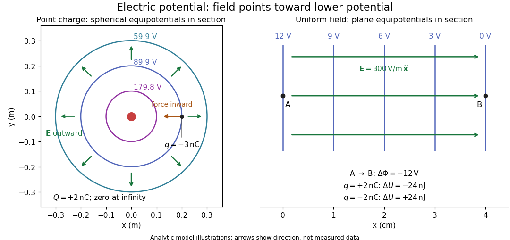
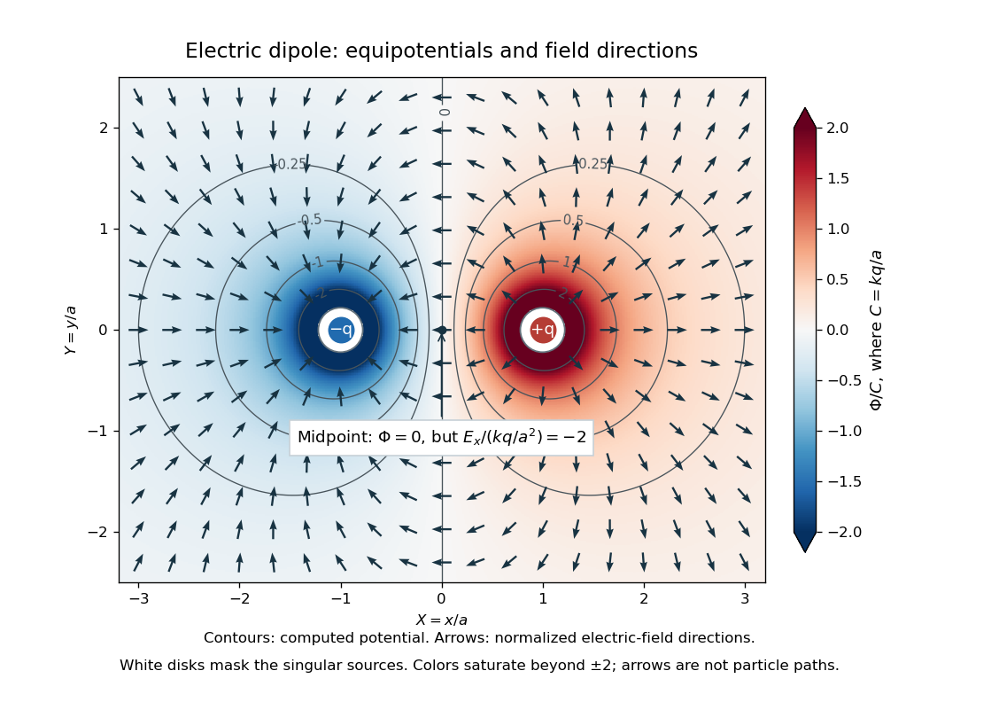
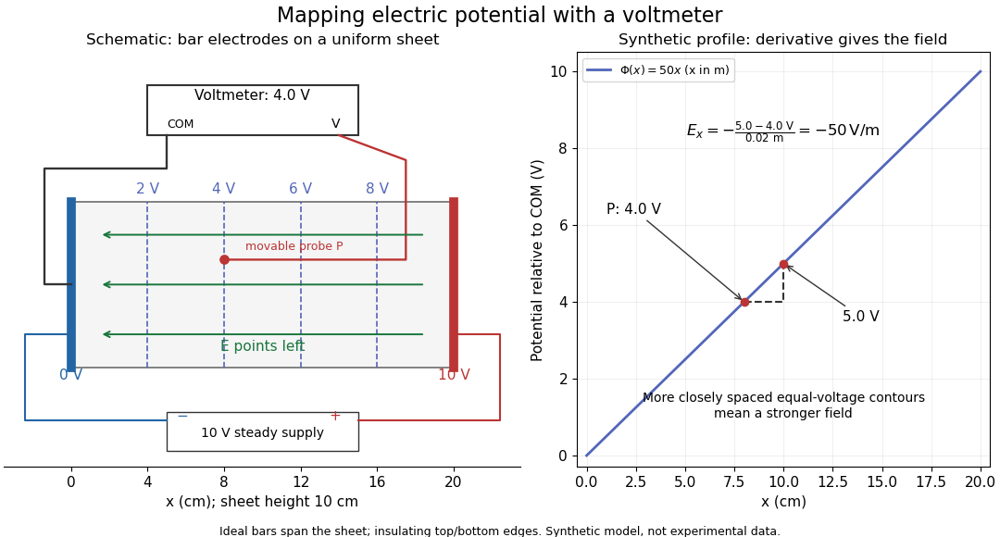

# Electric potential

↑ **Parent:** [Electric field](electric-field-split.md)  
ⓦ [Wiki](https://en.wikipedia.org/wiki/Electric_potential)

In [electrostatics](electrostatics-split.md), the [electric potential](electric-potential.md) $\Phi$ tells us the interaction [potential energy](potential-energy.md) per unit test [electric charge](electric-charge-split.md) in the [electric field](electric-field-split.md) of prescribed sources. Its most directly useful quantity is an [electric potential difference](electric-potential-difference.md): how much [work](work.md) per unit [electric charge](electric-charge-split.md) an external agent must supply to move that test [electric charge](electric-charge-split.md) slowly between two points. This replaces the bookkeeping of a [vector](vector.md) [force](force-split.md) along a path with the difference of two [scalar](scalar.md) values. The test [electric charge](electric-charge-split.md) must be small enough not to rearrange the sources appreciably.

For motion from $A$ to $B$, write $\Delta\Phi=\Phi(B)-\Phi(A)$. With fixed sources and only the [electric force](electric-force.md) doing [work](work.md),

$$
\Delta\Phi=-\int_A^B\mathbf E\cdot d\mathbf l,\qquad
\Delta U=q\Delta\Phi,\qquad
W_{\mathrm{field}}=-q\Delta\Phi,\qquad
\Delta K=-\Delta U.
$$

Here $U$ is interaction [potential energy](potential-energy.md), $K$ is [kinetic energy](kinetic-energy.md), and the [line integral](line-integral.md) uses the [electric field](electric-field-split.md) produced by the other [electric charges](electric-charge-split.md). For slow transport with unchanged [kinetic energy](kinetic-energy.md), the external [work](work.md) is $W_{\mathrm{ext}}=\Delta U$, so $\Delta\Phi=W_{\mathrm{ext}}/q$ for nonzero $q$. This external [work](work.md) has the opposite sign to the [work](work.md) done by the [electric field](electric-field-split.md). The [SI](international-system-of-units.md) unit is the [volt](volt.md),

$$
1\,\mathrm V=1\,\mathrm{J/C}.
$$

A [volt](volt.md) measures [energy](energy-split.md) per unit [electric charge](electric-charge-split.md), not [energy](energy-split.md) itself. For example, crossing an [electric potential difference](electric-potential-difference.md) of $+5\,\mathrm V$ changes the [potential energy](potential-energy.md) of $q=+2\,\mathrm{nC}$ by $+10\,\mathrm{nJ}$, but changes that of $q=-2\,\mathrm{nC}$ by $-10\,\mathrm{nJ}$. Both test [electric charges](electric-charge-split.md) encounter the same [electric potential difference](electric-potential-difference.md); their opposite signs reverse the [energy](energy-split.md) change.[§7.2, equations 7.4–7.7: energy per charge, work and potential difference](university-physics-volume-2-by-samuel-j-ling-and-others/7-2-electric-potential-and-potential-difference.md)

The [electrostatic potential](electric-potential.md) is a [scalar](scalar.md) [function](function-split.md) of position. The [electric field](electric-field-split.md) is a [conservative vector field](conservative-vector-field.md), and all three components follow from the negative [gradient](gradient.md) of the [electric potential](electric-potential.md):

$$
\mathbf E=-\nabla\Phi,\qquad E_x=-\frac{\partial\Phi}{\partial x},\quad E_y=-\frac{\partial\Phi}{\partial y},\quad E_z=-\frac{\partial\Phi}{\partial z}.
$$

The [electric field](electric-field-split.md) points toward decreasing [electric potential](electric-potential.md). A positive test [electric charge](electric-charge-split.md) feels [electric force](electric-force.md) in that direction; a negative test [electric charge](electric-charge-split.md) feels [electric force](electric-force.md) in the opposite direction, since $\mathbf F=q\mathbf E$. A freely accelerated negative test [electric charge](electric-charge-split.md) therefore moves toward higher [electric potential](electric-potential.md) while lowering its [potential energy](potential-energy.md) $U=q\Phi$.[§7.4, equations 7.13–7.15: components and negative gradient](university-physics-volume-2-by-samuel-j-ling-and-others/7-4-determining-field-from-potential.md)

Only differences fix physical [electrostatic potentials](electric-potential.md): adding the same constant $C_0$ everywhere, $\Phi'=\Phi+C_0$, changes neither the [gradient](gradient.md) nor any [electric potential difference](electric-potential-difference.md). Choosing an [electrical reference potential](electrical-reference-potential.md) is this elementary [gauge transformation](gauge-transformation.md). Setting zero at infinity is convenient for finitely many localized [point charges](point-charge.md); it is not available for an ideal uniform [electric field](electric-field-split.md) extending to infinity. There we can choose a finite reference point. Assigning zero at ground is a convention, whereas physically grounding an [electrical conductor](electrical-conductor.md) also allows exchange of [electric charge](electric-charge-split.md) to impose a boundary value. Zero [electric potential](electric-potential.md) at a point never by itself implies zero [electric field](electric-field-split.md).[§7.3, equation 7.8 and Figure 7.18: infinity and ground references](university-physics-volume-2-by-samuel-j-ling-and-others/7-3-calculations-of-electric-potential.md)

For a fixed [point charge](point-charge.md) $Q$ at the origin in [vacuum](vacuum.md), choose zero at infinity. [Coulomb's law](coulomb-s-law.md) gives

$$
\Phi(r)=\frac{kQ}{r},\qquad
\mathbf E(r)=\frac{kQ}{r^2}\widehat{\mathbf r},\qquad
k=\frac{1}{4\pi\varepsilon_0},\qquad r>0,
$$

where $\varepsilon_0$ is the [vacuum permittivity](vacuum-permittivity.md). Use the stipulated approximation $k=8.99\times10^9\,\mathrm{N\,m^2/C^2}$ and $Q=+2\,\mathrm{nC}$. At $r=0.20\,\mathrm m$,

$$
\Phi=89.9\,\mathrm V,\qquad E_r=449.5\,\mathrm{N/C}.
$$

A test [electric charge](electric-charge-split.md) $q=-3\,\mathrm{nC}$ has $U=-2.697\times10^{-7}\,\mathrm J$ and radial [electric force](electric-force.md) $F_r=-1.3485\times10^{-6}\,\mathrm N$, directed inward. Moving it inward from $r_A=0.20\,\mathrm m$ to $r_B=0.10\,\mathrm m$ raises the [electric potential](electric-potential.md) from $89.9$ to $179.8\,\mathrm V$ but lowers its [potential energy](potential-energy.md):

$$
\Delta\Phi=+89.9\,\mathrm V,\qquad
\Delta U=-2.697\times10^{-7}\,\mathrm J,\qquad
W_{\mathrm{field}}=+2.697\times10^{-7}\,\mathrm J.
$$

This is the [Coulomb potential energy](coulomb-potential-energy.md) calculation using [electric potentials](electric-potential.md). The source's singular self-field at $r=0$ is excluded; when finding the [force](force-split.md) on a source [point charge](point-charge.md), use only the [electric field](electric-field-split.md) of the other sources.[§7.3: point-charge potential and scalar superposition](university-physics-volume-2-by-samuel-j-ling-and-others/7-3-calculations-of-electric-potential.md)

For a uniform [electric field](electric-field-split.md) $\mathbf E=300\,\mathrm{V/m}\,\widehat{\mathbf x}$, choose $\Phi(0)=12\,\mathrm V$. Then

$$
\Phi(x)=12\,\mathrm V-(300\,\mathrm{V/m})x,\qquad
\Delta\Phi=-\mathbf E\cdot(\mathbf r_B-\mathbf r_A).
$$

Moving from $x_A=0$ to $x_B=0.04\,\mathrm m$ gives $\Delta\Phi=-12\,\mathrm V$. For $q=+2\,\mathrm{nC}$ the change in [potential energy](potential-energy.md) is $-24\,\mathrm{nJ}$ and the [electric field](electric-field-split.md) does $+24\,\mathrm{nJ}$ of [work](work.md). For $q=-2\,\mathrm{nC}$, the same prescribed displacement gives $\Delta U=+24\,\mathrm{nJ}$: the external agent must supply that [work](work.md) for slow transport. This uniform [electric field](electric-field-split.md) approximates the interior of a [parallel-plate capacitor](parallel-plate-capacitor.md) sufficiently far from the edges; the [fringing field of a capacitor](fringing-field-of-a-capacitor.md) limits the approximation.[§7.4: voltage gradient in a uniform field](university-physics-volume-2-by-samuel-j-ling-and-others/7-4-determining-field-from-potential.md)

**[Figure 3](#electric-potential-work-and-equipotentials). Analytic electric potential models: point charge equipotentials, a uniform electric field, and the sign of the change in potential energy**.

An [equipotential](equipotential.md) is a [level set](level-set.md) $\Phi=\text{constant}$. On a smooth [equipotential](equipotential.md) with nonzero [gradient](gradient.md), every tangent displacement has $d\Phi=\nabla\Phi\cdot d\mathbf l=0$, so the [electric field](electric-field-split.md) is normal to the [equipotential](equipotential.md). Thus moving a test [electric charge](electric-charge-split.md) along an [equipotential](equipotential.md) requires no net electrical [work](work.md). Around a [point charge](point-charge.md), the [equipotentials](equipotential.md) are [spheres](sphere.md); the circles in the diagram are their sections, not an assumption of two-dimensional [Coulomb's law](coulomb-s-law.md). A uniform [electric field](electric-field-split.md) has parallel [plane](plane.md) [equipotentials](equipotential.md). For contours separated by the same small [electric potential difference](electric-potential-difference.md), smaller normal separation means a stronger [electric field](electric-field-split.md), approximately $|\mathbf E|\approx|\Delta\Phi|/\Delta n$. At a point where $\nabla\Phi=0$, the [electric field](electric-field-split.md) is zero and has no direction to call normal.[§7.5, Figures 7.30–7.32: equipotentials, perpendicular field and zero work](university-physics-volume-2-by-samuel-j-ling-and-others/7-5-equipotential-surfaces-and-conductors.md)

The [superposition principle](superposition-principle.md) adds [electric potentials](electric-potential.md) as signed [scalars](scalar.md). For finitely many stationary [point charges](point-charge.md) $q_j$ at $\mathbf r_j$ in [vacuum](vacuum.md),

$$
\Phi(\mathbf r)=k\sum_j\frac{q_j}{|\mathbf r-\mathbf r_j|},\qquad
\mathbf E(\mathbf r)=k\sum_jq_j\frac{\mathbf r-\mathbf r_j}{|\mathbf r-\mathbf r_j|^3}.
$$

For example, the [electric dipole](electric-dipole.md) with $+q$ at $(a,0,0)$ and $-q$ at $(-a,0,0)$ has zero [electric potential](electric-potential.md) everywhere in the midplane $x=0$, yet its [electric field](electric-field-split.md) at the midpoint is $\mathbf E=-(2kq/a^2)\widehat{\mathbf x}$. With $q=2\,\mathrm{nC}$ and $a=0.10\,\mathrm m$, this is $-3596\,\mathrm{N/C}\,\widehat{\mathbf x}$. At $(2a,0,0)$, the same model gives $\Phi=2kq/(3a)\approx119.867\,\mathrm V$ and $E_x=8kq/(9a^2)\approx1598.222\,\mathrm{N/C}$. Cancellation of [electric potentials](electric-potential.md) is quite different from cancellation of [vector](vector.md) [electric fields](electric-field-split.md).

**[Figure 4](#image-computed-dipole-equipotentials-and-electric-field-directions-zero-potential-on-the-vertical-midline-still-permits-a-nonzero-field). Computed dipole equipotentials and electric-field directions: zero potential on the vertical midline still permits a nonzero field**.

A motivating measurement is [conductive-paper electric potential mapping](conductive-paper-electric-potential-mapping.md). A documented teaching experiment uses slightly conductive paper on an insulating board, two circular [electrodes](electrode.md) in highly conducting ink, a steady supply, and a digital [voltmeter](voltmeter.md). Connect the supply to the two [electrodes](electrode.md), keep the [voltmeter](voltmeter.md) common lead on the negative [electrode](electrode.md), and use its other lead as a movable probe. Adjust the supply using the measured [electric potential difference](electric-potential-difference.md) between [electrodes](electrode.md); the published procedure uses $10\,\mathrm V$. The observable is the [voltmeter](voltmeter.md) reading $\Phi(P)-\Phi(\mathrm{COM})$ at the probe position $P$. Locate several points reading $2\,\mathrm V$, record their positions on a separate map, and join them into an [equipotential](equipotential.md); repeat at other readings. Lift the probe between contacts so it does not damage the paper. This procedure makes the [electrical reference potential](electrical-reference-potential.md) concrete: every reading compares two contacts.[Physics 2212, Lab 5: Electric Potential and Field](physics-2212-laboratory-manual-by-eric-murray/physics-2212-lab-5-electric-potential-and-field.md)

From neighboring readings infer an [electric field](electric-field-split.md) component by a [finite difference](finite-difference-split.md), $E_x\approx-[\Phi(x+h)-\Phi(x)]/h$. Reconstruct two in-plane components with displacements along two independent directions. Alternatively, draw the [electric field](electric-field-split.md) normal to mapped [equipotentials](equipotential.md), toward lower [electric potential](electric-potential.md). The second diagram illustrates the same measurement principle with bar [electrodes](electrode.md) spanning a uniform sheet, insulating top and bottom edges, and a synthetic model $\Phi(x)=(50\,\mathrm{V/m})x$. The model readings $4.0\,\mathrm V$ at $x=0.08\,\mathrm m$ and $5.0\,\mathrm V$ at $x=0.10\,\mathrm m$ imply $E_x=-50\,\mathrm{V/m}$. These values are calculated illustrations, not reported experimental data. The documented circular-[electrode](electrode.md) experiment similarly estimates the [electric field](electric-field-split.md) from readings at successive centimetre marks.[Physics 2212, Lab 5: Electric Potential and Field](physics-2212-laboratory-manual-by-eric-murray/physics-2212-lab-5-electric-potential-and-field.md)

**[Figure 5](#electric-potential-voltmeter-mapping). Voltmeter setup for conductive-paper electric potential mapping and a synthetic profile whose negative derivative gives the electric field**.

Useful controls include checking the [voltmeter](voltmeter.md) zero, checking that the [electric potential difference](electric-potential-difference.md) along each painted [electrode](electrode.md) is negligible, and repeating reference readings to detect supply drift. Reversing the supply should reverse the signs relative to the same reference contact. Contact resistance, leakage [electric currents](electric-current.md), and touching the sheet can distort the map. A [voltmeter](voltmeter.md) has finite input [electrical resistance](electrical-resistance.md) and draws a small [electric current](electric-current.md); [voltmeter loading](voltmeter-loading.md) changes the quantity being measured if that [electrical resistance](electrical-resistance.md) is insufficiently large relative to the sheet's effective source [electrical resistance](electrical-resistance.md).[EC-2: Electric Fields](electricity-and-magnetism-laboratory-manual/ec-2-electric-fields.md)[§10.4, Measuring Voltage with a Voltmeter: parallel connection and large input resistance](university-physics-volume-2-by-samuel-j-ling-and-others/10-4-electrical-measuring-instruments.md)

The paper carries a steady [electric current](electric-current.md), so this is a planar analogue rather than a direct measurement of isolated [point charges](point-charge.md) in three-dimensional [vacuum](vacuum.md). For constant [electrical conductivity](electrical-conductivity.md), [Ohm's law](ohm-s-law.md) and steady [charge conservation](charge-conservation.md) give $\mathbf j=-\sigma\nabla\Phi$ and $\nabla\cdot\mathbf j=0$, hence the two-dimensional [Laplace equation](laplace-equation.md) away from [electrodes](electrode.md). Insulating sheet edges impose zero normal [electric current](electric-current.md), while finite [electrodes](electrode.md) fix boundary values. This derivation explains both the analogy and its limits: inhomogeneous paper, finite boundaries, and finite [electrodes](electrode.md) can change the contours. One should not fit the three-dimensional [point charge](point-charge.md) formula $kQ/r$ to a planar map without testing that model. Small probe spacing resolves spatial variation better, but amplifies uncertainty in the inferred [finite difference](finite-difference-split.md). The published laboratory instructions explicitly ask students to assess whether their proposed field fit is appropriate.[EC-2: Electric Fields](electricity-and-magnetism-laboratory-manual/ec-2-electric-fields.md)[Physics 2212, Lab 5: Electric Potential and Field](physics-2212-laboratory-manual-by-eric-murray/physics-2212-lab-5-electric-potential-and-field.md)

The scalar description has a crucial limit. [Faraday's law of induction](faraday-s-law-of-induction.md) for a stationary closed path $\Gamma$ says

$$
\oint_\Gamma\mathbf E\cdot d\mathbf l=-\frac{d\Phi_B}{dt},\qquad
\nabla\times\mathbf E=-\frac{\partial\mathbf B}{\partial t},
$$

where $\Phi_B$ is [magnetic flux](magnetic-flux.md). Nonzero changing [magnetic flux](magnetic-flux.md) gives nonzero circulation, incompatible with a single-valued [electric potential](electric-potential.md) alone. More generally, a scalar [electric potential](electric-potential.md) and a [magnetic vector potential](magnetic-vector-potential.md) together give

$$
\mathbf E=-\nabla\Phi-\frac{\partial\mathbf A}{\partial t},\qquad
\mathbf B=\nabla\times\mathbf A.
$$

Consequently, in the presence of induction, two [voltmeter](voltmeter.md) lead routes between the same contacts can produce different readings if the enclosed [magnetic flux](magnetic-flux.md) changes. This follows by subtracting the two path [line integrals](line-integral.md); it is a deduction from [Faraday's law of induction](faraday-s-law-of-induction.md), not a claimed outcome of the paper experiment. The steady setup and negligible induction justify interpreting its readings as [electric potential differences](electric-potential-difference.md). Merely introducing a scalar [electric potential](electric-potential.md) that depends on [time](time-in-physics.md) cannot supply a nonzero [curl](curl.md) of the [electric field](electric-field-split.md).[§21–3](the-feynman-lectures-on-physics-volume-ii-by-richard-feynman-and-others/chapter-21-solutions-of-maxwell%E2%80%99s-equations-with-currents-and-charges.md)

A short mathematical justification connects the statements above. Along a smooth path, the [chain rule](chain-rule.md) gives $d\Phi=\nabla\Phi\cdot d\mathbf l$. Integrating and using $\mathbf E=-\nabla\Phi$ yields the endpoint formula by the [fundamental theorem for line integrals](fundamental-theorem-for-line-integrals.md), proving [path independence](path-independence.md). Conversely, vanishing circulation around every closed path lets us define $\Phi(P)=-\int_{P_0}^{P}\mathbf E\cdot d\mathbf l$ independently of the route, with $\Phi(P_0)=0$. Zero [curl](curl.md) is a local test; for a continuously differentiable [curl-free vector field](irrotational-vector-field.md), a [simply connected](simply-connected-space.md) open region suffices for a global potential. The explicit finite-source formula already gives a global [electric potential](electric-potential.md) away from its source points.[Chapter 4: Electrostatics](the-feynman-lectures-on-physics-volume-ii-by-richard-feynman-and-others/chapter-4-electrostatics.md)

**Table of contents**

- [Grounded-plate potential of a central charged sheet](grounded-plate-potential-of-a-central-charged-sheet.md)
- [Potential of a charged cylindrical shell with angular Fourier data](potential-of-a-charged-cylindrical-shell-with-angular-fourier-data.md)
- [Voltmeter](voltmeter.md)
  - [Voltmeter loading](voltmeter-loading.md)
- [Conductive-paper electric potential mapping](conductive-paper-electric-potential-mapping.md)
- [Electrical reference potential](electrical-reference-potential.md)
- [Constrained electrostatic equilibrium](constrained-electrostatic-equilibrium.md)
- [Electrostatic reciprocity identity](electrostatic-reciprocity-identity.md)
- [Image charge](image-charge.md)
  - [Image charges in a right-angle conducting wedge](image-charges-in-a-right-angle-conducting-wedge.md)
    - [Lateral stability of a spring-supported charge in a wedge](lateral-stability-of-a-spring-supported-charge-in-a-wedge.md)
    - [Electrostatic softening above a conducting wedge](electrostatic-softening-above-a-conducting-wedge.md)
  - [Image charge at a dielectric interface](image-charge-at-a-dielectric-interface.md)
    - [Permittivity convention for transmitted image charges](permittivity-convention-for-transmitted-image-charges.md)
  - [Fall time of a charge toward a grounded plane](fall-time-of-a-charge-toward-a-grounded-plane.md)
  - [Falling charge above a grounded conducting plane](falling-charge-above-a-grounded-conducting-plane.md)
  - [Image charge for a grounded conducting sphere](image-charge-for-a-grounded-conducting-sphere.md)
    - [Equal-charge balance around a grounded sphere](equal-charge-balance-around-a-grounded-sphere.md)
    - [Image charges for a neutral conducting sphere](image-charges-for-a-neutral-conducting-sphere.md)
- [Electric potential difference](electric-potential-difference.md)
  - [Bias voltage](bias-voltage.md)
- [Point charge](point-charge.md)
- [Equipotential](equipotential.md)

## ↑ Ancestors (5)

1. [Electric field](electric-field-split.md)
2. [Electromagnetism](electromagnetism-split.md)
3. [Branches of physics](branches-of-physics.md)
4. [Physics](physics-split.md)
5. [Codex Wiki](split.md)

## ← Incoming links (138)

- [Arithmetic-harmonic bounds for dielectric capacitance](arithmetic-harmonic-bounds-for-dielectric-capacitance.md)
- [ATP synthase energy and proton budget](atp-synthase-energy-and-proton-budget.md)
- [Band bending](band-bending.md)
- [Bounded two-dimensional capacitor field model](bounded-two-dimensional-capacitor-field-model.md)
- [Built-in potential](built-in-potential.md)
- [Capacitor](capacitor.md)
- [Capacitor gap aspect ratio](capacitor-gap-aspect-ratio.md)
- [Cavity in a conductor](cavity-in-a-conductor.md)
- [CCD clocked charge transfer](ccd-clocked-charge-transfer.md)
- [Charge regulation](charge-regulation.md)
- [Charged sheet between grounded parallel plates](charged-sheet-between-grounded-parallel-plates.md)
- [Chemiosmosis](chemiosmosis.md)
- [Conducting hemispherical protrusion in a uniform field](conducting-hemispherical-protrusion-in-a-uniform-field.md)
- [Conducting sphere](conducting-sphere.md)
- [Conductor in electrostatic equilibrium](conductor-in-electrostatic-equilibrium.md)
- [Contact potential difference](contact-potential-difference.md)
- [Coulomb potential energy](coulomb-potential-energy.md)
- [Current dipole](current-dipole.md)
- [Cyclotron gap energy gain](cyclotron-gap-energy-gain.md)
- [Cylinder-plane image charges](cylinder-plane-image-charges.md)
- [Debye-Hückel potential of a charged sphere](debye-huckel-potential-of-a-charged-sphere.md)
- [Diode](diode.md)
- [Dipole line-integral identity](dipole-line-integral-identity.md)
- [Earnshaw's theorem](earnshaw-s-theorem.md)
- [Electric dipole](electric-dipole.md)
- [Electric dipole moment](electric-dipole-moment.md)
- [Electric multipole expansion](electric-multipole-expansion.md)
- [Electric potential](electric-potential.md)
- [Electric potential difference](electric-potential-difference.md)
- [Electrical reference potential](electrical-reference-potential.md)
- [Electrochemical gradient](electrochemical-gradient.md)
- [Electrochemical potential](electrochemical-potential.md)
- [Electrochemistry](electrochemistry-split.md)
- [Electrode](electrode.md)
- [Electromagnetic four-potential](electromagnetic-four-potential.md)
- [Electromotive force](electromotive-force.md)
- [Electron accelerating-voltage wavelength](electron-accelerating-voltage-wavelength.md)
- [Electrostatic acceleration energy gain](electrostatic-acceleration-energy-gain.md)
- [Electrostatic boundary conditions at a conductor](electrostatic-boundary-conditions-at-a-conductor.md)
- [Electrostatic energy of a uniformly charged solid sphere](electrostatic-energy-of-a-uniformly-charged-solid-sphere.md)
- [Electrostatic potential energy of point charges](electrostatic-potential-energy-of-point-charges.md)
- [Electrostatic screening](electrostatic-screening.md)
- [Electrostatics](electrostatics-split.md)
- [Faraday constant](faraday-constant.md)
- [Faraday's ice pail experiment](faraday-s-ice-pail-experiment.md)
- [Franck-Hertz experiment](franck-hertz-experiment.md)
- [Gauge-invariant Josephson phase](gauge-invariant-josephson-phase.md)
- [Gauss's law](gauss-s-law.md)
- [Geselowitz formula](geselowitz-formula.md)
- [Grounded-plate potential of a central charged sheet](grounded-plate-potential-of-a-central-charged-sheet.md)
- [Guard electrode of a capacitor](guard-electrode-of-a-capacitor.md)
- [Hess cosmic-ray balloon experiment](hess-cosmic-ray-balloon-experiment.md)
- [Intracellular recording of membrane potential](intracellular-recording-of-membrane-potential.md)
- [Ion trap](ion-trap.md)
- [Magnetically charged conical pendulum](magnetically-charged-conical-pendulum.md)
- [Mapping a capacitor fringing field](mapping-a-capacitor-fringing-field.md)
- [Membrane potential](membrane-potential-split.md)
- [Membrane transport](membrane-transport.md)
- [Mitochondrial membrane potential](mitochondrial-membrane-potential.md)
- [MOS inversion threshold](mos-inversion-threshold.md)
- [Passive transport](passive-transport.md)
- [Solution](past-exam-of-the-advanced-quantum-condensed-matter-physics-course-of-the-university-of-cambridge/2013/paper-1/1/solution.md)
- [Solution](past-exam-of-the-biochemistry-course-of-the-university-of-cambridge/2025/paper-1/section-ii/6/solution.md)
- [Solution](past-exam-of-the-mathematics-course-of-the-university-of-cambridge/2005/ib/paper-1/16h/solution.md)
- [Solution](past-exam-of-the-mathematics-course-of-the-university-of-cambridge/2006/ib/paper-1/16g/solution.md)
- [Solution](past-exam-of-the-mathematics-course-of-the-university-of-cambridge/2007/ib/paper-2/6e/solution.md)
- [Solution](past-exam-of-the-mathematics-course-of-the-university-of-cambridge/2008/ib/paper-1/16b/iv/solution.md)
- [Solution](past-exam-of-the-mathematics-course-of-the-university-of-cambridge/2008/ib/paper-2/6b/solution.md)
- [Solution](past-exam-of-the-mathematics-course-of-the-university-of-cambridge/2008/ib/paper-4/7b/i/solution.md)
- [Solution](past-exam-of-the-mathematics-course-of-the-university-of-cambridge/2008/ib/paper-4/7b/ii/solution.md)
- [Solution](past-exam-of-the-mathematics-course-of-the-university-of-cambridge/2008/iii/paper-76/1/solution.md)
- [Solution](past-exam-of-the-mathematics-course-of-the-university-of-cambridge/2009/ib/paper-1/16a/a/solution.md)
- [Solution](past-exam-of-the-mathematics-course-of-the-university-of-cambridge/2009/ib/paper-1/16a/b/solution.md)
- [Solution](past-exam-of-the-mathematics-course-of-the-university-of-cambridge/2013/ib/paper-4/7d/solution.md)
- [Solution](past-exam-of-the-mathematics-course-of-the-university-of-cambridge/2015/iii/paper-48/3/solution.md)
- [Solution](past-exam-of-the-mathematics-course-of-the-university-of-cambridge/2015/iii/paper-75/1/solution.md)
- [Solution](past-exam-of-the-mathematics-course-of-the-university-of-cambridge/2017/iii/paper-311/4/solution.md)
- [Solution](past-exam-of-the-mathematics-course-of-the-university-of-cambridge/2019/ia/paper-4/10a/b/ii/solution.md)
- [Solution](past-exam-of-the-mathematics-course-of-the-university-of-cambridge/2019/ib/paper-1/16a/solution.md)
- [Solution](past-exam-of-the-mathematics-course-of-the-university-of-cambridge/2019/ib/paper-2/6a/solution.md)
- [Solution](past-exam-of-the-mathematics-course-of-the-university-of-cambridge/2020/ib/paper-1/16d/solution.md)
- [Solution](past-exam-of-the-mathematics-course-of-the-university-of-cambridge/2020/ib/paper-2/5d/solution.md)
- [Solution](past-exam-of-the-mathematics-course-of-the-university-of-cambridge/2023/ib/paper-4/5d/a/solution.md)
- [Solution](past-exam-of-the-mathematics-course-of-the-year-1-of-the-natural-sciences-course-of-the-university-of-cambridge/2012/paper-2/15/a/solution.md)
- [Solution](past-exam-of-the-mathematics-course-of-the-year-1-of-the-natural-sciences-course-of-the-university-of-cambridge/2012/paper-2/15/b/solution.md)
- [Solution](past-exam-of-the-mathematics-course-of-the-year-1-of-the-natural-sciences-course-of-the-university-of-cambridge/2012/paper-2/15/c/solution.md)
- [Solution](past-exam-of-the-mathematics-course-of-the-year-2-of-the-natural-sciences-course-of-the-university-of-cambridge/2001/paper-2/1/solution.md)
- [Solution](past-exam-of-the-mathematics-course-of-the-year-2-of-the-natural-sciences-course-of-the-university-of-cambridge/2003/paper-2/1/solution.md)
- [Solution](past-exam-of-the-optics-and-electrodynamics-course-of-the-university-of-cambridge/2012/paper-1/2/c/solution.md)
- [Solution](past-exam-of-the-optics-and-electrodynamics-course-of-the-university-of-cambridge/2022/section-b/5/b/solution.md)
- [Solution](past-exam-of-the-physics-a-course-of-the-university-of-cambridge/2016/paper-1/section-d/d13/a/solution.md)
- [Solution](past-exam-of-the-physics-a-course-of-the-university-of-cambridge/2017/paper-1/section-a/4/solution.md)
- [Solution](past-exam-of-the-physics-b-course-of-the-university-of-cambridge/2010/paper-2a/section-b/b9/solution.md)
- [Solution](past-exam-of-the-physics-b-course-of-the-university-of-cambridge/2012/paper-1/section-b/b6/solution.md)
- [Solution](past-exam-of-the-physics-b-course-of-the-university-of-cambridge/2015/paper-1/section-a/a1/solution.md)
- [Solution](past-exam-of-the-physics-b-course-of-the-university-of-cambridge/2015/paper-1/section-b/b7/solution.md)
- [Solution](past-exam-of-the-physics-b-course-of-the-university-of-cambridge/2016/paper-2/section-b/b6/a/solution.md)
- [Solution](past-exam-of-the-physics-b-course-of-the-university-of-cambridge/2016/paper-2/section-b/b7/solution.md)
- [Solution](past-exam-of-the-physics-b-course-of-the-university-of-cambridge/2017/paper-1/section-b/b6/solution.md)
- [Solution](past-exam-of-the-physics-b-course-of-the-university-of-cambridge/2018/paper-1/section-b/b6/solution.md)
- [Solution](past-exam-of-the-physics-b-course-of-the-university-of-cambridge/2019/paper-1/section-b/unnumbered-electrostatics-question/solution.md)
- [Solution](past-exam-of-the-physics-b-course-of-the-university-of-cambridge/2022/paper-2/section-b/b7/a/solution.md)
- [Solution](past-exam-of-the-physics-course-of-the-year-1-of-the-natural-sciences-course-of-the-university-of-cambridge/2012/paper-1/section-e/e15/c/solution.md)
- [Solution](past-exam-of-the-physics-course-of-the-year-1-of-the-natural-sciences-course-of-the-university-of-cambridge/2014/paper-1/e15/a/solution.md)
- [Solution](past-exam-of-the-physics-course-of-the-year-1-of-the-natural-sciences-course-of-the-university-of-cambridge/2015/paper-1/section-e/e15/b/solution.md)
- [Solution](past-exam-of-the-physics-course-of-the-year-1-of-the-natural-sciences-course-of-the-university-of-cambridge/2016/paper-1/section-e/e15/b/solution.md)
- [Solution](past-exam-of-the-physics-course-of-the-year-1-of-the-natural-sciences-course-of-the-university-of-cambridge/2018/section-a/6/solution.md)
- [Solution](past-exam-of-the-physics-course-of-the-year-1-of-the-natural-sciences-course-of-the-university-of-cambridge/2018/section-e/15/a/solution.md)
- [Solution](past-exam-of-the-physics-course-of-the-year-1-of-the-natural-sciences-course-of-the-university-of-cambridge/2018/section-e/15/b/solution.md)
- [Solution](past-exam-of-the-physics-course-of-the-year-1-of-the-natural-sciences-course-of-the-university-of-cambridge/2022/section-a/5/solution.md)
- [Solution](past-exam-of-the-quantum-condensed-matter-course-of-the-university-of-cambridge/2006/section-a/a3/c/i/solution.md)
- [Solution](past-exam-of-the-quantum-condensed-matter-course-of-the-university-of-cambridge/2007/section-b/b3/solution.md)
- [Solution](past-exam-of-the-quantum-condensed-matter-course-of-the-university-of-cambridge/2009/section-a/a2/b/solution.md)
- [Solution](past-exam-of-the-quantum-condensed-matter-course-of-the-university-of-cambridge/2009/section-b/b4/solution.md)
- [Solution](past-exam-of-the-quantum-condensed-matter-course-of-the-university-of-cambridge/2019/section-a/2/solution.md)
- [Solution](past-exam-of-the-quantum-condensed-matter-course-of-the-university-of-cambridge/2021/section-b/6/d/solution.md)
- [Solution](past-exam-of-the-soft-condensed-matter-course-of-the-university-of-cambridge/2013/paper-1/2/b/solution.md)
- [Paul trap Mathieu parameters](paul-trap-mathieu-parameters.md)
- [Paul trap secular motion](paul-trap-secular-motion.md)
- [Photoelectron binding energy reference](photoelectron-binding-energy-reference.md)
- [Planar quadrupole potential](planar-quadrupole-potential.md)
- [Radial current dipole](radial-current-dipole.md)
- [Reference electrode](reference-electrode.md)
- [Resistance bridge](resistance-bridge.md)
- [Respiratory uncoupling](respiratory-uncoupling.md)
- [RF-averaged trapping potential](rf-averaged-trapping-potential.md)
- [Seebeck effect](seebeck-effect.md)
- [Spherical Neumann dipole images](spherical-neumann-dipole-images.md)
- [Surface state](surface-state.md)
- [Thermocouple](thermocouple.md)
- [Type-I band alignment](type-i-band-alignment.md)
- [Uniform current in a straight homogeneous wire](uniform-current-in-a-straight-homogeneous-wire.md)
- [Uniformly polarized sphere](uniformly-polarized-sphere.md)
- [Uniqueness theorem for the electrostatic potential](uniqueness-theorem-for-the-electrostatic-potential.md)
- [Virtual ground](virtual-ground.md)
- [Volt](volt.md)
- [Wheatstone bridge balance](wheatstone-bridge-balance.md)
- [Wheatstone bridge detector loading](wheatstone-bridge-detector-loading.md)
