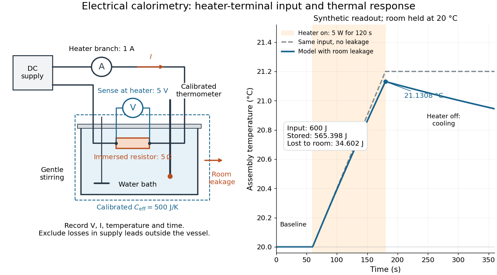

# Electrical calorimetry of a resistor

↑ **Parent:** [Joule heating](joule-heating.md)

An electrical [calorimetry](calorimetry-split.md) experiment asks whether a measured electrical [work](work.md) input accounts for a measured warming. The University of Iowa's demonstration uses an insulated flask containing [water](water.md), an immersed heater, a [thermometer](thermometer.md), electrical meters and a timer. Its procedure compares the duration, electrical readings and [temperature](temperature-split.md) rise. The following low-[power](power.md) measurement design and synthetic readout develop that idea; they are not measurements reported by the demonstration. [Equipment and Procedure: insulated flask, immersed heater, thermometry, electrical meters and timed warming](5f15-10-electrical-equivalent-of-heat-by-university-of-iowa-department-of-physics-and-astronomy.md)

Use a covered [calorimeter](calorimeter.md) with weighed [water](water.md), an immersed [resistor](resistor.md), a calibrated [thermometer](thermometer.md) and gentle stirring. Put an [ammeter](ammeter.md) in series with the heater branch and a high-input-[electrical resistance](electrical-resistance.md) [voltmeter](voltmeter.md) across the immersed [resistor](resistor.md)'s terminals. Record $V(t)$, $I(t)$, [temperature](temperature-split.md) $T(t)$ and room [temperature](temperature-split.md) $T_a(t)$ before, during and after switching the heater on. Measure the [electric potential difference](electric-potential-difference.md) at the heater, rather than at the supply: lead and contact [electrical resistance](electrical-resistance.md) outside the receiving boundary can consume [power](power.md) that never reaches the [water](water.md). Account for [voltmeter loading](voltmeter-loading.md) if the [ammeter](ammeter.md) also includes the sensing branch's [electric current](electric-current.md).[Measuring Current with an Ammeter and Measuring Voltage with a Voltmeter, Figures 10.35–10.36: series current measurement, parallel voltage measurement and instrument resistance](university-physics-volume-2-by-samuel-j-ling-and-others/10-4-electrical-measuring-instruments.md)

The electrical readout gives operating [electrical resistance](electrical-resistance.md) $R(t)=V(t)/I(t)$ when $I(t)\ne0$, and [power](power.md) $P(t)=V(t)I(t)$. To test [Ohm's law](ohm-s-law.md), obtain several pairs at the same [temperature](temperature-split.md); one ratio alone cannot establish a linear response. For small [electrical resistance](electrical-resistance.md), use [four-terminal sensing](four-terminal-sensing.md) to exclude lead drops and reverse [electric current](electric-current.md) to test stable offsets from the [thermoelectric effect](thermoelectric-effect-split.md). Use brief low-[power](power.md) resistance measurements if the intended result is the unheated value: the test itself causes [Joule heating](joule-heating.md).

For a covered assembly at approximately constant [pressure](pressure-split.md), with negligible evaporation, negligible endpoint mechanical [energy](energy-split.md) changes and no [phase transition](phase-transition.md), take

$$
C_{\rm eff}=m_wc_w+C_{\rm cal},\qquad
E_{\rm el}=\int_{t_0}^{t_1}VI\,dt
=C_{\rm eff}(T_1-T_0)+Q_{\rm loss,out}-W_{\rm stir,on}.
$$

Here $c_w$ is the [water](water.md)'s [specific heat capacity at constant pressure](specific-heat-capacity-at-constant-pressure.md), $C_{\rm cal}$ is the participating vessel, heater and sensor [heat capacity](heat-capacity.md), $Q_{\rm loss,out}$ is signed outward [heat](heat-split.md) leakage, and $W_{\rm stir,on}$ is stirring [work](work.md) entering the assembly. The storage term approximates its [enthalpy](enthalpy-split.md) change; for a rigid fixed-[volume](volume-thermodynamics.md) receiver use the corresponding [heat capacity at constant volume](heat-capacity-at-constant-volume.md). Calibrate $C_{\rm eff}$ independently if the purpose is to test electrical input against thermal storage. Using the same heating run to define $C_{\rm eff}=E_{\rm el}/\Delta T$ and then claiming it verifies the equality would be circular.

**[Figure 17](#joule-heating-electrical-calorimetry-readout). An immersed resistor connects electrical readings to a corrected calorimeter warming**. Original apparatus schematic and synthetic [temperature](temperature-split.md) trace, not Joule's original apparatus or a measured dataset. Separate sensing leads indicate the heater-terminal [electric potential difference](electric-potential-difference.md); the [ammeter](ammeter.md) is in the heater branch. Shading marks $120\,\mathrm s$ of input at $5\,\mathrm W$. The dashed trace suppresses room [heat](heat-split.md) leakage but keeps the same [heat capacity](heat-capacity.md).

For the synthetic trace, stipulate $V=5\,\mathrm V$, $I=1\,\mathrm A$, $R=5\,\Omega$, $C_{\rm eff}=500\,\mathrm{J/K}$, room [temperature](temperature-split.md) $20\,{}^\circ\mathrm C$, and loss coefficient $G=0.5\,\mathrm{W/K}$, with negligible stirring input. The heater runs for $120\,\mathrm s$, beginning at room [temperature](temperature-split.md). The [calorimeter heat-loss correction](calorimeter-heat-loss-correction.md) model is

$$
C_{\rm eff}\frac{dT}{dt}=VI-G(T-T_a),\qquad
\Delta T=\frac{VI}{G}\left(1-e^{-G\Delta t/C_{\rm eff}}\right).
$$

It predicts $E_{\rm el}=600\,\mathrm J$, $\Delta T\approx1.13080\,\mathrm K$, storage $565.398\,\mathrm J$ and outward loss $34.602\,\mathrm J$. Neglecting leakage undercounts deposited [energy](energy-split.md) by about $5.77\%$; assuming no loss predicts $1.20\,\mathrm K$. After switching off, the excess [temperature](temperature-split.md) undergoes [exponential decay](exponential-decay.md) with [time constant](time-constant.md) $C_{\rm eff}/G=1000\,\mathrm s$. A cooling slope can estimate $G$ only with known $C_{\rm eff}$ and a credible single-[temperature](temperature-split.md) model.

Controls separate causes of a [temperature](temperature-split.md) rise. Check the electrical meters' zeros and [thermometer calibration](thermometer-calibration.md); keep [water](water.md) [mass](mass.md), immersion, lid and stirring fixed between runs. Record a heater-off stirred baseline to estimate sensor drift and stirring input. Repeat cooling runs over the same [temperature](temperature-split.md) range to estimate environmental [heat transfer](heat-transfer.md); a baseline taken only at room [temperature](temperature-split.md) cannot measure warming-dependent leakage. Vary [electric current](electric-current.md) while keeping $R$ and initial thermal conditions comparable: corrected deposited [energy](energy-split.md) should scale as $I^2$ for equal durations. An independent [calorimeter calibration](calorimeter-calibration.md) or known reference [heat capacity](heat-capacity.md) makes this a quantitative test rather than a qualitative observation.

Finite sensor response, incomplete [thermal equilibrium](thermal-equilibrium-split.md), changing $R(T)$ or [heat capacity](heat-capacity.md), evaporation, and imperfect loss corrections limit the inference. A final [temperature](temperature-split.md) alone cannot distinguish smaller electrical input from larger [heat](heat-split.md) leakage or a larger participating [heat capacity](heat-capacity.md). Agreement tests the stated assembly and its [energy](energy-split.md) accounting; it does not show that all electrical [work](work.md) in arbitrary devices becomes [heat](heat-split.md).

Historically, the Royal Society's archive description of [James Prescott Joule](james-prescott-joule.md)'s manuscript dated 13 October 1840 records a coil of wire in a jar of [water](water.md), a [thermometer](thermometer.md) and a [galvanometer](galvanometer.md), and summarizes his inference that warming depends on [electrical resistance](electrical-resistance.md) and the square of [electric current](electric-current.md) intensity. This electrical experiment precedes [Joule's paddle-wheel experiment](joule-s-paddle-wheel-experiment.md); the input here is electrical [work](work.md), whereas the paddle supplies mechanical [work](work.md). The catalogue, rather than the inaccessible manuscript images, supports this account. [Royal Society Archives, AP/23/34, Description and Date: apparatus, resistance dependence and duplicate-ratio conclusion; manuscript dated 13 October 1840](archive-catalogue-record-ap-23-34-on-the-production-of-heat-by-voltaic-electricity-by-the-royal-society-archives.md)

## ↑ Ancestors (10)

1. [Joule heating](joule-heating.md)
2. [Ohm's law](ohm-s-law.md)
3. [Electrical resistance](electrical-resistance.md)
4. [Electrical resistance and conductance](electrical-resistance-and-conductance.md)
5. [Electric current](electric-current.md)
6. [Electric charge](electric-charge-split.md)
7. [Electromagnetism](electromagnetism-split.md)
8. [Branches of physics](branches-of-physics.md)
9. [Physics](physics-split.md)
10. [Codex Wiki](split.md)
