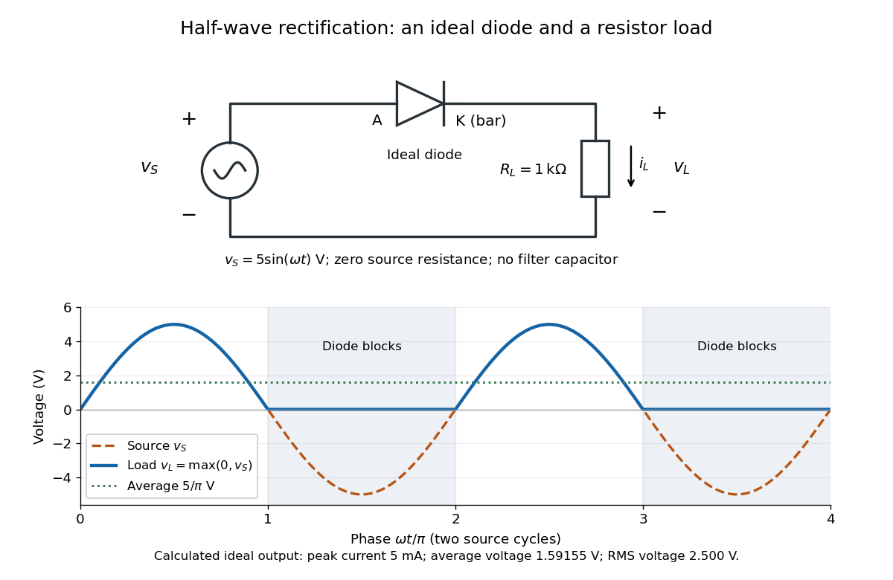
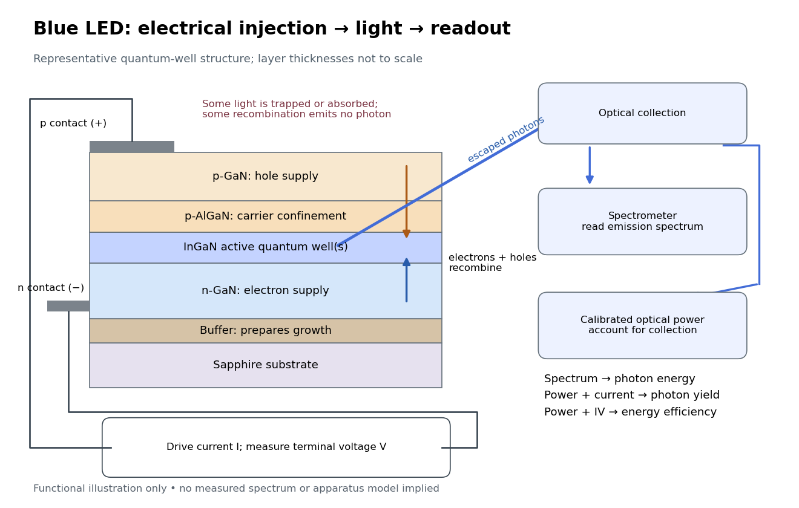
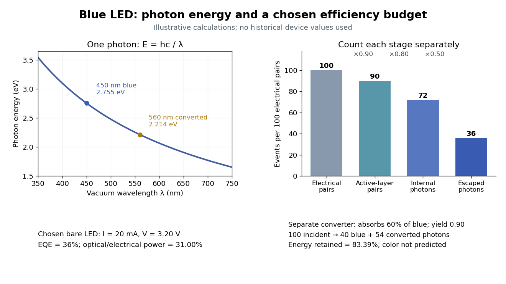
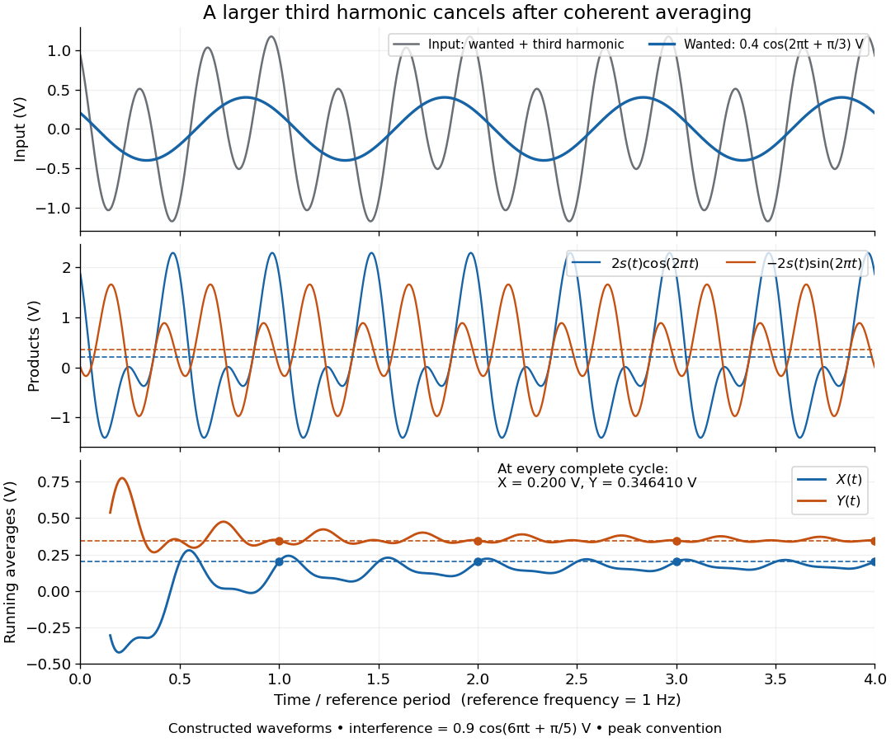
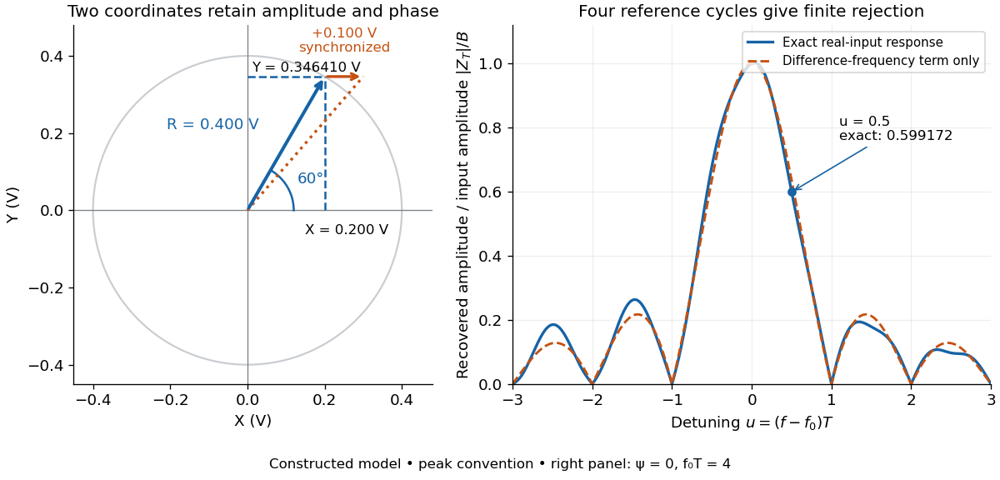
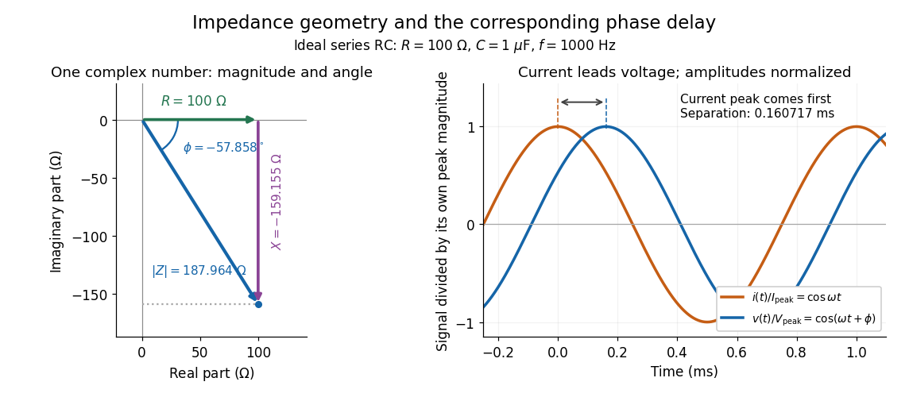
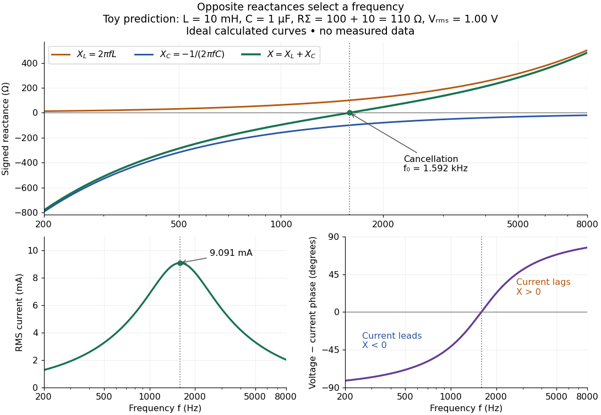
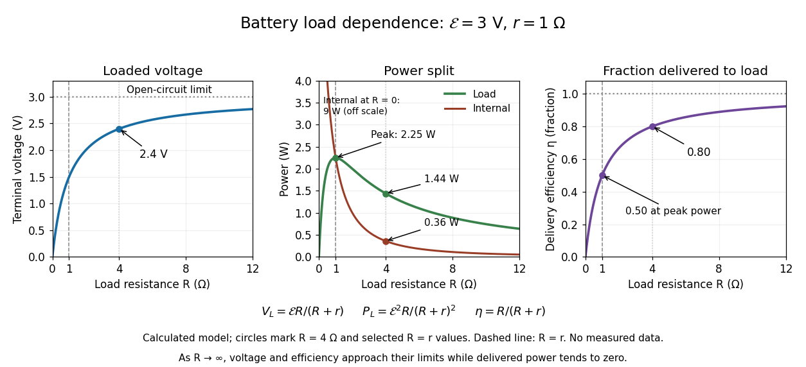
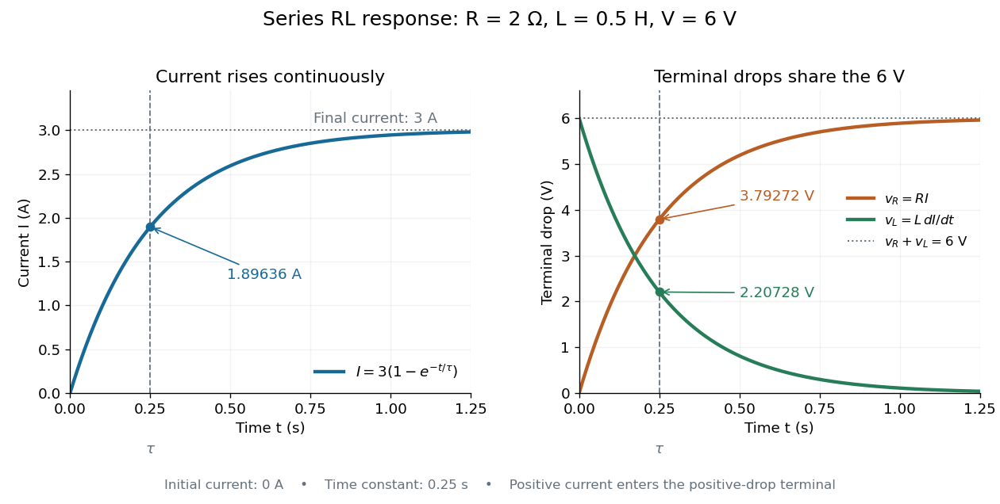
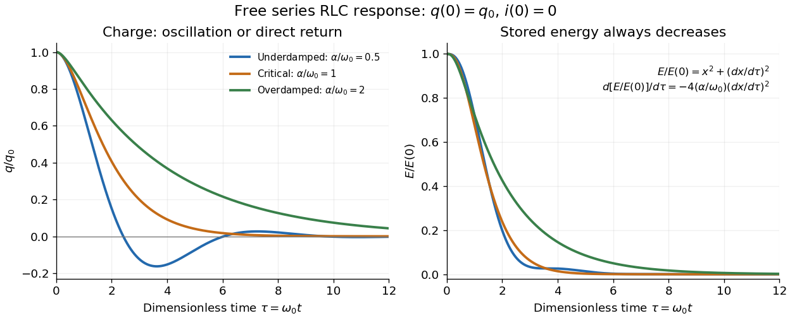

# Electrical circuit

↑ **Parent:** [Electromagnetism](electromagnetism.md)

An electrical circuit connects components that carry [electric current](electric-charge.md#electric-current) and sustain [electric potential difference](electric-field.md#electric-potential-difference) differences. Its dynamics may couple [electrical resistance](electric-charge.md#electrical-resistance), [inductance](electromagnetism.md#inductance) and [capacitance](electromagnetism.md#capacitance).

**Table of contents**

- [Duty cycle](#duty-cycle)
  - [Duty cycling](#duty-cycling)
- [Short circuit](#short-circuit)
- [Open circuit](#open-circuit)
- [Virtual ground](#virtual-ground)
- [Wien bridge](#wien-bridge)
  - [Wien bridge band-pass response](#wien-bridge-band-pass-response)
- [Two-port network](#two-port-network)
- [Parallel circuit](#parallel-circuit)
- [LC circuit](#lc-circuit)
  - [Series-fed parallel LC voltage response](#series-fed-parallel-lc-voltage-response)
- [Diode](#diode)
  - [Diode anode](#diode-anode)
  - [Diode cathode](#diode-cathode)
  - [Ideal diode model](#ideal-diode-model)
  - [Shockley diode equation](#shockley-diode-equation)
    - [Diode minority-carrier diffusion current](#diode-minority-carrier-diffusion-current)
    - [Thermal voltage](#thermal-voltage)
    - [Diode saturation current](#diode-saturation-current)
      - [Extracting a semiconductor band gap from diode saturation current](#extracting-a-semiconductor-band-gap-from-diode-saturation-current)
    - [Diode ideality factor](#diode-ideality-factor)
  - [Diode reverse breakdown](#diode-reverse-breakdown)
  - [Diode characteristic measurement](#diode-characteristic-measurement)
  - [Rectifier](#rectifier)
    - [Voltage multiplier](#voltage-multiplier)
    - [Half-wave rectifier](#half-wave-rectifier)
  - [Light-emitting diode](#light-emitting-diode)
    - [Blue light-emitting diode](#blue-light-emitting-diode)
      - [GaN blue LED development](#gan-blue-led-development)
    - [Light-emitting diode efficiency](#light-emitting-diode-efficiency)
      - [Internal quantum efficiency](#internal-quantum-efficiency)
      - [External quantum efficiency](#external-quantum-efficiency)
      - [Light extraction efficiency](#light-extraction-efficiency)
      - [Wall-plug efficiency](#wall-plug-efficiency)
    - [White light-emitting diode](#white-light-emitting-diode)
      - [Phosphor-converted white light-emitting diode](#phosphor-converted-white-light-emitting-diode)
- [Electronic amplifier](#electronic-amplifier)
  - [Charge amplifier](#charge-amplifier)
  - [Operational amplifier](#operational-amplifier)
    - [Noise gain of an operational amplifier](#noise-gain-of-an-operational-amplifier)
    - [Non-inverting operational amplifier](#non-inverting-operational-amplifier)
    - [Amplifier saturation](#amplifier-saturation)
    - [Operational-amplifier negative feedback](#operational-amplifier-negative-feedback)
      - [Closed-loop gain](#closed-loop-gain)
      - [Loop gain](#loop-gain)
        - [Phase margin](#phase-margin)
    - [Noninverting amplifier](#noninverting-amplifier)
    - [Inverting amplifier](#inverting-amplifier)
      - [Finite-input-resistance inverting amplifier](#finite-input-resistance-inverting-amplifier)
      - [Inverting two-pole band-pass filter](#inverting-two-pole-band-pass-filter)
        - [Selectivity bound for a two-real-pole band-pass](#selectivity-bound-for-a-two-real-pole-band-pass)
      - [Inverting low-pass amplifier](#inverting-low-pass-amplifier)
    - [Virtual short](#virtual-short)
    - [Op amp integrator](#op-amp-integrator)
      - [Finite-gain operational-amplifier integrator](#finite-gain-operational-amplifier-integrator)
    - [Slew rate](#slew-rate)
    - [Input bias current](#input-bias-current)
    - [Input offset voltage](#input-offset-voltage)
    - [Open-loop gain](#open-loop-gain)
      - [Gain-bandwidth product](#gain-bandwidth-product)
    - [Ideal operational amplifier](#ideal-operational-amplifier)
      - [Inverting operational amplifier](#inverting-operational-amplifier)
  - [Voltage gain](#voltage-gain)
  - [Current gain](#current-gain)
  - [Power gain](#power-gain)
  - [Lock-in amplifier](#lock-in-amplifier)
    - [Phase-sensitive detection](#phase-sensitive-detection)
    - [Lock-in quadratures](#lock-in-quadratures)
    - [Lock-in harmonic rejection](#lock-in-harmonic-rejection)
    - [Finite-window lock-in response](#finite-window-lock-in-response)
    - [Chopped-light lock-in experiment](#chopped-light-lock-in-experiment)
  - [Transimpedance amplifier](#transimpedance-amplifier)
- [Spark gap](#spark-gap)
- [Induction coil](#induction-coil)
- [Passive sign convention](#passive-sign-convention)
- [Electrical impedance](#electrical-impedance)
  - [Input impedance](#input-impedance)
  - [Impedance matching](#impedance-matching)
    - [Matched load](#matched-load)
    - [Maximum power transfer theorem](#maximum-power-transfer-theorem)
    - [Quarter-wave impedance transformer](#quarter-wave-impedance-transformer)
  - [Lossy parallel coil resonance](#lossy-parallel-coil-resonance)
    - [Determining a lossy parallel coil from its admittance](#determining-a-lossy-parallel-coil-from-its-admittance)
  - [Electrical admittance](#electrical-admittance)
    - [Electrical susceptance](#electrical-susceptance)
  - [Series RC impedance](#series-rc-impedance)
  - [Electrical impedance phase measurement](#electrical-impedance-phase-measurement)
  - [Electrical reactance](#electrical-reactance)
    - [Reactance phase convention](#reactance-phase-convention)
    - [Electrical reactance bench measurement](#electrical-reactance-bench-measurement)
  - [Output impedance](#output-impedance)
- [Electric battery](#electric-battery)
  - [Lithium-air battery](#lithium-air-battery)
  - [Microbattery](#microbattery)
  - [Rechargeable battery](#rechargeable-battery)
  - [Specific capacity](#specific-capacity)
  - [Zinc-air battery](#zinc-air-battery)
  - [Lead-acid battery](#lead-acid-battery)
    - [Sulfation](#sulfation)
  - [Lithium-ion battery](#lithium-ion-battery)
  - [Theoretical specific capacity](#theoretical-specific-capacity)
  - [Conversion electrode](#conversion-electrode)
  - [Primary battery](#primary-battery)
    - [Lithium iron disulfide battery](#lithium-iron-disulfide-battery)
    - [Battery capacity](#battery-capacity)
    - [Battery self-discharge](#battery-self-discharge)
    - [Battery separator](#battery-separator)
    - [Lithium–carbon monofluoride battery](#lithium-carbon-monofluoride-battery)
  - [Battery internal resistance](#battery-internal-resistance)
  - [Battery load power and efficiency](#battery-load-power-and-efficiency)
  - [Finite battery charge reservoir](#finite-battery-charge-reservoir)
  - [Battery voltage measurement experiment](#battery-voltage-measurement-experiment)
- [RL circuit](#rl-circuit)
- [RLC circuit](#rlc-circuit)
  - [Parallel RLC circuit](#parallel-rlc-circuit)
    - [Free parallel RLC voltage decay](#free-parallel-rlc-voltage-decay)
    - [Resistor-referenced parallel-resonator response](#resistor-referenced-parallel-resonator-response)
    - [Parallel RLC bandwidth](#parallel-rlc-bandwidth)
  - [Series RLC circuit](#series-rlc-circuit)
    - [Inductor voltage magnification in a series RLC circuit](#inductor-voltage-magnification-in-a-series-rlc-circuit)
    - [Displacement and current bandwidths of a series RLC circuit](#displacement-and-current-bandwidths-of-a-series-rlc-circuit)
    - [Resonant series RLC response](#resonant-series-rlc-response)
    - [Overdamped RLC response](#overdamped-rlc-response)
    - [Critically damped RLC response](#critically-damped-rlc-response)
    - [Underdamped RLC response](#underdamped-rlc-response)
- [Current-voltage characteristic](#current-voltage-characteristic)
- [Series circuit](#series-circuit)
- [Amplifier](#amplifier)
- [Biasing](#biasing)
  - [Forward bias](#forward-bias)
  - [Reverse bias](#reverse-bias)
  - [Operating point](#operating-point)
    - [Small-signal model](#small-signal-model)
      - [Transconductance](#transconductance)
- [Gas-discharge tube](#gas-discharge-tube)
  - [Thyratron](#thyratron)
  - [Gas-discharge lamp](#gas-discharge-lamp)
    - [Mercury-vapor lamp](#mercury-vapor-lamp)
- [Integrated circuit](#integrated-circuit)
  - [Discrete circuit](#discrete-circuit)
  - [Monolithic integrated circuit](#monolithic-integrated-circuit)
  - [Kilby integrated circuit demonstration](#kilby-integrated-circuit-demonstration)
  - [Planar process](#planar-process)
  - [Integrated circuit interconnect](#integrated-circuit-interconnect)
  - [Semiconductor wafer](#semiconductor-wafer)
    - [Semiconductor die](#semiconductor-die)
  - [Poisson defect yield](#poisson-defect-yield)
    - [Integrated circuit cost per good die](#integrated-circuit-cost-per-good-die)

## Duty cycle

↑ **Parent:** [Electrical circuit](electrical-circuit.md)

The fraction of an operating cycle spent in a specified active state. For two constant-current states, average current is $\bar I=DI_a+(1-D)I_s$; wake-up transients require an additional [energy](energy.md) term.

### Duty cycling

↑ **Parent:** [Duty cycle](#duty-cycle)

Alternating an active mode with a lower-power mode to reduce average demand. Sleep current and transition overhead prevent average power from falling indefinitely in direct proportion to active time.

## Short circuit

↑ **Parent:** [Electrical circuit](electrical-circuit.md)  
ⓦ [Wiki](https://en.wikipedia.org/wiki/Short_circuit)

An ideal [short circuit](#short-circuit) fixes zero [electric potential difference](electric-field.md#electric-potential-difference) across a terminal pair, corresponding to zero load [electrical impedance](#electrical-impedance). At the end of a lossless [transmission line](electrical-engineering.md#transmission-line), its voltage-wave [reflection coefficient](partial-differential-equation.md#reflection-coefficient) is $-1$ and the terminal [voltage](random-walk.md#voltage) is zero. The available current is still limited by source and circuit impedances; real short circuits can dissipate substantial [Joule heating](electric-charge.md#joule-heating).

## Open circuit

↑ **Parent:** [Electrical circuit](electrical-circuit.md)

An ideal [open circuit](#open-circuit) permits no conduction [electric current](electric-charge.md#electric-current) through a terminal pair, corresponding to infinite load [electrical impedance](#electrical-impedance). At the end of a lossless [transmission line](electrical-engineering.md#transmission-line), its voltage-wave [reflection coefficient](partial-differential-equation.md#reflection-coefficient) is $+1$ and the terminal current is zero. Real open terminals may retain parasitic [capacitance](electromagnetism.md#capacitance) and radiation loss.

## Virtual ground

↑ **Parent:** [Electrical circuit](electrical-circuit.md)

A circuit node held close to zero [electric potential](electric-field.md#electric-potential) by active feedback, without being directly connected to the reference conductor. In an ideal linear [operational amplifier](#operational-amplifier) with its non-inverting input grounded and stable negative feedback, $V_-=V_+=0$ while neither input draws [electric current](electric-charge.md#electric-current). External branch currents meeting the inverting node therefore obey [Kirchhoff's current law](random-walk.md#kirchhoff-node-law) without flowing into the amplifier input. Equality of the input potentials fails when the output saturates or the feedback ceases to enforce linear operation.

## Wien bridge

↑ **Parent:** [Electrical circuit](electrical-circuit.md)

An alternating-current [electrical circuit](electrical-circuit.md) comparing a parallel [resistor](electric-charge.md#resistor)-[capacitor](electromagnetism.md#capacitor) arm with a series [resistor](electric-charge.md#resistor)-[capacitor](electromagnetism.md#capacitor) arm. Let the upper-left arm have [electrical impedance](#electrical-impedance) $Z_1=R_1/(1+i\omega R_1C_1)$, the lower-left arm $Z_2=R_2+1/(i\omega C_2)$, and the upper-right and lower-right arms have [electrical resistances](electric-charge.md#electrical-resistance) $R_3,R_4$. For input between the upper and lower nodes and an unloaded difference measurement between the arm junctions, [voltage divider](electrical-engineering.md#voltage-divider) balance requires $Z_2/Z_1=R_4/R_3$. Separating real and imaginary parts gives

$$
\omega^2R_1R_2C_1C_2=1,\qquad
\frac{R_4}{R_3}=\frac{R_2}{R_1}+\frac{C_1}{C_2}.
$$

The balance [angular frequency](lagrangian-mechanics.md#angular-frequency) is positive for positive components. Equal $R_1=R_2=R$ and $C_1=C_2=C$ require $\omega=1/(RC)$ and $R_4=2R_3$. Reversing which reactive arm is upper changes the divider ratios, so the connections must always be specified.

### Wien bridge band-pass response

↑ **Parent:** [Wien bridge](#wien-bridge)

Use the equal-component [Wien bridge](#wien-bridge) with upper-left parallel arm and lower-left series arm. Let $A$ be the left arm junction, $C$ the upper input node, and $V_i$ the upper-minus-lower input [electric potential difference](electric-field.md#electric-potential-difference). With $u=\omega RC$, the unloaded transfer ratio $H=(V_A-V_C)/V_i$ is the displayed expression. Its [band-pass filter](electrical-engineering.md#band-pass-filter) magnitude is $[9+(u-u^{-1})^2]^{-1/2}$, maximal at $u=1$ with $H=-1/3$. One continuous [wave phase](wave.md#phase-waves) is $\phi=-\pi-\arctan[(u-u^{-1})/3]$, tending from $-\pi/2$ at low positive [frequency](wave.md#frequency) to $-3\pi/2$ at high [frequency](wave.md#frequency). Reversing the measured output polarity multiplies $H$ by $-1$ and shifts its phase by $\pi$ without changing its magnitude.

## Two-port network

↑ **Parent:** [Electrical circuit](electrical-circuit.md)  
ⓦ [Wiki](https://en.wikipedia.org/wiki/Two-port_network)

A [two-port network](#two-port-network) relates voltage and current, or incoming and outgoing travelling-wave amplitudes, at two pairs of electrical terminals. Power-normalized scattering parameters obey $b_i=\sum_jS_{ij}a_j$. In a reciprocal network with equal reference impedances, $S_{12}=S_{21}$. A load reflection at port 2 can return through both transmission coefficients to port 1.

## Parallel circuit

↑ **Parent:** [Electrical circuit](electrical-circuit.md)

A connection in which branches share both terminal nodes and therefore the same [electric potential difference](electric-field.md#electric-potential-difference). Branch [electric currents](electric-charge.md#electric-current) add. For sinusoidal signals, the total [electrical admittance](#electrical-admittance) is the sum of branch [electrical admittances](#electrical-admittance); ideal [capacitances](electromagnetism.md#capacitance) add.

## LC circuit

↑ **Parent:** [Electrical circuit](electrical-circuit.md)  
ⓦ [Wiki](https://en.wikipedia.org/wiki/LC_circuit)

An ideal [electrical circuit](electrical-circuit.md) exchanges [energy](energy.md) between an [inductor](electromagnetism.md#inductor) and a [capacitor](electromagnetism.md#capacitor). With no [electrical resistance](electric-charge.md#electrical-resistance) or applied drive, the [electric charge](electric-charge.md) obeys $Lq''+q/C=0$, giving [angular frequency](lagrangian-mechanics.md#angular-frequency) $\omega_0=1/\sqrt{LC}$. A [series RLC circuit](#series-rlc-circuit) adds dissipation and can include an external drive.

### Series-fed parallel LC voltage response

↑ **Parent:** [LC circuit](#lc-circuit)

An ideal [voltage](random-walk.md#voltage) source drives a series [resistor](electric-charge.md#resistor) feeding a parallel [inductor](electromagnetism.md#inductor) and [capacitor](electromagnetism.md#capacitor). In the $e^{i\omega t}$ convention, the branch [voltage](random-walk.md#voltage) ratio is the title expression. It is a band-pass response with unit peak at $1/\sqrt{LC}$, phase from $+\pi/2$ through zero to $-\pi/2$, and half-power bandwidth $1/(RC)$. At [resonance](dynamical-systems.md#resonance) the input current vanishes while equal and opposite [inductor](electromagnetism.md#inductor)/[capacitor](electromagnetism.md#capacitor) currents remain finite. Reactive branch-current magnitudes must be combined as [phasors](wave.md#phasor), not added as positive scalars.

## Diode

↑ **Parent:** [Electrical circuit](electrical-circuit.md)  
ⓦ [Wiki](https://en.wikipedia.org/wiki/Diode)

A [diode](#diode) is a two-terminal component with an asymmetric [current-voltage characteristic](#current-voltage-characteristic): reversing its terminal [electric potential difference](electric-field.md#electric-potential-difference) need not reverse its [electric current](electric-charge.md#electric-current) with the same magnitude. Name the terminals [diode anode](#diode-anode) $A$ and [diode cathode](#diode-cathode) $K$. Define $V_D=\phi_A-\phi_K$ using their [electric potentials](electric-field.md#electric-potential), and take positive [electric current](electric-charge.md#electric-current) $I_D$ from $A$ to $K$. The bar in the [diode](#diode) symbol marks $K$. Positive $V_D$ is the forward direction; negative $V_D$ is the reverse direction.[Functions of Rectifier Diodes, opening paragraph and Fig. 2-1(a): terminal names, polarity and symbol](physics-bibliography.md#functions-of-rectifier-diodes-by-toshiba-electronic-devices-and-storage-corporation)

The asymmetry makes a [rectifier](#rectifier) possible: a [sinusoid](geometry-and-topology.md#sinusoid) can drive [electric current](electric-charge.md#electric-current) through a [resistor](electric-charge.md#resistor) on one half of each cycle. An ordinary [resistor](electric-charge.md#resistor) obeying [Ohm's law](electric-charge.md#ohm-s-law) instead reverses its [electric current](electric-charge.md#electric-current) when the applied [electric potential difference](electric-field.md#electric-potential-difference) reverses. The useful idea is directional selection; the [ideal diode model](#ideal-diode-model) captures it, while the [Shockley diode equation](#shockley-diode-equation) describes a smooth [exponential function](calculus.md#exponential-function) rather than an abrupt switch.

### Diode anode

↑ **Parent:** [Diode](#diode)

The terminal of a [diode](#diode) at which positive forward [electric current](electric-charge.md#electric-current) enters, with the orientation used in the [ideal diode model](#ideal-diode-model).

### Diode cathode

↑ **Parent:** [Diode](#diode)

The terminal of a [diode](#diode) at which positive forward [electric current](electric-charge.md#electric-current) leaves. The bar in the [diode](#diode) symbol identifies this terminal.

### Ideal diode model

↑ **Parent:** [Diode](#diode)

The [ideal diode model](#ideal-diode-model) sets the conducting [electric potential difference](electric-field.md#electric-potential-difference) to zero and the blocking [electric current](electric-charge.md#electric-current) to zero. With the stated orientation,

$$
\begin{aligned}
\text{conducting:}&\quad V_D=0,\quad I_D\geq0,\\
\text{blocking:}&\quad I_D=0,\quad V_D\leq0.
\end{aligned}
$$

[The Junction Diode, §1.12.1, printed p. 30: zero forward voltage and zero reverse current idealization](physics-bibliography.md#the-junction-diode-by-w-marshall-leach-jr)

The surrounding [electrical circuit](electrical-circuit.md) chooses the state and remaining value. The two branches meet at $V_D=I_D=0$. Their product vanishes, so the ideal [diode](#diode) dissipates no [power](energy.md#power): $P_D=V_DI_D=0$.

The [ideal diode model](#ideal-diode-model) omits forward drop, reverse leakage, [diode reverse breakdown](#diode-reverse-breakdown) and switching delay.

**[Figure 1](#image-smooth-diode-models-and-the-ideal-diode-constraint). Smooth diode models and the ideal diode constraint**. Original calculated [current-voltage characteristics](#current-voltage-characteristic), not device measurements. Left: the [Shockley diode equation](#shockley-diode-equation) with $I_S=1\,\mathrm{nA}$, $n=2$, $T=300\,\mathrm K$, and a constructed extension with internal series [electrical resistance](electric-charge.md#electrical-resistance) $R_s=20\,\Omega$. The inset resolves reverse [electric current](electric-charge.md#electric-current) in nanoamperes. Right: the two allowed branches of the [ideal diode model](#ideal-diode-model), using the same terminal orientation.

### Shockley diode equation

↑ **Parent:** [Diode](#diode)  
ⓦ [Wiki](https://en.wikipedia.org/wiki/Shockley_diode_equation)

For a [p-n junction](semiconductor.md#p-n-junction) at fixed [temperature](temperature.md), the [Shockley diode equation](#shockley-diode-equation) models its [electric current](electric-charge.md#electric-current) as

$$
I_D=I_S\left(\exp\frac{V_D}{nV_T}-1\right),\qquad V_T=\frac{k_BT}{q}.
$$

Here $I_S>0$ is the [diode saturation current](#diode-saturation-current), $n>0$ the [diode ideality factor](#diode-ideality-factor), $V_T$ the [thermal voltage](#thermal-voltage), $k_B$ the [Boltzmann constant](thermodynamics.md#boltzmann-constant), and $q>0$ the [elementary charge](electric-charge.md#elementary-charge).[The Junction Diode, §1.2, printed p. 4, equation (1.1) and parameter definitions](physics-bibliography.md#the-junction-diode-by-w-marshall-leach-jr)

For an original model example, choose $I_S=1\,\mathrm{nA}$, $n=2$, and $T=300\,\mathrm K$. Using $k_B=1.380649\times10^{-23}\,\mathrm{J/K}$ and $q=1.602176634\times10^{-19}\,\mathrm C$ gives $V_T=25.8520\,\mathrm{mV}$. Then $V_D=0.600\,\mathrm V$ gives $I_D=0.109591\,\mathrm{mA}$, whereas $V_D=0.800\,\mathrm V$ gives $I_D=5.24450\,\mathrm{mA}$. These are predictions of the declared model. There is no universal turn-on [electric potential difference](electric-field.md#electric-potential-difference): solving the [Shockley diode equation](#shockley-diode-equation) for the value needed at a chosen [electric current](electric-charge.md#electric-current) gives

$$
V_D=nV_T\ln\left(1+\frac{I_D}{I_S}\right),\qquad I_D>-I_S.
$$

At $I_D\gg I_S$, increasing $V_D$ by $0.100\,\mathrm V$ multiplies the [electric current](electric-charge.md#electric-current) by approximately $e^{0.100/(nV_T)}=6.91772$. At $V_D=-0.300\,\mathrm V$ the same model gives $I_D=-0.996979\,\mathrm{nA}$. Its reverse branch approaches $-I_S$; it cannot describe [diode reverse breakdown](#diode-reverse-breakdown).

A constructed extension adds internal series [electrical resistance](electric-charge.md#electrical-resistance) $R_s$ to a junction whose [electric potential difference](electric-field.md#electric-potential-difference) is $V_j$. Applying the [Kirchhoff cycle law](random-walk.md#kirchhoff-cycle-law) gives

$$
V_D=V_j+I_DR_s
=nV_T\ln\left(1+\frac{I_D}{I_S}\right)+I_DR_s.
$$

For $R_s=20\,\Omega$ and the same $I_S,n,T$, sustaining $I_D=5.24450\,\mathrm{mA}$ needs $V_D=0.904890\,\mathrm V$: $0.800\,\mathrm V$ across the junction plus $0.104890\,\mathrm V$ across its internal [electrical resistance](electric-charge.md#electrical-resistance). The [derivative](calculus.md#derivative)

$$
\frac{dV_D}{dI_D}=\frac{nV_T}{I_D+I_S}+R_s
$$

shows why the [current-voltage characteristic](#current-voltage-characteristic) becomes nearly a [straight line](euclidean-geometry.md#straight-line) when the internal series [electrical resistance](electric-charge.md#electrical-resistance) dominates. This is still a fixed-[temperature](temperature.md) model; self-heating can change $I_S$, $n$ and $V_T$. Real [diodes](#diode) also have leakage and charge-storage effects omitted here.[The Junction Diode, §§1.3, 1.8 and 1.11: temperature dependence, charge storage and series bulk resistance](physics-bibliography.md#the-junction-diode-by-w-marshall-leach-jr)

#### Diode minority-carrier diffusion current

↑ **Parent:** [Shockley diode equation](#shockley-diode-equation)

For a long, nondegenerate, ideal [p-n junction](semiconductor.md#p-n-junction) under low injection, the [diode saturation current](#diode-saturation-current) is set by [minority carriers](semiconductor.md#minority-carrier) supplied from the neutral regions. Their equilibrium densities are $n_{p0}=n_i^2/N_A$ and $p_{n0}=n_i^2/N_D$. Solving the steady diffusion and recombination equations gives $I_S=e\mathcal A(D_nn_{p0}/L_n+D_pp_{n0}/L_p)$, where $\mathcal A$ is junction area, $D_n,D_p$ are diffusion coefficients, and $L_n,L_p$ are diffusion lengths. Reverse bias suppresses opposite majority-carrier injection exponentially while collecting this minority supply. Thus $I_S$ is approximately bias independent before breakdown, but depends strongly on [temperature](temperature.md) through $n_i^2$ and on transport, doping, and geometry.

#### Thermal voltage

↑ **Parent:** [Shockley diode equation](#shockley-diode-equation)

The [electric potential difference](electric-field.md#electric-potential-difference) corresponding to thermal [energy](energy.md) $k_BT$ per [elementary charge](electric-charge.md#elementary-charge) $q$.

#### Diode saturation current

↑ **Parent:** [Shockley diode equation](#shockley-diode-equation)

The positive [electric current](electric-charge.md#electric-current) scale in the [Shockley diode equation](#shockley-diode-equation).

##### Extracting a semiconductor band gap from diode saturation current

↑ **Parent:** [Diode saturation current](#diode-saturation-current)

In a diffusion-dominated [p-n junction](semiconductor.md#p-n-junction), $I_s=C(T)n_i^2$ with a transport prefactor determined by minority-carrier diffusion and dopant densities. Combining this with the [intrinsic carrier concentration](semiconductor.md#intrinsic-carrier-concentration) gives, for fixed gap and effective masses,

$$
\log\frac{I_s}{C(T)T^3}=\text{constant}-\frac{E_g}{k_BT}.
$$

The slope against $1/T$ is $-E_g/k_B$. A measured [diode ideality factor](#diode-ideality-factor) helps identify the transport regime: generation or recombination current can have a different dependence on $n_i$, so its activation slope cannot automatically be interpreted with the diffusion formula.

#### Diode ideality factor

↑ **Parent:** [Shockley diode equation](#shockley-diode-equation)

The dimensionless parameter adjusting the forward slope in the [Shockley diode equation](#shockley-diode-equation). Its ideal junction law sets $n=1$.

### Diode reverse breakdown

↑ **Parent:** [Diode](#diode)

A sufficiently large reverse [electric potential difference](electric-field.md#electric-potential-difference) can produce a rapidly increasing reverse [electric current](electric-charge.md#electric-current). Both the [ideal diode model](#ideal-diode-model) and the unextended [Shockley diode equation](#shockley-diode-equation) omit this behavior.[The Junction Diode, §1.7, printed p. 17: breakdown after the small reverse-current region](physics-bibliography.md#the-junction-diode-by-w-marshall-leach-jr)

### Diode characteristic measurement

↑ **Parent:** [Diode](#diode)

The New Jersey Institute of Technology laboratory uses a [silicon](chemical-substance.md#silicon) 1N4148 [diode](#diode). For its forward [current-voltage characteristic](#current-voltage-characteristic), the supply operates in current-source mode; a benchtop [voltmeter](electric-field.md#voltmeter) independently reads the [diode](#diode) [electric potential difference](electric-field.md#electric-potential-difference). Small [electric current](electric-charge.md#electric-current) steps resolve the steep branch. For reverse measurements, a sensitive [ammeter](electric-charge.md#ammeter) sits in series; the handout suggests a $10$–$100\,\mathrm{k\Omega}$ series [resistor](electric-charge.md#resistor). Reversing the applied polarity supplies the comparison. Meter placement must avoid counting the [voltmeter](electric-field.md#voltmeter)'s own [electric current](electric-charge.md#electric-current), and the zero reading may have an offset. The same [diode](#diode) is then measured with an Agilent U2722A source measure unit for graphical comparison.[Part B, Experiments with Semiconductor Diodes, items 1 and 2(a): preparation, current control, independent voltage readout, reverse series resistor and same-device comparison](physics-bibliography.md#part-b-semiconductor-devices-diodes-1-by-new-jersey-institute-of-technology)

The prescribed analysis uses a [logarithmic scale](calculus.md#logarithmic-scale) for forward [electric current](electric-charge.md#electric-current) to infer $I_S$ and $n$ from the straight region. Large-[electric current](electric-charge.md#electric-current) departures can indicate series [electrical resistance](electric-charge.md#electrical-resistance). The handout cautions that the accessible range may not determine it precisely; meter loading also matters. This is a measurement procedure, without a published set of device readings.[Experiments with Semiconductor Diodes, item 1, parameter extraction and high-current trend-line limitations; Report and Analysis](physics-bibliography.md#part-b-semiconductor-devices-diodes-1-by-new-jersey-institute-of-technology)

The reason for the [logarithmic scale](calculus.md#logarithmic-scale) follows directly from the [Shockley diode equation](#shockley-diode-equation). If $I_D\gg I_S$ and series [electrical resistance](electric-charge.md#electrical-resistance) is negligible,

$$
\ln\left(\frac{I_D}{I_0}\right)\approx\ln\left(\frac{I_S}{I_0}\right)+\frac{V_D}{nV_T},
$$

where $I_0>0$ is a fixed reference [electric current](electric-charge.md#electric-current) making the [logarithm](calculus.md#logarithm) dimensionless. The slope is $1/(nV_T)$, so extracting $n$ needs the junction [temperature](temperature.md). Fitting only an appropriate [interval](real-analysis.md#interval-mathematics) matters: a straight-looking subset cannot establish the model at all [electric currents](electric-charge.md#electric-current).

### Rectifier

↑ **Parent:** [Diode](#diode)  
ⓦ [Wiki](https://en.wikipedia.org/wiki/Rectifier)

A [rectifier](#rectifier) converts an alternating input into a unidirectional output. [Diode](#diode) orientation selects which direction of [electric current](electric-charge.md#electric-current) is transmitted.[Functions of Rectifier Diodes, opening paragraph and Fig. 2-2: directional conduction and rectification](physics-bibliography.md#functions-of-rectifier-diodes-by-toshiba-electronic-devices-and-storage-corporation)

#### Voltage multiplier

↑ **Parent:** [Rectifier](#rectifier)  
ⓦ [Wiki](https://en.wikipedia.org/wiki/Voltage_multiplier)

An [electrical circuit](electrical-circuit.md) that uses [diodes](#diode) and [capacitors](electromagnetism.md#capacitor) to produce an output [electric potential difference](electric-field.md#electric-potential-difference) larger in magnitude than the input peak. The attainable output depends on the circuit arrangement, [electric current](electric-charge.md#electric-current) drawn by the load, [capacitance](electromagnetism.md#capacitance) and input [frequency](wave.md#frequency); an ideal unloaded result does not specify the output under load.

#### Half-wave rectifier

↑ **Parent:** [Rectifier](#rectifier)

A [half-wave rectifier](#half-wave-rectifier) with one [diode](#diode) and a [resistor](electric-charge.md#resistor) load passes one half of each input cycle.[The Junction Diode, §1.12.1, printed p. 30: alternate-half-cycle conduction into a resistor load](physics-bibliography.md#the-junction-diode-by-w-marshall-leach-jr)

For an original ideal example, let an ideal [voltage source](electrical-engineering.md#voltage-source) supply the [sinusoid](geometry-and-topology.md#sinusoid) $v_S(t)=V_p\sin(\omega t)$, with $V_p=5\,\mathrm V$ and [angular frequency](lagrangian-mechanics.md#angular-frequency) $\omega>0$. Connect its positive reference terminal to the [diode anode](#diode-anode), the [diode cathode](#diode-cathode) to the upper terminal of a load [resistor](electric-charge.md#resistor) with [electrical resistance](electric-charge.md#electrical-resistance) $R_L=1\,\mathrm{k\Omega}$, and the lower terminal to the source return. Let $v_L$ be the upper-minus-lower load [electric potential difference](electric-field.md#electric-potential-difference), and $i_L$ the downward load [electric current](electric-charge.md#electric-current). Assume the [ideal diode model](#ideal-diode-model), zero source [electrical resistance](electric-charge.md#electrical-resistance), and no filter [capacitor](electromagnetism.md#capacitor), [inductor](electromagnetism.md#inductor) or switching delay.

**[Figure 2](#image-an-ideal-half-wave-rectifier-selects-the-positive-half-cycle). An ideal half-wave rectifier selects the positive half-cycle**. Original schematic and calculated load [electric potential difference](electric-field.md#electric-potential-difference) for $v_S=5\sin(\omega t)\,\mathrm V$ and $R_L=1\,\mathrm{k\Omega}$. The [diode cathode](#diode-cathode) is the bar at $K$; positive load [electric current](electric-charge.md#electric-current) flows downward through the [resistor](electric-charge.md#resistor). Dashed orange: source [sinusoid](geometry-and-topology.md#sinusoid). Blue: load output, zero during the negative half-cycle. Green: its cycle-average [electric potential difference](electric-field.md#electric-potential-difference) $5/\pi\,\mathrm V$. No smoothing [capacitor](electromagnetism.md#capacitor) is present; these are ideal model predictions.

The [Kirchhoff cycle law](random-walk.md#kirchhoff-cycle-law) gives $v_S=V_D+v_L$, and [Ohm's law](electric-charge.md#ohm-s-law) gives $v_L=R_Li_L$. If $v_S>0$, the blocking assumption would give $V_D=v_S>0$, contradicting the [ideal diode model](#ideal-diode-model), so the [diode](#diode) conducts with $V_D=0$. If $v_S<0$, conduction would give $i_L=v_S/R_L<0$, also forbidden, so the [diode](#diode) blocks. At the crossings both values vanish. Thus

$$
v_L(t)=\max\{0,V_p\sin(\omega t)\},\qquad i_L(t)=\frac{v_L(t)}{R_L}.
$$

The peak load [electric current](electric-charge.md#electric-current) is $5\,\mathrm{mA}$. The output is unidirectional but still varies in [time](classical-mechanics.md#time-in-physics), reaching zero throughout every negative half-cycle. Over a [period of a function](mathematics.md#period-of-a-function) $2\pi/\omega$, write the [wave phase](wave.md#phase-waves) as $\theta=\omega t$. Its [average value of a function](integral.md#average-value-of-a-function) and [root mean square](analysis.md#root-mean-square) follow from two [integrals](integral.md):

$$
\overline v_L=\frac1{2\pi}\int_0^\pi V_p\sin\theta\,d\theta=\frac{V_p}{\pi}=1.59155\,\mathrm V,\qquad
v_{L,\mathrm{rms}}=\left(\frac1{2\pi}\int_0^\pi V_p^2\sin^2\theta\,d\theta\right)^{1/2}=\frac{V_p}{2}=2.500\,\mathrm V.
$$

Consequently the average load [power](energy.md#power) is $v_{L,\mathrm{rms}}^2/R_L=6.25\,\mathrm{mW}$, not $\overline v_L^{\,2}/R_L$. The ideal [diode](#diode) has zero loss; the [resistor](electric-charge.md#resistor) converts supplied [energy](energy.md) into [Joule heating](electric-charge.md#joule-heating). The same switching argument predicts $v_L=\min(0,v_S)$ when the [diode](#diode) is reversed. Directional selection changes the waveform and its [average value of a function](integral.md#average-value-of-a-function); it does not by itself produce a constant output.

### Light-emitting diode

↑ **Parent:** [Diode](#diode)  
ⓦ [Wiki](https://en.wikipedia.org/wiki/Light-emitting_diode)

A [light-emitting diode](#light-emitting-diode) is a [semiconductor](semiconductor.md) [diode](#diode) producing [electroluminescence](optics.md#electroluminescence) under [electric current](electric-charge.md#electric-current). [Forward bias](#forward-bias) injects [electrons](physics.md#electron) and [electron holes](quantum-mechanics.md#electron-hole); radiative [electron-hole recombination](quantum-mechanics.md#electron-hole-recombination) emits [photons](quantum-mechanics.md#photon). A [double heterostructure](semiconductor.md#double-heterostructure) uses [band offsets](semiconductor.md#band-offset) to retain both [charge carriers](electric-charge.md#charge-carrier) in an active layer. A sufficiently thin layer is a [quantum well](semiconductor.md#quantum-well).[§I, p. 1139, Fig. 1; §IV.A, pp. 1143–1144: injection, active layer and quantum-well distinction](https://journals.aps.org/rmp/pdf/10.1103/RevModPhys.87.1139)

The optical and electrical questions are different: [photon](quantum-mechanics.md#photon) [energy](energy.md) sets a color scale, while [light-emitting diode efficiency](#light-emitting-diode-efficiency) determines how much supplied [energy](energy.md) escapes as [light](optics.md#light). The [blue light-emitting diode](#blue-light-emitting-diode) made compact [white light-emitting diodes](#white-light-emitting-diode) and full-color displays practical. A modulated [light-emitting diode](#light-emitting-diode) can also supply the optical [signal](electrical-engineering.md#signal) in a [chopped-light lock-in experiment](#chopped-light-lock-in-experiment).

**[Figure 3](#image-blue-light-emitting-diode-carrier-injection-emitting-structure-and-optical-readout). Blue light-emitting diode: carrier injection, emitting structure and optical readout**. [Source](blue-led-injection-structure-and-readout.py). Original functional schematic of a representative [indium gallium nitride](chemical-substance.md#indium-gallium-nitride) [quantum well](semiconductor.md#quantum-well) device on [sapphire](chemical-substance.md#sapphire), not a reconstruction of the 1989 or 1994 devices. Layer thicknesses are schematic. Separate electrical and optical readings determine different properties: terminal [electric potential difference](electric-field.md#electric-potential-difference) and [electric current](electric-charge.md#electric-current), [spectrum](linear-operator-theory.md#spectrum-functional-analysis), and calibrated escaping optical [power](energy.md#power). The arrows represent routes through the device rather than a calculated [energy band](bloch-s-theorem.md#energy-band) profile.

#### Blue light-emitting diode

↑ **Parent:** [Light-emitting diode](#light-emitting-diode)

Blue transitions motivate [wide-bandgap semiconductors](semiconductor.md#wide-bandgap-semiconductor), but a large [band gap](bloch-s-theorem.md#band-gap) alone cannot guarantee efficient emission. [Gallium nitride](chemical-substance.md#gallium-nitride) has a [direct band gap](bloch-s-theorem.md#direct-band-gap); [indium gallium nitride](chemical-substance.md#indium-gallium-nitride) composition tunes the transition [energy](energy.md).[§2, printed pp. 8–10: direct/indirect gaps and nitride composition range](https://www.kapitza.ras.ru/~glazkov/students/Nobel-akasaki-lecture.pdf)

For an emitted [photon](quantum-mechanics.md#photon), with [frequency](wave.md#frequency) $\nu$ and vacuum [wavelength](wave-equation.md#wavelength) $\lambda$,

$$
E_\gamma=h\nu=\frac{hc}{\lambda},\qquad
\lambda=\frac{hc}{E_\gamma},
$$

where $h$ is the [Planck constant](quantum-mechanics.md#planck-constant) and $c$ the vacuum [speed of light](special-relativity.md#speed-of-light). Multiplying [energy](energy.md) by [wavelength](wave-equation.md#wavelength) gives $hc=1239.841984\,\mathrm{eV\,nm}$. Thus chosen [wavelengths](wave-equation.md#wavelength) $450\,\mathrm{nm}$ and $630\,\mathrm{nm}$ correspond to $2.75520\,\mathrm{eV}$ and $1.96800\,\mathrm{eV}$: blue requires more [energy](energy.md) per [photon](quantum-mechanics.md#photon) than red. A stipulated transition [energy](energy.md) $3.40\,\mathrm{eV}$ instead gives $364.659\,\mathrm{nm}$, in the [ultraviolet](optics.md#ultraviolet). These are conversions, not measured emission lines.

For near-edge emission, $E_\gamma\approx E_g$ estimates the [photon](quantum-mechanics.md#photon) [energy](energy.md) from the emitting material's [band gap](bloch-s-theorem.md#band-gap). [Quantum well](semiconductor.md#quantum-well) confinement or impurity transitions can change it. The 1994 [blue light-emitting diode](#blue-light-emitting-diode) used [zinc](chemical-substance.md#zinc)-doped [indium gallium nitride](chemical-substance.md#indium-gallium-nitride), emitting below its near-edge transition.[p. 1688, Fig. 2 discussion: Zn-related emission](physics-bibliography.md#candela-class-high-brightness-ingan⁄algan-double-heterostructure-blue-light-emitting-diodes-by-shuji-nakamura-and-others)

The measured forward terminal [electric potential difference](electric-field.md#electric-potential-difference) $V_f$ is also not fixed by $E_g/q$, where $q$ is the [elementary charge](electric-charge.md#elementary-charge). It depends on [electric current](electric-charge.md#electric-current), [temperature](temperature.md), contacts and series [electrical resistance](electric-charge.md#electrical-resistance). Even the simple [Shockley diode equation](#shockley-diode-equation) with series [electrical resistance](electric-charge.md#electrical-resistance) has $V_f=V_j+IR_s$, whereas an optical transition does not acquire an extra [energy](energy.md) $qIR_s$ merely because the contact drop increases. Consequently, extracting a [band gap](bloch-s-theorem.md#band-gap) from one terminal-voltage reading is not justified.

##### GaN blue LED development

↑ **Parent:** [Blue light-emitting diode](#blue-light-emitting-diode)

[Isamu Akasaki](electrical-engineering.md#isamu-akasaki) chose [metalorganic vapour-phase epitaxy](engineering.md#metalorganic-vapour-phase-epitaxy) and [sapphire](chemical-substance.md#sapphire), which tolerated hot [ammonia](chemical-substance.md#ammonia). Large [lattice mismatch](semiconductor.md#lattice-mismatch) hindered film growth. In 1985, [Hiroshi Amano](electrical-engineering.md#hiroshi-amano) and [Isamu Akasaki](electrical-engineering.md#isamu-akasaki)'s group developed an [aluminium nitride](chemical-substance.md#aluminium-nitride) [epitaxial buffer layer](semiconductor.md#epitaxial-buffer-layer) deposited before hotter [gallium nitride](chemical-substance.md#gallium-nitride) growth. The buffer supplies initial growth sites; growing islands join into a continuous film. It improves growth without making the lattices identical. [Isamu Akasaki](electrical-engineering.md#isamu-akasaki) separately credits [Shuji Nakamura](electrical-engineering.md#shuji-nakamura)'s 1991 [gallium nitride](chemical-substance.md#gallium-nitride) buffer.[§§3.2–4.2, pp. 13–20, Figs. 7–11: growth sequence and microscopy](https://www.kapitza.ras.ru/~glazkov/students/Nobel-akasaki-lecture.pdf)

The 1986 growth paper reports a vertical [metalorganic vapour-phase epitaxy](engineering.md#metalorganic-vapour-phase-epitaxy) reactor, source gases mixed just before delivery to slanted [sapphire](chemical-substance.md#sapphire), and subsequent [gallium nitride](chemical-substance.md#gallium-nitride) growth over [aluminium nitride](chemical-substance.md#aluminium-nitride). Surface microscopy, [X-ray diffraction](quantum-scattering.md#x-ray-diffraction) and [photoluminescence](optics.md#photoluminescence) tested different aspects of the result. Buffered and unbuffered growth supplied the comparison. Its reported preparation conditions should not be replaced by one universal buffer [temperature](temperature.md): the later lecture's account of the first low-temperature trial and the paper's parameter study describe different stages of development.[p. 353, Fig. 1 and Table I; p. 354, surface and diffraction comparisons](physics-bibliography.md#metalorganic-vapor-phase-epitaxial-growth-of-a-high-quality-gan-film-using-an-aln-buffer-layer-by-hiroshi-amano-and-others)

A [magnesium](chemical-substance.md#magnesium) [acceptor impurity](semiconductor.md#acceptor-impurity) in [gallium nitride](chemical-substance.md#gallium-nitride) accepts a [valence band](quantum-mechanics.md#valence-band) [electron](physics.md#electron), leaving a mobile [electron hole](quantum-mechanics.md#electron-hole). [Hydrogen passivation of magnesium acceptors in gallium nitride](semiconductor.md#hydrogen-passivation-of-magnesium-acceptors-in-gallium-nitride) suppresses this activity. Post-growth activation restores existing impurities' electrical activity; ionization of active [acceptor impurities](semiconductor.md#acceptor-impurity) supplies mobile [electron holes](quantum-mechanics.md#electron-hole). Adding [magnesium](chemical-substance.md#magnesium) alone is insufficient.[p. 1258, abstract and §1: passivation and activation](physics-bibliography.md#hole-compensation-mechanism-of-p-type-gan-films-by-shuji-nakamura-and-others)

In 1989, [Hiroshi Amano](electrical-engineering.md#hiroshi-amano), [Masahiro Kito](physics-author.md#masahiro-kito), [Kazumasa Hiramatsu](electrical-engineering.md#kazumasa-hiramatsu) and [Isamu Akasaki](electrical-engineering.md#isamu-akasaki) obtained [p-type semiconductor](semiconductor.md#p-type-semiconductor) conduction in [magnesium](chemical-substance.md#magnesium)-doped [gallium nitride](chemical-substance.md#gallium-nitride) using low-energy [electron](physics.md#electron) beam irradiation. [Hiroshi Amano](electrical-engineering.md#hiroshi-amano) recalls initially resistive samples, an unreliable hot-probe test, then [Masahiro Kito](physics-author.md#masahiro-kito)'s [Hall effect](relativistic-electromagnetism.md#hall-effect) confirmation. A junction irradiated in an M-shaped region emitted in that pattern. Treatment, carrier-sign measurement and spatial emission supplied different evidence. Earlier [zinc](chemical-substance.md#zinc)-doped samples brightened under irradiation without becoming [p-type semiconductors](semiconductor.md#p-type-semiconductor): brightness alone did not prove the carrier sign.[§V, pp. 1135–1136, Figs. 3–4; authors of 1989 paper in references, p. 1137](https://journals.aps.org/rmp/pdf/10.1103/RevModPhys.87.1133)

[Shuji Nakamura](electrical-engineering.md#shuji-nakamura), [Takashi Mukai](electrical-engineering.md#takashi-mukai), [Masayuki Senoh](physics-author.md#masayuki-senoh) and [Naruhito Iwasa](physics-author.md#naruhito-iwasa)'s 1992 thermal-activation paper established another route using [annealing](engineering.md#annealing-materials-science) in [nitrogen](chemical-substance.md#nitrogen). Their companion study compared already conducting films heated in [nitrogen](chemical-substance.md#nitrogen) with films heated in [ammonia](chemical-substance.md#ammonia): the latter became highly resistive again. Its [hydrogen](chemical-substance.md#hydrogen)-complex explanation connected this atmosphere dependence to [acceptor impurity](semiconductor.md#acceptor-impurity) passivation. These are thermal treatment and atmosphere comparisons, distinct from the earlier [electron](physics.md#electron) beam intervention; neither observation alone images an individual [hydrogen](chemical-substance.md#hydrogen) complex.[abstract: nitrogen annealing above 700 degrees Celsius and electrical changes](physics-bibliography.md#thermal-annealing-effects-on-p-type-mg-doped-gan-films-by-shuji-nakamura-and-others)[p. 1258, abstract and §§1–2: activation history, nitrogen/ammonia comparison and hydrogenation hypothesis](physics-bibliography.md#hole-compensation-mechanism-of-p-type-gan-films-by-shuji-nakamura-and-others)

[Shuji Nakamura](electrical-engineering.md#shuji-nakamura)'s two-flow [metalorganic chemical vapor deposition](engineering.md#metalorganic-vapour-phase-epitaxy) reactor, [gallium nitride](chemical-substance.md#gallium-nitride) buffer, thermal activation and improved [indium gallium nitride](chemical-substance.md#indium-gallium-nitride) growth enabled bright [double heterostructure](semiconductor.md#double-heterostructure) devices, followed by thinner [quantum well](semiconductor.md#quantum-well) devices.[§§III–IV.A, pp. 1140–1144; Figs. 9–11](https://journals.aps.org/rmp/pdf/10.1103/RevModPhys.87.1139)

The original 1994 paper by [Shuji Nakamura](electrical-engineering.md#shuji-nakamura), [Takashi Mukai](electrical-engineering.md#takashi-mukai) and [Masayuki Senoh](physics-author.md#masayuki-senoh) describes a [sapphire](chemical-substance.md#sapphire)/[gallium nitride](chemical-substance.md#gallium-nitride)-buffer device with [zinc](chemical-substance.md#zinc)-doped [indium gallium nitride](chemical-substance.md#indium-gallium-nitride) emission and [aluminium gallium nitride](chemical-substance.md#aluminium-gallium-nitride) confinement. After [nitrogen](chemical-substance.md#nitrogen) [annealing](engineering.md#annealing-materials-science), etching exposed the n-side for a separate contact. At room [temperature](temperature.md), varied forward [electric currents](electric-charge.md#electric-current) gave emission [spectra](linear-operator-theory.md#spectrum-functional-analysis) and optical-output curves alongside a [current-voltage characteristic](#current-voltage-characteristic). At $20\,\mathrm{mA}$: $1.5\,\mathrm{mW}$ output, $450\,\mathrm{nm}$ peak [wavelength](wave-equation.md#wavelength), $3.6\,\mathrm V$ terminal [electric potential difference](electric-field.md#electric-potential-difference). The peak stayed nearly fixed across the current series. The paper omits a complete calibrated collection apparatus; comparisons with earlier devices change several preparation details.[pp. 1687–1688, fabrication and Figs. 1–4](physics-bibliography.md#candela-class-high-brightness-ingan⁄algan-double-heterostructure-blue-light-emitting-diodes-by-shuji-nakamura-and-others)

#### Light-emitting diode efficiency

↑ **Parent:** [Light-emitting diode](#light-emitting-diode)

Efficiency has several denominators. Specify a steady [electric current](electric-charge.md#electric-current) $I>0$, positive terminal [electric potential difference](electric-field.md#electric-potential-difference) $V_f$, and a simplified narrow emission [spectrum](linear-operator-theory.md#spectrum-functional-analysis) with [photon](quantum-mechanics.md#photon) [energy](energy.md) $E_\gamma$. Assume at most one radiative [photon](quantum-mechanics.md#photon) per injected [electron](physics.md#electron) and [electron hole](quantum-mechanics.md#electron-hole) pair. Let $\eta_{\rm inj}$ be the fraction of the electrical pair-supply rate $I/q$ reaching the active layer, $\eta_{\rm rad}$ the fraction of those pairs recombining radiatively, and $\eta_{\rm ext}$ the fraction of internally emitted [photons](quantum-mechanics.md#photon) that escape. Then counting the successive events gives

$$
\dot N_{\rm active}=\eta_{\rm inj}\frac Iq,\qquad
\dot N_{\rm internal}=\eta_{\rm rad}\dot N_{\rm active},\qquad
\dot N_{\rm out}=\eta_{\rm ext}\dot N_{\rm internal}.
$$

Define [internal quantum efficiency](#internal-quantum-efficiency) here conditionally on pairs reaching the active layer: $\eta_{\rm IQE}=\eta_{\rm rad}$. The internal [photon](quantum-mechanics.md#photon) yield per electrical pair is instead $\eta_{\rm inj}\eta_{\rm IQE}$. Stating this convention matters when another definition folds injection into [internal quantum efficiency](#internal-quantum-efficiency). The [external quantum efficiency](#external-quantum-efficiency) and [wall-plug efficiency](#wall-plug-efficiency) are

$$
\eta_{\rm EQE}=\frac{\dot N_{\rm out}}{I/q}
=\eta_{\rm inj}\eta_{\rm IQE}\eta_{\rm ext},\qquad
\eta_{\rm WPE}=\frac{P_{\rm opt}}{IV_f}
=\eta_{\rm EQE}\frac{E_\gamma}{qV_f},\qquad
P_{\rm opt}=\dot N_{\rm out}E_\gamma.
$$

These are [photon](quantum-mechanics.md#photon)-count and [energy](energy.md)-flow identities for the declared model. For a broad [spectrum](linear-operator-theory.md#spectrum-functional-analysis), replace $E_\gamma$ by the mean escaping [photon](quantum-mechanics.md#photon) [energy](energy.md), weighted by photon number, when computing optical [power](energy.md#power).

A stipulated example chooses $I=20\,\mathrm{mA}$, $V_f=3.20\,\mathrm V$, $\lambda=450\,\mathrm{nm}$, $\eta_{\rm inj}=0.90$, $\eta_{\rm IQE}=0.80$ and $\eta_{\rm ext}=0.50$. For every 100 electrical pairs, 90 reach the active layer, 72 emit internally, and 36 [photons](quantum-mechanics.md#photon) escape. Thus $\eta_{\rm EQE}=0.36$, not $0.80$. Using $q=1.602176634\times10^{-19}\,\mathrm C$ gives

$$
\begin{aligned}
I/q&=1.24830\times10^{17}\,\mathrm{s}^{-1},\\
\dot N_{\rm out}&=4.49389\times10^{16}\,\mathrm{s}^{-1},\\
P_{\rm opt}&=19.8375\,\mathrm{mW},\qquad IV_f=64.0\,\mathrm{mW},\\
\eta_{\rm WPE}&=0.309960.
\end{aligned}
$$

The [dimensional analysis](mathematical-physics.md#dimensional-analysis) is transparent: $\mathrm{A/C}=\mathrm{s}^{-1}$, $\mathrm{J/s}=\mathrm W$, and $\mathrm{CV}=\mathrm J$. The optical and electrical efficiencies differ because $E_\gamma/q=2.75520\,\mathrm V$ differs from the chosen $V_f$.

**[Figure 4](#image-photon-energy-wavelength-and-a-chosen-light-emitting-diode-efficiency-budget). Photon energy, wavelength and a chosen light-emitting diode efficiency budget**. [Source](blue-led-photon-energy-and-efficiency.py). Original calculations, not measurements or specifications of the historical devices. Left: $E_\gamma=hc/\lambda$, with chosen blue and converted-light [wavelengths](wave-equation.md#wavelength). Right: successive [photon](quantum-mechanics.md#photon) counts per 100 electrical pairs for $\eta_{\rm inj}=0.90$, $\eta_{\rm IQE}=0.80$, $\eta_{\rm ext}=0.50$. The optional converter calculation uses the separately stipulated absorption fraction and [fluorescence quantum yield](fluorescence.md#fluorescence-quantum-yield) below.

The factors suggest different improvements. Better confinement can reduce injection leakage; suppressing [nonradiative recombination](semiconductor.md#nonradiative-recombination) raises the radiative fraction; improving [light extraction efficiency](#light-extraction-efficiency) helps already-emitted [photons](quantum-mechanics.md#photon) escape. A [photon](quantum-mechanics.md#photon) trapped by [total internal reflection](electromagnetic-wave.md#total-internal-reflection) has already passed the radiative step and can still be lost through absorption. Improving extraction therefore need not change the internal radiative fraction. 

[Shuji Nakamura](electrical-engineering.md#shuji-nakamura)'s lecture cautions that why [indium gallium nitride](chemical-substance.md#indium-gallium-nitride) emits efficiently despite many defects was not completely settled in that account.[§IV.B, pp. 1144–1145: high defect density, localization hypothesis and stated uncertainty](https://journals.aps.org/rmp/pdf/10.1103/RevModPhys.87.1139)

As an independent consistency check on the 1994 reported values, treating its broad [spectrum](linear-operator-theory.md#spectrum-functional-analysis) as monochromatic at the $450\,\mathrm{nm}$ peak gives

$$
\eta_{\rm EQE}\approx\frac{(1.5\times10^{-3}\,\mathrm W)q}{(0.020\,\mathrm A)(hc/(450\,\mathrm{nm}))}=0.02722.
$$

This agrees at the quoted precision with the reported $2.7\%$. Its optical/electrical [power](energy.md#power) ratio is instead $1.5\,\mathrm{mW}/(20\,\mathrm{mA}\times3.6\,\mathrm V)=2.0833\%$. The first estimate uses a peak in place of a photon-number-weighted mean, so agreement is a consistency check rather than an exact reanalysis of the measured [spectrum](linear-operator-theory.md#spectrum-functional-analysis).

##### Internal quantum efficiency

↑ **Parent:** [Light-emitting diode efficiency](#light-emitting-diode-efficiency)

For the convention used in [light-emitting diode efficiency](#light-emitting-diode-efficiency), the internally generated [photon](quantum-mechanics.md#photon) rate divided by the rate of [electron](physics.md#electron) and [electron hole](quantum-mechanics.md#electron-hole) pairs reaching the emitting layer. Its denominator must be stated when comparing measurements.

##### External quantum efficiency

↑ **Parent:** [Light-emitting diode efficiency](#light-emitting-diode-efficiency)

The rate of escaping [photons](quantum-mechanics.md#photon) divided by the electrical pair-supply rate $I/q$ in a [light-emitting diode](#light-emitting-diode). This counts [photons](quantum-mechanics.md#photon) rather than comparing optical and electrical [power](energy.md#power).

##### Light extraction efficiency

↑ **Parent:** [Light-emitting diode efficiency](#light-emitting-diode-efficiency)

The fraction of internally emitted [photons](quantum-mechanics.md#photon) that escape a [light-emitting diode](#light-emitting-diode) across the specified optical boundary. Collection by a particular detector adds another factor unless the measurement accounts for all escaping [light](optics.md#light).

##### Wall-plug efficiency

↑ **Parent:** [Light-emitting diode efficiency](#light-emitting-diode-efficiency)

The emitted optical [power](energy.md#power) divided by electrical input [power](energy.md#power). For the bare-device calculation in [light-emitting diode efficiency](#light-emitting-diode-efficiency), $P_{\rm elec}=IV_f$; a complete lamp also consumes [power](energy.md#power) in its driver. [Luminous efficacy](optics.md#luminous-efficacy), measured in lumens per watt, additionally weights the [spectrum](linear-operator-theory.md#spectrum-functional-analysis) by human visual sensitivity and is a different quantity.

#### White light-emitting diode

↑ **Parent:** [Light-emitting diode](#light-emitting-diode)

An [additive color](optics.md#additive-color) display mixes separate red, green and blue emitters. A [phosphor-converted white light-emitting diode](#phosphor-converted-white-light-emitting-diode) converts some blue [photons](quantum-mechanics.md#photon) to longer-wavelength [light](optics.md#light) in a [phosphor](optics.md#phosphor), mixing it with unconverted blue to produce perceived white. [Hiroshi Amano](electrical-engineering.md#hiroshi-amano) distinguishes display and [phosphor](optics.md#phosphor)-lighting applications.[§I, p. 1133: full-color displays and phosphor-based white light](https://journals.aps.org/rmp/pdf/10.1103/RevModPhys.87.1133)

##### Phosphor-converted white light-emitting diode

↑ **Parent:** [White light-emitting diode](#white-light-emitting-diode)

To isolate conversion losses, suppose a converter receives 100 blue [photons](quantum-mechanics.md#photon) at $\lambda_b=450\,\mathrm{nm}$, absorbs a fraction $a=0.60$, and has [fluorescence quantum yield](fluorescence.md#fluorescence-quantum-yield) $\Phi=0.90$: 0.90 converted [photons](quantum-mechanics.md#photon) per absorbed blue [photon](quantum-mechanics.md#photon). Stipulate that every converted [photon](quantum-mechanics.md#photon) has $\lambda_c=560\,\mathrm{nm}$, that unabsorbed blue is transmitted, and that both outputs escape without further losses. The output is then 40 blue and 54 converted [photons](quantum-mechanics.md#photon). The total photon yield is $0.94$, while the retained optical [energy](energy.md) fraction is

$$
\frac{P_{\rm after}}{P_{\rm before}}
=(1-a)+a\Phi\frac{\lambda_b}{\lambda_c}
=0.40+0.60\times0.90\times\frac{450}{560}
=0.833929.
$$

The lower [energy](energy.md) of each converted [photon](quantum-mechanics.md#photon) matters even if $\Phi=1$. Combining this stipulated converter with the preceding chosen [light-emitting diode](#light-emitting-diode) gives $P_{\rm after}=16.5430\,\mathrm{mW}$ and an overall optical/electrical [power](energy.md#power) ratio $0.258485$. These chosen narrow lines and photon counts illustrate conversion accounting; they do not establish a white appearance, color quality or [luminous efficacy](optics.md#luminous-efficacy). Those require the full [spectrum](linear-operator-theory.md#spectrum-functional-analysis) and a model of human visual sensitivity.

## Electronic amplifier

↑ **Parent:** [Electrical circuit](electrical-circuit.md)

### Charge amplifier

↑ **Parent:** [Electronic amplifier](#electronic-amplifier)

An amplifier that converts input charge to voltage through a feedback [capacitance](electromagnetism.md#capacitance); used to read a [piezoelectric stress sensor](quantum-mechanics.md#piezoelectric-stress-sensor) while controlling electrical loading.

### Operational amplifier

↑ **Parent:** [Electronic amplifier](#electronic-amplifier)  
ⓦ [Wiki](https://en.wikipedia.org/wiki/Operational_amplifier)

An [operational amplifier](#operational-amplifier) is a differential [electronic amplifier](#electronic-amplifier) whose unloaded [voltage](random-walk.md#voltage) is modeled in its linear regime by $v_o=A(s)(v_+-v_-)$. Its large [open-loop gain](#open-loop-gain), large [input impedance](#input-impedance) and small [output impedance](#output-impedance) make [negative feedback](signal-transduction.md#negative-feedback) useful for setting a reproducible [transfer function](control-theory.md#transfer-function) with external components. Supply voltages bound the available output swing; the linear model does not apply after saturation.

#### Noise gain of an operational amplifier

↑ **Parent:** [Operational amplifier](#operational-amplifier)

The closed-loop gain from an equivalent differential input-[voltage](random-walk.md#voltage) disturbance to the output is the noise gain. For an ideal-input [inverting amplifier](#inverting-amplifier), $\beta=R_1/(R_1+R_2)$ and $G_{\rm n}=1+R_2/R_1$, although the [voltage gain](#voltage-gain) is $-R_2/R_1$. A dominant-pole amplifier has approximate closed-loop [bandwidth](electrical-engineering.md#bandwidth-signal-processing) $f_T/G_{\rm n}$ when loop gain is large at low frequency and the circuit is stable.

#### Non-inverting operational amplifier

↑ **Parent:** [Operational amplifier](#operational-amplifier)

An operational-amplifier configuration applying the signal to the non-inverting input and returning a fraction of output to the inverting input. In stable unsaturated ideal operation, zero input current and equal input voltages give the displayed [voltage gain](#voltage-gain). The feedback [resistor](electric-charge.md#resistor) $R_f$ connects output to the inverting input and $R_g$ connects that input to the reference [wavefunction node](wave-equation.md#wavefunction-node).

#### Amplifier saturation

↑ **Parent:** [Operational amplifier](#operational-amplifier)

In [amplifier saturation](#amplifier-saturation), the requested output lies outside the amplifier's linear operating range, such as when supply rails limit output voltage. The [negative feedback](signal-transduction.md#negative-feedback) [virtual short](#virtual-short) approximation then need not hold. Output swing, current drive and recovery behaviour depend on the device and load; finite [slew rate](#slew-rate) is a separate dynamic limit even when the output has not reached a rail.

#### Operational-amplifier negative feedback

↑ **Parent:** [Operational amplifier](#operational-amplifier)

Return a fraction of the output to the inverting input so that it opposes the input difference. Large stable [loop gain](#loop-gain) makes the [closed-loop gain](#closed-loop-gain) depend mainly on the external feedback ratio rather than the uncertain [open-loop gain](#open-loop-gain). Frequency-dependent phase lag can destabilize the loop; saturation and finite [slew rate](#slew-rate) also limit the approximation.[Chapter 3, §§3.2.2–3.2.4](physics-bibliography.md#operational-amplifier-negative-feedback-by-analog-devices)

##### Closed-loop gain

↑ **Parent:** [Operational-amplifier negative feedback](#operational-amplifier-negative-feedback)

The [closed-loop gain](#closed-loop-gain) is the input-to-output transfer after closing the feedback connection. In the elementary noninverting voltage model it tends to $1/\beta$ for large stable [loop gain](#loop-gain), rather than retaining the uncertain [open-loop gain](#open-loop-gain) $A$. A frequency-dependent transfer must be checked for stability before that approximation is used.

##### Loop gain

↑ **Parent:** [Operational-amplifier negative feedback](#operational-amplifier-negative-feedback)

The [loop gain](#loop-gain) is the product of the forward amplifier response and the return-network fraction, with the summing-junction minus sign kept explicit. Closed-loop poles are determined by $1+L=0$ in this convention. Large low-frequency magnitude controls gain error, while frequency-dependent phase affects stability.

###### Phase margin

↑ **Parent:** [Loop gain](#loop-gain)

The [phase margin](#phase-margin) measures the remaining phase lag before a negative-feedback loop reaches the critical phase $-\pi$ at unity loop magnitude, using a continuous phase convention. Positive adequate margin is a useful stability and transient-response design diagnostic for standard single-crossover amplifier loops. More general unstable open-loop systems and multiple crossovers require the full stability criterion.

#### Noninverting amplifier

↑ **Parent:** [Operational amplifier](#operational-amplifier)

A voltage-feedback [operational amplifier](#operational-amplifier) driven at its noninverting input, with a feedback divider $R_f,R_g$ at its inverting input, has ideal gain $1+R_f/R_g$ under stable [negative feedback](signal-transduction.md#negative-feedback).

#### Inverting amplifier

↑ **Parent:** [Operational amplifier](#operational-amplifier)

A voltage-feedback [operational amplifier](#operational-amplifier) with its noninverting input grounded and input and feedback resistances $R_i,R_f$ has ideal gain $-R_f/R_i$. [Virtual short](#virtual-short) and negligible input current give the result by node-current balance.

##### Finite-input-resistance inverting amplifier

↑ **Parent:** [Inverting amplifier](#inverting-amplifier)

With the noninverting input grounded, a differential [input impedance](#input-impedance) $R_{\rm in}$ draws current from the summing node. For zero [output impedance](#output-impedance), $V_o=-Av$ and [Kirchhoff's current law](random-walk.md#kirchhoff-node-law) gives $(v-V_i)/R_1+(v-V_o)/R_2+v/R_{\rm in}=0$. Eliminating $v$ yields the displayed [voltage gain](#voltage-gain). The resistor-ratio result requires $|A|\gg1+R_2/R_1+R_2/R_{\rm in}$ as well as stable, unsaturated operation. The same expression applies to small-signal [phasors](wave.md#phasor) with complex $A(f)$.

##### Inverting two-pole band-pass filter

↑ **Parent:** [Inverting amplifier](#inverting-amplifier)

An ideal inverting [operational amplifier](#operational-amplifier) with series $R_1,C_1$ input and parallel $R_2,C_2$ feedback has the displayed [transfer function](control-theory.md#transfer-function), where $K=R_2/R_1$ and $\tau_i=R_iC_i$. Its peak is at $\omega_0=1/\sqrt{\tau_1\tau_2}$ with voltage gain $K\tau_1/(\tau_1+\tau_2)$. A wide input-high-pass/feedback-low-pass separation produces a broad plateau, not a narrow [resonance](dynamical-systems.md#resonance). Validity requires stable [negative feedback](signal-transduction.md#negative-feedback), sufficient loop gain and linear output operation.

###### Selectivity bound for a two-real-pole band-pass

↑ **Parent:** [Inverting two-pole band-pass filter](#inverting-two-pole-band-pass-filter)

For a response proportional to $s/[(1+s\tau_1)(1+s\tau_2)]$ with positive time constants, its half-power width is $1/\tau_1+1/\tau_2$. Combining with the geometric-mean centre [frequency](wave.md#frequency) gives the displayed [quality factor](dynamical-systems.md#q-factor); the [arithmetic-geometric mean inequality](mathematical-optimization.md#arithmetic-geometric-mean-inequality) proves the bound. Equality requires matched time constants and gives half-power [frequencies](wave.md#frequency) $(\sqrt2\pm1)\omega_0$. Adjusting gains does not make this topology a high-Q resonant filter.

##### Inverting low-pass amplifier

↑ **Parent:** [Inverting amplifier](#inverting-amplifier)

An ideal [operational amplifier](#operational-amplifier) with a grounded noninverting input, input [resistor](electric-charge.md#resistor) $R_i$, and parallel feedback [resistor](electric-charge.md#resistor) $R_f$ and [capacitor](electromagnetism.md#capacitor) $C$ implements a [low-pass filter](electrical-engineering.md#low-pass-filter). The [virtual short](#virtual-short) and [Kirchhoff's current law](random-walk.md#kirchhoff-node-law) give $V_{\rm out}/V_{\rm in}=-Z_f/R_i$, where $Z_f=R_f/(1+i\omega R_fC)$. The DC gain magnitude is $R_f/R_i$ and the [cutoff frequency](electrical-engineering.md#cutoff-frequency) is $1/(2\pi R_fC)$. The [capacitance](electromagnetism.md#capacitance) reduces high-[frequency](wave.md#frequency) feedback [electrical impedance](#electrical-impedance), causing the gain magnitude to fall.

#### Virtual short

↑ **Parent:** [Operational amplifier](#operational-amplifier)

Under stable [negative feedback](signal-transduction.md#negative-feedback) and within its linear operating range, an ideal voltage-feedback [operational amplifier](#operational-amplifier) has equal input voltages. This relation is a consequence of large open-loop gain, and does not imply current flow between the inputs.

#### Op amp integrator

↑ **Parent:** [Operational amplifier](#operational-amplifier)  
ⓦ [Wiki](https://en.wikipedia.org/wiki/Op_amp_integrator)

An [op amp integrator](#op-amp-integrator) places a [resistor](electric-charge.md#resistor) $R$ between the input source and the inverting input of an [operational amplifier](#operational-amplifier), and a feedback [capacitor](electromagnetism.md#capacitor) $C$ between that input and the output, with the non-inverting input grounded. For an [ideal operational amplifier](#ideal-operational-amplifier), [Kirchhoff's current law](random-walk.md#kirchhoff-node-law) gives $v_{\mathrm{in}}/R=-C\,dv_o/dt$, hence

$$
v_o(t)=v_o(t_0)-\frac1{RC}\int_{t_0}^t v_{\mathrm{in}}(u)\,du,\qquad H(s)=-\frac1{sRC}.
$$

The initial capacitor charge supplies the integration constant. A parallel feedback [resistor](electric-charge.md#resistor) $R_f$ replaces the transfer by $H(s)=-(R_f/R)/(1+sR_fC)$: the direct-current gain becomes finite while integration is recovered when $|sR_fC|\gg1$. This limits offset-driven saturation. [Analog Devices, Chapter 2, integrator and parallel feedback resistance](https://wiki.analog.com/university/courses/electronics/text/chapter-2)

##### Finite-gain operational-amplifier integrator

↑ **Parent:** [Op amp integrator](#op-amp-integrator)

Consider an [op amp integrator](#op-amp-integrator) with infinite [input impedance](#input-impedance), an internal controlled voltage $u=-A(s)v$ where $v$ is the inverting-input voltage, and a series [output impedance](#output-impedance) equal to a resistance $r_o$. Assume no external output load. Writing $y$ for the output, [Kirchhoff's current law](random-walk.md#kirchhoff-node-law) gives

$$
\frac{v_{\mathrm{in}}-v}{R}=sC(v-y),\qquad \frac{u-y}{r_o}=sC(y-v).
$$

Eliminating $u$ and $v$ yields

$$
\boxed{H(s)=\frac{y}{v_{\mathrm{in}}}=\frac{sCr_o-A(s)}{1+sC\{r_o+R[1+A(s)]\}}.}
$$

The expression at $r_o=0$ is obtained by its limit. In particular, constant gain $A_0$ and $r_o=0$ give $H(s)=-A_0/[1+sRC(1+A_0)]$: a finite direct-current gain followed by an integrating regime. For the dominant-pole model $A(s)=A_0/(1+s/\omega_a)$ and $r_o=0$,

$$
H(s)=\frac{-A_0}{1+s[\omega_a^{-1}+(1+A_0)RC]+s^2RC/\omega_a}.
$$

If $A_0\gg1$ and $A_0\omega_aRC\gg1$, there are separated turnover frequencies near $1/(A_0RC)$ and $A_0\omega_a$. The gain magnitude is respectively constant, proportional to $\omega^{-1}$ and proportional to $\omega^{-2}$. With the convention $e^{i\omega t}$ a continuous phase choice passes from $180^\circ$ through $90^\circ$ to $0^\circ$. If $r_o>0$ and $A(i\omega)\to0$, capacitive feedthrough instead gives the ultimate limit $r_o/(R+r_o)$. Specifying finite gain alone therefore does not specify a unique high-frequency response.

#### Slew rate

↑ **Parent:** [Operational amplifier](#operational-amplifier)

The [slew rate](#slew-rate) bounds the large-signal output-voltage change per unit time. It is distinct from a small-signal [gain-bandwidth product](#gain-bandwidth-product). A sinusoidal output of amplitude $V_p$ and [angular frequency](lagrangian-mechanics.md#angular-frequency) $\omega$ needs $\omega V_p$ below the available [slew rate](#slew-rate) to avoid this source of distortion.

#### Input bias current

↑ **Parent:** [Operational amplifier](#operational-amplifier)

An [input bias current](#input-bias-current) is a direct-current component drawn by an input terminal of a real [operational amplifier](#operational-amplifier). Through a source resistance it produces a voltage error, and through the feedback [capacitor](electromagnetism.md#capacitor) of an [op amp integrator](#op-amp-integrator) it can produce an output ramp. Its magnitude and sign depend on the amplifier technology and operating conditions.

#### Input offset voltage

↑ **Parent:** [Operational amplifier](#operational-amplifier)

The [input offset voltage](#input-offset-voltage) of an [operational amplifier](#operational-amplifier) is the differential direct-current input voltage needed to make its output zero at a specified operating point. Its effect resembles a small unwanted input signal and can cause sustained output drift in an [op amp integrator](#op-amp-integrator).

#### Open-loop gain

↑ **Parent:** [Operational amplifier](#operational-amplifier)  
ⓦ [Wiki](https://en.wikipedia.org/wiki/Open-loop_gain)

The [open-loop gain](#open-loop-gain) of an [operational amplifier](#operational-amplifier) is the ratio of its output voltage to its differential input voltage before an external [feedback control](control-theory.md#closed-loop-control) connection is applied. A common small-signal model is $A(s)=A_0/(1+s/\omega_a)$, with a large direct-current gain $A_0$ and a dominant pole at $-\omega_a$. Above $\omega_a$ its magnitude falls approximately inversely with [angular frequency](lagrangian-mechanics.md#angular-frequency).

##### Gain-bandwidth product

↑ **Parent:** [Open-loop gain](#open-loop-gain)

For a dominant-pole voltage-feedback [operational amplifier](#operational-amplifier) with $A(s)=A_0/(1+s/\omega_a)$ and $A_0\gg1$, the unity-gain [angular frequency](lagrangian-mechanics.md#angular-frequency) is approximately $\omega_t=A_0\omega_a$. In the range where this pole dominates, a roughly constant closed-loop noise gain $G_N$ gives a bandwidth approximately $f_t/G_N$. This approximation depends on the amplifier model and [feedback control](control-theory.md#closed-loop-control) circuit; it is not a universal statement about all amplifiers or all frequency-dependent feedback networks. [Analog Devices, Activity: Op-Amp Gain Bandwidth Product, dominant-pole gain and unity-gain frequency](https://wiki.analog.com/university/courses/alm1k/alm-lab-gbw)

#### Ideal operational amplifier

↑ **Parent:** [Operational amplifier](#operational-amplifier)

An [ideal operational amplifier](#ideal-operational-amplifier) has infinite [open-loop gain](#open-loop-gain) and [input impedance](#input-impedance), zero [output impedance](#output-impedance), unlimited response speed and zero [input offset voltage](#input-offset-voltage) and [input bias current](#input-bias-current). Its input currents vanish. In a stable linear circuit with [negative feedback](signal-transduction.md#negative-feedback) and a finite output, its differential input voltage tends to zero as the [open-loop gain](#open-loop-gain) tends to infinity. Thus $i_+=i_-=0$ and $v_+=v_-$ are the familiar conditional circuit rules. The equality of the input voltages cannot be imposed on an open-loop, unstable or saturated circuit.

##### Inverting operational amplifier

↑ **Parent:** [Ideal operational amplifier](#ideal-operational-amplifier)

Connect a [resistor](electric-charge.md#resistor) $R_{\rm in}$ from the input source to the inverting input, a feedback [resistor](electric-charge.md#resistor) $R_f$ from output to that same input, and ground the non-inverting input. For ideal linear operation the inverting node is a [virtual ground](#virtual-ground). [Kirchhoff's current law](random-walk.md#kirchhoff-node-law) gives $V_i/R_{\rm in}+V_o/R_f=0$, yielding the displayed voltage gain. The source sees [input impedance](#input-impedance) $R_{\rm in}$, even though the amplifier input itself has infinite [input impedance](#input-impedance).

### Voltage gain

↑ **Parent:** [Electronic amplifier](#electronic-amplifier)

The ratio of output to input [signal](electrical-engineering.md#signal) [electric potential difference](electric-field.md#electric-potential-difference) for specified source and load conditions. A signed [voltage gain](#voltage-gain) records whether the output reverses polarity; its value can depend on [frequency](wave.md#frequency).

### Current gain

↑ **Parent:** [Electronic amplifier](#electronic-amplifier)

The ratio of output to input [signal](electrical-engineering.md#signal) [electric current](electric-charge.md#electric-current), with specified reference directions and load conditions. A large [current gain](#current-gain) alone does not determine [power gain](#power-gain).

### Power gain

↑ **Parent:** [Electronic amplifier](#electronic-amplifier)

The ratio of [signal](electrical-engineering.md#signal) [power](energy.md#power) delivered to a specified output load to [signal](electrical-engineering.md#signal) [power](energy.md#power) accepted at a specified input, with $P_{\rm in}>0$. An [amplifier](#amplifier) draws additional [energy](energy.md) from its supply, so a [power gain](#power-gain) above one does not create [energy](energy.md).

### Lock-in amplifier

↑ **Parent:** [Electronic amplifier](#electronic-amplifier)  
ⓦ [Wiki](https://en.wikipedia.org/wiki/Lock-in_amplifier)

A [lock-in amplifier](#lock-in-amplifier) measures the component of an input [signal](electrical-engineering.md#signal) synchronized with a reference at a chosen [frequency](wave.md#frequency). It multiplies the input by a reference [sinusoid](geometry-and-topology.md#sinusoid), then uses a [low-pass filter](electrical-engineering.md#low-pass-filter) to retain the slowly varying product. Two references in [phase quadrature](wave.md#phase-quadrature) recover both [amplitude](wave.md#wave-amplitude) and [phase difference](wave.md#phase-difference). A shared timing source keeps the relative [wave phase](wave.md#phase-waves) stable: this is coherent detection.[Model SR830 DSP Lock-In Amplifier manual, revision 2.5, printed pp. 3-1–3-2: multiplication, filtering, reference locking and dual-phase detection](physics-bibliography.md#model-sr830-dsp-lock-in-amplifier-manual-by-stanford-research-systems)

The useful trick is to move the wanted [frequency](wave.md#frequency) to zero before averaging. An [electronic amplifier](#electronic-amplifier) alone enlarges both the wanted [signal](electrical-engineering.md#signal) and unwanted [noise](electrical-engineering.md#noise-signal-processing); a [lock-in amplifier](#lock-in-amplifier) instead selects a component by its timing. A [photodiode](optical-instrument.md#photodiode)'s [electric current](electric-charge.md#electric-current) can first be converted to an [electric potential difference](electric-field.md#electric-potential-difference), so the same calculation can measure weak modulated [light](optics.md#light). The [chopped-light lock-in experiment](#chopped-light-lock-in-experiment) makes this selection tangible.

#### Phase-sensitive detection

↑ **Parent:** [Lock-in amplifier](#lock-in-amplifier)

[phase-sensitive detection](#phase-sensitive-detection) correlates an input with a synchronized reference and filters the product. Sinusoidal quadrature references recover both [signal](electrical-engineering.md#signal) [amplitude](wave.md#wave-amplitude) and relative phase. Narrow detection [bandwidth](electrical-engineering.md#bandwidth-signal-processing) rejects incoherent [noise](electrical-engineering.md#noise-signal-processing) but cannot reject a background coherent at the same [frequency](wave.md#frequency); changing the integration [time](classical-mechanics.md#time-in-physics) also changes settling and tracking speed.[printed pp.3-1–3-3](physics-bibliography.md#model-sr830-dsp-lock-in-amplifier-manual-by-stanford-research-systems)

#### Lock-in quadratures

↑ **Parent:** [Lock-in amplifier](#lock-in-amplifier)

Let the input [electric potential difference](electric-field.md#electric-potential-difference) be $s(t)=A\cos(\omega t+\phi)$, with peak [amplitude](wave.md#wave-amplitude) $A\geq0$, [angular frequency](lagrangian-mechanics.md#angular-frequency) $\omega>0$, and [phase difference](wave.md#phase-difference) $\phi$ relative to $\cos\omega t$. For an observation [interval](real-analysis.md#interval-mathematics) $[0,T]$ containing an [integer](integer.md) number $N\geq1$ of cycles, each lasting one [period of a function](mathematics.md#period-of-a-function), $T=2\pi N/\omega$, define the [lock-in quadratures](#lock-in-quadratures) in a peak convention:

$$
X=\frac2T\int_0^T s(t)\cos\omega t\,dt,\qquad
Y=-\frac2T\int_0^T s(t)\sin\omega t\,dt.
$$

These [integrals](integral.md) average the products with dimensionless references $2\cos\omega t$ and $-2\sin\omega t$; $X$ and $Y$ have the input's units. The minus sign makes positive $\phi$ give positive $Y$. The [trigonometric functions](geometry-and-topology.md#trigonometric-function) give

$$
\begin{aligned}
2s(t)\cos\omega t&=A\cos\phi+A\cos(2\omega t+\phi),\\
-2s(t)\sin\omega t&=A\sin\phi-A\sin(2\omega t+\phi).
\end{aligned}
$$

The oscillating terms have zero [integral](integral.md) over the stated [interval](real-analysis.md#interval-mathematics), proving $X=A\cos\phi$ and $Y=A\sin\phi$. Their [orthogonality](inner-product.md#orthogonal-vectors) turns an oscillating [signal](electrical-engineering.md#signal) into two constant coordinates.

Represent those coordinates as a [vector](vector-space.md#vector), or as the [complex number](complex-analysis.md#complex-number) $Z=X+\mathrm iY$. Its [modulus](complex-analysis.md#modulus) and [complex argument](complex-analysis.md#argument-complex-analysis) recover the peak [amplitude](wave.md#wave-amplitude) and [phase difference](wave.md#phase-difference):

$$
R=\sqrt{X^2+Y^2}=A,\qquad
\phi=\operatorname{atan2}(Y,X)\pmod{2\pi},\qquad R>0.
$$

Here $\operatorname{atan2}(Y,X)$ selects the [angle](geometry-and-topology.md#angle) with the correct signs of both coordinates, rather than applying the [arctangent](geometry-and-topology.md#inverse-tangent) to $Y/X$ and losing the quadrant. When $X=Y=0$, the [amplitude](wave.md#wave-amplitude) is zero and the [phase difference](wave.md#phase-difference) is undefined. When $\phi=\pi/2$, $X=0$ despite a nonzero [signal](electrical-engineering.md#signal); measuring $Y$ prevents this blind spot. Rotating both references by a fixed [angle](geometry-and-topology.md#angle) rotates the coordinate [vector](vector-space.md#vector) but preserves $R$.

The factors of two above deliberately recover peak [amplitude](wave.md#wave-amplitude). The SR830 instead reports the selected sinusoidal component in [root mean square](analysis.md#root-mean-square) units: in a calibrated, zero-offset display, $R_{\mathrm{rms}}=R/\sqrt2$. For $R=0.4\,\mathrm V$ this is $0.282843\,\mathrm V$, while the peak-to-peak span of that component is $0.8\,\mathrm V$. Display normalization, reference sign, gain and [angle](geometry-and-topology.md#angle) units must be checked for the particular instrument.[Model SR830 DSP Lock-In Amplifier manual, printed p. 3-3, “RMS or Peak?” and “Degrees or Radians?”; pp. 3-13–3-14, output scaling and display offsets](physics-bibliography.md#model-sr830-dsp-lock-in-amplifier-manual-by-stanford-research-systems)

#### Lock-in harmonic rejection

↑ **Parent:** [Lock-in amplifier](#lock-in-amplifier)

Consider this original constructed input [electric potential difference](electric-field.md#electric-potential-difference), with $t$ in seconds and $f_0=1\,\mathrm{Hz}$:

$$
s(t)=(0.4\,\mathrm V)\cos(2\pi f_0t+\pi/3)
+(0.9\,\mathrm V)\cos(6\pi f_0t+\pi/5).
$$

The unwanted component has three times the reference [frequency](wave.md#frequency) and more than twice the wanted peak [amplitude](wave.md#wave-amplitude). Nevertheless, the [lock-in quadratures](#lock-in-quadratures) over $T=4/f_0=4\,\mathrm s$ are exactly

$$
X=0.4\cos(\pi/3)\,\mathrm V=0.2\,\mathrm V,\qquad
Y=0.4\sin(\pi/3)\,\mathrm V=0.2\sqrt3\,\mathrm V\approx0.34641016\,\mathrm V,
$$

so $R=0.4\,\mathrm V$ and $\operatorname{atan2}(Y,X)=\pi/3=60^\circ$. This is a peak [amplitude](wave.md#wave-amplitude) calculation, not an SR830 display prediction.

To see why the larger component vanishes, multiply $B\cos(3\omega t+\psi)$ by each reference:

$$
\begin{aligned}
2B\cos(3\omega t+\psi)\cos\omega t
&=B\cos(2\omega t+\psi)+B\cos(4\omega t+\psi),\\
-2B\cos(3\omega t+\psi)\sin\omega t
&=B\sin(2\omega t+\psi)-B\sin(4\omega t+\psi).
\end{aligned}
$$

Each [sinusoid](geometry-and-topology.md#sinusoid) has zero [average value of a function](integral.md#average-value-of-a-function) over a whole reference cycle. More generally, a component $B\cos(n\omega t+\psi)$ with [integer](integer.md) $n\geq2$ gives products at $(n-1)\omega$ and $(n+1)\omega$, whose [integrals](integral.md) vanish over any [integer](integer.md) number of reference cycles. This is the [orthogonality](inner-product.md#orthogonal-vectors) behind selecting a [Fourier coefficient](fourier-series.md#fourier-coefficient) with sinusoidal references. A nonsinusoidal reference can contain additional [frequencies](wave.md#frequency) and need not have the same rejection property.

**[Figure 5](#image-lock-in-harmonic-rejection-multiplication-reveals-a-constant-component). Lock-in harmonic rejection: multiplication reveals a constant component**. Original calculated waveforms for the declared $0.4\,\mathrm V$ wanted component and $0.9\,\mathrm V$ interference; no measured data. Top: input and wanted [signal](electrical-engineering.md#signal). Middle: products with the two dimensionless references. Bottom: running [lock-in quadratures](#lock-in-quadratures); markers at complete reference cycles equal $X=0.2\,\mathrm V$, $Y=0.2\sqrt3\,\mathrm V$. Partial-cycle estimates need not equal those values.

An unwanted component at the reference [frequency](wave.md#frequency) survives. If $u(t)=B\cos(\omega t+\psi)$ is added to the input, its coordinate [vector](vector-space.md#vector) adds to the wanted one:

$$
Z=Ae^{\mathrm i\phi}+Be^{\mathrm i\psi}.
$$

For example, adding $B=0.1\,\mathrm V$ with $\psi=0$ to the wanted component gives $X=0.3\,\mathrm V$, $Y=0.2\sqrt3\,\mathrm V$, $R=\sqrt{0.21}\,\mathrm V\approx0.458258\,\mathrm V$, and [phase difference](wave.md#phase-difference) $\operatorname{atan2}(0.2\sqrt3,0.3)\approx49.1066^\circ$. Longer averaging cannot separate these two synchronized contributions.

#### Finite-window lock-in response

↑ **Parent:** [Lock-in amplifier](#lock-in-amplifier)

An observation [interval](real-analysis.md#interval-mathematics) of finite duration is not an infinitely sharp [frequency](wave.md#frequency) selector. Combine the [lock-in quadratures](#lock-in-quadratures) into

$$
Z_T=\frac2T\int_0^T s(t)e^{-\mathrm i\omega t}\,dt.
$$

For unwanted [electric potential difference](electric-field.md#electric-potential-difference) $s(t)=B\cos((\omega+\delta)t+\psi)$, where $\delta$ is an [angular frequency](lagrangian-mechanics.md#angular-frequency) offset and $\omega+\delta>0$, expansion into [complex exponentials](calculus.md#complex-exponential-function) gives the exact response

$$
\begin{aligned}
Z_T&=Be^{\mathrm i\psi}F_T(\delta)
+Be^{-\mathrm i\psi}F_T(-(2\omega+\delta)),\\
F_T(\nu)&=\frac1T\int_0^T e^{\mathrm i\nu t}\,dt
=e^{\mathrm i\nu T/2}\operatorname{sinc}(\nu T/2),\\
\operatorname{sinc}(x)&=\begin{cases}\sin x/x,&x\ne0,\\1,&x=0.\end{cases}
\end{aligned}
$$

The [sinc function](fourier-transform.md#sinc-function) formula follows by integrating the [exponential function](calculus.md#exponential-function) and factoring $e^{\mathrm i\nu T}-1=2\mathrm i e^{\mathrm i\nu T/2}\sin(\nu T/2)$; its value at zero follows from a [limit](calculus.md#limit-of-a-function). The first term changes slowly after multiplication; the second oscillates at the sum [frequency](wave.md#frequency). It vanishes at exact matching when $T$ is an [integer](integer.md) number of reference cycles, each lasting one [period of a function](mathematics.md#period-of-a-function), but cannot generally be discarded in a short-window calculation.

For $|\delta|\ll\omega$ and many reference cycles, the first term usually dominates: its [modulus](complex-analysis.md#modulus) is $B|\operatorname{sinc}(\delta T/2)|$ and its [complex argument](complex-analysis.md#argument-complex-analysis) includes $\delta T/2$. Thus $|\delta|T\ll1$ gives almost no rejection. A longer observation separates closer [frequencies](wave.md#frequency), with the first zeros of this term at $|\delta|=2\pi/T$. Those zeros are not a brick-wall cutoff: the [sinc function](fourier-transform.md#sinc-function) has nonzero lobes beyond them. At $\delta=0$ a synchronized contribution remains however large $T$ becomes.

**[Figure 6](#image-lock-in-quadratures-preserve-phase-difference-a-finite-interval-limits-rejection). Lock-in quadratures preserve phase difference; a finite interval limits rejection**. Original calculated geometry and responses, not measurements. Left: $X=0.2\,\mathrm V$, $Y=0.2\sqrt3\,\mathrm V$, $R=0.4\,\mathrm V$, $\phi=60^\circ$; the dotted [vector](vector-space.md#vector) shows an added synchronized $0.1\,\mathrm V$ contribution. Right: exact $|Z_T|/B$ for $\psi=0$ and $T$ equal to four reference cycles, against dimensionless detuning $(f-f_0)T$. The dashed curve keeps only the difference-frequency term. Their difference shows why the sum-frequency term matters for a short observation.

For a numerical check, use $f_0=1\,\mathrm{Hz}$, $T=4\,\mathrm s$, $\psi=0$ and an unwanted [frequency](wave.md#frequency) $f=1.125\,\mathrm{Hz}$. Then $(f-f_0)T=1/2$ and the exact expression gives

$$
\frac{|Z_T|}{B}=\frac2\pi-\frac2{17\pi}=\frac{32}{17\pi}\approx0.599172,
$$

whereas the difference-frequency term alone gives $2/\pi\approx0.636620$. An interference [amplitude](wave.md#wave-amplitude) $B=0.9\,\mathrm V$ therefore contributes $0.539254\,\mathrm V$ to $|Z_T|$ in this constructed example. A nearby [frequency](wave.md#frequency) can survive strongly even though the three-times-frequency component in [lock-in harmonic rejection](#lock-in-harmonic-rejection) cancels exactly.

A practical [lock-in amplifier](#lock-in-amplifier)'s [low-pass filter](electrical-engineering.md#low-pass-filter) weights past products differently from this rectangular observation [interval](real-analysis.md#interval-mathematics). Its [time constant](analysis.md#time-constant) and roll-off determine near-reference rejection and [settling time](control-theory.md#settling-time); narrowing detection slows the response.[Model SR830 DSP Lock-In Amplifier manual, printed p. 3-2, “Narrow band detection”; pp. 3-11–3-12, time constants and filter roll-off](physics-bibliography.md#model-sr830-dsp-lock-in-amplifier-manual-by-stanford-research-systems)

#### Chopped-light lock-in experiment

↑ **Parent:** [Lock-in amplifier](#lock-in-amplifier)

The University of California, Berkeley guide _LLS - Measuring the Light Signal from a Diode_, in Experimental Setup and Experiments X–XI, documents an experiment using a red [light-emitting diode](#light-emitting-diode) amid room-light background. An [optical chopper](optical-instrument.md#optical-chopper), controlled by an SR540, periodically interrupts its [light](optics.md#light). A PIN-10DP [photodiode](optical-instrument.md#photodiode) sends [electric current](electric-charge.md#electric-current) to an SR570 preamplifier, which converts it to an [electric potential difference](electric-field.md#electric-potential-difference) for an SR760 spectrum analyzer and an SR830 [lock-in amplifier](#lock-in-amplifier). The SR540 supplies the external reference. Preparation includes aligning the [photodiode](optical-instrument.md#photodiode) and its shielding cone and choosing gain to avoid overload. One comparison first searches for the source [frequency](wave.md#frequency) without the chopper reference, then checks against that external reference; switching off the LED tests the candidate spectral peak. The measurement procedure varies chopper [frequency](wave.md#frequency) and preamplifier filtering, then records repeated lock-in readings with selected averaging settings. These are prescribed observations to make, not published numerical results.[LLS - Measuring the Light Signal from a Diode, Experimental Setup; Block Diagram I; Experiment X, steps 2 and 9–13; Experiment XI, steps 1–8](physics-bibliography.md#lls-measuring-the-light-signal-from-a-diode-university-of-california-berkeley)

The guide notes nearly triangular chopping because slit and emitter sizes are comparable. Its interpretation requires detector conversion, preamplifier gain and waveform geometry to infer [optical power](geometrical-optics.md#optical-power) from the selected component.[Experimental Setup, waveform discussion; Interpreting the Data, points 1–3 and collection-geometry discussion](physics-bibliography.md#lls-measuring-the-light-signal-from-a-diode-university-of-california-berkeley)

The inference is therefore specific: synchronized [electric potential difference](electric-field.md#electric-potential-difference) supports the presence of a modulated optical component at the reference [frequency](wave.md#frequency). It does not by itself give total emitted [optical power](geometrical-optics.md#optical-power). The [photodiode](optical-instrument.md#photodiode)'s [spectral responsivity](optical-instrument.md#spectral-responsivity), collected fraction of the [light](optics.md#light), and conversion from the measured [Fourier coefficient](fourier-series.md#fourier-coefficient) to the chopped waveform must enter that calibration. The [finite-window lock-in response](#finite-window-lock-in-response) also explains why a frequency-search reading can drift when the reference is not synchronized. An LED-off comparison tests background at the same timing; it cannot guarantee that every synchronized disturbance disappears when the desired source is present. Overload before multiplication destroys information that later averaging cannot restore.

### Transimpedance amplifier

↑ **Parent:** [Electronic amplifier](#electronic-amplifier)

An [electronic amplifier](#electronic-amplifier) converting input [electric current](electric-charge.md#electric-current) to output [electric potential difference](electric-field.md#electric-potential-difference).

## Spark gap

↑ **Parent:** [Electrical circuit](electrical-circuit.md)  
ⓦ [Wiki](https://en.wikipedia.org/wiki/Spark_gap)

A [spark gap](#spark-gap) separates two [electrodes](electrochemistry.md#electrode); sufficient [electric potential difference](electric-field.md#electric-potential-difference) can cause an electrical discharge through the intervening [gas](thermodynamics.md#gas).

## Induction coil

↑ **Parent:** [Electrical circuit](electrical-circuit.md)  
ⓦ [Wiki](https://en.wikipedia.org/wiki/Induction_coil)

An [induction coil](#induction-coil) uses a changing [electric current](electric-charge.md#electric-current) and [Faraday's law of induction](maxwell-equations.md#faraday-s-law-of-induction) to produce a high output [electric potential difference](electric-field.md#electric-potential-difference).

## Passive sign convention

↑ **Parent:** [Electrical circuit](electrical-circuit.md)

The [passive sign convention](#passive-sign-convention) defines terminal [electric potential difference](electric-field.md#electric-potential-difference) $V=\phi(A)-\phi(B)$ and positive [electric current](electric-charge.md#electric-current) entering at $A$. Then $VI$ is absorbed electrical [power](energy.md#power): positive means the component receives [energy](energy.md), negative means it supplies [energy](energy.md). Reversing both reference directions leaves the product unchanged. For a positive [electrical resistance](electric-charge.md#electrical-resistance) obeying [Ohm's law](electric-charge.md#ohm-s-law), both $V$ and $I$ reverse together and [Joule heating](electric-charge.md#joule-heating) remains $I^2R\geq0$.

## Electrical impedance

↑ **Parent:** [Electrical circuit](electrical-circuit.md)  
ⓦ [Wiki](https://en.wikipedia.org/wiki/Electrical_impedance)

[Electrical impedance](#electrical-impedance) is the ratio of terminal [electric potential difference](electric-field.md#electric-potential-difference) and [electric current](electric-charge.md#electric-current) [phasors](wave.md#phasor) at one specified positive [angular frequency](lagrangian-mechanics.md#angular-frequency) $\omega$. For an [electrical circuit](electrical-circuit.md) modeled as a [linear time-invariant system](electrical-engineering.md#linear-time-invariant-system), use the sinusoidal [steady state](dynamical-systems.md#steady-state) after any decaying transient has settled. With the [passive sign convention](#passive-sign-convention), positive [electric current](electric-charge.md#electric-current) enters the terminal assigned positive [electric potential difference](electric-field.md#electric-potential-difference). Define peak [complex amplitudes](wave.md#complex-amplitude) by

$$
v(t)=\operatorname{Re}(\widehat V e^{\mathrm i\omega t}),\qquad
i(t)=\operatorname{Re}(\widehat I e^{\mathrm i\omega t}),\qquad
Z(\omega)=\frac{\widehat V}{\widehat I},\quad \widehat I\ne0.
$$

The physical $v(t)$ and $i(t)$ are real; the [complex numbers](complex-analysis.md#complex-number) encode their [amplitudes](wave.md#wave-amplitude) and [wave phases](wave.md#phase-waves). The unit of [electrical impedance](#electrical-impedance) is the [ohm](electric-charge.md#ohm), $1\,\Omega=1\,\mathrm V/\mathrm A$. Both [phasors](wave.md#phasor) may instead use [root mean square](analysis.md#root-mean-square) magnitudes, with the same ratio $Z$. A nonlinear [diode](#diode) can generate additional [frequencies](wave.md#frequency); a single $Z(\omega)$ then does not describe the whole response.

Write the [electrical impedance](#electrical-impedance) in Cartesian and [polar forms](complex-analysis.md#polar-form-of-a-complex-number) as

$$
Z=R+\mathrm iX=|Z|e^{\mathrm i\phi},\qquad
R=\operatorname{Re}Z,\quad X=\operatorname{Im}Z,\quad
|Z|=\sqrt{R^2+X^2},\quad
\phi=\arg Z=\arg\widehat V-\arg\widehat I.
$$

Here $R$ is the resistive [real part](complex-analysis.md#real-part), $X$ the signed [electrical reactance](#electrical-reactance), and $\phi$ the voltage-minus-current [phase difference](wave.md#phase-difference), defined modulo a full turn. The [Pythagorean theorem](euclidean-geometry.md#pythagorean-theorem) gives the [modulus](complex-analysis.md#modulus) from a [right triangle](euclidean-geometry.md#right-triangle) in the [complex plane](complex-analysis.md#complex-plane). The [complex argument](complex-analysis.md#argument-complex-analysis) gives the rotation from the current [phasor](wave.md#phasor) to the voltage [phasor](wave.md#phasor). Thus $V_{\rm rms}=|Z|I_{\rm rms}$, while negative $\phi$ means [electric current](electric-charge.md#electric-current) leads terminal [electric potential difference](electric-field.md#electric-potential-difference). For $R>0$, $\phi=\arctan(X/R)$ lies between $-\pi/2$ and $\pi/2$; outside that case, use the quadrant of the [complex number](complex-analysis.md#complex-number) rather than a bare [inverse tangent](geometry-and-topology.md#inverse-tangent). The geometric magnitude and [phase difference](wave.md#phase-difference) are the two pieces of the AC relation.[§15.3, figures 15.12–15.13 and equations 15.9–15.11: phasor addition, phase angle, impedance magnitude and ohm unit](physics-bibliography.md#university-physics-volume-2-by-samuel-j-ling-and-others)

**[Figure 7](#image-electrical-impedance-as-a-complex-number-and-a-voltage-current-phase-difference). Electrical impedance as a complex number and a voltage-current phase difference**. Original ideal [series RC impedance](#series-rc-impedance) calculation: $R=100\,\Omega$, $C=1\,\mu\mathrm F$, $f=1000\,\mathrm{Hz}$. Left: $Z=100-159.155\mathrm i\,\Omega$, resolved into its [real part](complex-analysis.md#real-part) and signed [electrical reactance](#electrical-reactance). Right: normalized predicted [sinusoids](geometry-and-topology.md#sinusoid) with the current [phasor](wave.md#phasor) as the zero-phase reference; their peak separation is $0.160717\,\mathrm{ms}$. The plotted normalized heights do not compare volts with amperes.

Multiplication by $Z$ acts on [phasors](wave.md#phasor), not on instantaneous physical signals. For example, when $i(t)=I_0\cos\omega t$,

$$
v(t)=I_0\bigl(R\cos\omega t-X\sin\omega t\bigr).
$$

The second term is in [phase quadrature](wave.md#phase-quadrature) with [electric current](electric-charge.md#electric-current); it cannot be represented by pointwise multiplication $v(t)=Zi(t)$ when $X\ne0$. This is the useful compression: one [complex multiplication](algebraic-geometry.md#complex-multiplication) replaces separate [amplitude](wave.md#wave-amplitude) and [phase difference](wave.md#phase-difference) calculations, while the [real part](complex-analysis.md#real-part) restores the physical signal.

An ideal [resistor](electric-charge.md#resistor), [inductor](electromagnetism.md#inductor) and [capacitor](electromagnetism.md#capacitor) have $Z_R=R$, $Z_L=\mathrm i\omega L$ and $Z_C=1/(\mathrm i\omega C)$. Their [electrical impedances](#electrical-impedance) add in a [series RLC circuit](#series-rlc-circuit), giving $Z=R+\mathrm i(\omega L-1/(\omega C))$. The current [amplitude](wave.md#wave-amplitude) is $V_0/|Z|$, so cancellation of the [imaginary parts](complex-analysis.md#imaginary-part) explains the [resonant series RLC response](#resonant-series-rlc-response). The component-law derivation and opposite [complex exponential](calculus.md#complex-exponential-function) convention are in [reactance phase convention](#reactance-phase-convention).

### Input impedance

↑ **Parent:** [Electrical impedance](#electrical-impedance)

[Input impedance](#input-impedance) is the ratio of a small applied input-voltage [phasor](wave.md#phasor) to the resulting input-current [phasor](wave.md#phasor), with the output termination and operating point specified. A finite [input impedance](#input-impedance) loads a voltage source. For an [ideal operational amplifier](#ideal-operational-amplifier) the [input impedance](#input-impedance) is infinite, so neither input terminal draws current.

### Impedance matching

↑ **Parent:** [Electrical impedance](#electrical-impedance)  
ⓦ [Wiki](https://en.wikipedia.org/wiki/Impedance_matching)

For a source with internal [electrical impedance](#electrical-impedance) $Z_s$, conjugate matching $Z_L=Z_s^*$ maximizes delivered mean [power](energy.md#power) when the source is fixed. For a purely resistive source and equal load [electrical resistance](electric-charge.md#electrical-resistance) $R$, the load sees half the open-circuit [voltage](random-walk.md#voltage). A [Johnson-Nyquist noise](electrical-engineering.md#thermal-electrical-noise) source with open-circuit mean-square voltage $4k_BTR\,d\nu$ therefore delivers $k_BT\,d\nu$ to the matched load, rather than $4k_BT\,d\nu$.

#### Matched load

↑ **Parent:** [Impedance matching](#impedance-matching)

A load matched to a source receives the maximum available power in the stated circuit model. For a real source resistance $R$ and open-circuit root mean square voltage $V_{\rm oc}$, a load $R$ receives voltage $V_{\rm oc}/2$ and power $V_{\rm oc}^2/(4R)$. For complex impedances, maximum power transfer instead uses conjugate matching under the usual linear-source assumptions.

#### Maximum power transfer theorem

↑ **Parent:** [Impedance matching](#impedance-matching)  
ⓦ [Wiki](https://en.wikipedia.org/wiki/Maximum_power_transfer_theorem)

A [Thévenin equivalent](electrical-engineering.md#thevenin-equivalent) voltage source $V_s$ with positive source resistance $R_s$ supplies load power $P_L=V_s^2R_L/(R_s+R_L)^2$ to a real resistive load. Differentiating gives its maximum at $R_L=R_s$. With reactive impedances and fixed source impedance, conjugate matching maximizes the average delivered power. Maximum delivered power is distinct from maximum efficiency; at a real resistive match half of the source's internally generated power is dissipated in $R_s$.

#### Quarter-wave impedance transformer

↑ **Parent:** [Impedance matching](#impedance-matching)  
ⓦ [Wiki](https://en.wikipedia.org/wiki/Quarter-wave_impedance_transformer)

A lossless intermediate section of positive real [characteristic impedance](electrical-engineering.md#characteristic-impedance) $Z_M$ matches unequal real exterior [characteristic impedances](electrical-engineering.md#characteristic-impedance) $Z_L,Z_R$ when $Z_M^2=Z_LZ_R$ and its propagation [wave phase](wave.md#phase-waves) is an odd multiple of $\pi/2$. The length is an odd quarter of the internal [wavelength](wave-equation.md#wavelength). This principle also applies to the [characteristic impedance of a stretched string](wave-equation.md#characteristic-impedance-of-a-stretched-string).

For a uniform intermediate string of length $l$, put $\delta=k_Ml$. Continuity of displacement and transverse [force](force.md) gives the displacement [reflection coefficient](partial-differential-equation.md#reflection-coefficient)

$$
r=\frac{(Z_L-Z_R)\cos\delta+i(Z_M-Z_LZ_R/Z_M)\sin\delta}{(Z_L+Z_R)\cos\delta-i(Z_M+Z_LZ_R/Z_M)\sin\delta}.
$$

At real positive [mechanical impedances](classical-mechanics.md#mechanical-impedance), the denominator never vanishes. Its numerator vanishes only if $(Z_L-Z_R)\cos\delta=0$ and $(Z_M^2-Z_LZ_R)\sin\delta=0$. Thus unequal exterior strings require the quarter-wave condition. Equal exterior strings with a different middle string instead transmit perfectly at integer half-[wavelengths](wave-equation.md#wavelength); if all three [mechanical impedances](classical-mechanics.md#mechanical-impedance) agree, every [frequency](wave.md#frequency) is matched.

### Lossy parallel coil resonance

↑ **Parent:** [Electrical impedance](#electrical-impedance)

A [series circuit](#series-circuit) comprising [electrical resistance](electric-charge.md#electrical-resistance) $R>0$ and [inductance](electromagnetism.md#inductance) $L>0$, placed in a [parallel circuit](#parallel-circuit) with [capacitance](electromagnetism.md#capacitance) $C>0$, has [electrical admittance](#electrical-admittance) $Y=(R+i\omega L)^{-1}+i\omega C$. Vanishing [imaginary part](complex-analysis.md#imaginary-part) at nonzero [angular frequency](lagrangian-mechanics.md#angular-frequency) gives the displayed condition, requiring $L>R^2C$. It defines zero voltage-current [phase difference](wave.md#phase-difference), which need not coincide exactly with the maximum of impedance magnitude when loss is present. At this frequency the [electrical impedance](#electrical-impedance) is real and equals $L/(RC)$.

#### Determining a lossy parallel coil from its admittance

↑ **Parent:** [Lossy parallel coil resonance](#lossy-parallel-coil-resonance)

For series resistance R and [inductance](electromagnetism.md#inductance) L in parallel with [capacitance](electromagnetism.md#capacitance) C, suppose the applied [voltage](random-walk.md#voltage) [amplitude](wave.md#wave-amplitude) V is fixed. The DC current gives $R=V/I_{\rm DC}$. If the high-frequency current is $I\sim\alpha\omega$, then $C=\alpha/V$. At the nonzero zero-phase [frequency](wave.md#frequency), current [amplitude](wave.md#wave-amplitude) $I_r=VRC/L$ determines $L=VRC/I_r$. The condition $R^2<L/C$ must hold. The inferred zero-phase [frequency](wave.md#frequency) is $\sqrt{1/(LC)-R^2/L^2}$; it is not automatically the exact [frequency](wave.md#frequency) of minimum current magnitude.

### Electrical admittance

↑ **Parent:** [Electrical impedance](#electrical-impedance)

The reciprocal of [electrical impedance](#electrical-impedance), relating [electric current](electric-charge.md#electric-current) and [electric potential difference](electric-field.md#electric-potential-difference) [phasors](wave.md#phasor) by $\widetilde I=Y\widetilde V$. Its unit is the siemens, $\mathrm S=\Omega^{-1}$. [Electrical admittances](#electrical-admittance) add for branches in a [parallel circuit](#parallel-circuit).

#### Electrical susceptance

↑ **Parent:** [Electrical admittance](#electrical-admittance)

In the $e^{i\omega t}$ [phasor](wave.md#phasor) convention, [electrical admittance](#electrical-admittance) is $Y=G+iB$, with conductance $G$ and [electrical susceptance](#electrical-susceptance) $B$. An ideal [capacitor](electromagnetism.md#capacitor) has $B=\omega C$ and an ideal [inductor](electromagnetism.md#inductor) has $B=-1/(\omega L)$. [electrical susceptances](#electrical-susceptance) add for parallel branches; their cancellation gives a purely resistive input admittance.

### Series RC impedance

↑ **Parent:** [Electrical impedance](#electrical-impedance)

Consider a stipulated [series circuit](#series-circuit) containing an ideal [resistor](electric-charge.md#resistor) of [electrical resistance](electric-charge.md#electrical-resistance) $R=100\,\Omega$ and an ideal [capacitor](electromagnetism.md#capacitor) of [capacitance](electromagnetism.md#capacitance) $C=1\,\mu\mathrm F$. The same [electric current](electric-charge.md#electric-current) passes through both. Their terminal [electric potential differences](electric-field.md#electric-potential-difference) add by [Kirchhoff's voltage law](random-walk.md#kirchhoff-cycle-law), so

$$
\widehat V=\widehat V_R+\widehat V_C
=R\widehat I+\frac{\widehat I}{\mathrm i\omega C},\qquad
Z=R-\frac{\mathrm i}{\omega C}.
$$

A quick derivation uses $i=C\,dv_C/dt$: taking the [derivative](calculus.md#derivative) of the [complex exponential](calculus.md#complex-exponential-function) multiplies the capacitor voltage [phasor](wave.md#phasor) by $\mathrm i\omega$, hence $\widehat V_C=\widehat I/(\mathrm i\omega C)$. Dimensionally, $1/(\omega C)$ has units $\mathrm{s/F}=\mathrm{V/A}=\Omega$, matching $R$.

At [frequency](wave.md#frequency) $f=1000\,\mathrm{Hz}$, the [angular frequency](lagrangian-mechanics.md#angular-frequency) is $\omega=2\pi f$. The signed capacitive [electrical reactance](#electrical-reactance), [modulus](complex-analysis.md#modulus) and [complex argument](complex-analysis.md#argument-complex-analysis) of the total [electrical impedance](#electrical-impedance) are

$$
X_C=-159.154943\,\Omega,\qquad
|Z|=187.963549\,\Omega,\qquad
\phi=-57.858092^\circ.
$$

Apply $V_{\rm rms}=1.00\,\mathrm V$ across the complete [series circuit](#series-circuit). Its [root mean square](analysis.md#root-mean-square) [electric current](electric-charge.md#electric-current) is

$$
I_{\rm rms}=\frac{1.00\,\mathrm V}{187.963549\,\Omega}
=5.320180\,\mathrm{mA}.
$$

With voltage as the zero-phase reference, the current [phasor](wave.md#phasor) has [complex argument](complex-analysis.md#argument-complex-analysis) $+57.858092^\circ$: [electric current](electric-charge.md#electric-current) leads. The [phasor](wave.md#phasor) drops have [moduli](complex-analysis.md#modulus) $V_{R,\rm rms}=0.532018\,\mathrm V$ and $V_{C,\rm rms}=0.846733\,\mathrm V$; these add as [complex numbers](complex-analysis.md#complex-number), not as positive magnitudes. Their squared magnitudes sum to $(1.00\,\mathrm V)^2$.

**[Figure 8](#image-series-rc-impedance-moving-in-the-complex-plane-as-frequency-changes). Series RC impedance moving in the complex plane as frequency changes**. Original calculated ideal $R=100\,\Omega$, $C=1\,\mu\mathrm F$ model, not measured data or a filter transfer function. Left: the [electrical impedance](#electrical-impedance) remains on $\operatorname{Re}Z=100\,\Omega$ and approaches the real axis as [frequency](wave.md#frequency) increases. Right: its [modulus](complex-analysis.md#modulus) and voltage-minus-current [phase difference](wave.md#phase-difference). The marked $1000\,\mathrm{Hz}$ case matches the worked example; $f_*=1/(2\pi RC)=1591.55\,\mathrm{Hz}$ marks $|X_C|=R$, $|Z|=\sqrt2R$, and $\phi=-45^\circ$.

The mean absorbed [power](energy.md#power) uses the [root mean square](analysis.md#root-mean-square) values:

$$
P=V_{\rm rms}I_{\rm rms}\cos\phi
=RI_{\rm rms}^2
=2.830432\,\mathrm{mW},\qquad
\cos\phi=\frac R{|Z|}=0.532018.
$$

The ideal [capacitor](electromagnetism.md#capacitor) has zero cycle-averaged absorbed [power](energy.md#power); all the mean absorbed [power](energy.md#power) becomes [Joule heating](electric-charge.md#joule-heating) in the [resistor](electric-charge.md#resistor).[§15.4, equations 15.12–15.14 and the capacitor/inductor paragraph: RMS average power and zero ideal reactive average power](physics-bibliography.md#university-physics-volume-2-by-samuel-j-ling-and-others) To see why the phase factor appears, average $p(t)=v(t)i(t)$ over a full cycle with $v(t)=\sqrt2V_{\rm rms}\cos\omega t$ and $i(t)=\sqrt2I_{\rm rms}\cos(\omega t-\phi)$. The [cosine addition formula](geometry-and-topology.md#cosine-addition-formula) reduces the average to $V_{\rm rms}I_{\rm rms}\cos\phi$; the term at $2\omega$ averages to zero. Independently, $p_C=d(Cv_C^2/2)/dt$, and the [capacitor energy](electromagnetism.md#capacitor-energy) returns to its starting value after each cycle.

At fixed applied $V_{\rm rms}$, the [limit](calculus.md#limit-of-a-function) $\omega\to0^+$ gives $|Z|\to\infty$, $\phi\to-\pi/2$ and $I_{\rm rms}\to0$: the ideal [capacitor](electromagnetism.md#capacitor) blocks steady [electric current](electric-charge.md#electric-current). The [limit](calculus.md#limit-of-a-function) $\omega\to\infty$ gives $Z\to R$, $\phi\to0$ and $I_{\rm rms}\to V_{\rm rms}/R$. These are [limits](calculus.md#limit-of-a-function) of the ideal lumped [electrical circuit](electrical-circuit.md); unwanted lead [inductance](electromagnetism.md#inductance) and component losses can invalidate that model at high [frequency](wave.md#frequency). At $\omega RC=1$, the equal legs of the impedance [right triangle](euclidean-geometry.md#right-triangle) give $|Z|=\sqrt2R$ and $\phi=-\pi/4$ without numerical evaluation. Measuring both the magnitude and the sign of the [phase difference](wave.md#phase-difference) distinguishes this [capacitor](electromagnetism.md#capacitor) response from an equally large positive [electrical reactance](#electrical-reactance).

### Electrical impedance phase measurement

↑ **Parent:** [Electrical impedance](#electrical-impedance)

An actual teaching experiment turns the [phasor](wave.md#phasor) definition into readings. Leipzig University's laboratory handout Measurements with an oscilloscope, experiment E 3e, uses a [function generator](electrical-engineering.md#function-generator), a two-channel [oscilloscope](wave-equation.md#oscilloscope), a known [resistor](electric-charge.md#resistor) and a [capacitor](electromagnetism.md#capacitor). Figure 5 places the [capacitor](electromagnetism.md#capacitor) above the [resistor](electric-charge.md#resistor), with a common return below the [resistor](electric-charge.md#resistor). Channel 1 measures the applied terminal [electric potential difference](electric-field.md#electric-potential-difference) $v_1$; channel 2 measures $v_R$. The handout asks for peak-to-peak values and relative timing, then comparison of measured and calculated [electrical impedances](#electrical-impedance) with $R=3\,\mathrm{k\Omega}$, $C=0.47\,\mu\mathrm F$ at $100$ and $300\,\mathrm{Hz}$. It also asks students to check the oscilloscope time base against a digitally counted generator [frequency](wave.md#frequency). These are apparatus and procedural specifications, not reported measured results.[Measurements with an oscilloscope, E 3e, p. 1 tasks 1 and 4; pp. 5–6 Measurement of impedances, figure 5 and experimental comparison](physics-bibliography.md#measurements-with-an-oscilloscope-experiment-e-3e-physikalisches-grundpraktikum-universitat-leipzig)

For this arrangement, [Ohm's law](electric-charge.md#ohm-s-law) gives $i(t)=v_R(t)/R$ if probe loading and the sensing [resistor](electric-charge.md#resistor)'s [electrical reactance](#electrical-reactance) are negligible. Record both voltage magnitudes with the same convention: peak, peak-to-peak, or [root mean square](analysis.md#root-mean-square). After the transient settles, compare matched rising zero crossings $t_1$ of $v_1$ and $t_R$ of $v_R$, with [period](mathematics.md#period-of-a-function) $T=1/f$. Then

$$
|Z|=R\frac{V_1}{V_R},\qquad
\Delta t=t_R-t_1,\qquad
\phi=\frac{2\pi\Delta t}{T},\qquad
Z=|Z|(\cos\phi+\mathrm i\sin\phi).
$$

The recovered [electrical impedance](#electrical-impedance) includes the known [resistor](electric-charge.md#resistor). For a separate unknown component in series with that [resistor](electric-charge.md#resistor), subtract $R$ from the inferred total [electrical impedance](#electrical-impedance). A current crossing earlier than the applied voltage crossing gives $\Delta t<0$, hence negative $\phi$. For the stipulated [series RC impedance](#series-rc-impedance) example at $1000\,\mathrm{Hz}$, this predicts $\Delta t=-0.160717\,\mathrm{ms}$; it is a calculated timing, not a lab observation. Timing supplies the [complex argument](complex-analysis.md#argument-complex-analysis) that an amplitude ratio alone cannot recover.

As additional measurement controls, first feed the same [sinusoid](geometry-and-topology.md#sinusoid) to both channels to check relative delay and polarity; then replace the reactive chain with a known [resistor](electric-charge.md#resistor), expecting nearly zero [phase difference](wave.md#phase-difference). Keep both probe returns at the common return shown in figure 5. A reversed voltage polarity adds half a turn to its inferred [wave phase](wave.md#phase-waves). Match crossings with the same slope and choose $-T/2<\Delta t\leq T/2$; adjacent cycles otherwise change $\phi$ by a full turn. A sweep continuous in [frequency](wave.md#frequency) helps track that branch. These controls test the signed inference rather than assuming that the scope's delay readout has the desired sign.

Measure the loaded terminal [electric potential difference](electric-field.md#electric-potential-difference) on channel 1 at every [frequency](wave.md#frequency). The generator's [output impedance](#output-impedance) can change the applied magnitude; its front-panel setting is not the measured terminal value. The generator's internal [electrical impedance](#electrical-impedance) is outside the terminal ratio above, while the known sensing [resistor](electric-charge.md#resistor) is inside it. Probe loading, finite timing resolution, component tolerances and distorted waveforms limit the inference. A repeat at lower drive [amplitude](wave.md#wave-amplitude) tests whether one linear [electrical impedance](#electrical-impedance) still fits. [Electrical reactance bench measurement](#electrical-reactance-bench-measurement) develops these loading and reference-direction issues further.

### Electrical reactance

↑ **Parent:** [Electrical impedance](#electrical-impedance)

Electrical reactance $X$ is the signed [imaginary part](complex-analysis.md#imaginary-part) of [electrical impedance](#electrical-impedance) $Z=R+\mathrm iX$, measured in [ohms](electric-charge.md#ohm). It describes the part of the terminal [electric potential difference](electric-field.md#electric-potential-difference) in [phase quadrature](wave.md#phase-quadrature) with the [electric current](electric-charge.md#electric-current) in a sinusoidal [steady state](dynamical-systems.md#steady-state). In the $e^{\mathrm i\omega t}$ convention, an ideal [inductor](electromagnetism.md#inductor) has $X_L=\omega L>0$ and an ideal [capacitor](electromagnetism.md#capacitor) has $X_C=-1/(\omega C)<0$ for $\omega>0$. A large $|X|$ reduces [electric current](electric-charge.md#electric-current) at fixed applied voltage, but an ideal purely reactive component returns the [energy](energy.md) it receives over each cycle. This is why [electrical reactance](#electrical-reactance) and [electrical resistance](electric-charge.md#electrical-resistance) have the same units yet describe different physical behavior. [Feynman, Leighton and Sands, The Feynman Lectures on Physics, II.22.5: resistance, reactance and energy loss](https://www.feynmanlectures.caltech.edu/II_22.html#Ch22-S5).

**[Figure 9](#image-signed-electrical-reactances-cancel-in-a-toy-series-rlc-circuit). Signed electrical reactances cancel in a toy series RLC circuit**. Calculated ideal curves, not measured data: [inductance](electromagnetism.md#inductance) $L=10\,\mathrm{mH}$, [capacitance](electromagnetism.md#capacitance) $C=1\,\mu\mathrm F$, total [electrical resistance](electric-charge.md#electrical-resistance) $R_\Sigma=100+10=110\,\Omega$, and applied [root mean square](analysis.md#root-mean-square) voltage $1.00\,\mathrm V$. The $10\,\Omega$ is the sensing [resistor](electric-charge.md#resistor) in [electrical reactance bench measurement](#electrical-reactance-bench-measurement). Top: $X_L$, signed $X_C$, and their sum. Bottom: [electric current](electric-charge.md#electric-current) and voltage-minus-current [phase difference](wave.md#phase-difference). At $f_0=1.592\,\mathrm{kHz}$ the sum vanishes, the [electric current](electric-charge.md#electric-current) peaks, and terminal voltage and [electric current](electric-charge.md#electric-current) are in phase.

In a [series RLC circuit](#series-rlc-circuit), [electrical impedances](#electrical-impedance) add because the same [electric current](electric-charge.md#electric-current) passes through every component. For ideal positive [inductance](electromagnetism.md#inductance) $L$, [capacitance](electromagnetism.md#capacitance) $C$, and total [electrical resistance](electric-charge.md#electrical-resistance) $R_\Sigma>0$,

$$
X(\omega)=\omega L-\frac1{\omega C},\qquad
|Z|=\sqrt{R_\Sigma^2+X^2},\qquad
I_{\rm rms}=\frac{V_{\rm rms}}{|Z|},\qquad
\phi=\arctan\frac{X}{R_\Sigma}.
$$

Here $\phi$ is voltage [wave phase](wave.md#phase-waves) minus current [wave phase](wave.md#phase-waves). Below $\omega_0=1/\sqrt{LC}$, $X<0$ and [electric current](electric-charge.md#electric-current) leads terminal voltage; above it, $X>0$ and [electric current](electric-charge.md#electric-current) lags. At $\omega_0$, the two signed [electrical reactances](#electrical-reactance) cancel, leaving $Z=R_\Sigma$ and the maximum [electric current](electric-charge.md#electric-current) at fixed terminal voltage. This is the [resonant series RLC response](#resonant-series-rlc-response). [Electrical resistance](electric-charge.md#electrical-resistance) does not cancel: the toy circuit gives $f_0=\omega_0/(2\pi)=1591.55\,\mathrm{Hz}$ and $I_{\rm rms}=9.091\,\mathrm{mA}$ there. These numbers follow directly from the stipulated component values. [Ling, Moebs and Sanny, University Physics 2, §15.3: series impedance and resonance](physics-bibliography.md#university-physics-volume-2-by-samuel-j-ling-and-others).

Cancellation concerns terminal voltage, not the disappearance of stored [energy](energy.md). In the toy circuit at [resonance](dynamical-systems.md#resonance), the individual [inductor](electromagnetism.md#inductor) and [capacitor](electromagnetism.md#capacitor) voltages are each $0.9091\,\mathrm V$ in [root mean square](analysis.md#root-mean-square) magnitude, with opposite [wave phases](wave.md#phase-waves), while their sum is zero. Their peak stored [magnetic energy](electromagnetic-wave.md#magnetic-energy) and [capacitor energy](electromagnetism.md#capacitor-energy) are each $0.8264\,\mu\mathrm J$, attained at different times. With smaller positive $R_\Sigma$, either component voltage can exceed the applied voltage. This ability to select a [frequency](wave.md#frequency) while sustaining internal [energy](energy.md) exchange connects [electrical reactance](#electrical-reactance) to tuning and [frequency response](electrical-engineering.md#frequency-response).

For an ideal [inductor](electromagnetism.md#inductor) or [capacitor](electromagnetism.md#capacitor), the absorbed instantaneous [power](energy.md#power) equals the rate of change of stored [energy](energy.md):

$$
p_L=v_Li=\frac{d}{dt}\left(\frac12Li^2\right),\qquad
p_C=v_Ci=\frac{d}{dt}\left(\frac12Cv_C^2\right).
$$

Positive [power](energy.md#power) stores [energy](energy.md); negative [power](energy.md#power) returns it. Over a periodic [steady state](dynamical-systems.md#steady-state), each stored [energy](energy.md) returns to its initial value, so its cycle-averaged absorbed [power](energy.md#power) is zero. An ideal [resistor](electric-charge.md#resistor) instead has $p_R=Ri^2\geq0$, transferring [energy](energy.md) into [Joule heating](electric-charge.md#joule-heating). More generally, the average terminal [power](energy.md#power) of this [series RLC circuit](#series-rlc-circuit) is

$$
\overline p=V_{\rm rms}I_{\rm rms}\cos\phi=I_{\rm rms}^2R_\Sigma.
$$

Zero average [power](energy.md#power) in an ideal reactive component does not imply zero instantaneous [power](energy.md#power), zero [electric current](electric-charge.md#electric-current), or zero stored [energy](energy.md). Real coils and [capacitors](electromagnetism.md#capacitor) have losses, so zero ideal reactive loss is a model assumption rather than a claim about every component. [Ling, Moebs and Sanny, University Physics 2, §15.4: instantaneous and average AC power](physics-bibliography.md#university-physics-volume-2-by-samuel-j-ling-and-others).

#### Reactance phase convention

↑ **Parent:** [Electrical reactance](#electrical-reactance)

Use [complex amplitudes](wave.md#complex-amplitude) only for signals at one common positive [angular frequency](lagrangian-mechanics.md#angular-frequency) $\omega$. Define the real terminal voltage and [electric current](electric-charge.md#electric-current) by

$$
v(t)=\operatorname{Re}\left(\widehat V e^{\mathrm i\omega t}\right),\qquad
i(t)=\operatorname{Re}\left(\widehat I e^{\mathrm i\omega t}\right),\qquad
Z=\frac{\widehat V}{\widehat I}.
$$

The [complex amplitudes](wave.md#complex-amplitude) here use peak magnitudes; both can instead use [root mean square](analysis.md#root-mean-square) magnitudes without changing their ratio. Choose positive [electric current](electric-charge.md#electric-current) entering the terminal assigned positive voltage, so $p=vi$ is absorbed [power](energy.md#power). For an ideal linear [inductor](electromagnetism.md#inductor) and [capacitor](electromagnetism.md#capacitor), their terminal laws $v_L=L\,di/dt$ and $i_C=C\,dv_C/dt$ give

$$
\widehat V_L=\mathrm i\omega L\widehat I,\qquad
\widehat I_C=\mathrm i\omega C\widehat V_C,\qquad
Z_L=\mathrm i\omega L,\qquad
Z_C=\frac1{\mathrm i\omega C}=-\frac{\mathrm i}{\omega C}.
$$

The [derivative](calculus.md#derivative) multiplies a [complex amplitude](wave.md#complex-amplitude) by $\mathrm i\omega$: this single algebraic step explains both signs. Taking $i(t)=I_0\cos\omega t$ as a reference gives $v_L(t)=-\omega LI_0\sin\omega t$ and $v_C(t)=I_0\sin\omega t/(\omega C)$ for the sinusoidal response. Thus [inductor](electromagnetism.md#inductor) voltage leads [electric current](electric-charge.md#electric-current) by $\pi/2$, while [capacitor](electromagnetism.md#capacitor) voltage lags [electric current](electric-charge.md#electric-current) by $\pi/2$. A constant offset or a free transient is outside this single-[frequency](wave.md#frequency) representation. [Feynman, Leighton and Sands, II.22.1: complex sinusoidal representation and component impedances](https://www.feynmanlectures.caltech.edu/II_22.html#Ch22-S1).

With the alternative $e^{-\mathrm i\omega t}$ convention, the same real signals use conjugated [complex amplitudes](wave.md#complex-amplitude) and $Z_L=-\mathrm i\omega L$, $Z_C=+\mathrm i/(\omega C)$. Their physical leads and lags stay the same; the sign of $\operatorname{Im}Z$ changes. Also, some textbooks call the positive magnitude $1/(\omega C)$ the capacitive reactance and write the series expression as $X_L-|X_C|$. This article consistently uses signed $X_C=-1/(\omega C)$ and hence $X=X_L+X_C$. [Ling, Moebs and Sanny, University Physics 2, §15.2: positive capacitive-reactance magnitude and quarter-cycle phase relations](https://openstax.org/books/university-physics-volume-2/pages/15-2-simple-ac-circuits).

#### Electrical reactance bench measurement

↑ **Parent:** [Electrical reactance](#electrical-reactance)

The motivating observation is a pair of sinusoids on an oscilloscope: changing [frequency](wave.md#frequency) changes both their relative [amplitudes](wave.md#wave-amplitude) and their [phase difference](wave.md#phase-difference). Gary Tuttle's EE 201 laboratory uses resistor voltage as the current-phase reference, compares predictions with readings at several [frequencies](wave.md#frequency), and explicitly asks students to measure component values and account for coil [electrical resistance](electric-charge.md#electrical-resistance). The following bench arrangement applies that method to a [series RLC circuit](#series-rlc-circuit); its component values and illustrated traces are our own toy example. [Gary Tuttle, EE 201 Lab 9: AC circuits, especially the notes and RC/RL measurements](https://gtuttle.net/circuits/lab/ac_circuits_1.pdf).

**[Figure 10](#image-toy-ac-bench-arrangement-and-predicted-voltage-current-timing). Toy AC bench arrangement and predicted voltage/current timing**. Top: a sine generator drives ideal $L=10\,\mathrm{mH}$, $C=1\,\mu\mathrm F$, $R=100\,\Omega$, and current-sensing $R_s=10\,\Omega$ in series. Channel A measures loaded terminal voltage; channel B measures $v_s=R_si$ relative to the common return. Bottom: calculated separate voltage traces at $f=500\,\mathrm{Hz}$ and terminal $V_{\rm rms}=1.00\,\mathrm V$, not an oscilloscope recording or measured data. The rising zero of channel B occurs $0.3835\,\mathrm{ms}$ earlier: $\phi=-69.02^\circ$ and predicted $I_{\rm rms}=3.255\,\mathrm{mA}$. The two trace axes have different voltage scales.

Connect a low-voltage sine generator to a series chain ending in a known sensing [resistor](electric-charge.md#resistor) $R_s$ at the common return. Use a [resistor](electric-charge.md#resistor) whose unwanted [inductance](electromagnetism.md#inductance) is negligible over the chosen [frequency](wave.md#frequency) range. An oscilloscope displays voltage against time: channel A reads the loaded voltage across the whole chain, and channel B reads the voltage $v_s$ across $R_s$. Both channel ground connections and the generator return meet at that same node. Ordinary bench oscilloscope grounds are electrically common; attaching one to an intermediate circuit node would change the circuit. A separate floating component voltage needs a suitable differential measurement, rather than moving a ground clip. [Tektronix, Floating Oscilloscope Measurements and Operator Protection: ground-referenced inputs](https://www.tek.com/en/documents/technical-brief/floating-oscilloscope-measurements-and-operator-protection).

After the free transient decays, record [frequency](wave.md#frequency) $f$, period $T=1/f$, both voltage [amplitudes](wave.md#wave-amplitude), and matched rising zero-crossing times $t_A,t_B$. Check that the traces are sinusoidal. Define $\Delta t=t_B-t_A$ on the branch $|\Delta t|<T/2$. With negligible probe loading and negligible sensing-[resistor](electric-charge.md#resistor) [electrical reactance](#electrical-reactance), $v_s=R_si$, so channel B is the [electric current](electric-charge.md#electric-current) reference, and in the [reactance phase convention](#reactance-phase-convention)

$$
I_{\rm rms}=\frac{V_{s,\rm rms}}{R_s},\qquad
|Z_{\rm chain}|=\frac{V_{A,\rm rms}}{I_{\rm rms}},\qquad
\phi=\frac{2\pi\Delta t}{T},\qquad
X_{\rm chain}=|Z_{\rm chain}|\sin\phi,\qquad
R_{\rm chain}=|Z_{\rm chain}|\cos\phi.
$$

A later current crossing gives $\Delta t>0$, hence positive [electrical reactance](#electrical-reactance); an earlier crossing gives negative [electrical reactance](#electrical-reactance). Use the same [amplitude](wave.md#wave-amplitude) convention for both channels. An amplitude-only ratio recovers $|Z|$, so it cannot distinguish the two signs: timing supplies the missing information. The formulas follow from $Z=|Z|e^{\mathrm i\phi}$ and the chosen terminal orientation.

Begin with a known [resistor](electric-charge.md#resistor) replacing the reactive chain: its expected [phase difference](wave.md#phase-difference) is approximately zero, testing channel polarity and relative delay. Measure the same signal with both channels to establish the instrumental delay baseline, then exchange probes to check that a phase offset does not belong to one channel. Next test an [inductor](electromagnetism.md#inductor) and a [capacitor](electromagnetism.md#capacitor) separately with $R_s$: after subtracting $R_s$ from the inferred real part, expect approximately $X/f=2\pi L$ and $fX=-1/(2\pi C)$, respectively. Finally combine $L,C,R,R_s$ and sweep through the predicted [resonance](dynamical-systems.md#resonance). These are proposed controls and consequences of the model, not reported observations.

For the toy [series RLC circuit](#series-rlc-circuit), the prediction at $500\,\mathrm{Hz}$ is $X=-286.894\,\Omega$, $|Z|=307.259\,\Omega$, $\phi=-69.02^\circ$, and $V_{s,\rm rms}=32.55\,\mathrm{mV}$. At $5000\,\mathrm{Hz}$, $X=+282.328\,\Omega$ and $\phi=+68.71^\circ$. Near $1591.55\,\mathrm{Hz}$ the model predicts zero [phase difference](wave.md#phase-difference) and $V_{s,\rm rms}=90.91\,\mathrm{mV}$. Keep actual loaded $V_{A,\rm rms}$ fixed or normalize by it at each [frequency](wave.md#frequency); the generator's display alone does not establish that voltage. The $10\,\Omega$ sensing [resistor](electric-charge.md#resistor) is part of the $110\,\Omega$ total and therefore changes the predicted peak [electric current](electric-charge.md#electric-current).

Real components add unintended [electrical impedance](#electrical-impedance): coil wire has [electrical resistance](electric-charge.md#electrical-resistance), nearby turns add [capacitance](electromagnetism.md#capacitance), and [capacitor](electromagnetism.md#capacitor) leads add [inductance](electromagnetism.md#inductance). These effects can produce a component's own [resonance](dynamical-systems.md#resonance), beyond which the ideal $\omega L$ or $-1/(\omega C)$ approximation fails. Work in a range where that approximation is adequate, measure coil wire [electrical resistance](electric-charge.md#electrical-resistance), and compare the inferred $R_{\rm chain}$ with the sensing [resistor](electric-charge.md#resistor), intended [resistor](electric-charge.md#resistor), and component losses. A measured nonzero real part is evidence of loss in the assembly, not negative or positive [electrical reactance](#electrical-reactance) becoming heat. [Keysight, Impedance Measurement Handbook, §§1.5.1 and 5.2.1: component frequency response and parasitic elements](https://www.keysight.com.cn/cn/zh/assets/7018-06840/application-notes/5950-3000.pdf); [Tuttle, EE 201 Lab 9: parasitic coil series resistance](https://gtuttle.net/circuits/lab/ac_circuits_1.pdf).

The probes also add [electrical resistance](electric-charge.md#electrical-resistance) and [capacitance](electromagnetism.md#capacitance) to the measured nodes; their loading becomes more important as [frequency](wave.md#frequency) increases. Use compensated probes with known input [electrical impedance](#electrical-impedance) and short ground connections, and repeat with a smaller drive voltage to test whether the inferred $X$ depends on [amplitude](wave.md#wave-amplitude). [Tektronix, How Oscilloscope Probes Affect Your Measurement: resistive and capacitive loading](https://www.tek.com/en/documents/application-note/how-oscilloscope-probes-affect-your-measurement). Record actual voltage and phase readings separately from calculated predictions, with component tolerances and timing uncertainty. A phase error $\delta\phi$ alone produces approximately $\delta X=|Z|\cos\phi\,\delta\phi$, so near zero [electrical reactance](#electrical-reactance), a small delay can imitate a small residual $X$. Agreement within stated uncertainties tests the model; the smooth toy curves establish no experimental accuracy.

### Output impedance

↑ **Parent:** [Electrical impedance](#electrical-impedance)  
ⓦ [Wiki](https://en.wikipedia.org/wiki/Output_impedance)

The [electrical impedance](#electrical-impedance) seen looking into output terminals with independent sources suppressed, as in [Thévenin source suppression](electrical-engineering.md#thevenin-source-suppression).

## Electric battery

↑ **Parent:** [Electrical circuit](electrical-circuit.md)  
ⓦ [Wiki](https://en.wikipedia.org/wiki/Electric_battery)

An [electric battery](#electric-battery) converts the available chemical [Gibbs free energy](thermodynamic-potential.md#gibbs-free-energy) of one or more [galvanic cells](electrochemistry.md#galvanic-cell) into electrical [work](energy.md#work) delivered to an [electrical load](electrical-engineering.md#electrical-load). The reacting materials are a finite reservoir: a [battery](#electric-battery) can sustain a terminal [electric potential difference](electric-field.md#electric-potential-difference) while discharging, but cannot supply [energy](energy.md) indefinitely. Unlike a [capacitor](electromagnetism.md#capacitor), whose [capacitor energy](electromagnetism.md#capacitor-energy) resides in an [electric field](electric-field.md), a [battery](#electric-battery) chiefly stores its available [energy](energy.md) in the chemical state of its materials. The detailed [half-reactions](electrochemistry.md#half-reaction) and apparatus of a [Daniell cell](electrochemistry.md#daniell-cell) explain this conversion at the [electrode](electrochemistry.md#electrode) level.

During discharge, [electrons](physics.md#electron) move through metallic wires from the negative [anode](electrochemistry.md#anode), through the [electrical load](electrical-engineering.md#electrical-load), to the positive [cathode](electrochemistry.md#cathode); external [conventional current](electric-charge.md#conventional-current) points the other way. Inside the [battery](#electric-battery), [ions](chemistry.md#ion) carry [electric current](electric-charge.md#electric-current) through the [electrolyte](electrochemistry.md#electrolyte), and [redox](chemical-reaction.md#redox) [chemical reactions](chemical-reaction.md) connect ionic transport to electronic transport at the [electrodes](electrochemistry.md#electrode). The same [electron](physics.md#electron) does not make a lap through both wire and [electrolyte](electrochemistry.md#electrolyte). [Electric charge conservation](electric-charge.md#charge-conservation) closes the circuit; changing chemical composition supplies the [energy](energy.md). See [galvanic cell](electrochemistry.md#galvanic-cell) for the two transport paths and [electrolyte](electrochemistry.md#electrolyte) for how oppositely moving [ions](chemistry.md#ion) contribute to one net [electric current](electric-charge.md#electric-current).

**[Figure 11](#image-battery-discharge-charge-paths-equivalent-circuit-and-work-per-coulomb). Battery discharge: charge paths, equivalent circuit and work per coulomb**. Original schematic and stipulated calculation, not a particular commercial [battery](#electric-battery) or measured cell. Left: external [electron](physics.md#electron) motion and internal ionic [conventional current](electric-charge.md#conventional-current) connect the two [electrodes](electrochemistry.md#electrode). Right: a short-interval model with [electromotive force](electric-charge.md#electromotive-force) $\mathcal E=3\,\mathrm V$, [battery internal resistance](#battery-internal-resistance) $r=1\,\Omega$ and [electrical load](electrical-engineering.md#electrical-load) $R=4\,\Omega$. Bottom: each [coulomb](physics.md#coulomb) transported corresponds to $3\,\mathrm J$ of available source [work](energy.md#work), split into $2.4\,\mathrm J$ delivered to the [electrical load](electrical-engineering.md#electrical-load) and $0.6\,\mathrm J$ of internal dissipation. Arrows describe transport and an energy budget, not the route of a particular [electron](physics.md#electron) or the propagation of an [electric field](electric-field.md).

The source's [electromotive force](electric-charge.md#electromotive-force) $\mathcal E$ measures its driving [work](energy.md#work) per unit [electric charge](electric-charge.md), in [volts](physics.md#volt); the loaded terminal [electric potential difference](electric-field.md#electric-potential-difference) $V_L$ measures the electrical [work](energy.md#work) per unit [electric charge](electric-charge.md) delivered outside the [battery](#electric-battery). They agree in an ideal lossless source, or approximately near open circuit, but generally differ during discharge.[§10.1, Introduction to Electromotive Force, work per charge and terminal voltage](physics-bibliography.md#university-physics-volume-2-by-samuel-j-ling-and-others)

In the ideal fixed-voltage model used in [fixed-voltage capacitor energy balance](electromagnetism.md#fixed-voltage-capacitor-energy-balance), a [battery](#electric-battery) maintains a prescribed terminal [electric potential difference](electric-field.md#electric-potential-difference) while [electric charge](electric-charge.md) flows to or from the [capacitor](electromagnetism.md#capacitor). This is a constraint for that calculation, not an inexhaustible reservoir. The [fixed-voltage capacitor energy balance](electromagnetism.md#fixed-voltage-capacitor-energy-balance) also accounts for electrical [energy](energy.md) returned to the source; an actual cell can accept sustained charging only if its chemistry and operating conditions permit it.

### Lithium-air battery

↑ **Parent:** [Electric battery](#electric-battery)  
ⓦ [Wiki](https://en.wikipedia.org/wiki/Lithium–air_battery)

A [battery](#electric-battery) using lithium [oxidation](chemical-reaction.md#oxidation) and oxygen [reduction](chemical-reaction.md#reduction-chemistry), often producing lithium peroxide in a nonaqueous discharge. Specific-energy claims depend strongly on whether oxygen, [electrolyte](electrochemistry.md#electrolyte) and inactive components are included in the mass.

### Microbattery

↑ **Parent:** [Electric battery](#electric-battery)

A miniature [battery](#electric-battery), often fabricated as a thin film or patterned three-dimensional structure for small devices. The term concerns size and construction; primary or rechargeable chemistry can be used.

### Rechargeable battery

↑ **Parent:** [Electric battery](#electric-battery)  
ⓦ [Wiki](https://en.wikipedia.org/wiki/Rechargeable_battery)

A [battery](#electric-battery) designed to recover usable chemical energy by electrical charging that reverses its discharge reactions. Reversibility, cycle life and parasitic reactions distinguish a practical secondary cell from a merely thermodynamically reversible equation.

### Specific capacity

↑ **Parent:** [Electric battery](#electric-battery)

Electrical charge delivered per unit mass, commonly expressed in ampere-hours per gram. For an ideal active material transferring $n$ [electrons](physics.md#electron) per formula unit, $q=nF/(3600M)$ when $M$ is in grams per mole.

### Zinc-air battery

↑ **Parent:** [Electric battery](#electric-battery)  
ⓦ [Wiki](https://en.wikipedia.org/wiki/Zinc–air_battery)

A metal-air cell that oxidizes zinc while reducing oxygen at a gas-accessible positive [electrode](electrochemistry.md#electrode). Primary and electrically rechargeable designs exist; reversible zinc morphology and durable oxygen-evolution catalysis are major requirements for the latter.

### Lead-acid battery

↑ **Parent:** [Electric battery](#electric-battery)  
ⓦ [Wiki](https://en.wikipedia.org/wiki/Lead–acid_battery)

A rechargeable aqueous sulfuric-acid cell using lead and lead dioxide [electrodes](electrochemistry.md#electrode). Discharge converts both active materials to lead [sulfate](chemistry.md#sulfate); charging reverses that conversion subject to corrosion, [gas](thermodynamics.md#gas) evolution and morphology limitations.

#### Sulfation

↑ **Parent:** [Lead-acid battery](#lead-acid-battery)

In lead-acid batteries, development of lead-sulfate deposits that are difficult to reconvert during ordinary charging. Persistent coarse deposits reduce accessible area and capacity; [sulfate](chemistry.md#sulfate) formation during normal discharge is not by itself a failure.

### Lithium-ion battery

↑ **Parent:** [Electric battery](#electric-battery)

A rechargeable cell transferring lithium ions between host electrodes during charging and discharge. Host chemical potentials determine voltage; an exposed lithium-metal electrode is a distinct design.

### Theoretical specific capacity

↑ **Parent:** [Electric battery](#electric-battery)

Charge released per specified active or composite mass under complete stoichiometric utilization. For $n$ electrons per formula unit, active-material capacity is $nF/(3.6M)$ in mAh per gram.

### Conversion electrode

↑ **Parent:** [Electric battery](#electric-battery)

An electrode whose discharge transforms the active compound into different phases rather than merely reversibly inserting a small ion.

### Primary battery

↑ **Parent:** [Electric battery](#electric-battery)

A battery designed for discharge rather than efficient repeated electrochemical regeneration of its initial state.

#### Lithium iron disulfide battery

↑ **Parent:** [Primary battery](#primary-battery)

A [primary battery](#primary-battery) using metallic [lithium](chemical-substance.md#lithium) and [iron disulfide](chemical-substance.md#iron-disulfide). The overall discharge conversion consumes four [lithium](chemical-substance.md#lithium) atoms and releases four [electrons](physics.md#electron) per $\mathrm{FeS_2}$ formula unit. This is distinct from the rechargeable host-to-host transport in a conventional [lithium-ion battery](#lithium-ion-battery).

#### Battery capacity

↑ **Parent:** [Primary battery](#primary-battery)

The charge a battery can deliver under specified operating conditions.

#### Battery self-discharge

↑ **Parent:** [Primary battery](#primary-battery)

Loss of stored charge through internal processes without useful external [electric current](electric-charge.md#electric-current).

#### Battery separator

↑ **Parent:** [Primary battery](#primary-battery)

An electronically insulating, ion-permeable layer preventing contact between the two [electrodes](electrochemistry.md#electrode).

<h4 id="lithium-carbon-monofluoride-battery">Lithium–carbon monofluoride battery</h4>

↑ **Parent:** [Primary battery](#primary-battery)

A [primary battery](#primary-battery) coupling [lithium](chemical-substance.md#lithium) [oxidation](chemical-reaction.md#oxidation) to [reduction](chemical-reaction.md#reduction-chemistry) of fluorinated [carbon](chemical-substance.md#carbon), producing [lithium fluoride](chemical-substance.md#lithium-fluoride) and [carbon](chemical-substance.md#carbon).

### Battery internal resistance

↑ **Parent:** [Electric battery](#electric-battery)

A useful short-interval approximation replaces a [battery](#electric-battery) by an ideal [electromotive force](electric-charge.md#electromotive-force) $\mathcal E$ in series with a positive internal [electrical resistance](electric-charge.md#electrical-resistance) $r$. This is the [Thévenin terminal response](electrical-engineering.md#thevenin-terminal-response) with [open-circuit voltage](electrical-engineering.md#open-circuit-voltage) $\mathcal E$ and [Thévenin resistance](electrical-engineering.md#thevenin-resistance) $r$. The model describes the terminals without asserting that there is a separate physical [resistor](electric-charge.md#resistor) hidden inside the cell. Both $\mathcal E$ and $r$ can change with composition, [temperature](temperature.md), [electric current](electric-charge.md#electric-current) and history.[§10.1, Internal Resistance and Terminal Voltage, current/temperature/history dependence and equation 10.1](physics-bibliography.md#university-physics-volume-2-by-samuel-j-ling-and-others)

For a resistive [electrical load](electrical-engineering.md#electrical-load) $R>0$, take $I>0$ to mean discharge: [conventional current](electric-charge.md#conventional-current) leaves the positive terminal. [Kirchhoff's voltage law](random-walk.md#kirchhoff-cycle-law) and [Ohm's law](electric-charge.md#ohm-s-law) give

$$
\mathcal E-Ir-IR=0,\qquad
I=\frac{\mathcal E}{R+r},\qquad
V_L=IR=\mathcal E-Ir.
$$

For the stipulated $\mathcal E=3\,\mathrm V$, $r=1\,\Omega$, $R=4\,\Omega$,

$$
I=0.6\,\mathrm A,\qquad
Ir=0.6\,\mathrm V,\qquad
V_L=2.4\,\mathrm V.
$$

An [open-circuit voltage](electrical-engineering.md#open-circuit-voltage) of $3\,\mathrm V$ therefore does not promise $3\,\mathrm V$ at this [electrical load](electrical-engineering.md#electrical-load). Increasing the load [electrical resistance](electric-charge.md#electrical-resistance) reduces [electric current](electric-charge.md#electric-current) and brings $V_L$ closer to $\mathcal E$, as in [Thévenin load response](electrical-engineering.md#thevenin-load-response).

The signed relation also explains charging within this model. If an external source drives [electric current](electric-charge.md#electric-current) into the positive terminal, $I<0$ and $V_L=\mathcal E+|I|r$. The terminal [electric potential difference](electric-field.md#electric-potential-difference) then exceeds $\mathcal E$. This algebra is not evidence that every [battery](#electric-battery) is rechargeable.[§10.1, paragraph accompanying Figure 10.10: reversed current and charging terminal voltage](physics-bibliography.md#university-physics-volume-2-by-samuel-j-ling-and-others)

### Battery load power and efficiency

↑ **Parent:** [Electric battery](#electric-battery)

In the constant-parameter [battery internal resistance](#battery-internal-resistance) model, the source's available electrical [power](energy.md#power) splits between the [electrical load](electrical-engineering.md#electrical-load) and internal dissipation:

$$
\mathcal E I=\underbrace{V_LI}_{P_L}+\underbrace{I^2r}_{P_{\rm int}},\qquad
P_L=\frac{\mathcal E^2R}{(R+r)^2},\qquad
P_{\rm int}=\frac{\mathcal E^2r}{(R+r)^2}.
$$

The stipulated $3\,\mathrm V$, $1\,\Omega$, $4\,\Omega$ calculation gives $P_L=1.44\,\mathrm W$, $P_{\rm int}=0.36\,\mathrm W$, and $\mathcal E I=1.80\,\mathrm W$. A resistive [electrical load](electrical-engineering.md#electrical-load) converts its share to [Joule heating](electric-charge.md#joule-heating); another [electrical load](electrical-engineering.md#electrical-load) might convert some of it to mechanical [work](energy.md#work) or [light](optics.md#light). The source term is available electrical [work](energy.md#work) per time, not a complete cell [heat](heat.md) budget: reaction [entropy](entropy.md) can also matter.

**[Figure 12](#image-calculated-battery-terminal-voltage-power-and-delivery-efficiency-versus-load-resistance). Calculated battery terminal voltage, power and delivery efficiency versus load resistance**. Original predictions for constant $\mathcal E=3\,\mathrm V$ and $r=1\,\Omega$. Circles mark $R=4\,\Omega$; dashed vertical lines mark $R=r$. The three panels have distinct vertical units. Delivery efficiency is $\eta=P_L/(\mathcal E I)$ for finite discharge [electric current](electric-charge.md#electric-current); its open-circuit limit is one although both input and output [power](energy.md#power) vanish. The $R=0$ endpoint is a mathematical limiting model, not an experimental instruction. No measured data or copied source figure is used.

Define the delivery efficiency relative to the source's available electrical [work](energy.md#work), rather than to all chemical [energy](energy.md) or to a complete charging cycle:

$$
\eta=\frac{P_L}{\mathcal E I}=\frac{V_L}{\mathcal E}=\frac{R}{R+r}.
$$

Here $\eta=0.80$. The largest load [power](energy.md#power) occurs at $R=r$: since $(R+r)^2\geq4Rr$,

$$
P_L\leq\frac{\mathcal E^2}{4r},\qquad
P_L\big|_{R=r}=2.25\,\mathrm W,\qquad
\eta\big|_{R=r}=\frac12.
$$

Thus maximum load [power](energy.md#power) and maximum delivery efficiency ask different questions. As $R\to\infty$, $V_L\to\mathcal E$ and $\eta\to1$, but $I\to0$ and $P_L\to0$: a high nearly unloaded voltage supplies almost no [power](energy.md#power). As $R\to0$, the model gives $V_L\to0$, $P_L\to0$ and internal [power](energy.md#power) tending to $\mathcal E^2/r$. Real high-current operation can invalidate constant $r$ and $\mathcal E$; the mathematical maximum does not establish a permissible operating point for an actual [battery](#electric-battery).

### Finite battery charge reservoir

↑ **Parent:** [Electric battery](#electric-battery)

A [battery](#electric-battery)'s charge reservoir means a finite amount of [electric charge](electric-charge.md) can pass through the external [electrical circuit](electrical-circuit.md) before its usable chemical state is depleted. It does not mean a large net [electric charge](electric-charge.md) is sitting inside the casing. For one net cell [chemical reaction](chemical-reaction.md) transferring $n$ [electrons](physics.md#electron) per reaction event, an ideal reaction inventory obeys

$$
Q_{\rm delivered}=\int_0^t I(t')\,dt'=nF\xi,\qquad
W_L=\int_0^t V_L(t')I(t')\,dt',
$$

where $F$ is the [Faraday constant](physics.md#faraday-constant) and $\xi$ the [extent of reaction](chemical-reaction.md#extent-of-reaction) in [moles](physics.md#mole-unit), assuming all the [electric current](electric-charge.md#electric-current) serves that reaction. At fixed [temperature](temperature.md) and [pressure](pressure.md), its reversible [electromotive force](electric-charge.md#electromotive-force) obeys $\Delta_rG=-nF\mathcal E$: a decrease in [Gibbs free energy](thermodynamic-potential.md#gibbs-free-energy) provides the maximum reversible electrical [work](energy.md#work) per [mole](physics.md#mole-unit). The [electromotive force](electric-charge.md#electromotive-force) also depends on composition; the [Daniell cell](electrochemistry.md#daniell-cell) illustrates this with [thermodynamic activity](chemical-potential.md#thermodynamic-activity).[§17.4, E° and ΔG°, and Potentials at Nonstandard Conditions: free energy, cell potential and composition](chemistry-bibliography.md#chemistry-2e-by-paul-flowers-and-others/17-4-potential-free-energy-and-equilibrium)

As an original finite-reservoir exercise, stipulate usable $Q_{\max}=360\,\mathrm C$ and hold the preceding $3\,\mathrm V$, $1\,\Omega$, $4\,\Omega$ parameters constant until an abrupt cutoff. Then $t=Q_{\max}/I=600\,\mathrm s$, available electrical [work](energy.md#work) is $\mathcal E Q_{\max}=1080\,\mathrm J$, load [work](energy.md#work) is $V_LQ_{\max}=864\,\mathrm J$, and internal dissipation is $216\,\mathrm J$. This explicitly finite idealization predicts ten minutes, not an experimentally measured runtime. Real accessible charge depends on discharge conditions and the chosen terminal-voltage cutoff. Charge alone is also not an [energy](energy.md): converting it to delivered [work](energy.md#work) requires the terminal [electric potential difference](electric-field.md#electric-potential-difference) throughout discharge.

### Battery voltage measurement experiment

↑ **Parent:** [Electric battery](#electric-battery)

The institutional handout [Measurement of Emf Using a Potentiometer, Oklahoma Christian University laboratory](physics-bibliography.md#measurement-of-emf-using-a-potentiometer-oklahoma-christian-university-laboratory) (Experimental Activity: calibration procedure, measuring a test cell, and measuring internal resistance of a cell) compares unloaded and loaded [battery](#electric-battery) readings. Its apparatus uses a slidewire [potentiometer](electrical-engineering.md#potentiometer), calibrated resistance coils, a reference cell, a [galvanometer](electric-charge.md#galvanometer), a nominal $1.5\,\mathrm V$ flashlight cell, a [voltmeter](electric-field.md#voltmeter), and a switched variable [resistor](electric-charge.md#resistor) branch with an [ammeter](electric-charge.md#ammeter). Calibration uses the reference cell's tagged [electromotive force](electric-charge.md#electromotive-force); zero [galvanometer](electric-charge.md#galvanometer) deflection establishes a [null measurement](electrical-engineering.md#null-measurement). With the load branch open, the null reading draws no test-cell [electric current](electric-charge.md#electric-current). The protocol compares newer and older cells using both instruments, then records simultaneous loaded terminal [electric potential difference](electric-field.md#electric-potential-difference) and [electric current](electric-charge.md#electric-current). It prescribes brief measurements, opening the load switch between readings, and periodic calibration rechecks. These are documented procedures, not run data.[Experimental Activity, calibration procedure and measuring a test cell; measuring internal resistance, side branch K-A-R and simultaneous readings](physics-bibliography.md#measurement-of-emf-using-a-potentiometer-oklahoma-christian-university-laboratory)

For the [battery internal resistance](#battery-internal-resistance) model, $V_L=\mathcal E-rI$. The handout's analysis estimates [electromotive force](electric-charge.md#electromotive-force) from the intercept and $r$ from the negative slope, then compares the intercept with the independent null reading.[Measuring internal resistance of a cell, final analysis paragraphs: line intercept/slope and comparison with the earlier emf measurement](physics-bibliography.md#measurement-of-emf-using-a-potentiometer-oklahoma-christian-university-laboratory)

Additional replication controls are to repeat the open-load reading after the sweep, return to an earlier load setting to detect drift, and record [temperature](temperature.md), elapsed time, instrument resolution and [measurement error](probability-and-statistics.md#measurement-error). Include [ammeter](electric-charge.md#ammeter) and contact [electrical resistance](electric-charge.md#electrical-resistance) in the external path; allow for [voltmeter loading](electric-field.md#voltmeter-loading) if a [voltmeter](electric-field.md#voltmeter) replaces the null instrument. The [Thévenin measurement experiment](electrical-engineering.md#thevenin-measurement-experiment) gives the corresponding meter-loading correction. Curvature or time-dependent readings can reject the constant-$r$ approximation, but a terminal curve alone does not identify which internal transport or [electrode](electrochemistry.md#electrode) process caused the deviation. These extra controls and interpretations are model-based extensions, not reported outcomes of the handout.

## RL circuit

↑ **Parent:** [Electrical circuit](electrical-circuit.md)  
ⓦ [Wiki](https://en.wikipedia.org/wiki/RL_circuit)

An [RL circuit](#rl-circuit) combines [electrical resistance](electric-charge.md#electrical-resistance) $R$ and [self-inductance](electromagnetism.md#self-inductance) $L$. In the series model, the same [electric current](electric-charge.md#electric-current) $I$ flows through both components. An ideal [battery](#electric-battery) maintains terminal [electric potential difference](electric-field.md#electric-potential-difference) $V$; the drops in the direction of positive [electric current](electric-charge.md#electric-current) obey [Ohm's law](electric-charge.md#ohm-s-law) and the [inductor](electromagnetism.md#inductor) relation:

$$
v_R=RI,\qquad v_L=L\frac{dI}{dt},\qquad
V=v_R+v_L.
$$

This is [Kirchhoff's voltage law](random-walk.md#kirchhoff-cycle-law) with the [inductor](electromagnetism.md#inductor)'s terminal drop, rather than its oppositely signed induced [electromotive force](electric-charge.md#electromotive-force). For constant $R>0$, $L>0$, and $V$, the [first-order linear differential equation](linear-ordinary-differential-equation.md#first-order-linear-differential-equation) has solution

$$
I(t)=I_\infty+(I(0)-I_\infty)e^{-t/\tau},\qquad
I_\infty=\frac VR,\qquad \tau=\frac LR.
$$

The [time constant](analysis.md#time-constant) $\tau$ measures [exponential decay](analysis.md#exponential-decay) of the difference from the final [electric current](electric-charge.md#electric-current). [OpenStax University Physics 2, §14.4: RL circuits](https://openstax.org/books/university-physics-volume-2/pages/14-4-rl-circuits).

For a stipulated example, take [electrical resistance](electric-charge.md#electrical-resistance) $R=2\,\Omega$, [self-inductance](electromagnetism.md#self-inductance) $L=0.5\,\mathrm H$, terminal [electric potential difference](electric-field.md#electric-potential-difference) $V=6\,\mathrm V$, and initial [electric current](electric-charge.md#electric-current) $I(0)=0$. Then

$$
\tau=0.25\,\mathrm s,\qquad I_\infty=3\,\mathrm A,
\qquad I(t)=(3\,\mathrm A)(1-e^{-t/(0.25\,\mathrm s)}).
$$

With $t$ measured numerically in seconds, this is $I(t)=3(1-e^{-4t})$ in amperes. At one [time constant](analysis.md#time-constant),

$$
I(\tau)=3(1-e^{-1})\,\mathrm A\approx1.89636\,\mathrm A,
$$

and the terminal [electric potential difference](electric-field.md#electric-potential-difference) drops are

$$
v_R(\tau)=6(1-e^{-1})\,\mathrm V\approx3.79272\,\mathrm V,
\qquad v_L(\tau)=6e^{-1}\,\mathrm V\approx2.20728\,\mathrm V.
$$

Their sum is exactly $6\,\mathrm V$. At $t=0^+$, the [inductor](electromagnetism.md#inductor) takes the entire terminal [electric potential difference](electric-field.md#electric-potential-difference) while the [electric current](electric-charge.md#electric-current) is still zero. At steady [electric current](electric-charge.md#electric-current), the [inductor](electromagnetism.md#inductor)'s terminal drop is zero and the entire drop is across the [electrical resistance](electric-charge.md#electrical-resistance).

**[Figure 13](#image-electric-current-and-terminal-electric-potential-difference-drops-during-an-rl-circuit-response). Electric current and terminal electric potential difference drops during an RL circuit response**. The [battery](#electric-battery) maintains $6\,\mathrm V$ across [electrical resistance](electric-charge.md#electrical-resistance) $2\,\Omega$ and [self-inductance](electromagnetism.md#self-inductance) $0.5\,\mathrm H$ in series. The dashed vertical line marks [time constant](analysis.md#time-constant) $0.25\,\mathrm s$; $v_L$ uses the positive terminal-drop convention.

The final [magnetic energy](electromagnetic-wave.md#magnetic-energy) stored by the [inductor](electromagnetism.md#inductor) is $U_\infty=LI_\infty^2/2=2.25\,\mathrm J$. At one [time constant](analysis.md#time-constant), the [electric current](electric-charge.md#electric-current) has reached about $63.21\%$ of its final value, but its [magnetic energy](electromagnetic-wave.md#magnetic-energy) has reached only about $39.96\%$:

$$
U(\tau)=\frac12L I(\tau)^2
=2.25(1-e^{-1})^2\,\mathrm J\approx0.899047\,\mathrm J.
$$

This difference follows from the square of [electric current](electric-charge.md#electric-current) in the [inductor](electromagnetism.md#inductor)'s [magnetic energy](electromagnetic-wave.md#magnetic-energy).

For release, take $t=0$ at the start of a separate experiment with initial [electric current](electric-charge.md#electric-current) $3\,\mathrm A$. Remove the [battery](#electric-battery) from the model while maintaining a closed path through the same [electrical resistance](electric-charge.md#electrical-resistance) and [inductor](electromagnetism.md#inductor). Then

$$
L\frac{dI}{dt}+RI=0,\qquad
I(t)=(3\,\mathrm A)e^{-t/(0.25\,\mathrm s)}.
$$

Now $v_L=-v_R$: the induced [electromotive force](electric-charge.md#electromotive-force) supports the continuing positive [electric current](electric-charge.md#electric-current) as its magnitude decreases. This closed-loop model describes [exponential decay](analysis.md#exponential-decay), not opening the sole path and imposing an instantaneous jump to zero [electric current](electric-charge.md#electric-current). The [inductor](electromagnetism.md#inductor)'s [magnetic energy](electromagnetic-wave.md#magnetic-energy) and the [power](energy.md#power) of [Joule heating](electric-charge.md#joule-heating) are

$$
U(t)=(2.25\,\mathrm J)e^{-2t/\tau},\qquad
P_R(t)=RI(t)^2=(18\,\mathrm W)e^{-2t/\tau},\qquad
\frac{dU}{dt}=-P_R.
$$

Their [time constant](analysis.md#time-constant) is $\tau/2=0.125\,\mathrm s$. The total [energy](energy.md) dissipated by [Joule heating](electric-charge.md#joule-heating) is exactly the initial [magnetic energy](electromagnetic-wave.md#magnetic-energy):

$$
\int_0^\infty P_R(t)\,dt
=(18\,\mathrm W)\frac{\tau}{2}=2.25\,\mathrm J.
$$

The second diagram in [inductor](electromagnetism.md#inductor) shows this [energy](energy.md) transfer. A finite closed path lets us predict both how long the [electric current](electric-charge.md#electric-current) persists and how much [energy](energy.md) becomes heat. [OpenStax University Physics 2, §14.4: decay in a closed RL loop](https://openstax.org/books/university-physics-volume-2/pages/14-4-rl-circuits).

## RLC circuit

↑ **Parent:** [Electrical circuit](electrical-circuit.md)  
ⓦ [Wiki](https://en.wikipedia.org/wiki/RLC_circuit)

An [RLC circuit](#rlc-circuit) combines [electrical resistance](electric-charge.md#electrical-resistance) $R$, [inductance](electromagnetism.md#inductance) $L$, and [capacitance](electromagnetism.md#capacitance) $C$. The [capacitor](electromagnetism.md#capacitor) stores [energy](energy.md) in its [electric field](electric-field.md); the [inductor](electromagnetism.md#inductor) stores [energy](energy.md) in its [magnetic field](magnetic-field.md). Their exchange can produce an [oscillation](wave.md#oscillation), while [Joule heating](electric-charge.md#joule-heating) removes [energy](energy.md). A [series RLC circuit](#series-rlc-circuit) gives a particularly clear example: changing $R$ turns ringing into a direct return to equilibrium, and changing $L$ or $C$ tunes a [resonance](dynamical-systems.md#resonance).

These circuits connect two useful viewpoints. In time, they describe how stored [energy](energy.md) is released after switching. In [frequency](wave.md#frequency), they select a range of signals: the [resonant series RLC response](#resonant-series-rlc-response) explains radio tuning and simple filters. The same mathematics describes a [damped harmonic oscillator](analysis.md#damped-harmonic-oscillator), so insight about mechanical ringing transfers directly to an [electrical circuit](electrical-circuit.md). [Feynman lectures, I.23.3: electrical and mechanical resonance](https://www.feynmanlectures.caltech.edu/I_23.html#Ch23-S3); [Feynman lectures, II.22.7: frequency filters](https://www.feynmanlectures.caltech.edu/II_22.html#Ch22-S7).

### Parallel RLC circuit

↑ **Parent:** [RLC circuit](#rlc-circuit)

An ideal [resistor](electric-charge.md#resistor), [inductor](electromagnetism.md#inductor) and [capacitor](electromagnetism.md#capacitor) connected across the same [voltage](random-walk.md#voltage) have admittance $Y=1/R+i(\omega C-1/(\omega L))$ in the $e^{i\omega t}$ convention. At $\omega_0=1/\sqrt{LC}$ the reactive branch currents cancel, giving minimum source current $V_0/R$ and maximum impedance $R$. This differs from a lossy series coil placed across a [capacitor](electromagnetism.md#capacitor).

#### Free parallel RLC voltage decay

↑ **Parent:** [Parallel RLC circuit](#parallel-rlc-circuit)

With no external current, [Kirchhoff's current law](random-walk.md#kirchhoff-node-law) is $C\dot V+V/R+I_L=0$, and $L\dot I_L=V$. Differentiating gives the title equation. For $4R^2>L/C$, its real solutions are $Ae^{-t/(2RC)}\cos(\omega_dt+\phi)$ with $\omega_d^2=1/(LC)-1/(4R^2C^2)$. The original current balance fixes the compatible initial [inductor](electromagnetism.md#inductor) current. A single [complex exponential](calculus.md#complex-exponential-function) represents a physical [voltage](random-walk.md#voltage) through its [real part](complex-analysis.md#real-part); general complex solutions require both conjugate characteristic roots.

#### Resistor-referenced parallel-resonator response

↑ **Parent:** [Parallel RLC circuit](#parallel-rlc-circuit)

When $R_s$ is in series with a [parallel RLC circuit](#parallel-rlc-circuit), the ratio of parallel-network [voltage](random-walk.md#voltage) to [voltage](random-walk.md#voltage) across $R_s$ is its impedance divided by $R_s$. Its peak is $R/R_s$, and its [phase](wave.md#phase-waves) passes from $+\pi/2$ through zero to $-\pi/2$ as [angular frequency](lagrangian-mechanics.md#angular-frequency) rises through $1/\sqrt{LC}$. This is not the transfer ratio relative to the total input [voltage](random-walk.md#voltage), which includes the additional series [voltage](random-walk.md#voltage) drop and has peak $R/(R+R_s)$. Identifying [voltage](random-walk.md#voltage) endpoints is necessary before using the [voltage](random-walk.md#voltage) divider formula.

#### Parallel RLC bandwidth

↑ **Parent:** [Parallel RLC circuit](#parallel-rlc-circuit)

For the ratio of resistor-current [amplitude](wave.md#wave-amplitude) to total-current [amplitude](wave.md#wave-amplitude) to exceed $1/\sqrt2$, $|\omega C-1/(\omega L)|<1/R$. The exact positive endpoint difference is $\Delta\omega=1/(RC)$ and the [quality factor](dynamical-systems.md#q-factor) is $Q=R\sqrt{C/L}$. Greater shunt resistance means weaker dissipation, unlike increasing a series resistance.

### Series RLC circuit

↑ **Parent:** [RLC circuit](#rlc-circuit)

In a [series RLC circuit](#series-rlc-circuit), the same [electric current](electric-charge.md#electric-current) $i=q'$ flows through the [resistor](electric-charge.md#resistor) with [electrical resistance](electric-charge.md#electrical-resistance) $R$, the [inductor](electromagnetism.md#inductor), and the [capacitor](electromagnetism.md#capacitor). Choose $q$ as the signed [electric charge](electric-charge.md) on the [capacitor](electromagnetism.md#capacitor) plate into which positive $i$ flows. With terminal drops measured in that direction, [Kirchhoff's voltage law](random-walk.md#kirchhoff-cycle-law) gives

$$
v_R=Ri,\qquad v_L=Li',\qquad v_C=q/C,\qquad
Lq''+Rq'+q/C=V(t).
$$

Here $V(t)$ is the applied [electric potential difference](electric-field.md#electric-potential-difference); assume constant $L>0$, $C>0$, and $R>0$. With the applied source set to zero and the loop kept closed, the free response satisfies

$$
q''+2\alpha q'+\omega_0^2q=0,\qquad
\alpha=\frac{R}{2L},\qquad \omega_0=\frac{1}{\sqrt{LC}}.
$$

The [angular frequency](lagrangian-mechanics.md#angular-frequency) $\omega_0$ is the value for lossless free [oscillation](wave.md#oscillation); $\alpha$ is the decay parameter. The three possibilities are [underdamped RLC response](#underdamped-rlc-response) for $\alpha<\omega_0$, [critically damped RLC response](#critically-damped-rlc-response) for $\alpha=\omega_0$, and [overdamped RLC response](#overdamped-rlc-response) for $\alpha>\omega_0$. [OpenStax University Physics 2, §14.6: free RLC response](https://openstax.org/books/university-physics-volume-2/pages/14-6-rlc-series-circuits).

For a fair comparison, start each circuit with the same [electric charge](electric-charge.md) $q(0)=q_0$ and zero [electric current](electric-charge.md#electric-current) $q'(0)=0$. Set $\tau=\omega_0t$ and $a=\alpha/\omega_0$; then $x=q/q_0$ obeys $d^2x/d\tau^2+2a\,dx/d\tau+x=0$. The plot compares $a=0.5,1,2$. These dimensionless curves apply to any $L,C$ after rescaling time and [electric charge](electric-charge.md).

**[Figure 14](#image-free-series-rlc-circuit-responses-with-identical-initial-conditions). Free series RLC circuit responses with identical initial conditions**. Left: [electric charge](electric-charge.md) for [underdamped RLC response](#underdamped-rlc-response), [critically damped RLC response](#critically-damped-rlc-response), and [overdamped RLC response](#overdamped-rlc-response). Right: total stored [energy](energy.md), which decreases in all three cases even when [electric charge](electric-charge.md) oscillates. The normalization is $\omega_0=1$, $q_0=1$, $q'(0)=0$.

The stored [energy](energy.md) is the sum of [magnetic energy](electromagnetic-wave.md#magnetic-energy) and [capacitor energy](electromagnetism.md#capacitor-energy):

$$
E=\frac12Li^2+\frac{q^2}{2C}.
$$

Differentiating and using the circuit equation gives the complete [power](energy.md#power) balance,

$$
E'=i\left(Li'+\frac qC\right)=V(t)i-Ri^2.
$$

In the free response, $E'=-Ri^2\leq0$: [Joule heating](electric-charge.md#joule-heating) accounts exactly for the lost [energy](energy.md). For the plotted [initial conditions](differential-equation.md#initial-condition), $E(0)=q_0^2/(2C)$ and $E/E(0)=x^2+(dx/d\tau)^2$. Since every free solution tends to zero for $R>0$,

$$
\int_0^\infty Ri(t)^2\,dt=E(0).
$$

In the lossless limit $R=0$, [energy](energy.md) stays constant and shuttles between the [capacitor](electromagnetism.md#capacitor) and [inductor](electromagnetism.md#inductor). Thus an [oscillation](wave.md#oscillation) of [electric charge](electric-charge.md) and a decrease of total [energy](energy.md) are compatible statements.

The analogy with a [damped harmonic oscillator](analysis.md#damped-harmonic-oscillator) is exact within these ideal models: [electric charge](electric-charge.md) corresponds to displacement, [electric current](electric-charge.md#electric-current) to [velocity](classical-mechanics.md#velocity), [inductance](electromagnetism.md#inductance) to [mass](classical-mechanics.md#mass), $1/C$ to [spring constant](elasticity-physics.md#spring-constant), and $R$ to the coefficient of a resisting force proportional to [velocity](classical-mechanics.md#velocity). The two stored [energy](energy.md) terms play the roles of [kinetic energy](energy.md#kinetic-energy) and elastic [potential energy](energy.md#potential-energy). [Feynman lectures, I.23.3: the oscillator analogy](https://www.feynmanlectures.caltech.edu/I_23.html#Ch23-S3).

Differentiating the driven equation also gives $Li''+Ri'+i/C=V'$. When using this equation to solve for [electric current](electric-charge.md#electric-current), retain the original constraint $Li'(0)+Ri(0)+q(0)/C=V(0)$: the initial [electric charge](electric-charge.md) fixes the initial rate of change of [electric current](electric-charge.md#electric-current).

#### Inductor voltage magnification in a series RLC circuit

↑ **Parent:** [Series RLC circuit](#series-rlc-circuit)

For series resistance $R$, [inductance](electromagnetism.md#inductance) $L$ and [capacitance](electromagnetism.md#capacitance) $C$, with output measured across the [inductor](electromagnetism.md#inductor), the $e^{i\omega t}$ transfer function is $H_L=i\omega L/[R+i(\omega L-1/(\omega C))]$. At current [resonance](dynamical-systems.md#resonance) $\omega_0=1/\sqrt{LC}$ its modulus is $\omega_0L/R=Q$. Large and oppositely phased [inductor](electromagnetism.md#inductor) and [capacitor](electromagnetism.md#capacitor) [voltages](random-walk.md#voltage) nearly cancel in the loop sum. This is [voltage](random-walk.md#voltage) magnification in a passive circuit, not [power gain](#power-gain). The maximum of $|H_L|$ need not occur exactly at the current-resonance [frequency](wave.md#frequency).

#### Displacement and current bandwidths of a series RLC circuit

↑ **Parent:** [Series RLC circuit](#series-rlc-circuit)

Write $\omega_0^2=1/(LC)$ and $\gamma=R/L$ for a [series RLC circuit](#series-rlc-circuit). The squared charge response has denominator $D=(\omega_0^2-\omega^2)^2+\gamma^2\omega^2$. Its nonzero [resonance](dynamical-systems.md#resonance) peak occurs at $\omega_r^2=\omega_0^2-\gamma^2/2$. The two squared half-height frequencies, when both exist, are

$$
\omega_\pm^2=\omega_0^2-\frac{\gamma^2}{2}\pm\gamma\sqrt{\omega_0^2-\frac{\gamma^2}{4}}.
$$

Their difference in [angular frequencies](lagrangian-mechanics.md#angular-frequency) is only approximately $\gamma$ at large [quality factor](dynamical-systems.md#q-factor). The [electric current](electric-charge.md#electric-current) instead has $|I|^2=|V|^2/[R^2+(\omega L-1/(\omega C))^2]$. Its exact half-power frequencies satisfy $|\omega L-1/(\omega C)|=R$, whose positive roots differ by $R/L$, independently of [capacitance](electromagnetism.md#capacitance). Thus an exact capacitance-independent [bandwidth](electrical-engineering.md#bandwidth-signal-processing) applies to current or resistor-voltage output; capacitor-voltage output is a low-pass response with a possible resonant peak.

#### Resonant series RLC response

↑ **Parent:** [Series RLC circuit](#series-rlc-circuit)

Drive a [series RLC circuit](#series-rlc-circuit) with [electric potential difference](electric-field.md#electric-potential-difference) $V(t)=V_0\cos(\omega t)$, where $V_0>0$ and $\omega>0$. After the free transient decays, the [electric current](electric-charge.md#electric-current) has the same [angular frequency](lagrangian-mechanics.md#angular-frequency) as the source:

$$
i_{\mathrm{ss}}(t)=I_{\mathrm{amp}}\cos(\omega t-\phi),\qquad
I_{\mathrm{amp}}(\omega)=\frac{V_0}{\sqrt{R^2+(\omega L-1/(\omega C))^2}},\qquad
\tan\phi=\frac{\omega L-1/(\omega C)}{R},\quad -\frac\pi2<\phi<\frac\pi2.
$$

For fixed positive $R,L,C,V_0$, the [electric current](electric-charge.md#electric-current) [amplitude](wave.md#wave-amplitude) is largest exactly at $\omega=\omega_0=1/\sqrt{LC}$. The two [electrical reactance](#electrical-reactance) contributions cancel there, leaving only the drop from [electrical resistance](electric-charge.md#electrical-resistance). In particular,

$$
i_{\mathrm{ss}}(t)=\frac{V_0}{R}\cos(\omega_0t),\qquad
q_{\mathrm{ss}}(t)=\frac{V_0}{R\omega_0}\sin(\omega_0t).
$$

Every solution approaches this periodic response because its difference from the displayed solution is a decaying free response. The peak remains at $\omega_0$ even for an [overdamped RLC response](#overdamped-rlc-response); free ringing is not required for a maximum of driven [electric current](electric-charge.md#electric-current). [OpenStax University Physics 2, §15.3: current amplitude, phase, and resonance](physics-bibliography.md#university-physics-volume-2-by-samuel-j-ling-and-others).

For example, stipulate $L=10\,\mathrm{mH}$, $C=1\,\mu\mathrm F$, $R=20\,\Omega$, and $V_0=1\,\mathrm V$. Then $\omega_0=10^4\,\mathrm{s}^{-1}$, $f_0=\omega_0/(2\pi)\approx1591.55\,\mathrm{Hz}$, and the peak [electric current](electric-charge.md#electric-current) [amplitude](wave.md#wave-amplitude) is $50\,\mathrm{mA}$. Holding the source [amplitude](wave.md#wave-amplitude) fixed is essential when comparing responses at different [frequencies](wave.md#frequency).

**[Figure 15](#image-driven-electric-current-resonance-and-the-distinct-electric-charge-peak). Driven electric current resonance and the distinct electric charge peak**. Left: fixed $L=1\,\mathrm H$, $C=1\,\mathrm F$, $V_0=1\,\mathrm V$, with positive $R=0.5,1,2,4\,\Omega$. Right: at $R=1\,\Omega$, the charge-amplitude peak, free ringing frequency, and current-amplitude peak occur at $\omega/\omega_0\approx0.707,0.866,1$, respectively. Both driven curves are divided by their own peak amplitude.

Three [frequencies](wave.md#frequency) must be distinguished. The free [underdamped RLC response](#underdamped-rlc-response) rings at $\omega_d=\sqrt{\omega_0^2-\alpha^2}$. Driven [electric current](electric-charge.md#electric-current) peaks at $\omega_0$. Driven [electric charge](electric-charge.md) has [amplitude](wave.md#wave-amplitude)

$$
q_{\mathrm{amp}}(\omega)=\frac{I_{\mathrm{amp}}(\omega)}{\omega}
=\frac{V_0/L}{\sqrt{(\omega_0^2-\omega^2)^2+4\alpha^2\omega^2}},
$$

whose peak occurs at $\sqrt{\omega_0^2-2\alpha^2}$ only if $\alpha<\omega_0/\sqrt2$. Otherwise it decreases from its zero-frequency limit $CV_0$, with no positive-frequency peak. The different peak locations follow because [electric current](electric-charge.md#electric-current) is the time [derivative](calculus.md#derivative) of [electric charge](electric-charge.md), multiplying a sinusoidal [amplitude](wave.md#wave-amplitude) by $\omega$. The limiting responses are $I_{\mathrm{amp}}\sim V_0C\omega$ as $\omega\to0^+$ and $I_{\mathrm{amp}}\sim V_0/(L\omega)$ as $\omega\to\infty$.

The [Q factor](dynamical-systems.md#q-factor) measures selectivity:

$$
Q=\frac{L\omega_0}{R}=\frac{\omega_0}{2\alpha}.
$$

The average [Joule heating](electric-charge.md#joule-heating) [power](energy.md#power) is $RI_{\mathrm{amp}}^2/2$. Its half-maximum [angular frequencies](lagrangian-mechanics.md#angular-frequency) and their separation are exactly

$$
\omega_\pm=\sqrt{\omega_0^2+\alpha^2}\pm\alpha,\qquad
\Delta\omega=\omega_+-\omega_-=2\alpha=\frac RL=\frac{\omega_0}{Q}.
$$

These follow by setting $|\omega L-1/(\omega C)|=R$. In the numerical example, $Q=5$ and $\Delta\omega=2000\,\mathrm{s}^{-1}$. Reducing $R$ makes a taller, narrower [electric current](electric-charge.md#electric-current) peak; varying $C$ tunes the selected [frequency](wave.md#frequency). Measuring the drop $v_R=Ri$ gives a [band-pass filter](electrical-engineering.md#band-pass-filter) that suppresses very low and very high [frequencies](wave.md#frequency) while passing a range near [resonance](dynamical-systems.md#resonance). This is useful for selecting a radio signal, though the range must be broad enough to pass its modulation. [Feynman lectures, II.22.7: resonant filters and radio sidebands](https://www.feynmanlectures.caltech.edu/II_22.html#Ch22-S7).

#### Overdamped RLC response

↑ **Parent:** [Series RLC circuit](#series-rlc-circuit)

An [overdamped RLC response](#overdamped-rlc-response) is a free [series RLC circuit](#series-rlc-circuit) response with $R>2\sqrt{L/C}$, equivalently $\alpha>\omega_0$. Put $\beta=\sqrt{\alpha^2-\omega_0^2}$. The distinct negative [characteristic roots](differential-equation.md#characteristic-root-of-a-constant-coefficient-differential-equation) are $r_\pm=-\alpha\pm\beta$, so the general [electric charge](electric-charge.md) is

$$
q(t)=Ae^{r_+t}+Be^{r_-t},\qquad i(t)=q'(t).
$$

For [initial conditions](differential-equation.md#initial-condition) $q(0)=q_0$, $i(0)=0$,

$$
q(t)=q_0e^{-\alpha t}\left(\cosh(\beta t)+\frac\alpha\beta\sinh(\beta t)\right),\qquad
i(t)=-\frac{q_0\omega_0^2}{\beta}e^{-\alpha t}\sinh(\beta t).
$$

For $q_0>0$, this [electric charge](electric-charge.md) decreases to zero without reversing sign. In the dimensionless example $\omega_0=1$, $\alpha=2$, the [characteristic roots](differential-equation.md#characteristic-root-of-a-constant-coefficient-differential-equation) are $-2\pm\sqrt3\approx-0.268,-3.732$. The slow term dominates late times. Stronger [damping](wave-equation.md#damping) can therefore make the final return slower: for $\alpha\gg\omega_0$, $r_+\sim-\omega_0^2/(2\alpha)=-1/(RC)$. Nonoscillation alone does not imply a fast response, and monotonicity here uses the specified [initial conditions](differential-equation.md#initial-condition).

#### Critically damped RLC response

↑ **Parent:** [Series RLC circuit](#series-rlc-circuit)

A [critically damped RLC response](#critically-damped-rlc-response) is the boundary between [underdamped RLC response](#underdamped-rlc-response) and [overdamped RLC response](#overdamped-rlc-response). The free [series RLC circuit](#series-rlc-circuit) has a repeated [characteristic root](differential-equation.md#characteristic-root-of-a-constant-coefficient-differential-equation) $-\omega_0$, with general solution

$$
q(t)=(A+Bt)e^{-\omega_0t}.
$$

For [initial conditions](differential-equation.md#initial-condition) $q(0)=q_0$, $i(0)=0$,

$$
q(t)=q_0(1+\omega_0t)e^{-\omega_0t},\qquad
i(t)=-q_0\omega_0^2t e^{-\omega_0t}.
$$

In the plotted normalization, $q(1)=2/e\approx0.735759$ and $i(1)=-1/e\approx-0.367879$. The [electric charge](electric-charge.md) returns without ringing; the [polynomial](polynomial.md) factor $1+\omega_0t$ matters, so a single [exponential function](calculus.md#exponential-function) does not give the whole response.

For fixed $L,C$ and these [initial conditions](differential-equation.md#initial-condition), [critical damping](wave-equation.md#critical-damping) avoids ringing while giving a faster asymptotic return than any larger $R$: the [overdamped RLC response](#overdamped-rlc-response) has a root closer to zero. This makes [critical damping](wave-equation.md#critical-damping) a useful tuning target for settling after switching. An MIT laboratory exercise makes the distinction observable by asking students to compare all three cases with $L=47\,\mathrm{mH}$ and $C=47\,\mathrm{nF}$. Those values give $R_{\mathrm{crit}}=2\sqrt{L/C}=2000\,\Omega$ and $\omega_0\approx21276.6\,\mathrm{s}^{-1}$. [MIT 6.071, Spring 2006, Laboratory 15, exercise 2](https://ocw.mit.edu/courses/6-071j-introduction-to-electronics-signals-and-measurement-spring-2006/491e7e50ee65521c601ee51d3c6f7e5f_lab15_transients.pdf).

#### Underdamped RLC response

↑ **Parent:** [Series RLC circuit](#series-rlc-circuit)

An [underdamped RLC response](#underdamped-rlc-response) is a free [series RLC circuit](#series-rlc-circuit) response with $0<R<2\sqrt{L/C}$, equivalently $0<\alpha<\omega_0$. Its [characteristic roots](differential-equation.md#characteristic-root-of-a-constant-coefficient-differential-equation) are $-\alpha\pm\mathrm{i}\omega_d$, and its general [electric charge](electric-charge.md) is

$$
q(t)=e^{-\alpha t}\left(A\cos(\omega_dt)+B\sin(\omega_dt)\right).
$$

For [initial conditions](differential-equation.md#initial-condition) $q(0)=q_0$, $i(0)=0$,

$$
q(t)=q_0e^{-\alpha t}\left(\cos(\omega_dt)+\frac\alpha{\omega_d}\sin(\omega_dt)\right),\qquad
i(t)=-\frac{q_0\omega_0^2}{\omega_d}e^{-\alpha t}\sin(\omega_dt).
$$

In the dimensionless example $\omega_0=1$, $\alpha=0.5$, the ringing [angular frequency](lagrangian-mechanics.md#angular-frequency) is $\omega_d=\sqrt3/2\approx0.866025$, below the driven [electric current](electric-charge.md#electric-current) [resonance](dynamical-systems.md#resonance) at $\omega_0=1$. The [electric charge](electric-charge.md) first crosses zero at $t=4\pi/(3\sqrt3)\approx2.41840$ and reaches its first negative extremum at $t=2\pi/\sqrt3\approx3.62760$, where $q/q_0=-e^{-\pi/\sqrt3}\approx-0.163034$.

The sinusoidal factor changes sign while its envelope decays as $e^{-\alpha t}$. The total [energy](energy.md) follows the exact balance $E'=-Ri^2$, rather than a pure [exponential decay](analysis.md#exponential-decay) at every instant; in particular, its rate of loss is zero whenever $i=0$. As $\alpha\to0$, the displayed solution tends to the lossless [harmonic oscillator](classical-mechanics.md#simple-harmonic-motion) $q=q_0\cos(\omega_0t)$. As $\alpha\to\omega_0$ from below, $\sin(\omega_dt)/\omega_d\to t$, recovering the [critically damped RLC response](#critically-damped-rlc-response) continuously. The [overdamped RLC response](#overdamped-rlc-response) reaches the same limit through $\sinh(\beta t)/\beta\to t$.

## Current-voltage characteristic

↑ **Parent:** [Electrical circuit](electrical-circuit.md)

A [current-voltage characteristic](#current-voltage-characteristic) describes the relation between terminal [electric potential difference](electric-field.md#electric-potential-difference) and [electric current](electric-charge.md#electric-current) for specified physical conditions. A [resistor](electric-charge.md#resistor) obeying [Ohm's law](electric-charge.md#ohm-s-law) gives a [straight line](euclidean-geometry.md#straight-line); a [diode](#diode) has an asymmetric relation.

## Series circuit

↑ **Parent:** [Electrical circuit](electrical-circuit.md)

A [series circuit](#series-circuit) connects components along one unbranched path, so any [electric current](electric-charge.md#electric-current) through the connected components is the same. Oriented terminal [electric potential differences](electric-field.md#electric-potential-difference) add along that path. In an open-circuit measurement, negligible [electric current](electric-charge.md#electric-current) permits the [electromotive forces](electric-charge.md#electromotive-force) of serially connected sources to add without appreciable internal [electrical resistance](electric-charge.md#electrical-resistance) drops.

## Amplifier

↑ **Parent:** [Electrical circuit](electrical-circuit.md)  
ⓦ [Wiki](https://en.wikipedia.org/wiki/Amplifier)

An [amplifier](#amplifier) uses supplied [energy](energy.md) to increase a [signal](electrical-engineering.md#signal) amplitude or delivered [power](energy.md#power). An electronic [amplifier](#amplifier) is an [electrical circuit](electrical-circuit.md); real devices add [noise](electrical-engineering.md#noise-signal-processing) and have a frequency-dependent [frequency response](electrical-engineering.md#frequency-response).

## Biasing

↑ **Parent:** [Electrical circuit](electrical-circuit.md)

Setting steady [electric potential differences](electric-field.md#electric-potential-difference) and [electric currents](electric-charge.md#electric-current) in an [electrical circuit](electrical-circuit.md) to choose its [operating point](#operating-point).

### Forward bias

↑ **Parent:** [Biasing](#biasing)

For a [p-n junction](semiconductor.md#p-n-junction), [biasing](#biasing) with the [p-type semiconductor](semiconductor.md#p-type-semiconductor) at positive [electric potential difference](electric-field.md#electric-potential-difference) relative to the [n-type semiconductor](semiconductor.md#n-type-semiconductor).

### Reverse bias

↑ **Parent:** [Biasing](#biasing)

For a [p-n junction](semiconductor.md#p-n-junction), [biasing](#biasing) with the [p-type semiconductor](semiconductor.md#p-type-semiconductor) at negative [electric potential difference](electric-field.md#electric-potential-difference) relative to the [n-type semiconductor](semiconductor.md#n-type-semiconductor).

### Operating point

↑ **Parent:** [Biasing](#biasing)

The steady [electric potential differences](electric-field.md#electric-potential-difference) and [electric currents](electric-charge.md#electric-current) about which [signals](electrical-engineering.md#signal) vary in an [electrical circuit](electrical-circuit.md). A [small-signal model](#small-signal-model) approximates nearby behavior.

#### Small-signal model

↑ **Parent:** [Operating point](#operating-point)

A first-order [Taylor expansion](calculus.md#taylor-expansion) of an [electrical circuit](electrical-circuit.md)'s response about an [operating point](#operating-point). It describes small changes in [electric potential difference](electric-field.md#electric-potential-difference) and [electric current](electric-charge.md#electric-current); the neglected higher-order terms limit the useful [signal](electrical-engineering.md#signal) range.

##### Transconductance

↑ **Parent:** [Small-signal model](#small-signal-model)  
ⓦ [Wiki](https://en.wikipedia.org/wiki/Transconductance)

The change of output [electric current](electric-charge.md#electric-current) per change of input [electric potential difference](electric-field.md#electric-potential-difference), evaluated at an [operating point](#operating-point) with the other terminal conditions specified. In a [small-signal model](#small-signal-model), $i_{\rm out}=g_m v_{\rm in}$ describes this contribution; [transconductance](#transconductance) has the dimensions of [electrical conductance](electric-charge.md#electrical-conductance).

## Gas-discharge tube

↑ **Parent:** [Electrical circuit](electrical-circuit.md)

A tube containing [gas](thermodynamics.md#gas) through which an applied [electric potential difference](electric-field.md#electric-potential-difference) drives an [electric current](electric-charge.md#electric-current).

### Thyratron

↑ **Parent:** [Gas-discharge tube](#gas-discharge-tube)  
ⓦ [Wiki](https://en.wikipedia.org/wiki/Thyratron)

A [gas-discharge tube](#gas-discharge-tube) used to switch an [electric current](electric-charge.md#electric-current) in response to an electrical control [signal](electrical-engineering.md#signal).

### Gas-discharge lamp

↑ **Parent:** [Gas-discharge tube](#gas-discharge-tube)  
ⓦ [Wiki](https://en.wikipedia.org/wiki/Gas-discharge_lamp)

A [gas-discharge tube](#gas-discharge-tube) used as a source of [light](optics.md#light).

#### Mercury-vapor lamp

↑ **Parent:** [Gas-discharge lamp](#gas-discharge-lamp)  
ⓦ [Wiki](https://en.wikipedia.org/wiki/Mercury-vapor_lamp)

A [gas-discharge lamp](#gas-discharge-lamp) that produces [light](optics.md#light) using [Mercury](planetary-science.md#mercury-planet) vapor.

## Integrated circuit

↑ **Parent:** [Electrical circuit](electrical-circuit.md)  
ⓦ [Wiki](https://en.wikipedia.org/wiki/Integrated_circuit)

An [integrated circuit](#integrated-circuit) combines interconnected [electrical circuit](electrical-circuit.md) elements in a fabricated structure. A [monolithic integrated circuit](#monolithic-integrated-circuit) forms its elements in or on one piece of [semiconductor](semiconductor.md), rather than merely putting separately manufactured components into one enclosure. [Transistors](semiconductor.md#transistor) supply control in [electronic amplifiers](#electronic-amplifier); [resistors](electric-charge.md#resistor) and [capacitors](electromagnetism.md#capacitor) can supply bias and timing. [Jack St. Clair Kilby](electrical-engineering.md#jack-st-clair-kilby)'s patent describes making such functions from a common [semiconductor](semiconductor.md) body with compatible fabrication steps.[Description, opening statement of the invention and discussion preceding Figs. 1–5a](physics-bibliography.md#miniaturized-electronic-circuits-by-jack-st-clair-kilby)

The useful change is to fabricate connections and functions together. Shrinking an enclosure still leaves individual parts to position and join. Integration makes their relative arrangement part of a repeatable fabrication pattern. The distinction is functional as well as geometric: one small piece can implement a whole [electrical circuit](electrical-circuit.md), while its external terminals expose only the connections needed by its surroundings.

**[Figure 16](#image-the-same-functions-in-separate-packages-and-in-a-monolithic-integrated-circuit). The same functions in separate packages and in a monolithic integrated circuit**. Original conceptual comparison: three functions and the same [signal](electrical-engineering.md#signal) direction, with package boundaries changed. Boxes denote functions, not individual components or a wiring diagram. Internal lines in the lower panel represent [integrated circuit interconnects](#integrated-circuit-interconnect). Supply and return connections are omitted. This is not a drawing of a historical chip or a scale comparison.

### Discrete circuit

↑ **Parent:** [Integrated circuit](#integrated-circuit)

An [electrical circuit](electrical-circuit.md) assembled from separately made components, such as individual [transistors](semiconductor.md#transistor), [resistors](electric-charge.md#resistor) and [capacitors](electromagnetism.md#capacitor). Several functions can share a package without forming a [monolithic integrated circuit](#monolithic-integrated-circuit); packaging alone does not establish how the components were fabricated.

### Monolithic integrated circuit

↑ **Parent:** [Integrated circuit](#integrated-circuit)

A [monolithic integrated circuit](#monolithic-integrated-circuit) has its circuit elements fabricated in or on one [semiconductor die](#semiconductor-die). Their connections are essential: an unconnected collection of [transistors](semiconductor.md#transistor) does not implement the intended [electrical circuit](electrical-circuit.md).

An original ideal example separates function from fabrication. Connect two [resistors](electric-charge.md#resistor), $R_1=10\,\mathrm{k\Omega}$ above $R_2=20\,\mathrm{k\Omega}$, in a [series circuit](#series-circuit) across an ideal $3\,\mathrm V$ [voltage source](electrical-engineering.md#voltage-source). With no load [electric current](electric-charge.md#electric-current) drawn from their meeting point, [Ohm's law](electric-charge.md#ohm-s-law) and the [Kirchhoff cycle law](random-walk.md#kirchhoff-cycle-law) give

$$
I=\frac{3\,\mathrm V}{R_1+R_2}=0.1\,\mathrm{mA},\qquad
V_{\rm out}=IR_2=2\,\mathrm V.
$$

These equations apply to either a [discrete circuit](#discrete-circuit) or an idealized [monolithic integrated circuit](#monolithic-integrated-circuit) realizing those same [electrical resistances](electric-charge.md#electrical-resistance). Integration changes construction; the [electrical circuit](electrical-circuit.md) equations still determine the output. A real load, unwanted [capacitance](electromagnetism.md#capacitance) or finite [resistor tolerance](electric-charge.md#resistor-tolerance) changes the ideal calculation. Manufacturing many functions together also couples their fate: a fatal defect can discard an entire [semiconductor die](#semiconductor-die), motivating the [Poisson defect yield](#poisson-defect-yield) model.

### Kilby integrated circuit demonstration

↑ **Parent:** [Integrated circuit](#integrated-circuit)

In his 2000 lecture, [Jack St. Clair Kilby](electrical-engineering.md#jack-st-clair-kilby) describes an August 1958 comparison circuit made from separate [silicon](chemical-substance.md#silicon) elements. [Resistors](electric-charge.md#resistor) were cut and etched; [capacitors](electromagnetism.md#capacitor) came from diffused, metallized [semiconductor wafers](#semiconductor-wafer). It tested whether [semiconductor](semiconductor.md) elements could perform all the required functions, but was still a [discrete circuit](#discrete-circuit). For the September prototype he used already diffused [germanium](chemical-substance.md#germanium) material with contacts, cut into bars, and hand-applied wax masks to define a [transistor](semiconductor.md#transistor) and a distributed [resistor](electric-charge.md#resistor)-[capacitor](electromagnetism.md#capacitor) region. Applying supply [power](energy.md#power) produced an oscillation.[Kilby's 2000 Nobel lecture, ChemPhysChem reprint (2001), pp. 486–487, separate-element comparison and oscillator preparation](physics-bibliography.md#turning-potential-into-realities-the-invention-of-the-integrated-circuit-nobel-lecture-by-jack-st-clair-kilby)

An inspected eyewitness interview describes the [germanium](chemical-substance.md#germanium) on a microscope slide with protruding wires; changing its connections changed the [oscilloscope](wave-equation.md#oscilloscope) display from a straight line to a [sinusoid](geometry-and-topology.md#sinusoid). This supplied a qualitative connected/disconnected comparison, not a calibrated record of [amplitude](wave.md#wave-amplitude), loading or repeatability.[Oral History of Jay W. Lathrop, recorded 7 May 2009, p. 11, demonstration and oscilloscope comparison](physics-bibliography.md#oral-history-of-jay-w-lathrop)

The inference was feasibility: integrated [semiconductor](semiconductor.md) elements could cooperate as an operating [electrical circuit](electrical-circuit.md). The hand-wired [germanium](chemical-substance.md#germanium) prototype did not yet supply the deposited [integrated circuit interconnects](#integrated-circuit-interconnect) of [Robert Noyce](physicist.md#robert-noyce)'s [silicon](chemical-substance.md#silicon) design. Nor does a working prototype establish manufacturing yield or long-term reliability.

### Planar process

↑ **Parent:** [Integrated circuit](#integrated-circuit)  
ⓦ [Wiki](https://en.wikipedia.org/wiki/Planar_process)

The [planar process](#planar-process) fabricates [semiconductor](semiconductor.md) devices from a common surface while retaining a protective oxide over the exposed ends of their [p-n junctions](semiconductor.md#p-n-junction). [Jean Hoerni](physicist.md#jean-hoerni)'s patent describes selective openings in [silicon dioxide](chemical-substance.md#silicon-dioxide) for [semiconductor doping](semiconductor.md#semiconductor-doping) and contacts, with oxide left over the [p-n junctions](semiconductor.md#p-n-junction). Protection and access are designed together; the surface is not simply stripped after fabrication. This was a distinct enabling contribution to the [monolithic integrated circuit](#monolithic-integrated-circuit).[Description, opening problem statement and Figs. 6–10, masking, retained oxide and contact openings](physics-bibliography.md#method-of-manufacturing-semiconductor-devices-by-jean-hoerni)

### Integrated circuit interconnect

↑ **Parent:** [Integrated circuit](#integrated-circuit)

An [integrated circuit interconnect](#integrated-circuit-interconnect) is a conducting path joining circuit regions. In [Robert Noyce](physicist.md#robert-noyce)'s patent, deposited metal strips cross retained oxide on [silicon](chemical-substance.md#silicon); selected openings permit contact to the [semiconductor](semiconductor.md) while oxide prevents unwanted contact across [p-n junctions](semiconductor.md#p-n-junction). Figs. 3–5 combine detection, filtering and [electronic amplifier](#electronic-amplifier) functions using a [transistor](semiconductor.md#transistor) in one structure. The key is both connectivity and insulation: a metal path must touch its intended terminals while crossing other regions without shorting them.[Description of Figs. 1–5, oxide tongues, metal strips and integrated circuit; claim 1](physics-bibliography.md#semiconductor-device-and-lead-structure-by-robert-noyce)

### Semiconductor wafer

↑ **Parent:** [Integrated circuit](#integrated-circuit)

A thin piece of [semiconductor](semiconductor.md) processed to form devices or [integrated circuits](#integrated-circuit), often many [semiconductor dies](#semiconductor-die) together. Dividing wafer [area](differential-geometry.md#surface-area) by die [area](differential-geometry.md#surface-area) gives an ideal count before edge losses and spaces used to separate [semiconductor dies](#semiconductor-die).

#### Semiconductor die

↑ **Parent:** [Semiconductor wafer](#semiconductor-wafer)

A piece of [semiconductor](semiconductor.md) carrying a fabricated device or [integrated circuit](#integrated-circuit), ordinarily separated from a larger [semiconductor wafer](#semiconductor-wafer). One package can contain multiple [semiconductor dies](#semiconductor-die); the package boundary and the [semiconductor die](#semiconductor-die) boundary are different concepts.

### Poisson defect yield

↑ **Parent:** [Integrated circuit](#integrated-circuit)

Consider a deliberately simplified model: fatal defects form a spatially uniform [Poisson point process](poisson-point-process.md) with intensity $D$ per unit [area](differential-geometry.md#surface-area). A [semiconductor die](#semiconductor-die) of [area](differential-geometry.md#surface-area) $A$ works exactly when it contains no fatal defect. Its defect count $N$ has a [Poisson distribution](discrete-probability-distribution.md#poisson-distribution) with [expected value](expected-value.md) $DA$, hence its probability of working, called its yield, is

$$
Y=\Pr(N=0)=\frac{(DA)^0}{0!}e^{-DA}=e^{-DA}.
$$

The product $DA$ is dimensionless. The formula concerns fatal defects, not every visible imperfection. Spatial uniformity, independent defect counts in disjoint [areas](differential-geometry.md#surface-area), and failure from even one fatal defect are model assumptions. Clustering, shared processing failures, repairable regions and defects that affect only some functions can invalidate them. This is a chosen probability model, not historical yield data.

Choose $D=0.005\,\mathrm{mm}^{-2}$. For [semiconductor die](#semiconductor-die) [areas](differential-geometry.md#surface-area) $25$, $100$ and $200\,\mathrm{mm}^2$, the model gives $Y=e^{-0.125}=0.882497$, $e^{-0.5}=0.606531$ and $e^{-1}=0.367879$. Doubling the [area](differential-geometry.md#surface-area) squares the yield: $Y(2A)=Y(A)^2$. This follows either from the [exponential function](calculus.md#exponential-function) or by splitting the larger [area](differential-geometry.md#surface-area) into two disjoint parts and using [independence](random-variable.md#independent-random-variables). More functions on one [semiconductor die](#semiconductor-die) can save assembly while making the no-defect requirement harder to satisfy.

**[Figure 17](#image-a-chosen-poisson-defect-yield-model-connects-die-area-to-expected-output). A chosen Poisson defect yield model connects die area to expected output**. Original model calculations with $D=0.005\,\mathrm{mm}^{-2}$. Left: $Y=e^{-DA}$ and three worked points. Right: expected good [semiconductor dies](#semiconductor-die) per circular $200\,\mathrm{mm}$ [semiconductor wafer](#semiconductor-wafer), comparing an area-only gross count with the declared approximate edge correction. No scribe lanes, packaging losses or measured yields are included. The annotation uses an assumed cost of $1000$ units per wafer.

#### Integrated circuit cost per good die

↑ **Parent:** [Poisson defect yield](#poisson-defect-yield)

Let a circular [semiconductor wafer](#semiconductor-wafer) have [diameter](topological-analysis.md#diameter) $d$ and processed cost $C_w$. For square [semiconductor dies](#semiconductor-die) of [area](differential-geometry.md#surface-area) $A$, ignoring all edge losses gives the ideal gross count $N_0=\pi d^2/(4A)$. For illustration adopt the geometric edge approximation

$$
N_g\approx\frac{\pi d^2}{4A}-\frac{\pi d}{\sqrt{2A}},\qquad
\mathbb E[G]\approx N_g e^{-DA},\qquad
C_{\rm good}\approx\frac{C_w}{N_g e^{-DA}}.
$$

Here $G$ is the good-die count. The correction scales as wafer perimeter divided by die side length: only a boundary strip can lose partially fitting squares. Its coefficient is an approximation depending on layout; the expression is not an exact packing theorem and is useful only when $\sqrt A\ll d$. Counts from it need not be [integers](integer.md). Actual layouts, edge exclusion and separation lanes determine an integer gross count. The [expected value](expected-value.md) of $G$ follows by [linearity of expectation](expected-value.md#linearity-of-expectation); independence between [semiconductor dies](#semiconductor-die) is not required for that step if each has the same yield.

For the original example $d=200\,\mathrm{mm}$, $A=100\,\mathrm{mm}^2$, $D=0.005\,\mathrm{mm}^{-2}$ and $C_w=1000$ cost units, $N_0=314.159$ and $N_g\approx269.730$. The predicted good count is $163.600$ per wafer, and the processed cost is $6.11248$ units per good die. This is total processed cost divided by expected output, appropriate to a large repeated batch; it is not the [expected value](expected-value.md) of a single-wafer random ratio $C_w/G$, which is undefined when $G=0$. Test, packaging, design and equipment costs are excluded.

A hypothetical test readout makes the inference explicit. Suppose $600$ of $1000$ tested [semiconductor dies](#semiconductor-die), each of [area](differential-geometry.md#surface-area) $100\,\mathrm{mm}^2$, pass a specified functional test. These are invented counts for calculation, not reported measurements. The pass fraction is $\widehat Y=0.600$; within the [Poisson defect yield](#poisson-defect-yield) assumptions it implies

$$
\widehat D=-\frac{\ln\widehat Y}{A}=0.00510826\,\mathrm{mm}^{-2}.
$$

If pass indicators are [independent random variables](random-variable.md#independent-random-variables) with common success probability $Y$, their sum has a [binomial distribution](discrete-probability-distribution.md#binomial-distribution). The fitted standard deviation of the pass fraction is $\sqrt{0.6(1-0.6)/1000}=0.01549$. A test readout estimates pass probability for its tested functions and conditions; it cannot alone establish spatially independent defects, detect every latent failure or distinguish fabrication losses from a faulty test. The [logarithm](calculus.md#logarithm) only translates the observed fraction into a defect intensity after those additional assumptions are adopted.

## 🏷️ Tagged (1)

- [Semiconductor device](semiconductor.md#semiconductor-device)

## ↑ Ancestors (4)

1. [Electromagnetism](electromagnetism.md)
2. [Branches of physics](physics.md#branches-of-physics)
3. [Physics](physics.md)
4. [Codex Wiki](README.md)

## ← Incoming links (69)

- [Ammeter](electric-charge.md#ammeter)
- [Amplifier](#amplifier)
- [Anode](electrochemistry.md#anode)
- [Antenna (radio)](electrical-engineering.md#antenna-radio)
- [Biasing](#biasing)
- [Biot-Savart law](electromagnetism.md#biot-savart-law)
- [Capacitor](electromagnetism.md#capacitor)
- [Capacitor energy](electromagnetism.md#capacitor-energy)
- [Charge conservation](electric-charge.md#charge-conservation)
- [Coupled RL induction model](maxwell-equations.md#coupled-rl-induction-model)
- [Current-biased Josephson phase dynamics](superconductivity.md#current-biased-josephson-phase-dynamics)
- [Current source](electrical-engineering.md#current-source)
- [Dependent electrical source](electrical-engineering.md#dependent-electrical-source)
- [Discrete circuit](#discrete-circuit)
- [Electric current](electric-charge.md#electric-current)
- [Electric potential difference](electric-field.md#electric-potential-difference)
- [Electrical engineering](electrical-engineering.md)
- [Electrical impedance](#electrical-impedance)
- [Electrical load](electrical-engineering.md#electrical-load)
- [Electrode](electrochemistry.md#electrode)
- [Electromotive force](electric-charge.md#electromotive-force)
- [Faraday induction-ring experiment](maxwell-equations.md#faraday-induction-ring-experiment)
- [Finite battery charge reservoir](#finite-battery-charge-reservoir)
- [Galvanic cell](electrochemistry.md#galvanic-cell)
- [Ideal diode model](#ideal-diode-model)
- [Independent electrical source](electrical-engineering.md#independent-electrical-source)
- [Inductor](electromagnetism.md#inductor)
- [Integrated circuit](#integrated-circuit)
- [Integrating factor](linear-ordinary-differential-equation.md#integrating-factor)
- [Joule heating](electric-charge.md#joule-heating)
- [Karl Ferdinand Braun](physicist.md#karl-ferdinand-braun)
- [Kilby integrated circuit demonstration](#kilby-integrated-circuit-demonstration)
- [LC circuit](#lc-circuit)
- [Linear resistive circuit](electrical-engineering.md#linear-resistive-circuit)
- [Magnetic field of a finite straight wire](electromagnetism.md#magnetic-field-of-a-finite-straight-wire)
- [Martinis-Devoret-Clarke circuit experiments](superconductivity.md#martinis-devoret-clarke-circuit-experiments)
- [Monolithic integrated circuit](#monolithic-integrated-circuit)
- [Motional electromotive force](electric-charge.md#motional-electromotive-force)
- [Mutual induction](electromagnetism.md#mutual-induction)
- [Ohm's law](electric-charge.md#ohm-s-law)
- [Operating point](#operating-point)
- [Parallel-path model of a superconducting ceramic](superconductivity.md#parallel-path-model-of-a-superconducting-ceramic)
- [Solution](past-exam-of-the-physics-course-of-the-year-1-of-the-natural-sciences-course-of-the-university-of-cambridge/2022.md#section-b/8/a/solution)
- [Photodiode](optical-instrument.md#photodiode)
- [Photodiode operating mode](optical-instrument.md#photodiode-operating-mode)
- [Poynting vector](electromagnetic-wave.md#poynting-vector)
- [Quantum escape of a current-biased Josephson junction](superconductivity.md#quantum-escape-of-a-current-biased-josephson-junction)
- [Resistance bridge](electrical-engineering.md#resistance-bridge)
- [Resistor](electric-charge.md#resistor)
- [Resistor-capacitor equilibrium noise](electrical-engineering.md#resistor-capacitor-equilibrium-noise)
- [Richardson-Dushman law](thermionic-emission.md#richardson-dushman-law)
- [RLC circuit](#rlc-circuit)
- [Seebeck effect](thermoelectric-effect.md#seebeck-effect)
- [Self-inductance](electromagnetism.md#self-inductance)
- [Series RC impedance](#series-rc-impedance)
- [Shot noise counting model](electrical-engineering.md#shot-noise-counting-model)
- [Small-signal model](#small-signal-model)
- [Stored energy of a solenoid](magnetic-field.md#stored-energy-of-a-solenoid)
- [Telegraph relay](electrical-engineering.md#telegraph-relay)
- [Thermal electrical noise](electrical-engineering.md#thermal-electrical-noise)
- [Thévenin terminal response](electrical-engineering.md#thevenin-terminal-response)
- [Transistor small-signal amplifier](semiconductor.md#transistor-small-signal-amplifier)
- [Tunnel-diode load-line stability](semiconductor.md#tunnel-diode-load-line-stability)
- [Voltage multiplier](#voltage-multiplier)
- [Voltage source](electrical-engineering.md#voltage-source)
- [Voltmeter loading](electric-field.md#voltmeter-loading)
- [Whole-cell recording](neuroscience.md#whole-cell-recording)
- [Wien bridge](#wien-bridge)
- [Wireless telegraphy](electrical-engineering.md#wireless-telegraphy)
