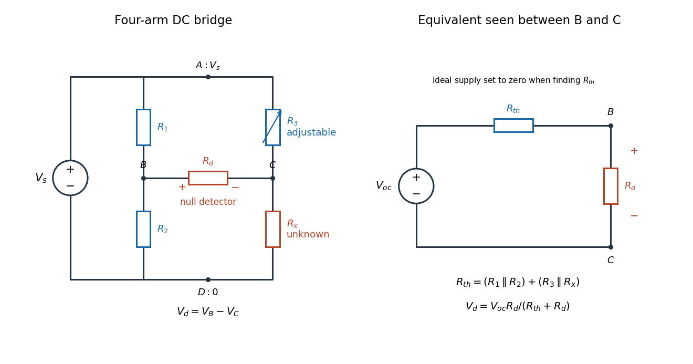
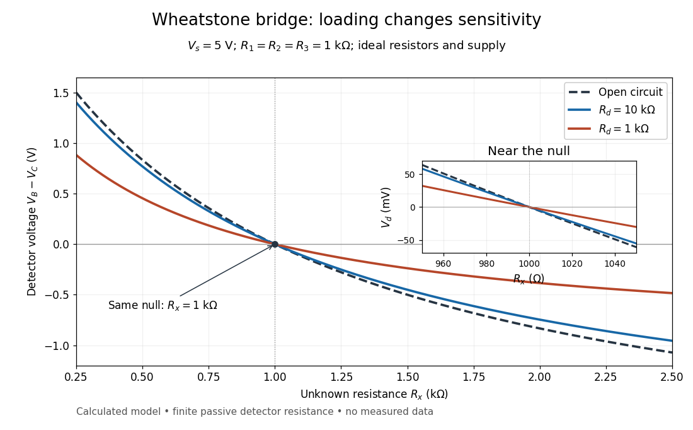
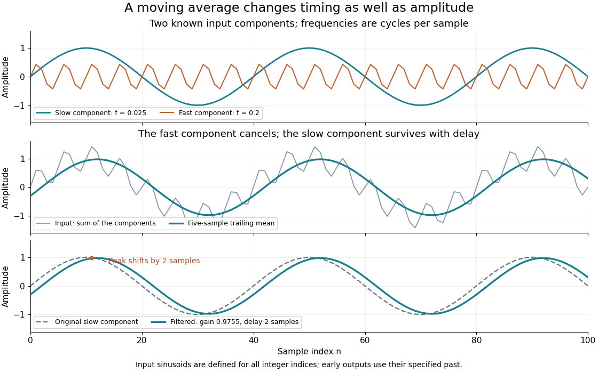
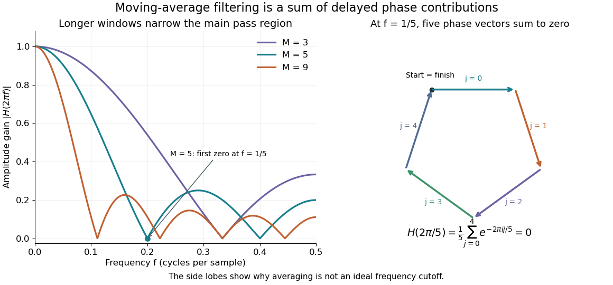

# Electrical engineering

↑ **Parent:** [Codex Wiki](README.md)  
ⓦ [Wiki](https://en.wikipedia.org/wiki/Electrical_engineering)

Electrical engineering designs systems that generate, transmit, measure and control electrical [energy](classical-mechanics.md#energy) and information. An [electrical circuit](electromagnetism.md#electrical-circuit) makes this concrete: [resistors](electromagnetism.md#resistor), [capacitors](electromagnetism.md#capacitor) and [inductors](electromagnetism.md#inductor) turn [electric potential differences](electromagnetism.md#electric-potential-difference) into predictable [electric currents](electromagnetism.md#electric-current) and time-dependent responses. [Signal processing](#signal-processing) then asks which information those responses preserve, suppress or reveal.

The connection is useful in both directions. A [series RLC circuit](electromagnetism.md#series-rlc-circuit) selects a band of [frequencies](physics.md#frequency) through its physical dynamics; a [moving average](#moving-average) selects frequencies by arithmetic on recorded samples. Both can be studied through a [frequency response](#frequency-response). The models differ, but the question is shared: what happens to each component of the [input](computer-science.md#input-computer-science), and what does that do to the [output](computer-science.md#output-computing) we care about?

**Table of contents**

- [Electrical measurement](#electrical-measurement)
  - [Null measurement](#null-measurement)
  - [Resistance bridge](#resistance-bridge)
    - [Wheatstone bridge](#wheatstone-bridge)
      - [Wheatstone bridge balance](#wheatstone-bridge-balance)
      - [Wheatstone bridge detector loading](#wheatstone-bridge-detector-loading)
      - [Slide-wire resistance bridge experiment](#slide-wire-resistance-bridge-experiment)
      - [Charles Wheatstone](#charles-wheatstone)
      - [Samuel Hunter Christie](#samuel-hunter-christie)
- [Voltage divider](#voltage-divider)
- [Thévenin's theorem](#thevenin-s-theorem)
- [Signal processing](#signal-processing)
  - [Signal](#signal)
    - [Discrete-time signal](#discrete-time-signal)
    - [Noise (signal processing)](#noise-signal-processing)
  - [Linear filter](#linear-filter)
    - [Causal filter](#causal-filter)
    - [Finite impulse response](#finite-impulse-response)
      - [Moving average](#moving-average)
    - [Band-pass filter](#band-pass-filter)
  - [Linear time-invariant system](#linear-time-invariant-system)
    - [Frequency response](#frequency-response)

## Electrical measurement

↑ **Parent:** [Electrical engineering](electrical-engineering.md)

### Null measurement

↑ **Parent:** [Electrical measurement](#electrical-measurement)

A null measurement adjusts a known comparison until a detector indicates zero difference. In a [resistance bridge](#resistance-bridge), the unknown [electrical resistance](electromagnetism.md#electrical-resistance) follows from the settings at balance rather than from a calibrated nonzero detector reading. A working detector must respond on both sides of the null: a disconnected [galvanometer](electromagnetism.md#galvanometer) also reads zero, but supplies no evidence of balance.

### Resistance bridge

↑ **Parent:** [Electrical measurement](#electrical-measurement)

A resistance bridge compares [electrical resistances](electromagnetism.md#electrical-resistance) by making two paths through an [electrical circuit](electromagnetism.md#electrical-circuit) produce the same intermediate [electric potential](electromagnetism.md#electric-potential). The [Wheatstone bridge](#wheatstone-bridge) turns this into a [null measurement](#null-measurement): adjust one arm until a detector joining the two intermediate points reads zero, then infer the unknown from a ratio. This is useful because the balance relation does not require an accurately calibrated detector gain or supply [electric potential difference](electromagnetism.md#electric-potential-difference), provided the supply is nonzero and the [resistors](electromagnetism.md#resistor) obey [Ohm's law](electromagnetism.md#ohm-s-law).

#### Wheatstone bridge

↑ **Parent:** [Resistance bridge](#resistance-bridge)  
ⓦ [Wiki](https://en.wikipedia.org/wiki/Wheatstone_bridge)

The Wheatstone bridge has four [resistor](electromagnetism.md#resistor) arms and two diagonals. Here the supply holds node $A$ at constant [electric potential difference](electromagnetism.md#electric-potential-difference) $V_s>0$ relative to node $D$, our [electrical reference potential](electromagnetism.md#electrical-reference-potential). The left path is $A\to R_1\to B\to R_2\to D$; the right path is $A\to R_3\to C\to R_x\to D$. The unknown is $R_x$, and $R_3$ is adjustable. A [voltmeter](electromagnetism.md#voltmeter) or [galvanometer](electromagnetism.md#galvanometer) connects $B$ to $C$. We define its positive reading as $V_B-V_C$; exchanging its leads reverses the sign. All four [electrical resistances](electromagnetism.md#electrical-resistance) are positive, the supply is ideal, and the calculation describes steady [electric currents](electromagnetism.md#electric-current) at fixed [temperature](thermodynamics.md#temperature).

**[Figure 1](#wheatstone-bridge-circuit-and-thevenin-equivalent). Four labeled Wheatstone bridge arms and the equivalent circuit seen by the detector**. [Source](wheatstone-bridge-circuit-and-thevenin-equivalent.py). The supply spans $A,D$; the detector spans $B,C$ and reads $V_B-V_C$. The right panel uses [Thévenin's theorem](#thevenin-s-theorem) to replace the bridge by its open-circuit [electric potential difference](electromagnetism.md#electric-potential-difference) and a series [electrical resistance](electromagnetism.md#electrical-resistance).

[Charles Wheatstone](#charles-wheatstone) described the instrument in his 1843 Bakerian lecture while explicitly crediting [Samuel Hunter Christie](#samuel-hunter-christie). The account from King's College London's collection identifies that attribution; the familiar name should not be read as an assertion that Wheatstone alone originated the bridge.[Wheatstone Collection, section “Wheatstone's contributions to electricity”: 1843 lecture and credit to Samuel Hunter Christie](physics-bibliography.md#wheatstone-collection-by-king-s-college-london)

##### Wheatstone bridge balance

↑ **Parent:** [Wheatstone bridge](#wheatstone-bridge)

First disconnect the detector. Each side is a [voltage divider](#voltage-divider). [Ohm's law](electromagnetism.md#ohm-s-law) and [Kirchhoff's voltage law](markov-process.md#kirchhoff-cycle-law) give the open-circuit intermediate [electric potentials](electromagnetism.md#electric-potential) and their difference:

$$
V_B=V_s\frac{R_2}{R_1+R_2},\qquad
V_C=V_s\frac{R_x}{R_3+R_x},\qquad
V_{\mathrm{oc}}=V_B-V_C
=V_s\left(\frac{R_2}{R_1+R_2}-\frac{R_x}{R_3+R_x}\right).
$$

Setting this difference to zero and cross-multiplying gives

$$
R_2R_3=R_1R_x,\qquad
\frac{R_1}{R_2}=\frac{R_3}{R_x},\qquad
R_x=R_3\frac{R_2}{R_1}.
$$

The balance compares ratios, not necessarily equal arm values or equal branch [electric currents](electromagnetism.md#electric-current). At balance the detector carries no [electric current](electromagnetism.md#electric-current), so [Kirchhoff's current law](markov-process.md#kirchhoff-node-law) again makes the [electric current](electromagnetism.md#electric-current) constant along each two-arm path.[PHYWE, Wheatstone bridge, P2410200, p. 4, Theory (1/3)–(2/3), equations (1)–(4): divider potentials and balance](physics-bibliography.md#wheatstone-bridge-by-phywe-p2410200)

For a worked [null measurement](#null-measurement), suppose $R_1=1.000\,\mathrm{k\Omega}$ and $R_2=2.000\,\mathrm{k\Omega}$, and the detector null occurs at adjustable $R_3=1.500\,\mathrm{k\Omega}$. Then

$$
R_x=(1.500\,\mathrm{k\Omega})\frac{2.000\,\mathrm{k\Omega}}{1.000\,\mathrm{k\Omega}}
=3.000\,\mathrm{k\Omega}.
$$

For $V_s=3.000\,\mathrm V$, both intermediate [electric potentials](electromagnetism.md#electric-potential) are $2.000\,\mathrm V$. The left branch carries $1.000\,\mathrm{mA}$ and the right branch $0.6667\,\mathrm{mA}$: the zero detector reading does not mean that the unknown carries no [electric current](electromagnetism.md#electric-current). These are stipulated ideal values illustrating the calculation, not experimental observations.

##### Wheatstone bridge detector loading

↑ **Parent:** [Wheatstone bridge](#wheatstone-bridge)

A real [voltmeter](electromagnetism.md#voltmeter) has finite input [electrical resistance](electromagnetism.md#electrical-resistance) $R_d$; a [galvanometer](electromagnetism.md#galvanometer) also has a finite winding [electrical resistance](electromagnetism.md#electrical-resistance). Away from balance, its [electric current](electromagnetism.md#electric-current) changes both intermediate [electric potentials](electromagnetism.md#electric-potential). This is [voltmeter loading](electromagnetism.md#voltmeter-loading) when the detector is a [voltmeter](electromagnetism.md#voltmeter). Model the detector as a passive [resistor](electromagnetism.md#resistor), with no offset or injected [electric current](electromagnetism.md#electric-current). [Thévenin's theorem](#thevenin-s-theorem) supplies the full response without pretending the connected bridge remains two independent [voltage dividers](#voltage-divider).

With the detector removed, the equivalent source is $V_{\mathrm{oc}}$. Replace the ideal supply by a wire to calculate the source [electrical resistance](electromagnetism.md#electrical-resistance) seen between $B,C$: nodes $A,D$ merge, making $R_1,R_2$ parallel and $R_3,R_x$ parallel. Consequently

$$
R_{\mathrm{th}}=\frac{R_1R_2}{R_1+R_2}+\frac{R_3R_x}{R_3+R_x},\qquad
I_d=\frac{V_{\mathrm{oc}}}{R_{\mathrm{th}}+R_d},\qquad
V_d=I_dR_d=V_{\mathrm{oc}}\frac{R_d}{R_{\mathrm{th}}+R_d}.
$$

Since the attenuation factor is strictly positive for $R_d>0$, the null remains $R_2R_3=R_1R_x$. A smaller detector [electrical resistance](electromagnetism.md#electrical-resistance) reduces the measured [electric potential difference](electromagnetism.md#electric-potential-difference) off balance but does not shift the ideal null. Its [electric current](electromagnetism.md#electric-current) sensitivity instead depends on $1/(R_{\mathrm{th}}+R_d)$; detector gain and resolution also matter in deciding how closely a null can be located.

**[Figure 2](#wheatstone-bridge-detector-voltage-and-loading). Finite detector resistance reduces bridge voltage sensitivity while preserving the null**. [Source](wheatstone-bridge-detector-voltage-and-loading.py). Calculated curves use $V_s=5\,\mathrm V$ and $R_1=R_2=R_3=1\,\mathrm{k\Omega}$. All cross zero at $R_x=1\,\mathrm{k\Omega}$; the inset resolves their different slopes. These curves are a model, not measured data.

In the plotted example, $R_x=1.100\,\mathrm{k\Omega}$ gives $V_{\mathrm{oc}}=-119.048\,\mathrm{mV}$ and $R_{\mathrm{th}}=1.02381\,\mathrm{k\Omega}$. A detector with $R_d=1.000\,\mathrm{k\Omega}$ instead reads $V_d=-58.824\,\mathrm{mV}$. Using that loaded reading in the unloaded [voltage divider](#voltage-divider) formula would underestimate the deviation of $R_x$ from $1\,\mathrm{k\Omega}$. Balancing the bridge avoids this particular systematic [measurement error](probability-and-statistics.md#measurement-error).

The local [derivative](calculus.md#derivative) makes the sensitivity explicit. For $R_1=R_2=R_3=R$ and $R_x=R+\delta R$, the first-order [Taylor expansion](calculus.md#taylor-expansion) is

$$
V_d=-\frac{V_s}{4R}\frac{R_d}{R+R_d}\,\delta R+O((\delta R)^2).
$$

At the plotted null, the open-circuit slope is $-1.25\,\mathrm{mV/\Omega}$, compared with $-0.625\,\mathrm{mV/\Omega}$ for $R_d=1\,\mathrm{k\Omega}$. Increasing the supply improves this ideal sensitivity but also increases [Joule heating](electromagnetism.md#joule-heating). A finite source [electrical resistance](electromagnetism.md#electrical-resistance) requires recomputing $R_{\mathrm{th}}$; the displayed parallel-pair expression assumes an ideal supply.

##### Slide-wire resistance bridge experiment

↑ **Parent:** [Wheatstone bridge](#wheatstone-bridge)

PHYWE's documented experiment uses a one-metre slide wire, a connection box, an unknown [resistor](electromagnetism.md#resistor), a known comparison [resistor](electromagnetism.md#resistor), a supply, and a digital multimeter in steady-current mA mode as the null detector. Its two yellow detector leads join the fixed-resistor junction and the slider. Move the slider until the indicated [electric current](electromagnetism.md#electric-current) vanishes; read the two wire [lengths](physics.md#length) on the ruler and infer the unknown [electrical resistance](electromagnetism.md#electrical-resistance) from their ratio. The guide advises changing the comparison [resistor](electromagnetism.md#resistor) if no null is reachable or the slider lies near an end.[PHYWE, P2410200, pp. 6–8: equipment, Figure 4 wiring, and Procedure (1/6)](physics-bibliography.md#wheatstone-bridge-by-phywe-p2410200)

The inference requires uniform [electrical resistivity](electromagnetism.md#electrical-resistivity) and [wire cross-sectional area](electromagnetism.md#wire-cross-sectional-area), so the two wire [electrical resistances](electromagnetism.md#electrical-resistance) have the ratio of their [lengths](physics.md#length), by $R=\rho_{\mathrm{el}}L/A$. Retaining PHYWE's labeling, its equation (6) is $R_x=R_C\ell_1/\ell_2$, where $R_C$ is the comparison [electrical resistance](electromagnetism.md#electrical-resistance). This is a different arm placement from our schematic. The guide's example table reports larger discrepancies near wire ends.[PHYWE, P2410200, p. 5, equation (6), and p. 12, Table 1 and end-position discussion](physics-bibliography.md#wheatstone-bridge-by-phywe-p2410200)

Useful additional controls distinguish a true [null measurement](#null-measurement) from an insensitive or disconnected detector. Check the detector zero with the supply off, then move the adjustable arm slightly to either side of the candidate balance and verify opposite detector signs. Reconnect the unknown with short, secure leads and repeat the balance. Any lead or contact [electrical resistance](electromagnetism.md#electrical-resistance) included in that arm contributes to the inferred value, even though a detector lead carries no [electric current](electromagnetism.md#electric-current) at exact balance. For very small unknown [electrical resistances](electromagnetism.md#electrical-resistance), [four-terminal sensing](statistical-physics.md#four-terminal-sensing) addresses this separate connection problem; a detector null alone does not remove it.

Check for [Joule heating](electromagnetism.md#joule-heating) by repeating at lower supply [electric potential difference](electromagnetism.md#electric-potential-difference) and with shorter powered intervals, holding ambient [temperature](thermodynamics.md#temperature) fixed. At balance the unknown still dissipates [power](classical-mechanics.md#power)

$$
P_x=\left(\frac{V_s}{R_3+R_x}\right)^2R_x.
$$

Halving $V_s$ quarters this [power](classical-mechanics.md#power) while halving ideal detector sensitivity. A balance that moves with excitation or elapsed [time](classical-mechanics.md#time-in-physics) suggests changing [electrical resistance](electromagnetism.md#electrical-resistance), including self-heating; it is not explained by passive detector loading alone. These are proposed controls, not claimed outcomes of PHYWE's experiment. Standard-[resistor](electromagnetism.md#resistor) accuracy, wire uniformity, contact reproducibility and finite detector resolution still limit the [electrical measurement](#electrical-measurement). Large [electrical resistances](electromagnetism.md#electrical-resistance) also make unwanted leakage paths consequential.

##### Charles Wheatstone

↑ **Parent:** [Wheatstone bridge](#wheatstone-bridge)  
ⓦ [Wiki](https://en.wikipedia.org/wiki/Charles_Wheatstone)

Physicist whose 1843 exposition gave the [Wheatstone bridge](#wheatstone-bridge) its familiar name while crediting [Samuel Hunter Christie](#samuel-hunter-christie).[Wheatstone Collection, opening biographical dates and “Wheatstone's contributions to electricity”](physics-bibliography.md#wheatstone-collection-by-king-s-college-london)

##### Samuel Hunter Christie

↑ **Parent:** [Wheatstone bridge](#wheatstone-bridge)  
ⓦ [Wiki](https://en.wikipedia.org/wiki/Samuel_Hunter_Christie)

The originator credited by [Charles Wheatstone](#charles-wheatstone) in his 1843 exposition of the [Wheatstone bridge](#wheatstone-bridge).[Wheatstone Collection, “Wheatstone's contributions to electricity”: inventor credited by Wheatstone](physics-bibliography.md#wheatstone-collection-by-king-s-college-london)

## Voltage divider

↑ **Parent:** [Electrical engineering](electrical-engineering.md)  
ⓦ [Wiki](https://en.wikipedia.org/wiki/Voltage_divider)

A voltage divider takes an [electric potential difference](electromagnetism.md#electric-potential-difference) across two series [resistors](electromagnetism.md#resistor) and measures the share across one. With no [electric current](electromagnetism.md#electric-current) drawn from the junction, [Ohm's law](electromagnetism.md#ohm-s-law) gives $V_{\mathrm{out}}=V_sR_b/(R_a+R_b)$ for the lower [resistor](electromagnetism.md#resistor) $R_b$. Drawing [electric current](electromagnetism.md#electric-current) from that junction changes the ratio through [voltmeter loading](electromagnetism.md#voltmeter-loading); the [Wheatstone bridge](#wheatstone-bridge) compares two such junctions.

<h2 id="thevenin-s-theorem">Thévenin's theorem</h2>

↑ **Parent:** [Electrical engineering](electrical-engineering.md)  
ⓦ [Wiki](https://en.wikipedia.org/wiki/Thévenin's_theorem)

For a linear resistive [electrical circuit](electromagnetism.md#electrical-circuit) with a well-defined two-terminal response, Thévenin's theorem replaces its terminal behavior by an ideal source of [electric potential difference](electromagnetism.md#electric-potential-difference) $V_{\mathrm{oc}}$ in series with [electrical resistance](electromagnetism.md#electrical-resistance) $R_{\mathrm{th}}$. Here $I$ is the [electric current](electromagnetism.md#electric-current) delivered to the external load. With independent sources only, calculate $R_{\mathrm{th}}$ by setting ideal voltage sources to zero (wires) and ideal current sources to zero (open connections). With dependent sources, retain them and determine the terminal ratio using a test source. The [Wheatstone bridge detector loading](#wheatstone-bridge-detector-loading) calculation applies the independent-source version.

## Signal processing

↑ **Parent:** [Electrical engineering](electrical-engineering.md)  
ⓦ [Wiki](https://en.wikipedia.org/wiki/Signal_processing)

Signal processing transforms or analyzes [signals](#signal) to extract information, change a representation, or improve a measurement. Examples include smoothing a sensor record, selecting a band of [frequencies](physics.md#frequency), and decomposing a recording through [Fourier analysis](fourier-analysis.md). A [signal](#signal) is a mathematical representation of a physical record; deciding which variation is meaningful and which is [noise](#noise-signal-processing) is part of the problem.

A [linear filter](#linear-filter) offers a simple entry point. Its [output](computer-science.md#output-computing) is assembled from weighted copies of its [input](computer-science.md#input-computer-science). A [moving average](#moving-average) can reduce rapid variation, but it also changes timing and can erase useful detail. The worked example below makes that tradeoff explicit rather than treating a smoother plot as automatic improvement.

Two complementary views make the subject appealing. An [impulse response](analysis.md#impulse-response) describes the effect of a localized input; a [frequency response](#frequency-response) describes the effect of a sustained oscillation. For a [linear time-invariant system](#linear-time-invariant-system), both describe the same operation, connected by [convolution](fourier-analysis.md#convolution) and [Fourier analysis](fourier-analysis.md). [Alan Oppenheim, MIT Signals and Systems, lecture 4: impulses, complex exponentials and convolution](https://ocw.mit.edu/courses/res-6-007-signals-and-systems-spring-2011/0400ba59406d52d94c079d99928156ee_MITRES_6_007S11_lec04.pdf).

### Signal

↑ **Parent:** [Signal processing](#signal-processing)  
ⓦ [Wiki](https://en.wikipedia.org/wiki/Signal)

A signal is a [function](function.md) or [sequence](real-analysis.md#sequence) representing a quantity that carries information. An [electric potential difference](electromagnetism.md#electric-potential-difference) measured over time can be written $x(t)$; regularly recorded values give a [discrete-time signal](#discrete-time-signal) $x[n]$. The meaning includes the measured quantity, units, time reference and sampling interval. The same list of numbers sampled once per second or once per millisecond describes different physical [frequencies](physics.md#frequency).

#### Discrete-time signal

↑ **Parent:** [Signal](#signal)

A discrete-time signal assigns a value to each of a discrete collection of times, often indexed by the [integers](number-theory.md#integer). Regular sampling at rate $f_s$ gives $x[n]=x(n/f_s)$, so a sinusoid with normalized frequency $f$ cycles per sample has physical [frequency](physics.md#frequency) $ff_s$. Discreteness of time does not itself require the amplitudes to be quantized; rounding the values is an additional operation. The [Nyquist–Shannon sampling theorem](fourier-analysis.md#nyquist-shannon-sampling-theorem) gives conditions for recovering a band-limited continuous [signal](#signal) from its samples.

#### Noise (signal processing)

↑ **Parent:** [Signal](#signal)  
ⓦ [Wiki](https://en.wikipedia.org/wiki/Noise_(signal_processing))

Noise is unwanted variation in a [signal](#signal). Whether a component is unwanted depends on the measurement task: suppressing fast variation helps only when that variation is expendable. [White noise](time-series.md#white-noise) provides one mathematical model; it does not describe every source of disturbance. A [linear filter](#linear-filter) may reduce some [noise](#noise-signal-processing) while also altering the desired [signal](#signal).

### Linear filter

↑ **Parent:** [Signal processing](#signal-processing)  
ⓦ [Wiki](https://en.wikipedia.org/wiki/Linear_filter)

A linear filter obeys the [superposition principle](vector-space.md#superposition-principle): filtering $\alpha x+\beta z$ gives $\alpha T[x]+\beta T[z]$. Many familiar examples are also [linear time-invariant systems](#linear-time-invariant-system), represented by an [impulse response](analysis.md#impulse-response) and [convolution](fourier-analysis.md#convolution). Linearity alone does not imply time invariance: multiplying $x[n]$ by the index $n$ is linear but changes its behavior when the same input is shifted.

The [moving average](#moving-average) is a [finite impulse response](#finite-impulse-response) example implemented by arithmetic; a [band-pass filter](#band-pass-filter) can instead be built from a [series RLC circuit](electromagnetism.md#series-rlc-circuit). Their [frequency responses](#frequency-response) explain which oscillations pass through. Choosing a filter means choosing how much amplitude, timing and detail may change, not simply removing every visible fluctuation.

#### Causal filter

↑ **Parent:** [Linear filter](#linear-filter)

A causal filter uses only present and past [input](computer-science.md#input-computer-science) values to produce its current [output](computer-science.md#output-computing). The trailing [moving average](#moving-average) is causal; a centered average that uses future samples is not. Future samples can be available when processing a finished recording, but they are unavailable to a live measurement at the current time.

#### Finite impulse response

↑ **Parent:** [Linear filter](#linear-filter)  
ⓦ [Wiki](https://en.wikipedia.org/wiki/Finite_impulse_response)

A [linear time-invariant system](#linear-time-invariant-system) has finite impulse response when its [impulse response](analysis.md#impulse-response) is nonzero at only finitely many indices. For a [causal filter](#causal-filter) supported at indices $0,\ldots,M-1$,

$$
y[n]=\sum_{j=0}^{M-1}h[j]x[n-j].
$$

This is a finite [discrete convolution](fourier-analysis.md#discrete-convolution). The coefficients $h[j]$ specify the complete operation; they need not be positive or equal. Such a filter has a simple bounded-input estimate, $|y[n]|\leq\|x\|_\infty\sum_j|h[j]|$, so bounded inputs remain bounded. The [moving average](#moving-average) chooses $h[j]=1/M$.

##### Moving average

↑ **Parent:** [Finite impulse response](#finite-impulse-response)  
ⓦ [Wiki](https://en.wikipedia.org/wiki/Moving_average)

A moving average replaces each value by an average over a moving window of neighboring values. The simple trailing version with positive integer window length $M$ is the [causal filter](#causal-filter)

$$
y[n]=\frac1M\sum_{j=0}^{M-1}x[n-j].
$$

It is a [finite impulse response](#finite-impulse-response) [linear time-invariant system](#linear-time-invariant-system). A constant [input](computer-science.md#input-computer-science) remains unchanged because the weights sum to one. Weighted and centered averages are other choices; the definition of the window determines both the weights and whether future values are needed.

For an exact five-sample example, let

$$
x[n]=\sin(2\pi(0.025)n)+0.45\sin(2\pi(0.2)n),
$$

defined at every integer index. The first component completes one cycle in forty samples and the second in five. Averaging five consecutive samples cancels the second component exactly. The first becomes

$$
y[n]=A\sin(2\pi(0.025)(n-2)),\qquad
A=\frac{\sin(5\pi(0.025))}{5\sin(\pi(0.025))}\approx0.975498.
$$

The remaining component is slightly smaller and delayed by two samples; the filter does not recover the original component unchanged.

**[Figure 3](#image-a-five-sample-moving-average-cancels-one-sinusoid-while-attenuating-and-delaying-another). A five-sample moving average cancels one sinusoid while attenuating and delaying another**.

The example is in steady operation: its early [output](computer-science.md#output-computing) values use the specified negative-index samples. Starting a device at $n=0$ with an unknown past requires an initialization rule. Treating earlier samples as zero, shortening the initial window, and postponing output until a full window is available produce different initial values.

For zero-mean [uncorrelated random variables](variance.md#uncorrelated-random-variables) $\varepsilon[n]$ with common [variance](variance.md) $\sigma^2$, the averaged disturbance has

$$
\operatorname{Var}\left(\frac1M\sum_{j=0}^{M-1}\varepsilon[n-j]\right)=\frac{\sigma^2}{M}.
$$

The [standard deviation](variance.md#standard-deviation) decreases by $\sqrt M$, but successive filtered errors share samples and are generally correlated. This variance calculation also assumes the wanted component is not damaged by averaging. A rapidly changing feature can be suppressed along with the disturbance.

The [frequency response](#frequency-response) explains the cancellation and limits of this method. A [moving average](#moving-average) preserves low [frequencies](physics.md#frequency) comparatively well, yet its side lobes make it a poor substitute for a sharply selective frequency cutoff. Smith develops this time-domain versus frequency-domain distinction in [The Scientist and Engineer's Guide to Digital Signal Processing, chapter 15: moving-average filters](https://www.dspguide.com/CH15.PDF).

#### Band-pass filter

↑ **Parent:** [Linear filter](#linear-filter)  
ⓦ [Wiki](https://en.wikipedia.org/wiki/Band-pass_filter)

A band-pass filter preferentially transmits signals within a range of [frequencies](physics.md#frequency) and attenuates sufficiently lower and higher [frequencies](physics.md#frequency). Taking the output voltage across the [resistor](electromagnetism.md#resistor) in a [series RLC circuit](electromagnetism.md#series-rlc-circuit) gives one example: the [resonant series RLC response](electromagnetism.md#resonant-series-rlc-response) selects a band around $1/\sqrt{LC}$. [Feynman lectures, II.22.7: resonant frequency filters](https://www.feynmanlectures.caltech.edu/II_22.html#Ch22-S7).

### Linear time-invariant system

↑ **Parent:** [Signal processing](#signal-processing)  
ⓦ [Wiki](https://en.wikipedia.org/wiki/Linear_time-invariant_system)

A linear time-invariant system combines two properties. [Linearity](vector-space.md#linearity) means that the [output](computer-science.md#output-computing) from a [linear combination](vector-space.md#linear-combination) of inputs is the same [linear combination](vector-space.md#linear-combination) of their outputs. Time invariance means that shifting an [input](computer-science.md#input-computer-science) by an integer delay shifts its [output](computer-science.md#output-computing) by exactly that delay. The operation has no preference for a particular time origin.

For discrete time, write the unit impulse as $\delta[n]=1$ at $n=0$ and zero otherwise, a [Kronecker delta](linear-algebra.md#kronecker-delta). Its response $h[n]=T[\delta][n]$ is the [impulse response](analysis.md#impulse-response). A finite [input](computer-science.md#input-computer-science) can be decomposed into shifted impulses, giving

$$
x[n]=\sum_kx[k]\delta[n-k]
\quad\Longrightarrow\quad
y[n]=\sum_kx[k]h[n-k]=(x*h)[n].
$$

The [superposition principle](vector-space.md#superposition-principle) supplies the sum and time invariance supplies the shifted copies of $h$. Infinite sums need convergence assumptions; for a bounded input and an impulse response $h$ with [absolute summability](real-analysis.md#absolute-convergence), the [discrete convolution](fourier-analysis.md#discrete-convolution) converges absolutely. For a physical system with stored initial [energy](classical-mechanics.md#energy), this construction describes the response with zero initial state; a separate free response accounts for nonzero initial conditions.

The gain is reuse. Measure or calculate one [impulse response](analysis.md#impulse-response), and the [convolution](fourier-analysis.md#convolution) predicts the response to every allowed [signal](#signal) without solving a new dynamical problem each time. Alternatively, the [frequency response](#frequency-response) predicts how each oscillatory component changes. [Oppenheim, lecture 4: convolution from shifted impulses](https://ocw.mit.edu/courses/res-6-007-signals-and-systems-spring-2011/0400ba59406d52d94c079d99928156ee_MITRES_6_007S11_lec04.pdf).

#### Frequency response

↑ **Parent:** [Linear time-invariant system](#linear-time-invariant-system)  
ⓦ [Wiki](https://en.wikipedia.org/wiki/Frequency_response)

The frequency response gives the change in [complex amplitude](physics.md#complex-amplitude) of a sustained oscillation under a [linear time-invariant system](#linear-time-invariant-system). If the [impulse response](analysis.md#impulse-response) is finite or has [absolute summability](real-analysis.md#absolute-convergence), substituting $x[n]=e^{\mathrm i\omega n}$ into its [discrete convolution](fourier-analysis.md#discrete-convolution) yields

$$
y[n]=\sum_jh[j]e^{\mathrm i\omega(n-j)}
=H(\omega)e^{\mathrm i\omega n},\qquad
H(\omega)=\sum_jh[j]e^{-\mathrm i\omega j}.
$$

Thus $|H(\omega)|$ is the amplitude gain and its [complex argument](complex-analysis.md#argument-complex-analysis) is the phase change. Real sinusoids follow by taking real or imaginary parts. Here $\omega$ is radians per sample; $\omega=2\pi f$ for $f$ cycles per sample. A physical sampling rate converts that normalized frequency into cycles per second.

For a trailing [moving average](#moving-average),

$$
H(\omega)=\frac1M\sum_{j=0}^{M-1}e^{-\mathrm i\omega j}
=e^{-\mathrm i\omega(M-1)/2}\frac{\sin(M\omega/2)}{M\sin(\omega/2)},
$$

with removable singularities evaluated from the finite sum. In particular $H(0)=1$. For $M=5$ and $\omega=2\pi/5$, the five [roots of unity](algebra.md#root-of-unity) sum to zero, so the oscillation is canceled. At small positive frequencies in the first pass region, the real sine ratio is positive and the phase factor gives a delay of $(M-1)/2$ samples.

**[Figure 4](#image-moving-average-gain-curves-and-five-phase-contributions-that-cancel-at-one-frequency). Moving-average gain curves and five phase contributions that cancel at one frequency**.

Increasing $M$ moves the first zero to $\omega=2\pi/M$, narrowing the main region of large gain. It does not create an ideal low-frequency cutoff: later side lobes transmit some higher-frequency components, and suppressing a component is only helpful when that component is unwanted. The frequency plot is the same operation as the delayed-sample average; the five-vector diagram explains one exact zero geometrically.

## ↑ Ancestors (1)

1. [Codex Wiki](README.md)
