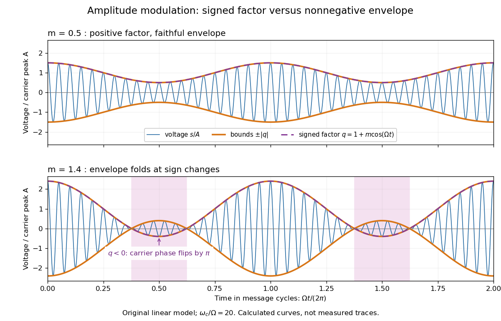
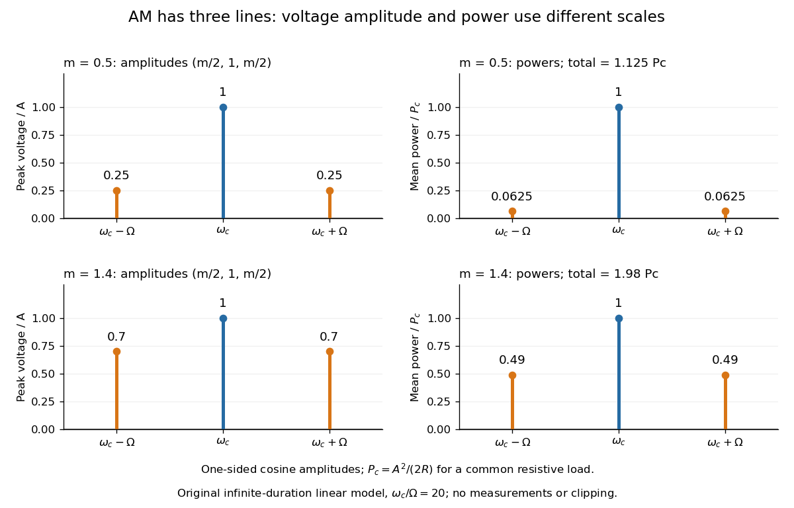
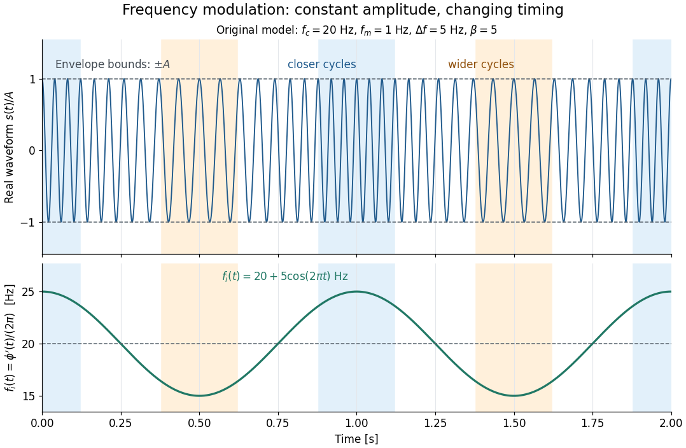
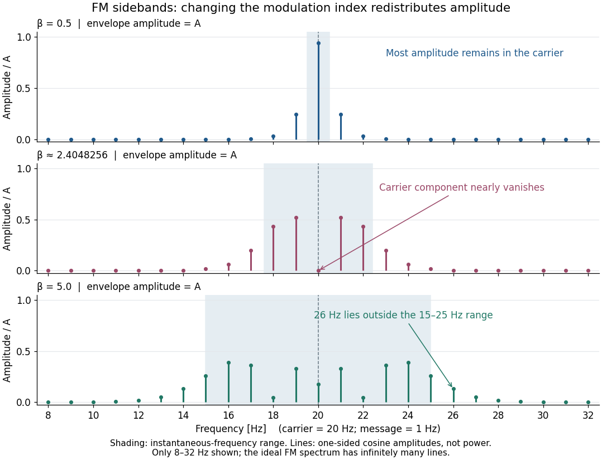
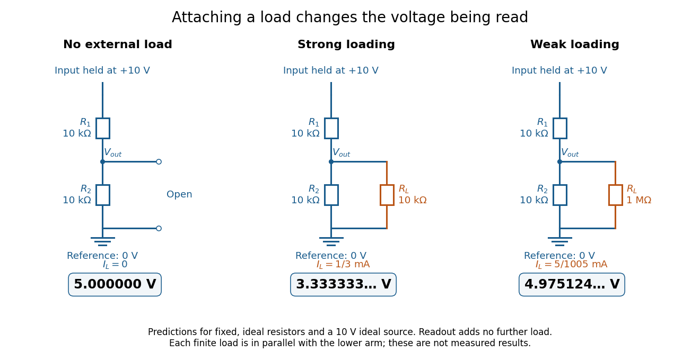
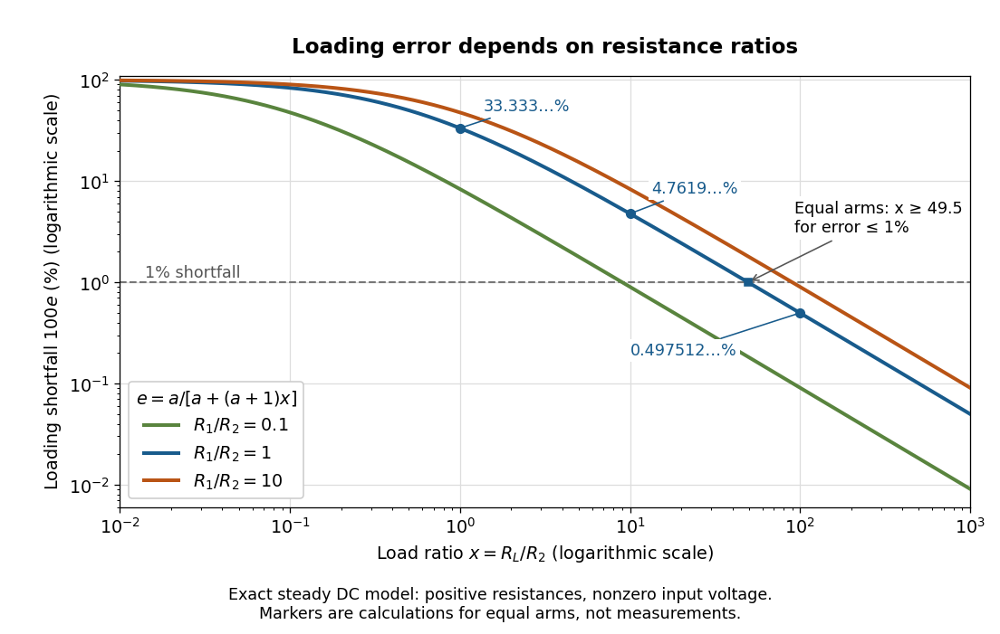
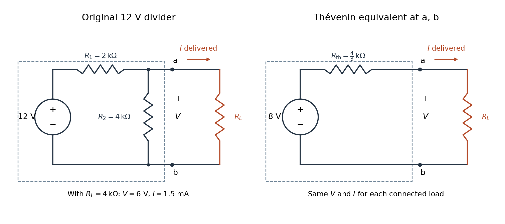
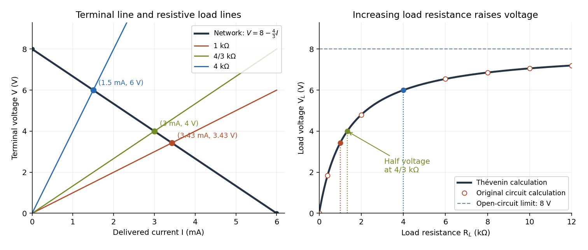
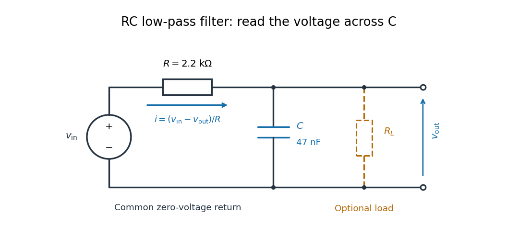
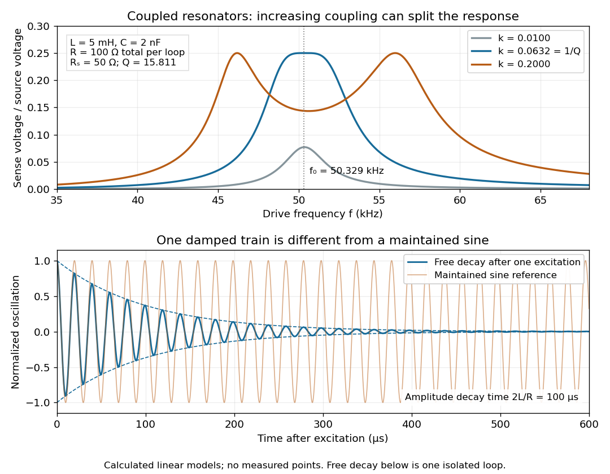

# Electrical engineering

↑ **Parent:** [Codex Wiki](README.md)  
ⓦ [Wiki](https://en.wikipedia.org/wiki/Electrical_engineering)

Electrical engineering designs systems that generate, transmit, measure and control electrical [energy](energy.md) and information. An [electrical circuit](electrical-circuit.md) makes this concrete: [resistors](electric-charge.md#resistor), [capacitors](electromagnetism.md#capacitor) and [inductors](electromagnetism.md#inductor) turn [electric potential differences](electric-field.md#electric-potential-difference) into predictable [electric currents](electric-charge.md#electric-current) and time-dependent responses. [Signal processing](#signal-processing) then asks which information those responses preserve, suppress or reveal.

The connection is useful in both directions. A [series RLC circuit](electrical-circuit.md#series-rlc-circuit) selects a band of [frequencies](wave.md#frequency) through its physical dynamics; a [moving average](#moving-average) selects frequencies by arithmetic on recorded samples. Both can be studied through a [frequency response](#frequency-response). The models differ, but the question is shared: what happens to each component of the [input](theoretical-computer-science.md#input-computer-science), and what does that do to the [output](theoretical-computer-science.md#output-computing) we care about?

**Table of contents**

- [Radar](#radar)
  - [Monostatic radar equation](#monostatic-radar-equation)
  - [Radar cross section](#radar-cross-section)
    - [Electric-dipole radar cross section of a small conducting sphere](#electric-dipole-radar-cross-section-of-a-small-conducting-sphere)
- [Analog Devices](#analog-devices)
  - [Work by Analog Devices](#work-by-analog-devices)
- [Analog-to-digital converter](#analog-to-digital-converter)
  - [Oversampling](#oversampling)
  - [Dither](#dither)
    - [Sub-step estimation with uniform dither](#sub-step-estimation-with-uniform-dither)
  - [Uniform quantization error](#uniform-quantization-error)
    - [High-resolution quantization approximation](#high-resolution-quantization-approximation)
  - [Bit-depth requirements for waveform digitization](#bit-depth-requirements-for-waveform-digitization)
- [Transmission line](#transmission-line)
  - [Finite impedance section of a transmission line](#finite-impedance-section-of-a-transmission-line)
  - [Alternating-impedance transmission line](#alternating-impedance-transmission-line)
    - [Transmission-line stop band](#transmission-line-stop-band)
    - [Bloch impedance](#bloch-impedance)
  - [Periodic resistive loading of a transmission line](#periodic-resistive-loading-of-a-transmission-line)
    - [Single-return approximation for periodic line reflections](#single-return-approximation-for-periodic-line-reflections)
  - [Standing wave ratio](#standing-wave-ratio)
  - [Parallel-plate transmission line](#parallel-plate-transmission-line)
  - [Telegrapher's equations](#telegrapher-s-equations)
    - [Low-loss transmission-line attenuation](#low-loss-transmission-line-attenuation)
  - [Characteristic impedance](#characteristic-impedance)
    - [TEM travelling-wave voltage-current relation](#tem-travelling-wave-voltage-current-relation)
- [Electric arc](#electric-arc)
- [Transformer (electrical engineering)](#transformer-electrical-engineering)
  - [Magnetizing reactance and reflected resistance in a transformer](#magnetizing-reactance-and-reflected-resistance-in-a-transformer)
- [Coaxial cable](#coaxial-cable)
  - [Poynting flux into lossy coaxial conductors](#poynting-flux-into-lossy-coaxial-conductors)
  - [Lossless coaxial line parameters](#lossless-coaxial-line-parameters)
- [Spintronics](#spintronics)
  - [Spin accumulation](#spin-accumulation)
- [Chart recorder](#chart-recorder)
- [Antenna (radio)](#antenna-radio)
  - [Antenna directivity](#antenna-directivity)
  - [Phased array](#phased-array)
    - [Grating lobe](#grating-lobe)
    - [Array factor](#array-factor)
  - [Radiation resistance](#radiation-resistance)
    - [Small-loop magnetic radiation resistance](#small-loop-magnetic-radiation-resistance)
  - [Friis transmission equation](#friis-transmission-equation)
    - [Reciprocal Hertzian-dipole echo](#reciprocal-hertzian-dipole-echo)
    - [Antenna load-mismatch echo](#antenna-load-mismatch-echo)
  - [Antenna aperture](#antenna-aperture)
    - [Antenna effective area](#antenna-effective-area)
      - [Antenna gain-effective-area relation](#antenna-gain-effective-area-relation)
        - [Antenna voltage comparison needs an impedance convention](#antenna-voltage-comparison-needs-an-impedance-convention)
  - [Antenna gain](#antenna-gain)
    - [Radiation efficiency](#radiation-efficiency)
  - [Antenna temperature](#antenna-temperature)
  - [Antenna beam pattern](#antenna-beam-pattern)
    - [Pointing tolerance of a circular receiving aperture](#pointing-tolerance-of-a-circular-receiving-aperture)
    - [Gaussian antenna beam solid angle](#gaussian-antenna-beam-solid-angle)
  - [Dipole antenna](#dipole-antenna)
    - [Hertzian dipole](#hertzian-dipole)
      - [Hertzian dipole fixed-current power scaling](#hertzian-dipole-fixed-current-power-scaling)
      - [Oblique coupling of parallel Hertzian dipoles](#oblique-coupling-of-parallel-hertzian-dipoles)
      - [Matched-load scattering of a Hertzian dipole](#matched-load-scattering-of-a-hertzian-dipole)
- [Optoelectronics](#optoelectronics)
- [Electrical engineer](#electrical-engineer)
  - [James Karki](#james-karki)
    - [Work by James Karki](#work-by-james-karki)
  - [List of electrical engineers](#list-of-electrical-engineers)
    - [Walt Kester](#walt-kester)
      - [Work by Walt Kester](#work-by-walt-kester)
    - [Marissa Giustina](#marissa-giustina)
      - [Work by Marissa Giustina](#work-by-marissa-giustina)
    - [Marcel Bouvier](#marcel-bouvier)
      - [Work by Marcel Bouvier](#work-by-marcel-bouvier)
    - [Takashi Mukai](#takashi-mukai)
      - [Work by Takashi Mukai](#work-by-takashi-mukai)
    - [Kazumasa Hiramatsu](#kazumasa-hiramatsu)
      - [Work by Kazumasa Hiramatsu](#work-by-kazumasa-hiramatsu)
    - [Shuji Nakamura](#shuji-nakamura)
      - [Work by Shuji Nakamura](#work-by-shuji-nakamura)
    - [Hiroshi Amano](#hiroshi-amano)
      - [Work by Hiroshi Amano](#work-by-hiroshi-amano)
    - [Isamu Akasaki](#isamu-akasaki)
      - [Work by Isamu Akasaki](#work-by-isamu-akasaki)
    - [George Alfred Hockham](#george-alfred-hockham)
      - [Work by George Alfred Hockham](#work-by-george-alfred-hockham)
    - [Charles Kuen Kao](#charles-kuen-kao)
      - [Work by Charles Kuen Kao](#work-by-charles-kuen-kao)
    - [Mario Dagenais](#mario-dagenais)
      - [Work by Mario Dagenais](#work-by-mario-dagenais)
    - [Jack St. Clair Kilby](#jack-st-clair-kilby)
      - [Work by Jack St. Clair Kilby](#work-by-jack-st-clair-kilby)
    - [Simon van der Meer](#simon-van-der-meer)
      - [Work by Simon van der Meer](#work-by-simon-van-der-meer)
    - [Emmett Leith](#emmett-leith)
      - [Work by Emmett Leith](#work-by-emmett-leith)
    - [William Hayward Pickering](#william-hayward-pickering)
      - [Work by William Hayward Pickering](#work-by-william-hayward-pickering)
    - [Alan V. Oppenheim](#alan-v-oppenheim)
      - [Work by Alan V. Oppenheim](#work-by-alan-v-oppenheim)
    - [Changhuei Yang](#changhuei-yang)
      - [Work by Changhuei Yang](#work-by-changhuei-yang)
    - [Joel B. Fowler](#joel-b-fowler)
      - [Work by Joel B. Fowler](#work-by-joel-b-fowler)
    - [W. Marshall Leach, Jr.](#w-marshall-leach-jr)
      - [Work by W. Marshall Leach, Jr.](#work-by-w-marshall-leach-jr)
    - [Pablo A. Parrilo](#pablo-a-parrilo)
      - [Work by Pablo A. Parrilo](#work-by-pablo-a-parrilo)
    - [Mario P. Vecchi](#mario-p-vecchi)
      - [Work by Mario P. Vecchi](#work-by-mario-p-vecchi)
    - [Hermann Anton Haus](#hermann-anton-haus)
      - [Work by Hermann Anton Haus](#work-by-hermann-anton-haus)
    - [James R. Melcher](#james-r-melcher)
      - [Work by James R. Melcher](#work-by-james-r-melcher)
    - [John Bertrand Johnson](#john-bertrand-johnson)
      - [Work by John Bertrand Johnson](#work-by-john-bertrand-johnson)
    - [Harry Nyquist](#harry-nyquist)
      - [Work by Harry Nyquist](#work-by-harry-nyquist)
    - [Max Knoll](#max-knoll)
      - [Work by Max Knoll](#work-by-max-knoll)
- [Amplitude modulation](#amplitude-modulation)
  - [Single-sideband modulation](#single-sideband-modulation)
  - [AM modulation index](#am-modulation-index)
  - [Amplitude modulation sidebands](#amplitude-modulation-sidebands)
    - [Fourier filtering of overlapping amplitude-modulation sidebands](#fourier-filtering-of-overlapping-amplitude-modulation-sidebands)
  - [Overmodulation](#overmodulation)
  - [Envelope detector](#envelope-detector)
  - [Coherent demodulation](#coherent-demodulation)
  - [Amplitude modulation laboratory](#amplitude-modulation-laboratory)
  - [Suppressed-carrier amplitude modulation](#suppressed-carrier-amplitude-modulation)
- [Voltage-controlled oscillator](#voltage-controlled-oscillator)
- [Frequency modulation](#frequency-modulation)
  - [Instantaneous frequency](#instantaneous-frequency)
  - [Frequency deviation](#frequency-deviation)
  - [FM modulation index](#fm-modulation-index)
  - [Single-tone FM sidebands](#single-tone-fm-sidebands)
  - [Narrowband frequency modulation](#narrowband-frequency-modulation)
  - [Frequency modulation laboratory](#frequency-modulation-laboratory)
- [Electrical measurement](#electrical-measurement)
  - [Function generator](#function-generator)
  - [Spectrum analyzer](#spectrum-analyzer)
  - [Multimeter](#multimeter)
  - [Frequency counter](#frequency-counter)
  - [Null measurement](#null-measurement)
  - [Open-circuit voltage](#open-circuit-voltage)
  - [Electrical test source](#electrical-test-source)
  - [Ohmmeter](#ohmmeter)
  - [Resistance bridge](#resistance-bridge)
    - [Series-RL parallel-RC bridge balance](#series-rl-parallel-rc-bridge-balance)
      - [DC bridge resistance resolution](#dc-bridge-resistance-resolution)
    - [Wheatstone bridge](#wheatstone-bridge)
      - [Wheatstone bridge balance](#wheatstone-bridge-balance)
      - [Wheatstone bridge detector loading](#wheatstone-bridge-detector-loading)
      - [Slide-wire resistance bridge experiment](#slide-wire-resistance-bridge-experiment)
      - [Charles Wheatstone](#charles-wheatstone)
      - [Samuel Hunter Christie](#samuel-hunter-christie)
- [Voltage divider](#voltage-divider)
  - [Loaded voltage divider](#loaded-voltage-divider)
  - [Voltage divider loading error](#voltage-divider-loading-error)
  - [Voltage divider teaching experiment](#voltage-divider-teaching-experiment)
- [Thévenin's theorem](#thevenin-s-theorem)
  - [Thévenin terminal response](#thevenin-terminal-response)
  - [Thévenin divider example](#thevenin-divider-example)
  - [Thévenin source suppression](#thevenin-source-suppression)
  - [Thévenin load response](#thevenin-load-response)
  - [Thévenin measurement experiment](#thevenin-measurement-experiment)
  - [Thévenin resistance](#thevenin-resistance)
  - [Thévenin equivalent](#thevenin-equivalent)
- [Linear resistive circuit](#linear-resistive-circuit)
- [Electrical load](#electrical-load)
  - [Resistive load line](#resistive-load-line)
- [Independent electrical source](#independent-electrical-source)
- [Voltage source](#voltage-source)
- [Current source](#current-source)
- [Dependent electrical source](#dependent-electrical-source)
- [Negative resistance](#negative-resistance)
- [Potentiometer](#potentiometer)
- [Signal processing](#signal-processing)
  - [Clock jitter](#clock-jitter)
  - [High-pass filter](#high-pass-filter)
  - [Signal sampling](#signal-sampling)
  - [Matched filter](#matched-filter)
    - [Visibility-domain matched filter](#visibility-domain-matched-filter)
  - [Bandwidth (signal processing)](#bandwidth-signal-processing)
  - [Analog multiplier](#analog-multiplier)
  - [Signal distortion](#signal-distortion)
  - [Quadrature demodulation](#quadrature-demodulation)
  - [Signal bandwidth](#signal-bandwidth)
  - [Signal](#signal)
    - [Rectangular function](#rectangular-function)
    - [Discrete-time signal](#discrete-time-signal)
    - [Noise (signal processing)](#noise-signal-processing)
      - [Electrical noise reduction](#electrical-noise-reduction)
      - [Flicker noise](#flicker-noise)
      - [Thermal noise](#thermal-noise)
      - [Shot noise](#shot-noise)
        - [Poisson photon counting](#poisson-photon-counting)
        - [Boxcar averaging of Poisson shot noise](#boxcar-averaging-of-poisson-shot-noise)
        - [Shot noise counting model](#shot-noise-counting-model)
        - [Shot noise spectral convention](#shot-noise-spectral-convention)
        - [Filtered shot noise](#filtered-shot-noise)
        - [Shot noise worked example](#shot-noise-worked-example)
        - [Shot noise photocurrent measurement](#shot-noise-photocurrent-measurement)
        - [Shot noise departures from Poisson statistics](#shot-noise-departures-from-poisson-statistics)
      - [Thermal electrical noise](#thermal-electrical-noise)
        - [Thermal noise spectral convention](#thermal-noise-spectral-convention)
        - [Effective noise bandwidth](#effective-noise-bandwidth)
        - [Thermal noise loading](#thermal-noise-loading)
        - [Thermal noise worked example](#thermal-noise-worked-example)
        - [Resistor-capacitor equilibrium noise](#resistor-capacitor-equilibrium-noise)
        - [Thermal noise measurement](#thermal-noise-measurement)
    - [Signal-to-noise ratio](#signal-to-noise-ratio)
    - [Power spectral density](#power-spectral-density)
      - [Amplitude spectral density](#amplitude-spectral-density)
  - [Linear filter](#linear-filter)
    - [Relative attenuation by a linear filter](#relative-attenuation-by-a-linear-filter)
    - [Low-pass filter](#low-pass-filter)
      - [Butterworth filter](#butterworth-filter)
      - [Sallen-Key low-pass filter](#sallen-key-low-pass-filter)
        - [Sallen-Key equal-component stability bound](#sallen-key-equal-component-stability-bound)
      - [RL low-pass filter](#rl-low-pass-filter)
      - [RC low-pass filter](#rc-low-pass-filter)
        - [RC low-pass frequency response](#rc-low-pass-frequency-response)
        - [RC low-pass step response](#rc-low-pass-step-response)
        - [RC low-pass output loading](#rc-low-pass-output-loading)
        - [RC low-pass laboratory](#rc-low-pass-laboratory)
    - [Causal filter](#causal-filter)
    - [Finite impulse response](#finite-impulse-response)
      - [Moving average](#moving-average)
    - [Band-pass filter](#band-pass-filter)
    - [Cutoff frequency](#cutoff-frequency)
  - [Linear time-invariant system](#linear-time-invariant-system)
    - [Frequency response](#frequency-response)
      - [Antiresonance](#antiresonance)
- [Slotted line](#slotted-line)
- [Telecommunication](#telecommunication)
  - [Telegraphy](#telegraphy)
  - [Radio communication](#radio-communication)
    - [Radio transmitter](#radio-transmitter)
    - [Radio receiver](#radio-receiver)
    - [Wireless telegraphy](#wireless-telegraphy)
      - [Coherer](#coherer)
      - [Telegraph relay](#telegraph-relay)
      - [Tuned spark wireless apparatus](#tuned-spark-wireless-apparatus)
        - [Braun's receiver coupling experiment](#braun-s-receiver-coupling-experiment)
      - [Spark-excited damped oscillation](#spark-excited-damped-oscillation)
      - [Coupled resonant circuit demonstration](#coupled-resonant-circuit-demonstration)
        - [Coupled resonant circuit model](#coupled-resonant-circuit-model)

## Radar

↑ **Parent:** [Electrical engineering](electrical-engineering.md)

Detection and inference about remote objects using transmitted [radio waves](electromagnetic-radiation.md#radio-wave) and their returned [electromagnetic radiation](electromagnetic-radiation.md). A received signal depends on propagation, directional [antenna gain](#antenna-gain), target scattering and receiver sensitivity.

### Monostatic radar equation

↑ **Parent:** [Radar](#radar)

For a far-field free-space link with one reciprocal [antenna](#antenna-radio) transmitting and receiving at range $D$, the outward intensity is $P_TG/(4\pi D^2)$. The backward scattered intensity at the receiver is this times $\sigma_{\rm back}/(4\pi D^2)$. Multiplying by the matched [antenna effective area](#antenna-effective-area) $G\lambda^2/(4\pi)$ gives the displayed received [power](energy.md#power). Attenuation, misalignment and polarization mismatch require additional factors. The threshold for a [root mean square](analysis.md#root-mean-square) voltage $V_m$ across a real matched load $R$ is $V_m^2/R$.

### Radar cross section

↑ **Parent:** [Radar](#radar)

The monostatic [radar cross section](#radar-cross-section) is $4\pi$ times the backward [differential scattering cross-section](quantum-scattering.md#differential-scattering-cross-section). Equivalently, $\sigma_{\rm back}=\lim_{r\to\infty}4\pi r^2S_{\rm back}/S_{\rm inc}$. It is a directional scattering measure with dimensions of area, not generally the geometric area or the total [scattering cross-section](quantum-scattering.md#scattering-cross-section). The definition may additionally specify the transmitted and received polarizations.

#### Electric-dipole radar cross section of a small conducting sphere

↑ **Parent:** [Radar cross section](#radar-cross-section)

Retaining only the [electric dipole](electrostatics.md#electric-dipole) induced in a small sphere gives $\mathbf p=4\pi\epsilon_0a^3\mathbf E_{\rm inc}$. In the backward direction its [differential scattering cross-section](quantum-scattering.md#differential-scattering-cross-section) is $k^4a^6$, so the [radar cross section](#radar-cross-section) is $4\pi k^4a^6$. This response model omits the sphere's induced [magnetic dipole moment](electromagnetism.md#magnetic-dipole-moment); it must be distinguished from [perfect-conductor sphere dipole interference](electromagnetic-radiation.md#perfect-conductor-sphere-dipole-interference).

## Analog Devices

↑ **Parent:** [Electrical engineering](electrical-engineering.md)

Official website: [https://www.analog.com](https://www.analog.com)

### Work by Analog Devices

↑ **Parent:** [Analog Devices](#analog-devices)

## Analog-to-digital converter

↑ **Parent:** [Electrical engineering](electrical-engineering.md)

An [analog-to-digital converter](#analog-to-digital-converter) produces a discrete numerical code from an input voltage. Its specifications include input range, resolution, conversion rate, [input impedance](electrical-circuit.md#input-impedance), offset, gain error and nonlinearity. A uniform $b$-[bit](information-theory.md#bit) converter covering voltage span $V_{\mathrm{span}}$ has nominal spacing $q\simeq V_{\mathrm{span}}/2^b$. The [uniform-quantization error bound](computer-science.md#uniform-quantization-error-bound) applies to rounding inside the range, while clipping is a different error. Sampling and [quantization](computer-science.md#quantization-signal-processing) are separate operations: neither sufficient sampling rate nor a large bit count alone guarantees accurate reconstruction.

### Oversampling

↑ **Parent:** [Analog-to-digital converter](#analog-to-digital-converter)

[oversampling](#oversampling) takes samples faster than the minimum rate required by the desired [signal](#signal) [bandwidth](#bandwidth-signal-processing). With suitable uncorrelated conversion [noise](#noise-signal-processing), digital filtering removes [noise](#noise-signal-processing) outside that [bandwidth](#bandwidth-signal-processing) before decimation. Independent-error averaging improves [standard deviation](variance.md#standard-deviation) as $N^{-1/2}$; fourfold averaging ideally gains one bit of amplitude resolution. Repetition of an unchanged biased code does not produce the same benefit.

### Dither

↑ **Parent:** [Analog-to-digital converter](#analog-to-digital-converter)

[dither](#dither) is an intentionally introduced fluctuation that makes a quantizer's output vary between codes, reducing signal-correlated quantization artifacts. A suitable distribution can make the averaged code carry information about a constant [voltage](random-walk.md#voltage) smaller than one conversion step. The improvement requires filtering or averaging; extra [noise](#noise-signal-processing) does not improve an individual conversion or repair arbitrary calibration errors.

#### Sub-step estimation with uniform dither

↑ **Parent:** [Dither](#dither)

Let a constant input lie a fraction $f$ of the way between two consecutive quantizer levels separated by $\Delta$. With independent uniform additive [dither](#dither) spanning one step and nearest-level rounding, the two output codes occur with [probabilities](probability-theory.md#probability) $1-f$ and $f$. Their mean equals the input and their sample-average [variance](variance.md) is the displayed expression. This simple model shows both the sub-step information and the remaining [noise](#noise-signal-processing) cost.

### Uniform quantization error

↑ **Parent:** [Analog-to-digital converter](#analog-to-digital-converter)

[rounding](numerical-analysis.md#rounding) an unclipped [voltage](random-walk.md#voltage) to equally spaced levels of separation $\Delta$ leaves error in $[-\Delta/2,\Delta/2]$. If the fractional position within a conversion interval is uniformly distributed, direct integration gives zero mean and [expectation value](quantum-system.md#expectation-value) $\langle\epsilon^2\rangle=\Delta^2/12$. This is a [statistical model](statistical-model.md) for the error, not a claim that the converter adds independent white [noise](#noise-signal-processing) for every possible input.

#### High-resolution quantization approximation

↑ **Parent:** [Uniform quantization error](#uniform-quantization-error)

A smooth input [probability density](wave-function.md#probability-density) varying slowly on the scale of one conversion interval makes the fractional [uniform quantization error](#uniform-quantization-error) approximately uniform. Large overall [variance](variance.md) is not sufficient: discrete inputs aligned with conversion levels provide a counterexample. Clipping, coarse sampling and correlations between error and [signal](#signal) require separate analysis.

### Bit-depth requirements for waveform digitization

↑ **Parent:** [Analog-to-digital converter](#analog-to-digital-converter)

A full-scale range $V_{\rm FS}$ and allowed quantization step $\Delta$ require $b\geq\lceil\log_2(V_{\rm FS}/\Delta)\rceil$ bits. The ideal uniform-quantizer rms error is approximately $\Delta/\sqrt{12}$. Bandwidth determines the sampling-rate requirement, but does not by itself determine a bit depth.

## Transmission line

↑ **Parent:** [Electrical engineering](electrical-engineering.md)  
ⓦ [Wiki](https://en.wikipedia.org/wiki/Transmission_line)

A [transmission line](#transmission-line) guides travelling voltage and current waves. Its distributed electrical properties determine its [characteristic impedance](#characteristic-impedance). A mismatch at a terminal produces reflected waves; available [power](energy.md#power), delivered [power](energy.md#power) and returned [power](energy.md#power) are distinct quantities.

### Finite impedance section of a transmission line

↑ **Parent:** [Transmission line](#transmission-line)

A [length](physics.md#length) $\ell$ with impedance ratio $\alpha$ between identical matched lossless lines has multiple internal reflections. Summing their amplitudes gives the displayed [power](energy.md#power) transmission when the propagation [speed](classical-mechanics.md#speed) is the same in all sections. It is unity at half-wave resonances even though either individual interface reflects. Matched remote terminations remove external echoes but not this [frequency](wave.md#frequency) dependence.

### Alternating-impedance transmission line

↑ **Parent:** [Transmission line](#transmission-line)

A periodic lossless line can consist of equal-length sections with impedances $Z_1,Z_2$. Its semi-infinite input is a fixed point of the two-section impedance transformation. The physical solution selects a forward-energy or decaying [Bloch wave](bloch-s-theorem.md#bloch-state). At special [frequencies](wave.md#frequency) where the cell [matrix](vector-space.md#matrix) is the identity, the fixed-point equation alone loses uniqueness; limiting absorption or a termination specifies the response.

#### Transmission-line stop band

↑ **Parent:** [Alternating-impedance transmission line](#alternating-impedance-transmission-line)

For a real-frequency lossless reciprocal periodic line, a cell [transfer matrix](combinatorics.md#transfer-matrix) has [determinant](multilinear-algebra.md#determinant) one. If half its trace lies outside $[-1,1]$, the Bloch multipliers are real reciprocal numbers rather than unit-modulus propagation factors. The physical interior field decays and carries no net power to infinity. A real reference line is then totally reflected by a semi-infinite structure; a finite structure can still tunnel.

#### Bloch impedance

↑ **Parent:** [Alternating-impedance transmission line](#alternating-impedance-transmission-line)

The voltage-to-current ratio of a selected Bloch eigenmode at a specified position within a periodic cell. It depends on the chosen cell boundary, unlike the cell's propagation [eigenvalues](linear-operator-theory.md#eigenvalue). In a pass band a physical semi-infinite mode carries positive real power; in an ideal stop band its [input impedance](electrical-circuit.md#input-impedance) is reactive and the mode decays into the line.

### Periodic resistive loading of a transmission line

↑ **Parent:** [Transmission line](#transmission-line)

A shunt [electrical resistance](electric-charge.md#electrical-resistance) $R$ inserted between the conductors of a uniform lossless [transmission line](#transmission-line) of [characteristic impedance](#characteristic-impedance) $Z$ has voltage [reflection coefficient](partial-differential-equation.md#reflection-coefficient) $r=-Z/(2R+Z)$ and transmission amplitude $t=1+r$. Equally spaced shunts produce coherent reflected waves. The round-trip phase between neighbours is $2kL$, so interference repeats in [frequency](wave.md#frequency) with spacing $v_p/(2L)$ for nondispersive phase [speed](classical-mechanics.md#speed) $v_p$.

#### Single-return approximation for periodic line reflections

↑ **Parent:** [Periodic resistive loading of a transmission line](#periodic-resistive-loading-of-a-transmission-line)

Summing only paths that reflect at one shunt, with all previous shunts crossed once in each direction, gives a [geometric series](sequence-and-series.md#geometric-series) with ratio $t^2e^{2ikL}$. This is not the full multiple-reflection solution: it excludes paths that bounce between distinct shunts. For a semi-infinite array the exact amplitude instead obeys $R=r+t^2e^{2ikL}R/(1-r e^{2ikL}R)$. Near coherent reflection peaks the omitted paths need not be small, even if each shunt is weak.

### Standing wave ratio

↑ **Parent:** [Transmission line](#transmission-line)  
ⓦ [Wiki](https://en.wikipedia.org/wiki/Standing_wave_ratio)

On a uniform lossless [transmission line](#transmission-line), incident and reflected sinusoidal waves give [voltage](random-walk.md#voltage) maxima $|V^+|(1+|\Gamma|)$ and minima $|V^+|(1-|\Gamma|)$. Their ratio is the [voltage](random-walk.md#voltage) [standing wave ratio](#standing-wave-ratio), $(1+|\Gamma|)/(1-|\Gamma|)$, where $\Gamma$ is the voltage-wave [reflection coefficient](partial-differential-equation.md#reflection-coefficient). A matched termination gives one, while perfect reflection gives an infinite ratio. These expressions assume a common real [characteristic impedance](#characteristic-impedance) and no propagation attenuation between the compared extrema.

### Parallel-plate transmission line

↑ **Parent:** [Transmission line](#transmission-line)

Two perfectly conducting wide strips of width $a$ and separation $d\ll a$, filled with a homogeneous nonmagnetic [dielectric](permittivity.md#dielectric) of absolute [permittivity](permittivity.md) $\varepsilon$, support a [transverse electromagnetic mode](electromagnetic-wave.md#transverse-electromagnetic-mode). Ignoring edge fields, their distributed [capacitance](electromagnetism.md#capacitance) is $C'=\varepsilon a/d$ and distributed external [inductance](electromagnetism.md#inductance) is $L'=\mu_0d/a$. The magnetic-energy integral $\mu_0(I/a)^2ad/2=L'I^2/2$ gives the latter. Their [characteristic impedance](#characteristic-impedance) is $Z_0=(d/a)\sqrt{\mu_0/\varepsilon}$ and propagation speed is $1/\sqrt{\mu_0\varepsilon}$. These parameters are per unit length, distinct from a lumped capacitor and inductor.

<h3 id="telegrapher-s-equations">Telegrapher's equations</h3>

↑ **Parent:** [Transmission line](#transmission-line)  
ⓦ [Wiki](https://en.wikipedia.org/wiki/Telegrapher's_equations)

A distributed [transmission line](#transmission-line) with per-unit-length series resistance $R'$, series [inductance](electromagnetism.md#inductance) $L'$, shunt conductance $G'$ and shunt [capacitance](electromagnetism.md#capacitance) $C'$ obeys the displayed coupled first-order equations by applying [Kirchhoff's voltage law](random-walk.md#kirchhoff-cycle-law) and [Kirchhoff's current law](random-walk.md#kirchhoff-node-law) to a short element. With $R'=G'=0$, both voltage and current satisfy a [wave equation](wave-equation.md) with speed $1/\sqrt{L'C'}$ and [characteristic impedance](#characteristic-impedance) $\sqrt{L'/C'}$. The quantities $R',L',G',C'$ are distributed parameters, not a single lumped resistor or [capacitor](electromagnetism.md#capacitor).

#### Low-loss transmission-line attenuation

↑ **Parent:** [Telegrapher's equations](#telegrapher-s-equations)

For per-length line parameters $R',L',G',C'$ and $e^{-i\omega t}$ convention, a forward factor $e^{-\Gamma z}$ has $\Gamma^2=(R'-i\omega L')(G'-i\omega C')$. Expanding about the lossless limit with $R'\ll\omega L'$ and $G'\ll\omega C'$ gives $\Gamma\simeq\alpha-i\omega\sqrt{L'C'}$, with $Z_0=\sqrt{L'/C'}$ and the displayed [amplitude](wave.md#wave-amplitude) attenuation. Power decays twice as fast in the exponent. Terminal reflection is a separate power-return mechanism and need not be dissipative.

### Characteristic impedance

↑ **Parent:** [Transmission line](#transmission-line)  
ⓦ [Wiki](https://en.wikipedia.org/wiki/Characteristic_impedance)

The [characteristic impedance](#characteristic-impedance) is the voltage-to-current ratio of a single forward travelling wave on a uniform [transmission line](#transmission-line). For real $Z_0$ and a real load resistance $R_L$, the voltage-wave [reflection coefficient](partial-differential-equation.md#reflection-coefficient) is $(R_L-Z_0)/(R_L+Z_0)$ and the power accepted by the load is the incident power times $4R_LZ_0/(R_L+Z_0)^2$.

#### TEM travelling-wave voltage-current relation

↑ **Parent:** [Characteristic impedance](#characteristic-impedance)

A lossless uniform [transmission line](#transmission-line) has a forward travelling-wave [voltage](random-walk.md#voltage) and current related by $V_0=Z_0I_0$ with $Z_0=\sqrt{L/C}$. Arbitrary independent DC [voltage](random-walk.md#voltage) and current fields cannot simply acquire the same forward [wave](wave.md) factor while retaining Maxwell consistency.

## Electric arc

↑ **Parent:** [Electrical engineering](electrical-engineering.md)  
ⓦ [Wiki](https://en.wikipedia.org/wiki/Electric_arc)

## Transformer (electrical engineering)

↑ **Parent:** [Electrical engineering](electrical-engineering.md)  
ⓦ [Wiki](https://en.wikipedia.org/wiki/Transformer)

An [electrical transformer](#transformer-electrical-engineering) transfers [energy](energy.md) between windings through [electromagnetic induction](electromagnetism.md#electromagnetic-induction). Its operation depends on changing [magnetic flux](magnetic-field.md#magnetic-flux), rather than a static [magnetic field](magnetic-field.md) alone.

### Magnetizing reactance and reflected resistance in a transformer

↑ **Parent:** [Transformer (electrical engineering)](#transformer-electrical-engineering)

For an ideal [electrical transformer](#transformer-electrical-engineering) with turns ratio $n=N_p/N_s$, the secondary load $R_L$ appears at the primary as $n^2R_L$, while a source resistance $R_g$ appears at the secondary as $R_g/n^2$. A finite magnetizing [inductance](electromagnetism.md#inductance) $L_m$ contributes a parallel branch $i\omega L_m$ at the primary; its magnitude must greatly exceed the reflected load for the loaded input to be approximately resistive. The corresponding unloaded secondary self-reactance is $\omega L_m/n^2$. That reactance is distinct from the source's transformed output resistance. A specification that simultaneously calls the loaded input matched to a small resistance and calls the primary impedance very large must distinguish these two branches.

## Coaxial cable

↑ **Parent:** [Electrical engineering](electrical-engineering.md)  
ⓦ [Wiki](https://en.wikipedia.org/wiki/Coaxial_cable)

### Poynting flux into lossy coaxial conductors

↑ **Parent:** [Coaxial cable](#coaxial-cable)

A small longitudinal electric field drives conductor current in a lossy coaxial line. Its [cross product](vector-space.md#cross-product) with the azimuthal [magnetic field](magnetic-field.md) sends [energy](energy.md) radially into both conductors, where it becomes [heat](heat.md); forward [power](energy.md#power) decreases with [distance](geometry-and-topology.md#distance).

### Lossless coaxial line parameters

↑ **Parent:** [Coaxial cable](#coaxial-cable)

For ideal coaxial conductors of radii $a<b$ filled with a homogeneous [permittivity](permittivity.md) $\epsilon$ and [magnetic permeability](maxwell-equations.md#permeability-electromagnetism) $\mu$, [Gauss's law](maxwell-equations.md#gauss-s-law) gives $E_r=\lambda/(2\pi\epsilon r)$ and hence $C'=2\pi\epsilon/\ln(b/a)$. The magnetic field $H_\varphi=I/(2\pi r)$ has energy per unit length $L'I^2/2$, giving $L'=\mu\ln(b/a)/(2\pi)$. These are the external-field parameters when internal magnetic penetration into the conductors is neglected. Their product is $L'C'=\mu\epsilon$, and the [characteristic impedance](#characteristic-impedance) is $\sqrt{L'/C'}=\sqrt{\mu/\epsilon}\ln(b/a)/(2\pi)$.

## Spintronics

↑ **Parent:** [Electrical engineering](electrical-engineering.md)

### Spin accumulation

↑ **Parent:** [Spintronics](#spintronics)

## Chart recorder

↑ **Parent:** [Electrical engineering](electrical-engineering.md)  
ⓦ [Wiki](https://en.wikipedia.org/wiki/Chart_recorder)

A [chart recorder](#chart-recorder) records a changing [signal](#signal) against [time](classical-mechanics.md#time-in-physics) on a moving chart.

## Antenna (radio)

↑ **Parent:** [Electrical engineering](electrical-engineering.md)  
ⓦ [Wiki](https://en.wikipedia.org/wiki/Antenna_(radio))

An [antenna](#antenna-radio) couples [electrical circuits](electrical-circuit.md) to propagating [electromagnetic radiation](electromagnetic-radiation.md) for transmission or reception.

### Antenna directivity

↑ **Parent:** [Antenna (radio)](#antenna-radio)

The [antenna directivity](#antenna-directivity) compares angular radiated power $U=dP_{\rm rad}/d\Omega$ with its average over directions. Its integral is $4\pi$. Unlike [antenna gain](#antenna-gain), it uses radiated power rather than accepted input power, so it omits dissipative losses. A narrow beam can have high directivity without a larger total radiated power.

### Phased array

↑ **Parent:** [Antenna (radio)](#antenna-radio)

A [phased array](#phased-array) combines radiation from spatially separated [antennas](#antenna-radio) with controlled relative [phases](wave.md#phase-waves). Changing those [phases](wave.md#phase-waves) steers the direction of [constructive interference](fourier-analysis.md#constructive-interference) without moving the elements. For an equally spaced linear array with spacing $d$, free-space [wavenumber](wave-equation.md#wavenumber) $k$ and phase increment $\psi$, a principal beam at angle $\theta_0$ from the array normal satisfies $\psi=kd\sin\theta_0$ when the time dependence is $e^{-i\omega t}$ and the element drives are $e^{ij\psi}$.

#### Grating lobe

↑ **Parent:** [Phased array](#phased-array)

A [grating lobe](#grating-lobe) is an additional principal maximum caused by spatial sampling in a [phased array](#phased-array). A regularly spaced linear array steered towards $\theta_0$ also has maxima wherever $\sin\theta=\sin\theta_0+m\lambda/d$ lies in $[-1,1]$. Taking $d<\lambda/2$ excludes such maxima for all steering angles; $d=\lambda/2$ is the usual limiting choice, with an endfire degeneracy at the extreme scan directions.

#### Array factor

↑ **Parent:** [Phased array](#phased-array)

The [array factor](#array-factor) describes the [interference](physical-optics.md#interference-wave-propagation) between the elements of a [phased array](#phased-array), separately from the radiation pattern of each element. For $N$ identical equally spaced elements,

$$
F(\theta)=\sum_{j=0}^{N-1}e^{ij\chi}=e^{i(N-1)\chi/2}\frac{\sin(N\chi/2)}{\sin(\chi/2)},\qquad \chi=\psi-kd\sin\theta.
$$

At $\chi=2\pi m$ the limiting value has magnitude $N$. The total [intensity](wave.md#intensity-physics) is proportional to $|F|^2$ times the single-element [antenna beam pattern](#antenna-beam-pattern).

### Radiation resistance

↑ **Parent:** [Antenna (radio)](#antenna-radio)  
ⓦ [Wiki](https://en.wikipedia.org/wiki/Radiation_resistance)

[Radiation resistance](#radiation-resistance) represents emitted electromagnetic [power](energy.md#power) as a real input resistance of an [antenna](#antenna-radio). It does not describe conversion to heat inside the conductor. If peak current amplitude is used, $P_{\rm rad}=|I_0|^2R_{\rm rad}/2$. Real ohmic loss adds a separate resistance and lowers radiation efficiency. For an ideal short uniform-current element of length $d$, the [Hertzian dipole](#hertzian-dipole) gives $R_{\rm rad}=80\pi^2(d/\lambda)^2$ in ohms, using the usual vacuum impedance approximation $120\pi\,\Omega$.

#### Small-loop magnetic radiation resistance

↑ **Parent:** [Radiation resistance](#radiation-resistance)

A fixed electrically small loop of area A with peak sinusoidal current $I_0\cos\omega t$ has magnetic moment $m=AI$. The [magnetic dipole radiation](electromagnetic-wave.md#magnetic-dipole-radiation) law gives mean [power](energy.md#power) $\mu_0A^2I_0^2\omega^4/(12\pi c^3)$. Defining it as $I_0^2R_{\rm rad}/2$ yields $R_{\rm rad}=\mu_0A^2\omega^4/(6\pi c^3)$. This equivalent resistance accounts for radiation, not heating in the conductor. Rotating the loop changes its vector moment and cannot in general be modelled by the same scalar current alone.

### Friis transmission equation

↑ **Parent:** [Antenna (radio)](#antenna-radio)  
ⓦ [Wiki](https://en.wikipedia.org/wiki/Friis_transmission_equation)

The [Friis transmission equation](#friis-transmission-equation) describes a far-field free-space antenna link with aligned directions, matched polarizations and negligible additional loss. It follows by multiplying the transmitter's axial [energy flux](mathematical-physics.md#energy-flux) $P_tG_t/(4\pi d^2)$ by the receiver's [antenna effective area](#antenna-effective-area) $\lambda^2G_r/(4\pi)$. A receiving impedance mismatch multiplies the available received power by $1-|\Gamma_L|^2$. Wavelength scaling must state which gains, apertures and impedances are held fixed.

#### Reciprocal Hertzian-dipole echo

↑ **Parent:** [Friis transmission equation](#friis-transmission-equation)

Two aligned lossless [Hertzian dipoles](#hertzian-dipole) in one another's broadside [radiation zone](electromagnetic-wave.md#radiation-zone) have gain $G=3/2$ and one-way received-power fraction $\eta=G^2[\lambda/(4\pi r)]^2$. If the second remains conjugately matched, its [matched-load scattering of a Hertzian dipole](#matched-load-scattering-of-a-hertzian-dipole) reradiates the same [power](energy.md#power) as its load absorbs. Applying the reciprocal far-field link on the return gives $P_{\rm echo}=P_t\eta^2$, proportional to $r^{-4}$. The statement concerns physical dipole reradiation; a pure [antenna load-mismatch echo](#antenna-load-mismatch-echo) model omits that scattering and is not interchangeable with it.

#### Antenna load-mismatch echo

↑ **Parent:** [Friis transmission equation](#friis-transmission-equation)

In an ideal matched-port [two-port network](electrical-circuit.md#two-port-network) for an antenna pair, the incident amplitude traverses the link, reflects from the receiver's load with amplitude coefficient $\Gamma_L$, then traverses the reciprocal link again. If each one-way power transfer factor is $\mathcal F$, the returned power fraction is $|\Gamma_L|^2\mathcal F^2$. With fixed gains, $\mathcal F\propto\lambda^2$ and this echo scales as $\lambda^4$. Actual antenna structural scattering or an existing input mismatch can add a coherent return not specified by the [Friis transmission equation](#friis-transmission-equation) alone.

### Antenna aperture

↑ **Parent:** [Antenna (radio)](#antenna-radio)  
ⓦ [Wiki](https://en.wikipedia.org/wiki/Antenna_aperture)

An [antenna aperture](#antenna-aperture) describes the collecting area associated with a receiving [antenna](#antenna-radio). The [antenna effective area](#antenna-effective-area) need not equal its geometric projected area.

#### Antenna effective area

↑ **Parent:** [Antenna aperture](#antenna-aperture)

The [antenna effective area](#antenna-effective-area) converts incident [energy flux](mathematical-physics.md#energy-flux) into available received [power](energy.md#power) for a specified direction and matched [polarization of an electromagnetic wave](electromagnetic-wave.md#polarization-of-an-electromagnetic-wave). In a lossless free-space link, a transmitter of [antenna gain](#antenna-gain) $G$ at range $r$ and a receiver of effective area $A_{\rm eff}$ have $P_r/P_t=GA_{\rm eff}/(4\pi r^2)$. Impedance or polarization mismatch reduces the delivered power.

##### Antenna gain-effective-area relation

↑ **Parent:** [Antenna effective area](#antenna-effective-area)

For a reciprocal [antenna](#antenna-radio) with matched polarization and load, the available [antenna effective area](#antenna-effective-area) is proportional to the directional [antenna gain](#antenna-gain). For a lossless [antenna](#antenna-radio), a [thermal equilibrium](thermal-equilibrium.md) argument fixes the constant: one polarization of [Rayleigh-Jeans law](astrophysics.md#rayleigh-jeans-law) radiance gives incident [power](energy.md#power) $(k_BT/\lambda^2)\int A_{\rm eff}\,d\Omega\,d\nu$, and matched [thermal electrical noise](#thermal-electrical-noise) gives $k_BT\,d\nu$. Thus $\int A_{\rm eff}\,d\Omega=\lambda^2$. Since $\int G\,d\Omega=4\pi$, the displayed relation follows. Reciprocal losses multiply both area and gain by the same efficiency.

###### Antenna voltage comparison needs an impedance convention

↑ **Parent:** [Antenna gain-effective-area relation](#antenna-gain-effective-area-relation)

Antennas with effective areas $A_{e,1}$ and $A_{e,2}$ receiving the same polarization-matched [plane wave](wave-function.md#plane-wave) have available [powers](energy.md#power) in that ratio. If their matched-load resistances are equal, terminal [voltage](random-walk.md#voltage) magnitudes have ratio $\sqrt{A_{e,1}/A_{e,2}}$. With unequal matched resistances the ratio becomes $\sqrt{A_{e,1}R_1/(A_{e,2}R_2)}$. Open-circuit [voltages](random-walk.md#voltage) additionally depend on each antenna's source impedance. Geometry alone therefore fixes available-power estimates more directly than unspecified terminal [voltages](random-walk.md#voltage).

### Antenna gain

↑ **Parent:** [Antenna (radio)](#antenna-radio)  
ⓦ [Wiki](https://en.wikipedia.org/wiki/Antenna_gain)

[Antenna gain](#antenna-gain) compares the far-field [energy flux](mathematical-physics.md#energy-flux) in a specified direction with the flux that an isotropic radiator would produce using the same input [power](energy.md#power). Thus $S_r=GP_{\rm in}/(4\pi r^2)$. Gain includes radiation efficiency; it must be distinguished from a voltage or current [amplifier](electrical-circuit.md#amplifier) gain and from directivity when losses matter.

#### Radiation efficiency

↑ **Parent:** [Antenna gain](#antenna-gain)

The fraction of accepted input power radiated by an [antenna](#antenna-radio). With consistent feed definitions, [antenna gain](#antenna-gain) is [radiation efficiency](#radiation-efficiency) times [antenna directivity](#antenna-directivity). Ohmic losses reduce the efficiency, while feed mismatch is usually tracked separately.

### Antenna temperature

↑ **Parent:** [Antenna (radio)](#antenna-radio)  
ⓦ [Wiki](https://en.wikipedia.org/wiki/Antenna_temperature)

The [antenna temperature](#antenna-temperature) expresses the noise [power](energy.md#power) delivered by a receiving [antenna](#antenna-radio) as an equivalent input [noise temperature](radiometry.md#noise-temperature). It depends on the sky and surroundings weighted by the [antenna beam pattern](#antenna-beam-pattern), as well as losses in the [antenna](#antenna-radio); it need not be the physical [temperature](temperature.md) of either the [antenna](#antenna-radio) or a single astronomical source.

### Antenna beam pattern

↑ **Parent:** [Antenna (radio)](#antenna-radio)

#### Pointing tolerance of a circular receiving aperture

↑ **Parent:** [Antenna beam pattern](#antenna-beam-pattern)

For a uniformly illuminated circular aperture of diameter D, normalized received [power](energy.md#power) is $[2J_1(x)/x]^2$ with $x=\pi D\sin\theta/\lambda$. The first null has $\sin\theta=1.21967\lambda/D$ and the half-power point has $\sin\theta\simeq0.5145\lambda/D$. A pointing tolerance must name the tolerated [power](energy.md#power) loss; the first-null angle is not a good low-loss tolerance. These estimates require an ideal aperture pattern and are only approximate for a dish a few [wavelengths](wave-equation.md#wavelength) across.

#### Gaussian antenna beam solid angle

↑ **Parent:** [Antenna beam pattern](#antenna-beam-pattern)

For a narrow angular [power](energy.md#power) pattern $\exp[-(u^2+w^2)/(2\alpha^2)]$ about an equatorial beam centre, the [solid angle](euclidean-geometry.md#solid-angle) measure is locally $du\,dw$. Extending the small lobe to the plane gives its beam [solid angle](euclidean-geometry.md#solid-angle) $\Omega_A\simeq2\pi\alpha^2$. Both sides of the azimuthal lobe must be included. A lossless [antenna](#antenna-radio) then has peak [antenna gain](#antenna-gain) $G_0\simeq2/\alpha^2$ and peak [antenna effective area](#antenna-effective-area) $A_0\simeq\lambda^2/(2\pi\alpha^2)$.

### Dipole antenna

↑ **Parent:** [Antenna (radio)](#antenna-radio)  
ⓦ [Wiki](https://en.wikipedia.org/wiki/Dipole_antenna)

#### Hertzian dipole

↑ **Parent:** [Dipole antenna](#dipole-antenna)

A [Hertzian dipole](#hertzian-dipole) is an ideal electrically short oscillating [electric dipole](electrostatics.md#electric-dipole) used to model radiation from a localized current element. In [vacuum](physics.md#vacuum) its far-field [electric dipole radiation](electromagnetic-wave.md#electric-dipole-radiation) has $\sin^2\theta$ angular power distribution and total [power](energy.md#power) $P=\mu_0|\ddot{\mathbf p}|^2/(6\pi c)$, evaluated at the [retarded time](relativistic-electromagnetism.md#retarded-time). The [electric-dipole approximation for radiation](electromagnetic-wave.md#electric-dipole-approximation-for-radiation) requires a source much smaller than its radiation [wavelength](wave-equation.md#wavelength).

##### Hertzian dipole fixed-current power scaling

↑ **Parent:** [Hertzian dipole](#hertzian-dipole)

A uniform electrically short [current element](electromagnetism.md#current-element) of [length](physics.md#length) $\ell$ with sinusoidal peak current $I_0$ has [electric dipole moment](electrostatics.md#electric-dipole-moment) [amplitude](wave.md#wave-amplitude) $p_0=I_0\ell/\omega$. The mean [electric dipole radiation](electromagnetic-wave.md#electric-dipole-radiation) [power](energy.md#power) is $\omega^4p_0^2/(12\pi\epsilon_0c^3)$, so fixing current makes it proportional to $\ell^2\omega^2$, rather than $\ell^2\omega^4$. Current, charge excursion and dipole moment are different quantities to hold fixed when comparing antennas. The approximation requires $\ell\ll\lambda$ and does not impose the nonuniform standing-current profile of a long antenna.

##### Oblique coupling of parallel Hertzian dipoles

↑ **Parent:** [Hertzian dipole](#hertzian-dipole)

For lossless parallel Hertzian transmitting and receiving dipoles separated by distance $r$ at angle $\theta$ to their common axis, directional gains are each $G=3\sin^2\theta/2$. The emitted polarization matches the receiving axis's transverse projection. Matched-load [power](energy.md#power) is therefore $P_L=P[3\sin^2\theta/2]^2[\lambda/(4\pi r)]^2$. One angular factor describes transmission and the other reception. This assumes reciprocal ideal dipoles, conjugate matching, far-field separation and negligible dissipative loss.

##### Matched-load scattering of a Hertzian dipole

↑ **Parent:** [Hertzian dipole](#hertzian-dipole)

For a lossless ideal [Hertzian dipole](#hertzian-dipole) driven by an incident wave, use its induced open-circuit voltage and its feed impedance $R_{\rm rad}+iX$. A conjugately matched load has impedance $R_{\rm rad}-iX$. The same induced current therefore delivers equal [power](energy.md#power) to the load and to [radiation resistance](#radiation-resistance): $P_{\rm sca}=P_{\rm load}$. The scattered wave has the usual dipole angular pattern. In direction of gain $G$, its scattering cross-section is $G A_{\rm eff}$, since the load receives $S_{\rm inc}A_{\rm eff}$.

This ideal single-mode scattering is not the same as a signal that travels through an already matched antenna port, reflects from a mismatched terminating load, and returns. A zero port reflection coefficient removes that latter echo but does not make the physical dipole invisible to the incident field. Additional structural scattering, ohmic loss or a different load changes the result.

## Optoelectronics

↑ **Parent:** [Electrical engineering](electrical-engineering.md)

## Electrical engineer

↑ **Parent:** [Electrical engineering](electrical-engineering.md)

### James Karki

↑ **Parent:** [Electrical engineer](#electrical-engineer)

#### Work by James Karki

↑ **Parent:** [James Karki](#james-karki)

### List of electrical engineers

↑ **Parent:** [Electrical engineer](#electrical-engineer)

#### Walt Kester

↑ **Parent:** [List of electrical engineers](#list-of-electrical-engineers)

Technical publications: [https://www.analog.com/en/resources/technical-books/data-conversion-handbook.html](https://www.analog.com/en/resources/technical-books/data-conversion-handbook.html)

##### Work by Walt Kester

↑ **Parent:** [Walt Kester](#walt-kester)

#### Marissa Giustina

↑ **Parent:** [List of electrical engineers](#list-of-electrical-engineers)

An [electrical engineer](#electrical-engineer) who develops quantum-computing hardware.[Opening professional description; Vienna research paragraph.](physics-bibliography.md#professional-profile-of-marissa-giustina-mcqst-de)

##### Work by Marissa Giustina

↑ **Parent:** [Marissa Giustina](#marissa-giustina)

#### Marcel Bouvier

↑ **Parent:** [List of electrical engineers](#list-of-electrical-engineers)

A [physicist](physicist.md) researching [condensed matter physics](physics.md#condensed-matter-physics).[Independent professional identity](physics-bibliography.md#gerard-mourou-biographical-by-gerard-mourou)

##### Work by Marcel Bouvier

↑ **Parent:** [Marcel Bouvier](#marcel-bouvier)

#### Takashi Mukai

↑ **Parent:** [List of electrical engineers](#list-of-electrical-engineers)

An [electrical engineer](#electrical-engineer) who developed [semiconductor](semiconductor.md) light-emitting devices at Nichia.[Independent professional identity](physics-bibliography.md#high-power-pure-blue-ingan-laser-diodes-by-atsuo-michiue-and-others)

##### Work by Takashi Mukai

↑ **Parent:** [Takashi Mukai](#takashi-mukai)

#### Kazumasa Hiramatsu

↑ **Parent:** [List of electrical engineers](#list-of-electrical-engineers)

An [electrical engineer](#electrical-engineer) researching [semiconductor](semiconductor.md) [crystal growth](engineering.md#crystal-growth) and [optoelectronics](#optoelectronics).[Independent professional identity](physics-bibliography.md#professional-profile-of-kazumasa-hiramatsu-www2-elec-mie-u-ac-jp)

##### Work by Kazumasa Hiramatsu

↑ **Parent:** [Kazumasa Hiramatsu](#kazumasa-hiramatsu)

#### Shuji Nakamura

↑ **Parent:** [List of electrical engineers](#list-of-electrical-engineers)

An [electrical engineer](#electrical-engineer) researching [gallium nitride](chemical-substance.md#gallium-nitride) light emitters.[Independent professional identity](physics-bibliography.md#professional-profile-of-shuji-nakamura-engineering-ucsb-edu)

##### Work by Shuji Nakamura

↑ **Parent:** [Shuji Nakamura](#shuji-nakamura)

#### Hiroshi Amano

↑ **Parent:** [List of electrical engineers](#list-of-electrical-engineers)

An [electrical engineer](#electrical-engineer) researching [semiconductor devices](semiconductor.md#semiconductor-device) and [crystal growth](engineering.md#crystal-growth).[Independent professional identity](physics-bibliography.md#professional-profile-of-hiroshi-amano-profs-provost-nagoya-u-ac-jp)

##### Work by Hiroshi Amano

↑ **Parent:** [Hiroshi Amano](#hiroshi-amano)

#### Isamu Akasaki

↑ **Parent:** [List of electrical engineers](#list-of-electrical-engineers)

An [electrical engineer](#electrical-engineer) who developed blue [light-emitting diodes](electrical-circuit.md#light-emitting-diode).[Independent professional identity](physics-bibliography.md#professional-profile-of-isamu-akasaki-meijo-u-ac-jp)

##### Work by Isamu Akasaki

↑ **Parent:** [Isamu Akasaki](#isamu-akasaki)

#### George Alfred Hockham

↑ **Parent:** [List of electrical engineers](#list-of-electrical-engineers)

An [electrical engineer](#electrical-engineer) researching [optical fibers](optical-instrument.md#optical-fiber) and [antennas](#antenna-radio).[Independent professional identity](physics-bibliography.md#professional-profile-of-george-alfred-hockham)

##### Work by George Alfred Hockham

↑ **Parent:** [George Alfred Hockham](#george-alfred-hockham)

#### Charles Kuen Kao

↑ **Parent:** [List of electrical engineers](#list-of-electrical-engineers)

An [electrical engineer](#electrical-engineer) researching [optical fibers](optical-instrument.md#optical-fiber).[Independent professional identity](physics-bibliography.md#professional-profile-of-charles-kuen-kao)

##### Work by Charles Kuen Kao

↑ **Parent:** [Charles Kuen Kao](#charles-kuen-kao)

#### Mario Dagenais

↑ **Parent:** [List of electrical engineers](#list-of-electrical-engineers)

An [electrical engineer](#electrical-engineer) researching [semiconductor lasers](laser.md#semiconductor-laser) and [optical fibers](optical-instrument.md#optical-fiber).[Independent professional identity](physics-bibliography.md#professional-profile-of-mario-dagenais)

##### Work by Mario Dagenais

↑ **Parent:** [Mario Dagenais](#mario-dagenais)

#### Jack St. Clair Kilby

↑ **Parent:** [List of electrical engineers](#list-of-electrical-engineers)

An [electrical engineer](#electrical-engineer) who developed [integrated circuits](electrical-circuit.md#integrated-circuit) at Texas Instruments.[Independent professional identity](physics-bibliography.md#professional-profile-of-jack-st-clair-kilby)

##### Work by Jack St. Clair Kilby

↑ **Parent:** [Jack St. Clair Kilby](#jack-st-clair-kilby)

#### Simon van der Meer

↑ **Parent:** [List of electrical engineers](#list-of-electrical-engineers)

An [electrical engineer](#electrical-engineer).[Independent professional identity](physics-bibliography.md#professional-profile-of-simon-van-der-meer)

##### Work by Simon van der Meer

↑ **Parent:** [Simon van der Meer](#simon-van-der-meer)

#### Emmett Leith

↑ **Parent:** [List of electrical engineers](#list-of-electrical-engineers)

An [electrical engineer](#electrical-engineer).[Independent professional identity](https://heritage.umich.edu/timeline/)

**[Figure 1](#image-portrait-of-emmett-leith). Portrait of Emmett Leith**. [Source](https://commons.wikimedia.org/wiki/File:Professor_Emmett_Leith_1963.jpg).

##### Work by Emmett Leith

↑ **Parent:** [Emmett Leith](#emmett-leith)

#### William Hayward Pickering

↑ **Parent:** [List of electrical engineers](#list-of-electrical-engineers)

An [electrical engineer](#electrical-engineer).[Independent professional biography and identity](https://www.jpl.nasa.gov/who-we-are/faces-of-leadership-the-directors-of-jpl/dr-william-h-pickering-1910-2004/)

##### Work by William Hayward Pickering

↑ **Parent:** [William Hayward Pickering](#william-hayward-pickering)

#### Alan V. Oppenheim

↑ **Parent:** [List of electrical engineers](#list-of-electrical-engineers)  
ⓦ [Wiki](https://en.wikipedia.org/wiki/Alan_V._Oppenheim)

An [electrical engineer](#electrical-engineer) working in [signal processing](#signal-processing). [MIT EECS profile: engineering title, EE discipline and Signal Processing research area](https://www.eecs.mit.edu/people/alan-oppenheim/)

He authored lecture notes and transparencies. [Continuous-Time Modulation, PDF p. 14: individual authored-resource attribution](physics-bibliography.md#continuous-time-modulation-by-alan-v-oppenheim)

**[Figure 2](#image-professor-alan-oppenheim). Professor Alan Oppenheim**. [Source](https://commons.wikimedia.org/wiki/File:Professor\_Alan\_Oppenheim.jpg). Portrait by [SJMW1987](https://commons.wikimedia.org/wiki/User:SJMW1987), licensed [CC BY-SA 4.0](https://creativecommons.org/licenses/by-sa/4.0/).

##### Work by Alan V. Oppenheim

↑ **Parent:** [Alan V. Oppenheim](#alan-v-oppenheim)

#### Changhuei Yang

↑ **Parent:** [List of electrical engineers](#list-of-electrical-engineers)

An [electrical engineer](#electrical-engineer) and coauthor of the [digital optical phase conjugation](physical-optics.md#digital-optical-phase-conjugation) experiment described there.[Institutional profile: electrical engineering, bioengineering and optical phase conjugation](https://www.ee.caltech.edu/people/chyang)

**[Figure 3](#image-portrait-of-changhuei-yang). Portrait of Changhuei Yang**. Institutional portrait identified on the Caltech electrical engineering profile.

##### Work by Changhuei Yang

↑ **Parent:** [Changhuei Yang](#changhuei-yang)

#### Joel B. Fowler

↑ **Parent:** [List of electrical engineers](#list-of-electrical-engineers)

Identity and discipline: [https://upload.wikimedia.org/wikipedia/commons/7/74/A_Third_Generation_Water_Bath_Based_Blackbody_Source_(IA_jresv100n5p591).pdf](https://upload.wikimedia.org/wikipedia/commons/7/74/A_Third_Generation_Water_Bath_Based_Blackbody_Source_(IA_jresv100n5p591).pdf)

##### Work by Joel B. Fowler

↑ **Parent:** [Joel B. Fowler](#joel-b-fowler)

#### W. Marshall Leach, Jr.

↑ **Parent:** [List of electrical engineers](#list-of-electrical-engineers)

Identity and biography: [https://leachlegacy.ece.gatech.edu/bio.html](https://leachlegacy.ece.gatech.edu/bio.html)

**[Figure 4](#image-portrait-of-w-marshall-leach-jr). Portrait of W. Marshall Leach, Jr.** [Source](https://leachlegacy.ece.gatech.edu/).

##### Work by W. Marshall Leach, Jr.

↑ **Parent:** [W. Marshall Leach, Jr.](#w-marshall-leach-jr)

#### Pablo A. Parrilo

↑ **Parent:** [List of electrical engineers](#list-of-electrical-engineers)

An [electrical engineer](#electrical-engineer) whose research includes [optimization](mathematical-optimization.md) and [control theory](control-theory.md).[MIT EECS profile: engineering professorship; Optimization and Game Theory; Systems Theory, Control, and Autonomy](https://www.eecs.mit.edu/people/pablo-parrilo/)

Homepage: [https://www.mit.edu/~parrilo/](https://www.mit.edu/~parrilo/)

**[Figure 5](#image-pablo-a-parrilo). Pablo A. Parrilo**. [Source](https://www.mit.edu/~parrilo/).

##### Work by Pablo A. Parrilo

↑ **Parent:** [Pablo A. Parrilo](#pablo-a-parrilo)

#### Mario P. Vecchi

↑ **Parent:** [List of electrical engineers](#list-of-electrical-engineers)

A [electrical engineer](#electrical-engineer).[Independent biographical source: Self-authored biography identifies former chair of Electrical Engineering Department at Universidad Metropolitana, head of semiconductors laboratory, MIT PhD and IBM visiting scientist coauthor of simulated annealing. Full middle name not independently verified; omit life dates.](https://www.vecchi.com/mario/brief_bio.htm)

##### Work by Mario P. Vecchi

↑ **Parent:** [Mario P. Vecchi](#mario-p-vecchi)

#### Hermann Anton Haus

↑ **Parent:** [List of electrical engineers](#list-of-electrical-engineers)

An [electrical engineer](#electrical-engineer).[Institutional memorial biography, engineering specialization and identity](https://news.mit.edu/2003/haus)

##### Work by Hermann Anton Haus

↑ **Parent:** [Hermann Anton Haus](#hermann-anton-haus)

#### James R. Melcher

↑ **Parent:** [List of electrical engineers](#list-of-electrical-engineers)

An [electrical engineer](#electrical-engineer).[Institutional memorial biography, engineering specialization and identity](https://nap.nationalacademies.org/read/2231/chapter/27)

##### Work by James R. Melcher

↑ **Parent:** [James R. Melcher](#james-r-melcher)

#### John Bertrand Johnson

↑ **Parent:** [List of electrical engineers](#list-of-electrical-engineers)

A [electrical engineer](#electrical-engineer).[Independent biography: identity and specialization](https://siarchives.si.edu/collections/siris_arc_371687)

##### Work by John Bertrand Johnson

↑ **Parent:** [John Bertrand Johnson](#john-bertrand-johnson)

#### Harry Nyquist

↑ **Parent:** [List of electrical engineers](#list-of-electrical-engineers)

A [electrical engineer](#electrical-engineer).[Independent biography: identity and specialization](https://ethw.org/Harry_Nyquist)

##### Work by Harry Nyquist

↑ **Parent:** [Harry Nyquist](#harry-nyquist)

#### Max Knoll

↑ **Parent:** [List of electrical engineers](#list-of-electrical-engineers)

An [electrical engineer](#electrical-engineer) who co-invented the [electron microscope](optics.md#electron-microscope) with [Ernst Ruska](physicist.md#ernst-ruska).[Max Knoll, 1897–1969: occupation Electrical engineer; co-invention with physicist Dr Ernst Ruska](https://collection.sciencemuseumgroup.org.uk/people/cp50265/max-knoll)

##### Work by Max Knoll

↑ **Parent:** [Max Knoll](#max-knoll)

## Amplitude modulation

↑ **Parent:** [Electrical engineering](electrical-engineering.md)  
ⓦ [Wiki](https://en.wikipedia.org/wiki/Amplitude_modulation)

Amplitude modulation encodes a message by varying the multiplying [wave amplitude](wave.md#wave-amplitude) of a [carrier wave](dispersion-relation.md#carrier-wave). Conventional [AM](#amplitude-modulation) adds a positive constant before multiplication, allowing a simple [envelope detector](#envelope-detector) to recover the message within its limits. Multiplication translates the message's [frequency spectrum](fourier-analysis.md#frequency-spectrum) into a band around the carrier, adapting a slow message to a faster channel. This is an application of the [modulation property of the Fourier transform](fourier-transform.md#modulation-property-of-the-fourier-transform).[Signals and Systems, Lecture 13: Continuous-Time Modulation, printed pp. 13-1–13-2: channel matching, spectrum translation, carrier injection and demodulation](physics-bibliography.md#continuous-time-modulation-by-alan-v-oppenheim)

For an original single-message-[frequency](wave.md#frequency) voltage model, choose

$$
s(t)=A[1+m\cos(\Omega t)]\cos(\omega_ct),\qquad
A>0,\quad 0<\Omega<\omega_c,\quad m\geq0.
$$

Here $t$ is time, $A$ is the peak voltage [amplitude](wave.md#wave-amplitude) of the unmodulated [carrier wave](dispersion-relation.md#carrier-wave), $\omega_c$ is its [angular frequency](lagrangian-mechanics.md#angular-frequency), $\Omega$ is the message [angular frequency](lagrangian-mechanics.md#angular-frequency), and $m$ is the dimensionless [AM modulation index](#am-modulation-index). The message shape is $\cos(\Omega t)$; $m$ measures how deeply it changes the multiplying factor. Define the signed factor $q(t)=1+m\cos(\Omega t)$. The nonnegative [wave envelope](dispersion-relation.md#envelope-waves) of the representation $z(t)=Aq(t)e^{\mathrm i\omega_ct}$ is

$$
E(t)=|z(t)|=A|q(t)|.
$$

The instantaneous voltage $s(t)$ crosses zero every carrier cycle, even when $E(t)$ is large. Its value at one time, its [wave envelope](dispersion-relation.md#envelope-waves), and its carrier-component [amplitude](wave.md#wave-amplitude) are three different quantities. The narrow-envelope intuition additionally needs $\Omega\ll\omega_c$; the algebraic model only assumes $\Omega<\omega_c$.

**[Figure 6](#image-am-waveform-signed-modulation-factor-and-envelope-before-and-after-overmodulation). AM waveform, signed modulation factor and envelope before and after overmodulation**. Original voltage model with $\omega_c/\Omega=20$ and $m=0.5$ or $1.4$. Orange curves bound the waveform by $\pm|q|$; the purple dashed curve is the signed $q$. Shading marks negative $q$, where the carrier phase reverses. These are calculated curves, not oscilloscope traces or detector measurements.

The beauty is that two views reveal different parts of the same operation. In time, the message appears to ride on the oscillations. In the [frequency spectrum](fourier-analysis.md#frequency-spectrum), [amplitude modulation sidebands](#amplitude-modulation-sidebands) show it as a pair of translated components. An [envelope detector](#envelope-detector) reads their combined shape without needing the carrier's [wave phase](wave.md#phase-waves); [coherent demodulation](#coherent-demodulation) instead uses a synchronized reference and preserves the signed factor.

### Single-sideband modulation

↑ **Parent:** [Amplitude modulation](#amplitude-modulation)

[Single-sideband modulation](#single-sideband-modulation) transmits one of the two translated message bands generated by [amplitude modulation](#amplitude-modulation). For a real signal, the transmitted negative-frequency band is the complex conjugate of the positive-frequency band. Removing the redundant band reduces the required [signal bandwidth](#signal-bandwidth). The [carrier wave](dispersion-relation.md#carrier-wave) may also be suppressed; its retention or removal must be specified separately.

### AM modulation index

↑ **Parent:** [Amplitude modulation](#amplitude-modulation)

In the single-[sinusoid](geometry-and-topology.md#sinusoid) [AM](#amplitude-modulation) voltage model, $m$ is the peak fractional excursion of the signed multiplying factor from its mean value $1$. At $m=0$ there is only the [carrier wave](dispersion-relation.md#carrier-wave); at $m=0.5$ its multiplying factor ranges from $0.5$ to $1.5$; at $m=1$ it just touches zero. For $0\leq m\leq1$, the [wave envelope](dispersion-relation.md#envelope-waves) extrema are

$$
E_{\max}=A(1+m),\qquad E_{\min}=A(1-m),\qquad
m=\frac{E_{\max}-E_{\min}}{E_{\max}+E_{\min}}.
$$

The last equality follows by adding and subtracting the first two. An [oscilloscope](wave-equation.md#oscilloscope) estimate uses local carrier peaks near the message extrema and needs enough carrier cycles to approximate those bounds. Consistent local [peak-to-peak amplitude](wave.md#peak-to-peak-amplitude) readings give the same ratio because their common factor of two cancels. Mixing a peak reading with a peak-to-peak reading does not.

For $A=2\,\mathrm V$ and $m=0.5$, the [wave envelope](dispersion-relation.md#envelope-waves) ranges from $1$ to $3\,\mathrm V$, giving $(3-1)/(3+1)=0.5$. These are model values. At $m=1.4$, the signed factor has minimum $-0.4$, but the nonnegative [wave envelope](dispersion-relation.md#envelope-waves) reaches zero at its sign changes; the extrema formula would misleadingly report $1$. It cannot measure the true depth of [overmodulation](#overmodulation) from the folded envelope alone.

### Amplitude modulation sidebands

↑ **Parent:** [Amplitude modulation](#amplitude-modulation)

Apply the [product-to-sum formula](geometry-and-topology.md#product-to-sum-formula) to the voltage model:

$$
s(t)=A\cos(\omega_ct)
+\frac{Am}{2}\cos((\omega_c+\Omega)t)
+\frac{Am}{2}\cos((\omega_c-\Omega)t).
$$

The [carrier wave](dispersion-relation.md#carrier-wave) component has peak voltage [amplitude](wave.md#wave-amplitude) $A$; each AM sideband has peak voltage [amplitude](wave.md#wave-amplitude) $Am/2$. These are temporal [frequency spectrum](fourier-analysis.md#frequency-spectrum) components, unlike the [spatial sidebands](dynamical-systems.md#spatial-sideband) used in pattern stability. The separation $\Omega>0$ makes the three positive [angular frequencies](lagrangian-mechanics.md#angular-frequency) distinct, and $\Omega<\omega_c$ keeps the lower one positive. The span between sidebands is $2\Omega$, or $2f_m$ in [hertz](wave.md#hertz) when $f_m=\Omega/(2\pi)$; this is the single-tone span, not a universal [signal bandwidth](#signal-bandwidth) for arbitrary messages.

A one-sided [cosine](geometry-and-topology.md#cosine)-[amplitude](wave.md#wave-amplitude) display assigns $A$ to the carrier line. A two-sided complex-exponential expansion instead assigns $A/2$ at each of $\pm\omega_c$, and $Am/4$ at each of the four sideband locations. The signal is identical; confusing the conventions creates a factor-of-two error. An ideal infinite-duration [sinusoid](geometry-and-topology.md#sinusoid) gives a spectral line. A finite recording and finite analyser resolution broaden the displayed peak.

For a voltage applied across an ideal [resistor](electric-charge.md#resistor) of [electrical resistance](electric-charge.md#electrical-resistance) $R>0$, a component of peak voltage $B$ has [root mean square](analysis.md#root-mean-square) voltage $B/\sqrt2$ and mean [power](energy.md#power) $B^2/(2R)$ by [Ohm's law](electric-charge.md#ohm-s-law). Thus

$$
P_c=\frac{A^2}{2R},\qquad
P_+=P_-=\frac{A^2m^2}{8R}=\frac{m^2}{4}P_c,\qquad
P_{\mathrm{tot}}=P_c\left(1+\frac{m^2}{2}\right).
$$

The proof of additivity is to average $s(t)^2/R$ over a long time: cross-products of distinct [frequencies](wave.md#frequency) have zero mean. Consequently the whole signal's [root mean square](analysis.md#root-mean-square) voltage is $A\sqrt{(1+m^2/2)/2}$, not simply its maximum [wave envelope](dispersion-relation.md#envelope-waves) divided by $\sqrt2$. The carrier-component $A/\sqrt2$ remains unchanged as $m$ varies.

**[Figure 7](#image-three-am-spectral-lines-peak-voltage-amplitudes-and-mean-powers). Three AM spectral lines: peak voltage amplitudes and mean powers**. Original one-sided spectra at $\omega_c/\Omega=20$, comparing $m=0.5$ and $1.4$. Peak voltages are normalized by $A$; component powers into the same resistor are normalized by $P_c=A^2/(2R)$. Equal-height carrier lines do not mean equal total power. The model has no extra lines when the signed factor changes sign.

With $A=2\,\mathrm V$, $R=50\,\Omega$ and $m=0.5$, the carrier supplies $40\,\mathrm{mW}$ and each $0.5\,\mathrm V$ peak sideband supplies $2.5\,\mathrm{mW}$, giving $45\,\mathrm{mW}$ total. At $m=1.4$ each sideband is $1.4\,\mathrm V$ peak and supplies $19.6\,\mathrm{mW}$, giving $79.2\,\mathrm{mW}$ total. Neither case changes the carrier-component [power](energy.md#power).

The fraction of mean [power](energy.md#power) in the message-bearing sidebands is $m^2/(2+m^2)$. It is $1/9$ at $m=0.5$ and $1/3$ at $m=1$. Conventional [AM](#amplitude-modulation) spends the remaining [power](energy.md#power) on a carrier that enables an inexpensive [envelope detector](#envelope-detector). Increasing $m$ beyond $1$ increases this fraction in the linear model but breaks ordinary envelope recovery. Removing the carrier gives [suppressed-carrier amplitude modulation](#suppressed-carrier-amplitude-modulation) and changes the receiver requirement.

#### Fourier filtering of overlapping amplitude-modulation sidebands

↑ **Parent:** [Amplitude modulation sidebands](#amplitude-modulation-sidebands)

The [modulation property of the Fourier transform](fourier-transform.md#modulation-property-of-the-fourier-transform) adds shifted copies of the message spectrum. If those copies overlap, their complex amplitudes add before taking a magnitude; a frequency filter then acts on this sum. For a real even triangular message spectrum proportional to $(1-|\omega|)_+$ and carrier frequency $1/2<\Omega<1$, the translated spectra overlap over $|\omega|<1-\Omega$. A filter retaining $|\omega|<\Omega$ therefore leaves a central plateau and sloping outer sections, rather than two disjoint triangular bands. Spectral [Dirac delta](distribution-theory.md#dirac-delta-function) lines at the cutoff need an explicitly specified filter gain: multiplying a [distribution](distribution-theory.md#distribution-mathematical-analysis) by a discontinuous mask is not defined by pointwise reasoning alone.

### Overmodulation

↑ **Parent:** [Amplitude modulation](#amplitude-modulation)  
ⓦ [Wiki](https://en.wikipedia.org/wiki/Overmodulation)

For this single-tone [AM](#amplitude-modulation) model, overmodulation means $m>1$. The signed factor $q(t)$ becomes negative whenever $\cos(\Omega t)<-1/m$. On such intervals,

$$
Aq(t)\cos(\omega_ct)=A|q(t)|\cos(\omega_ct+\pi).
$$

The sign reversal is a $\pi$ [radian](geometry-and-topology.md#radian) shift of the carrier's [wave phase](wave.md#phase-waves). At each zero of $q$, the [wave envelope](dispersion-relation.md#envelope-waves) vanishes and that phase is undefined. The waveform itself is continuous: the formula has not clipped it or created extra spectral lines.

At $m=1.4=7/5$, sign changes occur at message phases $\Omega t=\arccos(-5/7)$ and $2\pi-\arccos(-5/7)$ within each cycle. At the trough $\Omega t=\pi$, the desired signed factor is $-0.4$, whereas its nonnegative [wave envelope](dispersion-relation.md#envelope-waves) is $0.4A$. Ideal envelope recovery followed by subtraction of $A$ would give $-0.6A$ there, rather than the desired message voltage $-1.4A$. This is loss of polarity in the detector, not loss of the message from the full modulated signal. Actual transmitter clipping is a separate [signal distortion](#signal-distortion) that can generate additional spectral components.

### Envelope detector

↑ **Parent:** [Amplitude modulation](#amplitude-modulation)  
ⓦ [Wiki](https://en.wikipedia.org/wiki/Envelope_detector)

An envelope detector extracts the slowly varying nonnegative [wave envelope](dispersion-relation.md#envelope-waves) of a rapid [carrier wave](dispersion-relation.md#carrier-wave). In a simple electrical version a [diode](electrical-circuit.md#diode) charges a [capacitor](electromagnetism.md#capacitor) near positive carrier peaks and an attached [resistor](electric-charge.md#resistor) discharges it between peaks. When $0\leq m<1$, ideal envelope extraction gives $E(t)=A[1+m\cos(\Omega t)]$; removing the constant $A$ leaves $Am\cos(\Omega t)$. This permits recovery without a synchronized carrier reference. Carrier injection thus trades transmitted [power](energy.md#power) for simplicity.[Signals and Systems, Lecture 13: Continuous-Time Modulation, printed p. 13-2 and transparencies 13.17–13.19 on pp. 13-11–13-12: asynchronous recovery and injected carrier](physics-bibliography.md#continuous-time-modulation-by-alan-v-oppenheim)

A working peak detector needs margins as well as $m<1$: $E_{\min}=A(1-m)$ should comfortably exceed the [diode](electrical-circuit.md#diode)'s forward-voltage scale and [noise](#noise-signal-processing), and the [time constant](analysis.md#time-constant) $\tau=RC$ must suppress carrier ripple while following a falling [wave envelope](dispersion-relation.md#envelope-waves). The coarse scale window is

$$
\frac{2\pi}{\omega_c}\ll\tau\ll\frac1\Omega.
$$

A [time constant](analysis.md#time-constant) that is too short leaves carrier ripple; one that is too long makes the discharging [capacitor](electromagnetism.md#capacitor) fall more slowly than the envelope. In the ideal zero-drop, continuous-tracking approximation, following a falling $E$ requires $E/\tau\geq-E'$. For $0<m<1$,

$$
\max_{0<\theta<\pi}\frac{m\Omega\sin\theta}{1+m\cos\theta}
=\frac{m\Omega}{\sqrt{1-m^2}},\qquad
\tau\leq\frac{\sqrt{1-m^2}}{m\Omega}.
$$

Differentiating the ratio locates its maximum at $\cos\theta=-m$. This original slope check explains why operation near $m=1$ is demanding even before [overmodulation](#overmodulation): the upper bound tends to zero while the need to smooth carrier cycles persists. It is an approximate circuit criterion, not a guarantee in the presence of [diode](electrical-circuit.md#diode) drops, loading or [noise](#noise-signal-processing). At $m=0$ there is no varying message to track; at $m=1$ ideal envelope extraction remains algebraically possible, but the simple detector has no positive trough margin.

For $m>1$, even an ideal noiseless envelope detector returns $A|q(t)|$. Removing its mean or its original offset cannot restore the discarded sign. A more elaborate receiver can use the retained [wave phase](wave.md#phase-waves) through [coherent demodulation](#coherent-demodulation).

### Coherent demodulation

↑ **Parent:** [Amplitude modulation](#amplitude-modulation)

Coherent demodulation recovers a message by multiplying the received [signal](#signal) by a reference [carrier wave](dispersion-relation.md#carrier-wave) of the same [frequency](wave.md#frequency) and known relative [wave phase](wave.md#phase-waves), then passing the result through a [low-pass filter](#low-pass-filter). For the ideal [AM](#amplitude-modulation) model and reference $2\cos(\omega_ct+\varphi)$,

$$
2s(t)\cos(\omega_ct+\varphi)
=Aq(t)\cos\varphi+Aq(t)\cos(2\omega_ct+\varphi).
$$

A unity-gain ideal [low-pass filter](#low-pass-filter) passing $0$ and $\Omega$ but rejecting $2\omega_c$ and $2\omega_c\pm\Omega$ leaves $Aq(t)\cos\varphi$. Such a separating cutoff exists because $\Omega<2\omega_c-\Omega$. At $\varphi=0$, subtraction of $A$ recovers $Am\cos(\Omega t)$ exactly for any finite $m\geq0$, including [overmodulation](#overmodulation), provided the transmitter and channel preserve this linear waveform. This is the signed factor, not its [absolute value](real-analysis.md#absolute-value).

A constant phase error scales the recovered message by $\cos\varphi$: a $\pi/3$ [radian](geometry-and-topology.md#radian) error halves it, and a $\pi/2$ error removes it. A known error with nonzero [cosine](geometry-and-topology.md#cosine) can be compensated in gain; a frequency mismatch makes the relative [wave phase](wave.md#phase-waves) drift and no longer gives constant attenuation. The lecture illustrates synchronous multiplication, filtering and phase error.[Signals and Systems, Lecture 13: Continuous-Time Modulation, transparencies 13.10–13.11 on pp. 13-7–13-8 and 13.16 on p. 13-10: multiplier, low-pass separation and phase-error cosine factor](physics-bibliography.md#continuous-time-modulation-by-alan-v-oppenheim)

### Amplitude modulation laboratory

↑ **Parent:** [Amplitude modulation](#amplitude-modulation)

Rice University's _ELEC 332: In the Lab_ makes the model experimentally testable. Preparation resets the [spectrum analyzer](#spectrum-analyzer) and observes an unmodulated generator output on it and an [oscilloscope](wave-equation.md#oscilloscope). A Wavetek [function generator](#function-generator) supplies external modulation. The specified $10\,\mathrm{MHz}$ carrier and $10\,\mathrm{kHz}$ message separate three peaks. Marker readouts give [frequency](wave.md#frequency) and level; narrowing resolution bandwidth shows how the instrument broadens a line.[ELEC 332: In the Lab, Part 1, “Initial Configuration”, “Initializing”, “Observing a signal”, “Changing the bandwidth”, “Using the marker” and “Resolving signals”](physics-bibliography.md#elec-332-in-the-lab-rice-university)

Part 3 uses an SA602 [analog multiplier](#analog-multiplier) module. The message generator also triggers the [oscilloscope](wave-equation.md#oscilloscope); multiplier output feeds both displays. A no-offset module supplies a suppressed-carrier control. Replacing it with the offset-adding module restores the carrier; varying levels tests [signal distortion](#signal-distortion). Finally a radio receives the conventional [AM](#amplitude-modulation) transmission, and varying message [frequency](wave.md#frequency) checks that the heard tone belongs to this source. These are prescribed observations, not reported measurements.[ELEC 332: In the Lab, Part 3, module descriptions and “Connect the components” through “AM transmitter”: input/output connections, offset control, level sweep and receiver check](physics-bibliography.md#elec-332-in-the-lab-rice-university)

Calibration matters: verify generator voltage at the connected input, distinguish peak from [peak-to-peak amplitude](wave.md#peak-to-peak-amplitude) and [root mean square](analysis.md#root-mean-square), and check analyser units and loading before comparing heights with $Am/2$ or [power](energy.md#power) with $A^2m^2/(8R)$. The unmodulated carrier is a reference control. Limited resolution can merge sidebands; generator harmonics can add peaks. Rice explicitly demonstrates both limitations in Part 1.[ELEC 332: In the Lab, Part 1, “Resolving signals”: message-generator harmonic distortion and unresolved sidebands when the message frequency is reduced](physics-bibliography.md#elec-332-in-the-lab-rice-university)

A complementary University of Kansas procedure, _A.2 - Amplitude Modulation_, calibrates the added carrier and the suppressed-carrier product separately to $4\,\mathrm V$ peak-to-peak before recombining them. It holds the carrier fixed, varies modulation depth, reads envelope extrema and carrier-to-sideband [power](energy.md#power) differences, then connects the demodulator and adjusts its tunable [low-pass filter](#low-pass-filter) for recovery, comparing the output with the message. These are setup targets and comparison instructions, not measured results.[A.2 - Amplitude Modulation, §§A.2.5–A.2.8, printed pp. A.2.4–A.2.5 (PDF pp. 4–5), Figures A.2.3–A.2.4 and steps A.2.6(iv–xiv), A.2.8(i–vii): separate level calibration, fixed-carrier sweep and demodulation comparison](physics-bibliography.md#a-2-amplitude-modulation-university-of-kansas-eecs-562)

The inference combines time and [frequency spectrum](fourier-analysis.md#frequency-spectrum) readouts: correct sideband spacing tests frequency translation, relative heights test modulation depth, and the recovered message tests the detector. Hardware clipping, receiver filtering and [noise](#noise-signal-processing) can spoil recovery even at $m<1$. Conversely failure of an [envelope detector](#envelope-detector) at $m>1$ does not demonstrate failure of a synchronized multiplier receiver. The two diagrams above illustrate the stipulated linear model only.

### Suppressed-carrier amplitude modulation

↑ **Parent:** [Amplitude modulation](#amplitude-modulation)

## Voltage-controlled oscillator

↑ **Parent:** [Electrical engineering](electrical-engineering.md)  
ⓦ [Wiki](https://en.wikipedia.org/wiki/Voltage-controlled_oscillator)

An [oscillator](wave.md#oscillator) whose [frequency](wave.md#frequency) is adjusted by an input [electric potential difference](electric-field.md#electric-potential-difference). An approximately linear control characteristic provides a model for [frequency modulation](#frequency-modulation).

## Frequency modulation

↑ **Parent:** [Electrical engineering](electrical-engineering.md)  
ⓦ [Wiki](https://en.wikipedia.org/wiki/Frequency_modulation)

Frequency modulation carries a message by changing the [instantaneous frequency](#instantaneous-frequency) of a [carrier wave](dispersion-relation.md#carrier-wave). In the ideal model the [wave amplitude](wave.md#wave-amplitude) stays constant: information changes the rate at which the [wave phase](wave.md#phase-waves) advances. Write a real electrical [signal](#signal) and its chosen complex representation as

$$
s(t)=A\cos\phi(t),\qquad z(t)=Ae^{\mathrm i\phi(t)},\qquad A>0.
$$

The [wave envelope](dispersion-relation.md#envelope-waves) in this representation has [modulus](complex-analysis.md#modulus) $|z(t)|=A$ throughout, although $s(t)$ continually passes through zero. A smaller instantaneous value of $s(t)$ therefore does not mean a smaller [wave amplitude](wave.md#wave-amplitude). The continuously unwrapped [wave phase](wave.md#phase-waves) $\phi$ is measured in [radians](geometry-and-topology.md#radian); its [derivative](calculus.md#derivative) is an [angular frequency](lagrangian-mechanics.md#angular-frequency), while division by $2\pi$ gives [frequency](wave.md#frequency) in cycles per second, or [hertz](wave.md#hertz).

For a message $m(t)$ expressed as an [electric potential difference](electric-field.md#electric-potential-difference), an ideal [voltage-controlled oscillator](#voltage-controlled-oscillator) has sensitivity $K_f$ in [hertz](wave.md#hertz) per volt and obeys

$$
f_i(t)=f_c+K_fm(t),\qquad
\phi(t)=\phi(0)+2\pi f_ct+2\pi K_f\int_0^t m(\tau)\,d\tau.
$$

The [integral](integral.md) is essential: putting the message directly into the [wave phase](wave.md#phase-waves) gives [phase modulation](dynamical-systems.md#phase-modulation), whose [instantaneous frequency](#instantaneous-frequency) instead depends on the message's [derivative](calculus.md#derivative). [Amplitude modulation](#amplitude-modulation) changes the multiplying [wave amplitude](wave.md#wave-amplitude). These are different ways to encode the same kind of message [signal](#signal).

An original slow illustration uses $f_c=20\,\mathrm{Hz}$, message [frequency](wave.md#frequency) $f_m=1\,\mathrm{Hz}$, [frequency deviation](#frequency-deviation) $\Delta f=5\,\mathrm{Hz}$, and [FM modulation index](#fm-modulation-index) $\beta=5$. With zero initial [wave phase](wave.md#phase-waves),

$$
\phi(t)=2\pi\cdot20t+5\sin(2\pi t),\qquad
s(t)=A\cos\bigl(2\pi\cdot20t+5\sin(2\pi t)\bigr),\qquad
f_i(t)=20+5\cos(2\pi t).
$$

Here $t$ is in seconds. The [instantaneous frequency](#instantaneous-frequency) stays positive, between $15$ and $25\,\mathrm{Hz}$; the [wave phase](wave.md#phase-waves) always advances. The oscillations bunch up where $f_i$ is large and spread out where it is small, while the [wave envelope](dispersion-relation.md#envelope-waves) remains at $A$.

**[Figure 8](#image-constant-amplitude-and-changing-cycle-spacing-in-a-frequency-modulated-carrier). Constant amplitude and changing cycle spacing in a frequency-modulated carrier**. Original illustration with $f_c=20\,\mathrm{Hz}$, $f_m=1\,\mathrm{Hz}$, $\Delta f=5\,\mathrm{Hz}$ and $\beta=5$. The upper bounds are $s/A=\pm1$, not measured data; the lower curve is the exact derivative of the specified wave phase.

This separation is useful in a receiver: changing a positive multiplying [wave amplitude](wave.md#wave-amplitude) does not change the zero crossings of $\cos\phi$, so their timing still carries the message. [Noise](#noise-signal-processing) that moves those crossings, a vanishing [wave amplitude](wave.md#wave-amplitude), and [frequency response](#frequency-response) distortion can still damage it. The surprising beauty of [FM](#frequency-modulation) is that a constant [wave envelope](dispersion-relation.md#envelope-waves) can conceal a rich [frequency spectrum](fourier-analysis.md#frequency-spectrum): the components interfere to change timing instead of the envelope's height.

### Instantaneous frequency

↑ **Parent:** [Frequency modulation](#frequency-modulation)

For a [signal](#signal) with a specified differentiable, continuously unwrapped [wave phase](wave.md#phase-waves) $\phi(t)$, its instantaneous frequency is

$$
f_i(t)=\frac{1}{2\pi}\frac{d\phi}{dt}.
$$

Unwrapping means following successive turns instead of resetting the [wave phase](wave.md#phase-waves) at $2\pi$. Differentiating a reset phase would introduce artificial jumps. An arbitrary real [signal](#signal) does not by itself specify a unique amplitude-phase representation; this definition refers to the phase chosen in the model.

For the single-message-[frequency](wave.md#frequency) [FM](#frequency-modulation) model,

$$
\phi(t)=2\pi f_ct+\beta\sin(2\pi f_mt),\qquad
f_i(t)=f_c+\beta f_m\cos(2\pi f_mt).
$$

The proof is the [chain rule](calculus.md#chain-rule): the [derivative](calculus.md#derivative) of the [sine](geometry-and-topology.md#sine) contributes $2\pi f_m$, which cancels the $2\pi$ in the definition. In the $20\,\mathrm{Hz}$ example, $f_i(0)=25$, $f_i(1/4)=20$, and $f_i(1/2)=15\,\mathrm{Hz}$. Although the [frequency](wave.md#frequency) offset vanishes at $t=1/4$, the [wave phase](wave.md#phase-waves) offset is then $5$ [radians](geometry-and-topology.md#radian); the [wave phase](wave.md#phase-waves) offset and its rate of change need not vanish together.

Between times $t_1,t_2$, the accumulated number of cycles is $(\phi(t_2)-\phi(t_1))/(2\pi)=\int_{t_1}^{t_2}f_i(t)\,dt$. Thus a crossing-to-crossing measurement yields an average [frequency](wave.md#frequency) over that interval. Its reciprocal time is only an approximation to the [instantaneous frequency](#instantaneous-frequency) at one point when $f_i$ varies slowly over a cycle.

### Frequency deviation

↑ **Parent:** [Frequency modulation](#frequency-modulation)

The peak frequency deviation is the largest [absolute value](real-analysis.md#absolute-value) of the [instantaneous frequency](#instantaneous-frequency) offset from the chosen [carrier wave](dispersion-relation.md#carrier-wave) [frequency](wave.md#frequency) $f_c$. For $f_i=f_c+K_fM\cos(2\pi f_mt)$, it is $\Delta f=|K_f|M$. It is a [frequency](wave.md#frequency), measured in [hertz](wave.md#hertz), rather than a [wave phase](wave.md#phase-waves) or an exact [signal bandwidth](#signal-bandwidth).

### FM modulation index

↑ **Parent:** [Frequency modulation](#frequency-modulation)

For a message consisting of a single [sinusoid](geometry-and-topology.md#sinusoid) with [frequency](wave.md#frequency) $f_m>0$, the FM modulation index is $\beta=\Delta f/f_m$. It is dimensionless and equals the peak [wave phase](wave.md#phase-waves) excursion in [radians](geometry-and-topology.md#radian) in the chosen sine-phase convention. Keeping $\Delta f=5\,\mathrm{Hz}$ while changing $f_m$ from $1$ to $2\,\mathrm{Hz}$ reduces $\beta$ from $5$ to $2.5$: the same [frequency deviation](#frequency-deviation) acts for a shorter portion of each message cycle. A general message containing many [frequencies](wave.md#frequency) does not have a single $f_m$ with this meaning.

### Single-tone FM sidebands

↑ **Parent:** [Frequency modulation](#frequency-modulation)

A single-tone [FM](#frequency-modulation) [signal](#signal) has components displaced from the [carrier wave](dispersion-relation.md#carrier-wave) [frequency](wave.md#frequency) by integer multiples of the message [frequency](wave.md#frequency). These are temporal sidebands; the [spatial sidebands](dynamical-systems.md#spatial-sideband) used to perturb a spatial pattern are a related but different setting. To find the temporal components, apply the [Jacobi-Anger expansion](bessel-function.md#jacobi-anger-expansion) to the complex representation:

$$
e^{\mathrm i\beta\sin\theta}=\sum_{k=-\infty}^{\infty}J_k(\beta)e^{\mathrm ik\theta},\qquad
z(t)=A\sum_{k=-\infty}^{\infty}J_k(\beta)e^{2\pi\mathrm i(f_c+kf_m)t}.
$$

Here $J_k$ is a [Bessel function of the first kind](bessel-function.md#bessel-function-of-the-first-kind). The identity follows by setting the generating variable to $e^{\mathrm i\theta}$ in its [generating function](sequence-and-series.md#generating-function).[Chapter 10, §10.12, equation 10.12.1 and the substitution described in the section notes](mathematics-bibliography.md#nist-digital-library-of-mathematical-functions)

Taking the [real part](complex-analysis.md#real-part) gives the exact real [signal](#signal) expansion

$$
s(t)=A\sum_{k=-\infty}^{\infty}J_k(\beta)\cos\bigl(2\pi(f_c+kf_m)t\bigr).
$$

The complex representation has a [Fourier coefficient](fourier-series.md#fourier-coefficient) $AJ_k(\beta)$ at $f_c+kf_m$; the normalized magnitude is $|J_k(\beta)|$. The identity $J_{-k}(\beta)=(-1)^kJ_k(\beta)$ makes upper and lower complex sideband magnitudes equal, but their signs matter when reconstructing the [wave phase](wave.md#phase-waves). A negative coefficient reverses a component's [wave phase](wave.md#phase-waves) by $\pi$; an [amplitude](wave.md#wave-amplitude) display alone hides that information.

For $\beta=5$, original evaluation gives $J_0(5)\approx-0.17760$, $J_1(5)\approx-0.32758$, $J_5(5)\approx0.26114$ and $J_6(5)\approx0.13105$. Thus there are appreciable components at $14$ and $26\,\mathrm{Hz}$, outside the $15$–$25\,\mathrm{Hz}$ range of the [instantaneous frequency](#instantaneous-frequency). There is no contradiction: [instantaneous frequency](#instantaneous-frequency) describes the local rate of the combined [wave phase](wave.md#phase-waves), while the [frequency spectrum](fourier-analysis.md#frequency-spectrum) describes a global [superposition](vector-space.md#superposition-principle) of constant-[frequency](wave.md#frequency) components.

For the real [signal](#signal), negative [frequencies](wave.md#frequency) must also be accounted for: a [cosine](geometry-and-topology.md#cosine) at $-f$ equals one at $f$. When $f_c/f_m=20$, the normalized positive-[frequency](wave.md#frequency) [cosine](geometry-and-topology.md#cosine) coefficient at $nf_m$, $n>0$, is exactly $J_{n-20}(\beta)+J_{-n-20}(\beta)$. The second term is extremely small over the plotted range, but the figure includes it. The chosen complex representation need not have a [frequency spectrum](fourier-analysis.md#frequency-spectrum) supported only at positive [frequencies](wave.md#frequency), even when its specified [instantaneous frequency](#instantaneous-frequency) is everywhere positive.

**[Figure 9](#image-fm-sideband-amplitudes-for-three-modulation-indices-at-fixed-carrier-and-message-frequencies). FM sideband amplitudes for three modulation indices at fixed carrier and message frequencies**. Original one-sided cosine-amplitude spectra for $f_c=20\,\mathrm{Hz}$ and $f_m=1\,\mathrm{Hz}$. Shading marks the instantaneous-frequency range, not a spectral cutoff. The middle modulation index is near the first zero of $J_0$; all three modeled envelopes have amplitude $A$. Only a finite set of lines is displayed.

For a nonzero [FM modulation index](#fm-modulation-index), the ideal [frequency spectrum](fourier-analysis.md#frequency-spectrum) has infinitely many sidebands. Many become tiny, but drawing only visible lines does not make the exact [signal bandwidth](#signal-bandwidth) finite. A useful engineering width must state a threshold or a retained-power fraction. For the complex representation, [Parseval's identity](fourier-analysis.md#parseval-identity) gives a simple check:

$$
\frac{1}{2\pi}\int_0^{2\pi}\bigl|e^{\mathrm i\beta\sin\theta}\bigr|^2\,d\theta
=\sum_{k=-\infty}^{\infty}|J_k(\beta)|^2=1.
$$

At $\beta=5$, the sum through $|k|\leq6$ is approximately $0.99356$. Retaining those complex components captures over $99\%$ of their squared magnitudes and spans $12\,\mathrm{Hz}$ from $14$ to $26\,\mathrm{Hz}$. This is a stated truncation criterion, not an exact cutoff or a universal bandwidth rule. It also explains why a diminished carrier component need not imply a diminished envelope: its contribution has been redistributed among sidebands.

### Narrowband frequency modulation

↑ **Parent:** [Frequency modulation](#frequency-modulation)

When the [FM modulation index](#fm-modulation-index) satisfies $|\beta|\ll1$, a [Taylor expansion](calculus.md#taylor-expansion) gives a useful first-order approximation. With $\omega_c=2\pi f_c$ and $\omega_m=2\pi f_m$,

$$
\frac{s(t)}A
=\cos(\omega_ct)-\beta\sin(\omega_mt)\sin(\omega_ct)+O(\beta^2)
=\cos(\omega_ct)+\frac\beta2\cos((\omega_c+\omega_m)t)-\frac\beta2\cos((\omega_c-\omega_m)t)+O(\beta^2).
$$

The [product-to-sum formula](geometry-and-topology.md#product-to-sum-formula) for [sines](geometry-and-topology.md#sine) exposes a carrier and one pair of sidebands, with opposite signs for this [wave phase](wave.md#phase-waves) convention. Higher sidebands are neglected, not identically absent. For $\beta=0.1$, the predicted normalized first-sideband magnitude $0.05$ is close to the original exact evaluation $J_1(0.1)\approx0.0499375$. The neglected waveform term is bounded in [absolute value](real-analysis.md#absolute-value) by $\beta^2/2=0.005$, using the second-[derivative](calculus.md#derivative) bound for the [cosine](geometry-and-topology.md#cosine). Small [frequency deviation](#frequency-deviation) relative to $f_c$ alone does not justify this approximation: it is $\Delta f/f_m$ that must be small.

### Frequency modulation laboratory

↑ **Parent:** [Frequency modulation](#frequency-modulation)

The New Jersey Institute of Technology's _Lab 2: FM Modulation, Demodulation and Bessel Zeros_, Part I, prepares a [voltage-controlled oscillator](#voltage-controlled-oscillator) in low-frequency mode. A [frequency counter](#frequency-counter) reads its output while a buffered constant [electric potential difference](electric-field.md#electric-potential-difference) calibrates its sensitivity. Sweeping the control voltage checks [linearity](vector-space.md#linearity); the calibrated gain is then held fixed.[Part I, Figure 2 and steps T1–T7: VCO preparation, frequency-counter readout, DC sensitivity and linearity sweep](physics-bibliography.md#lab-2-fm-modulation-demodulation-and-bessel-zeros-njit-ece-489)

An audio oscillator replaces the constant control voltage. An [oscilloscope](wave-equation.md#oscilloscope) displays the [signal](#signal) and its [FFT](discrete-fourier-transform.md#fast-fourier-transform) [frequency spectrum](fourier-analysis.md#frequency-spectrum) together. Zero modulation supplies a carrier reference. Increasing message [amplitude](wave.md#wave-amplitude) reveals sidebands, compares their heights with the carrier, and locates a carrier minimum. These readouts test the spectrum and infer [frequency deviation](#frequency-deviation). This is a student procedure, not a report of measured results.[“The FM Spectrum”, steps T8–T13: audio-oscillator input, simultaneous waveform/FFT, unmodulated reference, relative sideband heights and carrier minimum](physics-bibliography.md#lab-2-fm-modulation-demodulation-and-bessel-zeros-njit-ece-489)

A carrier minimum is a minimum of one [Fourier coefficient](fourier-series.md#fourier-coefficient), not disappearance of the whole [signal](#signal). In the ideal model the first positive zero of $J_0$ is approximately $\beta=2.4048256$, while the [wave envelope](dispersion-relation.md#envelope-waves) remains $A$. The lab's introductory special-cases paragraph agrees with this rounded value; step T12 mistakenly repeats the equal-sideband value for the carrier zero.[“Special Cases, β=1.45 and β=2.405”, compared with the inconsistent numerical annotation in T12](physics-bibliography.md#lab-2-fm-modulation-demodulation-and-bessel-zeros-njit-ece-489)

The interpretation also has practical limits. A finite recording limits [frequency](wave.md#frequency) resolution; inadequate sampling can cause [aliasing](fourier-analysis.md#aliasing); and nonlinear VCO response can introduce extra components. Keeping the gain fixed and first checking [linearity](vector-space.md#linearity) helps distinguish those effects from a change in [FM modulation index](#fm-modulation-index). The diagrams above are independent model calculations, not laboratory measurements.

## Electrical measurement

↑ **Parent:** [Electrical engineering](electrical-engineering.md)

### Function generator

↑ **Parent:** [Electrical measurement](#electrical-measurement)  
ⓦ [Wiki](https://en.wikipedia.org/wiki/Function_generator)

### Spectrum analyzer

↑ **Parent:** [Electrical measurement](#electrical-measurement)  
ⓦ [Wiki](https://en.wikipedia.org/wiki/Spectrum_analyzer)

### Multimeter

↑ **Parent:** [Electrical measurement](#electrical-measurement)  
ⓦ [Wiki](https://en.wikipedia.org/wiki/Multimeter)

A [multimeter](#multimeter) combines measurements such as [electric potential difference](electric-field.md#electric-potential-difference), [electric current](electric-charge.md#electric-current) and [electrical resistance](electric-charge.md#electrical-resistance) in one instrument. Some models also measure [capacitance](electromagnetism.md#capacitance); the supported functions and test conditions depend on the instrument. The [dielectric](permittivity.md#dielectric) laboratory example uses a [multimeter](#multimeter) in capacitance mode.

### Frequency counter

↑ **Parent:** [Electrical measurement](#electrical-measurement)  
ⓦ [Wiki](https://en.wikipedia.org/wiki/Frequency_counter)

An instrument measuring the rate of repeated electrical events; it supplies the [frequency](wave.md#frequency) readout when calibrating a [voltage-controlled oscillator](#voltage-controlled-oscillator).

### Null measurement

↑ **Parent:** [Electrical measurement](#electrical-measurement)

A null measurement adjusts a known comparison until a detector indicates zero difference. In a [resistance bridge](#resistance-bridge), the unknown [electrical resistance](electric-charge.md#electrical-resistance) follows from the settings at balance rather than from a calibrated nonzero detector reading. A working detector must respond on both sides of the null: a disconnected [galvanometer](electric-charge.md#galvanometer) also reads zero, but supplies no evidence of balance.

### Open-circuit voltage

↑ **Parent:** [Electrical measurement](#electrical-measurement)  
ⓦ [Wiki](https://en.wikipedia.org/wiki/Open-circuit_voltage)

The terminal [electric potential difference](electric-field.md#electric-potential-difference) with zero external [electric current](electric-charge.md#electric-current), when a finite value exists. A reading from a finite-input-[electrical resistance](electric-charge.md#electrical-resistance) [voltmeter](electric-field.md#voltmeter) approximates it subject to [voltmeter loading](electric-field.md#voltmeter-loading).

### Electrical test source

↑ **Parent:** [Electrical measurement](#electrical-measurement)

A prescribed [voltage source](#voltage-source) or [current source](#current-source) used to probe a terminal response. For a suppressed [linear resistive circuit](#linear-resistive-circuit), the ratio of terminal voltage to entering [electric current](electric-charge.md#electric-current) determines the [Thévenin resistance](#thevenin-resistance) when finite.

### Ohmmeter

↑ **Parent:** [Electrical measurement](#electrical-measurement)  
ⓦ [Wiki](https://en.wikipedia.org/wiki/Ohmmeter)

An instrument that measures [electrical resistance](electric-charge.md#electrical-resistance) by applying a test excitation and observing the response.

### Resistance bridge

↑ **Parent:** [Electrical measurement](#electrical-measurement)

A resistance bridge compares [electrical resistances](electric-charge.md#electrical-resistance) by making two paths through an [electrical circuit](electrical-circuit.md) produce the same intermediate [electric potential](electric-field.md#electric-potential). The [Wheatstone bridge](#wheatstone-bridge) turns this into a [null measurement](#null-measurement): adjust one arm until a detector joining the two intermediate points reads zero, then infer the unknown from a ratio. This is useful because the balance relation does not require an accurately calibrated detector gain or supply [electric potential difference](electric-field.md#electric-potential-difference), provided the supply is nonzero and the [resistors](electric-charge.md#resistor) obey [Ohm's law](electric-charge.md#ohm-s-law).

#### Series-RL parallel-RC bridge balance

↑ **Parent:** [Resistance bridge](#resistance-bridge)

An unloaded four-arm [resistance bridge](#resistance-bridge) with $Z_1=R_1+i\omega L_1$ and $Z_4=R_4/(1+i\omega R_4C_4)$ balances when $Z_1Z_4=R_2R_3$. Multiplying through the RC denominator and comparing real and imaginary coefficients gives the displayed conditions. In this ideal model they hold at all frequencies, including the DC steady limit. Replacing the parallel RC arm by a series arm changes the balance law.

##### DC bridge resistance resolution

↑ **Parent:** [Series-RL parallel-RC bridge balance](#series-rl-parallel-rc-bridge-balance)

With other arms fixed and a high-input-resistance detector, the DC midpoint difference has derivative $-V_sR_2/(R_1+R_2)^2$ with respect to $R_1$. Dividing a small detectable voltage change by its magnitude gives the local resistance resolution. Calibration, source stability, thermal drift and detector loading contribute separately to total measurement uncertainty. Detector sensitivity alone is not a complete accuracy claim.

#### Wheatstone bridge

↑ **Parent:** [Resistance bridge](#resistance-bridge)  
ⓦ [Wiki](https://en.wikipedia.org/wiki/Wheatstone_bridge)

The Wheatstone bridge has four [resistor](electric-charge.md#resistor) arms and two diagonals. Here the supply holds node $A$ at constant [electric potential difference](electric-field.md#electric-potential-difference) $V_s>0$ relative to node $D$, our [electrical reference potential](electric-field.md#electrical-reference-potential). The left path is $A\to R_1\to B\to R_2\to D$; the right path is $A\to R_3\to C\to R_x\to D$. The unknown is $R_x$, and $R_3$ is adjustable. A [voltmeter](electric-field.md#voltmeter) or [galvanometer](electric-charge.md#galvanometer) connects $B$ to $C$. We define its positive reading as $V_B-V_C$; exchanging its leads reverses the sign. All four [electrical resistances](electric-charge.md#electrical-resistance) are positive, the supply is ideal, and the calculation describes steady [electric currents](electric-charge.md#electric-current) at fixed [temperature](temperature.md).

**[Figure 10](#wheatstone-bridge-circuit-and-thevenin-equivalent). Four labeled Wheatstone bridge arms and the equivalent circuit seen by the detector**. [Source](wheatstone-bridge-circuit-and-thevenin-equivalent.py). The supply spans $A,D$; the detector spans $B,C$ and reads $V_B-V_C$. The right panel uses [Thévenin's theorem](#thevenin-s-theorem) to replace the bridge by its open-circuit [electric potential difference](electric-field.md#electric-potential-difference) and a series [electrical resistance](electric-charge.md#electrical-resistance).

[Charles Wheatstone](#charles-wheatstone) described the instrument in his 1843 Bakerian lecture while explicitly crediting [Samuel Hunter Christie](#samuel-hunter-christie). The account from King's College London's collection identifies that attribution; the familiar name should not be read as an assertion that Wheatstone alone originated the bridge.[Wheatstone Collection, section “Wheatstone's contributions to electricity”: 1843 lecture and credit to Samuel Hunter Christie](physics-bibliography.md#wheatstone-collection-by-king-s-college-london)

##### Wheatstone bridge balance

↑ **Parent:** [Wheatstone bridge](#wheatstone-bridge)

First disconnect the detector. Each side is a [voltage divider](#voltage-divider). [Ohm's law](electric-charge.md#ohm-s-law) and [Kirchhoff's voltage law](random-walk.md#kirchhoff-cycle-law) give the open-circuit intermediate [electric potentials](electric-field.md#electric-potential) and their difference:

$$
V_B=V_s\frac{R_2}{R_1+R_2},\qquad
V_C=V_s\frac{R_x}{R_3+R_x},\qquad
V_{\mathrm{oc}}=V_B-V_C
=V_s\left(\frac{R_2}{R_1+R_2}-\frac{R_x}{R_3+R_x}\right).
$$

Setting this difference to zero and cross-multiplying gives

$$
R_2R_3=R_1R_x,\qquad
\frac{R_1}{R_2}=\frac{R_3}{R_x},\qquad
R_x=R_3\frac{R_2}{R_1}.
$$

The balance compares ratios, not necessarily equal arm values or equal branch [electric currents](electric-charge.md#electric-current). At balance the detector carries no [electric current](electric-charge.md#electric-current), so [Kirchhoff's current law](random-walk.md#kirchhoff-node-law) again makes the [electric current](electric-charge.md#electric-current) constant along each two-arm path.[PHYWE, Wheatstone bridge, P2410200, p. 4, Theory (1/3)–(2/3), equations (1)–(4): divider potentials and balance](physics-bibliography.md#wheatstone-bridge-by-phywe-p2410200)

For a worked [null measurement](#null-measurement), suppose $R_1=1.000\,\mathrm{k\Omega}$ and $R_2=2.000\,\mathrm{k\Omega}$, and the detector null occurs at adjustable $R_3=1.500\,\mathrm{k\Omega}$. Then

$$
R_x=(1.500\,\mathrm{k\Omega})\frac{2.000\,\mathrm{k\Omega}}{1.000\,\mathrm{k\Omega}}
=3.000\,\mathrm{k\Omega}.
$$

For $V_s=3.000\,\mathrm V$, both intermediate [electric potentials](electric-field.md#electric-potential) are $2.000\,\mathrm V$. The left branch carries $1.000\,\mathrm{mA}$ and the right branch $0.6667\,\mathrm{mA}$: the zero detector reading does not mean that the unknown carries no [electric current](electric-charge.md#electric-current). These are stipulated ideal values illustrating the calculation, not experimental observations.

##### Wheatstone bridge detector loading

↑ **Parent:** [Wheatstone bridge](#wheatstone-bridge)

A real [voltmeter](electric-field.md#voltmeter) has finite input [electrical resistance](electric-charge.md#electrical-resistance) $R_d$; a [galvanometer](electric-charge.md#galvanometer) also has a finite winding [electrical resistance](electric-charge.md#electrical-resistance). Away from balance, its [electric current](electric-charge.md#electric-current) changes both intermediate [electric potentials](electric-field.md#electric-potential). This is [voltmeter loading](electric-field.md#voltmeter-loading) when the detector is a [voltmeter](electric-field.md#voltmeter). Model the detector as a passive [resistor](electric-charge.md#resistor), with no offset or injected [electric current](electric-charge.md#electric-current). [Thévenin's theorem](#thevenin-s-theorem) supplies the full response without pretending the connected bridge remains two independent [voltage dividers](#voltage-divider).

With the detector removed, the equivalent source is $V_{\mathrm{oc}}$. Replace the ideal supply by a wire to calculate the source [electrical resistance](electric-charge.md#electrical-resistance) seen between $B,C$: nodes $A,D$ merge, making $R_1,R_2$ parallel and $R_3,R_x$ parallel. Consequently

$$
R_{\mathrm{th}}=\frac{R_1R_2}{R_1+R_2}+\frac{R_3R_x}{R_3+R_x},\qquad
I_d=\frac{V_{\mathrm{oc}}}{R_{\mathrm{th}}+R_d},\qquad
V_d=I_dR_d=V_{\mathrm{oc}}\frac{R_d}{R_{\mathrm{th}}+R_d}.
$$

Since the attenuation factor is strictly positive for $R_d>0$, the null remains $R_2R_3=R_1R_x$. A smaller detector [electrical resistance](electric-charge.md#electrical-resistance) reduces the measured [electric potential difference](electric-field.md#electric-potential-difference) off balance but does not shift the ideal null. Its [electric current](electric-charge.md#electric-current) sensitivity instead depends on $1/(R_{\mathrm{th}}+R_d)$; detector gain and resolution also matter in deciding how closely a null can be located.

**[Figure 11](#wheatstone-bridge-detector-voltage-and-loading). Finite detector resistance reduces bridge voltage sensitivity while preserving the null**. [Source](wheatstone-bridge-detector-voltage-and-loading.py). Calculated curves use $V_s=5\,\mathrm V$ and $R_1=R_2=R_3=1\,\mathrm{k\Omega}$. All cross zero at $R_x=1\,\mathrm{k\Omega}$; the inset resolves their different slopes. These curves are a model, not measured data.

In the plotted example, $R_x=1.100\,\mathrm{k\Omega}$ gives $V_{\mathrm{oc}}=-119.048\,\mathrm{mV}$ and $R_{\mathrm{th}}=1.02381\,\mathrm{k\Omega}$. A detector with $R_d=1.000\,\mathrm{k\Omega}$ instead reads $V_d=-58.824\,\mathrm{mV}$. Using that loaded reading in the unloaded [voltage divider](#voltage-divider) formula would underestimate the deviation of $R_x$ from $1\,\mathrm{k\Omega}$. Balancing the bridge avoids this particular systematic [measurement error](probability-and-statistics.md#measurement-error).

The local [derivative](calculus.md#derivative) makes the sensitivity explicit. For $R_1=R_2=R_3=R$ and $R_x=R+\delta R$, the first-order [Taylor expansion](calculus.md#taylor-expansion) is

$$
V_d=-\frac{V_s}{4R}\frac{R_d}{R+R_d}\,\delta R+O((\delta R)^2).
$$

At the plotted null, the open-circuit slope is $-1.25\,\mathrm{mV/\Omega}$, compared with $-0.625\,\mathrm{mV/\Omega}$ for $R_d=1\,\mathrm{k\Omega}$. Increasing the supply improves this ideal sensitivity but also increases [Joule heating](electric-charge.md#joule-heating). A finite source [electrical resistance](electric-charge.md#electrical-resistance) requires recomputing $R_{\mathrm{th}}$; the displayed parallel-pair expression assumes an ideal supply.

##### Slide-wire resistance bridge experiment

↑ **Parent:** [Wheatstone bridge](#wheatstone-bridge)

PHYWE's documented experiment uses a one-metre slide wire, a connection box, an unknown [resistor](electric-charge.md#resistor), a known comparison [resistor](electric-charge.md#resistor), a supply, and a digital multimeter in steady-current mA mode as the null detector. Its two yellow detector leads join the fixed-resistor junction and the slider. Move the slider until the indicated [electric current](electric-charge.md#electric-current) vanishes; read the two wire [lengths](physics.md#length) on the ruler and infer the unknown [electrical resistance](electric-charge.md#electrical-resistance) from their ratio. The guide advises changing the comparison [resistor](electric-charge.md#resistor) if no null is reachable or the slider lies near an end.[PHYWE, P2410200, pp. 6–8: equipment, Figure 4 wiring, and Procedure (1/6)](physics-bibliography.md#wheatstone-bridge-by-phywe-p2410200)

The inference requires uniform [electrical resistivity](electric-charge.md#electrical-resistivity) and [wire cross-sectional area](electric-charge.md#wire-cross-sectional-area), so the two wire [electrical resistances](electric-charge.md#electrical-resistance) have the ratio of their [lengths](physics.md#length), by $R=\rho_{\mathrm{el}}L/A$. Retaining PHYWE's labeling, its equation (6) is $R_x=R_C\ell_1/\ell_2$, where $R_C$ is the comparison [electrical resistance](electric-charge.md#electrical-resistance). This is a different arm placement from our schematic. The guide's example table reports larger discrepancies near wire ends.[PHYWE, P2410200, p. 5, equation (6), and p. 12, Table 1 and end-position discussion](physics-bibliography.md#wheatstone-bridge-by-phywe-p2410200)

Useful additional controls distinguish a true [null measurement](#null-measurement) from an insensitive or disconnected detector. Check the detector zero with the supply off, then move the adjustable arm slightly to either side of the candidate balance and verify opposite detector signs. Reconnect the unknown with short, secure leads and repeat the balance. Any lead or contact [electrical resistance](electric-charge.md#electrical-resistance) included in that arm contributes to the inferred value, even though a detector lead carries no [electric current](electric-charge.md#electric-current) at exact balance. For very small unknown [electrical resistances](electric-charge.md#electrical-resistance), [four-terminal sensing](superconductivity.md#four-terminal-sensing) addresses this separate connection problem; a detector null alone does not remove it.

Check for [Joule heating](electric-charge.md#joule-heating) by repeating at lower supply [electric potential difference](electric-field.md#electric-potential-difference) and with shorter powered intervals, holding ambient [temperature](temperature.md) fixed. At balance the unknown still dissipates [power](energy.md#power)

$$
P_x=\left(\frac{V_s}{R_3+R_x}\right)^2R_x.
$$

Halving $V_s$ quarters this [power](energy.md#power) while halving ideal detector sensitivity. A balance that moves with excitation or elapsed [time](classical-mechanics.md#time-in-physics) suggests changing [electrical resistance](electric-charge.md#electrical-resistance), including self-heating; it is not explained by passive detector loading alone. These are proposed controls, not claimed outcomes of PHYWE's experiment. Standard-[resistor](electric-charge.md#resistor) accuracy, wire uniformity, contact reproducibility and finite detector resolution still limit the [electrical measurement](#electrical-measurement). Large [electrical resistances](electric-charge.md#electrical-resistance) also make unwanted leakage paths consequential.

##### Charles Wheatstone

↑ **Parent:** [Wheatstone bridge](#wheatstone-bridge)  
ⓦ [Wiki](https://en.wikipedia.org/wiki/Charles_Wheatstone)

Physicist whose 1843 exposition gave the [Wheatstone bridge](#wheatstone-bridge) its familiar name while crediting [Samuel Hunter Christie](#samuel-hunter-christie).[Wheatstone Collection, opening biographical dates and “Wheatstone's contributions to electricity”](physics-bibliography.md#wheatstone-collection-by-king-s-college-london)

##### Samuel Hunter Christie

↑ **Parent:** [Wheatstone bridge](#wheatstone-bridge)  
ⓦ [Wiki](https://en.wikipedia.org/wiki/Samuel_Hunter_Christie)

The originator credited by [Charles Wheatstone](#charles-wheatstone) in his 1843 exposition of the [Wheatstone bridge](#wheatstone-bridge).[Wheatstone Collection, “Wheatstone's contributions to electricity”: inventor credited by Wheatstone](physics-bibliography.md#wheatstone-collection-by-king-s-college-london)

## Voltage divider

↑ **Parent:** [Electrical engineering](electrical-engineering.md)  
ⓦ [Wiki](https://en.wikipedia.org/wiki/Voltage_divider)

A voltage divider uses two [resistors](electric-charge.md#resistor) connected in series to obtain a fraction of an applied [electric potential difference](electric-field.md#electric-potential-difference). Let the upper [electrical resistance](electric-charge.md#electrical-resistance) be $R_1>0$, the lower one $R_2>0$, and the input be $V_{\mathrm{in}}=V_s$ relative to a common [electrical reference potential](electric-field.md#electrical-reference-potential). The output is the junction's [electric potential difference](electric-field.md#electric-potential-difference) relative to that same reference, across $R_2$. The familiar ratio assumes zero output [electric current](electric-charge.md#electric-current): no external [electrical load](#electrical-load) draws from the junction. In a steady [direct current](electric-charge.md#direct-current) model with fixed [resistors](electric-charge.md#resistor) obeying [Ohm's law](electric-charge.md#ohm-s-law) and an ideal [voltage source](#voltage-source),

$$
I=\frac{V_{\mathrm{in}}}{R_1+R_2},\qquad
V_0=IR_2=V_{\mathrm{in}}\frac{R_2}{R_1+R_2}.
$$

Here $V_0$ is the [open-circuit voltage](#open-circuit-voltage); $R_1,R_2$ correspond to $R_a,R_b$ in the header formula. With no junction branch, [Kirchhoff's current law](random-walk.md#kirchhoff-node-law) makes the same [electric current](electric-charge.md#electric-current) pass through both [resistors](electric-charge.md#resistor), and [Ohm's law](electric-charge.md#ohm-s-law) gives the two voltage drops. For $V_s\ne0$, division gives $V_0/V_s=R_2/(R_1+R_2)$; if $V_s=0$, the predicted output is zero but this ratio is undefined.

An original stipulated example has $R_1=R_2=10\,\mathrm{k\Omega}$ and $V_{\mathrm{in}}=10\,\mathrm V$. With zero output [electric current](electric-charge.md#electric-current), $I=0.5\,\mathrm{mA}$ and $V_0=5\,\mathrm V$. An attached $10\,\mathrm{k\Omega}$ [electrical load](#electrical-load) instead gives $V_{\mathrm{out}}=10/3\,\mathrm V$; a $1\,\mathrm{M\Omega}$ load gives $V_{\mathrm{out}}=1000/201\,\mathrm V=4.975124378\ldots\,\mathrm V$. These are exact model predictions, not measured readings or specifications of a particular [multimeter](#multimeter) or [oscilloscope](wave-equation.md#oscilloscope).

**[Figure 12](#image-the-same-voltage-divider-has-three-different-predicted-outputs-as-the-attached-load-changes). The same voltage divider has three different predicted outputs as the attached load changes**. [Source](voltage-divider-load-and-readout-comparison.py). Original circuit and readout comparison for ideal $10\,\mathrm V$ input and two $10\,\mathrm{k\Omega}$ resistors. Each finite $R_L$ connects across $R_2$; the displayed numbers are model predictions with ideal readout, not experimental data.

The divider is useful for scaling a voltage or converting a change in a sensor's [electrical resistance](electric-charge.md#electrical-resistance) into an [electric potential difference](electric-field.md#electric-potential-difference). Its beauty is also its trap: multiplying both [electrical resistances](electric-charge.md#electrical-resistance) by the same positive factor preserves the unloaded ratio, but changes the effect of any fixed [electrical load](#electrical-load). A divider therefore supplies a predictable ratio under specified loading conditions; it is not a source that maintains that voltage for arbitrary output [electric currents](electric-charge.md#electric-current). A [Wheatstone bridge](#wheatstone-bridge) compares two divider junctions, while [Thévenin's theorem](#thevenin-s-theorem) describes the divider's response to many different loads.

### Loaded voltage divider

↑ **Parent:** [Voltage divider](#voltage-divider)

Connect a passive [electrical load](#electrical-load) of [electrical resistance](electric-charge.md#electrical-resistance) $R_L>0$ from the junction to the reference. In the steady [direct current](electric-charge.md#direct-current) model, $R_L$ and $R_2$ share the same [electric potential difference](electric-field.md#electric-potential-difference) and are connected in parallel. Their equivalent [electrical resistance](electric-charge.md#electrical-resistance) is

$$
R_p=R_2\parallel R_L=\frac{R_2R_L}{R_2+R_L},\qquad
V_{\mathrm{out}}=V_{\mathrm{in}}\frac{R_p}{R_1+R_p}
=\frac{V_{\mathrm{in}}R_2R_L}{R_1R_2+(R_1+R_2)R_L}.
$$

This is the replacement required when a [voltmeter](electric-field.md#voltmeter) is connected across $R_2$. The inspected teaching guide explicitly models the meter this way.[ET 304A, Lab 4: Voltage Measurements and Meter Loading Effects, pp. 1–2, Figure 1 and equations (1)–(3)](physics-bibliography.md#lab-4-voltage-measurements-and-meter-loading-effects-southern-illinois-university-et-304a)

The [Kirchhoff's current law](random-walk.md#kirchhoff-node-law) proof makes the changed assumption visible:

$$
\frac{V_{\mathrm{in}}-V_{\mathrm{out}}}{R_1}
=\frac{V_{\mathrm{out}}}{R_2}+\frac{V_{\mathrm{out}}}{R_L}.
$$

The upper [resistor](electric-charge.md#resistor) carries the sum of the lower and load [electric currents](electric-charge.md#electric-current), so the two original [resistors](electric-charge.md#resistor) no longer have equal [electric currents](electric-charge.md#electric-current). In the stipulated $R_L=10\,\mathrm{k\Omega}$ example, $R_p=5\,\mathrm{k\Omega}$, the upper current is $2/3\,\mathrm{mA}$, and each lower branch carries $1/3\,\mathrm{mA}$.

For a digital [multimeter](#multimeter) used as a [voltmeter](electric-field.md#voltmeter), let its input [electrical resistance](electric-charge.md#electrical-resistance) on the selected voltage range be $R_m$. With no other load, set $R_L=R_m$; if an intended load is also present, use $R_L\parallel R_m$ in place of $R_L$. Two instruments connected simultaneously add two branches. Their ideal indicated value equals the voltage of this altered circuit; [voltmeter loading](electric-field.md#voltmeter-loading) can exist even with perfect [measurement calibration](physics.md#measurement-calibration). Real readout additionally has [measurement uncertainty](physics.md#measurement-uncertainty), offsets, and finite resolution. Consult the actual range and input specifications rather than assigning every digital [multimeter](#multimeter) the same $R_m$.

For an [oscilloscope](wave-equation.md#oscilloscope), the resistance-only model applies to settled [direct current](electric-charge.md#direct-current) with a compatible input coupling setting. The [oscilloscope](wave-equation.md#oscilloscope) input and cable also have [capacitance](electromagnetism.md#capacitance); changing [signals](#signal) can therefore have loading that depends on [frequency](wave.md#frequency). A probe changes the impedance seen at its tip and the relation between tip voltage and displayed voltage; use the probe-and-input combination's specification and attenuation setting. NJIT's guide models the parallel [electrical resistance](electric-charge.md#electrical-resistance) and [capacitance](electromagnetism.md#capacitance) and adjusts probe compensation with a square-wave readout.[Lab 7: Input Impedance of an Oscilloscope and the Scope Probe, Introduction, Figure 5 and probe adjustment; Laboratory §1(a)–(c)](physics-bibliography.md#lab-7-input-impedance-of-an-oscilloscope-and-the-scope-probe-njit-ece-291)

### Voltage divider loading error

↑ **Parent:** [Voltage divider](#voltage-divider)

For $R_1,R_2,R_L>0$ and $V_s\ne0$, define the fractional shortfall in output magnitude from the unloaded value by

$$
e=\frac{|V_0|-|V_{\mathrm{out}}|}{|V_0|}
=1-\frac{V_{\mathrm{out}}}{V_0}
=\frac{R_{\mathrm{th}}}{R_L+R_{\mathrm{th}}},\qquad
R_{\mathrm{th}}=\frac{R_1R_2}{R_1+R_2}.
$$

This is a loading bias relative to the unloaded target, not the uncertainty of an instrument's measurement of the connected circuit. The equality with the signed ratio also holds for negative $V_s$, because the output retains its sign. The [Thévenin resistance](#thevenin-resistance) $R_{\mathrm{th}}=R_1\parallel R_2$ summarizes the divider's susceptibility: the relevant comparison is $R_L/R_{\mathrm{th}}$, not merely a large absolute $R_L$.

Set $a=R_1/R_2>0$ and $x=R_L/R_2>0$. Then

$$
e=\frac{a}{a+(a+1)x},\qquad
\frac{de}{dx}=-\frac{a(a+1)}{\bigl(a+(a+1)x\bigr)^2}<0.
$$

The [derivative](calculus.md#derivative) proves that increasing the load [electrical resistance](electric-charge.md#electrical-resistance) always reduces this error. For equal divider arms, $e=1/(1+2x)$: $x=1$ gives $33\tfrac13\%$, $x=10$ gives $100/21\%=4.7619\ldots\%$, and $x=100$ gives $100/201\%=0.497512\ldots\%$. Thus a “ten times the lower resistor” rule does not guarantee one-percent agreement with the unloaded target.

**[Figure 13](#image-fractional-loading-error-falls-continuously-as-the-load-resistance-grows-relative-to-the-lower-divider-arm). Fractional loading error falls continuously as the load resistance grows relative to the lower divider arm**. [Source](voltage-divider-loading-error-versus-load-ratio.py). Original exact resistance-only predictions for three $R_1/R_2$ ratios. The logarithmic axes show the equal-arm examples $R_L/R_2=1,10,100$, including the stipulated $1\,\mathrm{M\Omega}$ load on a $10\,\mathrm{k\Omega}$ lower arm. No points represent measurements.

A quantitative design requirement follows without a rule of thumb. For a specified $0<\epsilon<1$,

$$
e\le\epsilon\quad\Longleftrightarrow\quad
R_L\ge R_{\mathrm{th}}\frac{1-\epsilon}{\epsilon}.
$$

For equal $10\,\mathrm{k\Omega}$ arms, $R_{\mathrm{th}}=5\,\mathrm{k\Omega}$, so one-percent loading error requires $R_L\ge495\,\mathrm{k\Omega}$. Reducing both divider [electrical resistances](electric-charge.md#electrical-resistance) reduces loading but increases unloaded supply [electric current](electric-charge.md#electric-current) and [Joule heating](electric-charge.md#joule-heating): $P=V_s^2/(R_1+R_2)$. The stipulated equal-arm example dissipates $5\,\mathrm{mW}$ in total when unloaded. This tradeoff explains why the ratio alone does not determine a useful divider.

### Voltage divider teaching experiment

↑ **Parent:** [Voltage divider](#voltage-divider)

Southern Illinois University's ET 304A guide, _Lab 4: Voltage Measurements and Meter Loading Effects_, documents an instructive test: build equal-arm [voltage dividers](#voltage-divider) on a $20\,\mathrm V$ supply, then measure across the lower arm with a digital [multimeter](#multimeter), analog [multimeter](#multimeter), and [oscilloscope](wave-equation.md#oscilloscope). Starting with two $10\,\mathrm{k\Omega}$ [resistors](electric-charge.md#resistor), repeat with equal pairs from $220\,\mathrm{k\Omega}$ to $4.7\,\mathrm{M\Omega}$. It requires separate recorded readings, unloaded predictions, and predictions including each instrument's input [electrical resistance](electric-charge.md#electrical-resistance). The guide obtains meter resistances from specification sheets and scope resistance from the input-panel marking. Equal ratios control the unloaded target while changing susceptibility to [voltmeter loading](electric-field.md#voltmeter-loading). The provided tables are blank: the guide specifies a procedure, not measured outcomes.[pp. 2–3, Figure 2, Procedure steps 1–13 and report requirements; pp. 4–5, blank tables](physics-bibliography.md#lab-4-voltage-measurements-and-meter-loading-effects-southern-illinois-university-et-304a)

Preparation and accuracy checks are made concrete by Berkeley's _Lab 1: Introductory Experiments and Linear Circuits I_. Its different divider uses nominal $470\,\mathrm{k\Omega}$ and $10\,\mathrm{k\Omega}$ [resistors](electric-charge.md#resistor) and a $24\,\mathrm V$ supply on a breadboard. Measure isolated [resistors](electric-charge.md#resistor) first, record actual supply voltage, recalculate with these measured values, then record the junction voltage with the digital [multimeter](#multimeter). It explicitly compares actual values with [resistor tolerance](electric-charge.md#resistor-tolerance) and the final voltage with a range-dependent accuracy bound from the instrument manual. This is an uncertainty check, not an independent [measurement calibration](physics.md#measurement-calibration).[Resistance instructions; Problems 1.1.8–1.1.10: component/supply preparation, recalculation and readout accuracy](physics-bibliography.md#lab-1-introductory-experiments-and-linear-circuits-i-uc-berkeley-physics-111a)

For a controlled comparison, additionally record the selected instrument range, probe factor, and input coupling; connect each instrument separately to the same [electrical reference potential](electric-field.md#electrical-reference-potential), and monitor the input rather than treating the supply label as an exact voltage. These are proposed controls for interpreting the documented procedures. A voltage indication and a resistance indication from the same digital [multimeter](#multimeter) do not independently validate its [measurement calibration](physics.md#measurement-calibration); a traceable reference comparison would be needed for that. [Resistor tolerance](electric-charge.md#resistor-tolerance) describes component variation, while [measurement uncertainty](physics.md#measurement-uncertainty) describes what is known about measured values. Using nominal arms alone can confuse mismatch with loading: equal nominal arms each within one-percent tolerance can give unloaded ratios from $0.495$ to $0.505$.

The inference to test is specific: once actual arm values, input voltage, and meter input [electrical resistance](electric-charge.md#electrical-resistance) are accounted for, the readout should approach the [loaded voltage divider](#loaded-voltage-divider) prediction within the remaining [measurement uncertainty](physics.md#measurement-uncertainty). A discrepancy can instead reflect contacts, changing [temperature](temperature.md), source droop, or an input that is not a fixed passive [resistor](electric-charge.md#resistor). A source with positive series [electrical resistance](electric-charge.md#electrical-resistance) $R_s$ can be modeled by replacing $R_1$ with $R_1+R_s$ only when $V_s$ denotes its ideal internal voltage; when the actual voltage across the divider is measured, that terminal value is already $V_{\mathrm{in}}$. During settling, or with appreciable input [capacitance](electromagnetism.md#capacitance) and changing [signals](#signal), the steady [direct current](electric-charge.md#direct-current) calculation is insufficient. Neither institutional procedure supplies measured values for the original $10\,\mathrm V$ example above.

<h2 id="thevenin-s-theorem">Thévenin's theorem</h2>

↑ **Parent:** [Electrical engineering](electrical-engineering.md)  
ⓦ [Wiki](https://en.wikipedia.org/wiki/Thévenin's_theorem)

Thévenin's theorem replaces the terminal behavior of a [linear resistive circuit](#linear-resistive-circuit) by an ideal [voltage source](#voltage-source) in series with a [Thévenin resistance](#thevenin-resistance), whenever its terminal [electric potential difference](electric-field.md#electric-potential-difference) is a well-defined [affine function](vector-space.md#affine-function) of the delivered [electric current](electric-charge.md#electric-current). Fix terminals $a,b$, write $V=\phi(a)-\phi(b)$, and take $I$ positive _out of the network at $a$_ into the [electrical load](#electrical-load), returning through $b$. Then

$$
V=V_{\mathrm{oc}}-IR_{\mathrm{th}}.
$$

The [open-circuit voltage](#open-circuit-voltage) $V_{\mathrm{oc}}$ is the intercept at $I=0$; $-R_{\mathrm{th}}$ is the slope. Thus two parameters predict what happens when many different [electrical loads](#electrical-load) are connected. The [Wheatstone bridge detector loading](#wheatstone-bridge-detector-loading) calculation uses precisely this replacement to find the detector reading even when the bridge's two [voltage dividers](#voltage-divider) interact through its detector.

For example, a $12\,\mathrm V$ ideal [voltage source](#voltage-source) with $2\,\mathrm{k\Omega}$ above and $4\,\mathrm{k\Omega}$ below a [voltage divider](#voltage-divider) junction supplies $V_{\mathrm{oc}}=8\,\mathrm V$ and $R_{\mathrm{th}}=\tfrac43\,\mathrm{k\Omega}$ at that junction relative to the lower terminal. Attaching a $4\,\mathrm{k\Omega}$ [electrical load](#electrical-load) reduces its voltage to $6\,\mathrm V$ and draws $1.5\,\mathrm{mA}$. The equivalent explains why an unloaded divider ratio alone cannot predict a loaded output.

**[Figure 14](#thevenin-divider-and-equivalent-circuits). A 12 V voltage divider and its 8 V Thévenin equivalent feed the same load**. [Source](thevenin-divider-and-equivalent-circuits.py). Original calculated example: the left circuit has $2\,\mathrm{k\Omega}$ and $4\,\mathrm{k\Omega}$ divider arms; the right circuit has an $8\,\mathrm V$ ideal [voltage source](#voltage-source) and $\tfrac43\,\mathrm{k\Omega}$ series [Thévenin resistance](#thevenin-resistance). Both use $V=\phi(a)-\phi(b)$ and delivered [electric current](electric-charge.md#electric-current) $I$ from $a$ into the same [electrical load](#electrical-load). Dashed boundaries identify what is replaced.

The equivalence concerns the chosen terminals, including the [power](energy.md#power) $VI$ delivered there. It does not identify internal branch [electric currents](electric-charge.md#electric-current) or internal [Joule heating](electric-charge.md#joule-heating). At open circuit the original divider still draws $2\,\mathrm{mA}$ from its $12\,\mathrm V$ supply, while the equivalent's series branch carries no [electric current](electric-charge.md#electric-current). [Thevenin and Norton Equivalents, pp. 1–2, “The Idea” and “Important Notes”: equivalence at the specified terminals](physics-bibliography.md#thevenin-and-norton-equivalents-university-of-houston-teaching-notes)

<h3 id="thevenin-terminal-response">Thévenin terminal response</h3>

↑ **Parent:** [Thévenin's theorem](#thevenin-s-theorem)

With the [passive sign convention](electrical-circuit.md#passive-sign-convention) applied to the network, its entering [electric current](electric-charge.md#electric-current) is $J=-I$, and the same relation becomes $V=V_{\mathrm{oc}}+JR_{\mathrm{th}}$. The [electrical load](#electrical-load) uses the [passive sign convention](electrical-circuit.md#passive-sign-convention) with entering [electric current](electric-charge.md#electric-current) $I$, so it absorbs [power](energy.md#power) $VI$. A positive delivered [electric current](electric-charge.md#electric-current) therefore produces a voltage drop for positive $R_{\mathrm{th}}$; changing the reference direction without changing the equation would give the wrong sign.

The reason is [linearity](vector-space.md#linearity) of [Ohm's law](electric-charge.md#ohm-s-law), [Kirchhoff's current law](random-walk.md#kirchhoff-node-law), [Kirchhoff's voltage law](random-walk.md#kirchhoff-cycle-law), and the constitutive relations of any linear [dependent electrical sources](#dependent-electrical-source). Solve once at $I=0$ with the [independent electrical sources](#independent-electrical-source) present. Subtract this solution from a solution with prescribed delivered [electric current](electric-charge.md#electric-current) $I$: the fixed [independent electrical sources](#independent-electrical-source) cancel, leaving a homogeneous [linear](vector-space.md#linearity) network whose terminal voltage change is proportional to $I$. This is a short [superposition principle](vector-space.md#superposition-principle) argument for an [affine function](vector-space.md#affine-function); the fixed offset need not vanish.

The qualification about a well-defined response matters. An ideal [voltage source](#voltage-source) alone has $R_{\mathrm{th}}=0$. An ideal nonzero [current source](#current-source) alone constrains $I$ and does not have a finite open-circuit voltage or a representation $V=V_{\mathrm{oc}}-IR_{\mathrm{th}}$ with finite coefficients. Linear [dependent electrical sources](#dependent-electrical-source) can give [negative resistance](#negative-resistance), and singular ideal networks may fail to have a unique finite response. Neither a finite nor a strictly positive passive $R_{\mathrm{th}}$ follows merely from calling an [electrical circuit](electrical-circuit.md) linear. [Thevenin and Norton Equivalents, p. 11, “On a Negative Thevenin Equivalent Resistance”: dependent-source models can have negative equivalent resistance](physics-bibliography.md#thevenin-and-norton-equivalents-university-of-houston-teaching-notes)

<h3 id="thevenin-divider-example">Thévenin divider example</h3>

↑ **Parent:** [Thévenin's theorem](#thevenin-s-theorem)

In the pictured original [linear resistive circuit](#linear-resistive-circuit), the ideal [voltage source](#voltage-source) keeps its upper node at $12\,\mathrm V$ relative to $b$. Let $R_1=2\,\mathrm{k\Omega}$ connect that node to $a$, and $R_2=4\,\mathrm{k\Omega}$ connect $a$ to $b$. With the external [electrical load](#electrical-load) removed, the [voltage divider](#voltage-divider) gives

$$
V_{\mathrm{oc}}=12\,\mathrm V\,\frac{4\,\mathrm{k\Omega}}{2\,\mathrm{k\Omega}+4\,\mathrm{k\Omega}}=8\,\mathrm V.
$$

To find the [Thévenin resistance](#thevenin-resistance), [Thévenin source suppression](#thevenin-source-suppression) replaces the ideal $12\,\mathrm V$ [voltage source](#voltage-source) by a wire. Both [resistors](electric-charge.md#resistor) now join $a$ to $b$ in parallel, giving

$$
R_{\mathrm{th}}=\frac{R_1R_2}{R_1+R_2}=\frac43\,\mathrm{k\Omega}.
$$

This is the [electrical resistance](electric-charge.md#electrical-resistance) looking into the original network with its [independent electrical source](#independent-electrical-source) suppressed; the external [electrical load](#electrical-load) is excluded.

An independent check uses [Kirchhoff's current law](random-walk.md#kirchhoff-node-law) at $a$, without suppressing anything:

$$
\frac{12\,\mathrm V-V}{2\,\mathrm{k\Omega}}=\frac{V}{4\,\mathrm{k\Omega}}+I,
\qquad V=8\,\mathrm V-\left(\frac43\,\mathrm{k\Omega}\right)I.
$$

The [Thévenin terminal response](#thevenin-terminal-response) thus follows directly from the original topology. Shorting $a$ to $b$ in this ideal calculation gives $I_{\mathrm{sc}}=6\,\mathrm{mA}$: the lower [resistor](electric-charge.md#resistor) has zero voltage and the upper [resistor](electric-charge.md#resistor) limits the [electric current](electric-charge.md#electric-current). All numerical values here and in the figures are stipulated model values, not laboratory data.

<h3 id="thevenin-source-suppression">Thévenin source suppression</h3>

↑ **Parent:** [Thévenin's theorem](#thevenin-s-theorem)

To determine the [Thévenin resistance](#thevenin-resistance), remove the external [electrical load](#electrical-load) and set each [independent electrical source](#independent-electrical-source) to zero in the circuit model. A zero ideal [voltage source](#voltage-source) enforces zero [electric potential difference](electric-field.md#electric-potential-difference), so replace it by a short connection. A zero ideal [current source](#current-source) enforces zero [electric current](electric-charge.md#electric-current), so replace it by an open connection. Retain every [resistor](electric-charge.md#resistor), including any explicitly modeled supply [electrical resistance](electric-charge.md#electrical-resistance). Turning an actual power supply's front-panel control to zero is not evidence that it physically becomes an ideal wire.

Retain every [dependent electrical source](#dependent-electrical-source) and its controlling variable: its response to an [electrical test source](#electrical-test-source) is part of the network's [electrical resistance](electric-charge.md#electrical-resistance). Impose terminal voltage $v_t$ with an [electrical test source](#electrical-test-source) and calculate $j_t$ _entering_ the suppressed network at $a$. For a nonzero test yielding a finite ratio,

$$
R_{\mathrm{th}}=\frac{v_t}{j_t}.
$$

Alternatively inject a known entering [electric current](electric-charge.md#electric-current) and solve for $v_t$. The test [electric current](electric-charge.md#electric-current) is opposite to the delivered-current convention of the original [Thévenin terminal response](#thevenin-terminal-response). [Thevenin and Norton Equivalents, pp. 5–7, “Test Source Method for RTH” and Notes: suppress independent sources, retain dependent sources](physics-bibliography.md#thevenin-and-norton-equivalents-university-of-houston-teaching-notes)

For an original illustration, put a positive [resistor](electric-charge.md#resistor) $R$ across $a,b$ and a [dependent electrical source](#dependent-electrical-source) in parallel that injects [electric current](electric-charge.md#electric-current) $gv_t$ from $b$ toward $a$, where $g$ has units of [electrical conductance](electric-charge.md#electrical-conductance). Its control is the same terminal voltage $v_t$. [Kirchhoff's current law](random-walk.md#kirchhoff-node-law) gives

$$
j_t=\frac{v_t}{R}-gv_t,\qquad
R_{\mathrm{th}}=\frac{1}{R^{-1}-g}.
$$

With $R=1\,\mathrm{k\Omega}$ and $g=0.5\,\mathrm{mS}$, a $1\,\mathrm V$ test draws $0.5\,\mathrm{mA}$, giving $R_{\mathrm{th}}=2\,\mathrm{k\Omega}$. Removing the [dependent electrical source](#dependent-electrical-source) would falsely give $1\,\mathrm{k\Omega}$. With $g=2\,\mathrm{mS}$, the model instead has $R_{\mathrm{th}}=-1\,\mathrm{k\Omega}$; with $g=1\,\mathrm{mS}$ it draws zero test [electric current](electric-charge.md#electric-current) for any imposed voltage and has no finite ratio. An active physical realization requires a supply and has a limited operating range.

For a finite nonzero $R_{\mathrm{th}}$ and a well-defined short-circuit response, $I_{\mathrm{sc}}=V_{\mathrm{oc}}/R_{\mathrm{th}}$. Thus $R_{\mathrm{th}}=V_{\mathrm{oc}}/I_{\mathrm{sc}}$ is usable when $I_{\mathrm{sc}}\ne0$. A source-free positive [resistor](electric-charge.md#resistor) has both $V_{\mathrm{oc}}=0$ and $I_{\mathrm{sc}}=0$, so this quotient cannot reveal its [electrical resistance](electric-charge.md#electrical-resistance); an [electrical test source](#electrical-test-source) can.

<h3 id="thevenin-load-response">Thévenin load response</h3>

↑ **Parent:** [Thévenin's theorem](#thevenin-s-theorem)

A positive resistive [electrical load](#electrical-load) obeys [Ohm's law](electric-charge.md#ohm-s-law), $V_L=IR_L$. Its [resistive load line](#resistive-load-line) intersects the [Thévenin terminal response](#thevenin-terminal-response) at

$$
I=\frac{V_{\mathrm{oc}}}{R_{\mathrm{th}}+R_L},\qquad
V_L=\frac{V_{\mathrm{oc}}R_L}{R_{\mathrm{th}}+R_L},
$$

provided $R_{\mathrm{th}}+R_L\ne0$. For the [Thévenin divider example](#thevenin-divider-example), $R_L=1\,\mathrm{k\Omega}$ gives $I=24/7\,\mathrm{mA}$ and $V_L=24/7\,\mathrm V$; $R_L=4\,\mathrm{k\Omega}$ gives $I=1.5\,\mathrm{mA}$ and $V_L=6\,\mathrm V$. At $R_L=R_{\mathrm{th}}=\tfrac43\,\mathrm{k\Omega}$, the voltage is $4\,\mathrm V$, half the [open-circuit voltage](#open-circuit-voltage).

**[Figure 15](#thevenin-terminal-load-lines-and-voltage). Load-line intersections and load voltage for the 12 V divider**. [Source](thevenin-terminal-load-lines-and-voltage.py). Left: the [Thévenin terminal response](#thevenin-terminal-response) falls from $8\,\mathrm V$ at zero delivered [electric current](electric-charge.md#electric-current) to zero voltage at $6\,\mathrm{mA}$; three positive [resistive load lines](#resistive-load-line) select operating points. Right: both the original loaded [voltage divider](#voltage-divider) calculation and its equivalent give the same voltage curve, approaching $8\,\mathrm V$ as $R_L$ increases. Calculated values only.

For this positive $R_{\mathrm{th}}$, increasing $R_L$ reduces the drawn [electric current](electric-charge.md#electric-current) and raises $V_L$ toward $V_{\mathrm{oc}}$. This explains [voltmeter loading](electric-field.md#voltmeter-loading): a [voltmeter](electric-field.md#voltmeter) itself is an [electrical load](#electrical-load). The equivalence also applies to a nonlinear [electrical load](#electrical-load) through intersection with its terminal relation, but an arbitrary load need not give a unique operating point. If negative $R_{\mathrm{th}}$ cancels positive $R_L$, the displayed formula is singular; a real active circuit's limits and dynamics must then be considered.

<h3 id="thevenin-measurement-experiment">Thévenin measurement experiment</h3>

↑ **Parent:** [Thévenin's theorem](#thevenin-s-theorem)

An authored teaching experiment uses an adjustable steady-voltage supply, a digital multimeter, fixed [resistors](electric-charge.md#resistor), and a $10\,\mathrm{k\Omega}$ [potentiometer](#potentiometer) or resistance decade box. Its original circuit uses a $10\,\mathrm V$ supply and $3.3$, $6.8$, and $4.7\,\mathrm{k\Omega}$ [resistors](electric-charge.md#resistor); the student compares $8.2$ and $2.2\,\mathrm{k\Omega}$ [electrical loads](#electrical-load). The readout is load voltage, recorded against prediction and deviation. The student then removes the [electrical load](#electrical-load) to measure the [open-circuit voltage](#open-circuit-voltage), disconnects the supply and substitutes a wire to measure the [Thévenin resistance](#thevenin-resistance) with the multimeter's resistance mode, and restores the supply for an independent method: adjust the variable [electrical load](#electrical-load) until the [voltmeter](electric-field.md#voltmeter) reads half the unloaded voltage. Finally the student builds the equivalent and repeats both load measurements. Its tables are blank recording forms, not reported observations. [Laboratory Manual for DC Electrical Circuit Analysis by James M. Fiore, version 1.4.3, experiment 11, printed pp. 52–55: Equipment, Procedure 1–10, Tables 11.1–11.3](physics-bibliography.md#laboratory-manual-for-dc-electrical-circuit-analysis-by-james-m-fiore)

The half-voltage inference assumes negligible [voltmeter loading](electric-field.md#voltmeter-loading) and positive $R_{\mathrm{th}}$. A finite [voltmeter](electric-field.md#voltmeter) input [electrical resistance](electric-charge.md#electrical-resistance) $R_m$ actually gives an apparent unloaded reading

$$
V_m=V_{\mathrm{oc}}\frac{R_m}{R_{\mathrm{th}}+R_m}.
$$

When the same [voltmeter](electric-field.md#voltmeter) remains connected across a variable [electrical load](#electrical-load) $R_L$, the network sees $R_p=R_LR_m/(R_L+R_m)$. Setting its reading to $V_m/2$, rather than to the true $V_{\mathrm{oc}}/2$, gives

$$
R_L=\frac{R_{\mathrm{th}}R_m}{R_{\mathrm{th}}+R_m}.
$$

Thus the uncorrected half-reading method underestimates positive $R_{\mathrm{th}}$. In the original $12\,\mathrm V$ example, a stipulated $R_m=10\,\mathrm{k\Omega}$ gives $V_m=120/17\,\mathrm V\approx7.059\,\mathrm V$ and half-reading load $R_L=20/17\,\mathrm{k\Omega}\approx1.176\,\mathrm{k\Omega}$, instead of $\tfrac43\,\mathrm{k\Omega}$. These are model predictions for a deliberately loading meter, not the specification or observed readout of the source experiment's instrument.

Finite readings can also estimate the terminal line without a physical short. For two distinct load settings with corrected delivered [electric currents](electric-charge.md#electric-current) $I_1,I_2$ and terminal voltages $V_1,V_2$,

$$
R_{\mathrm{th}}=\frac{V_1-V_2}{I_2-I_1},\qquad
V_{\mathrm{oc}}=V_1+I_1R_{\mathrm{th}}.
$$

If the [voltmeter](electric-field.md#voltmeter) remains across each [electrical load](#electrical-load), the delivered [electric current](electric-charge.md#electric-current) is $I_k=V_k(1/R_{L,k}+1/R_m)$, including the meter branch. Omitting it biases the inferred slope.

Useful additional controls are to measure each [resistor](electric-charge.md#resistor) separately before assembly, verify terminal polarity, repeat an earlier load setting to detect supply drift, and compare a third setting with the inferred [Thévenin terminal response](#thevenin-terminal-response). These are proposed controls, not reported outcomes of the source experiment. Closely spaced [electric currents](electric-charge.md#electric-current) make the slope estimate sensitive to voltage resolution and [measurement error](probability-and-statistics.md#measurement-error); widely separated settings may trigger source current limiting or [Joule heating](electric-charge.md#joule-heating) that changes [electrical resistance](electric-charge.md#electrical-resistance). Lead and contact [electrical resistance](electric-charge.md#electrical-resistance), meter input uncertainty and rounding limit the inference. An [ohmmeter](#ohmmeter) injects its own test [electric current](electric-charge.md#electric-current); its reading on a powered network is not the suppressed-network ratio. Measurements with independent sources physically removed do not characterize an active [dependent electrical source](#dependent-electrical-source) whose control or supply has also been disconnected.

<h3 id="thevenin-resistance">Thévenin resistance</h3>

↑ **Parent:** [Thévenin's theorem](#thevenin-s-theorem)

The negative slope of the [Thévenin terminal response](#thevenin-terminal-response) with delivered [electric current](electric-charge.md#electric-current) $I$. [Thévenin source suppression](#thevenin-source-suppression) determines it from the ratio of test voltage to entering test [electric current](electric-charge.md#electric-current). It need not represent a physical positive [resistor](electric-charge.md#resistor) inside the original network.

<h3 id="thevenin-equivalent">Thévenin equivalent</h3>

↑ **Parent:** [Thévenin's theorem](#thevenin-s-theorem)

A [Thévenin equivalent](#thevenin-equivalent) represents a network at two terminals by a [voltage source](#voltage-source) in series with its [Thévenin resistance](#thevenin-resistance). It reproduces the terminal relation under the assumptions of [Thévenin's theorem](#thevenin-s-theorem).

## Linear resistive circuit

↑ **Parent:** [Electrical engineering](electrical-engineering.md)

A steady [electrical circuit](electrical-circuit.md) described by [Ohm's law](electric-charge.md#ohm-s-law), [Kirchhoff's current law](random-walk.md#kirchhoff-node-law), [Kirchhoff's voltage law](random-walk.md#kirchhoff-cycle-law), and ideal [independent electrical sources](#independent-electrical-source) or linear [dependent electrical sources](#dependent-electrical-source). Fixed sources make the terminal response an [affine function](vector-space.md#affine-function) when the circuit equations admit a unique voltage for each prescribed terminal [electric current](electric-charge.md#electric-current).

## Electrical load

↑ **Parent:** [Electrical engineering](electrical-engineering.md)  
ⓦ [Wiki](https://en.wikipedia.org/wiki/Electrical_load)

The external [electrical circuit](electrical-circuit.md) attached to the specified output terminals. In a [Thévenin terminal response](#thevenin-terminal-response), its entering [electric current](electric-charge.md#electric-current) is the network's delivered [electric current](electric-charge.md#electric-current).

### Resistive load line

↑ **Parent:** [Electrical load](#electrical-load)

The straight terminal relation of a resistive [electrical load](#electrical-load) satisfying [Ohm's law](electric-charge.md#ohm-s-law). Its intersection with the [Thévenin terminal response](#thevenin-terminal-response) determines the shared terminal voltage and [electric current](electric-charge.md#electric-current).

## Independent electrical source

↑ **Parent:** [Electrical engineering](electrical-engineering.md)

An ideal [voltage source](#voltage-source) or [current source](#current-source) whose prescribed value is not controlled by a variable in the connected [electrical circuit](electrical-circuit.md).

## Voltage source

↑ **Parent:** [Electrical engineering](electrical-engineering.md)  
ⓦ [Wiki](https://en.wikipedia.org/wiki/Voltage_source)

An ideal voltage source prescribes an [electric potential difference](electric-field.md#electric-potential-difference); its [electric current](electric-charge.md#electric-current) is determined by the connected [electrical circuit](electrical-circuit.md). A [dependent electrical source](#dependent-electrical-source) can prescribe a voltage controlled by another circuit variable instead.

## Current source

↑ **Parent:** [Electrical engineering](electrical-engineering.md)  
ⓦ [Wiki](https://en.wikipedia.org/wiki/Current_source)

An ideal current source prescribes an [electric current](electric-charge.md#electric-current); its [electric potential difference](electric-field.md#electric-potential-difference) is determined by the connected [electrical circuit](electrical-circuit.md). A [dependent electrical source](#dependent-electrical-source) can prescribe a current controlled by another circuit variable instead.

## Dependent electrical source

↑ **Parent:** [Electrical engineering](electrical-engineering.md)

An ideal source whose [electric potential difference](electric-field.md#electric-potential-difference) or [electric current](electric-charge.md#electric-current) is controlled by a specified voltage or [electric current](electric-charge.md#electric-current) in the [electrical circuit](electrical-circuit.md). [Thévenin source suppression](#thevenin-source-suppression) retains its linear control relation.

## Negative resistance

↑ **Parent:** [Electrical engineering](electrical-engineering.md)  
ⓦ [Wiki](https://en.wikipedia.org/wiki/Negative_resistance)

A negative ratio of terminal voltage to entering [electric current](electric-charge.md#electric-current), or a negative differential slope in a more general terminal relation. A linear [dependent electrical source](#dependent-electrical-source) can produce a negative [Thévenin resistance](#thevenin-resistance) without any of the network's ordinary [resistors](electric-charge.md#resistor) having a negative value.

## Potentiometer

↑ **Parent:** [Electrical engineering](electrical-engineering.md)  
ⓦ [Wiki](https://en.wikipedia.org/wiki/Potentiometer)

A [resistor](electric-charge.md#resistor) with a movable contact that selects a point along its resistive path. In the [Thévenin measurement experiment](#thevenin-measurement-experiment), a contact and one end provide an adjustable resistive [electrical load](#electrical-load).

## Signal processing

↑ **Parent:** [Electrical engineering](electrical-engineering.md)  
ⓦ [Wiki](https://en.wikipedia.org/wiki/Signal_processing)

Signal processing transforms or analyzes [signals](#signal) to extract information, change a representation, or improve a measurement. Examples include smoothing a sensor record, selecting a band of [frequencies](wave.md#frequency), and decomposing a recording through [Fourier analysis](fourier-analysis.md). A [signal](#signal) is a mathematical representation of a physical record; deciding which variation is meaningful and which is [noise](#noise-signal-processing) is part of the problem.

A [linear filter](#linear-filter) offers a simple entry point. Its [output](theoretical-computer-science.md#output-computing) is assembled from weighted copies of its [input](theoretical-computer-science.md#input-computer-science). A [moving average](#moving-average) can reduce rapid variation, but it also changes timing and can erase useful detail. The worked example below makes that tradeoff explicit rather than treating a smoother plot as automatic improvement.

Two complementary views make the subject appealing. An [impulse response](green-s-function.md#impulse-response) describes the effect of a localized input; a [frequency response](#frequency-response) describes the effect of a sustained oscillation. For a [linear time-invariant system](#linear-time-invariant-system), both describe the same operation, connected by [convolution](fourier-analysis.md#convolution) and [Fourier analysis](fourier-analysis.md). [Alan Oppenheim, MIT Signals and Systems, lecture 4: impulses, complex exponentials and convolution](https://ocw.mit.edu/courses/res-6-007-signals-and-systems-spring-2011/0400ba59406d52d94c079d99928156ee_MITRES_6_007S11_lec04.pdf).

### Clock jitter

↑ **Parent:** [Signal processing](#signal-processing)

A fluctuation in the time at which a [signal](#signal) is sampled produces an amplitude error proportional to its local time [derivative](calculus.md#derivative). For a [sinusoid](geometry-and-topology.md#sinusoid), the characteristic fractional error grows with the product of [frequency](wave.md#frequency) and timing uncertainty. Sampling-time uncertainty is distinct from [uniform quantization error](#uniform-quantization-error).

### High-pass filter

↑ **Parent:** [Signal processing](#signal-processing)

A [high-pass filter](#high-pass-filter) attenuates low [frequencies](wave.md#frequency) relative to a specified higher-frequency pass-band. A simple first-order RC high-pass has the displayed [transfer function](control-theory.md#transfer-function), with a zero at zero [frequency](wave.md#frequency) and a [pole](isolated-singularity.md#pole) at $s=-1/\tau$. Combining a high-pass with a low-pass makes a band-pass, but its attainable selectivity depends on [pole](isolated-singularity.md#pole) structure rather than gain alone.

### Signal sampling

↑ **Parent:** [Signal processing](#signal-processing)

[Signal sampling](#signal-sampling) records a continuous signal at discrete times. Uniform sampling creates shifted frequency spectra separated by the sample rate; avoiding overlap requires suitable bandwidth limits and an [anti-aliasing filter](fourier-analysis.md#anti-aliasing-filter). The [Nyquist–Shannon sampling theorem](fourier-analysis.md#nyquist-shannon-sampling-theorem) describes exact reconstruction for an ideal band-limited signal.

### Matched filter

↑ **Parent:** [Signal processing](#signal-processing)  
ⓦ [Wiki](https://en.wikipedia.org/wiki/Matched_filter)

A linear filter that correlates data with a proposed signal, weighting frequencies according to their noise. In stationary Gaussian noise it maximizes the expected [signal-to-noise ratio](#signal-to-noise-ratio) for that known signal.

#### Visibility-domain matched filter

↑ **Parent:** [Matched filter](#matched-filter)

For data $d=aT+n$, known complex source template $T$, real amplitude $a$, and known noise covariance $C$, generalized least squares gives the displayed amplitude. This convention takes $C$ in the quadratic objective $(d-aT)^\dagger C^{-1}(d-aT)$; factors of two in the amplitude [variance](variance.md) depend on whether complex-component or real-component covariance is used. Source position, shape and contaminants must be fitted or marginalized when uncertain. An extended-source [complex visibility](astrophysics.md#complex-visibility) template accounts for resolved-out flux rather than assuming the source is unresolved.

### Bandwidth (signal processing)

↑ **Parent:** [Signal processing](#signal-processing)  
ⓦ [Wiki](https://en.wikipedia.org/wiki/Bandwidth_(signal_processing))

The [bandwidth](#bandwidth-signal-processing) is the width of a specified [frequency](wave.md#frequency) interval, $\Delta\nu=\nu_h-\nu_l$. Its meaning depends on how the interval is selected: a [signal bandwidth](#signal-bandwidth) and an [effective noise bandwidth](#effective-noise-bandwidth) can differ even for the same receiving system.

### Analog multiplier

↑ **Parent:** [Signal processing](#signal-processing)  
ⓦ [Wiki](https://en.wikipedia.org/wiki/Analog_multiplier)

### Signal distortion

↑ **Parent:** [Signal processing](#signal-processing)

### Quadrature demodulation

↑ **Parent:** [Signal processing](#signal-processing)

Recovering two orthogonal components of a [signal](#signal) by averaging its products with [sine](geometry-and-topology.md#sine) and [cosine](geometry-and-topology.md#cosine) reference [signals](#signal) at the chosen [frequency](wave.md#frequency).

### Signal bandwidth

↑ **Parent:** [Signal processing](#signal-processing)

The width of a [frequency](wave.md#frequency) range assigned to a [signal](#signal). Exact spectral support and widths defined by a retained-power fraction or amplitude threshold must be distinguished.

### Signal

↑ **Parent:** [Signal processing](#signal-processing)  
ⓦ [Wiki](https://en.wikipedia.org/wiki/Signal)

A signal is a [function](function.md) or [sequence](sequence-and-series.md#sequence) representing a quantity that carries information. An [electric potential difference](electric-field.md#electric-potential-difference) measured over time can be written $x(t)$; regularly recorded values give a [discrete-time signal](#discrete-time-signal) $x[n]$. The meaning includes the measured quantity, units, time reference and sampling interval. The same list of numbers sampled once per second or once per millisecond describes different physical [frequencies](wave.md#frequency).

#### Rectangular function

↑ **Parent:** [Signal](#signal)  
ⓦ [Wiki](https://en.wikipedia.org/wiki/Rectangular_function)

The rectangular function has value one on $|t|<1/2$ and zero on $|t|>1/2$. Endpoint values are convention-dependent and do not affect its ordinary [integrals](integral.md) or [Fourier transform](fourier-transform.md). Shifts, amplitude changes and time rescaling produce a [rectangular pulse](#rectangular-function) of arbitrary height, center and duration. With $\widehat f(k)=\int f(t)e^{-ikt}dt$, for $a>0$ the width-$2a$ pulse $f(t)=\mathbf1_{|t|<a}$ has [Fourier transform](fourier-transform.md) $2\sin(ak)/k$, with value $2a$ at zero by a [limit](calculus.md#limit-of-a-function). Its [convolution](fourier-analysis.md#convolution) with itself is a rescaled [triangular function](fourier-analysis.md#triangular-function), $(2a-|t|)$ on $|t|<2a$ and zero outside, because the [convolution](fourier-analysis.md#convolution) measures the overlap length of two intervals.

#### Discrete-time signal

↑ **Parent:** [Signal](#signal)

A discrete-time signal assigns a value to each of a discrete collection of times, often indexed by the [integers](integer.md). Regular sampling at rate $f_s$ gives $x[n]=x(n/f_s)$, so a sinusoid with normalized frequency $f$ cycles per sample has physical [frequency](wave.md#frequency) $ff_s$. Discreteness of time does not itself require the amplitudes to be quantized; rounding the values is an additional operation. The [Nyquist–Shannon sampling theorem](fourier-analysis.md#nyquist-shannon-sampling-theorem) gives conditions for recovering a band-limited continuous [signal](#signal) from its samples.

#### Noise (signal processing)

↑ **Parent:** [Signal](#signal)  
ⓦ [Wiki](https://en.wikipedia.org/wiki/Noise_(signal_processing))

Noise is unwanted variation in a [signal](#signal). Whether a component is unwanted depends on the measurement task: suppressing fast variation helps only when that variation is expendable. [White noise](time-series.md#white-noise) provides one mathematical model; it does not describe every source of disturbance. A [linear filter](#linear-filter) may reduce some [noise](#noise-signal-processing) while also altering the desired [signal](#signal).

##### Electrical noise reduction

↑ **Parent:** [Noise (signal processing)](#noise-signal-processing)

Improve a circuit's [signal-to-noise ratio](#signal-to-noise-ratio) by reducing unwanted coupling and physical noise sources while retaining the signal bandwidth. Important methods include lowering appropriate resistances or temperature to reduce [thermal electrical noise](#thermal-electrical-noise), controlling leakage and bias currents relevant to [shot noise](#shot-noise), minimizing pickup with shielding and small loop area, and selecting an [operational amplifier](electrical-circuit.md#operational-amplifier) for the source [electrical impedance](electrical-circuit.md#electrical-impedance). Filtering limits integrated [noise](#noise-signal-processing) only if it preserves the information-bearing spectrum; a [lock-in amplifier](electrical-circuit.md#lock-in-amplifier) can move detection above a [flicker noise](#flicker-noise) region and select a narrow band. Uncorrelated noise [variances](variance.md) add, whereas coherent pickup requires its phases and correlations to be considered. Repeated averaging reduces independent random error, but does not remove an arbitrary [systematic error](physics.md#systematic-error) or slow drift.

##### Flicker noise

↑ **Parent:** [Noise (signal processing)](#noise-signal-processing)

Low-frequency [noise](#noise-signal-processing) with an approximately inverse-[frequency](wave.md#frequency) [power spectral density](#power-spectral-density) over a specified range. It can dominate the flat spectrum of a weakly confined mechanical coordinate or an electronic readout at low [frequencies](wave.md#frequency). A $1/f$ law cannot hold with finite total [variance](variance.md) over unlimited frequency range, so its measured bandwidth and low-frequency cutoff matter. An observed excess alone does not uniquely identify the microscopic source.

##### Thermal noise

↑ **Parent:** [Noise (signal processing)](#noise-signal-processing)

Fluctuations associated with nonzero [temperature](temperature.md), including mechanical [Brownian motion](brownian-motion.md) and electrical noise.

##### Shot noise

↑ **Parent:** [Noise (signal processing)](#noise-signal-processing)  
ⓦ [Wiki](https://en.wikipedia.org/wiki/Shot_noise)

Shot noise is fluctuation associated with discrete transfer events. For an [electric current](electric-charge.md#electric-current), individual [charge carriers](electric-charge.md#charge-carrier) contribute finite amounts of [electric charge](electric-charge.md), even when a meter displays a smooth mean. The simplest model is a stream of equal, independently arriving charges with constant rate: its [Poisson process](poisson-process.md) predicts both the mean [electric current](electric-charge.md#electric-current) and the [variance](variance.md) around it. Discreteness alone does not imply a [Poisson distribution](discrete-probability-distribution.md#poisson-distribution); the timing and correlations matter.

The useful surprise is that [noise](#noise-signal-processing) can reveal something a mean hides. Two devices can carry the same mean [electric current](electric-charge.md#electric-current) yet have different fluctuations because one transfers charges independently and the other groups or regulates them. A calibrated [shot noise photocurrent measurement](#shot-noise-photocurrent-measurement) can connect a macroscopic voltage [variance](variance.md) to the [elementary charge](electric-charge.md#elementary-charge). [Thermal electrical noise](#thermal-electrical-noise) instead exists in an unbiased [resistor](electric-charge.md#resistor) at [thermal equilibrium](thermal-equilibrium.md); a measured background can contain both mechanisms.

[Walter Schottky](physicist.md#walter-schottky)'s 1918 paper _Über spontane Stromschwankungen in verschiedenen Elektrizitätsleitern_ treated [amplifier](electrical-circuit.md#amplifier) sensitivity limits. Part II considered independent discrete transfers, including [thermionic emission](thermionic-emission.md) through a [vacuum](physics.md#vacuum). On p. 563 he proposed amplifying fluctuations from a separate discharge tube to determine the [elementary charge](electric-charge.md#elementary-charge); those experiments were prospective, not reported results.[Schottky (1918), p. 541; Part II, pp. 547–552; p. 563, proposed experiment](physics-bibliography.md#uber-spontane-stromschwankungen-in-verschiedenen-elektrizitatsleitern-by-walter-schottky)

###### Poisson photon counting

↑ **Parent:** [Shot noise](#shot-noise)

For independent [photon](quantum-mechanics.md#photon) detections with a fixed mean rate, counts in a fixed exposure have a [Poisson distribution](discrete-probability-distribution.md#poisson-distribution), so the [variance](variance.md) equals the mean. Multiplying by a representative [photon energy](quantum-mechanics.md#photon-energy) gives $\sigma_E=h\nu\sqrt N$. A source-only signal-to-noise threshold $q$ therefore needs an expected $N=q^2$ [photons](quantum-mechanics.md#photon). Background, detector noise, variable illumination and [photon](quantum-mechanics.md#photon) correlations can invalidate that source-only formula.

###### Boxcar averaging of Poisson shot noise

↑ **Parent:** [Shot noise](#shot-noise)

Independent arrivals of charges $q$ at rate $\lambda$ give a [Poisson distribution](discrete-probability-distribution.md#poisson-distribution) for the number $N$ in time $\tau$, with mean and [variance](variance.md) $\lambda\tau$. Since $\overline I_\tau=qN/\tau$ and $I=q\lambda$, its [variance](variance.md) is $qI/\tau$. This agrees with integrating the one-sided [shot noise](#shot-noise) [power spectral density](#power-spectral-density) $2qI$ through the averaging filter: its [effective noise bandwidth](#effective-noise-bandwidth) is $1/(2\tau)$. A two-sided convention instead assigns density $qI$ to each sign of [frequency](wave.md#frequency).

###### Shot noise counting model

↑ **Parent:** [Shot noise](#shot-noise)

Let $q>0$ be the magnitude of each transferred [electric charge](electric-charge.md), and let arrivals form a [Homogeneous Poisson process](poisson-process.md) of rate $\lambda$. Extend the stream over past and future times when considering stationary filtering. For [electrons](physics.md#electron), $q=e$, the [elementary charge](electric-charge.md#elementary-charge). Choose the positive [electric current](electric-charge.md#electric-current) direction to follow these transfers, so $I=q\lambda>0$ is its mean magnitude. If $N_T$ counts arrivals in a gate of duration $T>0$, then

$$
N_T\sim\operatorname{Poisson}(\lambda T),\qquad
\mathbb E[N_T]=\operatorname{Var}(N_T)=\lambda T.
$$

The gate's transferred [electric charge](electric-charge.md) is $Q_T=qN_T$, and its average [electric current](electric-charge.md#electric-current) is $\overline i_T=Q_T/T$. Scaling the [expected value](expected-value.md) and [variance](variance.md) gives

$$
\mathbb E[\overline i_T]=I,\qquad
\operatorname{Var}(Q_T)=qIT,\qquad
\operatorname{Var}(\overline i_T)=\frac{qI}{T},\qquad
\frac{\sqrt{\operatorname{Var}(\overline i_T)}}{I}=\frac1{\sqrt{\lambda T}}.
$$

More arrivals increase the absolute fluctuation but decrease its size relative to the mean. For an original count example with $\lambda T=4$, the mean count and its [variance](variance.md) are both $4$, the [standard deviation](variance.md#standard-deviation) is $2$, and the relative [standard deviation](variance.md#standard-deviation) is $1/2$. The [probability](probability-theory.md#probability) of no transfer is $e^{-4}\approx0.01832$; the [probability](probability-theory.md#probability) of four is $4^4e^{-4}/4!\approx0.19537$. A constant arrival rate does not prescribe four arrivals in every gate.

These are fluctuations of a time average, not the [variance](variance.md) of an ideal instantaneous [electric current](electric-charge.md#electric-current). A model of point transfers has arbitrarily sharp impulses; it acquires a finite measured [variance](variance.md) only after specifying a gate or [linear filter](#linear-filter). Actual collection pulses have finite duration and [electrical circuits](electrical-circuit.md) have finite response times.

###### Shot noise spectral convention

↑ **Parent:** [Shot noise](#shot-noise)

Write an ideal point-transfer model using the [Dirac delta function](distribution-theory.md#dirac-delta-function):

$$
i(t)=q\sum_k\delta(t-t_k),\qquad \delta i(t)=i(t)-I.
$$

For this arrival stream with [independent increments](stochastic-process.md#independent-increments), distinct arrivals contribute the product of the means, which cancels when centering. The same-arrival term leaves the [autocovariance](time-series.md#autocovariance)

$$
\mathbb E[\delta i(t)\delta i(t+s)]=q^2\lambda\delta(s)=qI\delta(s).
$$

Its [Fourier transform](fourier-transform.md) gives the two-sided [power spectral density](#power-spectral-density), while folding negative [frequencies](wave.md#frequency) onto positive ones gives the one-sided convention:

$$
S_I^{(2)}(f)=qI\quad(-\infty<f<\infty),\qquad
S_I^{(1)}(f)=2qI\quad(f>0),\qquad
[S_I]=\mathrm{A^2/Hz}.
$$

These spectra describe $\delta i$, excluding the spectral line from the mean [direct current](electric-charge.md#direct-current). The [amplitude spectral density](#amplitude-spectral-density) is $\sqrt{2qI}$ in $\mathrm A/\sqrt{\mathrm{Hz}}$; it is not a [root mean square](analysis.md#root-mean-square) [electric current](electric-charge.md#electric-current) until a measurement [signal bandwidth](#signal-bandwidth) is specified. Approximate [white noise](time-series.md#white-noise) requires [frequencies](wave.md#frequency) low enough that the single-transfer pulse shape and any correlations can be neglected. Neither the ideal impulses nor a flat spectrum extending to infinity describe a real detector at every timescale.

All spectra above are per [hertz](wave.md#hertz), with $f$ in cycles per second. One possible [angular frequency](lagrangian-mechanics.md#angular-frequency) convention defines a density $\mathcal S_I^{(2)}(\omega)$ integrated using $d\omega$ alone. Since $\omega=2\pi f$, it has

$$
\mathcal S_I^{(2)}(\omega)=\frac{S_I^{(2)}(\omega/(2\pi))}{2\pi},\qquad
\operatorname{Var}(i_{\rm filtered})=\int_{-\infty}^{\infty}\mathcal S_I^{(2)}(\omega)|H(\omega/(2\pi))|^2\,d\omega.
$$

Another common convention keeps the numerical density $qI$ but integrates it with $d\omega/(2\pi)$. State the integration measure as well as whether a spectrum is one-sided: a change of variable and a folding of signs are separate operations.

###### Filtered shot noise

↑ **Parent:** [Shot noise](#shot-noise)

Let $K(f)$ be the complete current-to-voltage [frequency response](#frequency-response) from detector input to readout, in $\mathrm{V/A}$. For a real stable [linear time-invariant system](#linear-time-invariant-system), the shot contribution to the output voltage [variance](variance.md) is

$$
\sigma_{v,\rm shot}^2=\int_0^\infty 2qI|K(f)|^2\,df
=\int_{-\infty}^{\infty}qI|K(f)|^2\,df.
$$

If $K(f)=R_FG H(f)$ with feedback [electrical resistance](electric-charge.md#electrical-resistance) $R_F$, a reference [voltage gain](electrical-circuit.md#voltage-gain) $G$, and dimensionless normalized [frequency response](#frequency-response) $H$, then

$$
B_{\rm n}=\int_0^\infty |H(f)|^2\,df,\qquad
\sigma_{v,\rm shot}^2=2qI R_F^2G^2B_{\rm n}.
$$

This is the [effective noise bandwidth](#effective-noise-bandwidth) for unit reference magnitude. The [transimpedance amplifier](electrical-circuit.md#transimpedance-amplifier) factor $R_F$ converts [electric current](electric-charge.md#electric-current) to voltage; $G$ multiplies voltage. Neither is an additional [noise](#noise-signal-processing) source merely because it amplifies an existing fluctuation. In contrast, a real [amplifier](electrical-circuit.md#amplifier) adds input voltage [noise](#noise-signal-processing) and input current [noise](#noise-signal-processing), and its feedback [resistor](electric-charge.md#resistor) contributes [thermal electrical noise](#thermal-electrical-noise). Those terms need their own transfers to the output. In particular, input voltage [noise](#noise-signal-processing) generally has a different transfer from an injected detector [electric current](electric-charge.md#electric-current). Simply multiplying every input specification by $R_FG$ is incorrect.

For a unit-gain exponential [low-pass filter](#low-pass-filter), with [time constant](analysis.md#time-constant) $\tau>0$,

$$
h(t)=\frac1\tau e^{-t/\tau}\quad(t\geq0),\qquad
H(f)=\frac1{1+2\pi\mathrm i f\tau},\qquad
B_{\rm n}=\frac1{4\tau}=\frac\pi2 f_c,\qquad f_c=\frac1{2\pi\tau}.
$$

The [cutoff frequency](#cutoff-frequency) $f_c$ is not $B_{\rm n}$. An independent time-domain derivation sums independent event contributions to give

$$
\operatorname{Var}(i_{\rm filtered})
=\lambda q^2\int_0^\infty h(t)^2\,dt
=\frac{qI}{2\tau}.
$$

The same reasoning for a rectangular averaging gate has $h=1/T$ on $[0,T]$ and zero elsewhere, hence [effective noise bandwidth](#effective-noise-bandwidth) $1/(2T)$ and [variance](variance.md) $qI/T$, agreeing with the [shot noise counting model](#shot-noise-counting-model). Equal numerical durations $T=\tau$ do not make these two different [linear filters](#linear-filter) equivalent.

###### Shot noise worked example

↑ **Parent:** [Shot noise](#shot-noise)

For an original model, set $q=1.602176634\times10^{-19}\,\mathrm C$, $I=1\,\mu\mathrm A$, $R_F=100\,\mathrm{k}\Omega$, $G=10$, and the exponential [low-pass filter](#low-pass-filter)'s $\tau=100\,\mu\mathrm s$. Assume an ideal detector without charge multiplication and omit all additive [noise](#noise-signal-processing) for this calculation. Then

$$
f_c\approx1591.55\,\mathrm{Hz},\quad B_{\rm n}=2500\,\mathrm{Hz},\quad
S_I^{(1)}=3.204353268\times10^{-25}\,\mathrm{A^2/Hz},
$$

$$
\sqrt{S_I^{(1)}}\approx0.56607\,\mathrm{pA}/\sqrt{\mathrm{Hz}},\quad
\sigma_{v,\rm shot}^2=8.01088317\times10^{-10}\,\mathrm{V^2},\quad
\sigma_{v,\rm shot}\approx28.3035\,\mu\mathrm V.
$$

Doubling $I$ doubles the voltage [variance](variance.md) and multiplies its [standard deviation](variance.md#standard-deviation) by $\sqrt2$. Halving $\tau$ also doubles the [variance](variance.md), provided the detector remains approximately white throughout the enlarged passband. Using $f_c$ in place of $B_{\rm n}$ underestimates the [variance](variance.md) by the factor $2/\pi$. These are calculated predictions, not measured values or settings claimed for the laboratory below.

**[Figure 16](#image-discrete-counts-a-filtered-shot-noise-spectrum-and-two-distinct-mean-variance-laws). Discrete counts, a filtered shot-noise spectrum, and two distinct mean–variance laws**. Original exact model calculations, with no experimental trace. Left: [Poisson distribution](discrete-probability-distribution.md#poisson-distribution) for mean count $4$. Middle: normalized one-sided [power spectral densities](#power-spectral-density) after an exponential [low-pass filter](#low-pass-filter). Right: count [variance](variance.md) and normalized filtered-current [variance](variance.md) versus their common normalized mean.

To read the dimensionless figure, set $a=\lambda\tau$ and $x=\tau i_{\rm filtered}/q$, with [frequency](wave.md#frequency) $\nu=f\tau$ in cycles per unit $t/\tau$. A gate of duration $\tau$ has count mean and [variance](variance.md) $a$. The continuously filtered $x$ instead has

$$
\mathbb E[x]=a,\qquad \operatorname{Var}(x)=a/2,\qquad
S_x^{(1)}(\nu)=\frac{2a}{1+(2\pi\nu)^2},\qquad
\int_0^\infty S_x^{(1)}(\nu)\,d\nu=a/2.
$$

The count and the filtered [electric current](electric-charge.md#electric-current) are different observables. The factor $1/2$ comes from the exponential weighting, not from non-Poisson arrivals. The dimensionless count illustration is a separate choice of rate; it does not assert that the $1\,\mu\mathrm A$ example has only four [electrons](physics.md#electron) per $100\,\mu\mathrm s$.

###### Shot noise photocurrent measurement

↑ **Parent:** [Shot noise](#shot-noise)

MIT's guide uses an illuminated [vacuum photodiode](optical-instrument.md#vacuum-photodiode), with collecting [anode](electrochemistry.md#anode) positive relative to the emitting [cathode](electrochemistry.md#cathode). A [transimpedance amplifier](electrical-circuit.md#transimpedance-amplifier) gives $V_1=R_F I$; a [multimeter](#multimeter) reads its mean. The fluctuation path rejects below $100\,\mathrm{Hz}$, adds roughly tenfold [voltage gain](electrical-circuit.md#voltage-gain), then nominal hundredfold preamplification and a $1$–$50\,\mathrm{kHz}$ [band-pass filter](#band-pass-filter); the readout measures [root mean square](analysis.md#root-mean-square) voltage. With diode bias off, a sinusoid at the test port calibrates $g(f)$. Restore bias, retain gain settings, vary lamp brightness, and repeat both readings. The guide warns about overload; it supplies a procedure, not measured results.[pp. 3, 11–12: Fig. 1; §§V–VI, Figs. 6–7](physics-bibliography.md#johnson-noise-and-shot-noise-the-determination-of-the-boltzmann-constant-absolute-zero-temperature-and-the-charge-of-the-electron-by-mit-department-of-physics)

**[Figure 17](#image-functional-photocurrent-measurement-separate-mean-current-fluctuation-and-calibration-paths). Functional photocurrent measurement: separate mean-current, fluctuation and calibration paths**. Original functional diagram organizing the laboratory's measurement roles; it is not a component-level circuit reproduction. $K(f)$ includes current-to-voltage conversion and the complete fluctuation path. The dark comparison below is an additional control.

The inference can be expressed without relying on nominal passband edges. Let $g(f)$ denote the calibrated voltage transfer after the $R_F$ conversion, so $K(f)=R_Fg(f)$ and define $\mathcal K=\int_0^\infty|K(f)|^2\,df$. Under independent arrivals and an unchanged additive background,

$$
\sigma_{v,\rm measured}^2(I)=2q\mathcal K I+\sigma_{v,\rm background}^2,\qquad
q=\frac{1}{2\mathcal K}\frac{d\sigma_{v,\rm measured}^2}{dI}.
$$

The slope of voltage [variance](variance.md) against mean [electric current](electric-charge.md#electric-current) can therefore estimate $q$. A free intercept accounts for a constant background; forcing the line through zero generally biases the slope. The [root mean square](analysis.md#root-mean-square) readings must have their mean removed and then be squared. Subtracting two [root mean square](analysis.md#root-mean-square) amplitudes does not subtract independent [variances](variance.md). Estimate the [variance](variance.md) from successive records; averaging the waveforms first would suppress the fluctuation being measured.

Additional controls sharpen this interpretation. Block the [light](optics.md#light) with detector bias, [temperature](temperature.md), and gain unchanged; this preserves [dark current](optical-instrument.md#dark-current-physics) and electronics while removing [photocurrent](optical-instrument.md#photocurrent). Repeat this dark comparison between illumination settings to check drift. If independent dark arrivals have mean magnitude $I_d$ and illuminated arrivals add $I_{\rm ph}$, their spectra add: $2q(I_d+I_{\rm ph})$. Subtracting the unchanged dark [variance](variance.md) isolates $2qI_{\rm ph}\mathcal K$. This subtraction model assumes unchanged transfers and [independence](random-variable.md#independent-random-variables); switching off bias for gain calibration is a different control and need not preserve the dark background.

Vary measured $I_{\rm ph}$ rather than assuming lamp knob position is proportional to [photocurrent](optical-instrument.md#photocurrent). Check collection versus bias to identify a range where incomplete collection is negligible; a [space charge](electric-charge.md#space-charge) limited tube can correlate transfers. Verify that the [transimpedance amplifier](electrical-circuit.md#transimpedance-amplifier) remains linear and that its [frequency response](#frequency-response) is unchanged over the illumination range. Changing [signal bandwidth](#signal-bandwidth) should change the excess [variance](variance.md) through $\mathcal K$; compare inferred input spectra in several bands. Correlated fluctuations of the light source can add a contribution scaling approximately as $I_{\rm ph}^2$, while an electronics floor can hide the linear term at small [electric currents](electric-charge.md#electric-current). A fitted line over a short range alone does not establish independent transfers.

The gain calibration must include the same detector-to-readout path used for [noise](#noise-signal-processing), or explicitly supply any omitted transfer. Detector [capacitance](electromagnetism.md#capacitance), finite collection time, [amplifier](electrical-circuit.md#amplifier) voltage and current [noise](#noise-signal-processing), [thermal electrical noise](#thermal-electrical-noise), pickup, clipping, and finite recording precision limit the inference. Current-dependent [electrical impedance](electrical-circuit.md#electrical-impedance) or heating can make a background current-dependent too. Since $\mathcal K$ contains squared gain, a small fractional error in gain produces approximately twice that fractional error in the predicted [variance](variance.md) scale. Knowing a nominal gain and two cutoff settings is insufficient.

###### Shot noise departures from Poisson statistics

↑ **Parent:** [Shot noise](#shot-noise)

The [Fano factor](variance.md#fano-factor) $F_T$ compares count [variance](variance.md) with its mean over a specified gate. For a stationary unidirectional stream with fixed charge $q$, finite count second moments, and a generalized [autocovariance](time-series.md#autocovariance) with finite integral so that the long-gate limit exists,

$$
F_\infty=\lim_{T\to\infty}\frac{\operatorname{Var}(N_T)}{\mathbb E[N_T]},\qquad
S_I^{(1)}(0^+)=2qIF_\infty.
$$

The zero-[frequency](wave.md#frequency) relation concerns the continuous fluctuation spectrum, excluding the mean spectral line. It follows by writing $\operatorname{Var}(Q_T)$ as the double integral of the current [autocovariance](time-series.md#autocovariance); for long $T$, its leading term is $T S_I^{(2)}(0)$. A finite-gate $F_T$, a frequency-dependent ratio $S_I^{(1)}(f)/(2qI)$, and a factor inferred from one filtered [variance](variance.md) are not interchangeable. The last is weighted by the instrument's $|K(f)|^2$.

Two original counting counterexamples show why [electric charge](electric-charge.md) discreteness is insufficient. In $n$ independent time slots, transfer one charge with [probability](probability-theory.md#probability) $p$ in each slot: the [binomial distribution](discrete-probability-distribution.md#binomial-distribution) gives mean $np$, [variance](variance.md) $np(1-p)$ and [Fano factor](variance.md#fano-factor) $1-p$. A random common origin for the slots removes a preferred time origin; the long-gate factor remains $1-p$. Alternatively, if independent [Poisson process](poisson-process.md) bursts each transfer exactly two charges, then $N_T=2M_T$ gives $\operatorname{Var}(N_T)=2\mathbb E[N_T]$ and factor $2$. Both count individual charges; only the first model allows at most one per slot, and the second groups them in pairs.

Consequently $2qI$ is a reference for independent unidirectional arrivals, not a universal noise law for all [electrical conductors](electric-charge.md#electrical-conductor). Correlations, charge multiplication, and bidirectional transfer require a more specific model. For example, independent opposite streams with positive current magnitudes $I_+$ and $I_-$ have net mean $I=I_+-I_-$ but one-sided fluctuation spectrum $2q(I_++I_-)$. Using $2q|I|$ would miss their fluctuations when the net current is small. At [thermal equilibrium](thermal-equilibrium.md), the full transport model must also respect [thermal electrical noise](#thermal-electrical-noise); adding unrelated phenomenological formulas can double count the same underlying transfers.

##### Thermal electrical noise

↑ **Parent:** [Noise (signal processing)](#noise-signal-processing)

[Thermal electrical noise](#thermal-electrical-noise) is the fluctuating [electric potential difference](electric-field.md#electric-potential-difference) or [electric current](electric-charge.md#electric-current) produced by [thermal fluctuations](statistical-physics.md#thermal-fluctuation) in a dissipative [electrical circuit](electrical-circuit.md), even without an applied voltage. A [resistor](electric-charge.md#resistor) at [thermal equilibrium](thermal-equilibrium.md) is both a source of [noise](#noise-signal-processing) and a sink for electrical [energy](energy.md). Its [electrical resistance](electric-charge.md#electrical-resistance) describes the dissipation, and its absolute [temperature](temperature.md) sets the scale of the fluctuations. This connects a practical limit on [signal-to-noise ratio](#signal-to-noise-ratio) to [statistical mechanics](statistical-physics.md#statistical-mechanics): a warm, unbiased [resistor](electric-charge.md#resistor) is not electrically silent.

[John Bertrand Johnson](#john-bertrand-johnson) measured the effect using a vacuum-tube [amplifier](electrical-circuit.md#amplifier) and thermocouple; his 1928 paper reported agreement with the [Boltzmann constant](thermodynamics.md#boltzmann-constant). [Harry Nyquist](#harry-nyquist)'s companion paper calculated the effect from [thermodynamics](thermodynamics.md) and [statistical mechanics](statistical-physics.md#statistical-mechanics).[Johnson, Thermal Agitation of Electricity in Conductors, Physical Review 32, 97–109 (1928), abstract: amplifier and thermocouple measurement](physics-bibliography.md#thermal-agitation-of-electricity-in-conductors-by-john-bertrand-johnson)[Nyquist, Thermal Agitation of Electric Charge in Conductors, Physical Review 32, 110–113 (1928), abstract: thermodynamic and statistical calculation](physics-bibliography.md#thermal-agitation-of-electric-charge-in-conductors-by-harry-nyquist)

###### Thermal noise spectral convention

↑ **Parent:** [Thermal electrical noise](#thermal-electrical-noise)

Model an ideal [resistor](electric-charge.md#resistor) of constant [electrical resistance](electric-charge.md#electrical-resistance) $R>0$ at uniform absolute [temperature](temperature.md) $T$ by its [Thévenin equivalent](#thevenin-equivalent): a zero-mean random [voltage source](#voltage-source) in series with a noiseless $R$. In the classical range its one-sided, [open-circuit voltage](#open-circuit-voltage) [power spectral density](#power-spectral-density), per [hertz](wave.md#hertz), is

$$
S_v^{(1)}(f)=4k_{\rm B}TR\quad(f\geq0),\qquad [S_v^{(1)}]=\mathrm{V^2/Hz},
$$

where $k_{\rm B}$ is the [Boltzmann constant](thermodynamics.md#boltzmann-constant). Thus a positive-[frequency](wave.md#frequency) interval of width $df$ contributes $4k_{\rm B}TR\,df$ to the mean square voltage. This is approximately [white noise](time-series.md#white-noise) only where the [electrical resistance](electric-charge.md#electrical-resistance) is effectively constant and $hf\ll k_{\rm B}T$, with $h$ the [Planck constant](quantum-mechanics.md#planck-constant). The ideal constant spectrum cannot describe arbitrarily high [frequencies](wave.md#frequency).[Nyquist (1928), p. 113, equations (4)–(8): classical spectrum and high-frequency thermal correction](https://123.physics.ucdavis.edu/johnson_files/nyquist_1928.pdf)

For a real voltage, an equivalent two-sided [power spectral density](#power-spectral-density) is $S_v^{(2)}(f)=2k_{\rm B}TR$ over signed [frequencies](wave.md#frequency). With a real [linear time-invariant system](#linear-time-invariant-system) of [frequency response](#frequency-response) $H(f)$, the same output mean square is

$$
\langle v_o^2\rangle=\int_0^\infty S_v^{(1)}(f)|H(f)|^2\,df
=\int_{-\infty}^{\infty}S_v^{(2)}(f)|H(f)|^2\,df.
$$

Angle brackets denote an [expected value](expected-value.md); for this zero-mean [noise](#noise-signal-processing) the mean square is its [variance](variance.md). Do not integrate $4k_{\rm B}TR$ over both signs of [frequency](wave.md#frequency): that counts the same fluctuations twice. All integrals here use [frequency](wave.md#frequency) $f$ in [hertz](wave.md#hertz), not [angular frequency](lagrangian-mechanics.md#angular-frequency) $\omega=2\pi f$. The [amplitude spectral density](#amplitude-spectral-density) is $\sqrt{4k_{\rm B}TR}$ in $\mathrm V/\sqrt{\mathrm{Hz}}$, whereas the [root mean square](analysis.md#root-mean-square) voltage requires a specified measurement [signal bandwidth](#signal-bandwidth).

###### Effective noise bandwidth

↑ **Parent:** [Thermal electrical noise](#thermal-electrical-noise)

For a [linear filter](#linear-filter) with chosen nonzero reference voltage gain $H_0$, define its effective noise bandwidth by

$$
B_{\rm n}=\frac{1}{|H_0|^2}\int_0^\infty |H(f)|^2\,df.
$$

This is the width of an ideal rectangular [linear filter](#linear-filter) with gain magnitude $|H_0|$ passing the same mean square of input [white noise](time-series.md#white-noise). Consequently

$$
v_{o,\rm rms}=|H_0|\sqrt{4k_{\rm B}TRB_{\rm n}}.
$$

Use the full voltage transfer from the [open-circuit voltage](#open-circuit-voltage) source to the readout, including any [electrical load](#electrical-load), when applying this formula. A nominal [signal bandwidth](#signal-bandwidth) stated between two [cutoff frequencies](#cutoff-frequency) does not specify the integral: gradual tails and a nonuniform passband matter. For an ideal rectangular unit-gain passband $[f_1,f_2]$, $B_{\rm n}=f_2-f_1$. For an unloaded [RC low-pass filter](#rc-low-pass-filter) with $H_0=1$ and [cutoff frequency](#cutoff-frequency) $f_c=1/(2\pi RC)$,

$$
B_{\rm n}=\int_0^\infty\frac{df}{1+(f/f_c)^2}
=\frac\pi2 f_c=\frac1{4RC}.
$$

The last equality follows by substituting $x=f/f_c$ and integrating $1/(1+x^2)$ as $\arctan x$. Using the nominal $f_c$ as the noise bandwidth underestimates the [variance](variance.md) by a factor $\pi/2$, or the [root mean square](analysis.md#root-mean-square) voltage by $\sqrt{\pi/2}$.

**[Figure 18](#image-equal-area-bandwidth-for-filtered-thermal-electrical-noise). Equal-area bandwidth for filtered thermal electrical noise**. Original analytical illustration for $T=300\,\mathrm K$, $R=10\,\mathrm{k}\Omega$, and $C=1\,\mathrm{nF}$. The left panel shows the one-sided [open-circuit voltage](#open-circuit-voltage) [power spectral density](#power-spectral-density) and the output spectrum of an unloaded [RC low-pass filter](#rc-low-pass-filter). The right panel compares the squared [frequency response](#frequency-response) with an equal-area ideal rectangular [linear filter](#linear-filter); the shaded RC area continues beyond the plotted range. The nominal corner is $15.915\,\mathrm{kHz}$, whereas the [effective noise bandwidth](#effective-noise-bandwidth) is $25\,\mathrm{kHz}$. Calculated curves, not measured data.

###### Thermal noise loading

↑ **Parent:** [Thermal electrical noise](#thermal-electrical-noise)

An external [electrical load](#electrical-load) changes the terminal [noise](#noise-signal-processing). Connecting a purely resistive load $R_L>0$ to the noisy [resistor](electric-charge.md#resistor) gives the [voltage divider](#voltage-divider) ratio $R_L/(R+R_L)$. The source [resistor](electric-charge.md#resistor)'s contribution at the load is

$$
S_{v_L}^{(1)}(f)=4k_{\rm B}TR\left(\frac{R_L}{R+R_L}\right)^2.
$$

In a rectangular [signal bandwidth](#signal-bandwidth) $B$, the [power](energy.md#power) delivered by that source contribution to the load is

$$
P_{R\to L}=4k_{\rm B}TB\frac{RR_L}{(R+R_L)^2}\leq k_{\rm B}TB,
$$

because $(R-R_L)^2\geq0$. Equality occurs at $R_L=R$: this is matched available noise [power](energy.md#power). Matching halves the voltage, quarters its [power spectral density](#power-spectral-density), and gives $P_{\rm av}=k_{\rm B}TB$. Dividing the squared [open-circuit voltage](#open-circuit-voltage) by $R$ would instead give four times this available [power](energy.md#power).

These expressions isolate the source [resistor](electric-charge.md#resistor)'s contribution. A real load [resistor](electric-charge.md#resistor) also generates [thermal electrical noise](#thermal-electrical-noise). At the same [temperature](temperature.md) its independent contribution produces the equal reverse [power](energy.md#power) flow, so the net thermal [power](energy.md#power) transfer is zero at [thermal equilibrium](thermal-equilibrium.md). For example, two equal [resistors](electric-charge.md#resistor) at the same [temperature](temperature.md) have total terminal [power spectral density](#power-spectral-density) $2k_{\rm B}TR$, equivalent to $4k_{\rm B}T(R/2)$. One contribution alone is $k_{\rm B}TR$. The fictitious noiseless series $R$ in the [Thévenin equivalent](#thevenin-equivalent) is not an additional physical source: adding its [noise](#noise-signal-processing) again would double count the original [resistor](electric-charge.md#resistor).

###### Thermal noise worked example

↑ **Parent:** [Thermal electrical noise](#thermal-electrical-noise)

For an original hypothetical calculation, stipulate $T=300\,\mathrm K$, $R=10\,\mathrm{k}\Omega$, and an ideal rectangular measurement [signal bandwidth](#signal-bandwidth) $B=20\,\mathrm{kHz}$. Using $k_{\rm B}=1.380649\times10^{-23}\,\mathrm{J/K}$ gives

$$
S_v^{(1)}=1.6567788\times10^{-16}\,\mathrm{V^2/Hz},\qquad
\sqrt{S_v^{(1)}}\approx12.872\,\mathrm{nV}/\sqrt{\mathrm{Hz}},
$$

$$
\langle v_{\rm oc}^2\rangle=3.3135576\times10^{-12}\,\mathrm{V^2},\qquad
v_{\rm oc,rms}\approx1.8203\,\mu\mathrm V.
$$

A matched $10\,\mathrm{k}\Omega$ [electrical load](#electrical-load) receives $0.91016\,\mu\mathrm V$ [root mean square](analysis.md#root-mean-square) from the source [resistor](electric-charge.md#resistor), giving $P_{\rm av}=8.283894\times10^{-17}\,\mathrm W$. These are stipulated model predictions, not laboratory measurements. Increasing $R$ raises the [open-circuit voltage](#open-circuit-voltage) [noise](#noise-signal-processing) but does not increase the matched available [power](energy.md#power). Restricting the measurement [signal bandwidth](#signal-bandwidth) reduces [root mean square](analysis.md#root-mean-square) [noise](#noise-signal-processing) as its square root; it improves [signal-to-noise ratio](#signal-to-noise-ratio) only if the desired [signal](#signal) is preserved.

###### Resistor-capacitor equilibrium noise

↑ **Parent:** [Thermal electrical noise](#thermal-electrical-noise)

Connect one physical [resistor](electric-charge.md#resistor) $R$ across an ideal lossless [capacitor](electromagnetism.md#capacitor) $C$, with no applied source and an ideal readout that draws no [electric current](electric-charge.md#electric-current). Represent the [resistor](electric-charge.md#resistor) by its noisy [Thévenin equivalent](#thevenin-equivalent). The resulting [RC low-pass frequency response](#rc-low-pass-frequency-response) gives the stationary [capacitor](electromagnetism.md#capacitor) voltage [power spectral density](#power-spectral-density)

$$
S_C^{(1)}(f)=\frac{4k_{\rm B}TR}{1+(2\pi fRC)^2}.
$$

Its mean square follows by the [effective noise bandwidth](#effective-noise-bandwidth) calculation:

$$
\langle v_C^2\rangle=4k_{\rm B}TR\int_0^\infty\frac{df}{1+(2\pi fRC)^2}
=4k_{\rm B}TR\frac1{4RC}=\frac{k_{\rm B}T}{C}.
$$

This is also the [equipartition theorem](canonical-ensemble.md#equipartition-theorem): the mean [capacitor energy](electromagnetism.md#capacitor-energy) is $\tfrac12 C\langle v_C^2\rangle=\tfrac12 k_{\rm B}T$. Raising $R$ makes the low-[frequency](wave.md#frequency) spectrum taller and its width narrower in exactly compensating proportions. It changes the equilibration time $RC$, not the final [variance](variance.md).

The integral to infinity belongs to the ideal classical model. For a physical [electrical circuit](electrical-circuit.md), assume [thermal equilibrium](thermal-equilibrium.md), linear components with negligible extra dissipation, and a corner far below the [frequencies](wave.md#frequency) where parasitic effects, frequency-dependent [electrical resistance](electric-charge.md#electrical-resistance), or $hf\sim k_{\rm B}T$ invalidate the model; the omitted high-[frequency](wave.md#frequency) tail must be negligible. A finite-bandwidth instrument measures only part of this [variance](variance.md). Its input [capacitance](electromagnetism.md#capacitance) contributes to the total $C$, and its finite input [electrical resistance](electric-charge.md#electrical-resistance) introduces both loading and its own [thermal electrical noise](#thermal-electrical-noise).

For $T=300\,\mathrm K$ and $C=1\,\mathrm{nF}$, the predicted equilibrium [variance](variance.md) is $4.141947\times10^{-12}\,\mathrm{V^2}$ and the [root mean square](analysis.md#root-mean-square) voltage is $2.0352\,\mu\mathrm V$. At $R=10\,\mathrm{k}\Omega$, $RC=10\,\mu\mathrm s$ and $B_{\rm n}=25\,\mathrm{kHz}$. At $R=100\,\mathrm{k}\Omega$, $RC=100\,\mu\mathrm s$ and $B_{\rm n}=2.5\,\mathrm{kHz}$; the equilibrium [root mean square](analysis.md#root-mean-square) voltage is identical.

**[Figure 19](#image-changing-electrical-resistance-changes-noise-timescales-but-preserves-k-rm-b-t-c). Changing electrical resistance changes noise timescales but preserves $k_{\rm B}T/C$**. Original calculated comparison at $T=300\,\mathrm K$ and $C=1\,\mathrm{nF}$. Left: the physical parallel [resistor](electric-charge.md#resistor) and [capacitor](electromagnetism.md#capacitor) and their noisy [Thévenin equivalent](#thevenin-equivalent). Middle: equilibrium one-sided voltage spectra for $10$ and $100\,\mathrm{k}\Omega$ have the same full integral. Right: mean square voltage grows toward the same equilibrium value from an exactly discharged initial [capacitor](electromagnetism.md#capacitor). Curves describe ensemble [expected values](expected-value.md), not measured or simulated voltage traces.

To obtain the growth curve, prepare $v_C(0)=0$ exactly and connect the [resistor](electric-charge.md#resistor) at $t=0$ while maintaining its [temperature](temperature.md). The [RC low-pass filter](#rc-low-pass-filter)'s causal [impulse response](green-s-function.md#impulse-response) is $h(t)=e^{-t/(RC)}/(RC)$ for $t\geq0$. Classical ideal [white noise](time-series.md#white-noise) with two-sided [power spectral density](#power-spectral-density) $2k_{\rm B}TR$ gives

$$
\langle v_C(t)^2\rangle=2k_{\rm B}TR\int_0^t h(u)^2\,du
=\frac{k_{\rm B}T}{C}\left(1-e^{-2t/(RC)}\right).
$$

The factor $2k_{\rm B}TR$ here is the two-sided time-domain noise intensity; the equilibrium spectral integral above used the one-sided $4k_{\rm B}TR$. They give the same long-time limit. The [variance](variance.md) approaches equilibrium with [time constant](analysis.md#time-constant) $RC/2$, although a deterministic initial voltage decays with [time constant](analysis.md#time-constant) $RC$. If the [capacitor](electromagnetism.md#capacitor) already starts in [thermal equilibrium](thermal-equilibrium.md), its initial [variance](variance.md) supplies the missing exponentially decaying term and the total [variance](variance.md) stays constant.

###### Thermal noise measurement

↑ **Parent:** [Thermal electrical noise](#thermal-electrical-noise)

MIT's laboratory guide mounts [resistors](electric-charge.md#resistor) on an aluminum box beneath a metal beaker shield, with short twisted leads. Its SR560 [amplifier](electrical-circuit.md#amplifier) uses nominal gain $1000$ before a Krohn-Hite $1$–$50\,\mathrm{kHz}$ [band-pass filter](#band-pass-filter); an [oscilloscope](wave-equation.md#oscilloscope) reads [root mean square](analysis.md#root-mean-square) voltage. Calibration sweeps an attenuated sinusoid and measures the actual gain $g(f)$. Students alternate the [resistor](electric-charge.md#resistor) and a short circuit, subtracting squared readings $V_R^2-V_S^2$, and disconnect the [ohmmeter](#ohmmeter) during noise acquisition. Lead and input [capacitance](electromagnetism.md#capacitance) enter the gain-squared integral. With settings unchanged, varying [electrical resistance](electric-charge.md#electrical-resistance) or [temperature](temperature.md) tests the predicted mean square. The guide prescribes repeated readings and warns against averaging noise waveforms to zero. This is a documented teaching protocol, not a supplied dataset of measured outcomes.[MIT Department of Physics, Johnson Noise and Shot Noise, pp. 5–9: equation (13), apparatus §III, calibration §IV.1, Figure 5, and shorted-input subtraction equation (20)](physics-bibliography.md#johnson-noise-and-shot-noise-the-determination-of-the-boltzmann-constant-absolute-zero-temperature-and-the-charge-of-the-electron-by-mit-department-of-physics)

The subtraction requires care: shorting the input changes the source [electrical impedance](electrical-circuit.md#electrical-impedance). An [amplifier](electrical-circuit.md#amplifier)'s input current [noise](#noise-signal-processing) can therefore produce different voltage [noise](#noise-signal-processing) in the two configurations; a shorted baseline alone does not remove that contribution. Gain drift, interference and insufficient observation time also limit the inference. These are limitations of interpreting the measurement, not corrections that can be inferred from the nominal [signal bandwidth](#signal-bandwidth) alone. In an independent analysis one would compare the measured difference with

$$
4k_{\rm B}TR\int_0^\infty\frac{|g(f)|^2}{1+(2\pi fRC)^2}\,df,
$$

where $C$ represents the measured shunt [capacitance](electromagnetism.md#capacitance) and $g$ excludes that separately modeled shunt. If calibration already includes the same shunt response, applying the denominator again counts the attenuation twice. The [thermal noise worked example](#thermal-noise-worked-example) and both original figures illustrate ideal models; they claim no measured agreement or measured value of the [Boltzmann constant](thermodynamics.md#boltzmann-constant).

#### Signal-to-noise ratio

↑ **Parent:** [Signal](#signal)

A [signal-to-noise ratio](#signal-to-noise-ratio) compares a chosen measure of a [signal](#signal) with the corresponding [noise](#noise-signal-processing) measure. For a constant measured [electric potential difference](electric-field.md#electric-potential-difference) $V$ and a [root mean square](analysis.md#root-mean-square) [noise](#noise-signal-processing) voltage $v_n$, an amplitude ratio is $|V|/v_n$; the corresponding power ratio under equal [electrical resistance](electric-charge.md#electrical-resistance) is its square. State the convention and measurement [signal bandwidth](#signal-bandwidth), since changing either changes the numerical ratio.

#### Power spectral density

↑ **Parent:** [Signal](#signal)

A [power spectral density](#power-spectral-density) distributes the mean square of a [signal](#signal) over [frequency](wave.md#frequency). Its integral over the specified [frequency](wave.md#frequency) domain gives that mean square. State whether the convention is one-sided or two-sided and whether [frequency](wave.md#frequency) is measured in [hertz](wave.md#hertz) or as [angular frequency](lagrangian-mechanics.md#angular-frequency). For a zero-mean stationary [signal](#signal), the mean square is its [variance](variance.md); [spectral density of a stationary process](time-series.md#spectral-density-of-a-stationary-process) gives the discrete-time convention.

##### Amplitude spectral density

↑ **Parent:** [Power spectral density](#power-spectral-density)

An [amplitude spectral density](#amplitude-spectral-density) is the [square root](algebra.md#square-root) of a [power spectral density](#power-spectral-density). For an [electric potential difference](electric-field.md#electric-potential-difference) expressed in volts and [frequency](wave.md#frequency) in [hertz](wave.md#hertz), its units are $\mathrm V/\sqrt{\mathrm{Hz}}$.

### Linear filter

↑ **Parent:** [Signal processing](#signal-processing)  
ⓦ [Wiki](https://en.wikipedia.org/wiki/Linear_filter)

A linear filter obeys the [superposition principle](vector-space.md#superposition-principle): filtering $\alpha x+\beta z$ gives $\alpha T[x]+\beta T[z]$. Many familiar examples are also [linear time-invariant systems](#linear-time-invariant-system), represented by an [impulse response](green-s-function.md#impulse-response) and [convolution](fourier-analysis.md#convolution). Linearity alone does not imply time invariance: multiplying $x[n]$ by the index $n$ is linear but changes its behavior when the same input is shifted.

The [moving average](#moving-average) is a [finite impulse response](#finite-impulse-response) example implemented by arithmetic; a [band-pass filter](#band-pass-filter) can instead be built from a [series RLC circuit](electrical-circuit.md#series-rlc-circuit). Their [frequency responses](#frequency-response) explain which oscillations pass through. Choosing a filter means choosing how much amplitude, timing and detail may change, not simply removing every visible fluctuation.

#### Relative attenuation by a linear filter

↑ **Parent:** [Linear filter](#linear-filter)

For a [linear time-invariant system](#linear-time-invariant-system), a sinusoidal wanted [signal](#signal) at $\omega_s$ and an unwanted sinusoidal component at $\omega_n$ acquire their separate [frequency response](#frequency-response) factors. The ratio of their output [amplitudes](wave.md#wave-amplitude), divided by their input amplitude ratio, is $\eta=|H(\omega_n)|/|H(\omega_s)|$. An amplitude attenuation factor of $F=1/\eta$ corresponds to a factor $F^2$ in squared-amplitude [power](energy.md#power) ratios under a common impedance convention. The unwanted component's own absolute attenuation is $|H(\omega_n)|$, which need not equal its attenuation relative to the wanted signal.

#### Low-pass filter

↑ **Parent:** [Linear filter](#linear-filter)  
ⓦ [Wiki](https://en.wikipedia.org/wiki/Low-pass_filter)

A low-pass filter preferentially transmits low [frequencies](wave.md#frequency) and attenuates higher [frequencies](wave.md#frequency). It can smooth rapid [noise](#noise-signal-processing) in a slowly varying [signal](#signal), but it also suppresses wanted variations outside the useful [signal bandwidth](#signal-bandwidth). An [RC low-pass filter](#rc-low-pass-filter) gives a concrete continuous-time example; a [moving average](#moving-average) implements related smoothing on a [discrete-time signal](#discrete-time-signal).

The useful question is how much change the measurement can tolerate. Preserving the low [frequencies](wave.md#frequency) of a temperature record while reducing a fast unwanted oscillation can improve readability. Preserving the sharp onset of a pulse requires higher [frequencies](wave.md#frequency), so excessive smoothing changes its timing and shape. The [RC low-pass frequency response](#rc-low-pass-frequency-response) and [RC low-pass step response](#rc-low-pass-step-response) make this [signal bandwidth](#signal-bandwidth) versus [settling time](control-theory.md#settling-time) tradeoff quantitative.

##### Butterworth filter

↑ **Parent:** [Low-pass filter](#low-pass-filter)

A maximally flat passband magnitude design. A normalized second-order low-pass denominator is $1+\sqrt2s/\omega_0+s^2/\omega_0^2$. An equal-component [Sallen-Key low-pass filter](#sallen-key-low-pass-filter) realizes this damping when $K=3-\sqrt2$, with the corresponding non-inverting passband gain.

##### Sallen-Key low-pass filter

↑ **Parent:** [Low-pass filter](#low-pass-filter)

A second-order active low-pass architecture using a non-inverting amplifier and a resistor-capacitor network with output feedback into the network. For the convention with $R_1$ from source to A, $R_2$ from A to the non-inverting input, $C_2$ from that input to ground and $C_1$ from A to output, $a=C_1R_1(1-K)+C_2(R_1+R_2)$ and $b=R_1R_2C_1C_2$. The [poles](isolated-singularity.md#pole), not merely finite values of $G(i\omega)$, determine whether a settled sinusoidal response exists.[Section 3, low-pass transfer-function derivation](physics-bibliography.md#analysis-of-the-sallen-key-architecture-by-james-karki)

###### Sallen-Key equal-component stability bound

↑ **Parent:** [Sallen-Key low-pass filter](#sallen-key-low-pass-filter)

For equal frequency-setting [resistors](electric-charge.md#resistor) $R$ and [capacitors](electromagnetism.md#capacitor) $C$, write $\tau=RC$. The denominator is $1+(3-K)s\tau+s^2\tau^2$. With positive $\tau$, [asymptotic stability](dynamical-systems.md#asymptotic-stability) requires $K<3$; at $K=3$ the ideal [poles](isolated-singularity.md#pole) are imaginary, and larger gain gives right-half-plane [poles](isolated-singularity.md#pole). In particular $K=5$ gives $(1-s\tau)^2$, a repeated unstable [pole](isolated-singularity.md#pole). A finite formal gain curve must not be confused with stable filter operation.

##### RL low-pass filter

↑ **Parent:** [Low-pass filter](#low-pass-filter)

An [RL circuit](electrical-circuit.md#rl-circuit) with the output measured across its [resistor](electric-charge.md#resistor) is a first-order [low-pass filter](#low-pass-filter). For an ideal [inductor](electromagnetism.md#inductor), an ideal voltage source and a high-resistance output instrument, the [electrical impedances](electrical-circuit.md#electrical-impedance) $i\omega L$ and $R$ give

$$
H(\omega)=\frac{R}{R+i\omega L},\qquad |H|=\frac{1}{\sqrt{1+(\omega L/R)^2}},\qquad \omega_c=\frac RL.
$$

The gain approaches one at low [angular frequency](lagrangian-mechanics.md#angular-frequency) and $R/(\omega L)$ at high [angular frequency](lagrangian-mechanics.md#angular-frequency); at $\omega_c$ it is $1/\sqrt2$. The time-domain equation is $L\dot I+RI=V_{\rm in}$ and $V_{\rm out}=RI$, so the [time constant](analysis.md#time-constant) is $L/R$. Instrument loading, source resistance and nonideal [inductance](electromagnetism.md#inductance) can change the response.

##### RC low-pass filter

↑ **Parent:** [Low-pass filter](#low-pass-filter)

An RC low-pass filter places a [resistor](electric-charge.md#resistor) $R>0$ between [input](theoretical-computer-science.md#input-computer-science) and [output](theoretical-computer-science.md#output-computing), with a [capacitor](electromagnetism.md#capacitor) $C>0$ from [output](theoretical-computer-science.md#output-computing) to their common return. The ideal model prescribes the input [electric potential difference](electric-field.md#electric-potential-difference) and leaves the output unloaded. It is a [first-order low-pass filter](control-theory.md#first-order-low-pass-filter) with unit eventual gain.[Lab 3: Filters, §5.4: RC topology and voltage transfer](physics-bibliography.md#lab-3-filters-by-university-of-colorado-boulder-physics-undergraduate-labs)

**[Figure 20](#image-rc-low-pass-filter-topology-and-an-optional-electrical-load). RC low-pass filter topology and an optional electrical load**. Original schematic: the [output](theoretical-computer-science.md#output-computing) is across the [capacitor](electromagnetism.md#capacitor), not across the [resistor](electric-charge.md#resistor). The orange dashed [resistor](electric-charge.md#resistor) is the optional [electrical load](#electrical-load) $R_L$ used in [RC low-pass output loading](#rc-low-pass-output-loading); omit it for the ideal unloaded model. The blue arrow defines positive [electric current](electric-charge.md#electric-current) through $R$.

For [electrical resistance](electric-charge.md#electrical-resistance) $R$ and [capacitance](electromagnetism.md#capacitance) $C$, [Ohm's law](electric-charge.md#ohm-s-law) gives the [electric current](electric-charge.md#electric-current) through the [resistor](electric-charge.md#resistor) as $(v_{\rm in}-v_{\rm out})/R$. The [capacitor](electromagnetism.md#capacitor) relation gives $C\,dv_{\rm out}/dt$. Equating them by [Kirchhoff's current law](random-walk.md#kirchhoff-node-law) yields the [ordinary differential equation](differential-equation.md#ordinary-differential-equation)

$$
RC\frac{dv_{\rm out}}{dt}+v_{\rm out}=v_{\rm in},\qquad \tau=RC.
$$

The [time constant](analysis.md#time-constant) $\tau$ has units of time. A rapid change in [electric potential difference](electric-field.md#electric-potential-difference) requires a large [electric current](electric-charge.md#electric-current) into the [capacitor](electromagnetism.md#capacitor); the finite [electrical resistance](electric-charge.md#electrical-resistance) limits that rate. A slowly maintained voltage instead lets the [capacitor](electromagnetism.md#capacitor) approach the input voltage. The same equation therefore predicts both smoothing of sustained oscillations and a rounded response to a sudden change.

For the original constructed example throughout this article, take

$$
R=2.2\,\mathrm{k}\Omega,\qquad C=47\,\mathrm{nF},\qquad \tau=103.4\,\mu\mathrm{s}.
$$

These stipulated ideal values specify an analytical model, rather than measurements of particular components.

###### RC low-pass frequency response

↑ **Parent:** [RC low-pass filter](#rc-low-pass-filter)

Use the [complex amplitude](wave.md#complex-amplitude) convention $v(t)=\operatorname{Re}(\widehat V e^{\mathrm i\omega t})$, where $\omega=2\pi f$ is the [angular frequency](lagrangian-mechanics.md#angular-frequency) and $f$ is the [frequency](wave.md#frequency) in cycles per second. Substitution into the [RC low-pass filter](#rc-low-pass-filter) equation replaces the time [derivative](calculus.md#derivative) with multiplication by $\mathrm i\omega$, giving its [continuous-time frequency response](control-theory.md#continuous-time-frequency-response)

$$
H(\omega)=\frac{\widehat V_{\rm out}}{\widehat V_{\rm in}}
=\frac1{1+\mathrm i\omega\tau},\qquad
|H|=\frac1{\sqrt{1+(\omega\tau)^2}},\qquad
\phi=\arg H=-\arctan(\omega\tau).
$$

Here $\phi$ is the output-minus-input [phase difference](wave.md#phase-difference); a negative value means the output lags. Equivalently, the [voltage divider](#voltage-divider) formed from the [electrical impedances](electrical-circuit.md#electrical-impedance) $R$ and $1/(\mathrm i\omega C)$ gives the same ratio. For an input $A\cos(\omega t)$, the sustained output is $A|H|\cos(\omega t+\phi)$ after the initial [exponential decay](analysis.md#exponential-decay) has died away.

Define the [cutoff frequency](#cutoff-frequency) by a voltage [amplitude](wave.md#wave-amplitude) ratio $1/\sqrt2$ relative to the low-[frequency](wave.md#frequency) value:

$$
\omega_c=\frac1\tau,\qquad f_c=\frac1{2\pi\tau},\qquad
|H(\omega_c)|=\frac1{\sqrt2},\qquad \phi(\omega_c)=-\frac\pi4.
$$

On a [Bode plot](control-theory.md#bode-plot), the voltage gain in [decibels](physics.md#decibel) is

$$
G_{\rm dB}=20\log_{10}|H|=-10\log_{10}\left(1+(f/f_c)^2\right).
$$

At the [cutoff frequency](#cutoff-frequency) it is $-3.0103\,\mathrm{dB}$, and far above that [frequency](wave.md#frequency) it approaches a decrease of $20\,\mathrm{dB}$ per factor of ten in $f$. There is a smooth transition rather than an abrupt wall. The squared voltage ratio is one half at the corner; converting that statement to a [power](energy.md#power) ratio requires the same real [electrical resistance](electric-charge.md#electrical-resistance) for the compared voltages. It does not mean that an unloaded [capacitor](electromagnetism.md#capacitor) dissipates half the source [power](energy.md#power).

For $R=2.2\,\mathrm{k}\Omega$ and $C=47\,\mathrm{nF}$, the [cutoff frequency](#cutoff-frequency) is $f_c\approx1.5392\,\mathrm{kHz}$. A $1\,\mathrm V$ peak input at $0.1f_c$, $f_c$, and $10f_c$ produces peak output [amplitudes](wave.md#wave-amplitude) of approximately $0.9950\,\mathrm V$, $0.7071\,\mathrm V$, and $0.09950\,\mathrm V$, with [phase differences](wave.md#phase-difference) $-5.711^\circ$, $-45^\circ$, and $-84.289^\circ$. Thus a wanted oscillation at $0.1f_c$ is almost preserved while an unwanted one at $10f_c$ is reduced by about a factor of ten in voltage. The [superposition principle](vector-space.md#superposition-principle) lets these two responses be added when both oscillations occur in the same [signal](#signal).

###### RC low-pass step response

↑ **Parent:** [RC low-pass filter](#rc-low-pass-filter)

The [step response](control-theory.md#step-response) describes a sudden persistent input change. Suppose the input becomes a constant $V_s$ at $t=0$, and the initial [capacitor](electromagnetism.md#capacitor) voltage is $v_0$. Finite [electric current](electric-charge.md#electric-current) leaves that voltage continuous. Subtract $V_s$ from the [RC low-pass filter](#rc-low-pass-filter) equation: the remaining error satisfies $\tau\,de/dt+e=0$. Separating variables gives

$$
v_{\rm out}(t)=V_s+(v_0-V_s)e^{-t/\tau}\qquad(t\geq0).
$$

For an initially uncharged [capacitor](electromagnetism.md#capacitor) and a $0$ to $3\,\mathrm V$ step in the constructed example,

$$
v_{\rm out}(t)=3\left(1-e^{-t/(103.4\,\mu\mathrm{s})}\right)\,\mathrm V.
$$

At one [time constant](analysis.md#time-constant), $t=103.4\,\mu\mathrm{s}$, the voltage is $1.8964\,\mathrm V$, about $63.2\%$ of its final value. The voltage error then continues its [exponential decay](analysis.md#exponential-decay). This is different from a pure delay: the output starts changing immediately, yet takes time to approach the target.

**[Figure 21](#image-rc-low-pass-frequency-response-and-rc-low-pass-step-response-from-one-time-constant). RC low-pass frequency response and RC low-pass step response from one time constant**. Original analytical curves for $R=2.2\,\mathrm{k}\Omega$ and $C=47\,\mathrm{nF}$; no experimental points. Left: a [Bode plot](control-theory.md#bode-plot) of voltage gain and output-minus-input [phase difference](wave.md#phase-difference), with [cutoff frequency](#cutoff-frequency) $1.5392\,\mathrm{kHz}$. Right: the response to a $0$ to $3\,\mathrm V$ step, compared with doubling $C$ at fixed $R$. Doubling the [time constant](analysis.md#time-constant) halves the [cutoff frequency](#cutoff-frequency) and doubles the time to reach the same fraction of the final voltage.

Define [settling time](control-theory.md#settling-time) relative to the total voltage change: require $|v_{\rm out}-V_s|\leq\epsilon|v_0-V_s|$ thereafter, with $0<\epsilon<1$. The [exponential decay](analysis.md#exponential-decay) is monotone, so

$$
t_\epsilon=\tau\ln\frac1\epsilon,\qquad
f_ct_\epsilon=\frac{\ln(1/\epsilon)}{2\pi}.
$$

For $1\%$ settling, $t_{0.01}=4.6052\tau\approx476.17\,\mu\mathrm{s}$; the $10\%$ to $90\%$ rise takes $\tau\ln9\approx227.19\,\mu\mathrm{s}$. Reducing the [cutoff frequency](#cutoff-frequency) by doubling $C$ doubles both times. This reciprocal relation is the useful connection between [signal bandwidth](#signal-bandwidth) and response speed: stronger suppression of rapid [noise](#noise-signal-processing) comes with slower tracking of wanted changes.

###### RC low-pass output loading

↑ **Parent:** [RC low-pass filter](#rc-low-pass-filter)

A real [electrical load](#electrical-load) can draw [electric current](electric-charge.md#electric-current) from the [output](theoretical-computer-science.md#output-computing). For a load [resistor](electric-charge.md#resistor) $R_L>0$ across the [capacitor](electromagnetism.md#capacitor), [Kirchhoff's current law](random-walk.md#kirchhoff-node-law) instead gives

$$
\frac{v_{\rm in}-v_{\rm out}}R=C\frac{dv_{\rm out}}{dt}+\frac{v_{\rm out}}{R_L}.
$$

Therefore the loaded [continuous-time frequency response](control-theory.md#continuous-time-frequency-response) is

$$
H_L(\omega)=\frac{K_L}{1+\mathrm i\omega\tau_L},\qquad
K_L=\frac{R_L}{R+R_L},\qquad
\tau_L=\frac{RR_L}{R+R_L}C.
$$

Loading reduces the eventual gain and shortens the [time constant](analysis.md#time-constant). With the constructed values and $R_L=10\,\mathrm{k}\Omega$, $K_L\approx0.81967$, $\tau_L\approx84.754\,\mu\mathrm{s}$, and the corner relative to the loaded low-[frequency](wave.md#frequency) gain moves to $1.8778\,\mathrm{kHz}$. A $3\,\mathrm V$ step now approaches $2.4590\,\mathrm V$. A quicker rise alone would conceal the error in the final voltage.

With the ideal input [voltage source](#voltage-source) set to zero, the [output impedance](electrical-circuit.md#output-impedance) seen by the [electrical load](#electrical-load) is

$$
Z_{\rm out}(\omega)=\frac{R}{1+\mathrm i\omega RC}.
$$

This follows from [Thévenin's theorem](#thevenin-s-theorem): the [resistor](electric-charge.md#resistor) and [capacitor](electromagnetism.md#capacitor) are then in parallel. A sufficient small-loading condition is $|Z_L(\omega)|\gg|Z_{\rm out}(\omega)|$ over the [frequencies](wave.md#frequency) of interest. An [oscilloscope](wave-equation.md#oscilloscope) is itself an [electrical load](#electrical-load): its input [electrical resistance](electric-charge.md#electrical-resistance) and cable or probe [capacitance](electromagnetism.md#capacitance) can both change the response. Pure extra parallel [capacitance](electromagnetism.md#capacitance) increases $C$ and lowers the corner, whereas a finite parallel [electrical resistance](electric-charge.md#electrical-resistance) gives the different gain-and-corner changes above.

The definition of [input](theoretical-computer-science.md#input-computer-science) also matters. If voltage is prescribed inside a source with series [electrical resistance](electric-charge.md#electrical-resistance) $R_s$, the unloaded response to that internal source uses $R+R_s$. If the actual voltage at the filter input terminal is measured, the ratio of output to that measured input still uses $R$. Measuring both terminals avoids mistaking a source setting for the voltage delivered to the filter.

###### RC low-pass laboratory

↑ **Parent:** [RC low-pass filter](#rc-low-pass-filter)

The University of Colorado Boulder's Lab 3: Filters, §§7.1–7.4, specifies measuring the [resistor](electric-charge.md#resistor) and [capacitor](electromagnetism.md#capacitor), then driving the assembled [RC low-pass filter](#rc-low-pass-filter) with a [function generator](#function-generator). A two-channel [oscilloscope](wave-equation.md#oscilloscope) reads actual [input](theoretical-computer-science.md#input-computer-science) and [output](theoretical-computer-science.md#output-computing) using high [electrical impedance](electrical-circuit.md#electrical-impedance). Sweep the [frequency](wave.md#frequency), record the voltage [amplitude](wave.md#wave-amplitude) ratio, and locate $1/\sqrt2$. A control compares a cable with a $10\times$ [oscilloscope probe](wave-equation.md#oscilloscope-probe) on a resistive [voltage divider](#voltage-divider), isolating measurement [capacitance](electromagnetism.md#capacitance) before using the probe for the filter. A slow [square wave](fourier-series.md#square-wave) then lets discharge timing estimate the [time constant](analysis.md#time-constant) independently. Agreement supports the [RC low-pass frequency response](#rc-low-pass-frequency-response); source [output impedance](electrical-circuit.md#output-impedance), probe loading, and instrument [signal bandwidth](#signal-bandwidth) limit it. These are prescribed measurements, with no measured dataset supplied here.[Lab 3: Filters, §§7.1.1–7.1.3, Fig. 9 and §7.2.1, §§7.2.3, 7.3 and 7.4: component preparation, two-channel setup, probe control, frequency sweep and discharge timing](physics-bibliography.md#lab-3-filters-by-university-of-colorado-boulder-physics-undergraduate-labs)

The two-channel setup can also test the predicted [phase difference](wave.md#phase-difference) directly: for positive [frequency](wave.md#frequency) $f$, measure the output's time lag $\Delta t$ between corresponding features of the two [sinusoids](geometry-and-topology.md#sinusoid). For this single-stage model the phase lies between $-\pi/2$ and $0$, so choose the lag within a quarter cycle and calculate $\phi=-2\pi f\Delta t$. At the [cutoff frequency](#cutoff-frequency) the predicted lag is one eighth of a cycle. This tests the timing part of the [frequency response](#frequency-response) as well as the voltage ratio.

#### Causal filter

↑ **Parent:** [Linear filter](#linear-filter)

A causal filter uses only present and past [input](theoretical-computer-science.md#input-computer-science) values to produce its current [output](theoretical-computer-science.md#output-computing). The trailing [moving average](#moving-average) is causal; a centered average that uses future samples is not. Future samples can be available when processing a finished recording, but they are unavailable to a live measurement at the current time.

#### Finite impulse response

↑ **Parent:** [Linear filter](#linear-filter)  
ⓦ [Wiki](https://en.wikipedia.org/wiki/Finite_impulse_response)

A [linear time-invariant system](#linear-time-invariant-system) has finite impulse response when its [impulse response](green-s-function.md#impulse-response) is nonzero at only finitely many indices. For a [causal filter](#causal-filter) supported at indices $0,\ldots,M-1$,

$$
y[n]=\sum_{j=0}^{M-1}h[j]x[n-j].
$$

This is a finite [discrete convolution](fourier-analysis.md#discrete-convolution). The coefficients $h[j]$ specify the complete operation; they need not be positive or equal. Such a filter has a simple bounded-input estimate, $|y[n]|\leq\|x\|_\infty\sum_j|h[j]|$, so bounded inputs remain bounded. The [moving average](#moving-average) chooses $h[j]=1/M$.

##### Moving average

↑ **Parent:** [Finite impulse response](#finite-impulse-response)  
ⓦ [Wiki](https://en.wikipedia.org/wiki/Moving_average)

A moving average replaces each value by an average over a moving window of neighboring values. The simple trailing version with positive integer window length $M$ is the [causal filter](#causal-filter)

$$
y[n]=\frac1M\sum_{j=0}^{M-1}x[n-j].
$$

It is a [finite impulse response](#finite-impulse-response) [linear time-invariant system](#linear-time-invariant-system). A constant [input](theoretical-computer-science.md#input-computer-science) remains unchanged because the weights sum to one. Weighted and centered averages are other choices; the definition of the window determines both the weights and whether future values are needed.

For an exact five-sample example, let

$$
x[n]=\sin(2\pi(0.025)n)+0.45\sin(2\pi(0.2)n),
$$

defined at every integer index. The first component completes one cycle in forty samples and the second in five. Averaging five consecutive samples cancels the second component exactly. The first becomes

$$
y[n]=A\sin(2\pi(0.025)(n-2)),\qquad
A=\frac{\sin(5\pi(0.025))}{5\sin(\pi(0.025))}\approx0.975498.
$$

The remaining component is slightly smaller and delayed by two samples; the filter does not recover the original component unchanged.

**[Figure 22](#image-a-five-sample-moving-average-cancels-one-sinusoid-while-attenuating-and-delaying-another). A five-sample moving average cancels one sinusoid while attenuating and delaying another**.

The example is in steady operation: its early [output](theoretical-computer-science.md#output-computing) values use the specified negative-index samples. Starting a device at $n=0$ with an unknown past requires an initialization rule. Treating earlier samples as zero, shortening the initial window, and postponing output until a full window is available produce different initial values.

For zero-mean [uncorrelated random variables](variance.md#uncorrelated-random-variables) $\varepsilon[n]$ with common [variance](variance.md) $\sigma^2$, the averaged disturbance has

$$
\operatorname{Var}\left(\frac1M\sum_{j=0}^{M-1}\varepsilon[n-j]\right)=\frac{\sigma^2}{M}.
$$

The [standard deviation](variance.md#standard-deviation) decreases by $\sqrt M$, but successive filtered errors share samples and are generally correlated. This variance calculation also assumes the wanted component is not damaged by averaging. A rapidly changing feature can be suppressed along with the disturbance.

The [frequency response](#frequency-response) explains the cancellation and limits of this method. A [moving average](#moving-average) preserves low [frequencies](wave.md#frequency) comparatively well, yet its side lobes make it a poor substitute for a sharply selective frequency cutoff. Smith develops this time-domain versus frequency-domain distinction in [The Scientist and Engineer's Guide to Digital Signal Processing, chapter 15: moving-average filters](https://www.dspguide.com/CH15.PDF).

#### Band-pass filter

↑ **Parent:** [Linear filter](#linear-filter)  
ⓦ [Wiki](https://en.wikipedia.org/wiki/Band-pass_filter)

A band-pass filter preferentially transmits signals within a range of [frequencies](wave.md#frequency) and attenuates sufficiently lower and higher [frequencies](wave.md#frequency). Taking the output voltage across the [resistor](electric-charge.md#resistor) in a [series RLC circuit](electrical-circuit.md#series-rlc-circuit) gives one example: the [resonant series RLC response](electrical-circuit.md#resonant-series-rlc-response) selects a band around $1/\sqrt{LC}$. [Feynman lectures, II.22.7: resonant frequency filters](https://www.feynmanlectures.caltech.edu/II_22.html#Ch22-S7).

#### Cutoff frequency

↑ **Parent:** [Linear filter](#linear-filter)  
ⓦ [Wiki](https://en.wikipedia.org/wiki/Cutoff_frequency)

A chosen boundary in a [frequency response](#frequency-response), commonly where the voltage [amplitude](wave.md#wave-amplitude) gain falls to $1/\sqrt2$ of its pass-region value. The convention must specify the reference gain.

### Linear time-invariant system

↑ **Parent:** [Signal processing](#signal-processing)  
ⓦ [Wiki](https://en.wikipedia.org/wiki/Linear_time-invariant_system)

A linear time-invariant system combines two properties. [Linearity](vector-space.md#linearity) means that the [output](theoretical-computer-science.md#output-computing) from a [linear combination](vector-space.md#linear-combination) of inputs is the same [linear combination](vector-space.md#linear-combination) of their outputs. Time invariance means that shifting an [input](theoretical-computer-science.md#input-computer-science) by an integer delay shifts its [output](theoretical-computer-science.md#output-computing) by exactly that delay. The operation has no preference for a particular time origin.

For discrete time, write the unit impulse as $\delta[n]=1$ at $n=0$ and zero otherwise, a [Kronecker delta](multilinear-algebra.md#kronecker-delta). Its response $h[n]=T[\delta][n]$ is the [impulse response](green-s-function.md#impulse-response). A finite [input](theoretical-computer-science.md#input-computer-science) can be decomposed into shifted impulses, giving

$$
x[n]=\sum_kx[k]\delta[n-k]
\quad\Longrightarrow\quad
y[n]=\sum_kx[k]h[n-k]=(x*h)[n].
$$

The [superposition principle](vector-space.md#superposition-principle) supplies the sum and time invariance supplies the shifted copies of $h$. Infinite sums need convergence assumptions; for a bounded input and an impulse response $h$ with [absolute summability](sequence-and-series.md#absolute-convergence), the [discrete convolution](fourier-analysis.md#discrete-convolution) converges absolutely. For a physical system with stored initial [energy](energy.md), this construction describes the response with zero initial state; a separate free response accounts for nonzero initial conditions.

The gain is reuse. Measure or calculate one [impulse response](green-s-function.md#impulse-response), and the [convolution](fourier-analysis.md#convolution) predicts the response to every allowed [signal](#signal) without solving a new dynamical problem each time. Alternatively, the [frequency response](#frequency-response) predicts how each oscillatory component changes. [Oppenheim, lecture 4: convolution from shifted impulses](https://ocw.mit.edu/courses/res-6-007-signals-and-systems-spring-2011/0400ba59406d52d94c079d99928156ee_MITRES_6_007S11_lec04.pdf).

#### Frequency response

↑ **Parent:** [Linear time-invariant system](#linear-time-invariant-system)  
ⓦ [Wiki](https://en.wikipedia.org/wiki/Frequency_response)

The frequency response gives the change in [complex amplitude](wave.md#complex-amplitude) of a sustained oscillation under a [linear time-invariant system](#linear-time-invariant-system). If the [impulse response](green-s-function.md#impulse-response) is finite or has [absolute summability](sequence-and-series.md#absolute-convergence), substituting $x[n]=e^{\mathrm i\omega n}$ into its [discrete convolution](fourier-analysis.md#discrete-convolution) yields

$$
y[n]=\sum_jh[j]e^{\mathrm i\omega(n-j)}
=H(\omega)e^{\mathrm i\omega n},\qquad
H(\omega)=\sum_jh[j]e^{-\mathrm i\omega j}.
$$

Thus $|H(\omega)|$ is the amplitude gain and its [complex argument](complex-analysis.md#argument-complex-analysis) is the phase change. Real sinusoids follow by taking real or imaginary parts. Here $\omega$ is radians per sample; $\omega=2\pi f$ for $f$ cycles per sample. A physical sampling rate converts that normalized frequency into cycles per second.

For a trailing [moving average](#moving-average),

$$
H(\omega)=\frac1M\sum_{j=0}^{M-1}e^{-\mathrm i\omega j}
=e^{-\mathrm i\omega(M-1)/2}\frac{\sin(M\omega/2)}{M\sin(\omega/2)},
$$

with removable singularities evaluated from the finite sum. In particular $H(0)=1$. For $M=5$ and $\omega=2\pi/5$, the five [roots of unity](algebra.md#root-of-unity) sum to zero, so the oscillation is canceled. At small positive frequencies in the first pass region, the real sine ratio is positive and the phase factor gives a delay of $(M-1)/2$ samples.

**[Figure 23](#image-moving-average-gain-curves-and-five-phase-contributions-that-cancel-at-one-frequency). Moving-average gain curves and five phase contributions that cancel at one frequency**.

Increasing $M$ moves the first zero to $\omega=2\pi/M$, narrowing the main region of large gain. It does not create an ideal low-frequency cutoff: later side lobes transmit some higher-frequency components, and suppressing a component is only helpful when that component is unwanted. The frequency plot is the same operation as the delayed-sample average; the five-vector diagram explains one exact zero geometrically.

##### Antiresonance

↑ **Parent:** [Frequency response](#frequency-response)

An [antiresonance](#antiresonance) is a suppression of a specified measured response through cancellation of contributions, often between [normal modes](wave-equation.md#normal-mode). It does not generally mean that the entire system is motionless. In an ideal undamped two-oscillator system, the directly driven oscillator can have zero displacement while its partner still moves.

## Slotted line

↑ **Parent:** [Electrical engineering](electrical-engineering.md)

A [slotted line](#slotted-line) samples an [electromagnetic field](electromagnetism.md#electromagnetic-field) along a guide with a movable probe introduced through a longitudinal slot. Positions of [standing wave](mathematical-physics.md#standing-wave) minima determine the [guided wavelength](electromagnetic-wave.md#guided-wavelength); a detector response need not be a calibrated field amplitude.

## Telecommunication

↑ **Parent:** [Electrical engineering](electrical-engineering.md)  
ⓦ [Wiki](https://en.wikipedia.org/wiki/Telecommunication)

Telecommunication conveys information between separated places by physical [signals](#signal). [Radio communication](#radio-communication) uses [radio waves](electromagnetic-radiation.md#radio-wave); [telegraphy](#telegraphy) communicates discrete written symbols. The engineering problem includes choosing a source, a channel and a readable [output](theoretical-computer-science.md#output-computing), then distinguishing that output from [noise](#noise-signal-processing).

### Telegraphy

↑ **Parent:** [Telecommunication](#telecommunication)  
ⓦ [Wiki](https://en.wikipedia.org/wiki/Telegraphy)

Telegraphy represents written symbols by agreed sequences of distinguishable [signals](#signal). In [wireless telegraphy](#wireless-telegraphy), a key can select short and long transmission intervals; a receiver must recover their timing, rather than reproduce every rapid electrical [oscillation](wave.md#oscillation) as a visible mark.

### Radio communication

↑ **Parent:** [Telecommunication](#telecommunication)

Radio communication conveys information using [radio waves](electromagnetic-radiation.md#radio-wave) coupled into and out of space by [antennas](#antenna-radio). [Amplitude modulation](#amplitude-modulation) and [frequency modulation](#frequency-modulation) vary a [carrier wave](dispersion-relation.md#carrier-wave); [wireless telegraphy](#wireless-telegraphy) can instead encode symbols in transmission intervals. The useful separation is between the rapid electrical [oscillation](wave.md#oscillation) and the slower message timing. A receiver needs both [frequency](wave.md#frequency) selection and a way to turn its selected [signal](#signal) into a readable output.

#### Radio transmitter

↑ **Parent:** [Radio communication](#radio-communication)

A radio transmitter drives an [antenna](#antenna-radio) to emit controlled [radio waves](electromagnetic-radiation.md#radio-wave).

#### Radio receiver

↑ **Parent:** [Radio communication](#radio-communication)

A radio receiver selects and detects an incoming [radio wave](electromagnetic-radiation.md#radio-wave); its [frequency](wave.md#frequency) selection affects which [signals](#signal) reach its output.

#### Wireless telegraphy

↑ **Parent:** [Radio communication](#radio-communication)  
ⓦ [Wiki](https://en.wikipedia.org/wiki/Wireless_telegraphy)

Wireless telegraphy conveys discrete symbols without a connecting message wire. Here the mechanism is [radio communication](#radio-communication): keyed excitation produces [radio waves](electromagnetic-radiation.md#radio-wave), a receiving [antenna](#antenna-radio) drives a selective [electrical circuit](electrical-circuit.md), and a detector produces a readable event. This makes a beautiful bridge between [resonance](dynamical-systems.md#resonance) and information: accumulating many appropriately timed small electrical disturbances can distinguish one transmission from another. Selectivity is finite, however; [resonance](dynamical-systems.md#resonance) alone cannot guarantee immunity to strong unwanted [signals](#signal) or [noise](#noise-signal-processing).

The 1909 [Nobel Prize in Physics](nobel-prize-in-physics.md) recognized [Guglielmo Marconi](physicist.md#guglielmo-marconi) and [Karl Ferdinand Braun](physicist.md#karl-ferdinand-braun) for contributions to wireless telegraphy.[1909 award motivation and joint laureates](physics-bibliography.md#the-nobel-prize-in-physics-1909-by-nobel-prize-outreach) Their apparatus should be understood as a developing collection of systems. An early [coherer](#coherer) receiver, a later tuned receiver and a modern [envelope detector](#envelope-detector) are different instruments.

**[Figure 24](#image-functional-transmit-and-receive-chain-for-tuned-spark-wireless-telegraphy). Functional transmit and receive chain for tuned spark wireless telegraphy**. Original functional synthesis of [tuned spark wireless apparatus](#tuned-spark-wireless-apparatus) and early [coherer](#coherer) reception. Arrows show functional transfer; local [battery](electrical-circuit.md#electric-battery) [energy](energy.md) powers recording.

##### Coherer

↑ **Parent:** [Wireless telegraphy](#wireless-telegraphy)  
ⓦ [Wiki](https://en.wikipedia.org/wiki/Coherer)

A filings coherer changes from high to low [electrical resistance](electric-charge.md#electrical-resistance) following electrical excitation. A local [battery](electrical-circuit.md#electric-battery) supplies the readout [electric current](electric-charge.md#electric-current); a tap resets the detector. It records events rather than the incident [radio wave](electromagnetic-radiation.md#radio-wave) waveform.

Marconi described nickel and silver filings between silver plugs, with a cell and sensitive [telegraph relay](#telegraph-relay) controlling a tapper and recorder.[1909 lecture, printed p. 197, Fig. 1 and following paragraph: coherer construction and local readout](physics-bibliography.md#wireless-telegraphic-communication-by-guglielmo-marconi)

##### Telegraph relay

↑ **Parent:** [Wireless telegraphy](#wireless-telegraphy)

A telegraph relay uses a small control [electric current](electric-charge.md#electric-current) to switch a separate local [electrical circuit](electrical-circuit.md). The recording mechanism's [energy](energy.md) can therefore come from its own [battery](electrical-circuit.md#electric-battery), rather than from the weak received [signal](#signal). A sensitive trigger and a powerful readout serve different functions.

##### Tuned spark wireless apparatus

↑ **Parent:** [Wireless telegraphy](#wireless-telegraphy)

[Guglielmo Marconi](physicist.md#guglielmo-marconi)'s 1909 lecture describes [antennas](#antenna-radio) with earth connections and separate coupled receiving circuits. His 1900 system coupled a closed [capacitor](electromagnetism.md#capacitor)–[inductor](electromagnetism.md#inductor)–[spark gap](electrical-circuit.md#spark-gap) loop to a transmitting [antenna](#antenna-radio). Coil spacing adjusted coupling; [inductance](electromagnetism.md#inductance) and [capacitance](electromagnetism.md#capacitance) adjusted tuning. All four circuits were tuned together. By 1909 his company's stations mainly used magnetic receivers, rather than [coherers](#coherer).[1909 lecture, Figs. 2–3, 6 and 8 and associated paragraphs; receiver paragraph at Fig. 25](physics-bibliography.md#wireless-telegraphic-communication-by-guglielmo-marconi)

Those are a participant's retrospective descriptions, not a complete account of priority. An earth connection is part of this [antenna](#antenna-radio) arrangement; it is not a universal requirement for [radio communication](#radio-communication). Nor does tuning an isolated [LC circuit](electrical-circuit.md#lc-circuit) ensure that its [frequency](wave.md#frequency) remains unchanged when strongly coupled to another circuit. The [coupled resonant circuit model](#coupled-resonant-circuit-model) quantifies that distinction.

<h6 id="braun-s-receiver-coupling-experiment">Braun's receiver coupling experiment</h6>

↑ **Parent:** [Tuned spark wireless apparatus](#tuned-spark-wireless-apparatus)

In his 1909 lecture, [Karl Ferdinand Braun](physicist.md#karl-ferdinand-braun) recalled two experimental stations on Strasbourg forts in summer 1902. Known [capacitances](electromagnetism.md#capacitance) and calculated [inductances](electromagnetism.md#inductance) set the transmitter tuning; the receiver searched for its two coupled [oscillations](wave.md#oscillation). Its receiving coil fed a second coil in a tuned indicator circuit. Separating these coils increased both the sharpness of [resonance](dynamical-systems.md#resonance) and excitation intensity, until further separation reduced the response. The varied coil spacing was the control; transmitter coupling need not be loose for this receiver effect. For intensity measurements, Braun described an air-thermometer readout in the related resonant measuring apparatus.[1909 lecture, printed p. 234: Strasbourg stations, coil-spacing test and air-thermometer readout](physics-bibliography.md#electrical-oscillations-and-wireless-telegraphy-by-karl-ferdinand-braun)

The comparison tests receiver coupling, not an unrestricted law that looser coupling always helps. The paragraph does not identify the particular indicator used in the coil-spacing test or give a response curve from which to reconstruct its optimum. The plotted curves below are an original linear model with stated losses, rather than invented historical measurements.

##### Spark-excited damped oscillation

↑ **Parent:** [Wireless telegraphy](#wireless-telegraphy)

A [spark gap](electrical-circuit.md#spark-gap) can rapidly discharge a charged [capacitor](electromagnetism.md#capacitor) through an [inductor](electromagnetism.md#inductor). After excitation, the stored [energy](energy.md) runs down through [Joule heating](electric-charge.md#joule-heating), radiation and other losses. A key held down can permit repeated discharges: each discharge starts a damped train of rapid [oscillations](wave.md#oscillation). The spark repetition [frequency](wave.md#frequency), the electrical [oscillation](wave.md#oscillation) [frequency](wave.md#frequency) within each train, and the rate of keyed symbols are different quantities. Repetition does not make each train a maintained [sinusoid](geometry-and-topology.md#sinusoid).

An original lumped model replaces the conducting [spark gap](electrical-circuit.md#spark-gap) and other losses by a constant total [electrical resistance](electric-charge.md#electrical-resistance) $R>0$ in an isolated [series RLC circuit](electrical-circuit.md#series-rlc-circuit). For [electric charge](electric-charge.md) $q$ on the [capacitor](electromagnetism.md#capacitor), the [Kirchhoff cycle law](random-walk.md#kirchhoff-cycle-law) gives

$$
L\ddot q+R\dot q+\frac qC=0,\qquad
\omega_0=\frac1{\sqrt{LC}},\quad
\alpha=\frac R{2L},\quad
Q=\frac{\omega_0L}R.
$$

For $Q>1/2$, its characteristic roots are $-\alpha\pm\mathrm i\omega_d$, with $\omega_d=\sqrt{\omega_0^2-\alpha^2}$, proving the stated damped form. The [electric current](electric-charge.md#electric-current) $\dot q$ has the same exponential decay scale. Its [wave envelope](dispersion-relation.md#envelope-waves) falls by $\exp(-2\pi\alpha/\omega_d)$ per cycle; the [energy](energy.md) envelope falls twice as fast in the exponent. A maintained [sinusoid](geometry-and-topology.md#sinusoid) instead requires continuing input [power](energy.md#power) balancing losses.

With $L=5\,\mathrm{mH}$, $C=2\,\mathrm{nF}$ and $R=100\,\Omega$, the model gives $f_0=\omega_0/(2\pi)=50.329\,\mathrm{kHz}$, [Q factor](dynamical-systems.md#q-factor) $Q=15.811$, amplitude [time constant](analysis.md#time-constant) $1/\alpha=100\,\mathrm{\mu s}$, and damped [frequency](wave.md#frequency) $\omega_d/(2\pi)=50.304\,\mathrm{kHz}$. These are chosen component values. A real [spark gap](electrical-circuit.md#spark-gap) switches nonlinearly, an [antenna](#antenna-radio) radiates, and coupling exchanges [energy](energy.md) between circuits; one constant-$R$ free decay does not model the complete transmitter. Rapid [damping](wave-equation.md#damping) also broadens the [frequency spectrum](fourier-analysis.md#frequency-spectrum), which helps explain why short trains make sharp receiver selection difficult.

##### Coupled resonant circuit demonstration

↑ **Parent:** [Wireless telegraphy](#wireless-telegraphy)

MIT's demonstration places two 120-turn coils face to face, each with a [capacitor](electromagnetism.md#capacitor). A swept [sinusoid](geometry-and-topology.md#sinusoid) drives one circuit; an [oscilloscope](wave-equation.md#oscilloscope) observes the other circuit's [capacitor](electromagnetism.md#capacitor) [electric potential difference](electric-field.md#electric-potential-difference). The sheet specifies $L=5\,\mathrm{mH}$ and $C=3300$ or $2500\,\mathrm{pF}$, giving nominal [resonant frequencies](dynamical-systems.md#resonant-frequency) near $39$ and $45\,\mathrm{kHz}$. It presents a procedure, not a measured dataset.[L5, “Mutual Inductance W/Two Coils Resonant”: apparatus, frequency sweep, secondary capacitor readout and nominal component values](physics-bibliography.md#mutual-inductance-with-two-coils-resonant-by-massachusetts-institute-of-technology-technical-services-group)

A reproducible extension can test the same selection principle with the identical components of the [coupled resonant circuit model](#coupled-resonant-circuit-model). Prepare two separate series loops, measure their actual [inductances](electromagnetism.md#inductance), [capacitances](electromagnetism.md#capacitance) and coil [electrical resistances](electric-charge.md#electrical-resistance), and include generator [Thévenin resistance](#thevenin-resistance) in the driven loop's total $R_1$. Choose added [resistors](electric-charge.md#resistor) to make $R_1=R_2=100\,\Omega$ if the measured losses permit it. Include a known $R_s=50\,\Omega$ sense [resistor](electric-charge.md#resistor) within $R_2$. Drive the first loop with a small [function generator](#function-generator) [sinusoid](geometry-and-topology.md#sinusoid); read the second loop's [electric current](electric-charge.md#electric-current) as $|I_2|=|U|/R_s$ using an [oscilloscope](wave-equation.md#oscilloscope) across the sense [resistor](electric-charge.md#resistor). Here $U$ denotes the sense reading, distinct from the source [electric potential difference](electric-field.md#electric-potential-difference) $V$ in the model.

Sweep $35$–$68\,\mathrm{kHz}$ slowly enough for transients to settle; record source [frequency](wave.md#frequency), source [amplitude](wave.md#wave-amplitude) at the circuit terminals, and sense [amplitude](wave.md#wave-amplitude). Repeat at fixed coil spacing after changing one [capacitor](electromagnetism.md#capacitor), then at fixed components after changing spacing. Turn the drive off to establish the background; rotate the receiving coil toward a right angle to test inductive coupling; restore its orientation and repeat to check drift. These are proposed controls, not observations reported by MIT. Keep probe loading small and account for it if not negligible. A grounded [oscilloscope](wave-equation.md#oscilloscope) can electrically join the loops if attached to both: use an appropriately isolated differential input for any simultaneous primary measurement, or measure the primary separately.

Recovering deliberately chosen long and short generator bursts on the receiver trace demonstrates symbol timing. The essential inference is narrower than a long-distance radio test: nearby coils primarily exchange [energy](energy.md) through [mutual inductance](electromagnetism.md#mutual-inductance) in the [near and far field](electromagnetic-wave.md#near-and-far-field) regime dominated by the near field. Coil spacing, detuning and background controls distinguish this coupling from a direct wire connection or incidental pickup. They do not by themselves demonstrate reception of propagating [radio waves](electromagnetic-radiation.md#radio-wave) in the [radiation zone](electromagnetic-wave.md#radiation-zone).

###### Coupled resonant circuit model

↑ **Parent:** [Coupled resonant circuit demonstration](#coupled-resonant-circuit-demonstration)

Let two series loops have [inductances](electromagnetism.md#inductance) $L_1,L_2>0$, [capacitances](electromagnetism.md#capacitance) $C_1,C_2>0$, total [electrical resistances](electric-charge.md#electrical-resistance) $R_1,R_2>0$, and reciprocal [mutual inductance](electromagnetism.md#mutual-inductance) $M=k\sqrt{L_1L_2}$ with $0\leq k<1$. For a steady [sinusoid](geometry-and-topology.md#sinusoid) of [angular frequency](lagrangian-mechanics.md#angular-frequency) $\omega>0$, choose complex peak [amplitudes](wave.md#wave-amplitude) with time convention $e^{\mathrm i\omega t}$. An ideal source of peak [electric potential difference](electric-field.md#electric-potential-difference) $V$ drives loop 1; loop 2 has no independent source. Then

$$
Z_j=R_j+\mathrm i\left(\omega L_j-\frac1{\omega C_j}\right),\qquad
\begin{pmatrix}Z_1&\mathrm i\omega M\\\mathrm i\omega M&Z_2\end{pmatrix}
\begin{pmatrix}I_1\\I_2\end{pmatrix}
=\begin{pmatrix}V\\0\end{pmatrix},\qquad
\frac{I_2}{V}=\frac{-\mathrm i\omega M}{Z_1Z_2+\omega^2M^2}.
$$

Eliminating $I_1$ proves the response formula. Reversing one coil changes the sign of $M$ and the relative [wave phase](wave.md#phase-waves), but leaves this [amplitude](wave.md#wave-amplitude) response unchanged. The measured sense ratio is $|R_sI_2/V|$, with $R_s$ included in $R_2$, not added a second time.

**[Figure 25](#image-calculated-coupled-resonance-and-the-distinction-between-a-damped-train-and-a-maintained-sine). Calculated coupled resonance and the distinction between a damped train and a maintained sine**. Original predictions for two identical linear series loops with $L=5\,\mathrm{mH}$, $C=2\,\mathrm{nF}$ and total $R=100\,\Omega$ per loop; the secondary includes $R_s=50\,\Omega$. Top: steady sense-voltage ratios at three coupling coefficients. Bottom: one isolated loop's free damped train, exponential bounds and a maintained sine reference. Neither panel contains historical or laboratory measurements.

For identical loops at their uncoupled [resonant frequency](dynamical-systems.md#resonant-frequency) $\omega_0=1/\sqrt{LC}$,

$$
\left|\frac{I_2}{V}\right|_{\omega_0}
=\frac{\omega_0M}{R^2+\omega_0^2M^2}.
$$

Writing $x=\omega_0M/R$ makes this $x/[R(1+x^2)]$. Its [derivative](calculus.md#derivative) has the sign of $1-x^2$, so response at this fixed [frequency](wave.md#frequency) is largest when $x=1$, equivalently $k=1/Q$. Too little coupling transfers little excitation; excessive coupling reduces the response at the original centre [frequency](wave.md#frequency). This is a fixed-[frequency](wave.md#frequency) optimum, not a universal optimum over every possible receiver and drive [frequency](wave.md#frequency).

For the chosen values, $k=1/Q=0.063246$ gives $M=0.31623\,\mathrm{mH}$. At source peak $V=0.100\,\mathrm V$, the secondary peak [electric current](electric-charge.md#electric-current) is $0.500\,\mathrm{mA}$ and the sense peak [electric potential difference](electric-field.md#electric-potential-difference) is $25.0\,\mathrm{mV}$. The primary peak [electric current](electric-charge.md#electric-current) is also $0.500\,\mathrm{mA}$, so source mean [power](energy.md#power) is $25.0\,\mathrm{\mu W}$: each loop dissipates $12.5\,\mathrm{\mu W}$, checking [conservation of energy](mathematical-physics.md#conservation-of-energy). Here $V$ is the equivalent ideal source behind $R_1$; a generator's terminal reading must be converted using its measured [Thévenin resistance](#thevenin-resistance).

In the lossless identical-loop limit, the [normal modes](wave-equation.md#normal-mode) have equal or opposite [electric currents](electric-charge.md#electric-current), making their effective [inductances](electromagnetism.md#inductance) $L+M$ or $L-M$. Thus

$$
f_{\rm low}=\frac{f_0}{\sqrt{1+k}},\qquad
f_{\rm high}=\frac{f_0}{\sqrt{1-k}}.
$$

At $k=0.20$ these are $45.944$ and $56.270\,\mathrm{kHz}$. Finite [electrical resistance](electric-charge.md#electrical-resistance) broadens and shifts the driven peaks, so the exact response formula, rather than these lossless values, generates the plot. Changing a [capacitor](electromagnetism.md#capacitor) moves the uncoupled tuning through $f_0\propto C^{-1/2}$: increasing it by $21\%$ lowers $f_0$ by the factor $1/1.1$. The model explains why tuning and coupling must be adjusted together; it supplies no transatlantic propagation or detector-threshold prediction.

## ↑ Ancestors (1)

1. [Codex Wiki](README.md)

## ← Incoming links (1)

- [Heinrich Barkhausen](physicist.md#heinrich-barkhausen)
