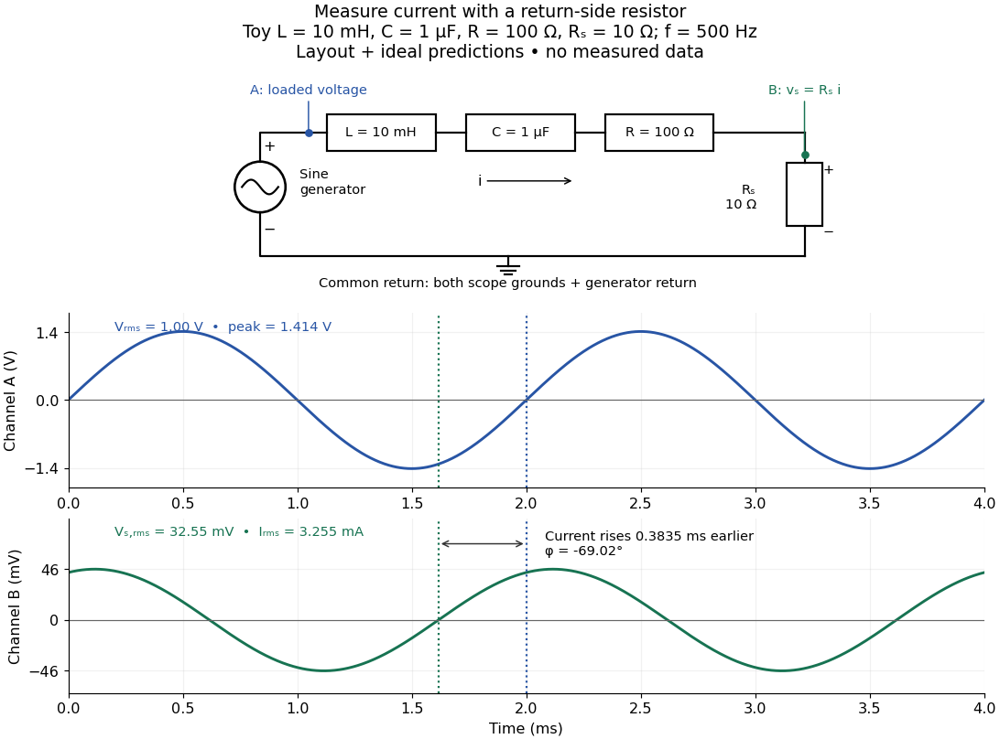

# Electrical reactance bench measurement

↑ **Parent:** [Electrical reactance](electrical-reactance.md)

The motivating observation is a pair of sinusoids on an oscilloscope: changing [frequency](frequency.md) changes both their relative [amplitudes](wave-amplitude.md) and their [phase difference](phase-difference.md). Gary Tuttle's EE 201 laboratory uses resistor voltage as the current-phase reference, compares predictions with readings at several [frequencies](frequency.md), and explicitly asks students to measure component values and account for coil [electrical resistance](electrical-resistance.md). The following bench arrangement applies that method to a [series RLC circuit](series-rlc-circuit.md); its component values and illustrated traces are our own toy example. [Gary Tuttle, EE 201 Lab 9: AC circuits, especially the notes and RC/RL measurements](https://gtuttle.net/circuits/lab/ac_circuits_1.pdf).

**[Figure 10](#image-toy-ac-bench-arrangement-and-predicted-voltage-current-timing). Toy AC bench arrangement and predicted voltage/current timing**. Top: a sine generator drives ideal $L=10\,\mathrm{mH}$, $C=1\,\mu\mathrm F$, $R=100\,\Omega$, and current-sensing $R_s=10\,\Omega$ in series. Channel A measures loaded terminal voltage; channel B measures $v_s=R_si$ relative to the common return. Bottom: calculated separate voltage traces at $f=500\,\mathrm{Hz}$ and terminal $V_{\rm rms}=1.00\,\mathrm V$, not an oscilloscope recording or measured data. The rising zero of channel B occurs $0.3835\,\mathrm{ms}$ earlier: $\phi=-69.02^\circ$ and predicted $I_{\rm rms}=3.255\,\mathrm{mA}$. The two trace axes have different voltage scales.

Connect a low-voltage sine generator to a series chain ending in a known sensing [resistor](resistor.md) $R_s$ at the common return. Use a [resistor](resistor.md) whose unwanted [inductance](inductance.md) is negligible over the chosen [frequency](frequency.md) range. An oscilloscope displays voltage against time: channel A reads the loaded voltage across the whole chain, and channel B reads the voltage $v_s$ across $R_s$. Both channel ground connections and the generator return meet at that same node. Ordinary bench oscilloscope grounds are electrically common; attaching one to an intermediate circuit node would change the circuit. A separate floating component voltage needs a suitable differential measurement, rather than moving a ground clip. [Tektronix, Floating Oscilloscope Measurements and Operator Protection: ground-referenced inputs](https://www.tek.com/en/documents/technical-brief/floating-oscilloscope-measurements-and-operator-protection).

After the free transient decays, record [frequency](frequency.md) $f$, period $T=1/f$, both voltage [amplitudes](wave-amplitude.md), and matched rising zero-crossing times $t_A,t_B$. Check that the traces are sinusoidal. Define $\Delta t=t_B-t_A$ on the branch $|\Delta t|<T/2$. With negligible probe loading and negligible sensing-[resistor](resistor.md) [electrical reactance](electrical-reactance.md), $v_s=R_si$, so channel B is the [electric current](electric-current.md) reference, and in the [reactance phase convention](reactance-phase-convention.md)

$$
I_{\rm rms}=\frac{V_{s,\rm rms}}{R_s},\qquad
|Z_{\rm chain}|=\frac{V_{A,\rm rms}}{I_{\rm rms}},\qquad
\phi=\frac{2\pi\Delta t}{T},\qquad
X_{\rm chain}=|Z_{\rm chain}|\sin\phi,\qquad
R_{\rm chain}=|Z_{\rm chain}|\cos\phi.
$$

A later current crossing gives $\Delta t>0$, hence positive [electrical reactance](electrical-reactance.md); an earlier crossing gives negative [electrical reactance](electrical-reactance.md). Use the same [amplitude](wave-amplitude.md) convention for both channels. An amplitude-only ratio recovers $|Z|$, so it cannot distinguish the two signs: timing supplies the missing information. The formulas follow from $Z=|Z|e^{\mathrm i\phi}$ and the chosen terminal orientation.

Begin with a known [resistor](resistor.md) replacing the reactive chain: its expected [phase difference](phase-difference.md) is approximately zero, testing channel polarity and relative delay. Measure the same signal with both channels to establish the instrumental delay baseline, then exchange probes to check that a phase offset does not belong to one channel. Next test an [inductor](inductor.md) and a [capacitor](capacitor.md) separately with $R_s$: after subtracting $R_s$ from the inferred real part, expect approximately $X/f=2\pi L$ and $fX=-1/(2\pi C)$, respectively. Finally combine $L,C,R,R_s$ and sweep through the predicted [resonance](resonance.md). These are proposed controls and consequences of the model, not reported observations.

For the toy [series RLC circuit](series-rlc-circuit.md), the prediction at $500\,\mathrm{Hz}$ is $X=-286.894\,\Omega$, $|Z|=307.259\,\Omega$, $\phi=-69.02^\circ$, and $V_{s,\rm rms}=32.55\,\mathrm{mV}$. At $5000\,\mathrm{Hz}$, $X=+282.328\,\Omega$ and $\phi=+68.71^\circ$. Near $1591.55\,\mathrm{Hz}$ the model predicts zero [phase difference](phase-difference.md) and $V_{s,\rm rms}=90.91\,\mathrm{mV}$. Keep actual loaded $V_{A,\rm rms}$ fixed or normalize by it at each [frequency](frequency.md); the generator's display alone does not establish that voltage. The $10\,\Omega$ sensing [resistor](resistor.md) is part of the $110\,\Omega$ total and therefore changes the predicted peak [electric current](electric-current.md).

Real components add unintended [electrical impedance](electrical-impedance.md): coil wire has [electrical resistance](electrical-resistance.md), nearby turns add [capacitance](capacitance.md), and [capacitor](capacitor.md) leads add [inductance](inductance.md). These effects can produce a component's own [resonance](resonance.md), beyond which the ideal $\omega L$ or $-1/(\omega C)$ approximation fails. Work in a range where that approximation is adequate, measure coil wire [electrical resistance](electrical-resistance.md), and compare the inferred $R_{\rm chain}$ with the sensing [resistor](resistor.md), intended [resistor](resistor.md), and component losses. A measured nonzero real part is evidence of loss in the assembly, not negative or positive [electrical reactance](electrical-reactance.md) becoming heat. [Keysight, Impedance Measurement Handbook, §§1.5.1 and 5.2.1: component frequency response and parasitic elements](https://www.keysight.com.cn/cn/zh/assets/7018-06840/application-notes/5950-3000.pdf); [Tuttle, EE 201 Lab 9: parasitic coil series resistance](https://gtuttle.net/circuits/lab/ac_circuits_1.pdf).

The probes also add [electrical resistance](electrical-resistance.md) and [capacitance](capacitance.md) to the measured nodes; their loading becomes more important as [frequency](frequency.md) increases. Use compensated probes with known input [electrical impedance](electrical-impedance.md) and short ground connections, and repeat with a smaller drive voltage to test whether the inferred $X$ depends on [amplitude](wave-amplitude.md). [Tektronix, How Oscilloscope Probes Affect Your Measurement: resistive and capacitive loading](https://www.tek.com/en/documents/application-note/how-oscilloscope-probes-affect-your-measurement). Record actual voltage and phase readings separately from calculated predictions, with component tolerances and timing uncertainty. A phase error $\delta\phi$ alone produces approximately $\delta X=|Z|\cos\phi\,\delta\phi$, so near zero [electrical reactance](electrical-reactance.md), a small delay can imitate a small residual $X$. Agreement within stated uncertainties tests the model; the smooth toy curves establish no experimental accuracy.

## ↑ Ancestors (7)

1. [Electrical reactance](electrical-reactance.md)
2. [Electrical impedance](electrical-impedance.md)
3. [Electrical circuit](electrical-circuit-split.md)
4. [Electromagnetism](electromagnetism-split.md)
5. [Branches of physics](branches-of-physics.md)
6. [Physics](physics-split.md)
7. [Codex Wiki](split.md)

## ← Incoming links (2)

- [Electrical impedance phase measurement](electrical-impedance-phase-measurement.md)
- [Electrical reactance](electrical-reactance.md)
