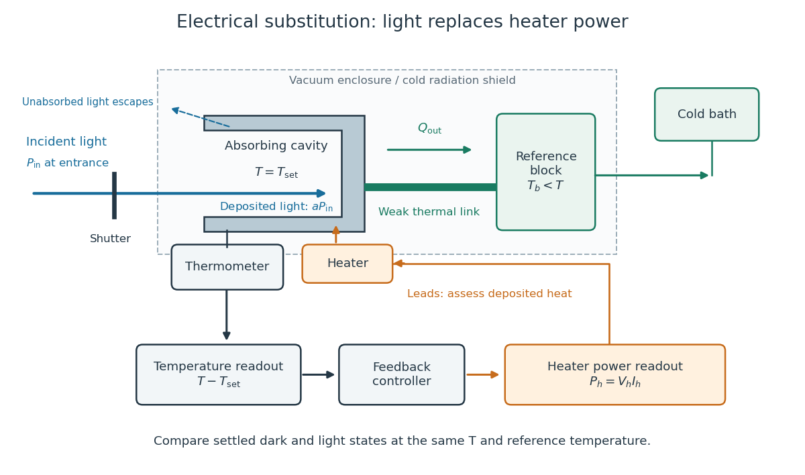

# Electrical substitution radiometer

↑ **Parent:** [Radiometry](radiometry-split.md)

An [electrical substitution radiometer](electrical-substitution-radiometer.md) measures [radiant flux](radiant-flux.md) by replacing absorbed optical [power](power.md) with calibrated [Joule heating](joule-heating.md). At fixed [temperature](temperature-split.md), [feedback control](closed-loop-control.md) holds the receiver equally warm with the beam blocked or admitted: after corrections, absorbed optical [power](power.md) equals the reduction in supplied electrical heating. Incident [radiant flux](radiant-flux.md) additionally requires [radiometric absorptance](radiometric-absorptance.md) and entrance-path corrections. This connects [radiometry](radiometry-split.md) to electrical standards.[§5.2, printed p. 30: electrical substitution and electrical standards](spectroradiometric-detector-measurements-ultraviolet-visible-and-near-infrared-detectors-for-spectral-power-by-thomas-c-larason-and-others.md)

Picture a small absorbing cavity connected to a colder reference block by a [radiometer thermal link](radiometer-thermal-link.md). A heater supplies [Joule heating](joule-heating.md), a [thermometer](thermometer.md) senses the receiver, and [feedback control](closed-loop-control.md) adjusts the heater. When [light](light.md) supplies some of the heating, the controller supplies less. The readout is the change in heater [power](power.md), rather than the beam's brightness or its number of [photons](photon.md). NIST's institutional description gives a concrete receiver with a conical interior, absorbing coating and weak Kapton support, operated with a receiver heater and [thermometer](thermometer.md).[Description, Design Parameters for Improved ACR Sensitivity; Key Design Features: conical receiver, coating, constant-temperature loop and thin-walled Kapton link](pico-watt-acr-by-national-institute-of-standards-and-technology.md)

**[Figure 7](#electrical-substitution-radiometer-cavity-control). Cavity, radiometer thermal link and heater readout in an electrical substitution radiometer**. Original functional schematic, not a drawing of a particular laboratory instrument. The shutter defines dark and illuminated states; incident [radiant flux](radiant-flux.md) is specified at the receiver entrance. The cavity absorbs a fraction $a$, while the remainder escapes. The reference block and receiver have distinct controlled [temperatures](temperature-split.md). The [thermometer](thermometer.md) signal drives [feedback control](closed-loop-control.md), and heater voltage and [electric current](electric-current.md) provide the electrical [power](power.md) readout. Lead heating, stray radiation and spatial heating differences require separate checks.

**Table of contents**

- [Electrical substitution heat balance](electrical-substitution-heat-balance.md)
  - [Radiometer thermal link](radiometer-thermal-link.md)
  - [Fixed-temperature electrical substitution example](fixed-temperature-electrical-substitution-example.md)
- [Optical-electrical heating non-equivalence](optical-electrical-heating-non-equivalence.md)
- [Cryogenic radiometer](cryogenic-radiometer.md)
  - [Cryogenic laser-power substitution experiment](cryogenic-laser-power-substitution-experiment.md)

## ↑ Ancestors (5)

1. [Radiometry](radiometry-split.md)
2. [Optics](optics-split.md)
3. [Branches of physics](branches-of-physics.md)
4. [Physics](physics-split.md)
5. [Codex Wiki](split.md)

## ← Incoming links (2)

- [Calibrated radiant-flux measurement](calibrated-radiant-flux-measurement.md)
- [Electrical substitution radiometer](electrical-substitution-radiometer.md)
