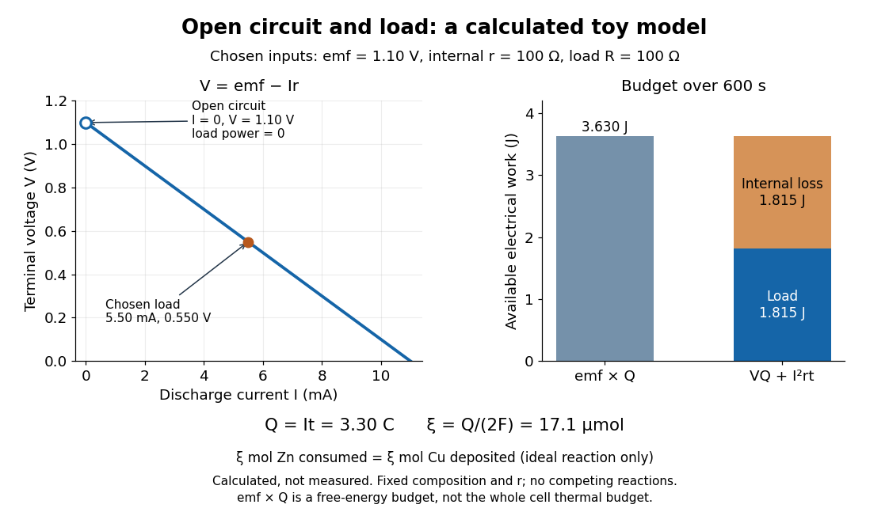

# Electrochemistry

↑ **Parent:** [Chemistry](chemistry.md)

[Electrochemistry](electrochemistry.md) studies how [chemical reactions](chemical-reaction.md), transport, and [chemical equilibrium](chemical-potential.md#chemical-equilibrium) couple to [electric charge](electric-charge.md) and [electric potential](electric-field.md#electric-potential). In a cell, [electrons](physics.md#electron) travel through the external circuit, while mobile [ions](chemistry.md#ion) carry [electric current](electric-charge.md#electric-current) through the [electrolyte](#electrolyte). At the [electrodes](#electrode), [redox](chemical-reaction.md#redox) reactions connect these two forms of [electric charge](electric-charge.md) transport. This connection makes it possible both to obtain electrical [work](energy.md#work) from a [chemical reaction](chemical-reaction.md) and to use electrical [work](energy.md#work) to drive a [chemical reaction](chemical-reaction.md).

An [anode](#anode) is an [electrode](#electrode) where [oxidation](chemical-reaction.md#oxidation) occurs; a [cathode](#cathode) is an [electrode](#electrode) where [reduction](chemical-reaction.md#reduction-chemistry) occurs. These definitions refer to the [chemical reactions](chemical-reaction.md), rather than universal positive or negative terminal signs. In a [galvanic cell](#galvanic-cell) delivering electrical [work](energy.md#work), the [anode](#anode) is negative and the [cathode](#cathode) positive. In an [electrolytic cell](#electrolytic-cell) driven by an external source, the [anode](#anode) is positive and the [cathode](#cathode) negative. See [Pingarrón et al., Terminology of electrochemical methods of analysis (IUPAC Recommendations 2019), §§3.1 and 3.4](https://doi.org/10.1515/pac-2018-0109) and [Flowers et al., Chemistry 2e, §17.2: galvanic cells](https://openstax.org/books/chemistry-2e/pages/17-2-galvanic-cells).

For a worked example, consider an [electrolytic cell](#electrolytic-cell) containing molten [sodium chloride](chemical-substance.md#sodium-chloride), with the [anode](#anode) connected to the positive terminal and the [cathode](#cathode) to the negative terminal of an external source. At the [cathode](#cathode), [sodium](chemical-substance.md#sodium) [cations](chemistry.md#cation) gain [electrons](physics.md#electron); at the [anode](#anode), [chlorine](chemical-substance.md#chlorine) [anions](chemistry.md#anion) lose [electrons](physics.md#electron):

$$
\begin{aligned}
\text{cathode, reduction:}\quad&2\mathrm{Na}^++2e^-\longrightarrow2\mathrm{Na},\\
\text{anode, oxidation:}\quad&2\mathrm{Cl}^-\longrightarrow\mathrm{Cl}_2+2e^-,\\
\text{overall:}\quad&2\mathrm{Na}^++2\mathrm{Cl}^-\longrightarrow2\mathrm{Na}+\mathrm{Cl}_2.
\end{aligned}
$$

The first line has net [electric charge](electric-charge.md) zero on each side; the second has $-2e$ on each side. Adding the lines cancels the transferred [electrons](physics.md#electron) and preserves both [chemical atom](physics.md#atom-physics) counts and net [electric charge](electric-charge.md). The [sodium](chemical-substance.md#sodium) product is neutral, and the [chlorine](chemical-substance.md#chlorine) product is a diatomic [molecule](molecule.md). These equations specify molten [sodium chloride](chemical-substance.md#sodium-chloride); aqueous [chemical solutions](mixture.md#solution-chemistry) introduce competing [water](chemical-substance.md#water) reactions. See [17.7 Electrolysis](chemistry-bibliography.md#chemistry-2e-by-paul-flowers-and-others/17-7-electrolysis) (§17.7: electrolysis of molten sodium chloride).

[Electrochemistry](electrochemistry.md) underlies [battery](electrical-circuit.md#electric-battery) charging and the manufacture of chemicals by [electrolysis](#electrolysis). Its particularly useful idea is that an [electron](physics.md#electron) inventory in a balanced [chemical equation](chemical-reaction.md#chemical-equation) also accounts for transported [electric charge](electric-charge.md). Transport alone is a different question from an [electrode](#electrode) [chemical reaction](chemical-reaction.md): an [ion](chemistry.md#ion) may carry [electric current](electric-charge.md#electric-current) through the [electrolyte](#electrolyte) without itself being consumed at an [electrode](#electrode).

Historically, Michael Faraday introduced the terms [electrode](#electrode), [electrolyte](#electrolyte), [anion](chemistry.md#anion), [cation](chemistry.md#cation), and [ion](chemistry.md#ion) in the terminology section of his 1834 paper, [Experimental Researches in Electricity, Seventh Series by Michael Faraday](chemistry-bibliography.md#experimental-researches-in-electricity-seventh-series-by-michael-faraday) (§§662–667). His §667 explicitly treats the direction assigned to [electric current](electric-charge.md#electric-current) as a convention. His [ion](chemistry.md#ion) language predates the modern [electron](physics.md#electron) and [atomic nucleus](atomic-nucleus.md) picture used in the charge-counting example above.

For an [electrolyte](#electrolyte) near [chemical equilibrium](chemical-potential.md#chemical-equilibrium), a [Poisson-Boltzmann equation](electrostatics.md#poisson-boltzmann-equation) can approximate the distribution of [ions](chemistry.md#ion) in an [electric potential](electric-field.md#electric-potential). Such an equilibrium model does not by itself describe a cell carrying sustained [electric current](electric-charge.md#electric-current).

**Table of contents**

- [Cerium dioxide electrodeposition](#cerium-dioxide-electrodeposition)
- [Galvanic replacement](#galvanic-replacement)
- [Electron transfer](#electron-transfer)
  - [Photoinduced electron transfer](#photoinduced-electron-transfer)
  - [Inner-sphere electron transfer](#inner-sphere-electron-transfer)
- [Supporting electrolyte](#supporting-electrolyte)
- [Cyclic voltammetry](#cyclic-voltammetry)
  - [ECEC mechanism](#ecec-mechanism)
- [Rotating disk electrode](#rotating-disk-electrode)
- [Passivation](#passivation)
  - [Oxide-film transport limitation](#oxide-film-transport-limitation)
- [Fuel cell](#fuel-cell)
- [Electrochemical polarization](#electrochemical-polarization)
  - [Butler-Volmer equation](#butler-volmer-equation)
  - [Limiting current density](#limiting-current-density)
  - [Exchange current density](#exchange-current-density)
  - [Tafel equation](#tafel-equation)
    - [Tafel slope](#tafel-slope)
  - [Phase-transformation polarization](#phase-transformation-polarization)
  - [Ohmic polarization](#ohmic-polarization)
  - [Concentration overpotential](#concentration-overpotential)
  - [Activation overpotential](#activation-overpotential)
- [Nernst equation](#nernst-equation)
- [Electrode potential](#electrode-potential)
  - [Overpotential](#overpotential)
  - [Midpoint potential](#midpoint-potential)
- [Redox mediator](#redox-mediator)
- [Biophotovoltaic device](#biophotovoltaic-device)
- [Electrode](#electrode)
  - [Electrode current collector](#electrode-current-collector)
  - [Anode](#anode)
  - [Cathode](#cathode)
- [Galvanic cell](#galvanic-cell)
  - [Concentration cell](#concentration-cell)
    - [Oxygen concentration cell](#oxygen-concentration-cell)
  - [Standard cell potential](#standard-cell-potential)
  - [Daniell cell](#daniell-cell)
    - [Daniell cell voltage and load experiment](#daniell-cell-voltage-and-load-experiment)
- [Electrolysis](#electrolysis)
  - [Electrorefining](#electrorefining)
    - [Anode slime](#anode-slime)
  - [Water electrolysis](#water-electrolysis)
  - [Electroplating](#electroplating)
  - [Faradaic efficiency](#faradaic-efficiency)
  - [Faraday's laws of electrolysis](#faraday-s-laws-of-electrolysis)
  - [Electrolytic cell](#electrolytic-cell)
- [Half-reaction](#half-reaction)
- [Salt bridge](#salt-bridge)
- [Electrolyte](#electrolyte)
  - [Solid electrolyte interphase](#solid-electrolyte-interphase)
  - [Strong electrolyte](#strong-electrolyte)
  - [Weak electrolyte](#weak-electrolyte)
    - [Ideal weak electrolyte dilution law](#ideal-weak-electrolyte-dilution-law)
  - [Nonelectrolyte](#nonelectrolyte)
- [Electroneutrality](#electroneutrality)

## Cerium dioxide electrodeposition

↑ **Parent:** [Electrochemistry](electrochemistry.md)

Electrochemical growth of cerium dioxide from dissolved cerium ions. [Oxidation](chemical-reaction.md#oxidation) of cerium(III) to the solid oxide transfers one [electron](physics.md#electron) per cerium; [proton](physics.md#proton) activity affects the potential strongly. A poorly conducting film can slow further growth.

## Galvanic replacement

↑ **Parent:** [Electrochemistry](electrochemistry.md)

Coupled dissolution of a less noble solid metal and [reduction](chemical-reaction.md#reduction-chemistry)/deposition of a more noble metal [ion](chemistry.md#ion) without an external [power](energy.md#power) supply.

## Electron transfer

↑ **Parent:** [Electrochemistry](electrochemistry.md)

Transfer of an electron between chemical species or between a species and an electrode. Its rate depends on driving force, electronic coupling and nuclear/solvent reorganization.

### Photoinduced electron transfer

↑ **Parent:** [Electron transfer](#electron-transfer)

[electron](physics.md#electron) transfer made favorable by [photoexcitation](chemistry.md#photoexcitation) of a donor or acceptor.

### Inner-sphere electron transfer

↑ **Parent:** [Electron transfer](#electron-transfer)

[Electron transfer](#electron-transfer) through a ligand shared by two metal centres. Bridge formation, [electron transfer](#electron-transfer) and bridge cleavage can leave transferred-ligand connectivity in a substitution-inert product.

## Supporting electrolyte

↑ **Parent:** [Electrochemistry](electrochemistry.md)

An abundant electrolyte used to carry solution current and suppress migration of the dilute electroactive species.

## Cyclic voltammetry

↑ **Parent:** [Electrochemistry](electrochemistry.md)

An electrochemical method that reverses a potential sweep and records the current response. Peak positions and return waves probe electron-transfer kinetics and coupled chemistry.

### ECEC mechanism

↑ **Parent:** [Cyclic voltammetry](#cyclic-voltammetry)

A sequence of [electron transfer](#electron-transfer), chemical reaction, [electron transfer](#electron-transfer) and chemical reaction. Binding reactions can shift reduction potentials and separate reduction from product-release waves.

## Rotating disk electrode

↑ **Parent:** [Electrochemistry](electrochemistry.md)

An electrode whose controlled rotation establishes a steady hydrodynamic boundary layer. In its diffusion-limited regime, current varies with the square root of angular speed.

## Passivation

↑ **Parent:** [Electrochemistry](electrochemistry.md)

Suppression of further interfacial reaction by a protective surface layer. A passive film can also impede useful charge transfer; its role depends on the electrode and operating conditions.

### Oxide-film transport limitation

↑ **Parent:** [Passivation](#passivation)

Slowing of electrochemical film growth as the deposited oxide restricts [electron](physics.md#electron) or ion transport. Increasing thickness increases the transport barrier even while dissolved precursor remains available.

## Fuel cell

↑ **Parent:** [Electrochemistry](electrochemistry.md)

An electrochemical energy converter supplied continuously with fuel and oxidant; operating voltage and current depend on kinetics and transport as well as equilibrium potential.

## Electrochemical polarization

↑ **Parent:** [Electrochemistry](electrochemistry.md)

Displacement of electrode or cell voltage from equilibrium under current flow. Kinetic, transport and resistive contributions should be separated.

### Butler-Volmer equation

↑ **Parent:** [Electrochemical polarization](#electrochemical-polarization)

A kinetic model for the net [electrode](#electrode) current near and away from equilibrium. For a single effective reaction with consistent activities and $\alpha_a+\alpha_c=1$, $j=j_0[\exp(\alpha_anF\eta/RT)-\exp(-\alpha_cnF\eta/RT)]$. Near equilibrium it gives $j\simeq j_0nF\eta/(RT)$; at sufficiently large [overpotential](#overpotential) one exponential gives the [Tafel equation](#tafel-equation). Multistep reactions can require a different kinetic interpretation.

### Limiting current density

↑ **Parent:** [Electrochemical polarization](#electrochemical-polarization)

A limiting rate of charge transfer per area imposed by reactant transport or another bottleneck. In a simple [diffusion](thermodynamics.md#diffusion) film, $j_L=nFDc_b/\delta$ and a consuming [electrode](#electrode) has $c_s/c_b=1-j/j_L$. Increasing internal roughness does not necessarily increase external mass-transfer flux proportionately.

### Exchange current density

↑ **Parent:** [Electrochemical polarization](#electrochemical-polarization)

The equal magnitudes of the opposing partial electrode-reaction [current densities](electric-charge.md#current-density) at equilibrium. Their net current is zero. The area convention, activities and [temperature](temperature.md) must be specified; an [exchange current density](#exchange-current-density) alone does not specify a nonlinear current-potential curve.

### Tafel equation

↑ **Parent:** [Electrochemical polarization](#electrochemical-polarization)

An activation-controlled large-overpotential relation $|\eta|=b\log_{10}(|j|/j_0)$. The [Tafel slope](#tafel-slope) $b$ uses volts per decade when the logarithm is base ten. Exchange [current density](electric-charge.md#current-density) and operating [current density](electric-charge.md#current-density) must use the same area convention.

#### Tafel slope

↑ **Parent:** [Tafel equation](#tafel-equation)

The change in [overpotential](#overpotential) per decade of [current density](electric-charge.md#current-density) in the activation-controlled regime of a [Tafel equation](#tafel-equation). In a single-step [Butler-Volmer equation](#butler-volmer-equation) with constant transfer coefficient, the anodic slope is $b_a=RT\ln10/(\alpha_a nF)$, where $T$ is [temperature](temperature.md), $R$ is the [molar gas constant](ideal-gas.md#molar-gas-constant), $n$ is the number of transferred [electrons](physics.md#electron) and $F$ is the [Faraday constant](physics.md#faraday-constant). The magnitude of the cathodic slope is $b_c=RT\ln10/(\alpha_c nF)$. Inferring one from the other requires the model's relation between the two coefficients; the equality $\alpha_a+\alpha_c=1$ applies to this effective single-step model and need not describe a multistep reaction.

### Phase-transformation polarization

↑ **Parent:** [Electrochemical polarization](#electrochemical-polarization)

Additional voltage needed to nucleate or grow a new phase, or overcome a phase-transformation barrier. It can cause an initial voltage dip and voltage hysteresis.

### Ohmic polarization

↑ **Parent:** [Electrochemical polarization](#electrochemical-polarization)

A voltage loss from ionic and electronic resistance, ideally $IR$.

### Concentration overpotential

↑ **Parent:** [Electrochemical polarization](#electrochemical-polarization)

A voltage loss from differences between interfacial and bulk reactant or product activities caused by finite mass transport.

### Activation overpotential

↑ **Parent:** [Electrochemical polarization](#electrochemical-polarization)

A voltage loss associated with finite charge-transfer reaction kinetics.

## Nernst equation

↑ **Parent:** [Electrochemistry](electrochemistry.md)

For a cell reaction transferring $n$ electrons, $E=E^\circ-(RT/nF)\ln Q$, with dimensionless [reaction quotient](chemical-potential.md#reaction-quotient) $Q$ and consistently chosen [standard states](chemical-potential.md#standard-state).

## Electrode potential

↑ **Parent:** [Electrochemistry](electrochemistry.md)

An electrode’s potential relative to a specified reference, conventionally tabulated for its reduction [half-reaction](#half-reaction).

### Overpotential

↑ **Parent:** [Electrode potential](#electrode-potential)

The difference between an applied electrode potential and the relevant equilibrium potential. Increasing its magnitude can drive [electron transfer](#electron-transfer) toward a mass-transport limit.

### Midpoint potential

↑ **Parent:** [Electrode potential](#electrode-potential)

A potential characterizing equal oxidized and reduced activities under stated conditions. For a reversible cyclic voltammogram, $(E_{pa}+E_{pc})/2$ estimates its formal potential.

## Redox mediator

↑ **Parent:** [Electrochemistry](electrochemistry.md)

A [redox mediator](#redox-mediator) transfers reducing equivalents between components through changes in oxidation state. A current-enhancing additive is not necessarily a mediator unless its redox participation and regeneration are established.

## Biophotovoltaic device

↑ **Parent:** [Electrochemistry](electrochemistry.md)

A [biophotovoltaic device](#biophotovoltaic-device) couples photosynthetic biological activity to an external electrical circuit. Measured current depends on intracellular electron supply, export, electrode reactions and abiotic background.

## Electrode

↑ **Parent:** [Electrochemistry](electrochemistry.md)  
ⓦ [Wiki](https://en.wikipedia.org/wiki/Electrode)

An [electrode](#electrode) is an electronic [electrical conductor](electric-charge.md#electrical-conductor) in contact with an [electrolyte](#electrolyte). In a cell carrying sustained [redox](chemical-reaction.md#redox) [electric current](electric-charge.md#electric-current), [chemical reactions](chemical-reaction.md) at this interface exchange [electrons](physics.md#electron) with [chemical species](mathematical-biology.md#chemical-species). An [electrode](#electrode) can participate in the [chemical reaction](chemical-reaction.md), as the dissolving [zinc](chemical-substance.md#zinc) [anode](#anode) of a [Daniell cell](#daniell-cell) does, or provide a conducting surface without appearing in the net [chemical equation](chemical-reaction.md#chemical-equation). This distinction is illustrated by active and inert [electrodes](#electrode) in [Flowers, Theopold, Langley and Robinson, Chemistry 2e, §17.2](https://openstax.org/books/chemistry-2e/pages/17-2-galvanic-cells).

The interface connects two kinds of [electric charge](electric-charge.md) transport: [electrons](physics.md#electron) in the external [electrical circuit](electrical-circuit.md) and [ions](chemistry.md#ion) in the [electrolyte](#electrolyte). The same [electron](physics.md#electron) does not travel through the wire, swim through the [salt bridge](#salt-bridge), and complete a circuit! The [half-reactions](#half-reaction) account for how electronic and ionic transport meet. This is the useful idea behind both obtaining electrical [work](energy.md#work) in a [galvanic cell](#galvanic-cell) and supplying electrical [work](energy.md#work) in an [electrolytic cell](#electrolytic-cell).

Name an [electrode](#electrode) from its net [chemical reaction](chemical-reaction.md): [oxidation](chemical-reaction.md#oxidation) means [anode](#anode), and [reduction](chemical-reaction.md#reduction-chemistry) means [cathode](#cathode). State the operating mode before assigning terminal signs. For a [galvanic cell](#galvanic-cell) supplying a passive load, the [anode](#anode) is negative and the [cathode](#cathode) positive; for an ordinary two-terminal [electrolytic cell](#electrolytic-cell) driven by a source, the [anode](#anode) is positive and the [cathode](#cathode) negative. Here positive means higher terminal [electric potential](electric-field.md#electric-potential) than the other [electrode](#electrode), not a claim that the bulk material has a large positive net [electric charge](electric-charge.md). See [Pingarrón et al., Terminology of electrochemical methods of analysis (IUPAC Recommendations 2019), §§3.1 and 3.4](https://doi.org/10.1515/pac-2018-0109).

### Electrode current collector

↑ **Parent:** [Electrode](#electrode)

An electronically conducting support connecting active material to an external circuit.

### Anode

↑ **Parent:** [Electrode](#electrode)  
ⓦ [Wiki](https://en.wikipedia.org/wiki/Anode)

The [anode](#anode) is the [electrode](#electrode) at which the net [electrode](#electrode) [chemical reaction](chemical-reaction.md) is [oxidation](chemical-reaction.md#oxidation): the reacting [chemical species](mathematical-biology.md#chemical-species) loses [electrons](physics.md#electron). This definition is independent of terminal sign. See [IUPAC Gold Book: anode](https://goldbook.iupac.org/terms/view/A00370).

During [Daniell cell](#daniell-cell) discharge, a [zinc](chemical-substance.md#zinc) [chemical atom](physics.md#atom-physics) becomes a $\mathrm{Zn}^{2+}$ [cation](chemistry.md#cation), leaving two [electrons](physics.md#electron) in the [electrode](#electrode); those [electrons](physics.md#electron) leave through the external [electrical circuit](electrical-circuit.md). The [zinc](chemical-substance.md#zinc) [anode](#anode) is the negative terminal. In an externally driven [electrolytic cell](#electrolytic-cell), [electrons](physics.md#electron) instead leave the [anode](#anode) through the lead to the source's positive terminal. [Conventional current](electric-charge.md#conventional-current) in that lead points toward the [anode](#anode), opposite to [electron](physics.md#electron) motion. The [anode](#anode) can therefore be positive while still being the site of [oxidation](chemical-reaction.md#oxidation). See [Daniell cell](#daniell-cell) for the balanced [half-reaction](#half-reaction) and [electrode](#electrode) for the operating-mode sign conventions.

### Cathode

↑ **Parent:** [Electrode](#electrode)  
ⓦ [Wiki](https://en.wikipedia.org/wiki/Cathode)

The [cathode](#cathode) is the [electrode](#electrode) at which the net [electrode](#electrode) [chemical reaction](chemical-reaction.md) is [reduction](chemical-reaction.md#reduction-chemistry): the reacting [chemical species](mathematical-biology.md#chemical-species) gains [electrons](physics.md#electron). This definition is independent of terminal sign. During [Daniell cell](#daniell-cell) discharge, $\mathrm{Cu}^{2+}$ [cations](chemistry.md#cation) accept [electrons](physics.md#electron) arriving at the [copper](chemical-substance.md#copper) [cathode](#cathode) and become neutral [copper](chemical-substance.md#copper). The [cathode](#cathode) is then the positive terminal. In an externally driven [electrolytic cell](#electrolytic-cell), the source's negative terminal supplies [electrons](physics.md#electron) to the negative [cathode](#cathode). See [Pingarrón et al., §3.4: cathode](https://doi.org/10.1515/pac-2018-0109) and [Daniell cell](#daniell-cell).

An [ion](chemistry.md#ion) carrying [electric current](electric-charge.md#electric-current) need not undergo [reduction](chemical-reaction.md#reduction-chemistry) at the [cathode](#cathode). For example, in the ideal [Daniell cell](#daniell-cell) charge-balance picture, [potassium](chemical-substance.md#potassium) [cations](chemistry.md#cation) arriving from a [salt bridge](#salt-bridge) remain dissolved while $\mathrm{Cu}^{2+}$ [cations](chemistry.md#cation) are consumed. Follow the [half-reaction](#half-reaction) to identify the reacting species; follow [electric charge conservation](electric-charge.md#charge-conservation) to account for the other moving [ions](chemistry.md#ion).

## Galvanic cell

↑ **Parent:** [Electrochemistry](electrochemistry.md)  
ⓦ [Wiki](https://en.wikipedia.org/wiki/Galvanic_cell)

A [galvanic cell](#galvanic-cell) supplies electrical [work](energy.md#work) from a spontaneous [redox](chemical-reaction.md#redox) [chemical reaction](chemical-reaction.md) under the specified conditions. In discharge through a passive load, [oxidation](chemical-reaction.md#oxidation) occurs at its negative [anode](#anode) and [reduction](chemical-reaction.md#reduction-chemistry) at its positive [cathode](#cathode). Separating the reacting compartments makes the [electrons](physics.md#electron) take an external route, where their transport can deliver useful [work](energy.md#work). See [Flowers et al., Chemistry 2e, §17.2: separated reactions and electrical work](https://openstax.org/books/chemistry-2e/pages/17-2-galvanic-cells).

**[Figure 1](#image-daniell-cell-discharge-electron-flow-outside-and-ion-transport-inside). Daniell cell discharge: electron flow outside and ion transport inside**. Original schematic of a [zinc](chemical-substance.md#zinc)/[copper](chemical-substance.md#copper) [galvanic cell](#galvanic-cell) connected to a passive load. A chosen [potassium](chemical-substance.md#potassium) [nitrate](chemistry.md#nitrate) [salt bridge](#salt-bridge) supplies compensating [anions](chemistry.md#anion) to the [anode](#anode) compartment and [cations](chemistry.md#cation) to the [cathode](#cathode) compartment. The arrows represent charge-balance roles, not measured trajectories or relative fluxes. The bottom inventory is an ideal accounting example for one [mole](physics.md#mole-unit) of net cell reaction.

In the metallic external [electrical circuit](electrical-circuit.md), [electrons](physics.md#electron) move from [anode](#anode) to [cathode](#cathode), while [conventional current](electric-charge.md#conventional-current) goes from [cathode](#cathode) through the load to [anode](#anode). Inside the cell, net ionic [conventional current](electric-charge.md#conventional-current) closes the loop from the [anode](#anode) compartment toward the [cathode](#cathode) compartment. Oppositely moving [cations](chemistry.md#cation) and [anions](chemistry.md#anion) can both contribute to that direction; see [electrolyte](#electrolyte) for the signed [current density](electric-charge.md#current-density) calculation. A cell can maintain a nonzero terminal [electric potential difference](electric-field.md#electric-potential-difference) near open circuit while delivering almost no [power](energy.md#power); the [Daniell cell voltage and load experiment](#daniell-cell-voltage-and-load-experiment) makes this distinction concrete.

### Concentration cell

↑ **Parent:** [Galvanic cell](#galvanic-cell)

A [galvanic cell](#galvanic-cell) whose reversible [electromotive force](electric-charge.md#electromotive-force) arises from different reactant activities at otherwise corresponding interfaces. The [Nernst equation](#nernst-equation) relates the measured [voltage](random-walk.md#voltage) to the activity ratio, provided the transported charge and reaction stoichiometry are specified.

#### Oxygen concentration cell

↑ **Parent:** [Concentration cell](#concentration-cell)

A cell comparing [oxygen](chemical-substance.md#oxygen) [chemical potentials](chemical-potential.md) across an oxygen-ion-conducting [electrolyte](#electrolyte). With oxide-ion conduction and four [electrons](physics.md#electron) transferred per [oxygen](chemical-substance.md#oxygen) molecule, $E=RT\ln(p_2/p_1)/(4F)$ for consistently ordered terminals. Reference [pressure](pressure.md), interface equilibrium and electronic leakage must be controlled.

### Standard cell potential

↑ **Parent:** [Galvanic cell](#galvanic-cell)

The reversible cell voltage with reactants and products in specified [standard states](chemical-potential.md#standard-state). It is the cathode reduction potential minus the anode reduction potential.

### Daniell cell

↑ **Parent:** [Galvanic cell](#galvanic-cell)  
ⓦ [Wiki](https://en.wikipedia.org/wiki/Daniell_cell)

A [Daniell cell](#daniell-cell) uses the [zinc](chemical-substance.md#zinc)/$\mathrm{Zn}^{2+}$ and $\mathrm{Cu}^{2+}$/[copper](chemical-substance.md#copper) pairs. In the separated-compartment teaching version, a [zinc](chemical-substance.md#zinc) [electrode](#electrode) contacts an aqueous [chemical solution](mixture.md#solution-chemistry) containing $\mathrm{Zn}^{2+}$, and a [copper](chemical-substance.md#copper) [electrode](#electrode) contacts one containing $\mathrm{Cu}^{2+}$. A [salt bridge](#salt-bridge) supplies an ionic connection; a wire and load supply an electronic connection. During discharge,

$$
\begin{aligned}
\text{anode, oxidation:}\quad&\mathrm{Zn}(s)\longrightarrow\mathrm{Zn}^{2+}(aq)+2e^-,\\
\text{cathode, reduction:}\quad&\mathrm{Cu}^{2+}(aq)+2e^-\longrightarrow\mathrm{Cu}(s),\\
\text{net:}\quad&\mathrm{Zn}(s)+\mathrm{Cu}^{2+}(aq)\longrightarrow\mathrm{Zn}^{2+}(aq)+\mathrm{Cu}(s).
\end{aligned}
$$

The [zinc](chemical-substance.md#zinc) [electrode](#electrode) loses material and [copper](chemical-substance.md#copper) is deposited at the [cathode](#cathode). Each [half-reaction](#half-reaction) conserves [chemical atom](physics.md#atom-physics) counts and [electric charge](electric-charge.md): the first has net charge zero on each side, the second $+2e-2e=0$ on the left and zero on the right. The net reaction has $+2e$ on both sides, with no [electrons](physics.md#electron) left in its [chemical equation](chemical-reaction.md#chemical-equation). The Zn/Cu teaching cell and these [half-reactions](#half-reaction) are described in [Florida State University, Redox Reactions in Voltaic Cells: Construction of a Potential Series, lab background](https://www.chem.fsu.edu/chemlab/chm1lab/redox/background.html).

Creating one [mole](physics.md#mole-unit) of $\mathrm{Zn}^{2+}$ adds $2F$ of positive [electric charge](electric-charge.md) to the [anode](#anode) compartment's ionic inventory; consuming one [mole](physics.md#mole-unit) of $\mathrm{Cu}^{2+}$ removes $2F$ of positive [electric charge](electric-charge.md) from the [cathode](#cathode) compartment. Here $F$ is the [Faraday constant](physics.md#faraday-constant). In an ideal bookkeeping example using a [potassium](chemical-substance.md#potassium) [nitrate](chemistry.md#nitrate) [salt bridge](#salt-bridge), two [moles](physics.md#mole-unit) of [nitrate](chemistry.md#nitrate) [anions](chemistry.md#anion) entering the [anode](#anode) compartment compensate the first change, and two [moles](physics.md#mole-unit) of [potassium](chemical-substance.md#potassium) [cations](chemistry.md#cation) entering the [cathode](#cathode) compartment compensate the second. Other [ions](chemistry.md#ion) in the cell can share the actual transport. The two compensating inventory changes do not mean that $4F$ flowed through the load: the same series [electric current](electric-charge.md#electric-current) transports $2F$ through each cross-section of the circuit per [mole](physics.md#mole-unit) of net reaction. See [salt bridge](#salt-bridge).

Under standard-state conditions near $298\,\mathrm K$, tabulated reduction potentials give a cell [electromotive force](electric-charge.md#electromotive-force) of approximately $1.10\,\mathrm V$. This is a reversible reference value, not a promised loaded reading; actual composition matters through [thermodynamic activity](chemical-potential.md#thermodynamic-activity). The tabulated [copper](chemical-substance.md#copper) and [zinc](chemical-substance.md#zinc) values and their subtraction are given in [Purdue University, Electrochemical Reactions: standard-state reduction potentials](https://chemed.chem.purdue.edu/genchem/topicreview/bp/ch20/electro.php). For the net [chemical equation](chemical-reaction.md#chemical-equation) as written, the molar [Gibbs free energy](thermodynamic-potential.md#gibbs-free-energy) change obeys

$$
\Delta_r G=-2F\mathcal E.
$$

Thus $\mathcal E=1.10\,\mathrm V$ corresponds to about $-212\,\mathrm{kJ\,mol^{-1}}$ of net reaction. At fixed [temperature](temperature.md) and [pressure](pressure.md), $-\Delta_r G$ is the maximum reversible electrical [work](energy.md#work) per [mole](physics.md#mole-unit) for this cell reaction. It is not automatically all the [heat](heat.md) released by a finite-current cell. See [17.4 Potential, Free Energy, and Equilibrium](chemistry-bibliography.md#chemistry-2e-by-paul-flowers-and-others/17-4-potential-free-energy-and-equilibrium) (§17.4: cell potential and free energy).

#### Daniell cell voltage and load experiment

↑ **Parent:** [Daniell cell](#daniell-cell)

The motivating observation is that a [chemical reaction](chemical-reaction.md) can produce a signed electrical reading even when its reacting materials occupy separate vessels. UC San Diego's teaching demonstration places a [copper](chemical-substance.md#copper) strip in $0.1\,\mathrm{mol\,L^{-1}}$ $\mathrm{CuSO_4}$ and a [zinc](chemical-substance.md#zinc) strip in $0.1\,\mathrm{mol\,L^{-1}}$ $\mathrm{ZnSO_4}$, using two $400\,\mathrm{mL}$ beakers with about $300\,\mathrm{mL}$ of [chemical solution](mixture.md#solution-chemistry) in each. The strips connect to a voltage meter. Initially there is no ionic connection; the demonstration specifies a zero reading. A filter-paper [salt bridge](#salt-bridge) containing aqueous $\mathrm{Na_2SO_4}$ then connects the [chemical solutions](mixture.md#solution-chemistry). With the meter's positive lead on [copper](chemical-substance.md#copper) and negative lead on [zinc](chemical-substance.md#zinc), its reported readings are about $+1.1\,\mathrm V$; exchanging the leads reverses the reading. These are observations reported by the university, not data generated for this article. See [UC San Diego, demonstration 9B: apparatus, bridge control and meter polarity](https://chemistryandbiochemistry.ucsd.edu/undergraduate/teaching-labs/demos/demo9b).

The controls answer different questions. Exchanging only the meter leads checks the sign convention; it does not reverse the [chemical reaction](chemical-reaction.md) or swap the [anode](#anode) and [cathode](#cathode). Interrupting only the [salt bridge](#salt-bridge) tests the need for an ionic return path. Its absence prevents sustained cell [electric current](electric-charge.md#electric-current), but a very high-input-resistance meter may still show a transient or unstable reading while interfaces store [electric charge](electric-charge.md). The zero reading specified for the university's apparatus is therefore not a universal theorem for every meter. Reconnecting the same [salt bridge](#salt-bridge) distinguishes a reversible interruption from a disconnected wire or exhausted [chemical solution](mixture.md#solution-chemistry). This interpretation follows from [electric charge conservation](electric-charge.md#charge-conservation) in a model allowing interfacial [electric charge](electric-charge.md) storage; see [IUPAC Gold Book: integral capacitance of an electrode](https://goldbook.iupac.org/terms/view/I03068) for the [capacitance](electromagnetism.md#capacitance) associated with [electrode](#electrode) charge.

To distinguish terminal [electric potential difference](electric-field.md#electric-potential-difference) from delivered [power](energy.md#power), compare the nearly open-circuit reading with readings across a known [resistor](electric-charge.md#resistor) load. In the nearly open-circuit condition, a meter with input [electrical resistance](electric-charge.md#electrical-resistance) much larger than the cell's effective internal [electrical resistance](electric-charge.md#electrical-resistance) draws little [electric current](electric-charge.md#electric-current). With a load, measure its terminal [electric potential difference](electric-field.md#electric-potential-difference) $V$ and infer $I=V/R$ using [Ohm's law](electric-charge.md#ohm-s-law); track the readings over [time](classical-mechanics.md#time-in-physics) and repeat the nearly open-circuit reading afterwards. Keep the [temperature](temperature.md), [chemical solution](mixture.md#solution-chemistry) compositions, immersed [electrode](#electrode) areas, bridge geometry and electrical contacts comparable. This is a model-based extension of the documented demonstration, not a claim that UC San Diego published a load sweep. A finite-current drop can reflect ionic [electrical resistance](electric-charge.md#electrical-resistance), changes of interfacial [reaction rates](chemical-kinetics.md#reaction-rate), or depletion near an [electrode](#electrode); a single voltage reading cannot identify which dominates. The interfacial and composition contributions are distinguished in [IUPAC Gold Book: overpotential](https://goldbook.iupac.org/terms/view/O04358) and [IUPAC Gold Book: concentration overpotential](https://goldbook.iupac.org/terms/view/C01230).

For a deliberately simplified calculation, model the cell by a constant [electromotive force](electric-charge.md#electromotive-force) $\mathcal E$ in series with a constant internal [electrical resistance](electric-charge.md#electrical-resistance) $r$, and a passive load $R>0$. Take $I$ positive from the [cathode](#cathode) through the load to the [anode](#anode). Then

$$
I=\frac{\mathcal E}{R+r},\qquad V=IR=\mathcal E-Ir,\qquad P_{\rm load}=IV=I^2R.
$$

The nearly open-circuit limit $R\to\infty$ gives $V\to\mathcal E$ but $I\to0$ and $P_{\rm load}\to0$. A straight $V$-versus-$I$ line is a prediction of constant $r$, not a general law for [electrochemistry](electrochemistry.md). See [Ling, Sanny and Moebs, University Physics II, §10.1: internal resistance, terminal voltage and load](https://openstax.org/books/university-physics-volume-2/pages/10-1-electromotive-force).

**[Figure 2](#image-toy-daniell-cell-load-calculation-terminal-electric-potential-difference-electric-charge-and-available-work). Toy Daniell cell load calculation: terminal electric potential difference, electric charge and available work**. Calculated line and energy bars, not measurements. Chosen inputs are $\mathcal E=1.10\,\mathrm V$, $r=100\,\Omega$, $R=100\,\Omega$ and a $600\,\mathrm s$ interval. The fixed-composition approximation and unit efficiency for the two intended [half-reactions](#half-reaction) are assumed. The open-circuit marker is an ideal limit; no fit to experimental data is made.

For the chosen values, $I=5.50\,\mathrm{mA}$ and $V=0.550\,\mathrm V$. Holding these toy parameters fixed for $600\,\mathrm s$ gives transported [electric charge](electric-charge.md) $Q=It=3.30\,\mathrm C$ and an [extent of reaction](chemical-reaction.md#extent-of-reaction) $\xi=Q/(2F)\simeq17.1\,\mathrm{\mu mol}$, assuming all the [electric current](electric-charge.md#electric-current) serves the two specified [half-reactions](#half-reaction). The same $\xi$ counts [zinc](chemical-substance.md#zinc) consumed and [copper](chemical-substance.md#copper) deposited, rather than equal [masses](classical-mechanics.md#mass). The energy budget is

$$
\mathcal E Q=3.630\,\mathrm J
=\underbrace{VQ}_{1.815\,\mathrm J\text{ delivered to load}}
+\underbrace{I^2rt}_{1.815\,\mathrm J\text{ internal dissipation}}.
$$

The load's electrical [work](energy.md#work) also becomes [Joule heating](electric-charge.md#joule-heating) when the load is a [resistor](electric-charge.md#resistor). Here $\mathcal E Q$ accounts for the reaction's available reversible electrical [work](energy.md#work); a full cell thermal budget would also require its thermodynamic [entropy](entropy.md) contribution. Real measurements need uncertainty estimates, a specified meter input [electrical resistance](electric-charge.md#electrical-resistance) and calibration, and allowance for changing composition and unwanted [chemical reactions](chemical-reaction.md). The toy value $r=100\,\Omega$ is not a measured property of the university's cell.

## Electrolysis

↑ **Parent:** [Electrochemistry](electrochemistry.md)  
ⓦ [Wiki](https://en.wikipedia.org/wiki/Electrolysis)

[Electrolysis](#electrolysis) uses an external source of electrical [work](energy.md#work) to drive [redox](chemical-reaction.md#redox) [chemical reactions](chemical-reaction.md) at the [electrodes](#electrode) of an [electrolytic cell](#electrolytic-cell). Its characteristic application is forcing a [chemical reaction](chemical-reaction.md) in a direction that is nonspontaneous under the specified conditions: a discharging [galvanic cell](#galvanic-cell) supplies electrical [work](energy.md#work), whereas [electrolysis](#electrolysis) consumes electrical [work](energy.md#work). This makes [electrolysis](#electrolysis) useful for producing otherwise difficult-to-obtain [chemical substances](chemical-substance.md), charging a rechargeable [battery](electrical-circuit.md#electric-battery), and depositing a metal coating on a conducting object.[§17.7](chemistry-bibliography.md#chemistry-2e-by-paul-flowers-and-others/17-7-electrolysis)

Always identify the [anode](#anode) by [oxidation](chemical-reaction.md#oxidation) and the [cathode](#cathode) by [reduction](chemical-reaction.md#reduction-chemistry). In ordinary driven two-terminal operation, the source withdraws [electrons](physics.md#electron) from the positive [anode](#anode) and delivers [electrons](physics.md#electron) to the negative [cathode](#cathode). In a discharging [galvanic cell](#galvanic-cell), the [anode](#anode) is negative and the [cathode](#cathode) positive. Thus terminal signs change with operating mode, while the reaction definitions remain valid. Through the [electrolyte](#electrolyte), [ions](chemistry.md#ion) transport [electric charge](electric-charge.md); they need not all be consumed at an [electrode](#electrode). The [electrolyte](#electrolyte) and [electrolytic cell](#electrolytic-cell) articles explain this transport and its [conventional current](electric-charge.md#conventional-current) direction.

For a net [chemical equation](chemical-reaction.md#chemical-equation) transferring $z$ [electrons](physics.md#electron) per reaction event, the molar reaction [Gibbs free energy](thermodynamic-potential.md#gibbs-free-energy) obeys

$$
\Delta_rG=-zF E_{\mathrm{chem}},
$$

where $F$ is the [Faraday constant](physics.md#faraday-constant) and $E_{\mathrm{chem}}$ is the reversible cell [electromotive force](electric-charge.md#electromotive-force) for the reaction in the written direction. A nonspontaneous direction has $\Delta_rG>0$ and $E_{\mathrm{chem}}<0$ at fixed [temperature](temperature.md) and [pressure](pressure.md). The ideal opposing voltage magnitude is $\Delta_rG/(zF)$; sustaining a finite [electric current](electric-charge.md#electric-current) generally needs additional drive because of [electrical resistance](electric-charge.md#electrical-resistance) and finite [electrode](#electrode) [reaction rates](chemical-kinetics.md#reaction-rate). This thermodynamic voltage concerns the actual composition, rather than necessarily standard conditions.[§17.4](chemistry-bibliography.md#chemistry-2e-by-paul-flowers-and-others/17-4-potential-free-energy-and-equilibrium) Not every use of [electrolysis](#electrolysis) increases bulk chemical [Gibbs free energy](thermodynamic-potential.md#gibbs-free-energy): transferring [copper](chemical-substance.md#copper) between equivalent surfaces can have zero bulk $\Delta_rG$ while the source still supplies dissipated electrical [work](energy.md#work). See the existing [electrolytic cell](#electrolytic-cell) example.

A particularly revealing experiment measures [copper](chemical-substance.md#copper) transfer instead of merely looking for a coating. Two separated [copper](chemical-substance.md#copper) [electrodes](#electrode) stand in aqueous $\mathrm{CuSO_4}$ [electrolyte](#electrolyte) in a vessel, with insulated leads to a regulated direct-current power supply, a series ammeter and a switch. A balance reads each [electrode](#electrode)'s [mass](classical-mechanics.md#mass) before and after a timed run. The Institute of Physics describes copper cells with ammeters, adjustable current and removable [cathodes](#cathode); its comparison uses three similar cells at $1\,\mathrm A$ for ten minutes, $0.5\,\mathrm A$ for ten minutes, and $0.5\,\mathrm A$ for twenty minutes. The specified observation to test is that deposited [copper](chemical-substance.md#copper) [mass](classical-mechanics.md#mass) is proportional to [electric current](electric-charge.md#electric-current) times [time](classical-mechanics.md#time-in-physics). These are documented experimental settings, not measurements generated here.[Electrolysis of copper sulfate solution by Institute of Physics](chemistry-bibliography.md#electrolysis-of-copper-sulfate-solution-by-institute-of-physics)

The ideal [half-reactions](#half-reaction) are

$$
\begin{aligned}
\text{anode, oxidation:}\quad&\mathrm{Cu}(s)\longrightarrow\mathrm{Cu}^{2+}(aq)+2e^-,\\
\text{cathode, reduction:}\quad&\mathrm{Cu}^{2+}(aq)+2e^-\longrightarrow\mathrm{Cu}(s).
\end{aligned}
$$

Each deposited [copper](chemical-substance.md#copper) [chemical atom](physics.md#atom-physics) requires two [electrons](physics.md#electron), so $z=2$. The [anode](#anode) loses [copper](chemical-substance.md#copper) and the [cathode](#cathode) gains it; ideally their [mass](classical-mechanics.md#mass) changes have equal magnitudes, and the bulk [copper](chemical-substance.md#copper) [cation](chemistry.md#cation) inventory stays constant. Local [concentrations](mathematical-physics.md#concentration) near the [electrodes](#electrode) can nevertheless differ. The sulfate [anions](chemistry.md#anion) participate in ionic transport without appearing in these net [half-reactions](#half-reaction); electronic [electric current](electric-charge.md#electric-current) in the wires becomes ionic [electric current](electric-charge.md#electric-current) in the [electrolyte](#electrolyte) through the two interfaces.[Elektrolyse, Bestimmung von e by Karlsruhe Institute of Technology, Faculty of Physics teaching laboratory](chemistry-bibliography.md#elektrolyse-bestimmung-von-e-by-karlsruhe-institute-of-technology-faculty-of-physics-teaching-laboratory)

**[Figure 3](#image-driven-copper-transfer-oxidation-at-the-positive-anode-and-reduction-at-the-negative-cathode). Driven copper transfer: oxidation at the positive anode and reduction at the negative cathode**. Original model schematic, not a measured trajectory map. The source withdraws [electrons](physics.md#electron) on the left and supplies them on the right; bulk ionic [conventional current](electric-charge.md#conventional-current) closes the circuit. Before/after dry [electrode](#electrode) [masses](classical-mechanics.md#mass) and the integrated [electric current](electric-charge.md#electric-current) provide independent readouts. The two [half-reactions](#half-reaction) count the same transferred [electric charge](electric-charge.md), so their charges must not be added together.

Clean, rinse, dry and identify the [electrodes](#electrode) before their initial weighing. After interrupting the [electric current](electric-charge.md#electric-current), rinse away adhering [electrolyte](#electrolyte), dry again and weigh without rubbing off the deposit. KIT's university practical explicitly calls for distilled-water rinsing, careful drying and weighing both [electrodes](#electrode); it warns that loose [copper](chemical-substance.md#copper) grains can be lost during handling.[Elektrolyse, Bestimmung von e by Karlsruhe Institute of Technology, Faculty of Physics teaching laboratory](chemistry-bibliography.md#elektrolyse-bestimmung-von-e-by-karlsruhe-institute-of-technology-faculty-of-physics-teaching-laboratory) Useful additional controls are repeated drying and weighing until the reading stabilizes, and a matched unpowered immersion followed by the same rinse/dry cycle. These controls test retained liquid, residual dissolved salts, handling loss and chemical changes unrelated to passed [electric charge](electric-charge.md); they are proposed checks, not additional observations reported by KIT. Keep immersed [electrode](#electrode) area, spacing, [electrolyte](#electrolyte) composition and [temperature](temperature.md) comparable across runs, and keep the [electrodes](#electrode) from touching.

Record the [electric current](electric-charge.md#electric-current) as a function of [time](classical-mechanics.md#time-in-physics), together with the exact switch-on and switch-off times. Taking $I(t)\geq0$ in the chosen deposition direction, the transported [electric charge](electric-charge.md) is

$$
Q=\int_{t_0}^{t_1}I(t)\,dt.
$$

For constant [electric current](electric-charge.md#electric-current), $Q=I(t_1-t_0)$; with sampled readings, use [numerical integration](numerical-integration.md) rather than assuming that one ammeter reading remained constant. The two equal-charge Institute of Physics settings each give $600\,\mathrm C$, while its shorter $0.5\,\mathrm A$ setting gives $300\,\mathrm C$. With $M_{\mathrm{Cu}}=63.546\,\mathrm{g\,mol^{-1}}$, the [mass](classical-mechanics.md#mass) per [amount of substance](physics.md#amount-of-substance) tabulated by KIT, and $F\approx96485.33212\,\mathrm{C\,mol^{-1}}$, ideal [Faraday's laws of electrolysis](#faraday-s-laws-of-electrolysis) predict

$$
m_{\mathrm{Cu}}=\frac{M_{\mathrm{Cu}}Q}{2F}
\approx\begin{cases}
0.09879\,\mathrm g,&Q=300\,\mathrm C,\\
0.19758\,\mathrm g,&Q=600\,\mathrm C.
\end{cases}
$$

These are calculated predictions for complete conversion of the measured [electric charge](electric-charge.md) into retained [copper](chemical-substance.md#copper), not experimental results. For a stable process, doubling the [electric charge](electric-charge.md) doubles the deposited [mass](classical-mechanics.md#mass); equal [electric charge](electric-charge.md) gives equal deposited [mass](classical-mechanics.md#mass) even when the [electric current](electric-charge.md#electric-current) and duration differ.

**[Figure 4](#image-faraday-s-laws-of-electrolysis-connect-transported-electric-charge-to-deposited-copper-mass). Faraday's laws of electrolysis connect transported electric charge to deposited copper mass**. Original calculated model, with no experimental points. Left: assumed constant-current histories with equal areas $Q=600\,\mathrm C$. Right: ideal [copper](chemical-substance.md#copper) [mass](classical-mechanics.md#mass) versus [electric charge](electric-charge.md) and a stipulated 80 percent current-efficiency comparison. The dashed line assumes that 20 percent of the [electric charge](electric-charge.md) drives other same-direction [electrode](#electrode) reactions and that all deposited [copper](chemical-substance.md#copper) remains attached.

The balance reading is a test of the whole model. Competing [reduction](chemical-reaction.md#reduction-chemistry) of [water](chemical-substance.md#water) or other [chemical species](mathematical-biology.md#chemical-species) can divert [electric current](electric-charge.md#electric-current) from [copper](chemical-substance.md#copper) deposition; transient [electrode](#electrode) [capacitance](electromagnetism.md#capacitance) can also consume part of a short pulse without producing [copper](chemical-substance.md#copper). A fragile deposit can detach even when its formation used the expected [electric charge](electric-charge.md). Conversely, retained [electrolyte](#electrolyte) or salts can increase an apparent [mass](classical-mechanics.md#mass) gain. Comparing [anode](#anode) loss with [cathode](#cathode) gain helps detect such problems but does not identify every cause. A slope below $M_{\mathrm{Cu}}/(2F)$ alone cannot distinguish competing [chemical reactions](chemical-reaction.md) from lost deposit. Current efficiency measures the fraction of transported [electric charge](electric-charge.md) assigned to a specified [electrode](#electrode) reaction, rather than the fraction of electrical [energy](energy.md) stored chemically.[current efficiency](chemistry-bibliography.md#iupac-compendium-of-chemical-terminology-fifth-edition-gold-book-by-international-union-of-pure-and-applied-chemistry/current-efficiency)

The beautiful connection is that an electrical measurement counts chemical events: integrating [electric current](electric-charge.md#electric-current) and reading a balance provide two ways of following the same [electron](physics.md#electron) [stoichiometry](chemical-reaction.md#stoichiometry). This makes [electrolysis](#electrolysis) useful for controlling coating quantity and for testing a charge-to-[amount of substance](physics.md#amount-of-substance) relation. It does not determine coating uniformity, adhesion or the required voltage, which depend on transport and [electrode](#electrode) [chemical kinetics](chemical-kinetics.md) as well.

### Electrorefining

↑ **Parent:** [Electrolysis](#electrolysis)

Electrolytic purification by transferring the desired metal from an impure dissolving [anode](#anode) to a purer [cathode](#cathode). Impurities can stay dissolved, remain as solids or form precipitated [anode slime](#anode-slime). Potential control, transport and exclusion of solid contamination are as important as tabulated standard potentials.

#### Anode slime

↑ **Parent:** [Electrorefining](#electrorefining)

Solid residue formed or collected during anodic dissolution in [electrorefining](#electrorefining). It can contain noble metals, precipitated salts and undissolved inclusions. Slime can retain valuable impurities, block transport or contaminate a deposit by entrainment.

### Water electrolysis

↑ **Parent:** [Electrolysis](#electrolysis)

Electrically driven conversion of water into hydrogen and oxygen. Reversible thermodynamics sets a minimum voltage, while activation, resistance and [mass](classical-mechanics.md#mass) transport increase the operating requirement.

### Electroplating

↑ **Parent:** [Electrolysis](#electrolysis)

Deposition of a metal coating by electrochemical [reduction](chemical-reaction.md#reduction-chemistry) of suitable dissolved species on a conducting workpiece. Current distribution and [mass](classical-mechanics.md#mass) transport affect coating uniformity.

### Faradaic efficiency

↑ **Parent:** [Electrolysis](#electrolysis)

The fraction of passed charge assigned to the specified product: $\eta_F=zn_{\rm product}/n_{e^-}$. Product yield and charge efficiency are distinct.

<h3 id="faraday-s-laws-of-electrolysis">Faraday's laws of electrolysis</h3>

↑ **Parent:** [Electrolysis](#electrolysis)  
ⓦ [Wiki](https://en.wikipedia.org/wiki/Faraday's_laws_of_electrolysis)

[Faraday's laws of electrolysis](#faraday-s-laws-of-electrolysis) state that the [mass](classical-mechanics.md#mass) of material formed or consumed by a specified [electrode](#electrode) reaction is proportional to the transported [electric charge](electric-charge.md), and that equal [electric charge](electric-charge.md) produces [masses](classical-mechanics.md#mass) proportional to $M/z$ for different reactions. Here $M$ is the product's [mass](classical-mechanics.md#mass) per [mole](physics.md#mole-unit), and $z$ is the positive number of [electrons](physics.md#electron) transferred per product entity. For complete use of the [electric charge](electric-charge.md) in that reaction,

$$
n_{e^-}=\frac QF,\qquad n_{\mathrm{product}}=\frac{Q}{zF},\qquad m=\frac{MQ}{zF}.
$$

The first relation uses the [Faraday constant](physics.md#faraday-constant); the second uses [half-reaction](#half-reaction) [stoichiometry](chemical-reaction.md#stoichiometry); the third converts [amount of substance](physics.md#amount-of-substance) to [mass](classical-mechanics.md#mass). For equal transported [electric charge](electric-charge.md) in two ideal cells,

$$
\frac{m_1}{m_2}=\frac{M_1/z_1}{M_2/z_2}.
$$

The number $z$ belongs to the balanced [half-reaction](#half-reaction), rather than to the metal's name alone: [copper](chemical-substance.md#copper) deposited from $\mathrm{Cu}^{2+}$ needs $z=2$. These modern forms of both laws are given in KIT's practical.[Elektrolyse, Bestimmung von e by Karlsruhe Institute of Technology, Faculty of Physics teaching laboratory](chemistry-bibliography.md#elektrolyse-bestimmung-von-e-by-karlsruhe-institute-of-technology-faculty-of-physics-teaching-laboratory)

If other same-direction [electrode](#electrode) reactions share the measured [electric current](electric-charge.md#electric-current), define an integrated current efficiency $\eta=Q_{\mathrm{product}}/Q$. Provided the product is neither subsequently consumed nor lost, the retained [mass](classical-mechanics.md#mass) is

$$
m=\eta\frac{MQ}{zF},\qquad
\eta=\frac{\int I_{\mathrm{product}}(t)\,dt}{\int I(t)\,dt}.
$$

Here $0\leq\eta\leq1$ follows from the specified same-direction partition of [electric current](electric-charge.md#electric-current). It is not a universal bound on every signed partial-current convention: IUPAC notes that simultaneous [oxidation](chemical-reaction.md#oxidation) and [reduction](chemical-reaction.md#reduction-chemistry) at one [electrode](#electrode) can produce a current-efficiency ratio above one.[current efficiency](chemistry-bibliography.md#iupac-compendium-of-chemical-terminology-fifth-edition-gold-book-by-international-union-of-pure-and-applied-chemistry/current-efficiency) When efficiency varies during a run, use the charge-weighted ratio above, rather than an unweighted average over [time](classical-mechanics.md#time-in-physics). If deposition removes material from a multicomponent [chemical solution](mixture.md#solution-chemistry), specify which [chemical species](mathematical-biology.md#chemical-species) is being counted and balance its [half-reaction](#half-reaction) before choosing $z$.

Michael Faraday's accessible 1834 paper, Experimental Researches in Electricity, Seventh Series, §783 states proportionality between chemical action and the quantity of electricity passed. In §§789–791 he describes connecting a molten tin-chloride cell in series with a water-decomposition charge indicator, weighing the receiving [electrode](#electrode) before and after, and comparing the deposited metal with the indicator's gas readout. The common series [electric current](electric-charge.md#electric-current) makes these two readouts comparable. This was a quantitative test of chemical equivalents, rather than merely an observation that a deposit appeared. It is historical evidence, not a suggested classroom procedure; the modern [electron](physics.md#electron)-counting derivation above uses concepts unavailable to Faraday.[§783; §§789–791; pp. 101–103](chemistry-bibliography.md#experimental-researches-in-electricity-seventh-series-by-michael-faraday)

### Electrolytic cell

↑ **Parent:** [Electrolysis](#electrolysis)  
ⓦ [Wiki](https://en.wikipedia.org/wiki/Electrolytic_cell)

An [electrolytic cell](#electrolytic-cell) uses an external source of electrical [work](energy.md#work) to drive [electrode](#electrode) [chemical reactions](chemical-reaction.md). In the ordinary two-terminal driven mode, its positive [anode](#anode) supports [oxidation](chemical-reaction.md#oxidation) and its negative [cathode](#cathode) supports [reduction](chemical-reaction.md#reduction-chemistry). The source removes [electrons](physics.md#electron) from the [anode](#anode) and supplies [electrons](physics.md#electron) to the [cathode](#cathode); through the [electrolyte](#electrolyte), net [conventional current](electric-charge.md#conventional-current) goes from [anode](#anode) toward [cathode](#cathode). Terminal signs refer to the driven cell's terminals relative to each other. The source supplies electrical [power](energy.md#power) to the cell. See [17.7 Electrolysis](chemistry-bibliography.md#chemistry-2e-by-paul-flowers-and-others/17-7-electrolysis) (§17.7: electrolysis and electroplating).

For example, transferring [copper](chemical-substance.md#copper) from a soluble [copper](chemical-substance.md#copper) [anode](#anode) onto a conducting object at the [cathode](#cathode) has the ideal [half-reactions](#half-reaction)

$$
\begin{aligned}
\text{positive anode:}\quad&\mathrm{Cu}(s)\longrightarrow\mathrm{Cu}^{2+}(aq)+2e^-,\\
\text{negative cathode:}\quad&\mathrm{Cu}^{2+}(aq)+2e^-\longrightarrow\mathrm{Cu}(s).
\end{aligned}
$$

Their sum transfers [copper](chemical-substance.md#copper) between surfaces. For identical bulk states, this transfer need not have a positive bulk [Gibbs free energy](thermodynamic-potential.md#gibbs-free-energy) change; finite [electric current](electric-charge.md#electric-current) still needs applied drive to overcome losses. Thus "consumes electrical [work](energy.md#work)" does not mean every [electrolytic cell](#electrolytic-cell) stores all that [work](energy.md#work) as chemical [Gibbs free energy](thermodynamic-potential.md#gibbs-free-energy). [Electrolysis](#electrolysis) can instead redistribute material. The charge-to-amount relation remains $\xi=Q/(2F)$ when only these [half-reactions](#half-reaction) carry the [electric current](electric-charge.md#electric-current); competing [water](chemical-substance.md#water) reactions would change the deposited amount. The electroplating principle and charge accounting are described in [17.7 Electrolysis](chemistry-bibliography.md#chemistry-2e-by-paul-flowers-and-others/17-7-electrolysis) (§17.7: electroplating and quantitative aspects).

The University of Washington's teaching demonstration makes this material transfer visible with a [copper](chemical-substance.md#copper) [electrode](#electrode) and a stainless-steel [electrode](#electrode) in a glass cell containing $0.5\,\mathrm{mol\,L^{-1}}$ $\mathrm{CuSO_4}$. The external source connects its positive lead to [copper](chemical-substance.md#copper) and negative lead to steel; the reported observation is a [copper](chemical-substance.md#copper) coating on the steel. Reversing the source polarity removes the deposited [copper](chemical-substance.md#copper) again: the coated surface now supports [oxidation](chemical-reaction.md#oxidation) and acts as the [anode](#anode). This polarity reversal changes the drive, unlike swapping the measurement leads in the [Daniell cell voltage and load experiment](#daniell-cell-voltage-and-load-experiment). Coating appearance alone does not measure charge efficiency or exclude competing [chemical reactions](chemical-reaction.md). See [University of Washington, Electroplating Copper on Stainless Steel: apparatus and reversible coating demonstration](https://chem.washington.edu/lecture-demos/electroplating-copper-stainless-steel).

The [copper](chemical-substance.md#copper) [cathode](#cathode) in this driven example is negative, while the [copper](chemical-substance.md#copper) [cathode](#cathode) of a discharging [Daniell cell](#daniell-cell) is positive: both support exactly the same [reduction](chemical-reaction.md#reduction-chemistry) [half-reaction](#half-reaction). Likewise, an [anode](#anode) need not lose material if its conducting surface is absent from its net [half-reaction](#half-reaction). Neither terminal sign nor a universal mass-change rule defines an [anode](#anode) or [cathode](#cathode).

## Half-reaction

↑ **Parent:** [Electrochemistry](electrochemistry.md)  
ⓦ [Wiki](https://en.wikipedia.org/wiki/Half-reaction)

A [half-reaction](#half-reaction) is a balanced [chemical equation](chemical-reaction.md#chemical-equation) for either the [oxidation](chemical-reaction.md#oxidation) or the [reduction](chemical-reaction.md#reduction-chemistry) part of a [redox](chemical-reaction.md#redox) [chemical reaction](chemical-reaction.md), explicitly including exchanged [electrons](physics.md#electron). Match the electron counts before adding the two [half-reactions](#half-reaction); the net equation then contains no transferred [electrons](physics.md#electron). A [half-reaction](#half-reaction) is bookkeeping, not necessarily an [elementary reaction](chemical-kinetics.md#elementary-reaction). See [Florida State University, lab background: separate electrode reactions](https://www.chem.fsu.edu/chemlab/chm1lab/redox/background.html) and [Daniell cell](#daniell-cell).

## Salt bridge

↑ **Parent:** [Electrochemistry](electrochemistry.md)  
ⓦ [Wiki](https://en.wikipedia.org/wiki/Salt_bridge)

A [salt bridge](#salt-bridge) is an ionic connection between [electrolyte](#electrolyte) compartments that limits bulk mixing while permitting [electric charge](electric-charge.md) transport. Its mobile [ions](chemistry.md#ion) compensate changes caused by the [electrode](#electrode) [half-reactions](#half-reaction), keeping the bulk [chemical solutions](mixture.md#solution-chemistry) approximately electrically neutral during sustained [electric current](electric-charge.md#electric-current). It does not conduct [electrons](physics.md#electron) like the external wire, and its [ions](chemistry.md#ion) need not be consumed at either [electrode](#electrode). The ionic return path and compensating ion flows are explained in [Purdue University, Electrochemical Reactions: salt bridge and charge balance](https://chemed.chem.purdue.edu/genchem/topicreview/bp/ch20/electro.php).

In a discharging [Daniell cell](#daniell-cell), [anions](chemistry.md#anion) moving toward the [anode](#anode) compartment and [cations](chemistry.md#cation) moving toward the [cathode](#cathode) compartment both contribute to the internal [conventional current](electric-charge.md#conventional-current) from [anode](#anode) toward [cathode](#cathode). This charge-balance role is compatible with a negative [anode](#anode): terminal signs do not imply that the whole [anode](#anode) [chemical solution](mixture.md#solution-chemistry) is negatively charged. The simple compensating-inventory example in [Daniell cell](#daniell-cell) does not fix all individual [ion](chemistry.md#ion) fluxes; [diffusion](thermodynamics.md#diffusion) and the cell's other mobile [ions](chemistry.md#ion) can contribute. A real bridge also introduces [electrical resistance](electric-charge.md#electrical-resistance) and may introduce a junction [electric potential difference](electric-field.md#electric-potential-difference), so its presence does not guarantee an exact thermodynamic cell reading. See [IUPAC Gold Book: salt bridge and liquid-junction potential](https://goldbook.iupac.org/terms/view/09080).

## Electrolyte

↑ **Parent:** [Electrochemistry](electrochemistry.md)

An [electrolyte](#electrolyte) is a conducting medium in which mobile [ions](chemistry.md#ion) carry [electric current](electric-charge.md#electric-current), according to [IUPAC Gold Book: electrolyte](https://goldbook.iupac.org/terms/view/09061). In introductory [chemistry](chemistry.md), a substance that yields [ions](chemistry.md#ion) when dissolved in [water](chemical-substance.md#water) is also called an [electrolyte](#electrolyte). Both usages point to the same mechanism: an [electric field](electric-field.md) gives mobile [cations](chemistry.md#cation) and [anions](chemistry.md#anion) directed [drift velocities](electric-charge.md#drift-velocity).

Mobility matters as much as the presence of [electric charge](electric-charge.md). In a simple ideal model of solid [sodium chloride](chemical-substance.md#sodium-chloride), [ions](chemistry.md#ion) are confined to their sites and do not carry a sustained transport [electric current](electric-charge.md#electric-current). Molten [sodium chloride](chemical-substance.md#sodium-chloride) has mobile [ions](chemistry.md#ion); dissolved [sodium chloride](chemical-substance.md#sodium-chloride) gives mobile $\mathrm{Na}^+$ and $\mathrm{Cl}^-$ [ions](chemistry.md#ion) in [water](chemical-substance.md#water). Real solids can have some ionic transport through imperfections; the immobile-solid picture is an introductory limit, rather than a claim that all solids are perfect insulators.

A [strong electrolyte](#strong-electrolyte) yields essentially all [ions](chemistry.md#ion) from the dissolved substance, whereas a [weak electrolyte](#weak-electrolyte) yields only a fraction under the specified conditions. Dissolved [sodium chloride](chemical-substance.md#sodium-chloride) is a [strong electrolyte](#strong-electrolyte). [Sucrose](chemical-substance.md#sucrose) is a [nonelectrolyte](#nonelectrolyte): it dissolves as neutral [molecules](molecule.md), so dissolving something does not automatically create mobile [ions](chemistry.md#ion). [Water](chemical-substance.md#water)'s own small population of [hydronium](chemistry.md#hydronium) and [hydroxide](chemistry.md#hydroxide) remains possible. See [11.2 Electrolytes](chemistry-bibliography.md#chemistry-2e-by-paul-flowers-and-others/11-2-electrolytes) (§11.2: strong, weak, and nonelectrolytes) and [Flowers et al., Chemistry 2e, §11.4, Table 11.3: sucrose and sodium chloride](https://openstax.org/books/chemistry-2e/pages/11-4-colligative-properties).

[Acetic acid](chemical-substance.md#acetic-acid) is a [weak electrolyte](#weak-electrolyte) and a [weak acid](acid-base-chemistry.md#weak-acid). In [water](chemical-substance.md#water), some neutral [acetic acid](chemical-substance.md#acetic-acid) [molecules](molecule.md) transfer a [proton](physics.md#proton) to [water](chemical-substance.md#water), producing [hydronium](chemistry.md#hydronium) and the negatively charged partner:

$$
\mathrm{CH_3COOH}+\mathrm{H_2O}\rightleftharpoons\mathrm{CH_3COO^-}+\mathrm{H_3O^+}.
$$

Both sides have net [electric charge](electric-charge.md) zero. At [chemical equilibrium](chemical-potential.md#chemical-equilibrium), neutral [acetic acid](chemical-substance.md#acetic-acid) coexists with these [ions](chemistry.md#ion); the fraction converted depends on the conditions. [Electrolyte](#electrolyte) strength describes this extent of ion production, while [concentration](mathematical-physics.md#concentration) describes how much substance is present per specified quantity of [chemical solution](mixture.md#solution-chemistry). A dilute [strong electrolyte](#strong-electrolyte) can contain fewer [ions](chemistry.md#ion) per volume than a concentrated [weak electrolyte](#weak-electrolyte). Neither the words strong and weak nor a conductivity comparison alone specifies [concentration](mathematical-physics.md#concentration).

Now specify an [electrolytic cell](#electrolytic-cell) with a positive [anode](#anode) on the left, a negative [cathode](#cathode) on the right, and an approximately uniform [electric field](electric-field.md) pointing right in the bulk [electrolyte](#electrolyte). With a steady external source and neglecting [diffusion](thermodynamics.md#diffusion) and [convection](convection.md), positive [cations](chemistry.md#cation) drift right toward the negative [cathode](#cathode); negative [anions](chemistry.md#anion) drift left toward the positive [anode](#anode). Yet both populations contribute a rightward [conventional current](electric-charge.md#conventional-current)! For [number densities](statistical-physics.md#number-density) $n_+,n_-$ and [drift velocities](electric-charge.md#drift-velocity) $\mathbf v_+,\mathbf v_-$, the transport [current density](electric-charge.md#current-density) is

$$
\mathbf J=n_+(+e)\mathbf v_++n_-(-e)\mathbf v_-.
$$

The product of [electric charge](electric-charge.md) and [velocity](classical-mechanics.md#velocity) determines [conventional current](electric-charge.md#conventional-current): for the [anion](chemistry.md#anion), both the charge and its rightward velocity component are negative, making its rightward contribution positive. This is the same sign rule used for [electron](physics.md#electron) [conventional current](electric-charge.md#conventional-current). It follows directly from the existing [charge carrier](electric-charge.md#charge-carrier) formula.

**[Figure 5](#image-opposite-ion-drift-velocities-contribute-to-the-same-conventional-current-in-a-specified-electrolytic-cell). Opposite ion drift velocities contribute to the same conventional current in a specified electrolytic cell**. The positive [anode](#anode) is left and the negative [cathode](#cathode) right. The upper arrows show [ion](chemistry.md#ion) motion; the lower arrows show the signs of $nqv_x$ for [current density](electric-charge.md#current-density). A uniform bulk [electric field](electric-field.md) is assumed; [diffusion](thermodynamics.md#diffusion), [convection](convection.md), and [electrode](#electrode) boundary layers are omitted. Arrow lengths are schematic.

For an independent numerical example, stipulate $n_+=n_-=10^{25}\,\mathrm{m^{-3}}$, $v_{+,x}=2\times10^{-4}\,\mathrm{m\,s^{-1}}$, and $v_{-,x}=-3\times10^{-4}\,\mathrm{m\,s^{-1}}$. With the exact [elementary charge](electric-charge.md#elementary-charge) $e=1.602176634\times10^{-19}\,\mathrm C$, the contributions are

$$
J_{+,x}=320.4353268\,\mathrm{A\,m^{-2}},\qquad
J_{-,x}=480.6529902\,\mathrm{A\,m^{-2}},\qquad
J_x=801.088317\,\mathrm{A\,m^{-2}}.
$$

Equal [number densities](statistical-physics.md#number-density) of singly charged [cations](chemistry.md#cation) and [anions](chemistry.md#anion) give zero bulk [charge density](electric-charge.md#charge-density), while their motion gives nonzero [current density](electric-charge.md#current-density). This is why a neutral [electrolyte](#electrolyte) can conduct. These numbers are chosen toy inputs, not measurements of [sodium chloride](chemical-substance.md#sodium-chloride); maintaining sustained cell [electric current](electric-charge.md#electric-current) also requires suitable [electrode](#electrode) reactions. Blocking [electrodes](#electrode) can instead lead to charge accumulation and decay of the [electric current](electric-charge.md#electric-current).

An [electrolyte](#electrolyte) connects the microscopic motion of [ions](chemistry.md#ion) to observable [electrical conductivity](electric-charge.md#electrical-conductivity). A counterion-only model keeps just the mobile [counterions](chemistry.md#counterion) needed to oppose a fixed [electric charge](electric-charge.md); [Poisson-Boltzmann equations](electrostatics.md#poisson-boltzmann-equation) use ideal [Boltzmann distributions](thermodynamics.md#boltzmann-distribution) to model their equilibrium distributions, rather than the drift example above.

### Solid electrolyte interphase

↑ **Parent:** [Electrolyte](#electrolyte)

An interfacial decomposition layer that can suppress continued electrolyte reduction while allowing lithium-ion transport. Its formation consumes charge and may increase interfacial resistance.

### Strong electrolyte

↑ **Parent:** [Electrolyte](#electrolyte)  
ⓦ [Wiki](https://en.wikipedia.org/wiki/Strong_electrolyte)

A [strong electrolyte](#strong-electrolyte) yields essentially all [ions](chemistry.md#ion) from its dissolved substance in the specified [solvent](mixture.md#solvent) and conditions. Strength does not specify [concentration](mathematical-physics.md#concentration).

For dissolved [sodium chloride](chemical-substance.md#sodium-chloride) in dilute [water](chemical-substance.md#water), one dissolved formula unit supplies one [sodium](chemical-substance.md#sodium) [cation](chemistry.md#cation) and one [chloride](chemistry.md#chloride) [anion](chemistry.md#anion). For [hydrogen chloride](electronegativity.md#hydrogen-chloride) in [water](chemical-substance.md#water), [ions](chemistry.md#ion) instead arise by [proton](physics.md#proton) transfer to the [solvent](mixture.md#solvent), giving [hydronium](chemistry.md#hydronium) and [chloride](chemistry.md#chloride). Thus separating existing [ions](chemistry.md#ion) by [dissociation of an ionic compound](ionic-bonding.md#dissociation-of-an-ionic-compound) and producing [ions](chemistry.md#ion) from neutral [molecules](molecule.md) by [ionization](atomic-physics.md#ionization) can both give a [strong electrolyte](#strong-electrolyte).[Chemistry 2e, §11.2, Ionic Electrolytes and Covalent Electrolytes](chemistry-bibliography.md#chemistry-2e-by-paul-flowers-and-others/11-2-electrolytes)

The denominator in “essentially all” is the dissolved inventory. [Solubility](ionic-bonding.md#solubility) asks how much enters the [chemical solution](mixture.md#solution-chemistry); [electrolyte](#electrolyte) strength asks what happens to the part that enters. A sparingly soluble [ionic compound](ionic-bonding.md#salt-chemistry) can therefore have an essentially fully dissociated dissolved portion. Undissolved solid does not count as neutral dissolved [chemical species](mathematical-biology.md#chemical-species), and low [electrical conductivity](electric-charge.md#electrical-conductivity) alone does not establish a [weak electrolyte](#weak-electrolyte).[Chemistry 2e, §11.2, Ionic Electrolytes, paragraph on sparingly soluble ionic compounds](chemistry-bibliography.md#chemistry-2e-by-paul-flowers-and-others/11-2-electrolytes)

**[Figure 6](#image-electrolyte-strength-and-dissolved-amount-of-substance-answer-different-questions). Electrolyte strength and dissolved amount of substance answer different questions**. Original schematic inventories in equal [volume](thermodynamics.md#volume-thermodynamics) of a specified [solvent](mixture.md#solvent). Each symbol represents the same chosen [amount of substance](physics.md#amount-of-substance), not one literal microscopic sample. A two-unit [strong electrolyte](#strong-electrolyte) inventory produces two [cations](chemistry.md#cation) and two [anions](chemistry.md#anion); a twenty-unit [weak electrolyte](#weak-electrolyte) inventory with a stipulated one-quarter converted fraction produces five of each [ion](chemistry.md#ion) and fifteen neutral units. A twenty-unit [nonelectrolyte](#nonelectrolyte) inventory remains neutral. The [solvent](mixture.md#solvent) and its background [ions](chemistry.md#ion) are omitted. These are chosen inventories, not measured material data.

The diagram's [weak electrolyte](#weak-electrolyte) has the smaller converted fraction but more [ions](chemistry.md#ion) in the same [volume](thermodynamics.md#volume-thermodynamics): ten charged symbols versus four. Even at equal total [ion](chemistry.md#ion) [concentrations](mathematical-physics.md#concentration), different [ion](chemistry.md#ion) [drift velocities](electric-charge.md#drift-velocity) can give different [electrical conductivities](electric-charge.md#electrical-conductivity). Strength is useful for predicting dissolved [chemical species](mathematical-biology.md#chemical-species) in [chemical equations](chemical-reaction.md#chemical-equation); [concentration](mathematical-physics.md#concentration) and transport properties are additionally needed to predict [electric current](electric-charge.md#electric-current).

An inspected motivating experiment is Harvard Natural Sciences Lecture Demonstrations' [Conductivity of Solutions by Harvard Natural Sciences Lecture Demonstrations](chemistry-bibliography.md#conductivity-of-solutions-by-harvard-natural-sciences-lecture-demonstrations), Setting it Up. Separate labeled beakers hold aqueous [sodium chloride](chemical-substance.md#sodium-chloride), [sucrose](chemical-substance.md#sucrose), [acetic acid](chemical-substance.md#acetic-acid) and [hydrochloric acid](acid-base-chemistry.md#hydrochloric-acid) samples specified at $0.10\,\mathrm{mol\,L^{-1}}$, with about $150\,\mathrm{mL}$ in $250\,\mathrm{mL}$ beakers; distilled [water](chemical-substance.md#water) supplies a blank. Metal [electrodes](#electrode) enclosed in tubing connect to a lamp. The readout is lamp brightness; the page reports that an ionic [chemical solution](mixture.md#solution-chemistry) lights the lamp. A separate deionized-[water](chemical-substance.md#water) rinse station limits carryover between samples.[Setting it Up, sample list, enclosed electrodes, lamp and rinse station](chemistry-bibliography.md#conductivity-of-solutions-by-harvard-natural-sciences-lecture-demonstrations)

For a controlled interpretation, keep [electrode](#electrode) spacing and immersed area fixed, compare at the same [temperature](temperature.md), and recheck the blank after rinsing. These are additional controls: the page supplies no numerical [electrode](#electrode) geometry, [temperature](temperature.md) or calibration. Brightness supports the presence of mobile [ions](chemistry.md#ion); it cannot alone measure the converted fraction because [concentration](mathematical-physics.md#concentration), [ion](chemistry.md#ion) mobility and circuit response also matter. Its classification of insoluble compounds as weak should not replace the dissolved-inventory distinction above.[How it Works and Setting it Up; qualitative readout and unspecified geometry and temperature](chemistry-bibliography.md#conductivity-of-solutions-by-harvard-natural-sciences-lecture-demonstrations)

### Weak electrolyte

↑ **Parent:** [Electrolyte](#electrolyte)  
ⓦ [Wiki](https://en.wikipedia.org/wiki/Weak_electrolyte)

A [weak electrolyte](#weak-electrolyte) yields only a fraction of [ions](chemistry.md#ion) from its dissolved substance under the specified conditions, as illustrated by [acetic acid](chemical-substance.md#acetic-acid) in [water](chemical-substance.md#water).

For a neutral [weak acid](acid-base-chemistry.md#weak-acid), unconverted [molecules](molecule.md) coexist with [hydronium](chemistry.md#hydronium) and the [conjugate base](acid-base-chemistry.md#conjugate-base) at [chemical equilibrium](chemical-potential.md#chemical-equilibrium). The [weak acid dissociation fraction](acid-base-chemistry.md#weak-acid-dissociation-fraction) describes the partition of the dissolved inventory; the [acid dissociation constant](acid-base-chemistry.md#acid-dissociation-constant) describes the [chemical equilibrium](chemical-potential.md#chemical-equilibrium) at fixed [solvent](mixture.md#solvent), [temperature](temperature.md) and [standard states](chemical-potential.md#standard-state). A single fraction is not a permanent label for every [concentration](mathematical-physics.md#concentration): [dilution](mixture.md#dilution) can increase that fraction while the [acid dissociation constant](acid-base-chemistry.md#acid-dissociation-constant) stays fixed. Calling a substance a [weak electrolyte](#weak-electrolyte) does not mean its [chemical solution](mixture.md#solution-chemistry) must be dilute.[Chemistry 2e, §14.3, Acid and Base Ionization Constants, percent-ionization discussion preceding Example 14.7](chemistry-bibliography.md#chemistry-2e-by-paul-flowers-and-others/14-3-relative-strengths-of-acids-and-bases)

The following [ideal weak electrolyte dilution law](#ideal-weak-electrolyte-dilution-law) makes the distinction quantitative for a [monoprotic acid](acid-base-chemistry.md#monoprotic-acid). Other [weak electrolytes](#weak-electrolyte), mixed [chemical solutions](mixture.md#solution-chemistry) and additional proton-transfer steps require their own [chemical equilibrium](chemical-potential.md#chemical-equilibrium) and inventory balances.

#### Ideal weak electrolyte dilution law

↑ **Parent:** [Weak electrolyte](#weak-electrolyte)

Consider a neutral [monoprotic acid](acid-base-chemistry.md#monoprotic-acid) $\mathrm{HA}$ dissolved in [water](chemical-substance.md#water), with no added salts or other acids. Assume dilute ideal [thermodynamic activities](chemical-potential.md#thermodynamic-activity), fixed [temperature](temperature.md), [water](chemical-substance.md#water) [thermodynamic activity](chemical-potential.md#thermodynamic-activity) one, and negligible [self-ionization of water](chemical-substance.md#self-ionization-of-water). Write $C_T$ for its [analytical concentration](acid-base-chemistry.md#analytical-concentration), $c=C_T/c^\circ$ with $c^\circ=1\,\mathrm{mol\,L^{-1}}$, and $\alpha$ for its [weak acid dissociation fraction](acid-base-chemistry.md#weak-acid-dissociation-fraction). Conservation of acid units and [electric charge](electric-charge.md) gives

$$
[\mathrm{HA}]=C_T(1-\alpha),\qquad
[\mathrm A^-]=[\mathrm H_3\mathrm O^+]=C_T\alpha.
$$

Here $\mathrm A^-$ is the [conjugate base](acid-base-chemistry.md#conjugate-base), and $\mathrm H^+$ is conventional shorthand for hydrated [hydrogen ions](chemistry.md#hydrogen-ion), represented by [hydronium](chemistry.md#hydronium) in this model. Substitution into the [dimensionless](physics.md#dimensionless-quantity) [acid dissociation constant](acid-base-chemistry.md#acid-dissociation-constant) gives

$$
K_a=\frac{[\mathrm H_3\mathrm O^+][\mathrm A^-]}{c^\circ[\mathrm{HA}]}
=\frac{c\alpha^2}{1-\alpha},\qquad
c\alpha^2+K_a\alpha-K_a=0.
$$

Solving this [quadratic equation](polynomial.md#quadratic-equation) and rejecting its negative [root of a polynomial](polynomial.md#root-of-a-polynomial) gives an exact result within the stated model:

$$
\alpha=\frac{\sqrt{K_a^2+4K_ac}-K_a}{2c}
=\frac{2K_a}{K_a+\sqrt{K_a^2+4K_ac}}.
$$

The second form avoids subtracting nearly equal numbers. Unlike the approximation $\alpha\approx\sqrt{K_a/c}$, it retains depletion of neutral [weak acid](acid-base-chemistry.md#weak-acid) and always satisfies $0<\alpha<1$ for positive $K_a,c$. The broader [weak acid mass and charge balances](acid-base-chemistry.md#weak-acid-mass-and-charge-balances) restore [self-ionization of water](chemical-substance.md#self-ionization-of-water) when that omitted contribution matters.

**[Figure 7](#image-dilution-increases-the-ionized-fraction-while-decreasing-the-absolute-hydronium-concentration-in-an-ideal-weak-electrolyte-model). Dilution increases the ionized fraction while decreasing the absolute hydronium concentration in an ideal weak electrolyte model**. Original calculated curves for stipulated [dimensionless](physics.md#dimensionless-quantity) [acid dissociation constant](acid-base-chemistry.md#acid-dissociation-constant) $K_a=10^{-5}$ at fixed [temperature](temperature.md), not measurements of a named [chemical acid](acid-base-chemistry.md#acid-chemistry). The shared horizontal [analytical concentration](acid-base-chemistry.md#analytical-concentration) axis decreases to the right. Separate panels show [weak acid dissociation fraction](acid-base-chemistry.md#weak-acid-dissociation-fraction) and $[\mathrm H_3\mathrm O^+]=C_T\alpha$; a dashed comparison shows a completely ionized [monoprotic acid](acid-base-chemistry.md#monoprotic-acid) at the same $C_T$. Both omit [self-ionization of water](chemical-substance.md#self-ionization-of-water), other [ions](chemistry.md#ion) and nonideal [thermodynamic activities](chemical-potential.md#thermodynamic-activity).

For an original worked example, stipulate $K_a=10^{-5}$ without identifying a real substance. At $C_T=10^{-2}\,\mathrm{mol\,L^{-1}}$, the [weak acid dissociation fraction](acid-base-chemistry.md#weak-acid-dissociation-fraction) is approximately $0.0311267$, or $3.11267\%$, and $[\mathrm H_3\mathrm O^+]=3.11267\times10^{-4}\,\mathrm{mol\,L^{-1}}$. A hundredfold [dilution](mixture.md#dilution) to $C_T=10^{-4}\,\mathrm{mol\,L^{-1}}$ raises the fraction to $0.270156$, or $27.0156\%$, but lowers $[\mathrm H_3\mathrm O^+]$ to $2.70156\times10^{-5}\,\mathrm{mol\,L^{-1}}$. A completely ionized [strong acid](acid-base-chemistry.md#strong-acid) at $C_T=10^{-4}\,\mathrm{mol\,L^{-1}}$ would have $[\mathrm H_3\mathrm O^+]\approx10^{-4}\,\mathrm{mol\,L^{-1}}$: less than the more concentrated [weak acid](acid-base-chemistry.md#weak-acid) in the first calculation, despite its greater converted fraction.

The directions of both changes follow without relying on the plot. Put $x=[\mathrm H_3\mathrm O^+]/c^\circ=c\alpha$. Rearranging the [chemical equilibrium](chemical-potential.md#chemical-equilibrium) relation gives

$$
c=x+\frac{x^2}{K_a},\qquad
\frac{\mathrm dc}{\mathrm dx}=1+\frac{2x}{K_a}>0,\qquad
\alpha=\frac{K_a}{K_a+x}.
$$

Thus smaller $c$ forces smaller $x$, which in turn makes $\alpha$ larger. The [derivative](calculus.md#derivative) proves that total [hydronium](chemistry.md#hydronium) [concentration](mathematical-physics.md#concentration) and converted fraction move in opposite directions during [dilution](mixture.md#dilution). In this model, adding [solvent](mixture.md#solvent) also makes additional acid units ionize at fixed total acid [amount of substance](physics.md#amount-of-substance), even though their [ions](chemistry.md#ion) are spread over more [volume](thermodynamics.md#volume-thermodynamics). That distinction explains why “more ionized” alone does not predict greater [electrical conductivity](electric-charge.md#electrical-conductivity).

Do not extend the no-background model to unlimited [dilution](mixture.md#dilution): its prediction $[\mathrm H_3\mathrm O^+]\to0$ omits [water](chemical-substance.md#water)'s own [ions](chemistry.md#ion). The [weak acid mass and charge balances](acid-base-chemistry.md#weak-acid-mass-and-charge-balances) include that background. Added salts, other acids or bases, and nonideal [activity coefficients](chemical-potential.md#activity-coefficient) also change the relation between [analytical concentration](acid-base-chemistry.md#analytical-concentration), converted fraction and [hydronium](chemistry.md#hydronium) [concentration](mathematical-physics.md#concentration).

### Nonelectrolyte

↑ **Parent:** [Electrolyte](#electrolyte)

A [nonelectrolyte](#nonelectrolyte) supplies neutral [molecules](molecule.md) rather than [ions](chemistry.md#ion) on dissolving in the specified [solvent](mixture.md#solvent), as illustrated by [sucrose](chemical-substance.md#sucrose) in [water](chemical-substance.md#water).

For example, dissolving an idealized $1\,\mathrm{mmol}$ [sucrose](chemical-substance.md#sucrose) inventory gives $1\,\mathrm{mmol}$ dissolved [sucrose](chemical-substance.md#sucrose) [molecules](molecule.md), rather than separate [cations](chemistry.md#cation) and [anions](chemistry.md#anion). Dissolving the same [amount of substance](physics.md#amount-of-substance) of a fully dissociated one-to-one [strong electrolyte](#strong-electrolyte) instead gives $1\,\mathrm{mmol}$ of each [ion](chemistry.md#ion). Both can disappear visibly into the [solvent](mixture.md#solvent); the resulting [chemical species](mathematical-biology.md#chemical-species) distinguish them.[Chemistry 2e, §11.2, opening definitions of electrolytes and nonelectrolytes](chemistry-bibliography.md#chemistry-2e-by-paul-flowers-and-others/11-2-electrolytes)

A [nonelectrolyte](#nonelectrolyte) is not necessarily insoluble: [sucrose](chemical-substance.md#sucrose) provides a soluble counterexample. Nor does the label assert exactly zero measured [electrical conductivity](electric-charge.md#electrical-conductivity). [Self-ionization of water](chemical-substance.md#self-ionization-of-water), impurities or residual [electrolyte](#electrolyte) from a probe can supply background [ions](chemistry.md#ion). Comparing with a [solvent](mixture.md#solvent) blank and rinsing between samples, as in the [strong electrolyte](#strong-electrolyte) experiment, tests whether the dissolved substance itself produces appreciable additional mobile [ions](chemistry.md#ion). This separates visible [dissolution](ionic-bonding.md#dissolution) from ion production without treating lamp darkness as an absolute absence of [electric charge](electric-charge.md).

## Electroneutrality

↑ **Parent:** [Electrochemistry](electrochemistry.md)

## ↑ Ancestors (2)

1. [Chemistry](chemistry.md)
2. [Codex Wiki](README.md)

## ← Incoming links (8)

- [Daniell cell voltage and load experiment](#daniell-cell-voltage-and-load-experiment)
- [Electrochemistry](electrochemistry.md)
- [Elementary charge](electric-charge.md#elementary-charge)
- [Ion](chemistry.md#ion)
- [Magdalena Wajrak](chemistry.md#magdalena-wajrak)
- [Oxidation](chemical-reaction.md#oxidation)
- [Reduction (chemistry)](chemical-reaction.md#reduction-chemistry)
- [Solid electrolyte](ionic-bonding.md#solid-electrolyte)
