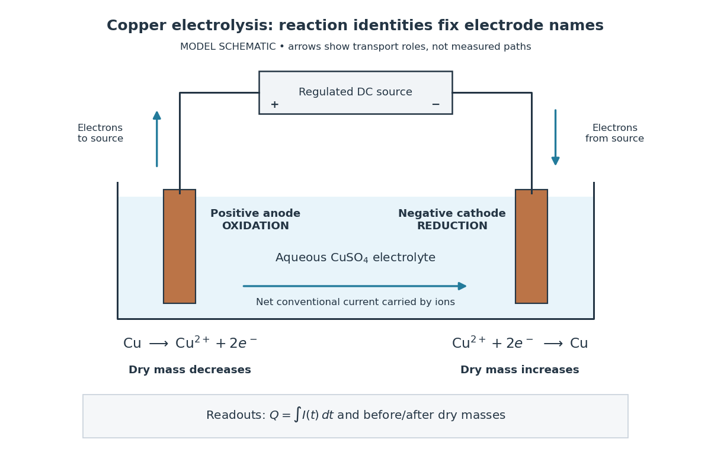
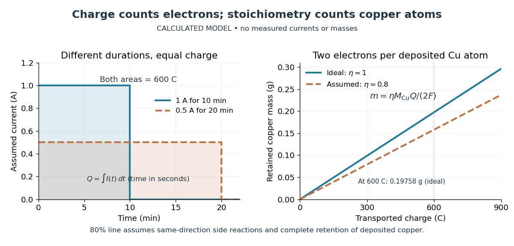

# Electrolysis

↑ **Parent:** [Electrochemistry](electrochemistry.md)  
ⓦ [Wiki](https://en.wikipedia.org/wiki/Electrolysis)

[Electrolysis](electrolysis.md) uses an external source of electrical [work](work.md) to drive [redox](redox.md) [chemical reactions](chemical-reaction.md) at the [electrodes](electrode.md) of an [electrolytic cell](electrolytic-cell.md). Its characteristic application is forcing a [chemical reaction](chemical-reaction.md) in a direction that is nonspontaneous under the specified conditions: a discharging [galvanic cell](galvanic-cell.md) supplies electrical [work](work.md), whereas [electrolysis](electrolysis.md) consumes electrical [work](work.md). This makes [electrolysis](electrolysis.md) useful for producing otherwise difficult-to-obtain [chemical substances](chemical-substance.md), charging a rechargeable [battery](electric-battery.md), and depositing a metal coating on a conducting object.[§17.7](chemistry-2e-by-paul-flowers-and-others/17-7-electrolysis.md)

Always identify the [anode](anode.md) by [oxidation](oxidation.md) and the [cathode](cathode.md) by [reduction](reduction-chemistry.md). In ordinary driven two-terminal operation, the source withdraws [Electrons](electron.md) from the positive [anode](anode.md) and delivers [Electrons](electron.md) to the negative [cathode](cathode.md). In a discharging [galvanic cell](galvanic-cell.md), the [anode](anode.md) is negative and the [cathode](cathode.md) positive. Thus terminal signs change with operating mode, while the reaction definitions remain valid. Through the [electrolyte](electrolyte.md), [ions](ion.md) transport [electric charge](electric-charge.md); they need not all be consumed at an [electrode](electrode.md). The [electrolyte](electrolyte.md) and [electrolytic cell](electrolytic-cell.md) articles explain this transport and its [conventional current](conventional-current.md) direction.

For a net [chemical equation](chemical-equation.md) transferring $z$ [Electrons](electron.md) per reaction event, the molar reaction [Gibbs free energy](gibbs-free-energy.md) obeys

$$
\Delta_rG=-zF E_{\mathrm{chem}},
$$

where $F$ is the [Faraday constant](faraday-constant.md) and $E_{\mathrm{chem}}$ is the reversible cell [electromotive force](electromotive-force.md) for the reaction in the written direction. A nonspontaneous direction has $\Delta_rG>0$ and $E_{\mathrm{chem}}<0$ at fixed [temperature](temperature.md) and [pressure](pressure.md). The ideal opposing voltage magnitude is $\Delta_rG/(zF)$; sustaining a finite [electric current](electric-current.md) generally needs additional drive because of [electrical resistance](electrical-resistance.md) and finite [electrode](electrode.md) [reaction rates](reaction-rate.md). This thermodynamic voltage concerns the actual composition, rather than necessarily standard conditions.[§17.4](chemistry-2e-by-paul-flowers-and-others/17-4-potential-free-energy-and-equilibrium.md) Not every use of [electrolysis](electrolysis.md) increases bulk chemical [Gibbs free energy](gibbs-free-energy.md): transferring [copper](copper.md) between equivalent surfaces can have zero bulk $\Delta_rG$ while the source still supplies dissipated electrical [work](work.md). See the existing [electrolytic cell](electrolytic-cell.md) example.

A particularly revealing experiment measures [copper](copper.md) transfer instead of merely looking for a coating. Two separated [copper](copper.md) [electrodes](electrode.md) stand in aqueous $\mathrm{CuSO_4}$ [electrolyte](electrolyte.md) in a vessel, with insulated leads to a regulated direct-current power supply, a series ammeter and a switch. A balance reads each [electrode](electrode.md)'s [mass](mass.md) before and after a timed run. The Institute of Physics describes copper cells with ammeters, adjustable current and removable [cathodes](cathode.md); its comparison uses three similar cells at $1\,\mathrm A$ for ten minutes, $0.5\,\mathrm A$ for ten minutes, and $0.5\,\mathrm A$ for twenty minutes. The specified observation to test is that deposited [copper](copper.md) [mass](mass.md) is proportional to [electric current](electric-current.md) times [time](time-in-physics.md). These are documented experimental settings, not measurements generated here.[Electrolysis of copper sulfate solution by Institute of Physics](electrolysis-of-copper-sulfate-solution-by-institute-of-physics.md)

The ideal [half-reactions](half-reaction.md) are

$$
\begin{aligned}
\text{anode, oxidation:}\quad&\mathrm{Cu}(s)\longrightarrow\mathrm{Cu}^{2+}(aq)+2e^-,\\
\text{cathode, reduction:}\quad&\mathrm{Cu}^{2+}(aq)+2e^-\longrightarrow\mathrm{Cu}(s).
\end{aligned}
$$

Each deposited [copper](copper.md) [chemical atom](atom-physics.md) requires two [Electrons](electron.md), so $z=2$. The [anode](anode.md) loses [copper](copper.md) and the [cathode](cathode.md) gains it; ideally their [mass](mass.md) changes have equal magnitudes, and the bulk [copper](copper.md) [cation](cation.md) inventory stays constant. Local [concentrations](concentration.md) near the [electrodes](electrode.md) can nevertheless differ. The sulfate [anions](anion.md) participate in ionic transport without appearing in these net [half-reactions](half-reaction.md); electronic [electric current](electric-current.md) in the wires becomes ionic [electric current](electric-current.md) in the [electrolyte](electrolyte.md) through the two interfaces.[Elektrolyse, Bestimmung von e by Karlsruhe Institute of Technology, Faculty of Physics teaching laboratory](elektrolyse-bestimmung-von-e-by-karlsruhe-institute-of-technology-faculty-of-physics-teaching-laboratory.md)

**[Figure 47](#image-driven-copper-transfer-oxidation-at-the-positive-anode-and-reduction-at-the-negative-cathode). Driven copper transfer: oxidation at the positive anode and reduction at the negative cathode**. Original model schematic, not a measured trajectory map. The source withdraws [Electrons](electron.md) on the left and supplies them on the right; bulk ionic [conventional current](conventional-current.md) closes the circuit. Before/after dry [electrode](electrode.md) [masses](mass.md) and the integrated [electric current](electric-current.md) provide independent readouts. The two [half-reactions](half-reaction.md) count the same transferred [electric charge](electric-charge.md), so their charges must not be added together.

Clean, rinse, dry and identify the [electrodes](electrode.md) before their initial weighing. After interrupting the [electric current](electric-current.md), rinse away adhering [electrolyte](electrolyte.md), dry again and weigh without rubbing off the deposit. KIT's university practical explicitly calls for distilled-water rinsing, careful drying and weighing both [electrodes](electrode.md); it warns that loose [copper](copper.md) grains can be lost during handling.[Elektrolyse, Bestimmung von e by Karlsruhe Institute of Technology, Faculty of Physics teaching laboratory](elektrolyse-bestimmung-von-e-by-karlsruhe-institute-of-technology-faculty-of-physics-teaching-laboratory.md) Useful additional controls are repeated drying and weighing until the reading stabilizes, and a matched unpowered immersion followed by the same rinse/dry cycle. These controls test retained liquid, residual dissolved salts, handling loss and chemical changes unrelated to passed [electric charge](electric-charge.md); they are proposed checks, not additional observations reported by KIT. Keep immersed [electrode](electrode.md) area, spacing, [electrolyte](electrolyte.md) composition and [temperature](temperature.md) comparable across runs, and keep the [electrodes](electrode.md) from touching.

Record the [electric current](electric-current.md) as a function of [time](time-in-physics.md), together with the exact switch-on and switch-off times. Taking $I(t)\geq0$ in the chosen deposition direction, the transported [electric charge](electric-charge.md) is

$$
Q=\int_{t_0}^{t_1}I(t)\,dt.
$$

For constant [electric current](electric-current.md), $Q=I(t_1-t_0)$; with sampled readings, use [numerical integration](numerical-integration.md) rather than assuming that one ammeter reading remained constant. The two equal-charge Institute of Physics settings each give $600\,\mathrm C$, while its shorter $0.5\,\mathrm A$ setting gives $300\,\mathrm C$. With $M_{\mathrm{Cu}}=63.546\,\mathrm{g\,mol^{-1}}$, the [mass](mass.md) per [amount of substance](amount-of-substance.md) tabulated by KIT, and $F\approx96485.33212\,\mathrm{C\,mol^{-1}}$, ideal [Faraday's laws of electrolysis](faraday-s-laws-of-electrolysis.md) predict

$$
m_{\mathrm{Cu}}=\frac{M_{\mathrm{Cu}}Q}{2F}
\approx\begin{cases}
0.09879\,\mathrm g,&Q=300\,\mathrm C,\\
0.19758\,\mathrm g,&Q=600\,\mathrm C.
\end{cases}
$$

These are calculated predictions for complete conversion of the measured [electric charge](electric-charge.md) into retained [copper](copper.md), not experimental results. For a stable process, doubling the [electric charge](electric-charge.md) doubles the deposited [mass](mass.md); equal [electric charge](electric-charge.md) gives equal deposited [mass](mass.md) even when the [electric current](electric-current.md) and duration differ.

**[Figure 48](#image-faraday-s-laws-of-electrolysis-connect-transported-electric-charge-to-deposited-copper-mass). Faraday's laws of electrolysis connect transported electric charge to deposited copper mass**. Original calculated model, with no experimental points. Left: assumed constant-current histories with equal areas $Q=600\,\mathrm C$. Right: ideal [copper](copper.md) [mass](mass.md) versus [electric charge](electric-charge.md) and a stipulated 80 percent current-efficiency comparison. The dashed line assumes that 20 percent of the [electric charge](electric-charge.md) drives other same-direction [electrode](electrode.md) reactions and that all deposited [copper](copper.md) remains attached.

The balance reading is a test of the whole model. Competing [reduction](reduction-chemistry.md) of [water](water.md) or other [chemical species](chemical-species.md) can divert [electric current](electric-current.md) from [copper](copper.md) deposition; transient [electrode](electrode.md) [capacitance](capacitance.md) can also consume part of a short pulse without producing [copper](copper.md). A fragile deposit can detach even when its formation used the expected [electric charge](electric-charge.md). Conversely, retained [electrolyte](electrolyte.md) or salts can increase an apparent [mass](mass.md) gain. Comparing [anode](anode.md) loss with [cathode](cathode.md) gain helps detect such problems but does not identify every cause. A slope below $M_{\mathrm{Cu}}/(2F)$ alone cannot distinguish competing [chemical reactions](chemical-reaction.md) from lost deposit. Current efficiency measures the fraction of transported [electric charge](electric-charge.md) assigned to a specified [electrode](electrode.md) reaction, rather than the fraction of electrical [energy](energy.md) stored chemically.[current efficiency](iupac-compendium-of-chemical-terminology-fifth-edition-gold-book-by-international-union-of-pure-and-applied-chemistry/current-efficiency.md)

The beautiful connection is that an electrical measurement counts chemical events: integrating [electric current](electric-current.md) and reading a balance provide two ways of following the same [Electron](electron.md) [stoichiometry](stoichiometry.md). This makes [electrolysis](electrolysis.md) useful for controlling coating quantity and for testing a charge-to-[amount of substance](amount-of-substance.md) relation. It does not determine coating uniformity, adhesion or the required voltage, which depend on transport and [electrode](electrode.md) [chemical kinetics](chemical-kinetics.md) as well.

**Table of contents**

- [Faraday's laws of electrolysis](faraday-s-laws-of-electrolysis.md)
- [Electrolytic cell](electrolytic-cell.md)

## ↑ Ancestors (3)

1. [Electrochemistry](electrochemistry.md)
2. [Chemistry](chemistry-split.md)
3. [Codex Wiki](split.md)

## ← Incoming links (5)

- [Conductivity experiment on salt solutions](conductivity-experiment-on-salt-solutions.md)
- [Electrochemistry](electrochemistry.md)
- [Electrolysis](electrolysis.md)
- [Electrolytic cell](electrolytic-cell.md)
- [Streakline](streakline.md)
