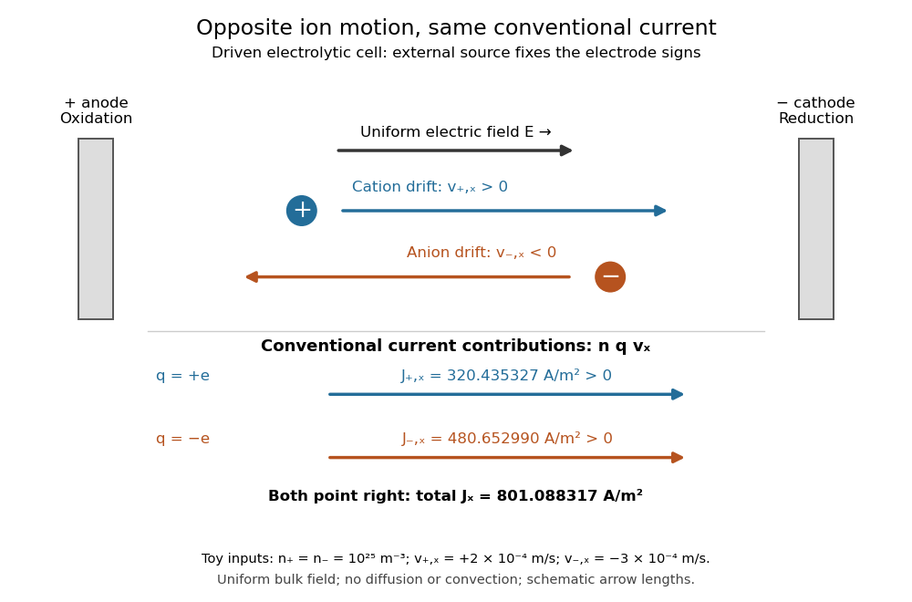

# Electrolyte

↑ **Parent:** [Electrochemistry](electrochemistry.md)

An [electrolyte](electrolyte.md) is a conducting medium in which mobile [ions](ion.md) carry [electric current](electric-current.md), according to [IUPAC Gold Book: electrolyte](https://goldbook.iupac.org/terms/view/09061). In introductory [chemistry](chemistry-split.md), a substance that yields [ions](ion.md) when dissolved in [water](water.md) is also called an [electrolyte](electrolyte.md). Both usages point to the same mechanism: an [electric field](electric-field.md) gives mobile [cations](cation.md) and [anions](anion.md) directed [drift velocities](drift-velocity.md).

Mobility matters as much as the presence of [electric charge](electric-charge.md). In a simple ideal model of solid [sodium chloride](sodium-chloride.md), [ions](ion.md) are confined to their sites and do not carry a sustained transport [electric current](electric-current.md). Molten [sodium chloride](sodium-chloride.md) has mobile [ions](ion.md); dissolved [sodium chloride](sodium-chloride.md) gives mobile $\mathrm{Na}^+$ and $\mathrm{Cl}^-$ [ions](ion.md) in [water](water.md). Real solids can have some ionic transport through imperfections; the immobile-solid picture is an introductory limit, rather than a claim that all solids are perfect insulators.

A [strong electrolyte](strong-electrolyte.md) yields essentially all [ions](ion.md) from the dissolved substance, whereas a [weak electrolyte](weak-electrolyte.md) yields only a fraction under the specified conditions. Dissolved [sodium chloride](sodium-chloride.md) is a [strong electrolyte](strong-electrolyte.md). [Sucrose](sucrose.md) is a [nonelectrolyte](nonelectrolyte.md): it dissolves as neutral [molecules](molecule.md), so dissolving something does not automatically create mobile [ions](ion.md). [Water](water.md)'s own small population of [hydronium](hydronium.md) and [hydroxide](hydroxide.md) remains possible. See [11.2 Electrolytes](chemistry-2e-by-paul-flowers-and-others/11-2-electrolytes.md) (§11.2: strong, weak, and nonelectrolytes) and [Flowers et al., Chemistry 2e, §11.4, Table 11.3: sucrose and sodium chloride](https://openstax.org/books/chemistry-2e/pages/11-4-colligative-properties).

[Acetic acid](acetic-acid.md) is a [weak electrolyte](weak-electrolyte.md) and a [weak acid](weak-acid.md). In [water](water.md), some neutral [acetic acid](acetic-acid.md) [molecules](molecule.md) transfer a [proton](proton.md) to [water](water.md), producing [hydronium](hydronium.md) and the negatively charged partner:

$$
\mathrm{CH_3COOH}+\mathrm{H_2O}\rightleftharpoons\mathrm{CH_3COO^-}+\mathrm{H_3O^+}.
$$

Both sides have net [electric charge](electric-charge.md) zero. At [chemical equilibrium](chemical-equilibrium.md), neutral [acetic acid](acetic-acid.md) coexists with these [ions](ion.md); the fraction converted depends on the conditions. [Electrolyte](electrolyte.md) strength describes this extent of ion production, while [concentration](concentration.md) describes how much substance is present per specified quantity of [chemical solution](solution-chemistry.md). A dilute [strong electrolyte](strong-electrolyte.md) can contain fewer [ions](ion.md) per volume than a concentrated [weak electrolyte](weak-electrolyte.md). Neither the words strong and weak nor a conductivity comparison alone specifies [concentration](concentration.md).

Now specify an [electrolytic cell](electrolytic-cell.md) with a positive [anode](anode.md) on the left, a negative [cathode](cathode.md) on the right, and an approximately uniform [electric field](electric-field.md) pointing right in the bulk [electrolyte](electrolyte.md). With a steady external source and neglecting [diffusion](diffusion.md) and [convection](convection.md), positive [cations](cation.md) drift right toward the negative [cathode](cathode.md); negative [anions](anion.md) drift left toward the positive [anode](anode.md). Yet both populations contribute a rightward [conventional current](conventional-current.md)! For [number densities](number-density.md) $n_+,n_-$ and [drift velocities](drift-velocity.md) $\mathbf v_+,\mathbf v_-$, the transport [current density](current-density.md) is

$$
\mathbf J=n_+(+e)\mathbf v_++n_-(-e)\mathbf v_-.
$$

The product of [electric charge](electric-charge.md) and [velocity](velocity.md) determines [conventional current](conventional-current.md): for the [anion](anion.md), both the charge and its rightward velocity component are negative, making its rightward contribution positive. This is the same sign rule used for [Electron](electron.md) [conventional current](conventional-current.md). It follows directly from the existing [charge carrier](charge-carrier.md) formula.

**[Figure 49](#image-opposite-ion-drift-velocities-contribute-to-the-same-conventional-current-in-a-specified-electrolytic-cell). Opposite ion drift velocities contribute to the same conventional current in a specified electrolytic cell**. The positive [anode](anode.md) is left and the negative [cathode](cathode.md) right. The upper arrows show [ion](ion.md) motion; the lower arrows show the signs of $nqv_x$ for [current density](current-density.md). A uniform bulk [electric field](electric-field.md) is assumed; [diffusion](diffusion.md), [convection](convection.md), and [electrode](electrode.md) boundary layers are omitted. Arrow lengths are schematic.

For an independent numerical example, stipulate $n_+=n_-=10^{25}\,\mathrm{m^{-3}}$, $v_{+,x}=2\times10^{-4}\,\mathrm{m\,s^{-1}}$, and $v_{-,x}=-3\times10^{-4}\,\mathrm{m\,s^{-1}}$. With the exact [elementary charge](elementary-charge.md) $e=1.602176634\times10^{-19}\,\mathrm C$, the contributions are

$$
J_{+,x}=320.4353268\,\mathrm{A\,m^{-2}},\qquad
J_{-,x}=480.6529902\,\mathrm{A\,m^{-2}},\qquad
J_x=801.088317\,\mathrm{A\,m^{-2}}.
$$

Equal [number densities](number-density.md) of singly charged [cations](cation.md) and [anions](anion.md) give zero bulk [charge density](charge-density.md), while their motion gives nonzero [current density](current-density.md). This is why a neutral [electrolyte](electrolyte.md) can conduct. These numbers are chosen toy inputs, not measurements of [sodium chloride](sodium-chloride.md); maintaining sustained cell [electric current](electric-current.md) also requires suitable [electrode](electrode.md) reactions. Blocking [electrodes](electrode.md) can instead lead to charge accumulation and decay of the [electric current](electric-current.md).

An [electrolyte](electrolyte.md) connects the microscopic motion of [ions](ion.md) to observable [electrical conductivity](electrical-conductivity.md). A counterion-only model keeps just the mobile [counterions](counterion.md) needed to oppose a fixed [electric charge](electric-charge.md); [Poisson-Boltzmann equations](poisson-boltzmann-equation.md) use ideal [Boltzmann distributions](boltzmann-distribution.md) to model their equilibrium distributions, rather than the drift example above.

**Table of contents**

- [Strong electrolyte](strong-electrolyte.md)
- [Weak electrolyte](weak-electrolyte.md)
- [Nonelectrolyte](nonelectrolyte.md)

## ↑ Ancestors (3)

1. [Electrochemistry](electrochemistry.md)
2. [Chemistry](chemistry-split.md)
3. [Codex Wiki](split.md)

## ← Incoming links (9)

- [Electrochemistry](electrochemistry.md)
- [Electrode](electrode.md)
- [Electrolysis](electrolysis.md)
- [Electrolyte](electrolyte.md)
- [Electrolytic cell](electrolytic-cell.md)
- [Galvanic cell](galvanic-cell.md)
- [Solution](past-exam-of-the-mathematics-course-of-the-university-of-cambridge/2015/iii/paper-75/1/solution.md)
- [Salt bridge](salt-bridge.md)
- [Solubility](solubility.md)
