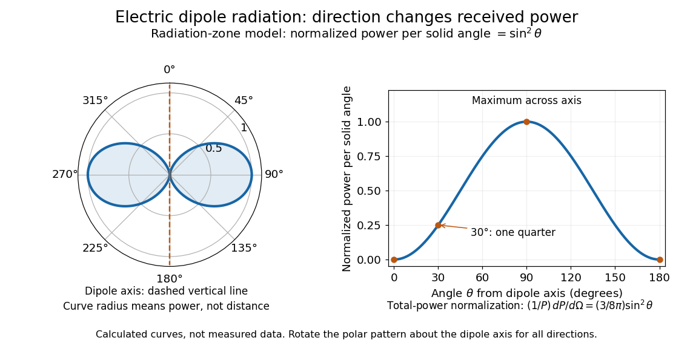

# Electromagnetic radiation

↑ **Parent:** [Electromagnetism](electromagnetism-split.md)  
ⓦ [Wiki](https://en.wikipedia.org/wiki/Electromagnetic_radiation)

[Electromagnetic radiation](electromagnetic-radiation-split.md) is a propagating disturbance of the [electric field](electric-field-split.md) and [magnetic field](magnetic-field-split.md) that carries [energy](energy-split.md) and [momentum](momentum-split.md) away from its source. It can be a sustained [electromagnetic wave](electromagnetic-wave-split.md) or a finite [wave packet](wave-packet.md): periodic oscillation is not required. In vacuum the disturbance travels at the [speed of light](speed-of-light.md). A receiver responds to fields arriving now from an earlier source event, as expressed by [retarded time](retarded-time.md). This is how electrical activity at one place can deliver [energy](energy-split.md) and information elsewhere without a connecting wire.

Stored [electromagnetic energy](electromagnetic-energy.md) alone does not establish outgoing [electromagnetic radiation](electromagnetic-radiation-split.md). A stationary [electric charge](electric-charge-split.md) in [electrostatics](electrostatics-split.md), or a steady localized [electric current](electric-current.md) in [magnetostatics](magnetostatics.md), can store [electromagnetic energy](electromagnetic-energy.md) with zero [Poynting vector](poynting-vector.md). Static combinations can have circulating [energy flux](energy-flux.md) without net outward [power](power.md). Near a changing source, reactive [energy](energy-split.md) can return later. The [near and far field](near-and-far-field.md) distinction separates these contributions from outgoing [radiation zone](radiation-zone.md) fields.[§27-5, Fig. 27-6: static fields with circulating energy flux](the-feynman-lectures-on-physics-volume-ii-by-richard-feynman-and-others/chapter-27-field-energy-and-field-momentum.md)

A single traveling vacuum [plane electromagnetic wave](plane-electromagnetic-wave.md) obeying the [Maxwell equations](maxwell-equations-split.md) has $\mathbf B=\widehat{\mathbf k}\times\mathbf E/c$. Its [Poynting vector](poynting-vector.md) gives the [energy density and flux of a plane electromagnetic wave](energy-density-and-flux-of-a-plane-electromagnetic-wave.md):

$$
\mathbf S=\frac{\mathbf E\times\mathbf B}{\mu_0}
=\epsilon_0c|\mathbf E|^2\widehat{\mathbf k},\qquad
I=\langle\mathbf S\rangle\cdot\widehat{\mathbf k}
=\frac{c\epsilon_0E_0^2}{2}.
$$

Here $I$ is [wave intensity](intensity-physics.md); $\epsilon_0$ and $\mu_0$ are [vacuum permittivity](vacuum-permittivity.md) and [vacuum permeability](vacuum-permeability.md). For a [monochromatic wave](monochromatic-wave.md) with [linear polarization](linear-polarization.md) and peak amplitude $E_0$, squared [cosine](cosine.md) averages to $1/2$. Pulses require the instantaneous [Poynting vector](poynting-vector.md); arbitrary incident-and-reflected superpositions need not obey this relation.[§27-5, Eqs. (27.16)–(27.18): traveling-wave energy flux](the-feynman-lectures-on-physics-volume-ii-by-richard-feynman-and-others/chapter-27-field-energy-and-field-momentum.md)

The [electromagnetic momentum density](electromagnetic-momentum-density.md) is $\mathbf g=\mathbf S/c^2$. Completely absorbing a unidirectional vacuum pulse of [energy](energy-split.md) $U$ transfers [momentum](momentum-split.md) $U/c$; see [radiation pressure on a perfectly absorbing surface](radiation-pressure-on-a-perfectly-absorbing-surface.md). A calculated $1.0\,\mathrm{mJ}$ pulse transfers $3.34\times10^{-12}\,\mathrm{kg\,m/s}$. Symmetric emission can lose [energy](energy-split.md) without net recoil because opposite [momenta](momentum-split.md) cancel.[§27-6, Eq. (27.21) and Fig. 27-7: field momentum and absorbed energy](the-feynman-lectures-on-physics-volume-ii-by-richard-feynman-and-others/chapter-27-field-energy-and-field-momentum.md)

The direction of emission matters as much as its total [power](power.md). For an oscillating [electric dipole moment](electric-dipole-moment.md) along $z$, the [angular distribution of electric dipole radiation](angular-distribution-of-electric-dipole-radiation.md) is strongest across the axis and vanishes along it. Its origin is geometric: the [electric dipole radiation](electric-dipole-radiation.md) field is the transverse projection of the second time derivative of the [electric dipole moment](electric-dipole-moment.md), so its magnitude contains $\sin\theta$. Squaring this [electric field](electric-field-split.md) to obtain [wave intensity](intensity-physics.md) gives $\sin^2\theta$. The [electric-dipole approximation for radiation](electric-dipole-approximation-for-radiation.md) requires a source much smaller than its [wavelength](wavelength.md) and observation in the [radiation zone](radiation-zone.md). [Feynman, Leighton and Sands, Electromagnetic Radiation, §§28-2–28-3: transverse acceleration and dipole geometry](the-feynman-lectures-on-physics-volume-i-by-richard-feynman-and-others/chapter-28-electromagnetic-radiation.md)

**[Figure 1](#image-normalized-angular-pattern-of-electric-dipole-radiation). Normalized angular pattern of electric dipole radiation**. Calculated [radiation zone](radiation-zone.md) model, not measured data. The polar curve's radial coordinate is normalized [power](power.md) per [solid angle](solid-angle.md), $\sin^2\theta$, rather than physical distance or a field line. The angle $\theta$ is measured from the dipole axis. Rotating this meridional pattern about that axis gives the three-dimensional angular distribution.

For example, the [power](power.md) per [solid angle](solid-angle.md) at $\theta=30^\circ$ is one quarter of its equatorial value, while the [electric field](electric-field-split.md) amplitude is one half. To normalize the angular distribution to total [power](power.md), use [spherical coordinates](spherical-coordinate-system.md) with $d\Omega=\sin\theta\,d\theta\,d\phi$:

$$
\int\sin^2\theta\,d\Omega
=2\pi\int_0^\pi\sin^3\theta\,d\theta=\frac{8\pi}{3},\qquad
\frac{1}{P}\frac{dP}{d\Omega}=\frac{3}{8\pi}\sin^2\theta.
$$

The [integral](integral-split.md) follows by substituting $x=\cos\theta$, giving $\int_{-1}^1(1-x^2)\,dx=4/3$. This is a probability-like normalization over direction, with units of inverse [steradian](steradian.md); it does not make the dipole an isotropic radiator. The same angular [integral](integral-split.md) underlies the [Larmor formula](larmor-formula.md) for nonrelativistic accelerated [electric charge](electric-charge-split.md).

Detection requires the incident [electromagnetic field](electromagnetic-field.md) to do something observable. An [antenna](antenna-radio.md) develops an electrical response; a [thermopile](thermopile.md) converts absorbed [energy](energy-split.md) into a thermal and then electrical signal; a [photodetector](photodetector.md) can respond through [photon](photon.md) absorption. [Hertz spark transmission and detection experiment](hertz-spark-transmission-and-detection-experiment.md) makes this conversion visible as a tiny spark. Detector orientation, sensitivity, and surrounding reflections all matter: failure to see a signal does not prove that no [electromagnetic radiation](electromagnetic-radiation-split.md) reached the receiver.

**Table of contents**

- [Radiation spectrum](radiation-spectrum.md)
  - [Power-law spectrum](power-law-spectrum.md)
    - [Radiation spectral index](radiation-spectral-index.md)
- [Radiation reaction](radiation-reaction.md)
  - [Order reduction of a radiation-reaction oscillator](order-reduction-of-a-radiation-reaction-oscillator.md)
  - [Stationary no-runaway response and preacceleration](stationary-no-runaway-response-and-preacceleration.md)
  - [Radiation-reaction oscillator pole structure](radiation-reaction-oscillator-pole-structure.md)
- [Radio wave](radio-wave.md)
  - [Microwave](microwave.md)
- [Vacuum frequency-wavelength relation](vacuum-frequency-wavelength-relation.md)
- [Outgoing radiation pulse](outgoing-radiation-pulse.md)
- [Hertz spark transmission and detection experiment](hertz-spark-transmission-and-detection-experiment.md)
- [X-ray](x-ray.md)
  - [Röntgen X-ray discovery experiment](rontgen-x-ray-discovery-experiment.md)
  - [Bothe-Geiger coincidence experiment](bothe-geiger-coincidence-experiment.md)
    - [Photon-recoil lag correlation](photon-recoil-lag-correlation.md)
  - [X-ray tube](x-ray-tube.md)
    - [X-ray tube cutoff](x-ray-tube-cutoff.md)
    - [Characteristic X-ray](characteristic-x-ray.md)
      - [X-ray emission spectroscopy](x-ray-emission-spectroscopy.md)
        - [Barkla characteristic X-ray experiment](barkla-characteristic-x-ray-experiment.md)
        - [Siegbahn precision X-ray wavelength spectroscopy](siegbahn-precision-x-ray-wavelength-spectroscopy.md)
          - [Crystal X-ray spectrometer](crystal-x-ray-spectrometer.md)
            - [Bragg wavelength error propagation](bragg-wavelength-error-propagation.md)
            - [Relative X-ray wavelength calibration](relative-x-ray-wavelength-calibration.md)
              - [X unit](x-unit.md)
            - [Gaussian spectral doublet resolution](gaussian-spectral-doublet-resolution.md)
        - [X-ray spectral attenuation operator](x-ray-spectral-attenuation-operator.md)
      - [X-ray fluorescence](x-ray-fluorescence.md)
  - [X-ray attenuation](x-ray-attenuation.md)
    - [Linear attenuation coefficient](linear-attenuation-coefficient.md)
      - [Linear energy-absorption coefficient](linear-energy-absorption-coefficient.md)
      - [Exponential attenuation](exponential-attenuation.md)
      - [Mass attenuation coefficient](mass-attenuation-coefficient.md)
    - [Half-value layer](half-value-layer.md)
    - [Beam hardening](beam-hardening.md)
    - [Absorption edge](absorption-edge.md)
  - [Radiography](radiography.md)
- [Larmor formula](larmor-formula.md)
  - [Acceleration covariance in nonrelativistic radiation](acceleration-covariance-in-nonrelativistic-radiation.md)
  - [Liénard radiated-power formula](lienard-radiated-power-formula.md)
- [Mie scattering](mie-scattering.md)
- [Synchrotron radiation](synchrotron-radiation.md)
  - [Synchrotron pulse compression](synchrotron-pulse-compression.md)
  - [Synchrotron critical frequency](synchrotron-critical-frequency.md)
- [Bremsstrahlung](bremsstrahlung.md)
- [Thermal radiation](thermal-radiation.md)
  - [Thermal radiation shield](thermal-radiation-shield.md)
- [Scattering efficiency](scattering-efficiency.md)
- [Rayleigh scattering](rayleigh-scattering.md)
  - [Rayleigh attenuation from refractivity](rayleigh-attenuation-from-refractivity.md)
  - [Polarization of singly scattered sunlight](polarization-of-singly-scattered-sunlight.md)
  - [Perfect-conductor sphere dipole interference](perfect-conductor-sphere-dipole-interference.md)
  - [Coherent continuum phase matching](coherent-continuum-phase-matching.md)
  - [Needle-scattering analyzer moments](needle-scattering-analyzer-moments.md)
  - [Rayleigh scattering by a small sphere](rayleigh-scattering-by-a-small-sphere.md)
  - [Rayleigh scattering wavelength dependence](rayleigh-scattering-wavelength-dependence.md)
  - [Rayleigh scattering angular pattern](rayleigh-scattering-angular-pattern.md)
  - [Why the sky is blue](why-the-sky-is-blue.md)

## ↑ Ancestors (4)

1. [Electromagnetism](electromagnetism-split.md)
2. [Branches of physics](branches-of-physics.md)
3. [Physics](physics-split.md)
4. [Codex Wiki](split.md)

## ← Incoming links (47)

- [Absorption (chemistry)](absorption-chemistry.md)
- [Absorption (electromagnetic radiation)](absorption-electromagnetic-radiation.md)
- [Albedo](albedo.md)
- [Antenna (radio)](antenna-radio.md)
- [Astrophysics](astrophysics-split.md)
- [Biot-Savart law](biot-savart-law.md)
- [Black-body radiation](black-body-radiation.md)
- [Blackbody](blackbody.md)
- [Bolometer](bolometer.md)
- [Bremsstrahlung](bremsstrahlung.md)
- [Cherenkov radiation](cherenkov-radiation.md)
- [Cosmic microwave background](cosmic-microwave-background-split.md)
- [Electromagnetic radiation](electromagnetic-radiation-split.md)
- [Fourier transform microwave spectroscopy](fourier-transform-microwave-spectroscopy.md)
- [Hydrogen transition wavelengths in the Bohr model](hydrogen-transition-wavelengths-in-the-bohr-model.md)
- [Infrared](infrared.md)
- [Infrared spectroscopy](infrared-spectroscopy.md)
- [Light](light.md)
- [Luminosity](luminosity.md)
- [Nobel Prize in Physics in 1901](nobel-prize-in-physics-in-1901.md)
- [Nobel Prize in Physics in 1902](nobel-prize-in-physics-in-1902.md)
- [Nuclear magnetic resonance](nuclear-magnetic-resonance-split.md)
- [Solution](past-exam-of-the-chemistry-course-of-the-year-4-of-the-natural-sciences-course-of-the-university-of-cambridge/2021/paper-id/3/d/ii/solution.md)
- [Thomson limit](past-exam-of-the-optics-and-electrodynamics-course-of-the-university-of-cambridge/2019/section-b/b5/thomson-limit.md)
- [Solution](past-exam-of-the-physics-b-course-of-the-university-of-cambridge/2012/paper-2/section-b/b7/solution.md)
- [Photometry (optics)](photometry-optics.md)
- [Photon gas](photon-gas.md)
- [Radar](radar.md)
- [Radiant flux](radiant-flux.md)
- [Radiation pressure](radiation-pressure.md)
- [Radio wave](radio-wave.md)
- [Radiometer](radiometer.md)
- [Radiometry](radiometry-split.md)
- [Rayleigh scattering](rayleigh-scattering.md)
- [Rayleigh scattering by a small sphere](rayleigh-scattering-by-a-small-sphere.md)
- [Spectral components of the linear hydrogen Stark effect](spectral-components-of-the-linear-hydrogen-stark-effect.md)
- [Spectroscopic wavenumber](spectroscopic-wavenumber.md)
- [Thermal radiation](thermal-radiation.md)
- [Thermopile](thermopile.md)
- [Thermopile absorber](thermopile-absorber.md)
- [Thermopile radiative measurement](thermopile-radiative-measurement.md)
- [Thermopile series voltage](thermopile-series-voltage.md)
- [Thermopile thermal response](thermopile-thermal-response.md)
- [Ultraviolet](ultraviolet.md)
- [Wavelength](wavelength.md)
- [X-ray](x-ray.md)
- [Zeeman slower](zeeman-slower.md)
