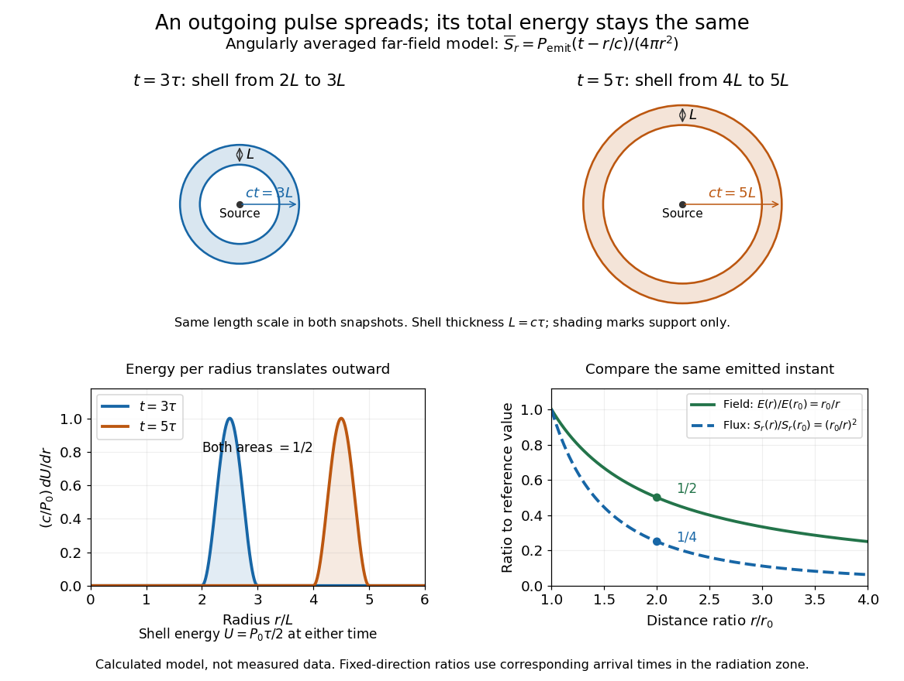
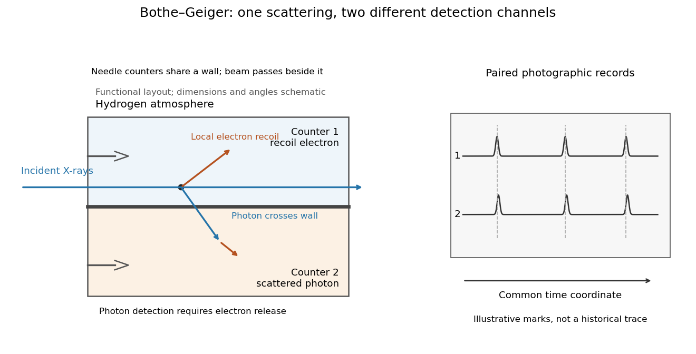
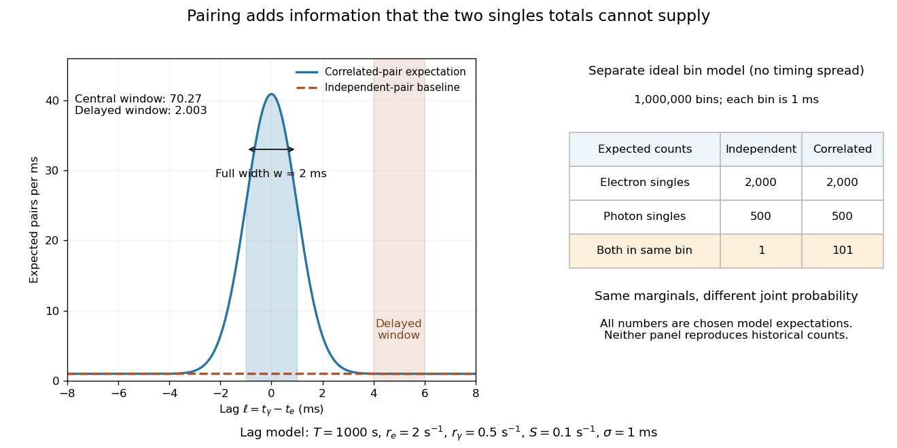
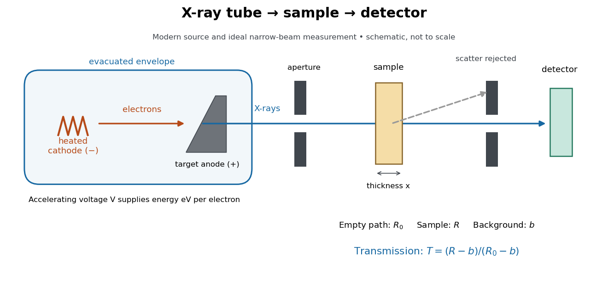
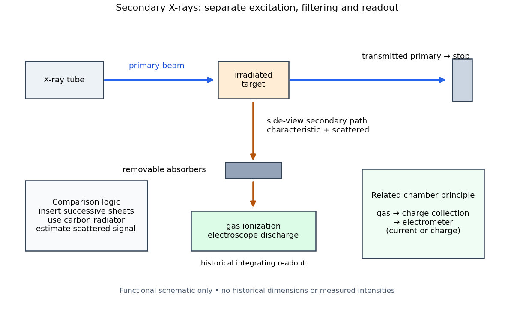
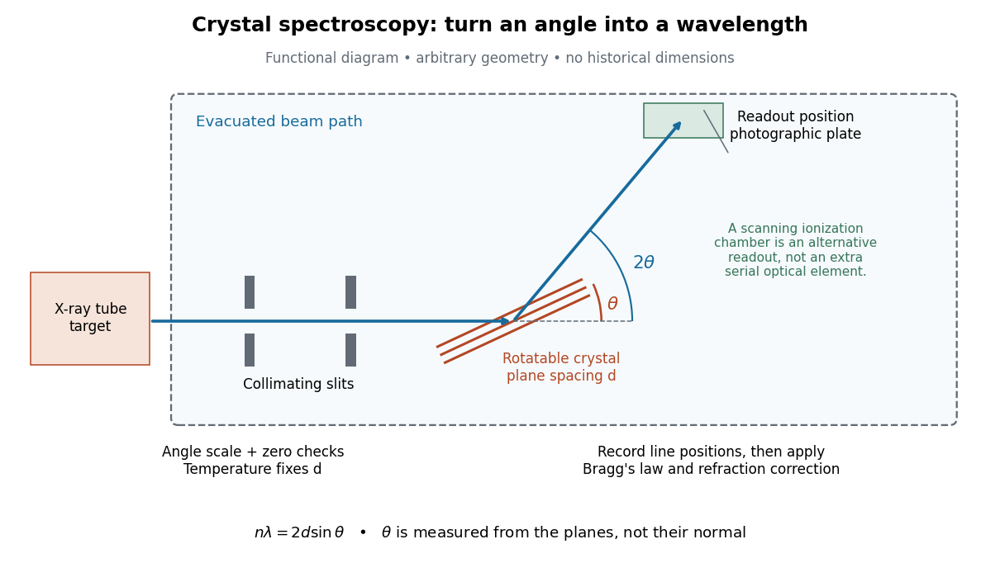
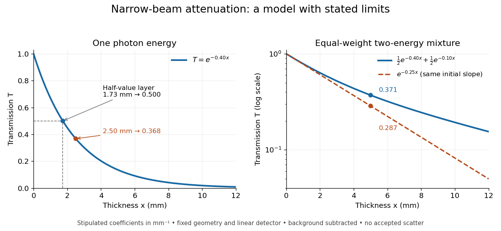
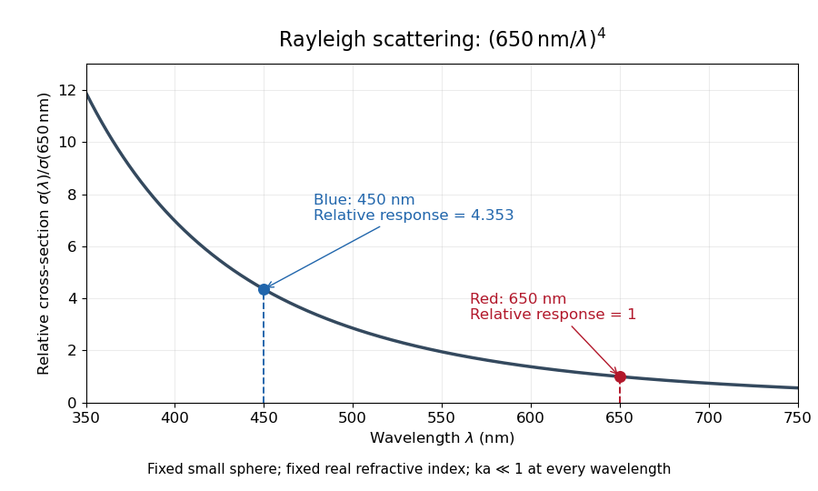
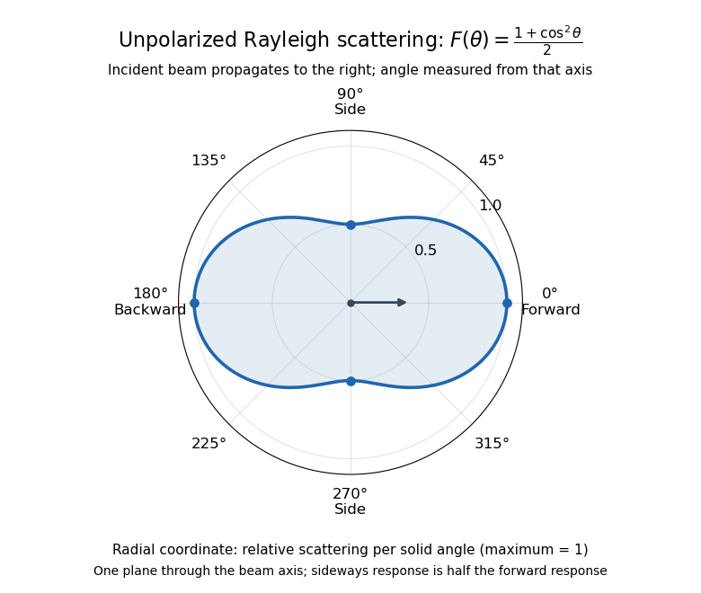

# Electromagnetic radiation

↑ **Parent:** [Electromagnetism](electromagnetism.md)  
ⓦ [Wiki](https://en.wikipedia.org/wiki/Electromagnetic_radiation)

[Electromagnetic radiation](electromagnetic-radiation.md) is a propagating disturbance of the [electric field](electric-field.md) and [magnetic field](magnetic-field.md) that carries [energy](energy.md) and [momentum](momentum.md) away from its source. It can be a sustained [electromagnetic wave](electromagnetic-wave.md) or a finite [wave packet](dispersion-relation.md#wave-packet): periodic oscillation is not required. In vacuum the disturbance travels at the [speed of light](special-relativity.md#speed-of-light). A receiver responds to fields arriving now from an earlier source event, as expressed by [retarded time](relativistic-electromagnetism.md#retarded-time). This is how electrical activity at one place can deliver [energy](energy.md) and information elsewhere without a connecting wire.

Stored [electromagnetic energy](electromagnetic-wave.md#electromagnetic-energy) alone does not establish outgoing [electromagnetic radiation](electromagnetic-radiation.md). A stationary [electric charge](electric-charge.md) in [electrostatics](electrostatics.md), or a steady localized [electric current](electric-charge.md#electric-current) in [magnetostatics](electromagnetism.md#magnetostatics), can store [electromagnetic energy](electromagnetic-wave.md#electromagnetic-energy) with zero [Poynting vector](electromagnetic-wave.md#poynting-vector). Static combinations can have circulating [energy flux](mathematical-physics.md#energy-flux) without net outward [power](energy.md#power). Near a changing source, reactive [energy](energy.md) can return later. The [near and far field](electromagnetic-wave.md#near-and-far-field) distinction separates these contributions from outgoing [radiation zone](electromagnetic-wave.md#radiation-zone) fields.[§27-5, Fig. 27-6: static fields with circulating energy flux](physics-bibliography.md#the-feynman-lectures-on-physics-volume-ii-by-richard-feynman-and-others/chapter-27-field-energy-and-field-momentum)

A single traveling vacuum [plane electromagnetic wave](electromagnetic-wave.md#plane-electromagnetic-wave) obeying the [Maxwell equations](maxwell-equations.md) has $\mathbf B=\widehat{\mathbf k}\times\mathbf E/c$. Its [Poynting vector](electromagnetic-wave.md#poynting-vector) gives the [energy density and flux of a plane electromagnetic wave](electromagnetic-wave.md#energy-density-and-flux-of-a-plane-electromagnetic-wave):

$$
\mathbf S=\frac{\mathbf E\times\mathbf B}{\mu_0}
=\epsilon_0c|\mathbf E|^2\widehat{\mathbf k},\qquad
I=\langle\mathbf S\rangle\cdot\widehat{\mathbf k}
=\frac{c\epsilon_0E_0^2}{2}.
$$

Here $I$ is [wave intensity](wave.md#intensity-physics); $\epsilon_0$ and $\mu_0$ are [vacuum permittivity](permittivity.md#vacuum-permittivity) and [vacuum permeability](maxwell-equations.md#vacuum-permeability). For a [monochromatic wave](wave.md#monochromatic-wave) with [linear polarization](electromagnetic-wave.md#linear-polarization) and peak amplitude $E_0$, squared [cosine](geometry-and-topology.md#cosine) averages to $1/2$. Pulses require the instantaneous [Poynting vector](electromagnetic-wave.md#poynting-vector); arbitrary incident-and-reflected superpositions need not obey this relation.[§27-5, Eqs. (27.16)–(27.18): traveling-wave energy flux](physics-bibliography.md#the-feynman-lectures-on-physics-volume-ii-by-richard-feynman-and-others/chapter-27-field-energy-and-field-momentum)

The [electromagnetic momentum density](electromagnetism.md#electromagnetic-momentum-density) is $\mathbf g=\mathbf S/c^2$. Completely absorbing a unidirectional vacuum pulse of [energy](energy.md) $U$ transfers [momentum](momentum.md) $U/c$; see [radiation pressure on a perfectly absorbing surface](electromagnetism.md#radiation-pressure-on-a-perfectly-absorbing-surface). A calculated $1.0\,\mathrm{mJ}$ pulse transfers $3.34\times10^{-12}\,\mathrm{kg\,m/s}$. Symmetric emission can lose [energy](energy.md) without net recoil because opposite [momenta](momentum.md) cancel.[§27-6, Eq. (27.21) and Fig. 27-7: field momentum and absorbed energy](physics-bibliography.md#the-feynman-lectures-on-physics-volume-ii-by-richard-feynman-and-others/chapter-27-field-energy-and-field-momentum)

The direction of emission matters as much as its total [power](energy.md#power). For an oscillating [electric dipole moment](electrostatics.md#electric-dipole-moment) along $z$, the [angular distribution of electric dipole radiation](electromagnetic-wave.md#angular-distribution-of-electric-dipole-radiation) is strongest across the axis and vanishes along it. Its origin is geometric: the [electric dipole radiation](electromagnetic-wave.md#electric-dipole-radiation) field is the transverse projection of the second time derivative of the [electric dipole moment](electrostatics.md#electric-dipole-moment), so its magnitude contains $\sin\theta$. Squaring this [electric field](electric-field.md) to obtain [wave intensity](wave.md#intensity-physics) gives $\sin^2\theta$. The [electric-dipole approximation for radiation](electromagnetic-wave.md#electric-dipole-approximation-for-radiation) requires a source much smaller than its [wavelength](wave-equation.md#wavelength) and observation in the [radiation zone](electromagnetic-wave.md#radiation-zone). [Feynman, Leighton and Sands, Electromagnetic Radiation, §§28-2–28-3: transverse acceleration and dipole geometry](physics-bibliography.md#the-feynman-lectures-on-physics-volume-i-by-richard-feynman-and-others/chapter-28-electromagnetic-radiation)

**[Figure 1](#image-normalized-angular-pattern-of-electric-dipole-radiation). Normalized angular pattern of electric dipole radiation**. Calculated [radiation zone](electromagnetic-wave.md#radiation-zone) model, not measured data. The polar curve's radial coordinate is normalized [power](energy.md#power) per [solid angle](euclidean-geometry.md#solid-angle), $\sin^2\theta$, rather than physical distance or a field line. The angle $\theta$ is measured from the dipole axis. Rotating this meridional pattern about that axis gives the three-dimensional angular distribution.

For example, the [power](energy.md#power) per [solid angle](euclidean-geometry.md#solid-angle) at $\theta=30^\circ$ is one quarter of its equatorial value, while the [electric field](electric-field.md) amplitude is one half. To normalize the angular distribution to total [power](energy.md#power), use [spherical coordinates](multivariable-calculus.md#spherical-coordinate-system) with $d\Omega=\sin\theta\,d\theta\,d\phi$:

$$
\int\sin^2\theta\,d\Omega
=2\pi\int_0^\pi\sin^3\theta\,d\theta=\frac{8\pi}{3},\qquad
\frac{1}{P}\frac{dP}{d\Omega}=\frac{3}{8\pi}\sin^2\theta.
$$

The [integral](integral.md) follows by substituting $x=\cos\theta$, giving $\int_{-1}^1(1-x^2)\,dx=4/3$. This is a probability-like normalization over direction, with units of inverse [steradian](euclidean-geometry.md#steradian); it does not make the dipole an isotropic radiator. The same angular [integral](integral.md) underlies the [Larmor formula](#larmor-formula) for nonrelativistic accelerated [electric charge](electric-charge.md).

Detection requires the incident [electromagnetic field](electromagnetism.md#electromagnetic-field) to do something observable. An [antenna](electrical-engineering.md#antenna-radio) develops an electrical response; a [thermopile](thermoelectric-effect.md#thermopile) converts absorbed [energy](energy.md) into a thermal and then electrical signal; a [photodetector](optical-instrument.md#photodetector) can respond through [photon](quantum-mechanics.md#photon) absorption. [Hertz spark transmission and detection experiment](#hertz-spark-transmission-and-detection-experiment) makes this conversion visible as a tiny spark. Detector orientation, sensitivity, and surrounding reflections all matter: failure to see a signal does not prove that no [electromagnetic radiation](electromagnetic-radiation.md) reached the receiver.

**Table of contents**

- [Radiation spectrum](#radiation-spectrum)
  - [Power-law spectrum](#power-law-spectrum)
    - [Radiation spectral index](#radiation-spectral-index)
- [Radiation reaction](#radiation-reaction)
  - [Order reduction of a radiation-reaction oscillator](#order-reduction-of-a-radiation-reaction-oscillator)
  - [Stationary no-runaway response and preacceleration](#stationary-no-runaway-response-and-preacceleration)
  - [Radiation-reaction oscillator pole structure](#radiation-reaction-oscillator-pole-structure)
- [Radio wave](#radio-wave)
  - [Microwave](#microwave)
- [Vacuum frequency-wavelength relation](#vacuum-frequency-wavelength-relation)
- [Outgoing radiation pulse](#outgoing-radiation-pulse)
- [Hertz spark transmission and detection experiment](#hertz-spark-transmission-and-detection-experiment)
- [X-ray](#x-ray)
  - [Röntgen X-ray discovery experiment](#rontgen-x-ray-discovery-experiment)
  - [Bothe-Geiger coincidence experiment](#bothe-geiger-coincidence-experiment)
    - [Photon-recoil lag correlation](#photon-recoil-lag-correlation)
  - [X-ray tube](#x-ray-tube)
    - [X-ray tube cutoff](#x-ray-tube-cutoff)
    - [Characteristic X-ray](#characteristic-x-ray)
      - [X-ray emission spectroscopy](#x-ray-emission-spectroscopy)
        - [Barkla characteristic X-ray experiment](#barkla-characteristic-x-ray-experiment)
        - [Siegbahn precision X-ray wavelength spectroscopy](#siegbahn-precision-x-ray-wavelength-spectroscopy)
          - [Crystal X-ray spectrometer](#crystal-x-ray-spectrometer)
            - [Bragg wavelength error propagation](#bragg-wavelength-error-propagation)
            - [Relative X-ray wavelength calibration](#relative-x-ray-wavelength-calibration)
              - [X unit](#x-unit)
            - [Gaussian spectral doublet resolution](#gaussian-spectral-doublet-resolution)
        - [X-ray spectral attenuation operator](#x-ray-spectral-attenuation-operator)
      - [X-ray fluorescence](#x-ray-fluorescence)
  - [X-ray attenuation](#x-ray-attenuation)
    - [Linear attenuation coefficient](#linear-attenuation-coefficient)
      - [Linear energy-absorption coefficient](#linear-energy-absorption-coefficient)
      - [Exponential attenuation](#exponential-attenuation)
      - [Mass attenuation coefficient](#mass-attenuation-coefficient)
    - [Half-value layer](#half-value-layer)
    - [Beam hardening](#beam-hardening)
    - [Absorption edge](#absorption-edge)
  - [Radiography](#radiography)
- [Larmor formula](#larmor-formula)
  - [Acceleration covariance in nonrelativistic radiation](#acceleration-covariance-in-nonrelativistic-radiation)
  - [Liénard radiated-power formula](#lienard-radiated-power-formula)
- [Mie scattering](#mie-scattering)
- [Synchrotron radiation](#synchrotron-radiation)
  - [Synchrotron pulse compression](#synchrotron-pulse-compression)
  - [Synchrotron critical frequency](#synchrotron-critical-frequency)
- [Bremsstrahlung](#bremsstrahlung)
- [Thermal radiation](#thermal-radiation)
  - [Thermal radiation shield](#thermal-radiation-shield)
- [Scattering efficiency](#scattering-efficiency)
- [Rayleigh scattering](#rayleigh-scattering)
  - [Rayleigh attenuation from refractivity](#rayleigh-attenuation-from-refractivity)
  - [Polarization of singly scattered sunlight](#polarization-of-singly-scattered-sunlight)
  - [Perfect-conductor sphere dipole interference](#perfect-conductor-sphere-dipole-interference)
  - [Coherent continuum phase matching](#coherent-continuum-phase-matching)
  - [Needle-scattering analyzer moments](#needle-scattering-analyzer-moments)
  - [Rayleigh scattering by a small sphere](#rayleigh-scattering-by-a-small-sphere)
  - [Rayleigh scattering wavelength dependence](#rayleigh-scattering-wavelength-dependence)
  - [Rayleigh scattering angular pattern](#rayleigh-scattering-angular-pattern)
  - [Why the sky is blue](#why-the-sky-is-blue)

## Radiation spectrum

↑ **Parent:** [Electromagnetic radiation](electromagnetic-radiation.md)

The distribution of emitted or received electromagnetic [power](energy.md#power), [radiative flux](astrophysics.md#radiative-flux) or [specific intensity](radiometry.md#spectral-radiance) across [frequency](wave.md#frequency) or [wavelength](wave-equation.md#wavelength). The spectral quantity and interval convention must be specified: $F_\nu$ and $F_\lambda$ differ by the change-of-variable factor, while $\nu F_\nu$ gives energy flux per logarithmic frequency interval. This physical spectrum is distinct from the spectrum of a linear operator or a spectrum in topology.

### Power-law spectrum

↑ **Parent:** [Radiation spectrum](#radiation-spectrum)

A [radiation spectrum](#radiation-spectrum) whose [spectral flux density](astrophysics.md#spectral-flux-density) follows a [power law](analysis.md#power-law) over a stated [frequency](wave.md#frequency) range. For $F_\nu\propto\nu^{-\alpha}$, the [spectral energy distribution](astrophysics.md#spectral-energy-distribution) satisfies $\nu F_\nu\propto\nu^{1-\alpha}$. Thus $\alpha=1$ gives equal [energy](energy.md) flux in equal logarithmic [frequency](wave.md#frequency) intervals. A spectral break invalidates extrapolation with a single index.

#### Radiation spectral index

↑ **Parent:** [Power-law spectrum](#power-law-spectrum)

The local logarithmic slope with the displayed sign convention. Other fields sometimes use the opposite sign, so an index should be accompanied by its defining [power-law spectrum](#power-law-spectrum).

## Radiation reaction

↑ **Parent:** [Electromagnetic radiation](electromagnetic-radiation.md)

[Radiation reaction](#radiation-reaction) is the influence on a source's motion of its own electromagnetic field, including the balance of radiated [energy](energy.md) and [momentum](momentum.md) with changes of the near field. For sufficiently weak radiation loss, an averaged [power](energy.md#power) balance can give the leading damping law without solving the full self-field dynamics. Replacing a constant-frequency radiation formula by its instantaneous slowly varying value requires an additional time-scale assumption; it is not an exact treatment of arbitrarily rapid motion changes.

### Order reduction of a radiation-reaction oscillator

↑ **Parent:** [Radiation reaction](#radiation-reaction)

For $|\varepsilon\omega|\ll1$, use the zeroth-order equation $\ddot x=f-x$ inside the small third-derivative term, giving

$$
\ddot x+\varepsilon\dot x+x=f+\varepsilon\dot f.
$$

For positive $\varepsilon$ this reduced equation has a stable retarded response with no high-frequency runaway. Its response $G_{\rm red}=(1-i\varepsilon\omega)/(1-\omega^2-i\varepsilon\omega)$ agrees with the unreduced oscillator to first order at fixed nonresonant frequency. Order reduction deliberately removes the singular fast mode outside the assumed low-frequency regime; it is an approximation rather than an exact alternative boundary condition for the third-order equation.

### Stationary no-runaway response and preacceleration

↑ **Parent:** [Radiation reaction](#radiation-reaction)

For positive $\varepsilon$, the real-axis frequency response of the [radiation-reaction oscillator pole structure](#radiation-reaction-oscillator-pole-structure) excludes future runaway growth but retains an upper-half-plane pole. Closing its inverse [Fourier transform](fourier-transform.md) upward at $t<0$ gives a nonzero response before the force. The fast pole contributes approximately $\varepsilon e^{t/\varepsilon}$ for negative $t$. A strictly causal retarded prescription instead includes an exponentially growing term for positive $t$ and requires a [Laplace transform](integral-transform.md#laplace-transform) contour. The pre-response is a consequence of imposing boundedness at future infinity, not an unavoidable property of all initial-value solutions of the differential equation.

### Radiation-reaction oscillator pole structure

↑ **Parent:** [Radiation reaction](#radiation-reaction)

For $\ddot x+x-\varepsilon\dddot x=f$ and the $e^{-i\omega t}$ convention, the frequency response is $G(\omega)=[1-\omega^2-i\varepsilon\omega^3]^{-1}$. At small nonzero real $\varepsilon$, its poles are

$$
\omega_\pm=\pm1-\frac{i\varepsilon}{2}+O(\varepsilon^2),\qquad
\omega_3=\frac i\varepsilon+i\varepsilon+O(\varepsilon^3).
$$

For positive $\varepsilon$ the slow oscillations decay but the fast mode runs away; for negative $\varepsilon$ the fast mode decays but the slow oscillations grow. Thus no nonzero sign makes all modes stable. A causal initial-value response and a bounded response free of runaways impose different boundary conditions.

## Radio wave

↑ **Parent:** [Electromagnetic radiation](electromagnetic-radiation.md)  
ⓦ [Wiki](https://en.wikipedia.org/wiki/Radio_wave)

A [radio wave](#radio-wave) is [electromagnetic radiation](electromagnetic-radiation.md) in the radio portion of the [frequency spectrum](fourier-analysis.md#frequency-spectrum). In vacuum its [frequency](wave.md#frequency) and [wavelength](wave-equation.md#wavelength) obey the [vacuum frequency-wavelength relation](#vacuum-frequency-wavelength-relation).

### Microwave

↑ **Parent:** [Radio wave](#radio-wave)  
ⓦ [Wiki](https://en.wikipedia.org/wiki/Microwave)

## Vacuum frequency-wavelength relation

↑ **Parent:** [Electromagnetic radiation](electromagnetic-radiation.md)

A [monochromatic wave](wave.md#monochromatic-wave) in vacuum has [frequency](wave.md#frequency) $\nu$ and [wavelength](wave-equation.md#wavelength) $\lambda$ related by $\nu\lambda=c$, where $c$ is the [speed of light](special-relativity.md#speed-of-light). During one [oscillation period](classical-mechanics.md#period-of-an-oscillation) $T=1/\nu$, a constant-[wave phase](wave.md#phase-waves) surface travels one [wavelength](wave-equation.md#wavelength), so $\lambda=cT$. Equivalently, the [plane electromagnetic wave](electromagnetic-wave.md#plane-electromagnetic-wave) relation $\omega=ck$ with [angular frequency](lagrangian-mechanics.md#angular-frequency) $\omega=2\pi\nu$ and [wavenumber](wave-equation.md#wavenumber) $k=2\pi/\lambda$ gives the same result.

As a calculated example, a vacuum [radio wave](#radio-wave) with $\nu=300\,\mathrm{MHz}=3.00\times10^8\,\mathrm{Hz}$ has $\lambda=0.999308\,\mathrm m$ using $c=299792458\,\mathrm{m/s}$. Doubling [frequency](wave.md#frequency) halves [wavelength](wave-equation.md#wavelength), independently of [wave amplitude](wave.md#wave-amplitude) and [wave intensity](wave.md#intensity-physics). The [frequency spectrum](fourier-analysis.md#frequency-spectrum) of a pulse contains multiple [frequencies](wave.md#frequency); the relation applies to each vacuum component, rather than assigning one exact [wavelength](wave-equation.md#wavelength) to the whole pulse. In a homogeneous medium replace $c$ by the appropriate [phase velocity](dispersion-relation.md#phase-velocity); the vacuum equation does not assert that all media have the same [wavelength](wave-equation.md#wavelength) at a given [frequency](wave.md#frequency).

## Outgoing radiation pulse

↑ **Parent:** [Electromagnetic radiation](electromagnetic-radiation.md)

An [outgoing radiation pulse](#outgoing-radiation-pulse) carries a finite amount of [electromagnetic energy](electromagnetic-wave.md#electromagnetic-energy) through successively larger enclosing [spheres](euclidean-geometry.md#sphere). In vacuum, far from a localized source and without absorption or additional reflections, let $P_{\rm emit}(t)$ be the emitted [power](energy.md#power). The [retarded time](relativistic-electromagnetism.md#retarded-time) at [radius](topology.md#radius) $r$ is $s=t-r/c$. Define $\overline S_r$ as the angular average of the radial [Poynting vector](electromagnetic-wave.md#poynting-vector) over the [sphere](euclidean-geometry.md#sphere), not a cycle average:

$$
\overline S_r(r,t)=\frac{P_{\rm emit}(t-r/c)}{4\pi r^2},\qquad
\overline u(r,t)=\frac{\overline S_r(r,t)}{c},\qquad
\frac{dU}{dr}=4\pi r^2\overline u=\frac{P_{\rm emit}(t-r/c)}c.
$$

Here $\overline u$ is the angularly averaged [energy density](statistical-physics.md#energy-density) in the leading [radiation zone](electromagnetic-wave.md#radiation-zone) approximation. Multiplying by shell [area](differential-geometry.md#surface-area) removes geometric dilution: the [energy](energy.md) per unit radial thickness translates outward without losing its shape. These angular averages do not assume that an actual [electric dipole](electrostatics.md#electric-dipole) emits equally in all directions. Nor do they specify an exact spherically symmetric transverse solution of the [Maxwell equations](maxwell-equations.md).

For an explicitly stipulated model, emit

$$
P_{\rm emit}(s)=P_0g(s/\tau),\qquad
g(q)=\begin{cases}\sin^2(\pi q),&0\le q\le1,\\0,&\text{otherwise},\end{cases}
\qquad U=\int P_{\rm emit}(s)\,ds=\frac{P_0\tau}{2}.
$$

After emission ends, $t>\tau$, the pulse lies between $r=c(t-\tau)$ and $r=ct$, provided this shell is in the [radiation zone](electromagnetic-wave.md#radiation-zone). Its radial thickness remains $c\tau$. Substituting $s=t-r/c$ in the shell [integral](integral.md) $\int4\pi r^2\overline u\,dr$ gives $U=P_0\tau/2$ at every such time. The same substitution in the time [integral](integral.md) of $4\pi r^2\overline S_r$ at any enclosing [sphere](euclidean-geometry.md#sphere) gives that same total crossing [energy](energy.md). This is [conservation of energy](mathematical-physics.md#conservation-of-energy) in two different views.

**[Figure 2](#image-outgoing-pulse-increasing-shell-area-dilutes-local-energy-flux). Outgoing pulse: increasing shell area dilutes local energy flux**. Original calculated model with $L=c\tau$ and $P_{\rm emit}=P_0\sin^2(\pi s/\tau)$ during emission. The circle diagrams show shell support, not equally strong emission in all directions. The lower-left curves show angularly integrated [energy](energy.md) per radius and have equal areas. The lower-right curves compare [electric field](electric-field.md) and [energy flux](mathematical-physics.md#energy-flux) ratios at corresponding [retarded times](relativistic-electromagnetism.md#retarded-time) along a fixed direction. All values are model predictions, not historical measurements.

Along any fixed direction with nonzero outgoing [power](energy.md#power), compare the same part of the pulse at two [radii](topology.md#radius), hence at different arrival times. The leading [electric field](electric-field.md) amplitude falls as $1/r$, while its squared [wave intensity](wave.md#intensity-physics) falls as $1/r^2$. At $2r$ the field is one half and the [energy flux](mathematical-physics.md#energy-flux) one quarter; the signal arrives $r/c$ later. A small fixed [area](differential-geometry.md#surface-area) receiver therefore intercepts less [energy](energy.md) at greater distance even though every enclosing [sphere](euclidean-geometry.md#sphere) receives the same total pulse [energy](energy.md). The [inverse-square law](physics.md#inverse-square-law) expresses spreading over [area](differential-geometry.md#surface-area), rather than destruction of [energy](energy.md). Close to the source, the neglected [near and far field](electromagnetic-wave.md#near-and-far-field) terms prevent extrapolating these formulas down to $r=0$.

## Hertz spark transmission and detection experiment

↑ **Parent:** [Electromagnetic radiation](electromagnetic-radiation.md)

In his 1888 reflection experiments, [Heinrich Hertz](physicist.md#heinrich-hertz) excited a straight conductor with a central [spark gap](electrical-circuit.md#spark-gap) driven by an [induction coil](electrical-circuit.md#induction-coil). The receiver was a wire circle of $35\,\mathrm{cm}$ [radius](topology.md#radius) with an adjustable small [spark gap](electrical-circuit.md#spark-gap); tiny sparks were observed in darkness. There was no connecting transmission wire. [Hertz, Electric Waves (1893 translation), VII, pp. 108–109; VIII, pp. 125–127](physics-bibliography.md#electric-waves-being-researches-on-the-propagation-of-electric-action-with-finite-velocity-through-space-by-heinrich-hertz)

He removed hanging metal fixtures, installed a $4\,\mathrm m$ by $2\,\mathrm m$ zinc reflecting sheet, and moved and rotated the receiver. Spark strength alternated with position and gap orientation, supporting [specular reflection](optics.md#specular-reflection) and [wave interference](physical-optics.md#interference-wave-propagation). He checked observations from farther away because the observer's body perturbed the response. Changing oscillator dimensions changed the spatial pattern. [Hertz, Electric Waves, VIII, pp. 125–127 and 135–136: preparations and controls](physics-bibliography.md#electric-waves-being-researches-on-the-propagation-of-electric-action-with-finite-velocity-through-space-by-heinrich-hertz)

These tests supported propagating [electromagnetic waves](electromagnetic-wave.md), rather than mere detection of nearby induction. They did not establish unlimited reception distance. His wire-versus-air [wave interference](physical-optics.md#interference-wave-propagation) experiment addressed finite [velocity](classical-mechanics.md#velocity); he later judged its quantitative velocity comparison doubtful because of room effects. [Hertz, Electric Waves, VII, pp. 107–108; Introduction, pp. 9–12: retrospective limitations](physics-bibliography.md#electric-waves-being-researches-on-the-propagation-of-electric-action-with-finite-velocity-through-space-by-heinrich-hertz)

The physical inference combines transmission with a spatially structured response to a reflected disturbance. In an ideal monochromatic incident-and-reflected model, [standing wave](mathematical-physics.md#standing-wave) nodes are separated by $\lambda/2$; combining a reliable [wavelength](wave-equation.md#wavelength) with independently known [frequency](wave.md#frequency) gives [phase velocity](dispersion-relation.md#phase-velocity) $v=\nu\lambda$. A spark is a threshold event, however: its presence or length is not a calibrated [wave intensity](wave.md#intensity-physics) or a direct arrival-time measurement. The actual loop also responds to its orientation and finite size, so the simple standing-wave model is an explanation of the test's logic, rather than a reconstruction of Hertz's measured points. [Poynting theorem](electromagnetic-wave.md#poynting-theorem) explains how source [energy](energy.md) can reach and drive the receiver's discharge.

## X-ray

↑ **Parent:** [Electromagnetic radiation](electromagnetic-radiation.md)  
ⓦ [Wiki](https://en.wikipedia.org/wiki/X-ray)

[X-rays](#x-ray) are high-[frequency](wave.md#frequency) [electromagnetic radiation](electromagnetic-radiation.md), conventionally with [wavelengths](wave-equation.md#wavelength) of roughly $0.01$ to $10\,\mathrm{nm}$. The precise [wavelength](wave-equation.md#wavelength) convention varies with context. Hot accreting [gas](thermodynamics.md#gas) and energetic electronic processes can emit [X-rays](#x-ray), whose short [wavelengths](wave-equation.md#wavelength) make them useful probes of compact objects and [electron shells](chemistry.md#electron-shell).

For a [photon](quantum-mechanics.md#photon), $E=h\nu=hc/\lambda$, where $h$ is the [Planck constant](quantum-mechanics.md#planck-constant) and $c$ is the [speed of light](special-relativity.md#speed-of-light). As a calculated example, $\lambda=0.10\,\mathrm{nm}$ gives $E\simeq12.4\,\mathrm{keV}$, using $hc\simeq1.23984\,\mathrm{keV\,nm}$. The same [wavelength](wave-equation.md#wavelength) can describe different production mechanisms: [bremsstrahlung](#bremsstrahlung) produces a continuous [frequency spectrum](fourier-analysis.md#frequency-spectrum), whereas [Characteristic X-rays](#characteristic-x-ray) arise from discrete electronic changes in [chemical atoms](physics.md#atom-physics). Measuring transmitted [X-rays](#x-ray) gives [radiography](#radiography); measuring their [frequency spectrum](fourier-analysis.md#frequency-spectrum) gives [spectroscopy](physics.md#spectroscopy).

<h3 id="rontgen-x-ray-discovery-experiment">Röntgen X-ray discovery experiment</h3>

↑ **Parent:** [X-ray](#x-ray)

[Wilhelm Conrad Röntgen](physicist.md#wilhelm-conrad-rontgen)'s 1895 first communication describes an [induction coil](electrical-circuit.md#induction-coil) driving an evacuated [gas-discharge tube](electrical-circuit.md#gas-discharge-tube), enclosed in black cardboard in darkness. A paper screen coated with [barium platinocyanide](chemical-substance.md#barium-platinocyanide) showed [fluorescence](fluorescence.md) even with its uncoated side facing the tube, visible two metres away. The covering excluded ordinary illumination.[Röntgen, On a New Kind of Rays, §§1–2; inspected reprint p. 153](physics-bibliography.md#on-a-new-kind-of-rays-by-wilhelm-conrad-rontgen)

He interposed materials: a thousand-page book transmitted; $1.5\,\mathrm{mm}$ lead was practically opaque. A stepped stack of foil produced a [photographic plate](optical-instrument.md#photographic-plate) record. Different materials were not equivalent at equal density and thickness. [Photographic plates](optical-instrument.md#photographic-plate) checked visual observations while remaining covered against ordinary illumination.[First communication, §§2–6; reprint pp. 153–154: absorption tests and photographic controls](physics-bibliography.md#on-a-new-kind-of-rays-by-wilhelm-conrad-rontgen)

Section 14 lists photographs of hand bones, wire on a bobbin, boxed weights, an enclosed compass, and a lead-painted door. It does not identify the hand's owner. Magnetic deflection moved the [cathode ray](physics.md#cathode-ray) impact point and thus the source, without bending the emerging [X-rays](#x-ray). Their nature remained unsettled.[First communication, §§11–14 and 17; reprint pp. 156–157](physics-bibliography.md#on-a-new-kind-of-rays-by-wilhelm-conrad-rontgen)

The observations belong to 1895; the contemporary English translation appeared in Nature on 23 January 1896.[Catalogue, On a new kind of rays: notes identify the Nature translation and its publication date](physics-bibliography.md#on-a-new-kind-of-rays-by-wilhelm-conrad-rontgen) The experimental logic separates production, transmission and detection. A visibly opaque covering can transmit [X-rays](#x-ray); [fluorescence](fluorescence.md) then converts deposited [energy](energy.md) into visible [light](optics.md#light). A shadow measures a difference between paths through an object, rather than a direct view of its surface. Neither a screen's brightness nor photographic darkness alone measures an absolute [X-ray](#x-ray) [energy](energy.md) or establishes the [X-ray attenuation](#x-ray-attenuation) law below.

### Bothe-Geiger coincidence experiment

↑ **Parent:** [X-ray](#x-ray)

In 1924–1925, [Walther Bothe](physicist.md#walther-bothe) and [Hans Geiger](physicist.md#hans-geiger) tested event-level [Compton scattering](mathematical-physics.md#compton-scattering) correlations against the statistical conservation proposed by [BKS theory](quantum-mechanics.md#bks-theory).[The coincidence method, pp. 271–273](physics-bibliography.md#the-coincidence-method-by-walther-bothe)

Needle [Geiger counters](particle-detection.md#geiger-counter) shared a wall. [X-rays](#x-ray) passed beside it through [hydrogen](chemical-substance.md#hydrogen); recoil [electrons](physics.md#electron) registered in one counter and scattered [photons](quantum-mechanics.md#photon) triggered [electron](physics.md#electron) release in the other. Photographic records resolved approximately $10^{-4}\,\mathrm s$.[p. 272: apparatus and timing](physics-bibliography.md#the-coincidence-method-by-walther-bothe)

**[Figure 3](#image-bothe-geiger-needle-counter-geometry). Two detection channels in the Bothe-Geiger coincidence experiment**. Original functional schematic based on Bothe's account; dimensions, angles and trace marks are illustrative. The common wall separates the counter regions; the direct beam avoids it. The drawing specifies neither wall material nor chamber shape. [Photon](quantum-mechanics.md#photon) detection requires [electron](physics.md#electron) release. Both records share a time coordinate.

The coincidence excess matched paired-emission expectations. Bothe distinguishes a later directional test from this timing experiment.[p. 273: paired emission and later directional test](physics-bibliography.md#the-coincidence-method-by-walther-bothe)

The two channels have different physical roles. The first responds to the local recoil [electron](physics.md#electron)'s [ionization](atomic-physics.md#ionization). The second converts a scattered [photon](quantum-mechanics.md#photon) into an [electron](physics.md#electron) response, as in the [photoelectric effect](quantum-mechanics.md#photoelectric-effect). A large counter signal is an amplified indication of an interaction, not a direct measurement of the incoming [photon](quantum-mechanics.md#photon)'s [energy](energy.md). The [detection efficiency](physics.md#detection-efficiency) and accepted directions determine how many genuine partners can be seen. Consequently, failure to record every partner is compatible with paired production.

The relevant distinction is between an average balance and a balance in each event. For an initially stationary free [electron](physics.md#electron), [Compton recoil kinematics](mathematical-physics.md#compton-recoil-kinematics) gives

$$
E=E'+T_e,\qquad
\frac{E}{c}\hat{\mathbf n}=\frac{E'}{c}\hat{\mathbf n}'+\mathbf p_e.
$$

Here $E,E'$ are incident and scattered [photon](quantum-mechanics.md#photon) [energies](energy.md), $T_e$ is recoil [kinetic energy](energy.md#kinetic-energy), and $\mathbf p_e$ is [electron](physics.md#electron) [momentum](momentum.md). These are paired constraints, not just equations between averages over unrelated detections. Summing correctly paired events preserves the equations; throwing away the pair identities loses information. Two samples can have identical separate [energy](energy.md) distributions while differing in their [joint probability distribution](probability-distribution.md#joint-probability-distribution).

The experiment therefore supplied evidence for the event association required by [photon](quantum-mechanics.md#photon) recoil, rather than weighing both outgoing [energies](energy.md) in every event. A statistically established excess above [accidental coincidences](particle-detection.md#accidental-coincidence) matters; one near-simultaneous pair cannot establish the association. It also cannot by itself settle every question about [wave-particle duality](quantum-mechanics.md#wave-particle-duality).

Preparation, readout and background checks address different failure modes. The direct beam must avoid the second counter, and the counter boundary must prevent a recoil [electron](physics.md#electron) from masquerading as its own [photon](quantum-mechanics.md#photon) partner. Separate-channel rates constrain [accidental coincidences](particle-detection.md#accidental-coincidence); common disturbances or electrical coupling could instead create a correlated instrumental background. A useful diagnostic is to displace one record in time: under a [stationary process](time-series.md#stationary-process) assumption, unrelated-pair expectations persist while prompt partners separate. This is the explanatory control modeled below, not an assertion that Bothe performed that particular record-shifting procedure. A background estimate and a statistical comparison are essential to the inference.

The existing [coincidence circuit](particle-detection.md#coincidence-circuit) article explains electronic selection, and [accidental coincidence](particle-detection.md#accidental-coincidence) derives the accepted-window background. Here pairing can be understood directly from the two recorded time sequences, without imposing a modern [detector trigger](particle-detection.md#trigger-particle-physics) on the historical readout.

#### Photon-recoil lag correlation

↑ **Parent:** [Bothe-Geiger coincidence experiment](#bothe-geiger-coincidence-experiment)

A [photon-recoil lag correlation](#photon-recoil-lag-correlation) asks how often a [photon](quantum-mechanics.md#photon) record occurs at a specified time displacement from an [electron](physics.md#electron) record. Let $r_e,r_\gamma$ be observed separate-channel rates, $S$ the rate of detected genuine pairs before a timing cut, and $f(\ell)$ their normalized timing [probability density function](continuous-probability-distribution.md#probability-density-function). For an original dilute, stationary model with observation time $T$, neglecting end effects and [detector dead time](particle-detection.md#detector-dead-time), the expected pair density is

$$
\frac{d\mathbb E[N]}{d\ell}
=T\bigl[r_er_\gamma+Sf(\ell)\bigr],\qquad
\int_{-\infty}^{\infty} f(\ell)\,d\ell=1.
$$

This counts all pairs of records, rather than at most one [detector trigger](particle-detection.md#trigger-particle-physics) per [electron](physics.md#electron). It uses independent unrelated detections for the flat term and an added same-event contribution. A [normal distribution](probability-distribution.md#normal-distribution) for timing spread is a chosen approximation, not a claim about the historical instrument. Intrinsic emission delay, counter response and readout uncertainty can all affect the observed [probability density function](continuous-probability-distribution.md#probability-density-function).

Define the accepted lag interval by $|\ell|<w/2$: **$w$ is its full width**. Integrating the flat baseline gives the existing [accidental coincidence](particle-detection.md#accidental-coincidence) expectation $Tr_er_\gamma w$. The additional area is $TS\int_{-w/2}^{w/2}f(\ell)\,d\ell$. Moving a window of the same full width away from the peak tests the baseline under the model's stationarity assumption. It does not remove correlated instrumental backgrounds or changing rates automatically.

**[Figure 4](#image-photon-recoil-joint-lag-correlation). Lag-dependent pairs and a joint probability distribution carry information absent from singles totals**. Original chosen models, not historical counts or fitted data. Left: a normalized [normal distribution](probability-distribution.md#normal-distribution) of genuine-pair lags with [standard deviation](variance.md#standard-deviation) $1\,\mathrm{ms}$ is added to an independent-pair baseline. Shaded intervals have full width $2\,\mathrm{ms}$, centered at zero and $5\,\mathrm{ms}$. Right: a separate exact ideal-bin model ignores timing spread; the two populations have identical singles expectations but different joint expectations.

For the lag model, choose $T=1000\,\mathrm s$, $r_e=2\,\mathrm{s^{-1}}$, $r_\gamma=0.5\,\mathrm{s^{-1}}$, $S=0.1\,\mathrm{s^{-1}}$ and timing [standard deviation](variance.md#standard-deviation) $\sigma=1\,\mathrm{ms}$. A full width $w=2\,\mathrm{ms}$ gives $2$ expected [accidental coincidences](particle-detection.md#accidental-coincidence) and $100\operatorname{erf}(1/\sqrt2)\simeq68.27$ accepted genuine pairs, using the [error function](integral.md#error-function). The total is approximately $70.27$, whereas the displaced interval from $4$ to $6\,\mathrm{ms}$ has approximately $2.003$ expected pairs. A finite sample fluctuates around these expectations; these values are not measured counts or a significance calculation.

The right panel isolates the information lost by retaining singles totals alone. In a separate idealized model, stipulate $M=10^6$ independent $1\,\mathrm{ms}$ bins, with [Bernoulli distribution](discrete-probability-distribution.md#bernoulli-distribution) indicators $X,Y$ for [electron](physics.md#electron) and [photon](quantum-mechanics.md#photon) detection in a bin. Set $p_e=\Pr(X=1)=0.002$ and $p_\gamma=\Pr(Y=1)=0.0005$. [Independence](random-variable.md#independent-random-variables) predicts $\Pr(X=1,Y=1)=p_ep_\gamma=10^{-6}$, hence one expected double detection. Alternatively choose

$$
\Pr(X=1,Y=1)=0.000101,\quad
\Pr(X=1,Y=0)=0.001899,\quad
\Pr(X=0,Y=1)=0.000399,\quad
\Pr(X=0,Y=0)=0.997601.
$$

These nonnegative [probabilities](probability-theory.md#probability) sum to one and preserve both marginal [probabilities](probability-theory.md#probability), yet predict $101$ double detections in expectation. Their [covariance](variance.md#covariance) is $0.000101-p_ep_\gamma=0.000100$. This is an exact [joint probability distribution](probability-distribution.md#joint-probability-distribution) illustrating pairing; it does not model the timing spread in the left panel or reconstruct either historical hypothesis quantitatively. Its lesson is why two singles totals cannot decide whether the observed events share a cause.

### X-ray tube

↑ **Parent:** [X-ray](#x-ray)  
ⓦ [Wiki](https://en.wikipedia.org/wiki/X-ray_tube)

An [X-ray tube](#x-ray-tube) accelerates [electrons](physics.md#electron) from a negative [cathode](electrochemistry.md#cathode) to a positive target [anode](electrochemistry.md#anode). A heated [cathode](electrochemistry.md#cathode) supplies [electrons](physics.md#electron) by [thermionic emission](thermionic-emission.md); the evacuated envelope limits collisions before the target. This differs from the [gas-discharge tube](electrical-circuit.md#gas-discharge-tube) in the [Röntgen X-ray discovery experiment](#rontgen-x-ray-discovery-experiment).[Diagnostic Radiology Physics: A Handbook for Teachers and Students; IAEA, Chapter 5: X-Ray Production, §§5.2–5.3.2; authored teaching slides, inspected transcription](physics-bibliography.md#diagnostic-radiology-physics-a-handbook-for-teachers-and-students/chapter-5-x-ray-production-teaching-slides-by-k-p-maher)

**[Figure 5](#image-x-ray-tube-transmission-detection). From accelerated electrons to a measured X-ray transmission signal**. Original schematic of a modern heated-cathode [X-ray tube](#x-ray-tube) and a narrow-beam measurement, not Röntgen's apparatus. [Electrons](physics.md#electron) stop in the target; emerging [X-rays](#x-ray) continue toward the detector. Apertures of a [collimator](optical-instrument.md#collimator) select a small angular range and reject much scattered radiation. The two reference readings use identical geometry. Arrow widths and component sizes are schematic.

In [bremsstrahlung](#bremsstrahlung), an [electron](physics.md#electron) changes [velocity](classical-mechanics.md#velocity) in the target's [electric fields](electric-field.md), emitting a [photon](quantum-mechanics.md#photon) while losing [kinetic energy](energy.md#kinetic-energy). Different encounters allow a continuous range of transferred [energies](energy.md). This is distinct from the discrete [electronic transitions](atomic-physics.md#electronic-transition) producing [Characteristic X-rays](#characteristic-x-ray).

Changing the accelerating [voltage](random-walk.md#voltage) changes the available [kinetic energy](energy.md#kinetic-energy) per [electron](physics.md#electron) and the [X-ray tube cutoff](#x-ray-tube-cutoff). Changing the number of arriving [electrons](physics.md#electron) changes the number of opportunities for [photon emission](quantum-mechanics.md#photon-emission). These are distinct controls: a larger [electric current](electric-charge.md#electric-current) does not by itself give each [electron](physics.md#electron) more [energy](energy.md). For an original idealized budget, $V=50\,\mathrm{kV}$ and tube [electric current](electric-charge.md#electric-current) $i=0.20\,\mathrm{mA}$ give electrical [power](energy.md#power) $Vi=10\,\mathrm W$ and arrival rate $i/e\simeq1.25\times10^{15}\,\mathrm{s^{-1}}$, where $e$ is the [elementary charge](electric-charge.md#elementary-charge). This is input [power](energy.md#power), not emitted [X-ray](#x-ray) [power](energy.md#power); obtaining the latter requires a conversion efficiency.

#### X-ray tube cutoff

↑ **Parent:** [X-ray tube](#x-ray-tube)

For an [electron](physics.md#electron) starting with negligible [kinetic energy](energy.md#kinetic-energy) and accelerated through a constant positive [electric potential difference](electric-field.md#electric-potential-difference) $V$, electrical work supplies $K=eV$. In the ideal single-[electron](physics.md#electron) [bremsstrahlung](#bremsstrahlung) model, [conservation of energy](mathematical-physics.md#conservation-of-energy) bounds any one emitted [photon](quantum-mechanics.md#photon):

$$
E_\gamma=h\nu=\frac{hc}{\lambda}\le eV,\qquad
\nu_{\max}=\frac{eV}{h},\qquad
\lambda_{\min}=\frac{hc}{eV}.
$$

The endpoint corresponds to essentially all available [kinetic energy](energy.md#kinetic-energy) going into one [photon](quantum-mechanics.md#photon). It is a limiting bound, not a claim that every [electron](physics.md#electron) produces an endpoint [photon](quantum-mechanics.md#photon). Neglect target recoil, initial [kinetic energy](energy.md#kinetic-energy), and losses before the emitting interaction. If the accelerating [voltage](random-walk.md#voltage) varies, its largest value sets the corresponding ideal upper endpoint; a mean [voltage](random-walk.md#voltage) does not substitute for that value.

For a calculated constant-$V$ example, $50\,\mathrm{kV}$ gives $E_{\max}=50\,\mathrm{keV}$ and $\lambda_{\min}=0.0248\,\mathrm{nm}$. Doubling $V$ halves $\lambda_{\min}$. Producing a $0.0200\,\mathrm{nm}$ [photon](quantum-mechanics.md#photon) requires at least $V=hc/(e\lambda)\simeq62.0\,\mathrm{kV}$ in this model. A continuous [frequency spectrum](fourier-analysis.md#frequency-spectrum) spans lower [photon](quantum-mechanics.md#photon) [energies](energy.md); the cutoff calculation predicts neither its shape nor the efficiency of [photon emission](quantum-mechanics.md#photon-emission).

#### Characteristic X-ray

↑ **Parent:** [X-ray tube](#x-ray-tube)  
ⓦ [Wiki](https://en.wikipedia.org/wiki/Characteristic_X-ray)

A [Characteristic X-ray](#characteristic-x-ray) comes from an [electronic transition](atomic-physics.md#electronic-transition) filling an inner [electron shell](chemistry.md#electron-shell) vacancy. The emitted [photon](quantum-mechanics.md#photon) carries the difference between atomic [energies](energy.md). Vacancy creation by direct [electron](physics.md#electron) impact requires [kinetic energy](energy.md#kinetic-energy) above the shell's [binding energy](energy.md#binding-energy), exceeding the line [energy](energy.md). Higher tube [voltage](random-walk.md#voltage) need not move the [spectral line](stellar-astrophysics.md#spectral-line).[Diagnostic Radiology Physics: A Handbook for Teachers and Students; IAEA Chapter 5, §§5.2.2–5.2.3: shell vacancy, binding-energy threshold and characteristic radiation](physics-bibliography.md#diagnostic-radiology-physics-a-handbook-for-teachers-and-students/chapter-5-x-ray-production-teaching-slides-by-k-p-maher)

An original stipulated shell model illustrates the distinction without using measured atomic data. Let positive [binding energies](energy.md#binding-energy) be $B_K=9.0\,\mathrm{keV}$ and $B_L=1.2\,\mathrm{keV}$, ignoring relaxation corrections. Filling a K-shell vacancy from the L shell releases

$$
E_{KL}=B_K-B_L=7.8\,\mathrm{keV},\qquad
\lambda_{KL}=\frac{hc}{E_{KL}}\simeq0.159\,\mathrm{nm}.
$$

An $8.5\,\mathrm{kV}$ tube can energetically emit a $7.8\,\mathrm{keV}$ [bremsstrahlung](#bremsstrahlung) [photon](quantum-mechanics.md#photon), yet cannot directly remove this K-shell [electron](physics.md#electron). A $12\,\mathrm{kV}$ tube can create that vacancy by [electron](physics.md#electron) impact; if radiative filling occurs, the line is still $7.8\,\mathrm{keV}$, not $12\,\mathrm{keV}$. This argument concerns direct [electron](physics.md#electron) impact and an initially unexcited target; it does not describe every possible excitation route.

##### X-ray emission spectroscopy

↑ **Parent:** [Characteristic X-ray](#characteristic-x-ray)  
ⓦ [Wiki](https://en.wikipedia.org/wiki/X-ray_emission_spectroscopy)

[X-ray emission spectroscopy](#x-ray-emission-spectroscopy) studies the [frequency spectrum](fourier-analysis.md#frequency-spectrum) of emitted [X-rays](#x-ray). The [spectral line](stellar-astrophysics.md#spectral-line) positions identify electronic [energy](energy.md) differences; their strengths also depend on excitation, [photon absorption](quantum-mechanics.md#photon-absorption) inside the sample, geometry and detector response. An [X-ray tube](#x-ray-tube) may excite a sample with [electrons](physics.md#electron), while [X-ray fluorescence](#x-ray-fluorescence) uses incident [photons](quantum-mechanics.md#photon). The distinction matters when choosing what the experiment measures: identifying a [chemical element](chemical-substance.md#chemical-element) from a line position is different from determining its abundance from a line strength.

###### Barkla characteristic X-ray experiment

↑ **Parent:** [X-ray emission spectroscopy](#x-ray-emission-spectroscopy)

[Charles Glover Barkla](physicist.md#charles-glover-barkla)'s 1911 paper describes irradiating a target with an [X-ray tube](#x-ray-tube) and observing secondary [X-rays](#x-ray) using an [electroscope](electric-charge.md#electroscope). For soft [Characteristic X-rays](#characteristic-x-ray) from [tin](chemical-substance.md#tin), he used a soft primary beam and placed the [electroscope](electric-charge.md#electroscope) close to the target to limit loss in air. Successive [aluminium](chemical-substance.md#aluminium) absorbers changed the gas-[ionization](atomic-physics.md#ionization) signal. Thick absorbers suppressed the soft component; a [carbon](chemical-substance.md#carbon) radiator supplied a comparison for the surviving scattered component. Subtracting this estimated contribution left approximately equal fractional losses through successive sheets, evidence for a nearly homogeneous component. Changing primary-beam hardness could suppress excitation of the more penetrating characteristic component.[Barkla, The spectra of the fluorescent Röntgen radiations (1911), p. 396: soft tube, nearby electroscope, aluminium sheets, carbon comparison and subtraction](physics-bibliography.md#the-spectra-of-the-fluorescent-rontgen-radiations-by-charles-glover-barkla)

An [electroscope](electric-charge.md#electroscope) reads loss of stored [electric charge](electric-charge.md); [ionization](atomic-physics.md#ionization) in its detecting [gas](thermodynamics.md#gas) enables discharge. An [ionization chamber](physics.md#ionization-chamber) with an [electrometer](electric-charge.md#electrometer) instead measures the collected [electric charge](electric-charge.md) or [electric current](electric-charge.md#electric-current). These are integrating readouts: neither directly assigns an [energy](energy.md) to each arriving [photon](quantum-mechanics.md#photon). The diagram separates these functions without claiming a surviving apparatus drawing.

**[Figure 6](#image-barkla-secondary-x-ray-excitation-detection). Excite the target, filter its secondary X-rays, measure gas ionization**. Original functional schematic, not a reconstruction of Barkla's apparatus. The side-view geometry separates the incident beam from the secondary path. The historical readout was an [electroscope](electric-charge.md#electroscope); the inset explains the related [ionization chamber](physics.md#ionization-chamber) principle. Absorber insertion and the [carbon](chemical-substance.md#carbon) comparison test a mixture of [Characteristic X-rays](#characteristic-x-ray) and scattered primary radiation. Arrow widths represent no measured [wave intensity](wave.md#intensity-physics).

The K and L components were distinguished by their penetrating power and dependence on the emitting [chemical element](chemical-substance.md#chemical-element). Barkla's Nobel lecture, delivered on 3 June 1920 for the 1917 prize, explains that absorber-defined K radiation had seemed homogeneous, whereas later [diffraction](quantum-scattering.md#diffraction) experiments resolved neighbouring [spectral lines](stellar-astrophysics.md#spectral-line) in both K and L groups. Absorber tests therefore distinguished groups without resolving every line.[Nobel Lectures, Physics 1901–1921; Barkla, Characteristic Röntgen radiation, printed pp. 392 and 395, PDF pp. 132 and 135: lecture date and limitations of absorption analysis](physics-bibliography.md#nobel-lectures-physics-1901-1921/characteristic-rontgen-radiation-by-charles-glover-barkla)

[Henry Gwyn Jeffreys Moseley](physicist.md#henry-gwyn-jeffreys-moseley) subsequently related the [frequencies](wave.md#frequency) of corresponding [spectral lines](stellar-astrophysics.md#spectral-line) to [atomic number](chemical-substance.md#atomic-number). The approximate relation $\sqrt{\nu}=a(Z-b)$, with series-dependent constants $a,b$, is [Moseley's law](physics.md#moseley-s-law); its discovery should be distinguished from Barkla's identification of characteristic secondary radiation.[University of Oxford Department of Physics, Moseley and X rays: Moseley's graph and the story of Moseley and X-rays](physics-bibliography.md#moseley-and-x-rays-by-university-of-oxford-department-of-physics)

A continuous incident [frequency spectrum](fourier-analysis.md#frequency-spectrum) can contribute a continuous scattered background alongside discrete [Characteristic X-rays](#characteristic-x-ray). Here “scattered” identifies a production process, not a universal spectral shape: scattering of a narrow incident line need not make a continuum. In particular, the characteristic component is [photon emission](quantum-mechanics.md#photon-emission) after vacancy creation, rather than simply the primary beam redirected. Source hardness, target substitution and absorber thickness probe different parts of that distinction. A surviving signal alone establishes neither an additional [electron shell](chemistry.md#electron-shell) nor a fully resolved [spectral line](stellar-astrophysics.md#spectral-line).

###### Siegbahn precision X-ray wavelength spectroscopy

↑ **Parent:** [X-ray emission spectroscopy](#x-ray-emission-spectroscopy)

Precision [X-ray emission spectroscopy](#x-ray-emission-spectroscopy) turns closely spaced [spectral lines](stellar-astrophysics.md#spectral-line) into quantitative constraints on atomic [energy levels](quantum-mechanics.md#energy-level). [Bragg's law](quantum-scattering.md#bragg-s-law) makes a [crystal](thermodynamics.md#crystal) an angular ruler for [wavelength](wave-equation.md#wavelength): resolving nearby directions can reveal components hidden inside an apparently single line. Accurate line positions and the ability to separate two lines are related, but distinct, experimental achievements.

[Karl Manne Georg Siegbahn](physicist.md#karl-manne-georg-siegbahn) received the 1924 [Nobel Prize in Physics](nobel-prize-in-physics.md); his lecture was delivered on 11 December 1925.[Nobel Lectures, Physics 1922–1941; The X-ray Spectra and the Structure of the Atoms, heading, printed p. 81](physics-bibliography.md#nobel-lectures-physics-1922-1941/the-x-ray-spectra-and-the-structure-of-the-atoms-by-karl-manne-georg-siegbahn)

His son [Kai Siegbahn](physicist.md#kai-manne-borje-siegbahn) received the 1981 [Nobel Prize in Physics](nobel-prize-in-physics.md) for electron [spectroscopy](physics.md#spectroscopy).[Family Nobel Prize laureates in physics, Father and son: Manne and Kai Siegbahn](physics-bibliography.md#facts-on-the-nobel-prize-in-physics-by-nobel-prize-outreach)

The [Barkla characteristic X-ray experiment](#barkla-characteristic-x-ray-experiment) distinguished element-dependent K and L groups through absorption and excitation. [Moseley's law](physics.md#moseley-s-law) related corresponding line [frequencies](wave.md#frequency) across [chemical elements](chemical-substance.md#chemical-element) to [atomic number](chemical-substance.md#atomic-number). Measuring the components within those groups asks a further question: which distinct atomic [energy](energy.md) differences produce the neighbouring [spectral lines](stellar-astrophysics.md#spectral-line)?

Siegbahn's lecture organizes measured [spectral lines](stellar-astrophysics.md#spectral-line) into [energy levels](quantum-mechanics.md#energy-level) and resolved double levels.[Nobel Lectures, Physics 1922–1941; Printed pp. 84–86, Figs. 1–2](physics-bibliography.md#nobel-lectures-physics-1922-1941/the-x-ray-spectra-and-the-structure-of-the-atoms-by-karl-manne-georg-siegbahn) The payoff is a map of atomic [energy](energy.md) differences as well as an element's position in the [periodic table](chemical-substance.md#periodic-table).

###### Crystal X-ray spectrometer

↑ **Parent:** [Siegbahn precision X-ray wavelength spectroscopy](#siegbahn-precision-x-ray-wavelength-spectroscopy)

A [crystal X-ray spectrometer](#crystal-x-ray-spectrometer) selects a narrow [wavelength](wave-equation.md#wavelength) interval by [diffraction](quantum-scattering.md#diffraction) at known [interplanar spacing](physical-chemistry.md#interplanar-spacing) $d$ and [Bragg angle](quantum-scattering.md#bragg-angle) $\theta$. For fixed [diffraction order](physical-optics.md#diffraction-order) $n$, a known $d$ lets an angular measurement determine $\lambda=2d\sin\theta/n$. This reverses the [crystallography](physical-chemistry.md#crystallography) problem of finding $d$ from a known [wavelength](wave-equation.md#wavelength).

Siegbahn's laboratory developed [X-ray tubes](#x-ray-tube) and evacuated spectrographs for longer [wavelengths](wave-equation.md#wavelength). Rotating the [crystal](thermodynamics.md#crystal) selected reflections; [photographic plates](optical-instrument.md#photographic-plate) recorded positions. Opposite-side exposures measured angles on both sides of the direct beam. Later tube instruments mounted a beam-defining slit opposite the plate holder. A separate double instrument compared two reflected beams with two [ionization chambers](physics.md#ionization-chamber). These were different instruments, not one universal assembly.[Hugo Atterling, Manne Siegbahn: Development of precision spectroscopy; Work at Uppsala 1923–1927](physics-bibliography.md#manne-siegbahn-his-research-by-hugo-atterling)

The Nobel biography describes constant-[temperature](temperature.md) spectrographs and a precision angular scale read by diametrically opposed microscopes.[Nobel Lectures, Physics 1922–1941; Biographical, paragraph beginning As a measure of the high precision; inspected collected volume pp. 90–91](physics-bibliography.md#nobel-lectures-physics-1922-1941/manne-siegbahn-biographical) [Temperature](temperature.md) control matters because [thermal expansion](thermodynamics.md#thermal-expansion) changes $d$; an accurately read angle cannot compensate for an unknown [interplanar spacing](physical-chemistry.md#interplanar-spacing).

**[Figure 7](#image-siegbahn-crystal-spectrometer-functions). Functions of a crystal X-ray spectrometer**. Original functional schematic, not a reconstruction of a particular Siegbahn instrument. Two slits illustrate [collimation](optical-instrument.md#collimation); the selected incident direction, rotatable [crystal](thermodynamics.md#crystal) and movable readout define the geometry. The [Bragg angle](quantum-scattering.md#bragg-angle) $\theta$ is measured from the [lattice planes](physical-chemistry.md#lattice-plane); the beam deflection is $2\theta$. The [photographic plate](optical-instrument.md#photographic-plate) and scanning [ionization chamber](physics.md#ionization-chamber) are alternative readouts. Component sizes, angles and positions have no historical scale.

The schematic separates preparation, selection and readout. An [X-ray tube](#x-ray-tube) target supplies [Characteristic X-rays](#characteristic-x-ray) with a possible [bremsstrahlung](#bremsstrahlung) background. A [collimator](optical-instrument.md#collimator) limits incident directions; evacuation reduces air [X-ray attenuation](#x-ray-attenuation). Rotating the [crystal](thermodynamics.md#crystal) brings different [wavelengths](wave-equation.md#wavelength) into reflection. A [photographic plate](optical-instrument.md#photographic-plate) stores line positions over an exposure, whereas an [ionization chamber](physics.md#ionization-chamber) can measure collected [electric charge](electric-charge.md) at successive angles. Neither readout alone establishes absolute [wavelength](wave-equation.md#wavelength): an angular zero, angular-scale calibration, [diffraction order](physical-optics.md#diffraction-order), $d$ and any required [refraction](optics.md#refraction) correction enter the inference. Narrower slits reduce accepted angular spread but also reduce signal; a weak line can become harder to locate despite a narrower instrumental response.

A control reported in Siegbahn's lecture photographed a line system with copper-sulphate and calcium-sulphate [crystals](thermodynamics.md#crystal). Irregular relative shifts around copper's characteristic [frequency](wave.md#frequency) supported [anomalous dispersion](geometrical-optics.md#anomalous-dispersion); the arrangement excluded differing absorption across that [frequency](wave.md#frequency) as the explanation.[Nobel Lectures, Physics 1922–1941; Printed pp. 88–89, final experiment](physics-bibliography.md#nobel-lectures-physics-1922-1941/the-x-ray-spectra-and-the-structure-of-the-atoms-by-karl-manne-georg-siegbahn) A finer angular scale alone cannot remove this physical [refraction](optics.md#refraction) correction.

###### Bragg wavelength error propagation

↑ **Parent:** [Crystal X-ray spectrometer](#crystal-x-ray-spectrometer)

Differentiate [Bragg's law](quantum-scattering.md#bragg-s-law) at fixed correctly assigned [diffraction order](physical-optics.md#diffraction-order):

$$
n\lambda=2d\sin\theta,\qquad
n\,d\lambda=2\sin\theta\,dd+2d\cos\theta\,d\theta.
$$

Divide the second equality by the first. For small signed changes,

$$
\frac{\delta\lambda}{\lambda}\simeq
\frac{\delta d}{d}+\cot\theta\,\delta\theta.
$$

The [Bragg angle](quantum-scattering.md#bragg-angle) error $\delta\theta$ must be in [radians](geometry-and-topology.md#radian). An error quoted for detector deflection $2\theta$ must first be halved. The expression is a first-order [Taylor expansion](calculus.md#taylor-expansion); an unknown [diffraction order](physical-optics.md#diffraction-order) is a discrete assignment error, not an infinitesimal perturbation.

For error bounds, add magnitudes. For independent zero-mean random errors with [standard deviations](variance.md#standard-deviation) $\sigma_d,\sigma_\theta$, [variance](variance.md) addition instead gives

$$
\left(\frac{\sigma_\lambda}{\lambda}\right)^2\simeq
\left(\frac{\sigma_d}{d}\right)^2+\cot^2\theta\,\sigma_\theta^2.
$$

Correlated errors require a [covariance](variance.md#covariance) term. A shared calibration bias does not become independent merely because many line positions are measured.

With a chosen angular error $10$ [arcseconds](geometry-and-topology.md#arcsecond), $\delta\theta=4.84814\times10^{-5}\,\mathrm{rad}$, the angular contribution is $8.3972\times10^{-5}$ at $30^\circ$ and $1.7646\times10^{-5}$ at $70^\circ$. Larger [Bragg angles](quantum-scattering.md#bragg-angle) reduce this contribution because $\cot\theta$ decreases. For a nearby [spectral doublet](stellar-astrophysics.md#spectral-doublet), the inverse relation is $\Delta\theta\simeq\tan\theta\,\Delta\lambda/\lambda$: a fixed fractional separation spreads farther apart angularly at large [Bragg angle](quantum-scattering.md#bragg-angle).

This does not permit unlimited improvement. The geometry requires $n\lambda\leq2d$; a desired [wavelength](wave-equation.md#wavelength) might not have an accessible large-angle reflection with the chosen [crystal](thermodynamics.md#crystal). Higher [diffraction orders](physical-optics.md#diffraction-order) can reach larger [Bragg angles](quantum-scattering.md#bragg-angle) but their strengths depend on the [crystal lattice structure factor](quantum-scattering.md#crystal-lattice-structure-factor). Finite crystal response, slit widths and source size remain relevant. An error in $d$, including uncorrected [thermal expansion](thermodynamics.md#thermal-expansion), remains even when the angular term is small. Very near $90^\circ$, the leading angular derivative vanishes and the second-order [Taylor expansion](calculus.md#taylor-expansion) matters.

###### Relative X-ray wavelength calibration

↑ **Parent:** [Crystal X-ray spectrometer](#crystal-x-ray-spectrometer)

For two lines measured with the same [interplanar spacing](physical-chemistry.md#interplanar-spacing) at the same [temperature](temperature.md), division of [Bragg's law](quantum-scattering.md#bragg-s-law) gives

$$
\frac{\lambda_1}{\lambda_2}
=\frac{n_2\sin\theta_1}{n_1\sin\theta_2}.
$$

The common $d$ cancels. Consequently a precise [wavelength](wave-equation.md#wavelength) ratio can coexist with an uncertain conversion to [SI](physics.md#international-system-of-units) [length](physics.md#length). In contrast, angular calibration errors generally survive: a shared small zero offset $\epsilon$ changes the inferred ratio fractionally by approximately $(\cot\theta_1-\cot\theta_2)\epsilon$. Nearby lines partially cancel this effect, but widely separated angles need not. Different [crystals](thermodynamics.md#crystal), [temperatures](temperature.md) or [refraction](optics.md#refraction) corrections also prevent unqualified cancellation.

###### X unit

↑ **Parent:** [Relative X-ray wavelength calibration](#relative-x-ray-wavelength-calibration)  
ⓦ [Wiki](https://en.wikipedia.org/wiki/X_unit)

The historical [X unit](#x-unit) was a practical [X-ray](#x-ray) [wavelength](wave-equation.md#wavelength) unit, approximately $10^{-13}\,\mathrm m$. Its scale used an assigned calcite spacing; relative [wavelength](wave-equation.md#wavelength) measurements could be more precise than absolute determinations. Variation between crystal specimens led to calibration using reference [spectral lines](stellar-astrophysics.md#spectral-line). An [X unit](#x-unit) value therefore cannot simply be read as an exact multiple of $10^{-13}\,\mathrm m$.[IUPAC, Nomenclature system for X-ray spectroscopy, §5.1 Units, printed p. 745](physics-bibliography.md#nomenclature-system-for-x-ray-spectroscopy-prepared-by-r-jenkins-and-others)

An angular-scale check determines how an indicated rotation corresponds to an angle. A reference line transfers a [wavelength](wave-equation.md#wavelength) scale. An absolute determination ties that scale to an independently established [length](physics.md#length) standard. These are different calibration tasks. Repeating measurements can reduce random scatter without correcting the common scale: if every inferred $d$ is too large by a chosen $0.1\%$, all inferred absolute [wavelengths](wave-equation.md#wavelength) are too large by $0.1\%$, while ratios using that same $d$ are unchanged.

###### Gaussian spectral doublet resolution

↑ **Parent:** [Crystal X-ray spectrometer](#crystal-x-ray-spectrometer)

A [spectral doublet](stellar-astrophysics.md#spectral-doublet) comprises two neighbouring [spectral lines](stellar-astrophysics.md#spectral-line). Resolving it requires information about the line response, relative strengths and [noise](electrical-engineering.md#noise-signal-processing), not only precision in reading an angle. Choose two equal angular responses shaped as [Gaussian functions](calculus.md#gaussian-function) with common [standard deviation](variance.md#standard-deviation) $\sigma$ and separation $\Delta$. If $x$ is angular displacement from their midpoint, their summed signal is

$$
f(x)=\exp\left(-\frac{(x-\Delta/2)^2}{2\sigma^2}\right)
+\exp\left(-\frac{(x+\Delta/2)^2}{2\sigma^2}\right).
$$

These are assumed response shapes, not a measured Siegbahn [frequency spectrum](fourier-analysis.md#frequency-spectrum). By symmetry $f'(0)=0$, and

$$
f''(0)=\frac{2e^{-\Delta^2/(8\sigma^2)}}{\sigma^2}
\left(\frac{\Delta^2}{4\sigma^2}-1\right).
$$

The midpoint changes from a maximum to a minimum at $\Delta=2\sigma$. For this particular equal-width, equal-height model, two distinct maxima occur when $\Delta>2\sigma$. Each isolated [Gaussian function](calculus.md#gaussian-function) has [full width at half maximum](analysis.md#full-width-at-half-maximum) $2\sqrt{2\ln2}\,\sigma\simeq2.355\sigma$; the two-maxima threshold is therefore about $0.849$ times that width.

**[Figure 8](#image-bragg-angular-error-doublet-resolution). Angular error and the visibility of a chosen spectral doublet**. Original calculated models. Left: magnitude of the angular term in [Bragg wavelength error propagation](#bragg-wavelength-error-propagation), alongside a separately chosen fractional spacing error of $20$ parts per million; the curves are not added. Right: explicitly chosen [interplanar spacing](physical-chemistry.md#interplanar-spacing) $d=0.2000\,\mathrm{nm}$, first [diffraction order](physical-optics.md#diffraction-order), and lines at $0.2000$ and $0.2002\,\mathrm{nm}$. Equal [Gaussian function](calculus.md#gaussian-function) responses use angular [standard deviations](variance.md#standard-deviation) $0.040^\circ$ and $0.008^\circ$; dotted curves show the narrower isolated components. None of these numbers is a historical crystal calibration or measured spectrum.

In this chosen model, the two [Bragg angles](quantum-scattering.md#bragg-angle) are $30.000000^\circ$ and $30.033085^\circ$. Their separation is $0.827$ times $\sigma$ for $\sigma=0.040^\circ$, giving one maximum, and $4.136$ times $\sigma$ for $\sigma=0.008^\circ$, giving two. Sharpening the response can reveal the doublet without changing either emitted [wavelength](wave-equation.md#wavelength).

The [Rayleigh criterion](point-spread-function.md#rayleigh-criterion) uses a first-zero convention for specified [diffraction](quantum-scattering.md#diffraction) patterns. A [Gaussian function](calculus.md#gaussian-function) has no finite zero, so its two-maxima threshold is not the [Rayleigh criterion](point-spread-function.md#rayleigh-criterion). Neither convention is a universal inference limit: known response shapes and adequate [signal-to-noise ratio](electrical-engineering.md#signal-to-noise-ratio) can support estimating a separation before two visible maxima appear. Unequal strengths, background, finite sampling and uncertainty in the response can make that inference much harder. [Measurement resolution](physics.md#measurement-resolution), the precision of an isolated line's centre and absolute [wavelength](wave-equation.md#wavelength) accuracy should therefore be reported separately.

###### X-ray spectral attenuation operator

↑ **Parent:** [X-ray emission spectroscopy](#x-ray-emission-spectroscopy)

For a fixed homogeneous absorber in a narrow-beam geometry, define the [X-ray spectral attenuation operator](#x-ray-spectral-attenuation-operator) on [L1 space](measure-theory.md#l1-space) over a bounded positive [energy](energy.md) interval. A physical input $f(E)\ge0$ is an [integrable function](measure-theory.md#lebesgue-integrable-function) giving incident [photon](quantum-mechanics.md#photon) rate density. Let its [linear attenuation coefficient](#linear-attenuation-coefficient) $\mu(E)\ge0$ be a [measurable function](measure-theory.md#measurable-function), with $x\ge0$. The transmitted uncollided density is

$$
(A_xf)(E)=e^{-\mu(E)x}f(E),\qquad
S(x)=\int w(E)(A_xf)(E)\,dE.
$$

Here $w(E)\ge0$ is a fixed bounded detector response described by a [measurable function](measure-theory.md#measurable-function); background has been subtracted. This is a positive [linear operator](vector-space.md#linear-operator) on [L1 space](measure-theory.md#l1-space). Since $0\le e^{-\mu(E)x}\le1$, it cannot increase the integrated absolute incident rate. Multiplication of exponentials proves $A_{x+y}=A_xA_y$ for successive layers of the same material. Ignore secondary radiation entering the detector, saturation and changes to the source. Discrete [spectral lines](stellar-astrophysics.md#spectral-line) use the finite-sum version below instead of an ordinary rate density.

For a chosen filter, stipulate $\mu_\alpha=0.20\,\mathrm{mm^{-1}}$, $\mu_\beta=0.80\,\mathrm{mm^{-1}}$ and input line rates $(N_\alpha,N_\beta)=(4,1)$ in a common arbitrary rate unit. Assume equal calibrated detector weight for both lines. At $x=2.0\,\mathrm{mm}$,

$$
\begin{pmatrix}N_\alpha(x)\\N_\beta(x)\end{pmatrix}
=\begin{pmatrix}e^{-0.4}&0\\0&e^{-1.6}\end{pmatrix}
\begin{pmatrix}4\\1\end{pmatrix}
\simeq\begin{pmatrix}2.68128\\0.201897\end{pmatrix}.
$$

The selected $8.5\,\mathrm{keV}$ line's fraction rises from $4/5=0.800$ to $0.929974$, but its absolute rate falls by about $33.0\%$. Filtering improves purity at the cost of signal. It multiplies existing components and cannot create a new emitted [spectral line](stellar-astrophysics.md#spectral-line).

**[Figure 9](#image-characteristic-x-ray-line-filtering-model). Shell differences set line energies; an absorber changes their weights**. Original stipulated shell and filter model, not a measured Barkla [frequency spectrum](fourier-analysis.md#frequency-spectrum). Positive shell [binding energies](energy.md#binding-energy) are plotted as negative bound-state [energies](energy.md). The two K lines are sticks with chosen input rates 4 and 1. The L line is outside the displayed filtering band. All attenuation coefficients are illustrative; they do not identify a real filter material.

With just one integrated reading, $S=N_\alpha+N_\beta$, the two unknown line rates are underdetermined. If the source is unchanged between an empty-path reading and a filtered reading, the ideal [inverse problem](inverse-problem.md) becomes

$$
\begin{pmatrix}S(0)\\S(2\,\mathrm{mm})\end{pmatrix}
=\begin{pmatrix}1&1\\e^{-0.4}&e^{-1.6}\end{pmatrix}
\begin{pmatrix}N_\alpha\\N_\beta\end{pmatrix}
=\begin{pmatrix}5\\2.88318\end{pmatrix}.
$$

The [determinant](multilinear-algebra.md#determinant) $e^{-1.6}-e^{-0.4}\simeq-0.468424$ is nonzero, so these two ideal readings determine the two stipulated line rates uniquely. Identical coefficients would give zero [determinant](multilinear-algebra.md#determinant) and destroy that separation. This small [linear algebra](linear-algebra.md) example explains why absorber contrast supplies information, while also showing its limit: unknown scattered components or unknown detector weights add unknowns that two readings cannot determine.

##### X-ray fluorescence

↑ **Parent:** [Characteristic X-ray](#characteristic-x-ray)  
ⓦ [Wiki](https://en.wikipedia.org/wiki/X-ray_fluorescence)

[X-ray fluorescence](#x-ray-fluorescence) is [Characteristic X-ray](#characteristic-x-ray) emission following excitation by incident [photons](quantum-mechanics.md#photon). In a simple initially unexcited [chemical atom](physics.md#atom-physics), [photoionization](atomic-physics.md#photoionization) can eject an inner [electron](physics.md#electron) if the incident [photon](quantum-mechanics.md#photon) supplies its [binding energy](energy.md#binding-energy). An outer [electron](physics.md#electron) can then fill the vacancy, releasing an emitted [photon](quantum-mechanics.md#photon) with the difference of shell [binding energies](energy.md#binding-energy). Nonradiative relaxation competes with this route, so one absorbed incident [photon](quantum-mechanics.md#photon) need not yield one escaping characteristic [photon](quantum-mechanics.md#photon).

Choose a separate stipulated [electron shell](chemistry.md#electron-shell) model with values $B_K=10.0$, $B_L=1.5$ and $B_M=0.3$, all in $\mathrm{keV}$. Ignore subshell splitting, recoil and changes of [binding energy](energy.md#binding-energy) during relaxation. The possible shell differences are

$$
E_{K\alpha}=B_K-B_L=8.5\,\mathrm{keV},\qquad
E_{K\beta}=B_K-B_M=9.7\,\mathrm{keV},\qquad
E_{L\alpha}=B_L-B_M=1.2\,\mathrm{keV}.
$$

These labels denote simplified shell groups, not resolved subshell [electronic transitions](atomic-physics.md#electronic-transition). With $hc=1.23984\,\mathrm{keV\,nm}$, their calculated [wavelengths](wave-equation.md#wavelength) are respectively $0.145864$, $0.127819$ and $1.03320\,\mathrm{nm}$. An incident $9.8\,\mathrm{keV}$ [photon](quantum-mechanics.md#photon) exceeds both K-line [energies](energy.md) but cannot directly create the K vacancy in this initially unexcited model. A $12.0\,\mathrm{keV}$ [photon](quantum-mechanics.md#photon) can, leaving approximately $2.0\,\mathrm{keV}$ of [photoelectron](atomic-physics.md#photoelectron) [kinetic energy](energy.md#kinetic-energy). This comparison fixes neither the excitation probability nor the radiative branching probability.

### X-ray attenuation

↑ **Parent:** [X-ray](#x-ray)

For a narrow beam of monoenergetic [photons](quantum-mechanics.md#photon) crossing homogeneous material of thickness $x$, the uncollided [wave intensity](wave.md#intensity-physics) obeys $I(x)=I_0e^{-\mu x}$. Here $\mu$ is the [linear attenuation coefficient](#linear-attenuation-coefficient), counting removal from the incident beam by [photon absorption](quantum-mechanics.md#photon-absorption) and [scattering of light](optics.md#scattering-of-light). It depends on [photon](quantum-mechanics.md#photon) [energy](energy.md) and material; it is not universally independent of [energy](energy.md).[Tables of X-Ray Mass Attenuation Coefficients and Mass Energy-Absorption Coefficients by John H. Hubbell and Stephen M. Seltzer; NIST, X-Ray Mass Attenuation Coefficients, §2, Eq. (1), narrow monoenergetic beam and interaction contributions](physics-bibliography.md#tables-of-x-ray-mass-attenuation-coefficients-and-mass-energy-absorption-coefficients-by-john-h-hubbell-and-stephen-m-seltzer/2-the-mass-attenuation-coefficient)

An original derivation makes the model explicit. If each thin layer removes fraction $\mu\,dx$ of the surviving beam, with the same $\mu$ throughout, then

$$
\frac{dI}{dx}=-\mu I,\qquad
\ln\frac{I(x)}{I_0}=-\mu x.
$$

Thus equal added thicknesses multiply transmission by the same factor. The [ordinary differential equation](differential-equation.md#ordinary-differential-equation) describes uncollided beam survival. To test it with a detector, keep source output, distance, selected [photon](quantum-mechanics.md#photon) [energy](energy.md) band and detector response fixed. Use a [collimator](optical-instrument.md#collimator) and suitable detector acceptance to exclude [scattering of light](optics.md#scattering-of-light) into the detector. Subtract background, measure an empty-path reference, and keep the detector in its linear operating range. A changing source distance adds geometric dilution and is not an attenuation measurement at fixed geometry.

For a stipulated example, take $\mu=0.40\,\mathrm{mm^{-1}}$ and $x=2.5\,\mathrm{mm}$. Transmission is $e^{-1}\simeq0.368$. If the empty-path detector rate is $1010\,\mathrm{s^{-1}}$, including background $b=10\,\mathrm{s^{-1}}$, the model predicts sample rate $10+1000e^{-1}\simeq378\,\mathrm{s^{-1}}$. Recover transmission as $(R-b)/(R_0-b)$; the raw ratio $R/R_0\simeq0.374$ is biased. These chosen values are a calculation, not measurements of a particular material or a historical apparatus.

**[Figure 10](#image-x-ray-narrow-beam-attenuation). When X-ray transmission is exponential, and when spectral mixing bends it**. Original calculated examples, with stipulated [linear attenuation coefficients](#linear-attenuation-coefficient) in inverse millimetres. The left panel uses one [photon](quantum-mechanics.md#photon) [energy](energy.md) and marks $x=2.5\,\mathrm{mm}$ and the [half-value layer](#half-value-layer). The right panel compares an equal-weight mixture of two [photon](quantum-mechanics.md#photon) [energies](energy.md) with the exponential having the same initial slope. A logarithmic vertical axis turns a single exponential into a straight line. Neither curve is fitted to measured material data.

#### Linear attenuation coefficient

↑ **Parent:** [X-ray attenuation](#x-ray-attenuation)

The [linear attenuation coefficient](#linear-attenuation-coefficient) is the infinitesimal probability of removal from the uncollided beam per unit path length. Its units are inverse [length](physics.md#length). In the homogeneous monoenergetic model, $\mu=-d\ln I/dx$; $1/\mu$ is the thickness leaving fraction $e^{-1}$ uncollided. The [mass attenuation coefficient](#mass-attenuation-coefficient) is $\mu/\rho$ for material [mass density](fluid-mechanics.md#density) $\rho$. Removing a [photon](quantum-mechanics.md#photon) by [scattering of light](optics.md#scattering-of-light) does not imply deposition of all its [energy](energy.md) at that point; attenuation and [energy](energy.md) absorption are different quantities.[Tables of X-Ray Mass Attenuation Coefficients and Mass Energy-Absorption Coefficients by John H. Hubbell and Stephen M. Seltzer; NIST §2, mass thickness, Eq. (1), and total interaction cross section; distinction from the mass energy-absorption coefficient](physics-bibliography.md#tables-of-x-ray-mass-attenuation-coefficients-and-mass-energy-absorption-coefficients-by-john-h-hubbell-and-stephen-m-seltzer/2-the-mass-attenuation-coefficient)

##### Linear energy-absorption coefficient

↑ **Parent:** [Linear attenuation coefficient](#linear-attenuation-coefficient)

A coefficient describing the locally absorbed fraction of an incident photon energy flow per path length, under a stated averaging convention. It is distinct from the total [linear attenuation coefficient](#linear-attenuation-coefficient), which counts removal from an uncollided beam. Dividing by [mass density](fluid-mechanics.md#density) gives an energy-absorption coefficient per mass.

##### Exponential attenuation

↑ **Parent:** [Linear attenuation coefficient](#linear-attenuation-coefficient)

The uncollided component decays exponentially when its removal probability per unit path length is constant. Scattered contributions require a separate transport treatment or a specified [radiation buildup factor](engineering.md#radiation-buildup-factor).

##### Mass attenuation coefficient

↑ **Parent:** [Linear attenuation coefficient](#linear-attenuation-coefficient)

The [linear attenuation coefficient](#linear-attenuation-coefficient) divided by the material [mass density](fluid-mechanics.md#density).

#### Half-value layer

↑ **Parent:** [X-ray attenuation](#x-ray-attenuation)  
ⓦ [Wiki](https://en.wikipedia.org/wiki/Half-value_layer)

The [half-value layer](#half-value-layer) is the thickness reducing the specified transmitted signal by one half. For constant monoenergetic [linear attenuation coefficient](#linear-attenuation-coefficient) $\mu$, solving $e^{-\mu x_{1/2}}=1/2$ gives $x_{1/2}=\ln2/\mu$. The stipulated $\mu=0.40\,\mathrm{mm^{-1}}$ gives $x_{1/2}\simeq1.73\,\mathrm{mm}$; two such layers transmit one quarter. A broad [frequency spectrum](fourier-analysis.md#frequency-spectrum) need not retain the same [half-value layer](#half-value-layer) after filtering.

#### Beam hardening

↑ **Parent:** [X-ray attenuation](#x-ray-attenuation)  
ⓦ [Wiki](https://en.wikipedia.org/wiki/Beam_hardening)

An original two-[energy](energy.md) model demonstrates the failure of a single constant [linear attenuation coefficient](#linear-attenuation-coefficient) for a mixed beam. Suppose the two components contribute equally to the empty-path detector signal and have stipulated $\mu_1=0.40\,\mathrm{mm^{-1}}$ and $\mu_2=0.10\,\mathrm{mm^{-1}}$. With fixed linear detector response and no accepted [scattering of light](optics.md#scattering-of-light),

$$
T(x)=\frac12e^{-\mu_1x}+\frac12e^{-\mu_2x},\qquad
-\frac{d\ln T}{dx}
=\frac{\mu_1e^{-\mu_1x}+\mu_2e^{-\mu_2x}}
{e^{-\mu_1x}+e^{-\mu_2x}}.
$$

The initial slope corresponds to $\mu=0.25\,\mathrm{mm^{-1}}$, but at $x=5\,\mathrm{mm}$, $T\simeq0.371$, rather than $e^{-0.25(5)}\simeq0.287$. The more strongly attenuated component disappears faster. If that component has lower [photon](quantum-mechanics.md#photon) [energy](energy.md), the surviving beam has a higher mean [energy](energy.md): [beam hardening](#beam-hardening). The formula is explicitly a two-component example, not a universal rule that attenuation decreases monotonically with [photon](quantum-mechanics.md#photon) [energy](energy.md). Detector weighting also matters when interpreting a broadband transmission signal.

#### Absorption edge

↑ **Parent:** [X-ray attenuation](#x-ray-attenuation)  
ⓦ [Wiki](https://en.wikipedia.org/wiki/Absorption_edge)

An [absorption edge](#absorption-edge) is an abrupt change in [photon absorption](quantum-mechanics.md#photon-absorption) as incident [photon](quantum-mechanics.md#photon) [energy](energy.md) crosses an electronic excitation threshold. For inner-shell [photoionization](atomic-physics.md#photoionization), a new vacancy-production channel opens near the shell's [binding energy](energy.md#binding-energy). This threshold concerns incident [energy](energy.md); a [Characteristic X-ray](#characteristic-x-ray) concerns a subsequent difference of atomic [energies](energy.md). They are different observations. Barkla's lecture explicitly treats characteristic emission as requiring a critical excitation condition, while discussing characteristic radiation separately from scattering.[Nobel Lectures, Physics 1901–1921; Barkla, Characteristic Röntgen radiation, printed p. 395, PDF p. 135: shorter-wavelength excitation and critical condition](physics-bibliography.md#nobel-lectures-physics-1901-1921/characteristic-rontgen-radiation-by-charles-glover-barkla)

In the stipulated [X-ray fluorescence](#x-ray-fluorescence) model, the K threshold is $10.0\,\mathrm{keV}$, whereas the K lines are $8.5$ and $9.7\,\mathrm{keV}$. An absorber made of a different material could have its own [absorption edge](#absorption-edge) between those line [energies](energy.md), preferentially removing the upper line. Actual near-edge structure and attenuation values require material data; the following deliberately chosen coefficients are not such data.

### Radiography

↑ **Parent:** [X-ray](#x-ray)

Imaging by recording spatial differences in transmitted [X-rays](#x-ray) or other penetrating radiation.

## Larmor formula

↑ **Parent:** [Electromagnetic radiation](electromagnetic-radiation.md)  
ⓦ [Wiki](https://en.wikipedia.org/wiki/Larmor_formula)

The nonrelativistic radiated power of an accelerated point charge is $P=q^2\mu_0a^2/(6\pi c)$ in [SI](physics.md#international-system-of-units) units. Integrating its dipole radiation pattern over solid angle gives this result; relativistic motion requires the Lienard generalization.

### Acceleration covariance in nonrelativistic radiation

↑ **Parent:** [Larmor formula](#larmor-formula)

For a nonrelativistic point charge, let $C_{ij}=\langle a_i a_j\rangle$ be the time-averaged second moment of [acceleration](classical-mechanics.md#acceleration), without subtracting its mean. The outgoing [radiation zone](electromagnetic-wave.md#radiation-zone) fields satisfy $\mathbf B=\mathbf n\times\mathbf E/c$ and $\mathbf E=q\mathbf n\times(\mathbf n\times\mathbf a)/(4\pi\epsilon_0c^2r)$. Their [Poynting vector](electromagnetic-wave.md#poynting-vector) gives the displayed [power](energy.md#power) per [solid angle](euclidean-geometry.md#solid-angle). Its integral is $\langle P\rangle=q^2\operatorname{tr}C/(6\pi\epsilon_0c^3)$, the averaged [Larmor formula](#larmor-formula).

For periodic motion the mean [acceleration](classical-mechanics.md#acceleration) vanishes and $C$ is also its [covariance matrix](variance.md#covariance-matrix). More generally the second moment, rather than the centered [covariance matrix](variance.md#covariance-matrix), is the relevant quantity. The angular formula is valid to leading nonrelativistic order and evaluates source motion at [retarded time](relativistic-electromagnetism.md#retarded-time).

<h3 id="lienard-radiated-power-formula">Liénard radiated-power formula</h3>

↑ **Parent:** [Larmor formula](#larmor-formula)

The relativistic generalization of the [Larmor formula](#larmor-formula) uses the invariant proper-acceleration magnitude: $P=-\mu_0q^2 A^aA_a/(6\pi)$ in signature $(+---)$. In coordinate time this is the displayed expression. For perpendicular magnetic circular motion, $\gamma m|a|=|q|vB$, giving $P=\mu_0q^4(\gamma^2-1)B^2/(6\pi m^2)$. The statement concerns total instantaneous emitted power; directional radiation flux is not itself invariant.

## Mie scattering

↑ **Parent:** [Electromagnetic radiation](electromagnetic-radiation.md)  
ⓦ [Wiki](https://en.wikipedia.org/wiki/Mie_scattering)

The electromagnetic scattering solution for a sphere describes the transition between [Rayleigh scattering](#rayleigh-scattering) and [geometrical optics](geometrical-optics.md). Grain-size-dependent efficiencies can produce structure in the [radiation-pressure coefficient](planetary-science.md#radiation-pressure-coefficient).

## Synchrotron radiation

↑ **Parent:** [Electromagnetic radiation](electromagnetic-radiation.md)  
ⓦ [Wiki](https://en.wikipedia.org/wiki/Synchrotron_radiation)

### Synchrotron pulse compression

↑ **Parent:** [Synchrotron radiation](#synchrotron-radiation)

The forward radiation cone sweeps past a distant observer while the source moves closer. The difference between emission time and arrival time shortens the observed pulse to order $\rho/(\gamma^3c)$ and broadens its spectrum.

### Synchrotron critical frequency

↑ **Parent:** [Synchrotron radiation](#synchrotron-radiation)

For an ultrarelativistic circular orbit of curvature radius $\rho$, the conventional critical angular [frequency](wave.md#frequency) is $\omega_c=3\gamma^3c/(2\rho)$. It sets the broad spectral scale rather than a strict maximum [frequency](wave.md#frequency).[Critical energy and critical mode number](physics-bibliography.md#synchrotron-radiation-in-the-geant4-physics-reference-manual-by-geant4-collaboration)

## Bremsstrahlung

↑ **Parent:** [Electromagnetic radiation](electromagnetic-radiation.md)  
ⓦ [Wiki](https://en.wikipedia.org/wiki/Bremsstrahlung)

[Bremsstrahlung](#bremsstrahlung) is [electromagnetic radiation](electromagnetic-radiation.md) emitted when a charged particle accelerates during interaction with another charged particle or field. The microscopic process $e^-+Z\to e^-+Z+\gamma$ creates a [photon](quantum-mechanics.md#photon), while its inverse absorbs one. Thus it contributes to a photon-number collision source in the [photon number current](statistical-physics.md#photon-number-current), unlike ordinary [Compton scattering](mathematical-physics.md#compton-scattering). [Thermal bremsstrahlung](astrophysics.md#thermal-bremsstrahlung) averages this emission over a thermal distribution of charged particles.

## Thermal radiation

↑ **Parent:** [Electromagnetic radiation](electromagnetic-radiation.md)  
ⓦ [Wiki](https://en.wikipedia.org/wiki/Thermal_radiation)

Thermal radiation is [electromagnetic radiation](electromagnetic-radiation.md) emitted by matter because of its temperature. Matter in [thermal equilibrium](thermal-equilibrium.md) emits a spectrum governed by its absorptivity, approaching the [Planck law](statistical-physics.md#planck-s-law) for a [blackbody](astrophysics.md#blackbody).

### Thermal radiation shield

↑ **Parent:** [Thermal radiation](#thermal-radiation)

A [thermal radiation shield](#thermal-radiation-shield) interposes a surface to reduce radiative heat exchange between an apparatus and its surroundings. [temperature](temperature.md), [emissivity](heat.md#emissivity) and view factors determine its effectiveness; conductive supports and gas transport remain separate heat paths. A [thermal radiation shield](#thermal-radiation-shield) is not automatically an ionizing-radiation shield.

## Scattering efficiency

↑ **Parent:** [Electromagnetic radiation](electromagnetic-radiation.md)

For a [sphere](euclidean-geometry.md#sphere) of [radius](topology.md#radius) $a$, the [scattering efficiency](#scattering-efficiency) is its effective scattering [area](differential-geometry.md#surface-area) divided by the projected [geometric cross-section](classical-mechanics.md#geometric-collision-cross-section) $\pi a^2$. It is a [dimensionless quantity](physics.md#dimensionless-quantity). For [Rayleigh scattering by a small sphere](#rayleigh-scattering-by-a-small-sphere) with relative [refractive index](electromagnetic-wave.md#refractive-index) $m$ and incident [wavenumber](wave-equation.md#wavenumber) $k$,

$$
Q_{\rm sca}=\frac{\sigma}{\pi a^2}=\frac83(ka)^4\left(\frac{m^2-1}{m^2+2}\right)^2.
$$

At fixed [wavelength](wave-equation.md#wavelength) and fixed [refractive index](electromagnetic-wave.md#refractive-index), the [Rayleigh scattering cross-section](#rayleigh-scattering-by-a-small-sphere) scales as $a^6$, whereas the [scattering efficiency](#scattering-efficiency) scales as $a^4$. Doubling [radius](topology.md#radius) multiplies the former by $64$ and the latter by $16$. An efficiency here is an effective scattering [area](differential-geometry.md#surface-area) relative to a reference [area](differential-geometry.md#surface-area), rather than a fraction of all light in an arbitrary beam.

For a worked toy example, take $a=10\,\mathrm{nm}$, $m=1.5$, and $\lambda=550\,\mathrm{nm}$. Then $ka=2\pi(10/550)\simeq0.1142$ and $(m^2-1)/(m^2+2)=5/17$. Substitution gives [Rayleigh scattering cross-section](#rayleigh-scattering-by-a-small-sphere) $\sigma\simeq1.234\times10^{-20}\,\mathrm{m}^2$ and [scattering efficiency](#scattering-efficiency) $Q_{\rm sca}\simeq3.929\times10^{-5}$. At incident [light intensity](wave.md#light-intensity) $1\,\mathrm{W\,m^{-2}}$, the scattered [power](energy.md#power) is approximately $1.234\times10^{-20}\,\mathrm W$. These are leading small-particle estimates, not a measured air-[molecule](molecule.md) cross-section.

## Rayleigh scattering

↑ **Parent:** [Electromagnetic radiation](electromagnetic-radiation.md)  
ⓦ [Wiki](https://en.wikipedia.org/wiki/Rayleigh_scattering)

[Rayleigh scattering](#rayleigh-scattering) is [elastic scattering](quantum-scattering.md#elastic-scattering) of [electromagnetic radiation](electromagnetic-radiation.md) by particles much smaller than the incident [wavelength](wave-equation.md#wavelength). In the stationary particle approximation, the scattered [electromagnetic radiation](electromagnetic-radiation.md) keeps the incident [frequency](wave.md#frequency): its direction changes, rather than its color. The incident [electric field](electric-field.md) induces an oscillating [electric dipole moment](electrostatics.md#electric-dipole-moment), which produces [electric dipole radiation](electromagnetic-wave.md#electric-dipole-radiation). This is a useful example of how a microscopic response can explain a familiar large-scale sight, [why the sky is blue](#why-the-sky-is-blue). [Richard Fitzpatrick, Rayleigh Scattering: bound-charge response and wavelength dependence](https://farside.ph.utexas.edu/teaching/jk1/lectures/node108.html).

The smallness condition for [Rayleigh scattering by a small sphere](#rayleigh-scattering-by-a-small-sphere) of [radius](topology.md#radius) $a$ is $ka\ll1$, where the [wavenumber](wave-equation.md#wavenumber) is $k=2\pi/\lambda$ and $\lambda$ is the surrounding medium's [wavelength](wave-equation.md#wavelength). For ordinary materials with modest [refractive index](electromagnetic-wave.md#refractive-index), the incident [electric field](electric-field.md) then varies little across the particle, making the [electric-dipole approximation for radiation](electromagnetic-wave.md#electric-dipole-approximation-for-radiation) useful. For very large [refractive index](electromagnetic-wave.md#refractive-index), also check the internal size $|m|ka\ll1$ before applying the simple [electric dipole](electrostatics.md#electric-dipole) model. Once these conditions fail, use [Mie scattering](#mie-scattering) for a [sphere](euclidean-geometry.md#sphere) instead of extrapolating the [Rayleigh scattering wavelength dependence](#rayleigh-scattering-wavelength-dependence).

Historically, the 1871 paper [Rayleigh, On the Light from the Sky, Its Polarization and Colour: original-paper transcription](https://en.wikisource.org/wiki/Scientific_Papers/Volume_1/On_the_Light_from_the_Sky,_Its_Polarization_and_Colour) connected the color and [polarization of an electromagnetic wave](electromagnetic-wave.md#polarization-of-an-electromagnetic-wave) of scattered skylight with particles smaller than the [wavelength](wave-equation.md#wavelength). Its [dimensional analysis](mathematical-physics.md#dimensional-analysis) anticipates scattered [light intensity](wave.md#light-intensity) proportional to particle [volume](geometry-and-topology.md#volume) squared and to $\lambda^{-4}$. The original mechanical picture is historical; the modern explanation uses induced [electric dipole radiation](electromagnetic-wave.md#electric-dipole-radiation).

### Rayleigh attenuation from refractivity

↑ **Parent:** [Rayleigh scattering](#rayleigh-scattering)

In a dilute nonmagnetic medium of isotropic independent polarizable particles, $n-1\simeq N\alpha/(2\epsilon_0)$ and the [Rayleigh scattering](#rayleigh-scattering) cross-section is $8\pi^3\alpha^2/(3\epsilon_0^2\lambda^4)$. Eliminating [polarizability](electrostatics.md#electric-polarizability) and setting direct-beam attenuation coefficient to $N\sigma$ gives the title relation. It describes scattering out of a narrow beam, not absorption of all radiant [energy](energy.md). It assumes fixed [number density](statistical-physics.md#number-density), negligible [correlations](variance.md#pearson-correlation-coefficient)/local-field corrections and a scalar [polarizability](electrostatics.md#electric-polarizability); molecular anisotropy, aerosols and stratification require additional information.

### Polarization of singly scattered sunlight

↑ **Parent:** [Rayleigh scattering](#rayleigh-scattering)

In ideal single [Rayleigh scattering](#rayleigh-scattering) of unpolarized incident [light](optics.md#light) by an isotropic small scatterer, observed [intensities](wave.md#intensity-physics) perpendicular and parallel to the [scattering plane](quantum-scattering.md#scattering-plane) are proportional to 1 and $\cos^2\chi$. Their normalized difference is $\mathcal P=\sin^2\chi/(1+\cos^2\chi)$. At a right-angle scattering geometry the output is fully linear and perpendicular to that plane. Multiple scattering, large particles and anisotropic scatterers change this ideal sky-polarization law.

### Perfect-conductor sphere dipole interference

↑ **Parent:** [Rayleigh scattering](#rayleigh-scattering)

An electrically small [perfect conductor](electromagnetic-wave.md#perfect-conductor) sphere has both an induced [electric dipole moment](electrostatics.md#electric-dipole-moment) and [magnetic dipole moment](electromagnetism.md#magnetic-dipole-moment). The latter contributes half the electric scattering [amplitude](wave.md#wave-amplitude) in magnitude. The two [amplitudes](wave.md#wave-amplitude) add in the backward direction and partially cancel in the forward direction. Thus the backward intensity is $9/4$ of the electric-only value and its [radar cross section](electrical-engineering.md#radar-cross-section) is $9\pi k^4a^6$. The correction persists at leading order as $ka\to0$; discarding the magnetic term is a separate response approximation.[Scattering by a Small Perfectly Conducting Sphere](physics-bibliography.md#scattering-of-em-waves-by-michael-fowler)

### Coherent continuum phase matching

↑ **Parent:** [Rayleigh scattering](#rayleigh-scattering)

In a homogeneous medium driven by a [plane wave](wave-function.md#plane-wave), coherent scattering amplitudes carry phases $e^{i(\mathbf k_i-\mathbf k_s)\cdot\mathbf r}$. An infinite uniform volume cancels arbitrary nonforward components. Finite shapes, boundaries and fluctuations determine any side signal; summing independent-particle intensities is not the continuous-medium limit.

### Needle-scattering analyzer moments

↑ **Parent:** [Rayleigh scattering](#rayleigh-scattering)

For isotropically oriented independent needles illuminated with $z$ [polarization](wave.md#polarization-waves) and viewed along $y$, the amplitudes through $x$ and $z$ analysers are proportional to $u_xu_z$ and $u_z^2$. The moments $\langle u_x^2u_z^2\rangle=1/15$ and $\langle u_z^4\rangle=1/5$ give intensity ratio $1:3$.

### Rayleigh scattering by a small sphere

↑ **Parent:** [Rayleigh scattering](#rayleigh-scattering)

Consider a fixed, homogeneous, nonabsorbing, nonmagnetic [sphere](euclidean-geometry.md#sphere) of [radius](topology.md#radius) $a$ in [vacuum](physics.md#vacuum). Let $m$ be its relative [refractive index](electromagnetic-wave.md#refractive-index), a fixed [real number](arithmetic.md#real-number); in [vacuum](physics.md#vacuum) this equals the [sphere](euclidean-geometry.md#sphere)'s [refractive index](electromagnetic-wave.md#refractive-index). Treat $m$ as independent of [wavelength](wave-equation.md#wavelength) over the range being compared, neglecting [optical dispersion](geometrical-optics.md#dispersion-optics). Air can be approximated by [vacuum](physics.md#vacuum) here because its [refractive index](electromagnetic-wave.md#refractive-index) is close to one. These assumptions describe a toy particle, rather than a literal model of an individual air [molecule](molecule.md).

The [Rayleigh scattering cross-section](#rayleigh-scattering-by-a-small-sphere) $\sigma$ is an effective [area](differential-geometry.md#surface-area): the total scattered [power](energy.md#power) is $P_{\rm sca}=I_{\rm inc}\sigma$, where $I_{\rm inc}$ is the incident [light intensity](wave.md#light-intensity). For $ka\ll1$ its leading approximation is

$$
\sigma=\frac{8\pi}{3}k^4a^6\left(\frac{m^2-1}{m^2+2}\right)^2,\qquad k=\frac{2\pi}{\lambda}.
$$

The units are [area](differential-geometry.md#surface-area), since $k^4a^6$ has units $\mathrm{m}^{-4}\mathrm{m}^6=\mathrm{m}^2$. This [Rayleigh scattering cross-section](#rayleigh-scattering-by-a-small-sphere) measures scattering, not conversion of the incident [electromagnetic radiation](electromagnetic-radiation.md) into [heat](heat.md). The definition follows [Fitzpatrick, Thomson Scattering: total and differential scattering cross-sections](https://farside.ph.utexas.edu/teaching/jk1/lectures/node107.html).

To see the mechanism, the nearly uniform applied [electric field](electric-field.md) produces an [electric dipole moment](electrostatics.md#electric-dipole-moment) with peak magnitude

$$
p_0=4\pi\epsilon_0a^3\frac{m^2-1}{m^2+2}E_0,
$$

where $E_0$ is the incident [electric field](electric-field.md) peak [wave amplitude](wave.md#wave-amplitude) and $\epsilon_0$ is [vacuum permittivity](permittivity.md#vacuum-permittivity). This is the [sphere](euclidean-geometry.md#sphere)'s response in [electrostatics](electrostatics.md), with its [permittivity](permittivity.md) divided by [vacuum permittivity](permittivity.md#vacuum-permittivity) equal to $m^2$ under the nonmagnetic assumption. [Fitzpatrick, Boundary Value Problems with Dielectrics, equation 554: induced sphere dipole](https://farside.ph.utexas.edu/teaching/jk1/lectures/node42.html). The averaged [electric dipole radiation](electromagnetic-wave.md#electric-dipole-radiation) [power](energy.md#power) is $P_{\rm sca}=\omega^4p_0^2/(12\pi\epsilon_0c^3)$, with [angular frequency](lagrangian-mechanics.md#angular-frequency) $\omega=ck$ and [speed of light](special-relativity.md#speed-of-light) $c$. Dividing by $I_{\rm inc}=\epsilon_0cE_0^2/2$ gives the displayed [Rayleigh scattering cross-section](#rayleigh-scattering-by-a-small-sphere). Thus doubling [radius](topology.md#radius) multiplies the [electric dipole moment](electrostatics.md#electric-dipole-moment) by eight and the scattered [power](energy.md#power) by $64$, provided the larger [sphere](euclidean-geometry.md#sphere) still satisfies $ka\ll1$. [Fitzpatrick, Electric dipole radiation: angular power and its integral](https://farside.ph.utexas.edu/teaching/em/lectures/node95.html).

### Rayleigh scattering wavelength dependence

↑ **Parent:** [Rayleigh scattering](#rayleigh-scattering)

For a fixed [sphere](euclidean-geometry.md#sphere) and fixed [refractive index](electromagnetic-wave.md#refractive-index), both the [Rayleigh scattering cross-section](#rayleigh-scattering-by-a-small-sphere) and [scattering efficiency](#scattering-efficiency) are proportional to $\lambda^{-4}$. Halving [wavelength](wave-equation.md#wavelength) multiplies either by $16$, as long as the shorter [wavelength](wave-equation.md#wavelength) still satisfies $ka\ll1$. If [optical dispersion](geometrical-optics.md#dispersion-optics) changes $m$, the material factor changes too; the pure fourth-power comparison then needs correction.

For equal incident [light intensities](wave.md#light-intensity) at blue [wavelength](wave-equation.md#wavelength) $450\,\mathrm{nm}$ and red [wavelength](wave-equation.md#wavelength) $650\,\mathrm{nm}$, the same toy [sphere](euclidean-geometry.md#sphere) gives

$$
\frac{\sigma(450\,\mathrm{nm})}{\sigma(650\,\mathrm{nm})}=\left(\frac{650}{450}\right)^4=\frac{28561}{6561}\simeq4.35315.
$$

Blue [light](optics.md#light) therefore produces about $4.35$ times the scattered [power](energy.md#power). This compares the particle's response at two [wavelengths](wave-equation.md#wavelength); it does not assert that an actual sky has this ratio of observed blue and red [light intensities](wave.md#light-intensity).

**[Figure 11](#image-rayleigh-scattering-wavelength-dependence-for-a-fixed-small-sphere-normalized-at-650-mathrm-nm). Rayleigh scattering wavelength dependence for a fixed small sphere, normalized at $650\,\mathrm{nm}$**. The curve is $(650\,\mathrm{nm}/\lambda)^4$ over $350$ to $750\,\mathrm{nm}$. Blue and red comparison points are marked at $450$ and $650\,\mathrm{nm}$. Fixed [radius](topology.md#radius) and nondispersive [refractive index](electromagnetic-wave.md#refractive-index) are assumed, with $ka\ll1$ throughout. This is a particle response curve, not a simulated sky [optical spectrum](optics.md#optical-spectrum).

### Rayleigh scattering angular pattern

↑ **Parent:** [Rayleigh scattering](#rayleigh-scattering)

For incident [unpolarized light](wave.md#unpolarized-light) and the isotropic [electric dipole](electrostatics.md#electric-dipole) response of [Rayleigh scattering by a small sphere](#rayleigh-scattering-by-a-small-sphere), let $\theta$ be the angle between the incident beam's propagation direction and the outgoing direction. The [differential scattering cross-section](quantum-scattering.md#differential-scattering-cross-section) and its relative angular pattern are

$$
\frac{d\sigma}{d\Omega}=\frac{3\sigma}{16\pi}(1+\cos^2\theta),\qquad F(\theta)=\frac{1+\cos^2\theta}{2},
$$

where $d\Omega$ is an element of [solid angle](euclidean-geometry.md#solid-angle). Averaging over the two transverse directions of incident [polarization of an electromagnetic wave](electromagnetic-wave.md#polarization-of-an-electromagnetic-wave) gives this pattern. Forward scattering at $0^\circ$ and backward scattering at $180^\circ$ are equally strong: $F=1$. Sideways scattering at $90^\circ$ is weakest, but nonzero: $F=1/2$. [Fitzpatrick, Thomson Scattering, equations 1283–1287: averaging the dipole angular pattern](https://farside.ph.utexas.edu/teaching/jk1/lectures/node107.html).

**[Figure 12](#image-rayleigh-scattering-angular-pattern-for-incident-unpolarized-light-measured-from-the-incident-beam). Rayleigh scattering angular pattern for incident unpolarized light, measured from the incident beam**. The plotted radial coordinate is $F(\theta)$, a relative [differential scattering cross-section](quantum-scattering.md#differential-scattering-cross-section), rather than the distance travelled by [light](optics.md#light). The incident propagation axis points right: $0^\circ$ is forward, $180^\circ$ backward, and $90^\circ$ sideways. Rotating this plane about the incident axis gives the three-dimensional pattern.

The normalization is consistent because

$$
\int(1+\cos^2\theta)\,d\Omega=2\pi\int_0^\pi(1+\cos^2\theta)\sin\theta\,d\theta=\frac{16\pi}{3}.
$$

Thus integrating $d\sigma/d\Omega$ gives the total [Rayleigh scattering cross-section](#rayleigh-scattering-by-a-small-sphere) $\sigma$. The plotted $F$ has maximum one; it is not itself normalized to unit [solid angle](euclidean-geometry.md#solid-angle) integral.

For a single [electric dipole](electrostatics.md#electric-dipole) driven by incident [linear polarization](electromagnetic-wave.md#linear-polarization), the [angular distribution of electric dipole radiation](electromagnetic-wave.md#angular-distribution-of-electric-dipole-radiation) instead has a $\sin^2\alpha$ factor, where $\alpha$ is measured from the [electric dipole moment](electrostatics.md#electric-dipole-moment) direction, parallel to the incident [electric field](electric-field.md). That direction is perpendicular to the incident beam. Confusing $\alpha$ with the beam angle $\theta$ would incorrectly predict zero forward scattering. Averaging the dipole patterns over incident [unpolarized light](wave.md#unpolarized-light) yields the displayed $F(\theta)$.

### Why the sky is blue

↑ **Parent:** [Rayleigh scattering](#rayleigh-scattering)

In a clear [terrestrial atmosphere](planetary-science.md#terrestrial-atmosphere), [Rayleigh scattering](#rayleigh-scattering) by air [molecules](molecule.md) redirects some sunlight toward an observer looking away from the [Sun](stellar-astrophysics.md#sun). Shorter [wavelengths](wave-equation.md#wavelength) are preferentially scattered, enriching the scattered [light](optics.md#light) in blue compared with the incoming sunlight. Along the longer atmospheric path to the low [Sun](stellar-astrophysics.md#sun), more short-[wavelength](wave-equation.md#wavelength) [light](optics.md#light) is removed from the direct beam, helping produce red sunsets. [NASA Space Place, Why Is the Sky Blue?: scattered sunlight and red sunsets](https://spaceplace.nasa.gov/blue-sky/en/).

Violet [light](optics.md#light) has an even shorter [wavelength](wave-equation.md#wavelength) than blue [light](optics.md#light), so the [Rayleigh scattering wavelength dependence](#rayleigh-scattering-wavelength-dependence) alone cannot predict the perceived sky color. The incoming solar [optical spectrum](optics.md#optical-spectrum) and the eye's differing response to [wavelengths](wave-equation.md#wavelength) both matter; human vision is less sensitive to violet than to blue. [NOAA National Weather Service, Why Is The Sky Blue?: solar spectrum and visual response](https://www.weather.gov/fgz/SkyBlue). [Multiple scattering](wave.md#multiple-scattering) and other atmospheric particles also affect the observed sky. Cloud droplets are generally too large for this simple [Rayleigh scattering](#rayleigh-scattering) model: [Mie scattering](#mie-scattering) describes spherical droplets, with much weaker visible [wavelength](wave-equation.md#wavelength) selectivity, while repeated scattering helps make clouds appear white. [NASA GISS, Aerosols in the Atmosphere: particle size, Mie scattering and white clouds](https://www.giss.nasa.gov/edu/icp/research/ppa/1997/reyes/).

## ↑ Ancestors (4)

1. [Electromagnetism](electromagnetism.md)
2. [Branches of physics](physics.md#branches-of-physics)
3. [Physics](physics.md)
4. [Codex Wiki](README.md)

## ← Incoming links (47)

- [Absorption (chemistry)](physical-chemistry.md#absorption-chemistry)
- [Absorption (electromagnetic radiation)](radiometry.md#absorption-electromagnetic-radiation)
- [Albedo](geophysics.md#albedo)
- [Antenna (radio)](electrical-engineering.md#antenna-radio)
- [Astrophysics](astrophysics.md)
- [Biot-Savart law](electromagnetism.md#biot-savart-law)
- [Black-body radiation](statistical-physics.md#black-body-radiation)
- [Blackbody](astrophysics.md#blackbody)
- [Bolometer](optical-instrument.md#bolometer)
- [Bremsstrahlung](#bremsstrahlung)
- [Cherenkov radiation](electromagnetic-wave.md#cherenkov-radiation)
- [Cosmic microwave background](cosmic-microwave-background.md)
- [Electromagnetic radiation](electromagnetic-radiation.md)
- [Fourier transform microwave spectroscopy](molecule.md#fourier-transform-microwave-spectroscopy)
- [Hydrogen transition wavelengths in the Bohr model](mathematical-physics.md#hydrogen-transition-wavelengths-in-the-bohr-model)
- [Infrared](optics.md#infrared)
- [Infrared spectroscopy](chemistry.md#infrared-spectroscopy)
- [Light](optics.md#light)
- [Luminosity](astrophysics.md#luminosity)
- [Nobel Prize in Physics in 1901](nobel-prize-in-physics.md#nobel-prize-in-physics-in-1901)
- [Nobel Prize in Physics in 1902](nobel-prize-in-physics.md#nobel-prize-in-physics-in-1902)
- [Nuclear magnetic resonance](nuclear-magnetic-resonance.md)
- [Solution](past-exam-of-the-chemistry-course-of-the-year-4-of-the-natural-sciences-course-of-the-university-of-cambridge/2021/paper-id.md#3/d/ii/solution)
- [Thomson limit](past-exam-of-the-optics-and-electrodynamics-course-of-the-university-of-cambridge/2019.md#section-b/b5/thomson-limit)
- [Solution](past-exam-of-the-physics-b-course-of-the-university-of-cambridge/2012/paper-2.md#section-b/b7/solution)
- [Photometry (optics)](optics.md#photometry-optics)
- [Photon gas](statistical-physics.md#photon-gas)
- [Radar](electrical-engineering.md#radar)
- [Radiant flux](radiometry.md#radiant-flux)
- [Radiation pressure](pressure.md#radiation-pressure)
- [Radio wave](#radio-wave)
- [Radiometer](radiometry.md#radiometer)
- [Radiometry](radiometry.md)
- [Rayleigh scattering](#rayleigh-scattering)
- [Rayleigh scattering by a small sphere](#rayleigh-scattering-by-a-small-sphere)
- [Spectral components of the linear hydrogen Stark effect](mathematical-physics.md#spectral-components-of-the-linear-hydrogen-stark-effect)
- [Spectroscopic wavenumber](wave-equation.md#spectroscopic-wavenumber)
- [Thermal radiation](#thermal-radiation)
- [Thermopile](thermoelectric-effect.md#thermopile)
- [Thermopile absorber](thermoelectric-effect.md#thermopile-absorber)
- [Thermopile radiative measurement](thermoelectric-effect.md#thermopile-radiative-measurement)
- [Thermopile series voltage](thermoelectric-effect.md#thermopile-series-voltage)
- [Thermopile thermal response](thermoelectric-effect.md#thermopile-thermal-response)
- [Ultraviolet](optics.md#ultraviolet)
- [Wavelength](wave-equation.md#wavelength)
- [X-ray](#x-ray)
- [Zeeman slower](atomic-physics.md#zeeman-slower)
