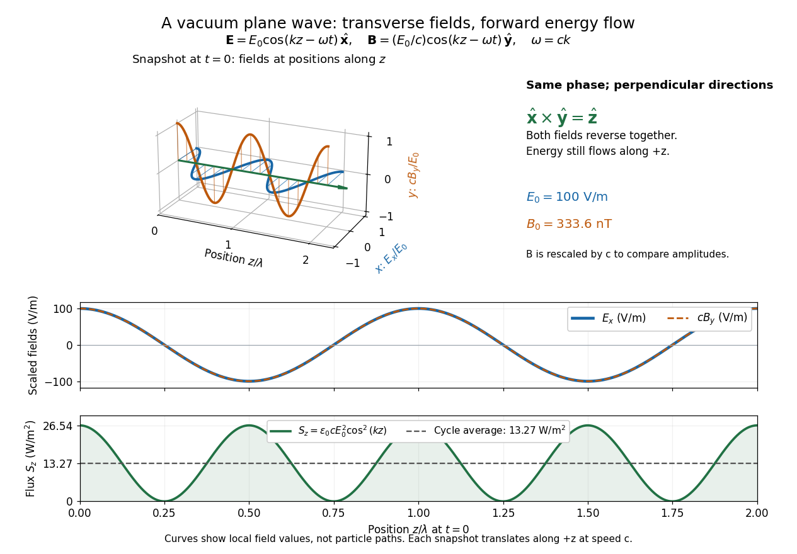
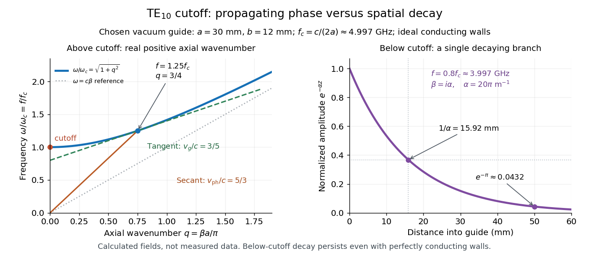
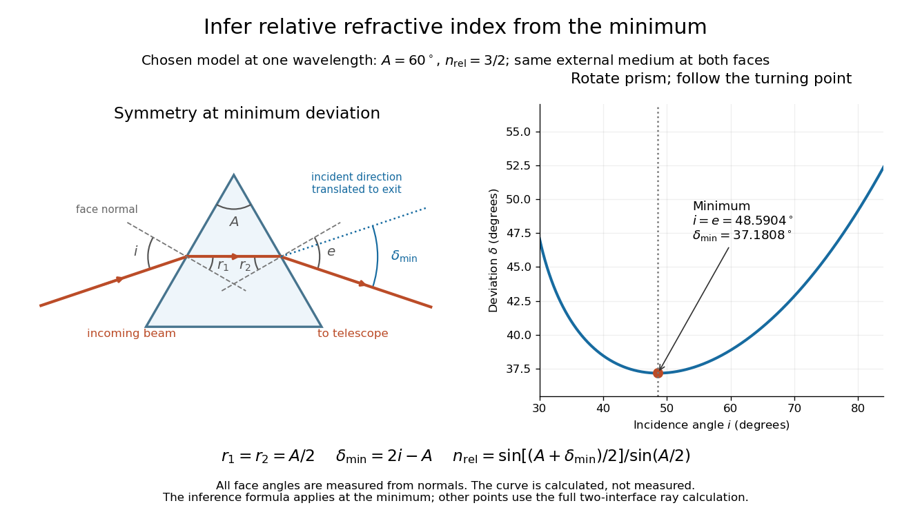
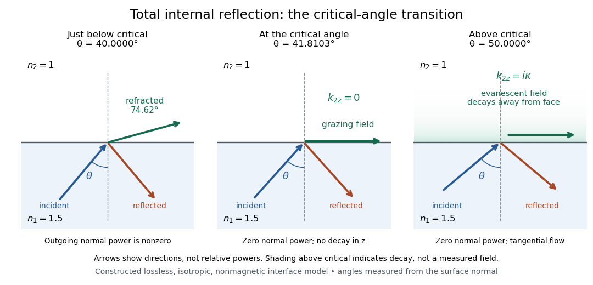
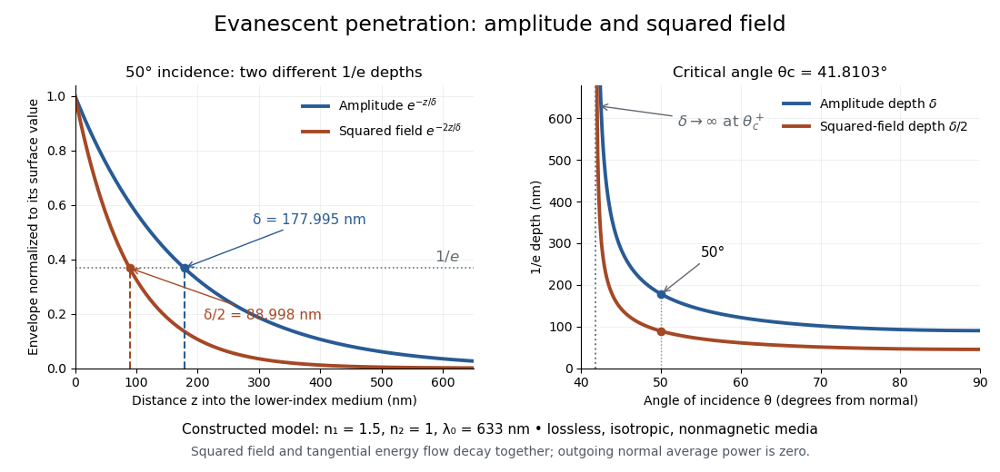
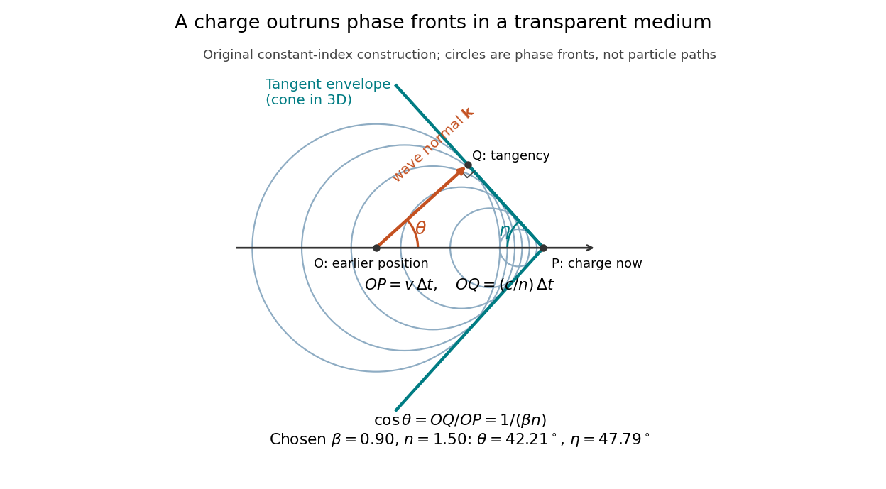
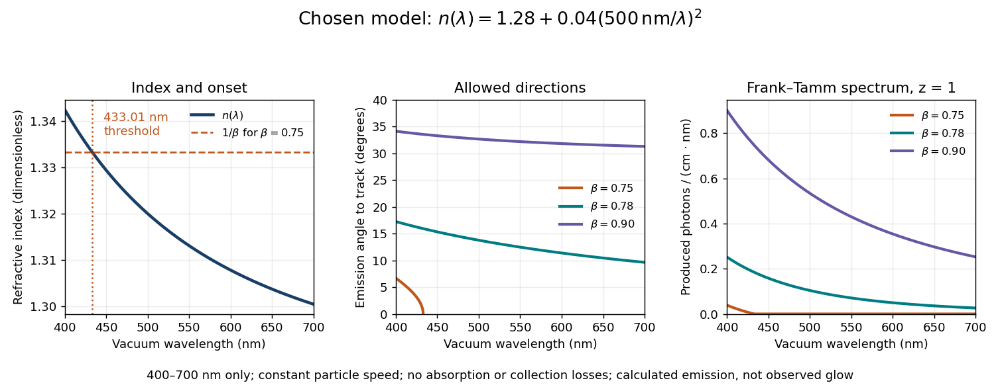

# Electromagnetic wave

↑ **Parent:** [Electromagnetism](electromagnetism.md)  
ⓦ [Wiki](https://en.wikipedia.org/wiki/Electromagnetic_wave)

An [electromagnetic wave](electromagnetic-wave.md) is a propagating disturbance of the [electric field](electric-field.md) and [magnetic field](magnetic-field.md) obeying the [Maxwell equations](maxwell-equations.md). In source-free vacuum its speed is

$$
c=\frac1{\sqrt{\mu_0\epsilon_0}}\simeq2.998\times10^8\,\mathrm{m/s},
$$

the [speed of light](special-relativity.md#speed-of-light). An [electromagnetic wave](electromagnetic-wave.md) can travel through vacuum: a conducting medium is unnecessary. A single traveling [plane electromagnetic wave](#plane-electromagnetic-wave) has mutually perpendicular [electric field](electric-field.md), [magnetic field](magnetic-field.md), and propagation direction. This statement applies to that wave; arbitrary [near and far field](#near-and-far-field) configurations need not share these directions or the relation $|\mathbf B|=|\mathbf E|/c$.

The visualization compares perpendicular components on a common scale: $c\mathbf B$ has the same units as $\mathbf E$. The curves are field values along space, rather than paths traced by particles. Their common phase moves toward $+z$, while the [Poynting vector](#poynting-vector) records the associated [energy flux](mathematical-physics.md#energy-flux).

**[Figure 1](#image-vacuum-plane-wave-with-electric-field-along-x-magnetic-field-along-y-and-energy-flux-along-positive-z). Vacuum plane wave with electric field along x, magnetic field along y, and energy flux along positive z**.

The [electromagnetic wave equation](#electromagnetic-wave-equation) gives a propagation law, while the full [Maxwell equations](maxwell-equations.md) additionally enforce the field directions and relative amplitudes. This is why solving an independent scalar [wave equation](wave-equation.md) for each component is insufficient to construct an [electromagnetic wave](electromagnetic-wave.md). [Feynman lectures, II.20: solutions in free space](https://www.feynmanlectures.caltech.edu/II_20.html).

**Table of contents**

- [Root mean square magnetic field from beam power](#root-mean-square-magnetic-field-from-beam-power)
- [Rectangular electromagnetic cavity](#rectangular-electromagnetic-cavity)
- [Wave impedance](#wave-impedance)
  - [Power transmission coefficient](#power-transmission-coefficient)
- [Electromagnetic waveguide](#electromagnetic-waveguide)
  - [Transverse electric mode](#transverse-electric-mode)
  - [Planar dielectric waveguide](#planar-dielectric-waveguide)
    - [Fundamental even mode of a symmetric dielectric slab](#fundamental-even-mode-of-a-symmetric-dielectric-slab)
      - [Vanishing index contrast in a dielectric slab](#vanishing-index-contrast-in-a-dielectric-slab)
  - [Scalar-potential conducting waveguide modes](#scalar-potential-conducting-waveguide-modes)
  - [Electromagnetic aperture angular spectrum](#electromagnetic-aperture-angular-spectrum)
- [Rectangular electromagnetic waveguide](#rectangular-electromagnetic-waveguide)
  - [Transverse magnetic mode of a rectangular waveguide](#transverse-magnetic-mode-of-a-rectangular-waveguide)
  - [Waveguide cutoff frequency](#waveguide-cutoff-frequency)
    - [Waveguide phase and group velocities](#waveguide-phase-and-group-velocities)
  - [Transverse electric mode of a rectangular waveguide](#transverse-electric-mode-of-a-rectangular-waveguide)
    - [Evanescent transverse electric mode in a rectangular waveguide](#evanescent-transverse-electric-mode-in-a-rectangular-waveguide)
  - [Guided wavelength](#guided-wavelength)
  - [Slotted-line waveguide measurement](#slotted-line-waveguide-measurement)
- [Transverse magnetic polarization](#transverse-magnetic-polarization)
- [Transverse electric polarization](#transverse-electric-polarization)
  - [TE wave equation in a stratified magnetodielectric](#te-wave-equation-in-a-stratified-magnetodielectric)
- [Refractive index](#refractive-index)
  - [Phase refractive index](#phase-refractive-index)
  - [Complex refractive index](#complex-refractive-index)
    - [Optical extinction coefficient](#optical-extinction-coefficient)
  - [Relative refractive index](#relative-refractive-index)
  - [Refractive index and wavelength](#refractive-index-and-wavelength)
  - [Refractive index and electromagnetic response](#refractive-index-and-electromagnetic-response)
  - [Prism minimum-deviation index measurement](#prism-minimum-deviation-index-measurement)
  - [Inverse-square refractive-index profile](#inverse-square-refractive-index-profile)
- [Electromagnetic wave equation](#electromagnetic-wave-equation)
- [Plane electromagnetic wave](#plane-electromagnetic-wave)
  - [Covariant transversality of a vacuum plane wave](#covariant-transversality-of-a-vacuum-plane-wave)
  - [Polarization of an electromagnetic wave](#polarization-of-an-electromagnetic-wave)
    - [Lorentz invariance of normalized plane-wave polarization](#lorentz-invariance-of-normalized-plane-wave-polarization)
    - [Faraday effect](#faraday-effect)
      - [Verdet constant](#verdet-constant)
      - [Faraday rotation from circular phases](#faraday-rotation-from-circular-phases)
      - [Faraday rotation on a round trip](#faraday-rotation-on-a-round-trip)
      - [Magnetic reversal measurement of Faraday rotation](#magnetic-reversal-measurement-of-faraday-rotation)
      - [Faraday rotation in a glass-rod experiment](#faraday-rotation-in-a-glass-rod-experiment)
      - [Rotation measure](#rotation-measure)
        - [Long-path projection of a magnetic correlation](#long-path-projection-of-a-magnetic-correlation)
          - [Hankel inversion of a rotation-measure correlation](#hankel-inversion-of-a-rotation-measure-correlation)
    - [Polarizer](#polarizer)
      - [Circular polarizer](#circular-polarizer)
    - [Stokes parameters](#stokes-parameters)
    - [Linear polarization](#linear-polarization)
    - [Circular polarization](#circular-polarization)
  - [Perfect conductor](#perfect-conductor)
    - [Magnetic-history constant in an undamped plasma](#magnetic-history-constant-in-an-undamped-plasma)
    - [Scalar polarization reduction at a conducting corrugation](#scalar-polarization-reduction-at-a-conducting-corrugation)
    - [Normal reflection of an electromagnetic wave from a perfect conductor](#normal-reflection-of-an-electromagnetic-wave-from-a-perfect-conductor)
  - [Interface conditions for electromagnetic fields](#interface-conditions-for-electromagnetic-fields)
    - [Dielectric-interface boundary conditions](#dielectric-interface-boundary-conditions)
      - [Phase matching at a planar wave interface](#phase-matching-at-a-planar-wave-interface)
        - [Snell law for electromagnetic waves](#snell-law-for-electromagnetic-waves)
          - [Total internal reflection](#total-internal-reflection)
            - [Critical angle for total internal reflection](#critical-angle-for-total-internal-reflection)
            - [Evanescent field in total internal reflection](#evanescent-field-in-total-internal-reflection)
              - [Evanescent penetration depth](#evanescent-penetration-depth)
            - [Frustrated total internal reflection](#frustrated-total-internal-reflection)
      - [Fresnel equations](#fresnel-equations)
        - [Reflection-amplitude sign convention](#reflection-amplitude-sign-convention)
        - [Plane of incidence](#plane-of-incidence)
          - [Polarization parallel to the plane of incidence](#polarization-parallel-to-the-plane-of-incidence)
          - [Polarization perpendicular to the plane of incidence](#polarization-perpendicular-to-the-plane-of-incidence)
        - [Power normalization of Fresnel amplitudes](#power-normalization-of-fresnel-amplitudes)
        - [Brewster's angle](#brewster-s-angle)
          - [Brewster solar elevation](#brewster-solar-elevation)
          - [Polarization of environmental dielectric reflections](#polarization-of-environmental-dielectric-reflections)
          - [Brewster reflection from a tangentially moving dielectric](#brewster-reflection-from-a-tangentially-moving-dielectric)
          - [Brewster reflection from an ionospheric interface](#brewster-reflection-from-an-ionospheric-interface)
        - [Transverse-electric Fresnel reflection coefficient](#transverse-electric-fresnel-reflection-coefficient)
          - [Reflected-to-transmitted transverse-electric amplitude ratio](#reflected-to-transmitted-transverse-electric-amplitude-ratio)
  - [Plane wave in an anisotropic dielectric](#plane-wave-in-an-anisotropic-dielectric)
- [Poynting vector](#poynting-vector)
  - [Poynting flux](#poynting-flux)
  - [Static Poynting flow](#static-poynting-flow)
    - [Poynting flow in resistive parallel strips](#poynting-flow-in-resistive-parallel-strips)
  - [Poynting theorem](#poynting-theorem)
    - [Poynting flux and local heating in a skin layer](#poynting-flux-and-local-heating-in-a-skin-layer)
    - [Poynting flux in a centrally discharged parallel-plate capacitor](#poynting-flux-in-a-centrally-discharged-parallel-plate-capacitor)
    - [Closed-surface Poynting flux of a plane wave](#closed-surface-poynting-flux-of-a-plane-wave)
    - [Electromagnetic energy](#electromagnetic-energy)
      - [Magnetic energy](#magnetic-energy)
        - [Magnetic coenergy](#magnetic-coenergy)
        - [Magnetic energy spectrum](#magnetic-energy-spectrum)
    - [Energy density and flux of a plane electromagnetic wave](#energy-density-and-flux-of-a-plane-electromagnetic-wave)
    - [Poynting theorem in a linear anisotropic medium](#poynting-theorem-in-a-linear-anisotropic-medium)
- [Near and far field](#near-and-far-field)
  - [Magnetic-radiation detectability at a marginal far-field distance](#magnetic-radiation-detectability-at-a-marginal-far-field-distance)
  - [Radiation zone](#radiation-zone)
    - [Intensity of an isotropic radiator](#intensity-of-an-isotropic-radiator)
    - [Multipole radiation](#multipole-radiation)
      - [Electric dipole radiation](#electric-dipole-radiation)
        - [Radiative spin-down of a rotating electric dipole](#radiative-spin-down-of-a-rotating-electric-dipole)
        - [Electric-dipole approximation for radiation](#electric-dipole-approximation-for-radiation)
        - [Angular distribution of electric dipole radiation](#angular-distribution-of-electric-dipole-radiation)
          - [Dipole-axis ambiguity from three intensity measurements](#dipole-axis-ambiguity-from-three-intensity-measurements)
          - [Radiation pattern of a circularly moving nonrelativistic charge](#radiation-pattern-of-a-circularly-moving-nonrelativistic-charge)
        - [Radiation damping of a harmonically oscillating charge](#radiation-damping-of-a-harmonically-oscillating-charge)
      - [Magnetic dipole radiation](#magnetic-dipole-radiation)
        - [Frequency doubling of an induction-driven rotating loop](#frequency-doubling-of-an-induction-driven-rotating-loop)
          - [Inductance correction to a rotating-loop radiation estimate](#inductance-correction-to-a-rotating-loop-radiation-estimate)
        - [Magnetic-dipole spin-down](#magnetic-dipole-spin-down)
- [Transverse electromagnetic mode](#transverse-electromagnetic-mode)
  - [Electric and magnetic pressure cancellation in a matched TEM line](#electric-and-magnetic-pressure-cancellation-in-a-matched-tem-line)
- [Cherenkov radiation](#cherenkov-radiation)
  - [Kinetic-energy threshold for Cherenkov radiation](#kinetic-energy-threshold-for-cherenkov-radiation)
  - [Cherenkov mass inference](#cherenkov-mass-inference)
  - [Cherenkov photon-cone and wavefront-cone angles](#cherenkov-photon-cone-and-wavefront-cone-angles)
  - [Cherenkov luminescence controls in irradiated liquids](#cherenkov-luminescence-controls-in-irradiated-liquids)
  - [Cherenkov cone angle](#cherenkov-cone-angle)
  - [Frank-Tamm formula](#frank-tamm-formula)
    - [Finite-band Cherenkov yield model](#finite-band-cherenkov-yield-model)

## Root mean square magnetic field from beam power

↑ **Parent:** [Electromagnetic wave](electromagnetic-wave.md)

For a uniform plane-wave beam of cross section $A$, mean [intensity](wave.md#intensity-physics) is $P/A=cB_{\rm rms}^2/\mu_0$. Hence $B_{\rm rms}=\sqrt{\mu_0P/(cA)}$. A sinusoidal peak [amplitude](wave.md#wave-amplitude) is $\sqrt2$ times the rms [amplitude](wave.md#wave-amplitude). A [Gaussian beam](physical-optics.md#gaussian-beam) requires a stated waist or diameter convention before inferring its on-axis field from total [power](energy.md#power).

## Rectangular electromagnetic cavity

↑ **Parent:** [Electromagnetic wave](electromagnetic-wave.md)

A closed rectangular [perfect conductor](#perfect-conductor) cavity has discrete [normal modes](wave-equation.md#normal-mode) selected by zero tangential [electric field](electric-field.md) at the walls. Each [frequency](wave.md#frequency) has the displayed form. With all three indices positive there are two independent [polarizations of an electromagnetic wave](#polarization-of-an-electromagnetic-wave); modes with exactly one zero index have one, and those with two zero indices are absent. For example the $n=0$ family can have $E_z\propto\sin(\pi lx/L_x)\sin(\pi my/L_y)$, independent of $z$. It satisfies the wall conditions because $E_z$ is normal to the $z$ faces and tangential to the side walls. Omitting such zero-index families is harmless for leading bulk [density of states](quantum-ideal-gas-statistics.md#density-of-states), but changes the low-[temperature](temperature.md) physics of a thin cavity.

## Wave impedance

↑ **Parent:** [Electromagnetic wave](electromagnetic-wave.md)  
ⓦ [Wiki](https://en.wikipedia.org/wiki/Wave_impedance)

For a [plane electromagnetic wave](#plane-electromagnetic-wave) in a homogeneous, linear, lossless, [isotropic](continuum-mechanics.md#isotropy) medium with [permittivity](permittivity.md) $\epsilon$ and [magnetic permeability](maxwell-equations.md#permeability-electromagnetism) $\mu$, the wave impedance relates the field amplitudes by $Z=E/H=\sqrt{\mu/\epsilon}$. Its units are ohms. Impedance differences determine the normal-incidence amplitude [Fresnel equations](#fresnel-equations), $r=(Z_2-Z_1)/(Z_2+Z_1)$ and $t=2Z_2/(Z_2+Z_1)$, with a common tangential electric-field axis.

### Power transmission coefficient

↑ **Parent:** [Wave impedance](#wave-impedance)

The ratio of transmitted to incident normal time-averaged [power](energy.md#power) for a specified wave and interface. Converting a field-amplitude transmission coefficient into power requires the appropriate impedances or flux normalization. For a displacement wave on a string with impedance $Z$, $\mathcal T=(Z_2/Z_1)|t|^2$; using an electric-field amplitude in electromagnetic waves instead gives the corresponding electromagnetic flux ratio. Amplitude squared alone is sufficient only when the relevant incident and transmitted normalizations agree.

## Electromagnetic waveguide

↑ **Parent:** [Electromagnetic wave](electromagnetic-wave.md)

An [electromagnetic waveguide](#electromagnetic-waveguide) confines an [electromagnetic wave](electromagnetic-wave.md) across its axis while allowing it to travel along the axis. Conducting walls or changes of [refractive index](#refractive-index) select transverse [normal modes](wave-equation.md#normal-mode): reproducible cross-sectional field patterns with their own longitudinal [wavenumbers](wave-equation.md#wavenumber). A hollow metal pipe and an [optical fiber](optical-instrument.md#optical-fiber) are different realizations of this principle. Their usefulness is to deliver [electromagnetic energy](#electromagnetic-energy) along a chosen route instead of letting it spread freely.

For a uniform [vacuum](physics.md#vacuum)-filled conducting guide, write a [normal mode](wave-equation.md#normal-mode)'s axial and time dependence as $e^{i(\beta z-\omega t)}$. Here $\omega>0$ is [angular frequency](lagrangian-mechanics.md#angular-frequency), $\beta$ is the longitudinal [wavenumber](wave-equation.md#wavenumber), and $k_\perp^2$ is the transverse [eigenvalue](linear-operator-theory.md#eigenvalue) selected by the wall [boundary conditions](differential-equation.md#boundary-condition). The [electromagnetic wave equation](#electromagnetic-wave-equation) separates into

$$
\beta^2=\frac{\omega^2}{c^2}-k_\perp^2.
$$

The geometry consumes part of the available squared [wavenumber](wave-equation.md#wavenumber): when $\omega/c<k_\perp$, this branch is an [evanescent wave](elasticity-physics.md#evanescent-wave) rather than a propagating [normal mode](wave-equation.md#normal-mode). The [waveguide cutoff frequency](#waveguide-cutoff-frequency) is therefore a property of a specified branch and geometry. A [transverse electromagnetic mode](#transverse-electromagnetic-mode) in a suitable two-conductor geometry can have $k_\perp=0$ and no positive geometric cutoff. An [optical fiber](optical-instrument.md#optical-fiber) needs its own [dielectric](permittivity.md#dielectric) [boundary conditions](differential-equation.md#boundary-condition), rather than the metal-wall formulas below.

The [rectangular electromagnetic waveguide](#rectangular-electromagnetic-waveguide) makes these ideas explicit with a single [sine](geometry-and-topology.md#sine) profile. The [scalar-potential conducting waveguide modes](#scalar-potential-conducting-waveguide-modes) give a broader construction. At an open [aperture](optics.md#aperture), a confined field can radiate into the [electromagnetic aperture angular spectrum](#electromagnetic-aperture-angular-spectrum); it need not remain one guided [normal mode](wave-equation.md#normal-mode).

### Transverse electric mode

↑ **Parent:** [Electromagnetic waveguide](#electromagnetic-waveguide)

A guided [electromagnetic wave](electromagnetic-wave.md) whose [electric field](electric-field.md) has no component along the propagation axis. Its [magnetic field](magnetic-field.md) can have a longitudinal component. In an empty perfectly conducting rectangular [electromagnetic waveguide](#electromagnetic-waveguide), transverse wave numbers determine a nonzero [cutoff frequency](electrical-engineering.md#cutoff-frequency). This differs from a [transverse electromagnetic mode](#transverse-electromagnetic-mode), in which both fields are transverse.

### Planar dielectric waveguide

↑ **Parent:** [Electromagnetic waveguide](#electromagnetic-waveguide)

A [dielectric](permittivity.md#dielectric) slab surrounded by lower-index material confines waves with an oscillatory core profile and evanescent exterior tails. In an isotropic, nonmagnetic symmetric slab, an even transverse-electric field has core profile $\cos Kz$ and matches to exponential tails through $K\tan(Kd)=K'$. The transverse constants also satisfy $K^2+K'^2=(\epsilon_r-1)\omega^2/c^2$ for vacuum exterior.

#### Fundamental even mode of a symmetric dielectric slab

↑ **Parent:** [Planar dielectric waveguide](#planar-dielectric-waveguide)

Set $u=Kd$, $w=K'd$, and $\mathcal V=(\omega d/c)\sqrt{\epsilon_r-1}$. The [circle](topology.md#circle) in the first quadrant falls from $w=\mathcal V$, while $u\tan u$ rises from zero to its first pole. A unique first-branch intersection exists for every $\mathcal V>0$. It yields a nodeless even bound field. At exactly zero index contrast there is no confined mode; as contrast tends to zero from above its tail extends without bound.

##### Vanishing index contrast in a dielectric slab

↑ **Parent:** [Fundamental even mode of a symmetric dielectric slab](#fundamental-even-mode-of-a-symmetric-dielectric-slab)

### Scalar-potential conducting waveguide modes

↑ **Parent:** [Electromagnetic waveguide](#electromagnetic-waveguide)

For dependence $e^{i(kz-\omega t)}$, a [Helmholtz equation](partial-differential-equation.md#helmholtz-equation) $(\Delta_\perp+\gamma^2)\psi=0$ generates transverse-magnetic fields $e_\perp=\nabla_\perp\psi$, $e_z=-i\gamma^2\psi/k$, $b_\perp=\omega\,\widehat z\times\nabla_\perp\psi/(kc^2)$, $b_z=0$, for $k\ne0$. The conducting wall requires a [Dirichlet boundary condition](differential-equation.md#dirichlet-boundary-condition) on $\psi$. A transverse-electric representation is $e_\perp=\widehat z\times\nabla_\perp\psi$, $e_z=0$, $b_\perp=-k\nabla_\perp\psi/\omega$, $b_z=i\gamma^2\psi/\omega$, with a [Neumann boundary condition](differential-equation.md#neumann-boundary-condition). These are families of modes, not a completeness assertion for multiply connected guides and their possible TEM fields.

### Electromagnetic aperture angular spectrum

↑ **Parent:** [Electromagnetic waveguide](#electromagnetic-waveguide)

For an aperture normal to $\mathbf e_x$, let $F_y,F_z$ be its tangential [electric field](electric-field.md) traces extended by zero outside the aperture. With the outgoing branch of $\kappa$, the [Weyl plane-wave representation](partial-differential-equation.md#weyl-plane-wave-representation) and the curl aperture integral give a spectrum proportional to $(-(\nu\widehat F_y+\eta\widehat F_z)/\kappa,\widehat F_y,\widehat F_z)$. Each wave is transverse to $\mathbf q$. The longitudinal electric component is regenerated by oblique diffraction even when it vanishes at the input. For $G=e^{ikr}/(4\pi r)$ and a unit prefactor on the stated curl integral, the spectrum has an overall factor $1/2$; a doubled half-space Green kernel gives factor one. The normalization must follow the chosen Green kernel and equivalent-current convention.

## Rectangular electromagnetic waveguide

↑ **Parent:** [Electromagnetic wave](electromagnetic-wave.md)

Take a straight hollow [rectangular electromagnetic waveguide](#rectangular-electromagnetic-waveguide) with [vacuum](physics.md#vacuum) interior $0<x<a$, $0<y<b$ and axis $z$, where $a>b>0$. Its four walls are ideal [perfect conductors](#perfect-conductor). The time-dependent [Maxwell equations](maxwell-equations.md) require zero tangential [electric field](electric-field.md) and zero normal oscillating [magnetic field](magnetic-field.md) at these walls. Real metal has finite [electrical conductivity](electric-charge.md#electrical-conductivity), so real guides lose [electromagnetic energy](#electromagnetic-energy) by [Joule heating](electric-charge.md#joule-heating); the perfect-wall model isolates confinement and [wave dispersion](dispersion-relation.md#wave-dispersion) from that loss.

The simplest propagating [transverse electric mode of a rectangular waveguide](#transverse-electric-mode-of-a-rectangular-waveguide) is $\mathrm{TE}_{10}$. “Transverse electric” means $E_z=0$, not that the [magnetic field](magnetic-field.md) is also wholly transverse. With real peak scale $E_0$, its [complex amplitudes](wave.md#complex-amplitude), including the common axial factor, can be written

$$
\begin{aligned}
E_y&=E_0\sin(\pi x/a)e^{i\beta z},& E_x&=E_z=0,\\
B_x&=-\frac{\beta}{\omega}E_0\sin(\pi x/a)e^{i\beta z},&B_y&=0,\\
B_z&=-\frac{i\pi}{a\omega}E_0\cos(\pi x/a)e^{i\beta z}.&&
\end{aligned}
$$

The physical fields are the [real parts](complex-analysis.md#real-part) after multiplication by $e^{-i\omega t}$. In particular, $E_y$ is zero at $x=0,a$, maximal at $x=a/2$, and independent of $y$. At $y=0,b$ it is normal to the metal, so it need not vanish there. The $\mathrm{TE}_{10}$ [electric field](electric-field.md) crosses the narrow gap, while its strength varies across the broad dimension.

**[Figure 2](#image-original-vacuum-filled-rectangular-guide-the-te10-electric-field-profile-across-a-30-mm-by-12-mm-cross-section). Original vacuum-filled rectangular guide: the TE10 electric-field profile across a 30 mm by 12 mm cross-section**. The arrows show the [electric field](electric-field.md) at an axial plane and time where its common [wave phase](wave.md#phase-waves) factor is positive; their length follows $\sin(\pi x/a)$. They are field directions, not particle trajectories. The profile is uniform along $y$ and vanishes at the side walls. The guide axis $+z$ points out of the cross-section. All dimensions and the operating [frequency](wave.md#frequency) are chosen model values.

For an original example choose $a=30\,\mathrm{mm}$, $b=12\,\mathrm{mm}$ and $f=1.25f_c$, where $f_c=c/(2a)$. With $c=299792458\,\mathrm{m/s}$, this gives

$$
\begin{aligned}
f_c&=4.99654097\,\mathrm{GHz},& f&=6.24567621\,\mathrm{GHz},\\
\lambda_0&=48\,\mathrm{mm},&\beta&=25\pi\,\mathrm{m}^{-1},&\lambda_g&=80\,\mathrm{mm}.
\end{aligned}
$$

Here $\lambda_0=c/f$ is [vacuum](physics.md#vacuum) [wavelength](wave-equation.md#wavelength) and $\lambda_g=2\pi/\beta$ is [guided wavelength](#guided-wavelength). The next cutoff is $\mathrm{TE}_{20}$ at $2f_c$; $\mathrm{TE}_{01}$ starts at $(a/b)f_c=2.5f_c$. Thus only $\mathrm{TE}_{10}$ can propagate at the chosen [frequency](wave.md#frequency), although a source or discontinuity can additionally excite local [evanescent waves](elasticity-physics.md#evanescent-wave). These are calculated values, not specifications or measurements of a commercial guide.

### Transverse magnetic mode of a rectangular waveguide

↑ **Parent:** [Rectangular electromagnetic waveguide](#rectangular-electromagnetic-waveguide)

In a hollow [rectangular electromagnetic waveguide](#rectangular-electromagnetic-waveguide) with [perfect conductor](#perfect-conductor) walls and axis $z$, a [transverse magnetic polarization](#transverse-magnetic-polarization) has $B_z=0$ and a nonzero longitudinal [electric field](electric-field.md) $E_z$. The wall [boundary conditions](differential-equation.md#boundary-condition) impose $E_z=0$ around the transverse rectangle. [Separation of variables](partial-differential-equation.md#separation-of-variables) therefore gives $E_z=E_0\sin(n\pi x/a)\sin(m\pi y/b)e^{i(k_z z-\omega t)}$, with $n,m\geq1$. Setting either index to zero makes the entire field vanish. Thus there is no $\mathrm{TM}_{n0}$ or $\mathrm{TM}_{0m}$ branch. The transverse [eigenvalue](linear-operator-theory.md#eigenvalue) is $k_\perp^2=(n\pi/a)^2+(m\pi/b)^2$, with [dispersion relation](dispersion-relation.md) $\omega^2/c^2=k_z^2+k_\perp^2$. This exclusion is specific to this geometry and these [boundary conditions](differential-equation.md#boundary-condition).

### Waveguide cutoff frequency

↑ **Parent:** [Rectangular electromagnetic waveguide](#rectangular-electromagnetic-waveguide)

The [waveguide cutoff frequency](#waveguide-cutoff-frequency) separates oscillatory axial propagation from [exponential decay](analysis.md#exponential-decay) for a particular [normal mode](wave-equation.md#normal-mode). For the [vacuum](physics.md#vacuum)-filled [rectangular electromagnetic waveguide](#rectangular-electromagnetic-waveguide), the [dispersion relation](dispersion-relation.md) is

$$
\kappa_{mn}^2=\left(\frac{m\pi}{a}\right)^2+\left(\frac{n\pi}{b}\right)^2,\qquad
\omega_{mn}=c\kappa_{mn},\qquad
\beta^2=\frac{\omega^2-\omega_{mn}^2}{c^2}.
$$

For a [transverse electric mode of a rectangular waveguide](#transverse-electric-mode-of-a-rectangular-waveguide), $m,n$ are nonnegative [integers](integer.md) but not both zero. For a mode with $B_z=0$ and nonzero $E_z$, both indices must be positive. The lowest cutoff for $a>b$ is consequently $\omega_{10}=\pi c/a$, or ordinary [frequency](wave.md#frequency) $f_c=c/(2a)$.

A square cross-section instead gives equal $\mathrm{TE}_{10}$ and $\mathrm{TE}_{01}$ cutoffs. The absence of a [transverse electromagnetic mode](#transverse-electromagnetic-mode) is specific to this hollow pipe, rather than all [electromagnetic waveguides](#electromagnetic-waveguide).[Haus and Melcher, Electromagnetic Fields and Energy, §13.4, equations (26)–(27) and Fig. 13.4.3: allowed indices, dominant mode and square-guide degeneracy](physics-bibliography.md#electromagnetic-fields-and-energy-by-hermann-a-haus-and-james-r-melcher/rectangular-waveguide-modes)

For $\omega>\omega_{mn}$, choose real $\beta>0$ for propagation toward $+z$. For $0<\omega<\omega_{mn}$, a field decaying into a semi-infinite guide has

$$
\beta=i\alpha,\qquad \alpha=\frac{\sqrt{\omega_{mn}^2-\omega^2}}{c}>0,\qquad e^{i\beta z}=e^{-\alpha z}.
$$

A finite section can contain both growing and decaying axial solutions set by its two ends; the single decaying solution is not a complete finite-section transmission calculation. At exact cutoff $\beta=0$, the two axial solutions become a constant and a linear function of $z$: there is no finite axial [wavelength](wave-equation.md#wavelength) for a traveling sinusoid.

In the chosen $a=30\,\mathrm{mm}$ guide at $f=0.8f_c=3.99723277\,\mathrm{GHz}$, the $\mathrm{TE}_{10}$ branch has $\alpha=20\pi\,\mathrm{m}^{-1}$. Its amplitude decay length is $1/\alpha\simeq15.9155\,\mathrm{mm}$; after $50\,\mathrm{mm}$, its normalized [wave amplitude](wave.md#wave-amplitude) is $e^{-\pi}\simeq0.0432139$. This is geometric evanescence even with ideal walls, not [Joule heating](electric-charge.md#joule-heating). A single decaying branch has zero cycle-averaged axial [Poynting vector](#poynting-vector): substituting $\beta=i\alpha$ makes $B_x$ a quarter-cycle out of phase with $E_y$. Coupling across a finite section requires the complete boundary-value solution.

**[Figure 3](#image-original-te10-model-propagating-dispersion-above-cutoff-and-spatial-amplitude-decay-below-cutoff). Original TE10 model: propagating dispersion above cutoff and spatial amplitude decay below cutoff**. The left panel uses $\omega_c=\pi c/a$ and $q=\beta a/\pi$ to plot $\omega/\omega_c=\sqrt{1+q^2}$. The secant slope is [phase velocity](dispersion-relation.md#phase-velocity) divided by $c$; the tangent slope is [group velocity](dispersion-relation.md#group-velocity) divided by $c$. The right panel is the single decaying branch at $f=0.8f_c$, not an experimental transmission curve or a curve for dissipated [power](energy.md#power).

#### Waveguide phase and group velocities

↑ **Parent:** [Waveguide cutoff frequency](#waveguide-cutoff-frequency)

For a propagating branch of an ideal [vacuum](physics.md#vacuum)-filled [rectangular electromagnetic waveguide](#rectangular-electromagnetic-waveguide), the [phase velocity](dispersion-relation.md#phase-velocity) tracks constant [wave phase](wave.md#phase-waves) along the axis, whereas the [group velocity](dispersion-relation.md#group-velocity) describes a sufficiently narrow, weakly distorted [wave packet](dispersion-relation.md#wave-packet). Using $\omega^2=c^2\beta^2+\omega_c^2$ gives

$$
v_{\rm ph}=\frac{\omega}{\beta}=\frac{c}{\sqrt{1-(\omega_c/\omega)^2}},\qquad
v_g=\frac{d\omega}{d\beta}=\frac{c^2\beta}{\omega}=c\sqrt{1-(\omega_c/\omega)^2}.
$$

Thus $v_{\rm ph}>c$, $0<v_g<c$, and $v_{\rm ph}v_g=c^2$. Differentiating the [dispersion relation](dispersion-relation.md) proves the second formula; dividing it by $\beta^2$ proves the first. This is the same mathematical structure as [Klein-Gordon packet velocities](dispersion-relation.md#klein-gordon-packet-velocities). In the stipulated $f=1.25f_c$ example,

$$
v_{\rm ph}=\frac53c,\qquad v_g=\frac35c.
$$

Over $0.30\,\mathrm m$, the corresponding narrow-envelope delay is $(0.50\,\mathrm m)/c$, approximately $1.668\,\mathrm{ns}$. Timing a carrier [wave crest](dispersion-relation.md#wave-crest) would give $0.6004\,\mathrm{ns}$; it does not time the arrival of a newly introduced message.

There is an independent [energy](energy.md) check. For the forward $\mathrm{TE}_{10}$ fields, the average axial [Poynting vector](#poynting-vector) is $\langle S_z\rangle=\beta|E_y|^2/(2\mu_0\omega)$. Integrating across the guide gives average [power](energy.md#power) $P$ and average [electromagnetic energy](#electromagnetic-energy) per unit length $U'$:

$$
P=\frac{ab\beta E_0^2}{4\mu_0\omega},\qquad U'=\frac{\epsilon_0abE_0^2}{4},\qquad \frac{P}{U'}=\frac{c^2\beta}{\omega}=v_g.
$$

The transverse [sine](geometry-and-topology.md#sine) and [cosine](geometry-and-topology.md#cosine) squared each integrate to $a/2$; $\beta^2+(\pi/a)^2=\omega^2/c^2$ then makes the integrated electric and magnetic contributions to $U'$ equal. The axial [energy](energy.md) transport therefore agrees with the [group velocity](dispersion-relation.md#group-velocity) in this ideal model.

As $\omega\downarrow\omega_c$, $v_g\to0$ and $v_{\rm ph}\to\infty$; exactly at cutoff $\omega/\beta$ is undefined. Strong [wave dispersion](dispersion-relation.md#wave-dispersion) close to cutoff also limits the narrow-packet approximation. Neither a large [phase velocity](dispersion-relation.md#phase-velocity) nor a pulse peak establishes superluminal [information velocity](dispersion-relation.md#information-velocity); [front velocity](dispersion-relation.md#front-velocity) asks a separate causal question. In a uniform filling with constant positive [permittivity](permittivity.md) $\varepsilon$ and [magnetic permeability](maxwell-equations.md#permeability-electromagnetism) $\mu$, replace $c$ by $u=1/\sqrt{\varepsilon\mu}$, giving $v_{\rm ph}v_g=u^2$. Frequency-dependent material response or significant loss requires differentiating the actual [dispersion relation](dispersion-relation.md), so this product is not universal.

### Transverse electric mode of a rectangular waveguide

↑ **Parent:** [Rectangular electromagnetic waveguide](#rectangular-electromagnetic-waveguide)

A [transverse electric mode of a rectangular waveguide](#transverse-electric-mode-of-a-rectangular-waveguide) has $E_z=0$ while its axial [magnetic field](magnetic-field.md) is generally nonzero. For time dependence $e^{-i\omega t}$ and axial dependence $e^{i\beta z}$, set $\Delta=(\omega/c)^2-\beta^2$. The [Maxwell equations](maxwell-equations.md) reconstruct the transverse components from $B_z$:

$$
B_x=\frac{i\beta}{\Delta}\partial_xB_z,\quad
B_y=\frac{i\beta}{\Delta}\partial_yB_z,\quad
E_x=\frac{i\omega}{\Delta}\partial_yB_z,\quad
E_y=-\frac{i\omega}{\Delta}\partial_xB_z.
$$

The axial [complex amplitude](wave.md#complex-amplitude) satisfies a transverse [Helmholtz equation](partial-differential-equation.md#helmholtz-equation), $(\partial_x^2+\partial_y^2+\Delta)B_z=0$. Zero tangential [electric field](electric-field.md) at each [perfect conductor](#perfect-conductor) wall becomes a [Neumann boundary condition](differential-equation.md#neumann-boundary-condition) on $B_z$. [Separation of variables](partial-differential-equation.md#separation-of-variables) gives

$$
B_z=B_*\cos(m\pi x/a)\cos(n\pi y/b)e^{i\beta z},\qquad \Delta=\kappa_{mn}^2.
$$

The index $m$ counts half-periods across $a$, and $n$ across $b$. Either index can vanish, allowing $\mathrm{TE}_{10}$; both cannot vanish. Indeed a spatially constant axial oscillating [magnetic field](magnetic-field.md) would give nonzero changing [magnetic flux](magnetic-field.md#magnetic-flux) through the cross-section, whereas the [line integral](multivariable-calculus.md#line-integral) of tangential [electric field](electric-field.md) around its metal boundary is zero. The integral form of [Faraday's law](maxwell-equations.md#faraday-s-law-of-induction) excludes this $\mathrm{TE}_{00}$ candidate. Dividing the reconstruction formulas by $\Delta=0$ would be invalid and cannot produce the separate [transverse electromagnetic mode](#transverse-electromagnetic-mode).

For $m=1,n=0$, choose $B_*=-i(\pi/a)E_0/\omega$. The formulas recover exactly the $E_y$, $B_x$ and $B_z$ in [rectangular electromagnetic waveguide](#rectangular-electromagnetic-waveguide). In particular, the transverse [magnetic field](magnetic-field.md) accompanies $B_z$ and ensures zero [divergence](multivariable-calculus.md#divergence); an oscillating longitudinal [magnetic field](magnetic-field.md) on its own is not the guided solution.

#### Evanescent transverse electric mode in a rectangular waveguide

↑ **Parent:** [Transverse electric mode of a rectangular waveguide](#transverse-electric-mode-of-a-rectangular-waveguide)

Below the lowest [waveguide cutoff frequency](#waveguide-cutoff-frequency), the axial wave number of the $\mathrm{TE}_{10}$ mode is $i\kappa$, with $\kappa>0$. For a real peak scale $E_0$ and time convention $e^{-i\omega t}$, $E_y=E_0\sin(\pi x/a)e^{-\kappa z}$, $B_x=-i\kappa E_y/\omega$ and $B_z=-iE_0(\pi/a)\cos(\pi x/a)e^{-\kappa z}/\omega$. The [electric field](electric-field.md) and [magnetic field](magnetic-field.md) are in quadrature. A single decaying mode in a lossless semi-infinite guide consequently has zero time-averaged [Poynting vector](#poynting-vector), although its instantaneous field stores [energy](energy.md).

### Guided wavelength

↑ **Parent:** [Rectangular electromagnetic waveguide](#rectangular-electromagnetic-waveguide)

The [guided wavelength](#guided-wavelength) is the distance for a $2\pi$ change of axial [wave phase](wave.md#phase-waves) in a propagating [normal mode](wave-equation.md#normal-mode). For the [vacuum](physics.md#vacuum)-filled [rectangular electromagnetic waveguide](#rectangular-electromagnetic-waveguide),

$$
\lambda_g=\frac{\lambda_0}{\sqrt{1-(f_c/f)^2}},\qquad
\frac1{\lambda_g^2}=\frac1{\lambda_0^2}-\frac1{(2a)^2}
$$

for $\mathrm{TE}_{10}$, with $\lambda_0=c/f$ and $f>f_c$. It exceeds the [vacuum](physics.md#vacuum) [wavelength](wave-equation.md#wavelength) at the same [frequency](wave.md#frequency). This longer axial spacing is consistent with $v_{\rm ph}>c$: multiplying $\lambda_g$ by $f$ gives the [phase velocity](dispersion-relation.md#phase-velocity), not the [group velocity](dispersion-relation.md#group-velocity).

Two oppositely traveling fields at the same [frequency](wave.md#frequency) form a [standing wave](mathematical-physics.md#standing-wave). For a perfect electric short at $z=0$, the total [electric field](electric-field.md) is proportional to $\sin(\beta z)\sin(\pi x/a)$, so successive axial electric nodes are separated by

$$
d=\frac\pi\beta=\frac{\lambda_g}{2}.
$$

Thus neighboring minima in a [slotted line](electrical-engineering.md#slotted-line) scan give half a [guided wavelength](#guided-wavelength). In the original $a=30\,\mathrm{mm}$, $f=1.25f_c$ example, $d=40\,\mathrm{mm}$ implies $\lambda_g=80\,\mathrm{mm}$, not $40\,\mathrm{mm}$. Combined with the chosen $f$, the inferred broad dimension is $a=\lambda_0/[2\sqrt{1-(\lambda_0/\lambda_g)^2}]=30\,\mathrm{mm}$. Below cutoff, $\beta$ is imaginary and $2\pi/\beta$ is not a physical periodic spacing.

### Slotted-line waveguide measurement

↑ **Parent:** [Rectangular electromagnetic waveguide](#rectangular-electromagnetic-waveguide)

MIT's documented [slotted-line waveguide measurement](#slotted-line-waveguide-measurement) shorts one end of a [rectangular electromagnetic waveguide](#rectangular-electromagnetic-waveguide) and excites it through a probe coupled by [capacitance](electromagnetism.md#capacitance). A second such probe moves through a longitudinal slot, aligned with the wall [electric current](electric-charge.md#electric-current) to reduce disturbance. Its output locates axial [standing wave](mathematical-physics.md#standing-wave) nulls. The book's standing-wave setup chooses a [frequency](wave.md#frequency) above the first [waveguide cutoff frequency](#waveguide-cutoff-frequency) and below higher-mode cutoffs. Lowering it below the first cutoff instead reveals spatial decay away from the source. The text supplies apparatus and an observable comparison, rather than a table of measured null positions.[Haus and Melcher, Electromagnetic Fields and Energy, §13.4, Example 13.4.1, Demonstration 13.4.1 and Fig. 13.4.5; chapter PDF printed pp. 31–33](physics-bibliography.md#electromagnetic-fields-and-energy-by-hermann-a-haus-and-james-r-melcher/rectangular-waveguide-modes)

The inference can be checked without assuming that detector output is proportional to [electric field](electric-field.md) amplitude. At fixed measured [frequency](wave.md#frequency), record several minima at coordinates $z_0,\ldots,z_N$; then estimate $\lambda_g=2(z_N-z_0)/N$ when the minima are consecutive. This uses positions alone. Compare the result with the [guided wavelength](#guided-wavelength) prediction using independently measured $a$ and $f$. The $40\,\mathrm{mm}$ spacing above is a synthetic example, not a reading from the MIT apparatus.

Additional proposed controls are to keep probe insertion fixed, repeat the scan in both directions, recheck source [frequency](wave.md#frequency), and compare shallow probe settings for shifts in the minima. These test probe loading, mechanical backlash and drift. A deliberately reflecting termination supplies the [standing wave](mathematical-physics.md#standing-wave); varying its position should translate the pattern without changing adjacent-null spacing in a uniform single-mode region. Source-adjacent [evanescent waves](elasticity-physics.md#evanescent-wave), unintended reflections, additional propagating [normal modes](wave-equation.md#normal-mode), detector noise and finite positional resolution can spoil that inference. A disappearing remote signal alone does not distinguish below-cutoff decay from loss or poor excitation, and a scan at one [frequency](wave.md#frequency) does not measure a pulse's [group velocity](dispersion-relation.md#group-velocity).

## Transverse magnetic polarization

↑ **Parent:** [Electromagnetic wave](electromagnetic-wave.md)

Relative to a propagation plane, transverse magnetic polarization has its magnetic field perpendicular to that plane. At a perfectly conducting corrugation its scalar magnetic component obeys a Neumann condition. It reduces to a scalar two-dimensional problem, but not to the Dirichlet problem for the transverse electric component.

## Transverse electric polarization

↑ **Parent:** [Electromagnetic wave](electromagnetic-wave.md)

Relative to a propagation plane, transverse electric polarization has its electric field perpendicular to that plane. For a conducting corrugation independent of the perpendicular coordinate, the scalar electric component obeys the Helmholtz equation with Dirichlet data at the metal surface.

### TE wave equation in a stratified magnetodielectric

↑ **Parent:** [Transverse electric polarization](#transverse-electric-polarization)

With permittivity and permeability depending only on $z$ and time dependence $e^{i\omega t}$, a [transverse electric polarization](#transverse-electric-polarization) $\mathbf E=\widehat{\mathbf y}E_y(x,z)$ obeys the displayed equation. [Maxwell's equations](maxwell-equations.md) give $H_x=E_{y,z}/(i\omega\mu)$ and $H_z=-E_{y,x}/(i\omega\mu)$. The latter satisfies $H_{z,xx}+H_{z,zz}+(\mu'/\mu)H_{z,z}+[\omega^2\mu\varepsilon+(\log\mu)'']H_z=0$. At normal incidence $H_z=0$; the nonzero magnetic component is $H_x$.

## Refractive index

↑ **Parent:** [Electromagnetic wave](electromagnetic-wave.md)  
ⓦ [Wiki](https://en.wikipedia.org/wiki/Refractive_index)

The [refractive index](#refractive-index) compares the [phase velocity](dispersion-relation.md#phase-velocity) of [light](optics.md#light) in a medium with the [vacuum](physics.md#vacuum) [speed of light](special-relativity.md#speed-of-light) $c$. For a transparent, uniform medium with [isotropy](continuum-mechanics.md#isotropy) and a positive-index propagation branch,

$$
n(\omega)=\frac{c}{v_{\rm ph}(\omega)}=\frac{ck(\omega)}{\omega}.
$$

Here $\omega>0$ is the [angular frequency](lagrangian-mechanics.md#angular-frequency), $k>0$ is the [wavenumber](wave-equation.md#wavenumber), and $v_{\rm ph}=\omega/k$ is the speed of a surface of constant [wave phase](wave.md#phase-waves). The [refractive index](#refractive-index) is a [dimensionless quantity](physics.md#dimensionless-quantity); it is a property of a specified material response at a specified [frequency](wave.md#frequency), rather than a universal number attached to the word “glass”. More general absorbing or negative-index media require the conventions discussed in [refractive index and electromagnetic response](#refractive-index-and-electromagnetic-response). [RP Photonics Encyclopedia, Rüdiger Paschotta, Refractive Index: What is a Refractive Index?](physics-bibliography.md#rp-photonics-encyclopedia-by-rudiger-paschotta/refractive-index)

For an original model example, choose $n=3/2$ at [vacuum](physics.md#vacuum) [wavelength](wave-equation.md#wavelength) $\lambda_0=600\,\mathrm{nm}$. The [phase velocity](dispersion-relation.md#phase-velocity) is $v_{\rm ph}=2c/3\simeq1.999\times10^8\,\mathrm{m/s}$, the [frequency](wave.md#frequency) is $f=c/\lambda_0\simeq4.997\times10^{14}\,\mathrm{Hz}$, and the medium [wavelength](wave-equation.md#wavelength) is $400\,\mathrm{nm}$. These are stipulated model values, not measured properties of glass or water. A value at this single [frequency](wave.md#frequency) does not determine a pulse's [group velocity](dispersion-relation.md#group-velocity).

The usefulness of [refractive index](#refractive-index) is that one measured response connects several different observations: [Snell's law](partial-differential-equation.md#snell-s-law) predicts [refraction](optics.md#refraction), [optical path length](physical-optics.md#optical-path-length) predicts accumulated [wave phase](wave.md#phase-waves), and changes with [frequency](wave.md#frequency) describe [optical dispersion](geometrical-optics.md#dispersion-optics). Even at [normal incidence](optics.md#normal-incidence), where a [light ray](geometrical-optics.md#light-ray) does not bend, a changed [refractive index](#refractive-index) changes [wavelength](wave-equation.md#wavelength) and [wave phase](wave.md#phase-waves). The following comparison isolates that effect; the oblique geometry is developed in [wavefront](physical-optics.md#wavefront).

**[Figure 4](#image-chosen-refractive-index-n-3-2-shorter-wavelength-slower-wavefronts-unchanged-interface-frequency). Chosen refractive index $n=3/2$: shorter wavelength, slower wavefronts, unchanged interface frequency**. The top panel compares equal normalized [electric field](electric-field.md) components at one time on either side of a stationary interface at [normal incidence](optics.md#normal-incidence). The lower panel tracks constant-[wave phase](wave.md#phase-waves) crests in space and time. Curves represent incident and transmitted components, with their amplitudes normalized separately; reflected [light](optics.md#light) and interface amplitude matching are omitted. The chosen single-[frequency](wave.md#frequency) model contains no measured material data.

### Phase refractive index

↑ **Parent:** [Refractive index](#refractive-index)

The ratio $n=c/v_{\rm ph}$ compares vacuum light speed with the [phase velocity](dispersion-relation.md#phase-velocity) at a specified [frequency](wave.md#frequency). In a dispersive material it differs from the group index; the [Cherenkov radiation](#cherenkov-radiation) cone uses the phase index.

### Complex refractive index

↑ **Parent:** [Refractive index](#refractive-index)

For a plane wave proportional to $e^{i(N\omega z/c-\omega t)}$, the [complex refractive index](#complex-refractive-index) separates phase propagation from attenuation. In a nonmagnetic medium $N^2=\epsilon_r$, so $n^2-\kappa^2=\epsilon_r'$ and $2n\kappa=\epsilon_r''$. The passive branch has $\kappa\geq0$. If $\kappa\ll n$ and $\epsilon_r'>0$, then $n\simeq\sqrt{\epsilon_r'}$ and $\kappa\simeq\epsilon_r''/(2\sqrt{\epsilon_r'})$. These signs assume the $e^{-i\omega t}$ convention for the [complex permittivity](permittivity.md#complex-permittivity).

#### Optical extinction coefficient

↑ **Parent:** [Complex refractive index](#complex-refractive-index)

The imaginary part $\kappa$ of the [complex refractive index](#complex-refractive-index) makes wave amplitude decay as $e^{-\omega\kappa z/c}$. Since intensity is proportional to amplitude squared, its [absorption coefficient](astrophysics.md#absorption-coefficient) is $\alpha_{\rm abs}=2\omega\kappa/c$.

### Relative refractive index

↑ **Parent:** [Refractive index](#refractive-index)

The [relative refractive index](#relative-refractive-index) of medium two with respect to medium one is $n_{21}=n_2/n_1$, using their absolute [refractive indices](#refractive-index) at the same [frequency](wave.md#frequency). For transparent media with [isotropy](continuum-mechanics.md#isotropy) and positive [refractive indices](#refractive-index), [Snell's law](partial-differential-equation.md#snell-s-law) gives $n_{21}=\sin i/\sin r$, with the [angles](geometry-and-topology.md#angle) measured from the interface normal. Thus a [refraction](optics.md#refraction) measurement in air directly determines an index relative to air. Converting it to an absolute [refractive index](#refractive-index) requires the [refractive index](#refractive-index) of that air; replacing it by one is an approximation.

### Refractive index and wavelength

↑ **Parent:** [Refractive index](#refractive-index)

For a linear stationary interface, [phase matching at a planar wave interface](#phase-matching-at-a-planar-wave-interface) preserves [frequency](wave.md#frequency): the incident and transmitted [electric fields](electric-field.md) must oscillate together at each boundary point. Their [phase velocities](dispersion-relation.md#phase-velocity) can differ, so their [wavelengths](wave-equation.md#wavelength) differ. Writing $\omega=2\pi f$, the definitions give

$$
\lambda_0=\frac{c}{f},\qquad \lambda=\frac{v_{\rm ph}}{f}=\frac{\lambda_0}{n},\qquad k=\frac{2\pi}{\lambda}=n\frac{2\pi}{\lambda_0}.
$$

This explains the compressed [wavefront](physical-optics.md#wavefront) spacing in the figure without changing the time between crests at the interface. Moving interfaces or time-dependent material responses need not preserve [frequency](wave.md#frequency). [The Feynman Lectures on Physics, Volume I, §31–1: boundary oscillations, vacuum and medium wavelengths, Fig. 31–2](physics-bibliography.md#the-feynman-lectures-on-physics-volume-i-by-richard-feynman-and-others/chapter-31-the-origin-of-the-refractive-index)

The notation $n(\lambda_0)$ labels [refractive index](#refractive-index) by [vacuum](physics.md#vacuum) [wavelength](wave-equation.md#wavelength); it does not mean the [wavelength](wave-equation.md#wavelength) inside the material. Dependence on $\lambda_0$, equivalently on [frequency](wave.md#frequency), is [optical dispersion](geometrical-optics.md#dispersion-optics). The field driving the material induces oscillating [electric charges](electric-charge.md); their emitted [electromagnetic fields](electromagnetism.md#electromagnetic-field) combine with the applied field to change the resulting [wave phase](wave.md#phase-waves). This collective response motivates [refractive index](#refractive-index), rather than a picture of independently delayed little pieces of [light](optics.md#light). [The Feynman Lectures on Physics, Volume I by Richard Feynman and others; §31–1: superposition of the applied field and fields from driven charges; near-unity-index approximation](physics-bibliography.md#the-feynman-lectures-on-physics-volume-i-by-richard-feynman-and-others/chapter-31-the-origin-of-the-refractive-index)

To distinguish three speeds, track a [wavefront](physical-optics.md#wavefront) for [phase velocity](dispersion-relation.md#phase-velocity), a narrow [wave envelope](dispersion-relation.md#envelope-waves) for [group velocity](dispersion-relation.md#group-velocity), and the earliest newly introduced disturbance for [front velocity](dispersion-relation.md#front-velocity). For a transparent differentiable propagation branch,

$$
v_g=\left(\frac{dk}{d\omega}\right)^{-1}=\frac{c}{n+\omega\,dn/d\omega}=\frac{c}{n_g},\qquad n_g=n-\lambda_0\frac{dn}{d\lambda_0}.
$$

The denominator is the [group refractive index](physical-optics.md#group-refractive-index). It describes envelope transit when loss and reshaping are small. It need not equal $n$, and neither [phase velocity](dispersion-relation.md#phase-velocity) nor a reshaped pulse peak generally measures signal arrival. The [front velocity](dispersion-relation.md#front-velocity) article explains the separate [relativistic causality](special-relativity.md#relativistic-causality) constraint and why a detector threshold is not an exact causal-front measurement.

### Refractive index and electromagnetic response

↑ **Parent:** [Refractive index](#refractive-index)

For a uniform linear medium with [isotropy](continuum-mechanics.md#isotropy) and local constitutive response, [Maxwell equations](maxwell-equations.md) give $k^2=\omega^2\varepsilon(\omega)\mu(\omega)$. Here $\varepsilon$ is [permittivity](permittivity.md) and $\mu$ is [magnetic permeability](maxwell-equations.md#permeability-electromagnetism). Since $c^{-2}=\varepsilon_0\mu_0$, the [relative permittivity](quantum-mechanics.md#relative-permittivity) $\varepsilon_r=\varepsilon/\varepsilon_0$ and the relative [magnetic permeability](maxwell-equations.md#permeability-electromagnetism) $\mu_r=\mu/\mu_0$ obey

$$
n^2=\varepsilon_r\mu_r.
$$

If both responses are real and positive with negligible loss, and the ordinary positive-index branch is intended, then $n=+\sqrt{\varepsilon_r\mu_r}$. If additionally $\mu_r\simeq1$, then $n\simeq\sqrt{\varepsilon_r}$. All these responses must be evaluated at the [electromagnetic wave](electromagnetic-wave.md)'s [frequency](wave.md#frequency); a static [relative permittivity](quantum-mechanics.md#relative-permittivity) cannot simply be substituted at an optical [frequency](wave.md#frequency). [RP Photonics Encyclopedia by Rüdiger Paschotta; What is a Refractive Index?: squared constitutive relation and frequency-specific material responses](physics-bibliography.md#rp-photonics-encyclopedia-by-rudiger-paschotta/refractive-index)

With loss, use a complex index $\widetilde n=n'+i\kappa$ and explicitly fix the [phase convention for complex amplitudes](wave.md#phase-convention-for-complex-amplitudes). For $E\propto\exp[i(kz-\omega t)]$ with $k=\widetilde n\omega/c$, its [wave amplitude](wave.md#wave-amplitude) has factor $\exp(-\kappa\omega z/c)$. A forward attenuating branch has $\kappa\geq0$, while its [wave phase](wave.md#phase-waves) is controlled by $n'$. The complex relation $\widetilde n^2=\varepsilon_r\mu_r$ alone leaves a choice of sign: the physical solution also needs [causality](special-relativity.md#causality) and the appropriate radiation or decay condition. In negative-index media the physically selected real part can be negative. The positive square root is therefore not a universal rule for complex or negative-index media. Direction and [polarization of an electromagnetic wave](#polarization-of-an-electromagnetic-wave) also matter in a [plane wave in an anisotropic dielectric](#plane-wave-in-an-anisotropic-dielectric), for which one scalar index need not describe every propagation branch.

### Prism minimum-deviation index measurement

↑ **Parent:** [Refractive index](#refractive-index)

A [prism minimum-deviation index measurement](#prism-minimum-deviation-index-measurement) infers a transparent sample's [relative refractive index](#relative-refractive-index) from two [angles](geometry-and-topology.md#angle): its known apex [angle](geometry-and-topology.md#angle) $A$ and the smallest deviation $\delta_{\min}$ of a selected [spectral line](stellar-astrophysics.md#spectral-line). A [spectrometer](optical-instrument.md#spectrometer) combines a source and slit, a [collimator](optical-instrument.md#collimator), a rotating [optical prism](geometrical-optics.md#prism-optics) table, and a viewing [optical telescope](optical-instrument.md#optical-telescope) with an angular readout. The [collimator](optical-instrument.md#collimator) supplies a nearly parallel beam; the [optical telescope](optical-instrument.md#optical-telescope) locates its emergent direction. This turns an otherwise difficult measurement of the [phase velocity](dispersion-relation.md#phase-velocity) of [light](optics.md#light) into a measurement of [angles](geometry-and-topology.md#angle).

For the symmetric path through a uniform [optical prism](geometrical-optics.md#prism-optics), with the same external medium at both faces and positive [refractive indices](#refractive-index),

$$
r_1=r_2=\frac A2,\qquad i=e=\frac{A+\delta_{\min}}2,\qquad n_{\rm rel}=\frac{n_{\rm prism}}{n_{\rm ext}}=\frac{\sin[(A+\delta_{\min})/2]}{\sin(A/2)}.
$$

The [angles](geometry-and-topology.md#angle) $i,e,r_1,r_2$ are measured from face normals. This is the [minimum deviation](geometrical-optics.md#minimum-deviation) relation, not a formula for an arbitrary prism orientation. An absolute [refractive index](#refractive-index) additionally requires $n_{\rm ext}$.

**[Figure 5](#image-prism-minimum-deviation-index-measurement-symmetric-ray-geometry-and-an-independently-calculated-deviation-minimum). Prism minimum-deviation index measurement: symmetric ray geometry and an independently calculated deviation minimum**. The original model chooses $A=60^\circ$ and $n_{\rm rel}=3/2$ at one fixed [wavelength](wave-equation.md#wavelength). The left panel marks face normals, equal internal [angles](geometry-and-topology.md#angle), apex [angle](geometry-and-topology.md#angle) and deviation from the undeflected incident direction. The right panel calculates deviation versus incidence from two applications of [Snell's law](partial-differential-equation.md#snell-s-law); the marked minimum is the only orientation used for the index inference. No points are experimental observations.

For example, stipulate $A=60^\circ$ and $n_{\rm rel}=3/2$. Then $i=e=\arcsin(3/4)\simeq48.5904^\circ$ and $\delta_{\min}\simeq37.1808^\circ$. Substitution recovers $n_{\rm rel}=1.5$. These synthetic values illustrate the geometry; they are not readings for the prism in the laboratory protocol below.

A Michigan State University teaching experiment uses a mercury lamp, slit, [collimator](optical-instrument.md#collimator), prism table and [optical telescope](optical-instrument.md#optical-telescope), with a subsidiary angular scale read to one arcminute. First focus the [optical telescope](optical-instrument.md#optical-telescope) on a distant object; with the prism removed, align its crosshair to a narrow vertical slit image, focus the [collimator](optical-instrument.md#collimator), and establish the direct-beam zero. Insert and centre the prism. Select the green mercury [spectral line](stellar-astrophysics.md#spectral-line), tabulated at $546.1\,\mathrm{nm}$, then rotate the prism while tracking its image with the [optical telescope](optical-instrument.md#optical-telescope). Locate the turning point where continued prism rotation reverses the image motion, and read the deviation. Re-establish the minimum separately for each other [spectral line](stellar-astrophysics.md#spectral-line). The protocol assumes $A=60^\circ$; that assumed apex [angle](geometry-and-topology.md#angle) is not an independently measured result. [introductory-physics-experiments-physics-252-version-4-0-michigan-state-university; Michigan State University, The Prism Spectrometer, Physics 252 v4.0: pp. 2, 5–9; apparatus, vernier readout, alignment, turning point and wavelength table](physics-bibliography.md#introductory-physics-experiments-physics-252-version-4-0-michigan-state-university/the-prism-spectrometer)

For an uncertainty-aware implementation, repeat the turning-point search from both prism-rotation directions, recheck the direct-beam reference, and record individual readings before averaging. Independently determine $A$ or include its calibration uncertainty; record the chosen [spectral line](stellar-astrophysics.md#spectral-line), sample identity, [temperature](temperature.md) and surrounding-air conditions. These are proposed controls deduced from the inference, not claimed additional instructions or results of that manual. Finite slit width, unresolved [spectral lines](stellar-astrophysics.md#spectral-line), imperfect collimation, table tilt, angular calibration and sample nonuniformity can limit the inferred [refractive index](#refractive-index). One arcminute readout resolution alone does not establish one arcminute total [measurement uncertainty](physics.md#measurement-uncertainty). A single selected [wavelength](wave-equation.md#wavelength) gives one index, not a measured [optical dispersion](geometrical-optics.md#dispersion-optics) curve.

A short geometric derivation uses $r_1+r_2=A$ and $\delta=i+e-A$. Reversibility exchanges entrance and exit. At the symmetric stationary path, $i=e$ and $r_1=r_2$; applying [Snell's law](partial-differential-equation.md#snell-s-law) gives the displayed index relation. The plotted calculation checks that this stationary point is a minimum on the chosen transmitting branch. To assess local sensitivity, differentiate the inferred index using [angles](geometry-and-topology.md#angle) in radians:

$$
\frac{dn_{\rm rel}}{n_{\rm rel}}=\frac12\cot\!\left(\frac{A+\delta_{\min}}2\right)d\delta_{\min}+\frac12\left[\cot\!\left(\frac{A+\delta_{\min}}2\right)-\cot\!\left(\frac A2\right)\right]dA.
$$

This first-order relation exposes both angular contributions; it is not an instruction to add signed systematic errors as independent random errors. In the synthetic example, a deviation error of $+1$ arcminute at fixed $A$ changes the inferred [relative refractive index](#relative-refractive-index) by approximately $+1.92\times10^{-4}$.

### Inverse-square refractive-index profile

↑ **Parent:** [Refractive index](#refractive-index)

A [transverse electric polarization](#transverse-electric-polarization) with constant permeability and conserved transverse wavenumber $k_0\sin\theta_0$ satisfies $e''+[\beta^2-(\nu^2-1/4)/(z-z_0)^2]e=0$, with $\beta^2=k_0^2(a^2-\sin^2\theta_0)$ and $\nu^2=1/4+k_0^2b^2$. Substitution $e=\sqrt{|z-z_0|}Z_\nu(\beta|z-z_0|)$ reduces it to the [Bessel equation](bessel-function.md#bessel-differential-equation). The profile is singular at $z_0$, so each side requires its own boundary conditions.

## Electromagnetic wave equation

↑ **Parent:** [Electromagnetic wave](electromagnetic-wave.md)  
ⓦ [Wiki](https://en.wikipedia.org/wiki/Electromagnetic_wave_equation)

In source-free vacuum the [electric field](electric-field.md) and [magnetic field](magnetic-field.md) obey

$$
\nabla^2\mathbf E-c^{-2}\partial_t^2\mathbf E=0,\qquad
\nabla^2\mathbf B-c^{-2}\partial_t^2\mathbf B=0.
$$

A brief derivation takes the [curl](multivariable-calculus.md#curl) of [Faraday's law](maxwell-equations.md#faraday-s-law-of-induction) and substitutes the [Ampère-Maxwell equation](maxwell-equations.md#ampere-s-circuital-law). The [vector calculus](multivariable-calculus.md#vector-calculus) identity $\nabla\times(\nabla\times\mathbf E)=\nabla(\nabla\cdot\mathbf E)-\nabla^2\mathbf E$, together with source-free [Gauss's law](maxwell-equations.md#gauss-s-law), leaves $\nabla^2\mathbf E=\mu_0\epsilon_0\partial_t^2\mathbf E$. The same argument gives the [magnetic field](magnetic-field.md) equation. The operator $\nabla^2$ is the [Laplacian](multivariable-calculus.md#laplacian), applied componentwise.

## Plane electromagnetic wave

↑ **Parent:** [Electromagnetic wave](electromagnetic-wave.md)  
ⓦ [Wiki](https://en.wikipedia.org/wiki/Plane_electromagnetic_wave)

A monochromatic vacuum [plane electromagnetic wave](#plane-electromagnetic-wave) has phase $\mathbf k\cdot\mathbf r-\omega t$, where $\mathbf k$ is the [wavevector](elasticity-physics.md#wavevector), $\omega>0$ the [angular frequency](lagrangian-mechanics.md#angular-frequency), and $\omega=c|\mathbf k|$. Its field amplitudes obey $\mathbf k\cdot\mathbf E_0=\mathbf k\cdot\mathbf B_0=0$ and $\mathbf B_0=\mathbf k\times\mathbf E_0/\omega$.

For the [linear polarization](#linear-polarization) and orientation in the visualization, choose a right-handed [Cartesian coordinate system](linear-algebra.md#cartesian-coordinate-system) and put

$$
\mathbf E(z,t)=E_0\cos(kz-\omega t)\widehat{\mathbf x},\qquad
\mathbf B(z,t)=\frac{E_0}{c}\cos(kz-\omega t)\widehat{\mathbf y},\qquad
k>0,\quad\omega=ck.
$$

Constant phase means $z=ct+\text{constant}$, so propagation is along $+z$. The [cross product](vector-space.md#cross-product) $\widehat{\mathbf x}\times\widehat{\mathbf y}=\widehat{\mathbf z}$ fixes the positive [Poynting vector](#poynting-vector). Both fields reverse together every half-period and are in phase. Reversing the propagation direction with the same electric orientation reverses the magnetic orientation.

These fields are spatially uniform across every transverse plane. An infinite [plane electromagnetic wave](#plane-electromagnetic-wave) is an idealization with infinite total [electromagnetic energy](#electromagnetic-energy); it is useful as a local approximation and as a building block for [superposition](vector-space.md#superposition-principle). For [frequency](wave.md#frequency) $f=100\,\mathrm{MHz}$, $\omega=2\pi f$ and [wavelength](wave-equation.md#wavelength) $\lambda=c/f\simeq3.00\,\mathrm m$, independently of $E_0$.

### Covariant transversality of a vacuum plane wave

↑ **Parent:** [Plane electromagnetic wave](#plane-electromagnetic-wave)

For a source-free [plane electromagnetic wave](#plane-electromagnetic-wave) in [vacuum](physics.md#vacuum), let $n^\mu=(1,\mathbf s)$ be its null propagation [Lorentz four-vector](special-relativity.md#four-vector). In signature $(+---)$, take $F^{0i}=-E_i/c$, $F^{ij}=-\epsilon_{ijk}B_k$, and define the [dual electromagnetic field tensor](relativistic-electromagnetism.md#dual-electromagnetic-field-tensor) by $\widetilde F^{0i}=-B_i$, $\widetilde F^{ij}=\epsilon_{ijk}E_k/c$. Lower both indices with the [Minkowski metric](special-relativity.md#minkowski-metric). Direct contraction gives

$$
n^\mu F_{\mu\nu}=\left(-\frac{\mathbf s\cdot\mathbf E}{c},\frac{\mathbf E}{c}+\mathbf s\times\mathbf B\right),\qquad
n^\mu\widetilde F_{\mu\nu}=\left(-\mathbf s\cdot\mathbf B,\mathbf B-\frac{\mathbf s\times\mathbf E}{c}\right).
$$

Both contractions vanish exactly when the transverse [plane electromagnetic wave](#plane-electromagnetic-wave) [Maxwell equations](maxwell-equations.md) hold. Being zero [covectors](dual-space.md#covector), they remain zero in every [inertial frame](mathematical-physics.md#inertial-frame). Thus the transformed spatial [wavevector](elasticity-physics.md#wavevector) is perpendicular to both transformed fields, even though the separate three-dimensional [dot products](inner-product.md#dot-product) are not themselves [Lorentz scalars](special-relativity.md#lorentz-scalar) for arbitrary fields.

One contraction alone is insufficient without the other [Maxwell equations](maxwell-equations.md). In particular, adding a [magnetic field](magnetic-field.md) parallel to $\mathbf s$ leaves $n^\mu F_{\mu\nu}$ unchanged but violates $\mathbf s\cdot\mathbf B=0$. Conversely the two scalar perpendicularity conditions alone do not impose the required relation $\mathbf B=\mathbf s\times\mathbf E/c$ between field strengths and directions.

### Polarization of an electromagnetic wave

↑ **Parent:** [Plane electromagnetic wave](#plane-electromagnetic-wave)

The polarization of an electromagnetic wave describes the path traced by its transverse electric-field vector at a fixed point. A monochromatic wave may be linearly, circularly, or elliptically polarized; in vacuum it has two independent transverse polarization states.

This specializes [polarization of waves](wave.md#polarization-waves) to electric-field oscillations.

#### Lorentz invariance of normalized plane-wave polarization

↑ **Parent:** [Polarization of an electromagnetic wave](#polarization-of-an-electromagnetic-wave)

For a [vacuum](physics.md#vacuum) [plane electromagnetic wave](#plane-electromagnetic-wave), a [Lorentz boost](special-relativity.md#lorentz-boost) multiplies both transverse [Jones vector](wave.md#jones-vector) [amplitudes](wave.md#wave-amplitude) by the same positive [Doppler factor](special-relativity.md#doppler-factor) when the basis is carried to the aberrated ray. Their ratio and [phase difference](wave.md#phase-difference) therefore remain unchanged. All [Stokes parameters](#stokes-parameters) gain the same squared factor, leaving normalized parameters, ellipse shape, handedness and [degree of polarization](wave.md#degree-of-polarization) unchanged. This does not mean the propagation direction or the components in an arbitrarily fixed pair of spatial axes remain unchanged.

#### Faraday effect

↑ **Parent:** [Polarization of an electromagnetic wave](#polarization-of-an-electromagnetic-wave)  
ⓦ [Wiki](https://en.wikipedia.org/wiki/Faraday_effect)

The [Faraday effect](#faraday-effect) is [magnetic field](magnetic-field.md)-induced [circular birefringence](maxwell-equations.md#circular-birefringence): opposite [circular polarizations](#circular-polarization) acquire different [wave phases](wave.md#phase-waves), rotating transmitted [linear polarization](#linear-polarization). For a transparent medium with [isotropy](continuum-mechanics.md#isotropy) before applying the [magnetic field](magnetic-field.md), in the linear magnetic-response regime at fixed [vacuum](physics.md#vacuum) [wavelength](wave-equation.md#wavelength) $\lambda_0$ and [temperature](temperature.md) $T$,

$$
\theta=V(\lambda_0,T)\int_0^L B_\parallel(\ell)\,d\ell.
$$

Here $V$ is the [Verdet constant](#verdet-constant), $L$ is the material path length, and $B_\parallel$ is the applied [magnetic flux density](magnetic-field.md) component along the ray. This $\mathbf B$ is the external bias, distinct from the oscillating [magnetic field](magnetic-field.md) of the [light](optics.md#light) itself. [Michael Faraday](chemistry.md#michael-faraday) discovered the effect in 1845.[RP Photonics Encyclopedia, Faraday Effect, Rüdiger Paschotta: What is the Faraday Effect?, rotation law and discovery](physics-bibliography.md#rp-photonics-encyclopedia-by-rudiger-paschotta/faraday-effect)

Fix the sign before using the formula. On the forward path choose a right-handed [Cartesian coordinate system](linear-algebra.md#cartesian-coordinate-system), propagation along $+z$, and measure $\theta$ from $+x$ toward $+y$ for the [electric field](electric-field.md)'s oscillation line. Positive $\theta$ is counterclockwise in the $x$-right, $y$-up end view seen from $z>0$, looking toward the source. Then $B_\parallel=B_z$ and positive $V$ means positive rotation for positive $B_z$. This convention differs from the clockwise-positive convention in [optical rotation](stereochemistry.md#optical-rotation). A [linear polarization](#linear-polarization) line is unchanged by $180^\circ$; a measured orientation determines accumulated rotation only modulo $\pi$, unless continuity selects a branch.

For uniform $B_\parallel$, the formula reduces to $\theta=VBL$. Its appeal is that a weak change of [refractive index](#refractive-index) becomes a visible change of orientation. [Magnetic reversal measurement of Faraday rotation](#magnetic-reversal-measurement-of-faraday-rotation) turns this into an inference of $V$ or of the [magnetic field](magnetic-field.md) path integral. [Faraday rotation on a round trip](#faraday-rotation-on-a-round-trip) explains the directional behavior used by an [optical isolator](optical-instrument.md#optical-isolator). In an astronomical cold [plasma](physics.md#plasma-physics), the high-[frequency](wave.md#frequency) limit instead leads to the [rotation measure](#rotation-measure) law $\theta=\mathrm{RM}\lambda_0^2$; that [wavelength](wave-equation.md#wavelength) dependence is not a universal law for transparent solids.

##### Verdet constant

↑ **Parent:** [Faraday effect](#faraday-effect)  
ⓦ [Wiki](https://en.wikipedia.org/wiki/Verdet_constant)

The [Verdet constant](#verdet-constant) is the coefficient relating [Faraday rotation](#faraday-effect) to the [magnetic flux density](magnetic-field.md) path integral. Its [SI](physics.md#international-system-of-units) units are $\mathrm{rad\,T^{-1}\,m^{-1}}$. It depends on material, [wavelength](wave-equation.md#wavelength) and [temperature](temperature.md); a sign requires the stated viewing convention.[RP Photonics Encyclopedia, Faraday Effect, Rüdiger Paschotta: What is the Faraday Effect? and Verdet Constants of Materials](physics-bibliography.md#rp-photonics-encyclopedia-by-rudiger-paschotta/faraday-effect)

The name commemorates [Émile Verdet](physicist.md#emile-verdet). For nonuniform material or [temperature](temperature.md), use $\theta=\int V(\ell)B_\parallel(\ell)\,d\ell$ when the local scalar description remains valid. A single central [magnetic field](magnetic-field.md) reading cannot generally replace this weighted [integral](integral.md). Strong additional linear [birefringence](maxwell-equations.md#birefringence) or appreciable [circular dichroism](stereochemistry.md#circular-dichroism) requires following the full [polarization of an electromagnetic wave](#polarization-of-an-electromagnetic-wave), rather than treating the output as merely a rotated line.

##### Faraday rotation from circular phases

↑ **Parent:** [Faraday effect](#faraday-effect)

The factor of one half follows from [superposition](vector-space.md#superposition-principle), without assigning ambiguous right/left names to the [circular polarizations](#circular-polarization). Use the [complex amplitude](wave.md#complex-amplitude) convention $\operatorname{Re}[\mathbf E(z)e^{-i\omega t}]$ and fixed transverse [unit vectors](vector-space.md#unit-vector)

$$
\mathbf u_+=\frac{\widehat{\mathbf x}-i\widehat{\mathbf y}}{\sqrt2},\qquad
\mathbf u_-=\frac{\widehat{\mathbf x}+i\widehat{\mathbf y}}{\sqrt2},\qquad
\widehat{\mathbf x}=\frac{\mathbf u_++\mathbf u_-}{\sqrt2}.
$$

For equal transmitted [wave amplitudes](wave.md#wave-amplitude), let the accumulated [wave phases](wave.md#phase-waves) be $\phi_+$ and $\phi_-$. Their sum is

$$
\frac{\mathbf u_+e^{i\phi_+}+\mathbf u_-e^{i\phi_-}}{\sqrt2}
=e^{i\bar\phi}\left(\widehat{\mathbf x}\cos\theta+\widehat{\mathbf y}\sin\theta\right),\qquad
\bar\phi=\frac{\phi_++\phi_-}{2},\quad
\theta=\frac{\phi_+-\phi_-}{2}.
$$

The common [wave phase](wave.md#phase-waves) $\bar\phi$ sets the timing of the [electric field](electric-field.md) oscillation; the real direction in parentheses sets its [linear polarization](#linear-polarization). Opposite [circular polarizations](#circular-polarization) have changed their relative [wave phase](wave.md#phase-waves), yet their sum still oscillates along a line. Unequal transmitted [wave amplitudes](wave.md#wave-amplitude) would generally give [elliptical polarization](wave.md#elliptical-polarization) instead.

In a uniform sample, with [refractive indices](#refractive-index) $n_+,n_-$ and [vacuum](physics.md#vacuum) [wavenumber](wave-equation.md#wavenumber) $k_0=2\pi/\lambda_0$, the [phase difference](wave.md#phase-difference) is $(k_+-k_-)L=k_0(n_+-n_-)L$. Thus

$$
\theta=\frac{\pi L}{\lambda_0}(n_+-n_-),\qquad
n_+-n_-=\frac{\lambda_0}{\pi}VB_\parallel.
$$

The second relation identifies the small signed [circular birefringence](maxwell-equations.md#circular-birefringence) responsible for the rotation in this basis. Unlike a [waveplate](maxwell-equations.md#waveplate), whose separated modes have orthogonal [linear polarizations](#linear-polarization), this ideal rotator has modes with opposite [circular polarizations](#circular-polarization).

**[Figure 6](#image-equal-opposite-circular-polarizations-acquire-a-60-circ-relative-wave-phase-and-give-30-circ-faraday-rotation). Equal opposite circular polarizations acquire a $60^\circ$ relative wave phase and give $30^\circ$ Faraday rotation**. Original normalized model: common [wave phase](wave.md#phase-waves) is removed, and the relative [wave phase](wave.md#phase-waves) grows linearly with path fraction. The top panels add the real circular-component [electric field](electric-field.md) vectors at the same time. Orange lines mark the resulting [linear polarization](#linear-polarization) direction. The lower panel compares relative [wave phase](wave.md#phase-waves) with its half-angle rotation. No material measurements are plotted.

##### Faraday rotation on a round trip

↑ **Parent:** [Faraday effect](#faraday-effect)

[Faraday rotation](#faraday-effect) exhibits [optical nonreciprocity](optics.md#optical-nonreciprocity): with the bias [magnetic field](magnetic-field.md) held fixed, a retracing beam gains another rotation in the same laboratory sense. Natural [optical activity](stereochemistry.md#optical-activity) in a reciprocal medium instead unwinds on retracing the path.[RP Photonics Encyclopedia, Faraday Effect, Rüdiger Paschotta: What is the Faraday Effect?, doubled rotation on a round trip](physics-bibliography.md#rp-photonics-encyclopedia-by-rudiger-paschotta/faraday-effect)

To reconcile this with the signed $B_\parallel$ formula, retain the laboratory $x,y,z$ axes for comparing physical lines. For the backward ray choose a right-handed ray basis $x'=x$, $y'=-y$, $z'=-z$. Its [magnetic flux density](magnetic-field.md) component is $B_\parallel'=-B_z$, so its local rotation increment is $-\theta$. But positive $y'$ is negative laboratory $y$: the backward increment is therefore $+\theta$ in the laboratory orientation plot. Reversing the ray reverses both the longitudinal component and the basis used for its signed [angle](geometry-and-topology.md#angle). Reversing only one creates the false prediction of cancellation.

In fixed laboratory transverse components, define the [rotation matrix](linear-algebra.md#rotation-matrix)

$$
R(\theta)=\begin{pmatrix}\cos\theta&-\sin\theta\\\sin\theta&\cos\theta\end{pmatrix}.
$$

For an ideal mirror at [normal incidence](optics.md#normal-incidence) that contributes the same [complex amplitude](wave.md#complex-amplitude) factor $r$ to both transverse components, the round-trip map is $rR(\theta)R(\theta)=rR(2\theta)$. The common mirror factor does not change the oscillation line. A reciprocal natural rotator instead gives $rR(-\alpha)R(\alpha)=rI$. This comparison assumes a retraced straight path and no additional polarization-changing elements.

For example, a chosen single-pass $30^\circ$ [Faraday rotation](#faraday-effect) produces a returned line at $60^\circ$ to the original laboratory $x$ axis. A chosen reciprocal $30^\circ$ natural rotator returns it to $0^\circ$. The same addition makes an ideal [optical isolator](optical-instrument.md#optical-isolator) possible: [polarizers](#polarizer) at $0^\circ$ and $45^\circ$ surround a $45^\circ$ Faraday rotator. Forward [light](optics.md#light) follows $0^\circ\to45^\circ$ and passes. Returning [light](optics.md#light) selected at $45^\circ$ reaches $90^\circ$ at the entrance [polarizer](#polarizer) and is rejected by [Malus's law](wave.md#malus-s-law). Real transmission loss and incomplete extinction limit the isolation.

##### Magnetic reversal measurement of Faraday rotation

↑ **Parent:** [Faraday effect](#faraday-effect)

Consider an original model at fixed [vacuum](physics.md#vacuum) [wavelength](wave-equation.md#wavelength) $600\,\mathrm{nm}$ and [temperature](temperature.md) $20^\circ\mathrm C$. Stipulate a transparent sample with [Verdet constant](#verdet-constant) $V=20\,\mathrm{rad\,T^{-1}\,m^{-1}}$, length $L=0.050\,\mathrm m$, uniform adjustable $B_z$, and a field-independent analyzer-zero offset $\theta_0=0.020\,\mathrm{rad}$. These are chosen values, not measured glass properties. On a continuously tracked small-[angle](geometry-and-topology.md#angle) branch,

$$
\theta_{\rm obs}(B)=\theta_0+VLB,\qquad
\theta_{\rm obs}(+0.10\,\mathrm T)=0.120\,\mathrm{rad},\qquad
\theta_{\rm obs}(-0.10\,\mathrm T)=-0.080\,\mathrm{rad}.
$$

Taking half the difference gives $\theta_{\rm odd}=0.100\,\mathrm{rad}$; half the sum recovers $\theta_0=0.020\,\mathrm{rad}$. Hence $V=\theta_{\rm odd}/(LB)=20\,\mathrm{rad\,T^{-1}\,m^{-1}}$. A field-reversal difference of $0.200\,\mathrm{rad}$ is twice the single-field rotation, not that rotation itself. More generally this subtraction removes every contribution that is even under $B\mapsto-B$, provided the sample and apparatus remain otherwise matched.

**[Figure 7](#image-chosen-faraday-rotation-model-reversing-the-magnetic-field-removes-a-constant-angular-offset). Chosen Faraday rotation model: reversing the magnetic field removes a constant angular offset**. Lines and marked values are exact synthetic predictions for $V=20\,\mathrm{rad\,T^{-1}\,m^{-1}}$, $L=0.050\,\mathrm m$ and offset $0.020\,\mathrm{rad}$. Left: observed orientation and its odd part. Right: normalized [Malus's law](wave.md#malus-s-law) curves at $B_z=-0.10,0,+0.10\,\mathrm T$; shifted maxima recover the three orientations. The $45^\circ$ analyzer line illustrates a signed intensity response. No points are experimental observations.

An ideal [polarimeter analyzer](stereochemistry.md#polarimeter-analyzer) at laboratory [angle](geometry-and-topology.md#angle) $a$ reads normalized [light intensity](wave.md#light-intensity) $I(a,B)/I_0=\cos^2[a-\theta_{\rm obs}(B)]$. Here $I_0$ is the [light intensity](wave.md#light-intensity) immediately before the analyzer, separately calibrated for each condition. A scan locates the maximum at $a=\theta_{\rm obs}$ modulo $\pi$. At $a=\pi/4$, expansion about zero gives $I/I_0=1/2+\theta_{\rm obs}+O(\theta_{\rm obs}^3)$, with [angles](geometry-and-topology.md#angle) in [radians](geometry-and-topology.md#radian). At crossed extinction, the response instead begins as $\theta_{\rm obs}^2$ and loses the sign near zero. The favorable $45^\circ$ slope follows directly by differentiating [Malus's law](wave.md#malus-s-law); its sign reverses if the angular convention is reversed.

##### Faraday rotation in a glass-rod experiment

↑ **Parent:** [Faraday effect](#faraday-effect)

A William & Mary teaching experiment places a $10\,\mathrm{cm}$ glass rod inside a [solenoid](magnetic-field.md#solenoid). Align a polarized [helium-neon laser](laser.md#helium-neon-laser) through the rod's centre onto a [photodiode](optical-instrument.md#photodiode) after a rotatable [polarimeter analyzer](stereochemistry.md#polarimeter-analyzer). First scan the analyzer from maximum to minimum transmission in $5^\circ$ steps and record detector voltage, establishing the angular response. A [function generator](electrical-engineering.md#function-generator) and [electronic amplifier](electrical-circuit.md#electronic-amplifier) then drive sinusoidal [electric current](electric-charge.md#electric-current) through the [solenoid](magnetic-field.md#solenoid); a [multimeter](electrical-engineering.md#multimeter) measures the [electric current](electric-charge.md#electric-current) and an [oscilloscope](wave-equation.md#oscilloscope) reads the [photodiode](optical-instrument.md#photodiode). Trigger the [oscilloscope](wave-equation.md#oscilloscope) from the generator, remove the large constant detector component by AC coupling, and average repeated traces. Convert the small synchronized voltage modulation to rotation using the calibrated angular slope. The manual fits rotation against [magnetic flux density](magnetic-field.md), using its stated coil calibration and converting measured [root mean square](analysis.md#root-mean-square) current to peak current. This is a specified laboratory procedure, rather than measured results reproduced here.[Physics 251: Experimental Atomic Physics, Fall 2019; William & Mary, Faraday Rotation laboratory chapter: printed pp. 2–7, apparatus, alignment, analyzer calibration, synchronized readout and equations (1.8)–(1.9)](physics-bibliography.md#physics-251-experimental-atomic-physics-fall-2019/faraday-rotation)

To test the inference, add matched zero-[electric current](electric-charge.md#electric-current) readings before and after each reversal, hold the analyzer fixed during paired readings, and compare equal positive and negative [electric currents](electric-charge.md#electric-current). A blocked beam tests electrical pickup in the detector channel. These are proposed controls. [Joule heating](electric-charge.md#joule-heating) scales as current squared, so reversing [electric current](electric-charge.md#electric-current) at equal magnitude helps separate an odd rotation from even heating effects; it does not remove drift between readings. Record [temperature](temperature.md) and allow repeatable settling. Changes in transmission, mechanical motion, stressed-glass [birefringence](maxwell-equations.md#birefringence) and detector pickup can imitate a signal. Synchronized averaging suppresses unsynchronized noise, but cannot reject an artifact synchronized to the drive.

Quantitative extraction of the [Verdet constant](#verdet-constant) also needs the [integral](integral.md) of [magnetic flux density](magnetic-field.md) through the rod: a finite [solenoid](magnetic-field.md#solenoid) can have a nonuniform axial [magnetic field](magnetic-field.md). Use its calibrated path integral, or justify a uniform-field approximation; do not silently multiply a central field by the whole rod length. A signed reversal or phase-sensitive readout tests the part odd in applied [magnetic field](magnetic-field.md). Its agreement with the simple rotation law supports the model under these controls, rather than proving that every change of transmitted [light intensity](wave.md#light-intensity) is [Faraday rotation](#faraday-effect).

##### Rotation measure

↑ **Parent:** [Faraday effect](#faraday-effect)

For the high-frequency [Faraday effect](#faraday-effect) in a cold [plasma](physics.md#plasma-physics), the rotation measure is the coefficient in $\Delta\phi=\lambda^2\mathrm{RM}$. It is a density-weighted line integral of the line-of-sight [magnetic field](magnetic-field.md); the coefficient $a_0$ depends on the units. A sign convention for the line of sight fixes its sign. Correlations across an extended source can constrain a foreground [magnetic energy spectrum](#magnetic-energy-spectrum), subject to statistical assumptions.

###### Long-path projection of a magnetic correlation

↑ **Parent:** [Rotation measure](#rotation-measure)

For constant [electron](physics.md#electron) density, common path length $L$, and a [solenoidal isotropic spectral tensor](probability-and-statistics.md#solenoidal-isotropic-spectral-tensor), the rotation-measure [correlation](variance.md#pearson-correlation-coefficient) contains the window $|\int_0^Le^{ik_zz}dz|^2$. As $L$ becomes large compared with the [correlation length](critical-phenomenon.md#correlation-length), this window acts as $2\pi L\delta(k_z)$ within the [integral](integral.md). The transverse projector then has $zz$ component one, yielding the displayed two-dimensional [Fourier transform](fourier-transform.md). For finite $L$, the windowed integral retains longitudinal modes and endpoint corrections. The method of using such [rotation measure](#rotation-measure) correlations to infer magnetic spectra is developed by [Enßlin and Vogt](https://arxiv.org/abs/astro-ph/0302426).

###### Hankel inversion of a rotation-measure correlation

↑ **Parent:** [Long-path projection of a magnetic correlation](#long-path-projection-of-a-magnetic-correlation)

Invert the two-dimensional [Fourier transform](fourier-transform.md) in the [long-path projection of a magnetic correlation](#long-path-projection-of-a-magnetic-correlation), then perform the angular integration in [polar coordinates](multivariable-calculus.md#polar-coordinates). The angular integral is $2\pi J_0(kr)$, a [Bessel function of the first kind](bessel-function.md#bessel-function-of-the-first-kind), giving the displayed [Hankel transform](fourier-transform.md#hankel-transform) with the stated [Fourier-Hankel normalization for an isotropic spectrum](fourier-transform.md#fourier-hankel-normalization-for-an-isotropic-spectrum). The result recovers the scalar tensor coefficient $H$, whose shell-integrated [magnetic energy spectrum](#magnetic-energy-spectrum) has an additional factor $k^2$.

#### Polarizer

↑ **Parent:** [Polarization of an electromagnetic wave](#polarization-of-an-electromagnetic-wave)  
ⓦ [Wiki](https://en.wikipedia.org/wiki/Polarizer)

A linear [polarizer](#polarizer) transmits one [linear polarization](#linear-polarization) and suppresses the orthogonal one. Two ideal crossed [polarizers](#polarizer) block light unless an intervening medium changes its [polarization of an electromagnetic wave](#polarization-of-an-electromagnetic-wave). A [twisted nematic field effect](critical-phenomenon.md#twisted-nematic-field-effect) uses this selection to convert field-driven reorientation into brightness modulation.

##### Circular polarizer

↑ **Parent:** [Polarizer](#polarizer)

A reciprocal optical [circular polarizer](#circular-polarizer) can be assembled from a linear [polarizer](#polarizer) followed by a [quarter-wave plate](maxwell-equations.md#quarter-wave-plate) whose axes make $45^\circ$ to the transmitted linear state. Forward passage converts [unpolarized light](wave.md#unpolarized-light) into circular [light](optics.md#light) of half the ideal incident [intensity](wave.md#intensity-physics). Reverse passage encounters the retarder first; it leaves [unpolarized light](wave.md#unpolarized-light) unpolarized until the linear [polarizer](#polarizer) transmits half as linear [light](optics.md#light). Thus the one-pass [intensity](wave.md#intensity-physics) can be equal in both directions even though the outgoing polarization differs. Use a [coherency matrix](wave.md#coherency-matrix), not a single [Jones vector](wave.md#jones-vector), for unpolarized input.

#### Stokes parameters

↑ **Parent:** [Polarization of an electromagnetic wave](#polarization-of-an-electromagnetic-wave)

The Stokes parameters $I,Q,U,V$ describe intensity, two linear-polarization components and circular polarization. $Q$ and $U$ depend on the chosen transverse basis. On the celestial sphere, $Q\pm iU$ transform as spin-two fields rather than as ordinary scalars.

#### Linear polarization

↑ **Parent:** [Polarization of an electromagnetic wave](#polarization-of-an-electromagnetic-wave)

A wave is linearly polarized when its oscillating [electric field](electric-field.md) always lies along one fixed line. For a transverse [plane wave](wave-function.md#plane-wave), that line is perpendicular to the [wavevector](elasticity-physics.md#wavevector). Unlike [circular polarization](#circular-polarization), the field oscillates along the line rather than rotating through directions.

#### Circular polarization

↑ **Parent:** [Polarization of an electromagnetic wave](#polarization-of-an-electromagnetic-wave)  
ⓦ [Wiki](https://en.wikipedia.org/wiki/Circular_polarization)

An electromagnetic wave has circular polarization when its transverse [electric field](electric-field.md) has constant magnitude and rotates once during each period. In complex-amplitude notation, two orthogonal components have equal magnitude and a relative phase of one quarter-cycle.

### Perfect conductor

↑ **Parent:** [Plane electromagnetic wave](#plane-electromagnetic-wave)  
ⓦ [Wiki](https://en.wikipedia.org/wiki/Perfect_conductor)

At the surface of a perfect conductor, the tangential [electric field](electric-field.md) and normal [magnetic field](magnetic-field.md) vanish. An incident [plane electromagnetic wave](#plane-electromagnetic-wave) is therefore accompanied by a reflected wave whose tangential electric field cancels the incident field at the surface.

#### Magnetic-history constant in an undamped plasma

↑ **Parent:** [Perfect conductor](#perfect-conductor)

The linear carrier acceleration equation $\dot{\mathbf j}=\epsilon_0\omega_p^2\mathbf E$ and [Faraday's law](maxwell-equations.md#faraday-s-law-of-induction) imply this conserved local quantity. Setting its initial value to zero gives the second [London equation](magnetic-field.md#london-equations) and [London screening](magnetic-field.md#london-screening). An undamped response alone does not select that initial value, so it must not be used to infer expulsion of a pre-existing [magnetic field](magnetic-field.md) for every magnetic history.[pp. 71–74: acceleration theory and the additional superconducting relation](physics-bibliography.md#the-electromagnetic-equations-of-the-supraconductor-by-fritz-london-and-heinz-london)

#### Scalar polarization reduction at a conducting corrugation

↑ **Parent:** [Perfect conductor](#perfect-conductor)

If a metal surface is $z=h(x)$ and the incident field is independent of $y$, Maxwell's equations separate into [TE polarization](#transverse-electric-polarization) and [TM polarization](#transverse-magnetic-polarization). The metal condition that the tangential electric field vanish sets $E_y=0$ in the TE sector. In the TM sector $\mathbf E=i\nabla\times(H_y\widehat{\mathbf y})/(\omega\epsilon)$, so the same condition gives $(\partial_z-h'\partial_x)H_y=0$. This explains why the TE problem agrees with scalar Dirichlet acoustics while the TM problem has different rough-surface boundary forcing.

#### Normal reflection of an electromagnetic wave from a perfect conductor

↑ **Parent:** [Perfect conductor](#perfect-conductor)

At normal incidence, the reflected electric amplitude is the negative of the incident amplitude at the surface, while the reflected magnetic amplitude has the same sign. Their superposition forms a [standing wave](mathematical-physics.md#standing-wave) with an electric node and a magnetic antinode at the conductor.

### Interface conditions for electromagnetic fields

↑ **Parent:** [Plane electromagnetic wave](#plane-electromagnetic-wave)  
ⓦ [Wiki](https://en.wikipedia.org/wiki/Interface_conditions_for_electromagnetic_fields)

Across an interface with unit normal $\mathbf n$ from medium one to medium two, [Maxwell equations](maxwell-equations.md) imply $\mathbf n\times(\mathbf E_2-\mathbf E_1)=0$, $\mathbf n\cdot(\mathbf B_2-\mathbf B_1)=0$, $\mathbf n\cdot(\mathbf D_2-\mathbf D_1)=\sigma_f$, and $\mathbf n\times(\mathbf H_2-\mathbf H_1)=\mathbf K_f$. Here $\sigma_f$ and $\mathbf K_f$ are the free surface [electric charge](electric-charge.md) and [electric current](electric-charge.md#electric-current) densities.

#### Dielectric-interface boundary conditions

↑ **Parent:** [Interface conditions for electromagnetic fields](#interface-conditions-for-electromagnetic-fields)

Without free surface charge or current, the tangential components of $E$ and $H$ and the normal components of $D$ and $B$ are continuous across an interface.

##### Phase matching at a planar wave interface

↑ **Parent:** [Dielectric-interface boundary conditions](#dielectric-interface-boundary-conditions)

Equality of the boundary fields for every tangential position and time forces equal frequency and equal tangential wavevector for incident, reflected, and transmitted plane waves.

###### Snell law for electromagnetic waves

↑ **Parent:** [Phase matching at a planar wave interface](#phase-matching-at-a-planar-wave-interface)

For refractive indices $n_-$ and $n_+$,

$$
\theta_R=\theta_I,
\qquad
n_-\sin\theta_I=n_+\sin\theta_T.
$$

###### Total internal reflection

↑ **Parent:** [Snell law for electromagnetic waves](#snell-law-for-electromagnetic-waves)  
ⓦ [Wiki](https://en.wikipedia.org/wiki/Total_internal_reflection)

[Total internal reflection](#total-internal-reflection) occurs when a [wave](wave.md) travels from higher to lower [refractive index](#refractive-index) above the [critical angle for total internal reflection](#critical-angle-for-total-internal-reflection), leaving no propagating transmitted [plane electromagnetic wave](#plane-electromagnetic-wave) normal to the interface.

At an infinite planar interface, [total internal reflection](#total-internal-reflection) returns all incident normal [power](energy.md#power) in the reflected [plane electromagnetic wave](#plane-electromagnetic-wave). Assume homogeneous [dielectrics](permittivity.md#dielectric) with [isotropy](continuum-mechanics.md#isotropy), [linearity](vector-space.md#linearity), no [dielectric loss](permittivity.md#dielectric-loss), [magnetic permeability](maxwell-equations.md#permeability-electromagnetism) $\mu_0$, and positive real [refractive indices](#refractive-index) $n_1>n_2$. Above the [critical angle for total internal reflection](#critical-angle-for-total-internal-reflection), both [TE polarization](#transverse-electric-polarization) and [TM polarization](#transverse-magnetic-polarization) have unit [optical reflectance](radiometry.md#reflectance) despite the external [evanescent wave](elasticity-physics.md#evanescent-wave).[Basic Electromagnetic and Wave Optics, Total Internal Reflection and Evanescent Waves, equations (153)–(158)](physics-bibliography.md#interactive-optics-by-sander-konijnenberg-aurele-j-l-adam-and-h-paul-urbach)

This makes [total internal reflection](#total-internal-reflection) useful for guiding [light](optics.md#light) in an [optical fiber](optical-instrument.md#optical-fiber): suitable internal incidence [angles](geometry-and-topology.md#angle) keep [energy](energy.md) inside successive boundaries. Its more surprising feature is that perfect [optical reflectance](radiometry.md#reflectance) coexists with an external [electric field](electric-field.md). The [evanescent field in total internal reflection](#evanescent-field-in-total-internal-reflection) can interact with a nearby object, as the [frustrated total internal reflection](#frustrated-total-internal-reflection) experiment demonstrates.

For an original idealized example, choose $n_1=1.5$, $n_2=1$ at [vacuum](physics.md#vacuum) [wavelength](wave-equation.md#wavelength) $\lambda_0=633\,\mathrm{nm}$. At [angle of incidence](optics.md#angle-of-incidence) $40^\circ$, [Snell law for electromagnetic waves](#snell-law-for-electromagnetic-waves) gives an [angle of refraction](optics.md#angle-of-refraction) $\arcsin(1.5\sin40^\circ)\approx74.6186^\circ$, so a transmitted [light ray](geometrical-optics.md#light-ray) still emerges. At $\theta_c\approx41.8103^\circ$, its direction becomes tangent to the boundary. At $50^\circ$, the proposed [sine](geometry-and-topology.md#sine) of a real [angle of refraction](optics.md#angle-of-refraction) would be $1.5\sin50^\circ\approx1.14907>1$: the transmitted [wavevector](elasticity-physics.md#wavevector) must instead have an imaginary normal component. These are predictions for the stipulated media, not measured properties of a particular block.

**[Figure 8](#image-constructed-ray-geometry-just-below-at-and-above-the-critical-angle-for-refractive-indices-1-5-and-1-arrows-indicate-directions-rather-than-relative-powers). Constructed ray geometry just below, at, and above the critical angle for refractive indices 1.5 and 1; arrows indicate directions rather than relative powers**.

A real semicircular-block experiment isolates this threshold. The University of Maryland laboratory instructions place a [laser](laser.md), motor-driven rotation stage and [photodetector](optical-instrument.md#photodetector) together; an [aperture](optics.md#aperture) limits the detector voltage. The semicircular block is centered on the rotation axis, with the [photodetector](optical-instrument.md#photodetector) aligned along its flat face. The instructions identify a strong grazing-beam signal and a weaker signal just before the [critical angle for total internal reflection](#critical-angle-for-total-internal-reflection). The readout is detector voltage versus stage [angle](geometry-and-topology.md#angle). Retracing the incident [laser](laser.md) beam identifies [normal incidence](optics.md#normal-incidence) for alignment.[pp. 1–2, alignment procedure and Total Internal Reflection apparatus and detector instructions](physics-bibliography.md#snell’s-law-and-total-internal-reflection-laboratory-instructions-university-of-maryland-department-of-physics)

The semicircular shape supplies a geometric control: a [light ray](geometrical-optics.md#light-ray) passing radially through the curved face enters at [normal incidence](optics.md#normal-incidence), avoiding additional entrance [refraction](optics.md#refraction). The weaker signal near the flat face locates a limiting [angle of refraction](optics.md#angle-of-refraction); a vanishing remote-detector signal alone would not establish that the external [electric field](electric-field.md) vanishes. Beam width and alignment limit angular resolution; no measured threshold or decay depth is supplied.[p. 1, beam-position uncertainty prompt; p. 2, semicircular-block geometry and near-critical signal](physics-bibliography.md#snell’s-law-and-total-internal-reflection-laboratory-instructions-university-of-maryland-department-of-physics)

###### Critical angle for total internal reflection

↑ **Parent:** [Total internal reflection](#total-internal-reflection)

For [refractive indices](#refractive-index) $n_->n_+$, the [critical angle for total internal reflection](#critical-angle-for-total-internal-reflection) satisfies $\sin\theta_c=n_+/n_-$. Above it, the transmitted normal [wavenumber](wave-equation.md#wavenumber) is imaginary and the transmitted field is an [evanescent wave](elasticity-physics.md#evanescent-wave).

The [critical angle for total internal reflection](#critical-angle-for-total-internal-reflection) is the boundary between outgoing [refraction](optics.md#refraction) and an [evanescent wave](elasticity-physics.md#evanescent-wave), rather than an [angle](geometry-and-topology.md#angle) at which the external [electric field](electric-field.md) abruptly disappears. Write $n_1=n_-$ and $n_2=n_+$. At the threshold, [Snell law for electromagnetic waves](#snell-law-for-electromagnetic-waves) has $\theta_t=90^\circ$, hence

$$
\theta_c=\arcsin\!\left(\frac{n_2}{n_1}\right),\qquad 0<n_2<n_1.
$$

Here [inverse sine](geometry-and-topology.md#inverse-sine) selects $0<\theta_c<90^\circ$. For $n_1=1.5$ and $n_2=1$, $\sin\theta_c=2/3$ and $\theta_c\approx41.8103149^\circ$. The threshold is independent of [polarization of an electromagnetic wave](#polarization-of-an-electromagnetic-wave) under the stated assumptions.

A short proof using [phase matching at a planar wave interface](#phase-matching-at-a-planar-wave-interface) reveals all three cases at once. Choose a [Cartesian coordinate system](linear-algebra.md#cartesian-coordinate-system) with boundary $z=0$, incident medium $z<0$, and transmitted medium $z>0$. With [vacuum](physics.md#vacuum) [wavenumber](wave-equation.md#wavenumber) $k_0=2\pi/\lambda_0$, the shared tangential [wavevector](elasticity-physics.md#wavevector) component is $q=n_1k_0\sin\theta$. The [dispersion relation](dispersion-relation.md) in medium two gives

$$
k_{2z}^{\,2}=n_2^2k_0^2-q^2=k_0^2\left(n_2^2-n_1^2\sin^2\theta\right).
$$

Below $\theta_c$, choose the positive real [square root](algebra.md#square-root) for an outgoing [plane electromagnetic wave](#plane-electromagnetic-wave). At $\theta_c$, $k_{2z}=0$: there is a grazing [wave](wave.md), with zero normal average [power](energy.md#power) but no exponential confinement in $z$. Above $\theta_c$, choose $k_{2z}=i\kappa$ with $\kappa>0$, so the [wave amplitude](wave.md#wave-amplitude) decays into the second [half-space](geometry-and-topology.md#half-space).

If $n_1\leq n_2$, no nongrazing [angle of incidence](optics.md#angle-of-incidence) produces this threshold. As $n_2/n_1\to1$ from below, $\theta_c\to90^\circ$; as that ratio tends to zero, $\theta_c\to0$. These [limits](calculus.md#limit-of-a-function) explain why a larger [refractive index](#refractive-index) contrast permits confinement over a wider range of internal [angles](geometry-and-topology.md#angle).

###### Evanescent field in total internal reflection

↑ **Parent:** [Total internal reflection](#total-internal-reflection)

The [evanescent field in total internal reflection](#evanescent-field-in-total-internal-reflection) oscillates and advances in [wave phase](wave.md#phase-waves) along the boundary while its [wave amplitude](wave.md#wave-amplitude) decays away from it. With the coordinates above and time dependence $e^{-i\omega t}$, a [TE polarization](#transverse-electric-polarization) has [complex amplitude](wave.md#complex-amplitude)

$$
\mathbf E(x,z)=A e^{iqx-\kappa z}\widehat{\mathbf y},\qquad
\kappa=k_0\sqrt{n_1^2\sin^2\theta-n_2^2},\qquad \theta>\theta_c.
$$

The physical [electric field](electric-field.md) is $\operatorname{Re}[\mathbf E(x,z)e^{-i\omega t}]$. The decaying sign excludes a field that grows without bound at $z\to\infty$. [Dielectric-interface boundary conditions](#dielectric-interface-boundary-conditions) determine $A$; for nongrazing incidence it is generally nonzero.[Total Internal Reflection and Evanescent Waves, equations (154)–(158), decaying sign and parallel energy flow](physics-bibliography.md#interactive-optics-by-sander-konijnenberg-aurele-j-l-adam-and-h-paul-urbach)

Zero normal [energy flux](mathematical-physics.md#energy-flux) follows directly from [Maxwell equations](maxwell-equations.md). The [wavevector](elasticity-physics.md#wavevector) is $(q,0,i\kappa)$; the relation $\mathbf H=(\mathbf k\times\mathbf E)/(\omega\mu_0)$ gives

$$
H_x=-\frac{i\kappa}{\omega\mu_0}E_y,\qquad H_z=\frac{q}{\omega\mu_0}E_y.
$$

Consequently, the cycle-averaged [Poynting vector](#poynting-vector) is

$$
\langle\mathbf S\rangle=\frac12\operatorname{Re}(\mathbf E\times\mathbf H^*)
=\frac{q|A|^2}{2\omega\mu_0}e^{-2\kappa z}\widehat{\mathbf x},\qquad \langle S_z\rangle=0.
$$

The [electric field](electric-field.md) and $H_x$ are a quarter-cycle apart, so their product has zero cycle average. Tangential [energy flux](mathematical-physics.md#energy-flux) survives. This is a local calculation for the single decaying [evanescent wave](elasticity-physics.md#evanescent-wave) in the infinite second [half-space](geometry-and-topology.md#half-space).

To check reflected [power](energy.md#power) independently, put $a=n_1k_0\cos\theta>0$. The existing [transverse-electric Fresnel reflection coefficient](#transverse-electric-fresnel-reflection-coefficient) becomes $r=(a-i\kappa)/(a+i\kappa)$. Its numerator and denominator are [complex conjugates](complex-analysis.md#complex-conjugate), so $|r|^2=1$, while $1+r=2a/(a+i\kappa)\ne0$ supplies the surface [electric field](electric-field.md) relative to the incident [wave amplitude](wave.md#wave-amplitude). Thus a unit [optical reflectance](radiometry.md#reflectance) does not require a zero transmitted field. The same normal [power](energy.md#power) balance holds for [TM polarization](#transverse-magnetic-polarization); its reflected [wave phase](wave.md#phase-waves) generally differs from the [TE polarization](#transverse-electric-polarization) phase. A mixture can therefore change its [polarization of an electromagnetic wave](#polarization-of-an-electromagnetic-wave) on reflection even though all normal incident [power](energy.md#power) returns.

###### Evanescent penetration depth

↑ **Parent:** [Evanescent field in total internal reflection](#evanescent-field-in-total-internal-reflection)

Define the amplitude [evanescent penetration depth](#evanescent-penetration-depth) as the distance at which the [electric field](electric-field.md) [wave amplitude](wave.md#wave-amplitude) falls to $1/e$ of its surface value:

$$
\delta=\frac1\kappa=\frac{\lambda_0}{2\pi\sqrt{n_1^2\sin^2\theta-n_2^2}},\qquad
\frac{|\mathbf E(z)|}{|\mathbf E(0)|}=e^{-z/\delta}.
$$

The squared-field envelope decays twice as fast:

$$
\frac{|\mathbf E(z)|^2}{|\mathbf E(0)|^2}=e^{-2z/\delta},\qquad d_{1/e}=\frac\delta2.
$$

The same normalized [exponential decay](analysis.md#exponential-decay) describes the tangential average [Poynting vector](#poynting-vector) for the [TE polarization](#transverse-electric-polarization) above. An intensity penetration depth convention often means $d_{1/e}$; it must not be confused with amplitude depth $\delta$ or interpreted as outgoing normal [light intensity](wave.md#light-intensity).

For the stipulated $n_1=1.5$, $n_2=1$, $\lambda_0=633\,\mathrm{nm}$ and $\theta=50^\circ$,

$$
\begin{aligned}
k_0&\approx0.00992604314\,\mathrm{nm}^{-1},&
\kappa&\approx0.00561812463\,\mathrm{nm}^{-1},\\
\delta&\approx177.99534\,\mathrm{nm},&
d_{1/e}&\approx88.99767\,\mathrm{nm}.
\end{aligned}
$$

At $z=200\,\mathrm{nm}$ the normalized [wave amplitude](wave.md#wave-amplitude) is approximately $0.325099$, and its squared envelope is approximately $0.105689$. At $z=\delta$, these become $e^{-1}$ and $e^{-2}$, respectively. The quantity inside the [square root](algebra.md#square-root) is dimensionless, so $\kappa$ has inverse-length units and both depths have length units.

**[Figure 9](#image-constructed-evanescent-field-model-at-633-nm-amplitude-and-squared-field-decay-at-50-degrees-and-their-penetration-depths-as-incidence-increases-above-the-critical-angle). Constructed evanescent-field model at 633 nm: amplitude and squared-field decay at 50 degrees, and their penetration depths as incidence increases above the critical angle**.

The sharp angular dependence has a simple explanation. For $\theta=\theta_c+\varepsilon$ with $\varepsilon>0$ small and measured in [radians](geometry-and-topology.md#radian), a first-order [Taylor expansion](calculus.md#taylor-expansion) gives

$$
\delta\sim\frac{\lambda_0}{2\pi\sqrt{2n_1^2\sin\theta_c\cos\theta_c}}\,\varepsilon^{-1/2}.
$$

Thus $\delta\to\infty$ as $\theta\downarrow\theta_c$: exponential confinement disappears continuously. With fixed [refractive indices](#refractive-index), $\delta$ decreases as the [angle of incidence](optics.md#angle-of-incidence) increases and approaches $\lambda_0/(2\pi\sqrt{n_1^2-n_2^2})\approx90.1091\,\mathrm{nm}$ as $\theta\to90^\circ$. This is a [limit](calculus.md#limit-of-a-function) of the normalized depth; exactly grazing incidence supplies zero incident normal [power](energy.md#power). Real beam widths, angular spreads and [optical dispersion](geometrical-optics.md#dispersion-optics) matter when applying these ideal [plane electromagnetic wave](#plane-electromagnetic-wave) predictions near the threshold.

###### Frustrated total internal reflection

↑ **Parent:** [Total internal reflection](#total-internal-reflection)

[Frustrated total internal reflection](#frustrated-total-internal-reflection) occurs when a nearby second high-index [dielectric](permittivity.md#dielectric) couples to the [evanescent field in total internal reflection](#evanescent-field-in-total-internal-reflection), allowing [power](energy.md#power) to cross a finite low-index gap. The extra boundary changes the [dielectric-interface boundary conditions](#dielectric-interface-boundary-conditions); the gap field need not be a single decaying [evanescent wave](elasticity-physics.md#evanescent-wave). Consequently, the zero normal [Poynting vector](#poynting-vector) calculation for two infinite [half-spaces](geometry-and-topology.md#half-space) does not forbid transmission in this three-medium geometry.

Harvard’s actual demonstration uses two right-angle glass prisms, a [helium-neon laser](laser.md#helium-neon-laser), a small clamp and two perpendicular screens as detectors. The contact faces are cleaned and placed opposite each other, with the clamp protecting the corners. Increasing pressure narrows the intervening air film; the observed beam routing changes gradually from [total internal reflection](#total-internal-reflection) toward onward transmission. The broad-gap reflecting configuration supplies the comparison for the narrow-gap transmitting configuration. This is a qualitative readout: the page explicitly says the gap is not measured.[How it works and Setting it up: two prisms, HeNe laser, perpendicular screens, pressure adjustment and unmeasured gap](physics-bibliography.md#frustrated-total-internal-reflection-by-harvard-natural-sciences-lecture-demonstrations)

The inference is that the lower-index region can mediate [electromagnetic energy](#electromagnetic-energy) transfer when another boundary is nearby. The demonstration does not determine a numerical [evanescent penetration depth](#evanescent-penetration-depth), resolve gap uniformity, or establish a three-layer transmission coefficient. For the constructed $50^\circ$ example, $\delta\approx178\,\mathrm{nm}$ identifies the scale over which the isolated-interface field remains appreciable; substituting $e^{-2g/\delta}$ for a gap transmission fraction would omit the changed boundary fields and their [interference](physical-optics.md#interference-wave-propagation). A quantitative gap calculation must solve the full [Maxwell equations](maxwell-equations.md) with both boundaries.

##### Fresnel equations

↑ **Parent:** [Dielectric-interface boundary conditions](#dielectric-interface-boundary-conditions)  
ⓦ [Wiki](https://en.wikipedia.org/wiki/Fresnel_equations)

The [Fresnel equations](#fresnel-equations) give reflection and transmission amplitudes for both transverse-electric and transverse-magnetic [polarization of an electromagnetic wave](#polarization-of-an-electromagnetic-wave) at a planar interface. They follow by applying [interface conditions for electromagnetic fields](#interface-conditions-for-electromagnetic-fields) to incident, reflected and refracted [plane electromagnetic waves](#plane-electromagnetic-wave).

###### Reflection-amplitude sign convention

↑ **Parent:** [Fresnel equations](#fresnel-equations)

With one fixed tangential electric-field direction, normal-incidence reflection from impedance $Z_1$ to $Z_2$ gives $r_E=(Z_2-Z_1)/(Z_2+Z_1)$. Using one fixed tangential magnetic-field direction reverses the reflected wave's sign, giving $r_H=-r_E$. Reversing the chosen reflected basis can produce the same change. The [reflectance](radiometry.md#reflectance) $|r|^2$ is invariant, but coherent amplitudes require a consistent convention throughout. Two internal reflections at identical opposite interfaces give the same round-trip product in either convention.

###### Plane of incidence

↑ **Parent:** [Fresnel equations](#fresnel-equations)

For a ray meeting an interface at nonzero incidence angle, the plane spanned by the incoming wavevector and the surface normal. [transverse electric polarization](#transverse-electric-polarization) has electric field perpendicular to this plane, while [transverse magnetic polarization](#transverse-magnetic-polarization) has electric field in it. At exact normal incidence, the surface normal and ray alone do not select a unique plane.

###### Polarization parallel to the plane of incidence

↑ **Parent:** [Plane of incidence](#plane-of-incidence)

For reflection or refraction at a flat isotropic interface, [p-polarization](#polarization-parallel-to-the-plane-of-incidence) has its [electric field](electric-field.md) in the incidence plane and perpendicular to its [wavevector](elasticity-physics.md#wavevector). At a lossless nonmagnetic [dielectric](permittivity.md#dielectric) interface, its reflected [amplitude](wave.md#wave-amplitude) vanishes at [Brewster's angle](#brewster-s-angle). This does not mean that its field is generally parallel to the interface surface.

###### Polarization perpendicular to the plane of incidence

↑ **Parent:** [Plane of incidence](#plane-of-incidence)

For reflection or refraction at a flat isotropic interface, [s-polarization](#polarization-perpendicular-to-the-plane-of-incidence) has its [electric field](electric-field.md) perpendicular to the plane containing the incident [wavevector](elasticity-physics.md#wavevector) and interface normal. At an isotropic [dielectric](permittivity.md#dielectric) boundary it is an eigenpolarization of the Fresnel reflection problem. The label is relative to the specified interface, not an absolute direction in space.

###### Power normalization of Fresnel amplitudes

↑ **Parent:** [Fresnel equations](#fresnel-equations)

For real [wave impedances](#wave-impedance) at normal incidence, the electric-field transmission coefficient $t$ gives transmitted power fraction $T=(Z_1/Z_2)|t|^2$. Reflection gives $R=|r|^2$. Enforcing both tangential electric and magnetic [boundary conditions](differential-equation.md#boundary-condition) gives $r=(Z_2-Z_1)/(Z_2+Z_1)$ and $t=2Z_2/(Z_1+Z_2)$, which satisfy $R+T=1$.

<h6 id="brewster-s-angle">Brewster's angle</h6>

↑ **Parent:** [Fresnel equations](#fresnel-equations)  
ⓦ [Wiki](https://en.wikipedia.org/wiki/Brewster's_angle)

For an interface between two lossless, [isotropic](continuum-mechanics.md#isotropy), nonmagnetic media with unequal [refractive index](#refractive-index) values $n_1,n_2$, Brewster's angle is the incidence angle at which the reflected amplitude in [transverse magnetic polarization](#transverse-magnetic-polarization) vanishes. The [Fresnel equations](#fresnel-equations) and [Snell's law](partial-differential-equation.md#snell-s-law) give $\tan\theta_B=n_2/n_1$; the reflected and transmitted rays are perpendicular there. The usual formula assumes equal [magnetic permeabilities](maxwell-equations.md#permeability-electromagnetism).

###### Brewster solar elevation

↑ **Parent:** [Brewster's angle](#brewster-s-angle)

For sunlight reflected from a horizontal flat [dielectric](permittivity.md#dielectric) interface, incidence angle is measured from the vertical while solar elevation is measured from the horizontal. The Brewster condition $\tan\theta_B=n_2/n_1$ therefore gives $h_B=\pi/2-\theta_B=\tan^{-1}(n_1/n_2)$. Reflected light has its [electric field](electric-field.md) perpendicular to the vertical incidence plane, so its surviving [linear polarization](#linear-polarization) is horizontal. This ideal result assumes real [refractive indices](#refractive-index), negligible absorption, nonmagnetic media and a smooth interface.

###### Polarization of environmental dielectric reflections

↑ **Parent:** [Brewster's angle](#brewster-s-angle)

At a transparent nonmagnetic [dielectric](permittivity.md#dielectric) interface, the Fresnel [reflection](linear-algebra.md#reflection-mathematics) coefficients differ for s and p [linear polarization](#linear-polarization). At Brewster incidence the reflected p [amplitude](wave.md#wave-amplitude) vanishes and reflected [unpolarized light](wave.md#unpolarized-light) becomes s polarized. For a horizontal reflecting surface this is horizontal glare. Away from Brewster incidence it is generally partial polarization. Refraction and internal [reflection](linear-algebra.md#reflection-mathematics) in droplets also select the two components differently, explaining polarization of rainbow [light](optics.md#light) without a biological mechanism.

###### Brewster reflection from a tangentially moving dielectric

↑ **Parent:** [Brewster's angle](#brewster-s-angle)

A [vacuum](physics.md#vacuum) ray incident normally on a [dielectric](permittivity.md#dielectric) moving parallel to its surface becomes oblique in the material rest frame, with $\sin i=|\beta|$. For a transparent nonmagnetic [dielectric](permittivity.md#dielectric), the rest-frame [Brewster angle](#brewster-s-angle) satisfies $\tan i_B=n$, giving $|\beta_B|=n/\sqrt{1+n^2}$. The reflected [electric field](electric-field.md) is perpendicular to the plane containing the ray and the velocity. A real [refractive index](#refractive-index) $n\ne1$ is assumed; [dispersion](dispersion-relation.md#wave-dispersion) makes the condition implicit through the rest-frame [frequency](wave.md#frequency), and [absorption](radiometry.md#absorption-electromagnetic-radiation) generally removes exact extinction.

###### Brewster reflection from an ionospheric interface

↑ **Parent:** [Brewster's angle](#brewster-s-angle)

In the sharp planar, nonmagnetic [ionosphere](geophysics.md#ionosphere) model with frequency above the [plasma frequency](physics.md#plasma-frequency), the [refractive index](#refractive-index) is $n=\sqrt{1-\omega_p^2/\omega^2}<1$. From air, the [Brewster angle](#brewster-s-angle) satisfies $\tan\theta_B=n$. At that angle the reflected p-polarized wave vanishes, while s polarization retains a nonzero reflected component. A ground-to-ground single reflection from height $h$ spans $D=2h\tan\theta_B=2hn$. This is below the [critical angle for total internal reflection](#critical-angle-for-total-internal-reflection) for [total internal reflection](#total-internal-reflection), which reflects both polarizations in this lossless isotropic model. The distinction diagnoses ordinary Brewster reflection rather than total internal reflection.

###### Transverse-electric Fresnel reflection coefficient

↑ **Parent:** [Fresnel equations](#fresnel-equations)

When the permeabilities agree, the signed reflected-to-incident electric-field ratio for polarization normal to the plane of incidence is

$$
r_{\rm TE}
=\frac{n_-\cos\theta_I-n_+\cos\theta_T}
{n_-\cos\theta_I+n_+\cos\theta_T}.
$$

For incidence from lower to higher refractive index it never vanishes.

###### Reflected-to-transmitted transverse-electric amplitude ratio

↑ **Parent:** [Transverse-electric Fresnel reflection coefficient](#transverse-electric-fresnel-reflection-coefficient)

For equal permeabilities on the two sides of an interface, tangential-field continuity and [Snell law for electromagnetic waves](#snell-law-for-electromagnetic-waves) give

$$
\frac{E_R}{E_T}
=\frac12\left(1-\frac{\tan\theta_R}{\tan\theta_T}\right)
$$

for consistently signed electric amplitudes normal to the plane of incidence.

### Plane wave in an anisotropic dielectric

↑ **Parent:** [Plane electromagnetic wave](#plane-electromagnetic-wave)

For $D_i=\varepsilon_{ij}E_j$, $B=\mu H$, and a plane wave with electric polarization $e$, the source-free Maxwell equations imply

$$
k\times(k\times e)+\omega^2\mu\varepsilon e=0.
$$

If $e$ is an eigenvector of $\varepsilon$, then $e\perp k$, the dispersion relation is $|k|^2=\omega^2\mu\varepsilon_e$, and the [Poynting vector](#poynting-vector) is parallel to $k$.

## Poynting vector

↑ **Parent:** [Electromagnetic wave](electromagnetic-wave.md)  
ⓦ [Wiki](https://en.wikipedia.org/wiki/Poynting_vector)

In vacuum the [Poynting vector](#poynting-vector)

$$
\mathbf S=\frac1{\mu_0}\mathbf E\times\mathbf B
$$

is the local [energy flux](mathematical-physics.md#energy-flux), measured in watts per square metre. Its [surface integral](multivariable-calculus.md#surface-integral) $P=\int_A\mathbf S\cdot\mathbf n\,dA$ gives signed [power](energy.md#power) crossing a surface with unit [normal vector](differential-geometry.md#normal-vector) $\mathbf n$. Positive flux follows the chosen normal; for a closed surface the usual convention is outward. [Power](energy.md#power) depends on the normal component and area, rather than just the field magnitude.

The [Poynting vector](#poynting-vector) applies to steady fields as well as [electromagnetic waves](electromagnetic-wave.md). In a driven resistive [electrical circuit](electrical-circuit.md), surrounding fields can carry [energy](energy.md) into the conductor, where electrical [work](energy.md#work) becomes [Joule heating](electric-charge.md#joule-heating). This turns a circuit-level power balance into a spatial description of energy delivery. [Haus and Melcher, Electromagnetic Fields and Energy, chapter 11, §§11.0–11.3](https://ocw.mit.edu/courses/res-6-001-electromagnetic-fields-and-energy-spring-2008/0f814aee1c72517df7d7e7e96b7365e1_11.pdf).

### Poynting flux

↑ **Parent:** [Poynting vector](#poynting-vector)

The [Poynting flux](#poynting-flux) through an oriented surface is the normal component of the electromagnetic energy-flow [vector](vector-space.md#vector). Integrating it over area gives outward electromagnetic power. A scale estimate of the form [energy density](statistical-physics.md#energy-density) [times](classical-mechanics.md#time-in-physics) propagation speed must still specify the field and geometric regime.

### Static Poynting flow

↑ **Parent:** [Poynting vector](#poynting-vector)

Time-independent crossed electric and magnetic fields can carry a nonzero energy flux $\mathbf S=\mathbf E\times\mathbf H$. A steady coaxial circuit is an example: radial electric and azimuthal magnetic fields carry energy axially from source to load. Static [energy density](statistical-physics.md#energy-density) does not imply zero flux.

#### Poynting flow in resistive parallel strips

↑ **Parent:** [Static Poynting flow](#static-poynting-flow)

For a resistive upper strip at $z=d$ with $V(x)=V_0-IRx/l$ and an ideal lower strip at zero potential, the narrow-gap approximation gives $\phi=zV(x)/d$ and $\mathbf H=(0,I/a,0)$. The [Poynting vector](#poynting-vector) has both an axial flux and an upward flux into the lossy conductor. Axial [power](energy.md#power) decreases by $I^2R$ along the line, exactly equal to the integrated upper-surface flux. The ideal lower conductor receives no steady dissipation.

### Poynting theorem

↑ **Parent:** [Poynting vector](#poynting-vector)

The [Poynting theorem](#poynting-theorem) is the local [energy](energy.md) balance of classical [electromagnetism](electromagnetism.md). For vacuum field laws, with [current density](electric-charge.md#current-density) $\mathbf J$, the [electromagnetic energy](#electromagnetic-energy) per unit volume is

$$
u=\frac{\epsilon_0|\mathbf E|^2}{2}+\frac{|\mathbf B|^2}{2\mu_0},
$$

and

$$
\partial_tu+\nabla\cdot\mathbf S=-\mathbf J\cdot\mathbf E.
$$

Thus a decrease in local [electromagnetic energy](#electromagnetic-energy) can supply outward [energy flux](mathematical-physics.md#energy-flux) or [work](energy.md#work) on [electric charge](electric-charge.md). The term $\mathbf J\cdot\mathbf E$ is [power](energy.md#power) transferred to matter per unit volume. Its sign matters: positive values remove field [energy](energy.md), while negative values describe matter supplying the field. The magnetic part of the [Lorentz force](relativistic-electromagnetism.md#lorentz-force) supplies no work term.

For a fixed volume $V$, the [divergence theorem](multivariable-calculus.md#divergence-theorem) gives the directly measurable balance

$$
\frac{d}{dt}\int_Vu\,dV
=-\int_{\partial V}\mathbf S\cdot\mathbf n\,dA
-\int_V\mathbf J\cdot\mathbf E\,dV.
$$

For example, $2.0\,\mathrm W$ entering a region with $0.50\,\mathrm W$ leaving and $1.20\,\mathrm W$ transferred to matter means stored [electromagnetic energy](#electromagnetic-energy) increases at $0.30\,\mathrm W$. In source-free vacuum only the boundary flux changes the stored [energy](energy.md); a nonzero local [Poynting vector](#poynting-vector) can still have zero net closed-surface flux.

A brief proof takes the [dot product](inner-product.md#dot-product) of the [Ampère-Maxwell equation](maxwell-equations.md#ampere-s-circuital-law) with $\mathbf E/\mu_0$ and uses [Faraday's law](maxwell-equations.md#faraday-s-law-of-induction) with $\mathbf B/\mu_0$. The identity $\nabla\cdot(\mathbf E\times\mathbf B)=\mathbf B\cdot(\nabla\times\mathbf E)-\mathbf E\cdot(\nabla\times\mathbf B)$ turns the remaining terms into the [divergence](multivariable-calculus.md#divergence) of the [Poynting vector](#poynting-vector). [Feynman lectures, II.27.3: local field-energy conservation](https://www.feynmanlectures.caltech.edu/II_27.html#Ch27-S3).

#### Poynting flux and local heating in a skin layer

↑ **Parent:** [Poynting theorem](#poynting-theorem)

For a good conductor with surface electric-field peak amplitude $E_0$, the [surface impedance of a good conductor](electric-charge.md#surface-impedance-of-a-good-conductor) gives the displayed time-averaged [Poynting vector](#poynting-vector) component into the conductor. The factor one half in $\langle\mathbf S\rangle=\operatorname{Re}(\mathbf E\times\mathbf H^*)/2$ is required for peak phasors. Its loss with depth obeys $-d\langle S_z\rangle/dz=\sigma E_0^2e^{-2z/\delta}/2=\langle\mathbf j\cdot\mathbf E\rangle$. Electromagnetic energy becomes [Joule heating](electric-charge.md#joule-heating) locally; averaged field-energy storage has zero time derivative.

#### Poynting flux in a centrally discharged parallel-plate capacitor

↑ **Parent:** [Poynting theorem](#poynting-theorem)

For circular plates of radius $a$, separation $d\ll a$, and a thin axial resistor $R$, the quasistatic [capacitance](electromagnetism.md#capacitance) is $C=\varepsilon_0\pi a^2/d$. During discharge, $I=V/R=-C\dot V$. A circular [Ampere-Maxwell law](maxwell-equations.md#ampere-s-circuital-law) contour between the plates encloses wire current $I$ and opposing [displacement current](maxwell-equations.md#displacement-current) $-Ir^2/a^2$, giving $H=I(1-r^2/a^2)/(2\pi r)$. The [electric field](electric-field.md) has magnitude $V/d$, so the [Poynting vector](#poynting-vector) points radially inward with magnitude $V^2(1-r^2/a^2)/(2\pi rdR)$. Its flux through the cylindrical side is the displayed inward power. The field inside that cylinder releases $V^2r^2/(Ra^2)$ per unit time; adding the incoming flux gives the resistor's full [Joule heating](electric-charge.md#joule-heating) rate $V^2/R$. End fringing, wire radius and magnetic-energy corrections are neglected.

#### Closed-surface Poynting flux of a plane wave

↑ **Parent:** [Poynting theorem](#poynting-theorem)

For a real linearly polarized monochromatic vacuum [plane wave](wave-function.md#plane-wave), the local [Poynting vector](#poynting-vector) is proportional to $\cos^2(\mathbf k\cdot\mathbf r-\omega t)\widehat{\mathbf k}$. Its flux through a closed surface generally oscillates at $2\omega$, with zero cycle average, although particular volume geometries can cancel it identically. For a circularly polarized plane wave of constant amplitude the [Poynting vector](#poynting-vector) is spatially and temporally constant, so the net flux through every closed surface is exactly zero. A nonzero constant local energy flux must not be confused with the net closed-surface flux.

#### Electromagnetic energy

↑ **Parent:** [Poynting theorem](#poynting-theorem)

In vacuum the electromagnetic energy density is

$$
u=\frac{\varepsilon_0E^2}{2}+\frac{B^2}{2\mu_0},
$$

and the field energy in a region is $U_{\rm EM}=\int u\,dV$.

##### Magnetic energy

↑ **Parent:** [Electromagnetic energy](#electromagnetic-energy)

In vacuum-permeability [magnetohydrodynamics](magnetohydrodynamics.md), the [magnetic energy](#magnetic-energy) in a volume is $E_B=\int B^2/(2\mu_0)\,dV$. Its volume density equals the [magnetic pressure](magnetohydrodynamics.md#magnetic-pressure).

###### Magnetic coenergy

↑ **Parent:** [Magnetic energy](#magnetic-energy)

For reversible quasistatic magnetic circuits with [flux linkages](electromagnetism.md#magnetic-flux-linkage) $\lambda_i$, currents $I_i$ and mechanical coordinate $q$, write $dW_B=\sum_i I_i\,d\lambda_i-F_q\,dq$. The [Legendre transform](convex-optimization.md#convex-conjugate) $W'_B=\sum_iI_i\lambda_i-W_B$ obeys $dW'_B=\sum_i\lambda_i\,dI_i+F_q\,dq$. Thus $F_q=(\partial W'_B/\partial q)_{I_i}$, while $F_q=-(\partial W_B/\partial q)_{\lambda_i}$. In a linear reciprocal system $W'_B=W_B=\tfrac12\mathbf I^{\mathsf T}L(q)\mathbf I$ numerically, but the variables held fixed in their [force](force.md) [derivatives](calculus.md#derivative) differ. The coenergy formulation includes the effect of electrical sources maintaining the currents; it avoids reversing the sign of the magnetic [force](force.md) by differentiating stored [energy](energy.md) under the wrong [constraint](classical-mechanics.md#constraint-mechanics).

###### Magnetic energy spectrum

↑ **Parent:** [Magnetic energy](#magnetic-energy)

The shell-integrated magnetic energy spectrum distributes [magnetic energy](#magnetic-energy) over [wavenumbers](wave-equation.md#wavenumber). With a [solenoidal isotropic spectral tensor](probability-and-statistics.md#solenoidal-isotropic-spectral-tensor) normalized to $\widehat C_{ii}=2H(k)$ and the inverse [Fourier transform](fourier-transform.md) measure $d^3k/(2\pi)^3$, one has $\mathbb E|\mathbf B|^2=\pi^{-2}\int k^2H(k)dk$. In [Gaussian units](electromagnetism.md#gaussian-units), $E_B(k)=k^2H(k)/(8\pi^3)$ integrates to the energy density $\mathbb E|\mathbf B|^2/(8\pi)$. A spectrum per unit mass or normalized to $B^2/2$ has different constant factors. Scale-local fluctuation estimates give $\delta B_l^2$ proportional to $kE_B(k)$ at $k\sim l^{-1}$ when the spectrum is normalized consistently.

#### Energy density and flux of a plane electromagnetic wave

↑ **Parent:** [Poynting theorem](#poynting-theorem)

For a single traveling vacuum [plane electromagnetic wave](#plane-electromagnetic-wave), $\mathbf B=\widehat{\mathbf k}\times\mathbf E/c$ gives equal electric and magnetic contributions to [electromagnetic energy](#electromagnetic-energy):

$$
u_E=u_B=\frac12\epsilon_0|\mathbf E|^2,\qquad
u=\epsilon_0|\mathbf E|^2,\qquad
\mathbf S=cu\widehat{\mathbf k}.
$$

For the fields with [linear polarization](#linear-polarization) along $x$ and magnetic orientation along $y$ specified above,

$$
\mathbf S(z,t)=\epsilon_0cE_0^2\cos^2(kz-\omega t)\widehat{\mathbf z},\qquad
\langle\mathbf S\rangle=\frac{\epsilon_0cE_0^2}{2}\widehat{\mathbf z}.
$$

Angle brackets mean an average over one period at fixed position. The factor $1/2$ comes from averaging squared [cosine](geometry-and-topology.md#cosine); $E_0$ is the peak amplitude, whereas the [root mean square](analysis.md#root-mean-square) field is $E_{\mathrm{rms}}=E_0/\sqrt2$. The equal energy contributions oscillate together, rather than trading energy as in an [RLC circuit](electrical-circuit.md#rlc-circuit). [MIT 6.013 course notes, §2.7.3: power and energy in uniform plane waves](https://live.ocw.mit.edu/courses/6-013-electromagnetics-and-applications-spring-2009/d3be4ea78b036a6362230fb41780cf54_MIT6_013S09_notes.pdf).

For $E_0=100\,\mathrm{V/m}$, using $c=299792458\,\mathrm{m/s}$ and $\epsilon_0\simeq8.854\times10^{-12}\,\mathrm{F/m}$,

$$
B_0=\frac{100}{c}\,\mathrm{V/m}\simeq3.34\times10^{-7}\,\mathrm T,
\qquad
\langle S_z\rangle\simeq13.3\,\mathrm{W/m^2},
\qquad
\langle u\rangle\simeq4.43\times10^{-8}\,\mathrm{J/m^3}.
$$

A $0.010\,\mathrm{m^2}$ surface normal to $+z$ therefore has average crossing [power](energy.md#power) $0.133\,\mathrm W$. This is incident [power](energy.md#power); the amount absorbed depends on the surface. Doubling the field amplitude quadruples the average flux.

#### Poynting theorem in a linear anisotropic medium

↑ **Parent:** [Poynting theorem](#poynting-theorem)

For symmetric time-independent constitutive tensors,

$$
u=\frac12(\varepsilon_{ij}E_iE_j+\mu_{ij}H_iH_j),
\qquad
S=E\times H,
$$

and the macroscopic Maxwell equations give $\partial_tu+\nabla\cdot S=-E\cdot J$.

## Near and far field

↑ **Parent:** [Electromagnetic wave](electromagnetic-wave.md)  
ⓦ [Wiki](https://en.wikipedia.org/wiki/Near_and_far_field)

The [near and far field](#near-and-far-field) distinguish source-dependent electromagnetic field regions. Close to a localized source, reactive fields and induction terms contribute; sufficiently far away, the leading transverse fields decrease as the inverse distance and carry outgoing power. The [radiation zone](#radiation-zone) describes this far-field limit.

### Magnetic-radiation detectability at a marginal far-field distance

↑ **Parent:** [Near and far field](#near-and-far-field)

For a harmonic [magnetic dipole](electromagnetism.md#magnetic-dipole) observed with kr of order unity, its quasistatic, [induction](foundations-of-mathematics.md#mathematical-induction) and radiation fields scale as $r^{-3}$, $kr^{-2}$ and $k^2r^{-1}$ and need not be cleanly separated experimentally. The radiated-power law remains an asymptotic [flux](mathematical-physics.md#flux) statement, but $P/(4\pi r^2)$ alone does not specify the local detected field. Detectability further depends on directional pattern, [plasma](physics.md#plasma-physics) propagation, antenna coupling, [bandwidth](electrical-engineering.md#bandwidth-signal-processing), integration and [noise](electrical-engineering.md#noise-signal-processing). A tiny nonzero vacuum radiation term does not by itself establish either a practical detection or an absolute impossibility.

### Radiation zone

↑ **Parent:** [Near and far field](#near-and-far-field)

In the radiation zone of a localized source, the leading electromagnetic fields decay as $1/R$, are transverse to the observation direction, and satisfy $B=\widehat R\times E/c$. Terms decaying faster than $1/R$ do not contribute to the limiting radiated power.

#### Intensity of an isotropic radiator

↑ **Parent:** [Radiation zone](#radiation-zone)

An isotropic source of average power $P$ has intensity

$$
\langle S\rangle=\frac{P}{4\pi r^2}
$$

at distance $r$. For monochromatic vacuum radiation, its electric-field amplitude is $E_0=\sqrt{2\langle S\rangle/(\epsilon_0c)}$.

#### Multipole radiation

↑ **Parent:** [Radiation zone](#radiation-zone)  
ⓦ [Wiki](https://en.wikipedia.org/wiki/Multipole_radiation)

[Multipole radiation](#multipole-radiation) expands radiation from localized time-dependent sources into electric and magnetic multipoles. [Electric dipole radiation](#electric-dipole-radiation) is the leading electric term, while [magnetic dipole radiation](#magnetic-dipole-radiation) and higher electric multipoles contribute when the leading term vanishes or higher precision is needed.

##### Electric dipole radiation

↑ **Parent:** [Multipole radiation](#multipole-radiation)

For a localized source whose size is small compared with its radiation wavelength, the radiation fields of its electric dipole moment $p$ are

$$
E_{\rm rad}=\frac{\mu_0}{4\pi R}\widehat R\times(\widehat R\times\ddot p(t-R/c)),
\qquad
B_{\rm rad}=\frac1c\widehat R\times E_{\rm rad}.
$$

Their total instantaneous power is

$$
\mathcal P=\frac{\mu_0}{6\pi c}|\ddot p(t-R/c)|^2.
$$

###### Radiative spin-down of a rotating electric dipole

↑ **Parent:** [Electric dipole radiation](#electric-dipole-radiation)

A permanent [electric dipole moment](electrostatics.md#electric-dipole-moment) of magnitude $p_0$ rotating perpendicular to a fixed axis emits $P=K\omega^4$ in the [electric-dipole approximation for radiation](#electric-dipole-approximation-for-radiation), with $K=\mu_0p_0^2/(6\pi c)$. For fixed mechanical [moment of inertia](rigid-body-dynamics.md#moment-of-inertia) $\mathcal I$, weak radiative loss gives $\mathcal I\omega\dot\omega=-K\omega^4$ and hence the displayed spin-down law. It assumes $|\dot\omega|\ll\omega^2$: the full dipole acceleration has squared magnitude $p_0^2(\omega^4+\dot\omega^2)$, whose second term is beyond this leading adiabatic approximation.

###### Electric-dipole approximation for radiation

↑ **Parent:** [Electric dipole radiation](#electric-dipole-radiation)

For a source of characteristic size $a$ and [angular frequency](lagrangian-mechanics.md#angular-frequency) $\omega$, the electric-dipole approximation requires

$$
\frac{\omega a}{c}\ll1,
$$

so the source is much smaller than its radiation wavelength. Observing the pure $1/R$ radiation field additionally requires the [radiation zone](#radiation-zone), $R\gg c/\omega$ and $R\gg a$.

###### Angular distribution of electric dipole radiation

↑ **Parent:** [Electric dipole radiation](#electric-dipole-radiation)

If $\theta$ is the angle between the observation direction and $\ddot p$, then

$$
\frac{dP}{d\Omega}
=\frac{\mu_0}{16\pi^2c}|\ddot p|^2\sin^2\theta.
$$

Integrating over [solid angle](euclidean-geometry.md#solid-angle) uses $\int\sin^2\theta\,d\Omega=8\pi/3$ and gives the total [electric dipole radiation](#electric-dipole-radiation) power.

###### Dipole-axis ambiguity from three intensity measurements

↑ **Parent:** [Angular distribution of electric dipole radiation](#angular-distribution-of-electric-dipole-radiation)

The [angular distribution of electric dipole radiation](#angular-distribution-of-electric-dipole-radiation) measures squared projections of the dipole axis, so a few [intensity](wave.md#intensity-physics) measurements need not determine that axis or the total radiated [power](energy.md#power) uniquely. For a real unit dipole axis $\mathbf d$, the radiation-zone formula is $I(\mathbf n)=3P[1-(\mathbf d\cdot\mathbf n)^2]/(8\pi R^2)$. Equal intensities along $\hat{\mathbf z}$, $(\hat{\mathbf x}+\hat{\mathbf z})/\sqrt2$ and $(\hat{\mathbf y}+\hat{\mathbf z})/\sqrt2$ permit four axes, up to reversal:

$$
\mathbf d\ \parallel\ (s_1\sqrt2-1,\ s_2\sqrt2-1,\ 1),\qquad s_1,s_2\in\{+1,-1\}.
$$

Three generally different radiated powers are compatible with the same intensity data. Additional directional measurements or polarization information can remove the ambiguity.

###### Radiation pattern of a circularly moving nonrelativistic charge

↑ **Parent:** [Angular distribution of electric dipole radiation](#angular-distribution-of-electric-dipole-radiation)

For an orbit of [radius](topology.md#radius) $b$ in the $xy$ plane, $\mathbf a=-b\omega^2(\cos\omega t,\sin\omega t,0)$. In [spherical coordinates](multivariable-calculus.md#spherical-coordinate-system), at [angle](geometry-and-topology.md#angle) $\theta$ from the orbit normal, $\langle(\mathbf n\cdot\mathbf a)^2\rangle=b^2\omega^4\sin^2\theta/2$. The [acceleration covariance in nonrelativistic radiation](electromagnetic-radiation.md#acceleration-covariance-in-nonrelativistic-radiation) therefore gives the displayed pattern. Its axial [power](energy.md#power) per [solid angle](euclidean-geometry.md#solid-angle) is twice its equatorial value; no observation direction has zero time-averaged [power](energy.md#power). Integrating gives $\langle P\rangle=q^2b^2\omega^4/(6\pi\epsilon_0c^3)$. The condition $b\omega\ll c$ is essential: relativistic [synchrotron radiation](electromagnetic-radiation.md#synchrotron-radiation) has a different beamed pattern.

###### Radiation damping of a harmonically oscillating charge

↑ **Parent:** [Electric dipole radiation](#electric-dipole-radiation)

A charge $q$ undergoing [simple harmonic motion](classical-mechanics.md#simple-harmonic-motion) of [angular frequency](lagrangian-mechanics.md#angular-frequency) $\omega$ and slowly varying amplitude $A$ radiates the averaged power

$$
\langle P\rangle=\frac{\mu_0q^2A^2\omega^4}{12\pi c}.
$$

Its mechanical energy $E=mA^2\omega^2/2$ therefore has [exponential decay](analysis.md#exponential-decay) rate $\gamma=\mu_0q^2\omega^2/(6\pi mc)$ and [half-life](analysis.md#half-life)

$$
t_{1/2}=\frac{6\pi mc\log2}{\mu_0q^2\omega^2}.
$$

##### Magnetic dipole radiation

↑ **Parent:** [Multipole radiation](#multipole-radiation)

Electromagnetic duality replaces the electric dipole $p$ by $m/c$ for a magnetic dipole moment $m$. Therefore

$$
\mathcal P=\frac{\mu_0}{6\pi c^3}|\ddot m|^2.
$$

This is the magnetic-dipole term of the [multipole radiation](#multipole-radiation) expansion.

###### Frequency doubling of an induction-driven rotating loop

↑ **Parent:** [Magnetic dipole radiation](#magnetic-dipole-radiation)

Let a conducting loop of area A rotate about z with normal $(\cos\omega t,\sin\omega t,0)$ in a fixed field $B\widehat{\mathbf x}$. Neglect [inductance](electromagnetism.md#inductance) so $I=(BA\omega/R)\sin\omega t$. Put $m_0=BA^2\omega/R$. Its vector magnetic moment is

$$
\mathbf m=\frac{m_0}{2}[\sin(2\omega t)\widehat{\mathbf x}+(1-\cos(2\omega t))\widehat{\mathbf y}].
$$

The static component does not radiate. The remaining component rotates at twice the mechanical [frequency](wave.md#frequency) and has $|\ddot{\mathbf m}|^2=4m_0^2\omega^4$. Thus $\overline P=2\mu_0 B^2A^4\omega^6/(3\pi c^3R^2)$. Treating the same sinusoidal current as a fixed-axis moment underestimates this rotating geometry by a factor of eight. The [energy](energy.md) source is mechanical rotation, with additional ohmic [dissipation](thermodynamics.md#dissipation) and [magnetic braking](electromagnetism.md#magnetic-braking).

###### Inductance correction to a rotating-loop radiation estimate

↑ **Parent:** [Frequency doubling of an induction-driven rotating loop](#frequency-doubling-of-an-induction-driven-rotating-loop)

For constant [self-inductance](electromagnetism.md#self-inductance) L, the steady induced current satisfies $L\dot I+RI=BA\omega\sin\omega t$, giving [amplitude](wave.md#wave-amplitude) $I_0=BA\omega/\sqrt{R^2+\omega^2L^2}$ and [phase](wave.md#phase-waves) lag. Multiplication by the rotating loop normal again gives a static moment plus a twice-frequency rotating moment of magnitude $AI_0/2$, independently of lag. Therefore replace the resistance-only denominator $R^2$ in the radiation [power](energy.md#power) by $R^2+\omega^2L^2$. A wire resistance alone is not sufficient for an exact prediction if [inductance](electromagnetism.md#inductance) is appreciable.

###### Magnetic-dipole spin-down

↑ **Parent:** [Magnetic dipole radiation](#magnetic-dipole-radiation)

If a rigid body's inclined magnetic dipole rotates at angular speed $\Omega$, its radiated power is $C\Omega^4$. Conservation of rotational energy $I\Omega^2/2$ then gives

$$
\dot\Omega=-\frac CI\Omega^3,
\qquad
\Omega(t)^{-2}=\Omega_0^{-2}+\frac{2C}{I}t.
$$

## Transverse electromagnetic mode

↑ **Parent:** [Electromagnetic wave](electromagnetic-wave.md)

A [transverse electromagnetic mode](#transverse-electromagnetic-mode) has both [electric field](electric-field.md) and [magnetic field](magnetic-field.md) transverse to its propagation axis. An ideal two-conductor guide can support such a mode without a geometric [waveguide cutoff frequency](#waveguide-cutoff-frequency); an empty simply connected [perfect conductor](#perfect-conductor) pipe cannot.

### Electric and magnetic pressure cancellation in a matched TEM line

↑ **Parent:** [Transverse electromagnetic mode](#transverse-electromagnetic-mode)

In a matched lossless [parallel-plate transmission line](electrical-engineering.md#parallel-plate-transmission-line), a single travelling wave obeys $V/I=Z_0=(d/a)\sqrt{\mu_0/\varepsilon}$. The electric attraction per unit length is $f_E=\varepsilon aV_{\rm rms}^2/(2d^2)$; each plate feels the field of the other plate, excluding its self-field. Opposite sheet currents give magnetic repulsion $f_B=\mu_0I_{\rm rms}^2/(2a)$. Substituting the travelling-wave impedance proves their equality, so the ideal net transverse electromagnetic force is zero at every phase. A standing wave or independent voltage and current need not have this cancellation.

## Cherenkov radiation

↑ **Parent:** [Electromagnetic wave](electromagnetic-wave.md)  
ⓦ [Wiki](https://en.wikipedia.org/wiki/Cherenkov_radiation)

[Cherenkov radiation](#cherenkov-radiation) is [electromagnetic radiation](electromagnetic-radiation.md) from a [charged particle](electric-charge.md#charged-particle) exceeding the medium's [phase velocity](dispersion-relation.md#phase-velocity): $c/n(\omega)<v<c$. Here $n(\omega)$ is the positive [refractive index](#refractive-index) at [angular frequency](lagrangian-mechanics.md#angular-frequency) $\omega$. The threshold uses [phase velocity](dispersion-relation.md#phase-velocity), not [group velocity](dispersion-relation.md#group-velocity).[§34.7.1, equation (34.41), Fig. 34.26: phase-speed threshold](physics-bibliography.md#passage-of-particles-through-matter-by-donald-e-groom-and-spencer-klein)

The beauty of [Cherenkov radiation](#cherenkov-radiation) is that uniform motion can generate a sharply directed [electromagnetic wave](electromagnetic-wave.md): the medium's response along successive portions of the track adds with matching [wave phase](wave.md#phase-waves) on a cone. The moving [electric charge](electric-charge.md) drives the medium's [electric polarization](electromagnetism.md#polarization-density); the resulting radiation depends on the collective [refractive index](#refractive-index). This differs from [luminescence](optics.md#luminescence), where excitation of material is followed by [light](optics.md#light) emission. Both mechanisms can contribute to the same irradiated sample. A visible blue glow alone therefore identifies neither [Cherenkov radiation](#cherenkov-radiation) nor a particular radioactive source.

The [Cherenkov cone angle](#cherenkov-cone-angle) turns a measured direction into a constraint on particle [speed](classical-mechanics.md#speed) when the [refractive index](#refractive-index) is known. The [Frank-Tamm formula](#frank-tamm-formula) instead predicts the number of emitted [photons](quantum-mechanics.md#photon) in a specified [wavelength](wave-equation.md#wavelength) interval. These are complementary observables: the [finite-band Cherenkov yield model](#finite-band-cherenkov-yield-model) below shows why both depend on [optical dispersion](geometrical-optics.md#dispersion-optics) and on which [wavelengths](wave-equation.md#wavelength) are collected. This makes [Cherenkov radiation](#cherenkov-radiation) useful for [particle detectors](particle-detection.md#particle-detector), with [photon](quantum-mechanics.md#photon) production, transport and detection treated separately.

### Kinetic-energy threshold for Cherenkov radiation

↑ **Parent:** [Cherenkov radiation](#cherenkov-radiation)

At a specified [frequency](wave.md#frequency) with transparent-medium [phase](wave.md#phase-waves) index $n>1$, [Cherenkov radiation](#cherenkov-radiation) requires $\beta>1/n$. Inserting the threshold [speed](classical-mechanics.md#speed) into [relativistic kinetic energy](energy.md#relativistic-kinetic-energy) gives $K_{\rm th}=mc^2[(1-n^{-2})^{-1/2}-1]$. Equality is the kinematic limit; the cone angle and emission vanish there. A dispersive material has different thresholds in different spectral intervals. The result uses [phase velocity](dispersion-relation.md#phase-velocity), not [group velocity](dispersion-relation.md#group-velocity).

### Cherenkov mass inference

↑ **Parent:** [Cherenkov radiation](#cherenkov-radiation)

The cone relation $\cos\theta=1/(n\beta)$ determines speed. Together with a measured [kinetic energy](energy.md#kinetic-energy) $T$, the rest [mass](classical-mechanics.md#mass) is $m=T/[(\gamma-1)c^2]$. The inference requires the radiation to be identified as [Cherenkov radiation](#cherenkov-radiation), and the frequency-dependent [phase refractive index](#phase-refractive-index) must be known.

### Cherenkov photon-cone and wavefront-cone angles

↑ **Parent:** [Cherenkov radiation](#cherenkov-radiation)

For a charge moving at $v=\beta c$, the [Cherenkov radiation](#cherenkov-radiation) photon direction makes angle $\theta_C$ to the trajectory with $\cos\theta_C=1/(n\beta)$. The full cone of photon directions has opening $2\theta_C$. The corresponding conical wavefront is perpendicular to those directions and has half-angle $\mu=\pi/2-\theta_C$, satisfying $\sin\mu=1/(n\beta)$. Therefore a full opening angle $\alpha$ gives $n=1/[\beta\cos(\alpha/2)]$ for the photon-direction cone, but $n=1/[\beta\sin(\alpha/2)]$ for the wavefront cone. These are different geometrical definitions, not competing approximations to the same angle.

### Cherenkov luminescence controls in irradiated liquids

↑ **Parent:** [Cherenkov radiation](#cherenkov-radiation)

In his 1958 lecture, [Pavel Cherenkov](physicist.md#pavel-alekseyevich-cherenkov) recalls the 1934 reports by himself and [Sergey Vavilov](physicist.md#sergey-vavilov): [radium](chemical-substance.md#radium) [gamma rays](quantum-mechanics.md#gamma-ray) illuminated solutions and their solvents. Weak [light](optics.md#light) was compared using dark-adapted human vision and threshold [photometry](optics.md#photometry-optics). Heating and added [fluorescence](fluorescence.md) [quenching](fluorescence.md#quenching-fluorescence) agents left the solvent component and its [polarization of an electromagnetic wave](#polarization-of-an-electromagnetic-wave) unchanged; parallel aqueous fluorescent controls visibly quenched. Its electric vibration direction was parallel to the exciting beam, unlike the compared polarized [fluorescence](fluorescence.md). Further experiments attributed the emission to fast [electrons](physics.md#electron) produced by [Compton scattering](mathematical-physics.md#compton-scattering), rather than directly to [gamma rays](quantum-mechanics.md#gamma-ray). These comparisons supported a mechanism distinct from ordinary [luminescence](optics.md#luminescence).[1958 lecture, pp. 426–429: liquids, threshold photometry, parallel quenching and polarization controls; Columbia scan pp. 413–416](physics-bibliography.md#radiation-of-particles-moving-at-a-velocity-exceeding-that-of-light-and-some-of-the-possibilities-for-their-use-in-experimental-physics-by-pavel-alekseyevich-cherenkov)

The evidential step is the controlled comparison, rather than the mere presence of [light](optics.md#light). A weak glow could include [fluorescence](fluorescence.md) from impurities; suppressing a known fluorescent control tests whether the intervention actually works. Visual threshold comparisons also require a stable observer and viewing conditions. These early controls do not themselves calibrate absolute [photon](quantum-mechanics.md#photon) yield or supply a single-[electron](physics.md#electron) angular scan. Its [polarization of an electromagnetic wave](#polarization-of-an-electromagnetic-wave) comparison also does not by itself measure the [Cherenkov cone angle](#cherenkov-cone-angle) of an individual [electron](physics.md#electron).

[Ilya Frank](physicist.md#ilya-mikhailovich-frank) and [Igor Tamm](physicist.md#igor-yevgenyevich-tamm) supplied the theory in 1937; [Ilya Frank](physicist.md#ilya-mikhailovich-frank) also investigated [nuclear physics](physics.md#nuclear-physics) experimentally and later directed neutron research.[JINR, 23 October 2023, paragraphs on 1934 experiments, 1937 explanation, and neutron research](physics-bibliography.md#ilya-mikhailovich-frank-first-flnp-jinr-director-laureate-of-nobel-prize-by-joint-institute-for-nuclear-research) [Sergey Vavilov](physicist.md#sergey-vavilov), an [optics](optics.md) and [luminescence](optics.md#luminescence) researcher and collaborator in the discovery, died in 1951. The 1958 [Nobel Prize in Physics](nobel-prize-in-physics.md) went to [Pavel Cherenkov](physicist.md#pavel-alekseyevich-cherenkov), [Ilya Frank](physicist.md#ilya-mikhailovich-frank) and [Igor Tamm](physicist.md#igor-yevgenyevich-tamm); [Sergey Vavilov](physicist.md#sergey-vavilov) was not a recipient.[Russian Academy of Sciences, Sergey Ivanovich Vavilov: physical-optics and luminescence work; discovery and 1958 award after his death](physics-bibliography.md#sergey-ivanovich-vavilov-by-russian-academy-of-sciences)

### Cherenkov cone angle

↑ **Parent:** [Cherenkov radiation](#cherenkov-radiation)

Let a [charged particle](electric-charge.md#charged-particle) travel along $+z$ at constant [speed](classical-mechanics.md#speed) $v=\beta c$, with $0<\beta<1$. For a [plane electromagnetic wave](#plane-electromagnetic-wave) with [wave phase](wave.md#phase-waves) $\mathbf k\cdot\mathbf r-\omega t$, two points along the track separated by time $\Delta t$ contribute with phase difference

$$
\Delta\phi=(kv\cos\theta-\omega)\Delta t,
\qquad k=\frac{n(\omega)\omega}{c}.
$$

Here $\theta$ is the [angle](geometry-and-topology.md#angle) between the wave's [wave vector](elasticity-physics.md#wavevector) and the forward particle track. Constructive addition along a long uniform track requires $kv\cos\theta=\omega$. Thus

$$
\cos\theta=\frac{1}{\beta n(\omega)},\qquad
\beta n(\omega)>1.
$$

A real forward cone with nonzero opening exists only above this threshold. At $\beta n=1$ the cone closes and the ideal [Frank-Tamm formula](#frank-tamm-formula) gives zero yield. For $\beta n<1$ there is no allowed [angle](geometry-and-topology.md#angle), rather than an imaginary observable cone. The requirement is [phase matching](physical-optics.md#phase-matching); substituting the [group refractive index](physical-optics.md#group-refractive-index) would describe a different condition.

There is a second geometric derivation when $n$ is constant. In time $\Delta t$, the charge advances $OP=v\Delta t$, while an earlier spherical phase front has radius $OQ=c\Delta t/n$. Its tangent envelope passes through the current position $P$. The radius $OQ$ is normal to the envelope, so the right triangle gives $\cos\theta=OQ/OP$. Rotating about the track makes a cone. Its surface half-angle $\eta$ is complementary to the emission [angle](geometry-and-topology.md#angle) $\theta$, not equal to it.

**[Figure 10](#image-original-cherenkov-radiation-geometry-phase-fronts-their-tangent-cone-and-the-emission-normal). Original Cherenkov radiation geometry: phase fronts, their tangent cone, and the emission normal**. Chosen constant [refractive index](#refractive-index) $n=1.50$ and particle [speed](classical-mechanics.md#speed) $v=0.90c$. The circles are phase fronts at one time from successive earlier track positions. The orange normal makes $\theta\simeq42.21^\circ$ with the track; the tangent cone makes $\eta\simeq47.79^\circ$. This is a nondispersive geometric construction, not a measured particle track or a broadband pulse envelope.

In a dispersive medium, apply the [phase matching](physical-optics.md#phase-matching) derivation separately at each [angular frequency](lagrangian-mechanics.md#angular-frequency). The circle construction uses one fixed phase speed; it does not determine the envelope of a broadband [wave packet](dispersion-relation.md#wave-packet). In particular, [group velocity](dispersion-relation.md#group-velocity) controls packet propagation under its usual narrow-band assumptions, and the simple complementary-angle construction need not describe a dispersive pulse front. A finite track also broadens the ideal directional selection: adding contributions over duration $T$ gives a factor proportional to $\sin(\Delta T/2)/\Delta$, with $\Delta=kv\cos\theta-\omega$, rather than an infinitely sharp direction.

### Frank-Tamm formula

↑ **Parent:** [Cherenkov radiation](#cherenkov-radiation)  
ⓦ [Wiki](https://en.wikipedia.org/wiki/Frank–Tamm_formula)

For constant particle [speed](classical-mechanics.md#speed) and [electric charge](electric-charge.md) $q=ze$, in a transparent, linear, nonmagnetic medium with [isotropy](continuum-mechanics.md#isotropy), the [Frank-Tamm formula](#frank-tamm-formula) gives the produced [photon](quantum-mechanics.md#photon) density:

$$
\frac{d^2N}{dx\,d\lambda}
=\frac{2\pi\alpha z^2}{\lambda^2}
\left(1-\frac{1}{\beta^2n^2(\lambda)}\right),
\qquad \beta n(\lambda)>1.
$$

Set it to zero below threshold. Here $e$ is the positive [elementary charge](electric-charge.md#elementary-charge), $x$ is track length, $\lambda=2\pi c/\omega$ is [vacuum](physics.md#vacuum) [wavelength](wave-equation.md#wavelength), and $\alpha$ is the [fine-structure constant](perturbative-quantum-field-theory.md#fine-structure-constant). With [SI](physics.md#international-system-of-units) lengths in metres, the density has units $\mathrm{m}^{-2}$; multiplying by $dx\,d\lambda$ gives a dimensionless expected count. The explicit [SI](physics.md#international-system-of-units) convention is

$$
\alpha=\frac{e^2}{4\pi\epsilon_0\hbar c},\qquad
\frac{d^2N}{dx\,d\omega}=\frac{\alpha z^2}{c}
\left(1-\frac{1}{\beta^2n^2(\omega)}\right).
$$

These conventions agree.[§34.7.1, equations (34.43)–(34.44), p. 34: photon yields](physics-bibliography.md#passage-of-particles-through-matter-by-donald-e-groom-and-spencer-klein)

To check the convention, start from $E=\hbar\omega=hc/\lambda$ and $d^2N/(dx\,dE)=\alpha z^2\sin^2\theta/(\hbar c)$. Changing variables uses the positive density Jacobian $|dE/d\lambda|=hc/\lambda^2$; since $h/\hbar=2\pi$, the coefficient becomes $2\pi\alpha z^2$. No factor of the material [refractive index](#refractive-index) belongs in this Jacobian: $\lambda$ is not the in-medium [wavelength](wave-equation.md#wavelength). Multiplication by $\hbar\omega$ gives the corresponding energy loss density in this [SI](physics.md#international-system-of-units) nonmagnetic convention:

$$
\frac{d^2W}{dx\,d\omega}
=\frac{z^2e^2\omega}{4\pi\epsilon_0c^2}
\left(1-\frac{1}{\beta^2n^2(\omega)}\right).
$$

For an original constant-index example, stipulate $n=1.50$, $\beta=0.90$, $z=1$ and $\alpha=1/137.036$. Integration from $400$ to $700\,\mathrm{nm}$ gives

$$
\frac NL=2\pi\alpha\left(1-\frac1{1.35^2}\right)
\left(\frac1{400\times10^{-9}\,\mathrm m}-\frac1{700\times10^{-9}\,\mathrm m}\right)
\simeq2.217\times10^4\,\mathrm m^{-1}.
$$

Thus a stipulated $1\,\mathrm{cm}$ track produces about $222$ [photons](quantum-mechanics.md#photon) in this band in the ideal model. This is an emitted count before [absorption](radiometry.md#absorption-electromagnetic-radiation), collection losses and detector response, not a brightness measurement or a measured water yield.

#### Finite-band Cherenkov yield model

↑ **Parent:** [Frank-Tamm formula](#frank-tamm-formula)

Choose an original transparent-band model, defined only for $400\leq\lambda\leq700\,\mathrm{nm}$:

$$
n(\lambda)=1.28+0.04\left(\frac{500\,\mathrm{nm}}\lambda\right)^2.
$$

This chosen [refractive index](#refractive-index) is not a fit to water, glass or the historical liquids. It decreases from $1.3425$ to approximately $1.300408$, so the threshold $1/n$ increases across the band. For $\beta=0.75$, solving $n(\lambda_*)=1/\beta$ gives

$$
\lambda_*=500\sqrt{\frac{0.04}{1/0.75-1.28}}\,\mathrm{nm}
\simeq433.013\,\mathrm{nm}.
$$

Only $400\leq\lambda<\lambda_*$ emits. Faster particles with $\beta=0.78$ and $0.90$ emit throughout this chosen band. The [Cherenkov cone angle](#cherenkov-cone-angle) and the [Frank-Tamm formula](#frank-tamm-formula) are both evaluated with the same $n(\lambda)$.

**[Figure 11](#image-original-dispersive-cherenkov-radiation-model-a-wavelength-dependent-threshold-emission-angle-and-produced-photon-spectrum). Original dispersive Cherenkov radiation model: a wavelength-dependent threshold, emission angle, and produced photon spectrum**. All curves are calculations for the chosen finite-band [refractive index](#refractive-index), with $z=1$ and $\alpha=1/137.036$. A missing angular segment means the threshold fails; the corresponding spectral yield is zero. The spectral axis is per centimetre of track and per nanometre of [vacuum](physics.md#vacuum) [wavelength](wave-equation.md#wavelength), so it is $10^{-11}$ times the density in [SI](physics.md#international-system-of-units) units. No historical observations, measured material constants, [absorption](radiometry.md#absorption-electromagnetic-radiation) or detector response are plotted.

For a $1\,\mathrm{cm}$ track the chosen model predicts about $0.589$, $27.40$ and $142.85$ emitted [photons](quantum-mechanics.md#photon) for $\beta=0.75$, $0.78$ and $0.90$, respectively. An expected count below one is meaningful over repeated equivalent tracks; it is not a fractional [photon](quantum-mechanics.md#photon) observed on one track. The near-threshold example illustrates why extending a constant-index approximation across an entire optical band can give the wrong emitting interval.

Finite bandwidth is essential. The $1/\lambda^2$ factor cannot be extrapolated down to arbitrarily small [wavelength](wave-equation.md#wavelength): the chosen material model stops at its stated band. Real [optical dispersion](geometrical-optics.md#dispersion-optics) changes the threshold and direction, and appreciable [absorption](radiometry.md#absorption-electromagnetic-radiation) requires a complex material response beyond the simple transparent-medium expression. A detected count must also include transport, collection geometry and the detector's wavelength-dependent response. Even a correct produced spectrum therefore does not, on its own, predict perceived colour or observed glow intensity.

## ↑ Ancestors (4)

1. [Electromagnetism](electromagnetism.md)
2. [Branches of physics](physics.md#branches-of-physics)
3. [Physics](physics.md)
4. [Codex Wiki](README.md)

## ← Incoming links (31)

- [Cherenkov radiation](#cherenkov-radiation)
- [Cold collisionless plasma dielectric response](physics.md#cold-collisionless-plasma-dielectric-response)
- [Cold-plasma radio dispersion](geophysics.md#cold-plasma-radio-dispersion)
- [Electromagnetic radiation](electromagnetic-radiation.md)
- [Electromagnetic wave](electromagnetic-wave.md)
- [Electromagnetic waveguide](#electromagnetic-waveguide)
- [Electromagnetism](electromagnetism.md)
- [Hertz spark transmission and detection experiment](electromagnetic-radiation.md#hertz-spark-transmission-and-detection-experiment)
- [Light intensity](wave.md#light-intensity)
- [Magnetic field](magnetic-field.md)
- [Maser cavity](maser.md#maser-cavity)
- [Optical fiber acceptance angle](optical-instrument.md#optical-fiber-acceptance-angle)
- [Optics](optics.md)
- [Solution](past-exam-of-the-mathematics-course-of-the-university-of-cambridge/2023/ib/paper-1.md#15d/b/solution)
- [Solution](past-exam-of-the-physics-a-course-of-the-university-of-cambridge/2019/paper-2.md#section-d/d12/solution)
- [Solution](past-exam-of-the-physics-a-course-of-the-university-of-cambridge/2021/paper-1.md#section-d/d9/solution)
- [Solution](past-exam-of-the-physics-b-course-of-the-university-of-cambridge/2013/paper-2.md#section-b/b6/a/solution)
- [Solution](past-exam-of-the-physics-b-course-of-the-university-of-cambridge/2017/paper-2.md#section-b/b6/a/solution)
- [Solution](past-exam-of-the-physics-b-course-of-the-university-of-cambridge/2017/paper-2.md#section-b/b6/b/solution)
- [Solution](past-exam-of-the-physics-b-course-of-the-university-of-cambridge/2019/paper-1.md#section-b/b8/solution)
- [Solution](past-exam-of-the-physics-b-course-of-the-university-of-cambridge/2021/paper-2.md#section-b/b7/solution)
- [Solution](past-exam-of-the-physics-b-course-of-the-university-of-cambridge/2022/paper-2.md#section-b/b7/d/solution)
- [Solution](past-exam-of-the-physics-course-of-the-year-1-of-the-natural-sciences-course-of-the-university-of-cambridge/2015/paper-1.md#section-e/e15/d/solution)
- [Solution](past-exam-of-the-quantum-condensed-matter-course-of-the-university-of-cambridge/2014.md#1/a/solution)
- [Solution](past-exam-of-the-quantum-condensed-matter-course-of-the-university-of-cambridge/2021.md#section-a/2/solution)
- [Poynting vector](#poynting-vector)
- [Refractive index and electromagnetic response](#refractive-index-and-electromagnetic-response)
- [Surface plasmon polariton](physics.md#surface-plasmon-polariton)
- [Transverse electric mode](#transverse-electric-mode)
- [Transverse wave](wave.md#transverse-wave)
- [Upper atmosphere](geophysics.md#upper-atmosphere)
