# Electromagnetism

↑ **Parent:** [Branches of physics](physics.md#branches-of-physics)  
ⓦ [Wiki](https://en.wikipedia.org/wiki/Electromagnetism)

Electromagnetism describes how [electric charge](electric-charge.md) and [electric current](electric-charge.md#electric-current) interact through the [electric field](electric-field.md) $\mathbf E$ and [magnetic field](magnetic-field.md) $\mathbf B$. The [Maxwell equations](maxwell-equations.md) describe the fields and their sources; the [Lorentz force](relativistic-electromagnetism.md#lorentz-force) describes the response of a particle of [electric charge](electric-charge.md) $q$ and [velocity](classical-mechanics.md#velocity) $\mathbf v$:

$$
\mathbf F=q(\mathbf E+\mathbf v\times\mathbf B),\qquad
\frac{d\mathcal E_{\mathrm{particle}}}{dt}=q\mathbf E\cdot\mathbf v.
$$

The [electric field](electric-field.md) can change the particle's [energy](energy.md). The magnetic part of the [Lorentz force](relativistic-electromagnetism.md#lorentz-force) is perpendicular to [velocity](classical-mechanics.md#velocity), so [magnetic forces do no work](relativistic-electromagnetism.md#magnetic-forces-do-no-work); they can bend a trajectory. These are local interactions: a particle responds to the [electromagnetic field](#electromagnetic-field) at its position. [Feynman lectures, II.1: fields and forces](https://www.feynmanlectures.caltech.edu/II_01.html).

The remarkable unification is that the same [Maxwell equations](maxwell-equations.md) connect [Coulomb's law](electrostatics.md#coulomb-s-law), [Faraday's law of induction](maxwell-equations.md#faraday-s-law-of-induction), and freely propagating [electromagnetic waves](electromagnetic-wave.md). A changing [electric field](electric-field.md) contributes to magnetic circulation through [displacement current](maxwell-equations.md#displacement-current); together with [Faraday's law](maxwell-equations.md#faraday-s-law-of-induction), this permits waves in vacuum without conducting matter. The [Poynting theorem](electromagnetic-wave.md#poynting-theorem) then explains how the fields store and transport [energy](energy.md). This connects the force on a charge to the energy carried by light.

In his 1865 paper, [James Clerk Maxwell](physicist.md#james-clerk-maxwell) derived transverse disturbances and compared the propagation speed inferred from electrical measurements with independently measured light speeds. Part VI, especially §§95–97, argues that their agreement supports identifying light as an [electromagnetic wave](electromagnetic-wave.md). This was a comparison with finite experimental accuracy, rather than a numerical identity between the historical measurements. [Maxwell, A Dynamical Theory of the Electromagnetic Field, Philosophical Transactions 155 (1865), 459–512](https://royalsocietypublishing.org/doi/10.1098/rstl.1865.0008); [transcription of Maxwell's original Part VI](https://en.wikisource.org/wiki/A_Dynamical_Theory_of_the_Electromagnetic_Field/Part_VI).

**Table of contents**

- [Quasistatic electromagnetic approximation](#quasistatic-electromagnetic-approximation)
- [Dielectrophoresis](#dielectrophoresis)
  - [Clausius-Mossotti factor](#clausius-mossotti-factor)
- [Reciprocity (electromagnetism)](#reciprocity-electromagnetism)
- [Electricity](#electricity)
- [Electromagnetic induction](#electromagnetic-induction)
  - [Homopolar generator](#homopolar-generator)
  - [Magnetic braking](#magnetic-braking)
    - [Resistive magnetic entry of a falling loop](#resistive-magnetic-entry-of-a-falling-loop)
    - [Rotational magnetic damping of a square wire loop](#rotational-magnetic-damping-of-a-square-wire-loop)
    - [Translational magnetic damping of a square wire loop](#translational-magnetic-damping-of-a-square-wire-loop)
    - [Electrical and mechanical time scales in magnetic braking](#electrical-and-mechanical-time-scales-in-magnetic-braking)
    - [Loop crossing a magnetic field boundary](#loop-crossing-a-magnetic-field-boundary)
      - [Impulse of magnetic braking](#impulse-of-magnetic-braking)
  - [Inductive impulse outside a switched solenoid](#inductive-impulse-outside-a-switched-solenoid)
  - [Mutual induction](#mutual-induction)
- [Thermoelectric effect](thermoelectric-effect.md)
  - [Thermoelectric figure of merit](thermoelectric-effect.md#thermoelectric-figure-of-merit)
    - [Thermoelectric couple figure of merit](thermoelectric-effect.md#thermoelectric-couple-figure-of-merit)
    - [Band convergence](thermoelectric-effect.md#band-convergence)
    - [Thermoelectric power factor](thermoelectric-effect.md#thermoelectric-power-factor)
  - [Thomson effect](thermoelectric-effect.md#thomson-effect)
  - [Thermoelectric module](thermoelectric-effect.md#thermoelectric-module)
    - [Thermoelectric generator](thermoelectric-effect.md#thermoelectric-generator)
      - [Radioisotope thermoelectric generator](thermoelectric-effect.md#radioisotope-thermoelectric-generator)
  - [Seebeck effect](thermoelectric-effect.md#seebeck-effect)
    - [Seebeck coefficient](thermoelectric-effect.md#seebeck-coefficient)
    - [Thermocouple](thermoelectric-effect.md#thermocouple)
      - [Thermopile](thermoelectric-effect.md#thermopile)
        - [Thermopile series voltage](thermoelectric-effect.md#thermopile-series-voltage)
        - [Thermopile absorber](thermoelectric-effect.md#thermopile-absorber)
        - [Thermopile thermal response](thermoelectric-effect.md#thermopile-thermal-response)
        - [Thermopile radiative measurement](thermoelectric-effect.md#thermopile-radiative-measurement)
      - [Thermocouple measuring junction](thermoelectric-effect.md#thermocouple-measuring-junction)
      - [Thermocouple reference junction](thermoelectric-effect.md#thermocouple-reference-junction)
        - [Isothermal terminal block](thermoelectric-effect.md#isothermal-terminal-block)
        - [Cold-junction compensation](thermoelectric-effect.md#cold-junction-compensation)
      - [Thermocouple voltage calibration](thermoelectric-effect.md#thermocouple-voltage-calibration)
        - [Thermocouple reference function](thermoelectric-effect.md#thermocouple-reference-function)
  - [Peltier effect](thermoelectric-effect.md#peltier-effect)
    - [Peltier coefficient](thermoelectric-effect.md#peltier-coefficient)
      - [Kelvin thermoelectric relation](thermoelectric-effect.md#kelvin-thermoelectric-relation)
    - [Peltier current-reversal experiment](thermoelectric-effect.md#peltier-current-reversal-experiment)
    - [Thermoelectric cooling](thermoelectric-effect.md#thermoelectric-cooling)
      - [Thermoelectric cooler energy balance](thermoelectric-effect.md#thermoelectric-cooler-energy-balance)
      - [Thermoelectric cooling current limit](thermoelectric-effect.md#thermoelectric-cooling-current-limit)
- [Lorenz-gauge reduction of the electromagnetic action](#lorenz-gauge-reduction-of-the-electromagnetic-action)
- [Bioelectromagnetism](#bioelectromagnetism)
  - [Volume conductor](#volume-conductor)
    - [Geselowitz formula](#geselowitz-formula)
    - [Spherical volume conductor model](#spherical-volume-conductor-model)
      - [Sarvas formula](#sarvas-formula)
        - [Spherical current-dipole logarithmic kernel](#spherical-current-dipole-logarithmic-kernel)
- [Maxwell–Chern–Simons one-form equation](#maxwell-chern-simons-one-form-equation)
- [Electromagnetic field](#electromagnetic-field)
  - [Electromagnetic field momentum](#electromagnetic-field-momentum)
- [Electrical circuit](electrical-circuit.md)
  - [Duty cycle](electrical-circuit.md#duty-cycle)
    - [Duty cycling](electrical-circuit.md#duty-cycling)
  - [Short circuit](electrical-circuit.md#short-circuit)
  - [Open circuit](electrical-circuit.md#open-circuit)
  - [Virtual ground](electrical-circuit.md#virtual-ground)
  - [Wien bridge](electrical-circuit.md#wien-bridge)
    - [Wien bridge band-pass response](electrical-circuit.md#wien-bridge-band-pass-response)
  - [Two-port network](electrical-circuit.md#two-port-network)
  - [Parallel circuit](electrical-circuit.md#parallel-circuit)
  - [LC circuit](electrical-circuit.md#lc-circuit)
    - [Series-fed parallel LC voltage response](electrical-circuit.md#series-fed-parallel-lc-voltage-response)
  - [Diode](electrical-circuit.md#diode)
    - [Diode anode](electrical-circuit.md#diode-anode)
    - [Diode cathode](electrical-circuit.md#diode-cathode)
    - [Ideal diode model](electrical-circuit.md#ideal-diode-model)
    - [Shockley diode equation](electrical-circuit.md#shockley-diode-equation)
      - [Diode minority-carrier diffusion current](electrical-circuit.md#diode-minority-carrier-diffusion-current)
      - [Thermal voltage](electrical-circuit.md#thermal-voltage)
      - [Diode saturation current](electrical-circuit.md#diode-saturation-current)
        - [Extracting a semiconductor band gap from diode saturation current](electrical-circuit.md#extracting-a-semiconductor-band-gap-from-diode-saturation-current)
      - [Diode ideality factor](electrical-circuit.md#diode-ideality-factor)
    - [Diode reverse breakdown](electrical-circuit.md#diode-reverse-breakdown)
    - [Diode characteristic measurement](electrical-circuit.md#diode-characteristic-measurement)
    - [Rectifier](electrical-circuit.md#rectifier)
      - [Voltage multiplier](electrical-circuit.md#voltage-multiplier)
      - [Half-wave rectifier](electrical-circuit.md#half-wave-rectifier)
    - [Light-emitting diode](electrical-circuit.md#light-emitting-diode)
      - [Blue light-emitting diode](electrical-circuit.md#blue-light-emitting-diode)
        - [GaN blue LED development](electrical-circuit.md#gan-blue-led-development)
      - [Light-emitting diode efficiency](electrical-circuit.md#light-emitting-diode-efficiency)
        - [Internal quantum efficiency](electrical-circuit.md#internal-quantum-efficiency)
        - [External quantum efficiency](electrical-circuit.md#external-quantum-efficiency)
        - [Light extraction efficiency](electrical-circuit.md#light-extraction-efficiency)
        - [Wall-plug efficiency](electrical-circuit.md#wall-plug-efficiency)
      - [White light-emitting diode](electrical-circuit.md#white-light-emitting-diode)
        - [Phosphor-converted white light-emitting diode](electrical-circuit.md#phosphor-converted-white-light-emitting-diode)
  - [Electronic amplifier](electrical-circuit.md#electronic-amplifier)
    - [Charge amplifier](electrical-circuit.md#charge-amplifier)
    - [Operational amplifier](electrical-circuit.md#operational-amplifier)
      - [Noise gain of an operational amplifier](electrical-circuit.md#noise-gain-of-an-operational-amplifier)
      - [Non-inverting operational amplifier](electrical-circuit.md#non-inverting-operational-amplifier)
      - [Amplifier saturation](electrical-circuit.md#amplifier-saturation)
      - [Operational-amplifier negative feedback](electrical-circuit.md#operational-amplifier-negative-feedback)
        - [Closed-loop gain](electrical-circuit.md#closed-loop-gain)
        - [Loop gain](electrical-circuit.md#loop-gain)
          - [Phase margin](electrical-circuit.md#phase-margin)
      - [Noninverting amplifier](electrical-circuit.md#noninverting-amplifier)
      - [Inverting amplifier](electrical-circuit.md#inverting-amplifier)
        - [Finite-input-resistance inverting amplifier](electrical-circuit.md#finite-input-resistance-inverting-amplifier)
        - [Inverting two-pole band-pass filter](electrical-circuit.md#inverting-two-pole-band-pass-filter)
          - [Selectivity bound for a two-real-pole band-pass](electrical-circuit.md#selectivity-bound-for-a-two-real-pole-band-pass)
        - [Inverting low-pass amplifier](electrical-circuit.md#inverting-low-pass-amplifier)
      - [Virtual short](electrical-circuit.md#virtual-short)
      - [Op amp integrator](electrical-circuit.md#op-amp-integrator)
        - [Finite-gain operational-amplifier integrator](electrical-circuit.md#finite-gain-operational-amplifier-integrator)
      - [Slew rate](electrical-circuit.md#slew-rate)
      - [Input bias current](electrical-circuit.md#input-bias-current)
      - [Input offset voltage](electrical-circuit.md#input-offset-voltage)
      - [Open-loop gain](electrical-circuit.md#open-loop-gain)
        - [Gain-bandwidth product](electrical-circuit.md#gain-bandwidth-product)
      - [Ideal operational amplifier](electrical-circuit.md#ideal-operational-amplifier)
        - [Inverting operational amplifier](electrical-circuit.md#inverting-operational-amplifier)
    - [Voltage gain](electrical-circuit.md#voltage-gain)
    - [Current gain](electrical-circuit.md#current-gain)
    - [Power gain](electrical-circuit.md#power-gain)
    - [Lock-in amplifier](electrical-circuit.md#lock-in-amplifier)
      - [Phase-sensitive detection](electrical-circuit.md#phase-sensitive-detection)
      - [Lock-in quadratures](electrical-circuit.md#lock-in-quadratures)
      - [Lock-in harmonic rejection](electrical-circuit.md#lock-in-harmonic-rejection)
      - [Finite-window lock-in response](electrical-circuit.md#finite-window-lock-in-response)
      - [Chopped-light lock-in experiment](electrical-circuit.md#chopped-light-lock-in-experiment)
    - [Transimpedance amplifier](electrical-circuit.md#transimpedance-amplifier)
  - [Spark gap](electrical-circuit.md#spark-gap)
  - [Induction coil](electrical-circuit.md#induction-coil)
  - [Passive sign convention](electrical-circuit.md#passive-sign-convention)
  - [Electrical impedance](electrical-circuit.md#electrical-impedance)
    - [Input impedance](electrical-circuit.md#input-impedance)
    - [Impedance matching](electrical-circuit.md#impedance-matching)
      - [Matched load](electrical-circuit.md#matched-load)
      - [Maximum power transfer theorem](electrical-circuit.md#maximum-power-transfer-theorem)
      - [Quarter-wave impedance transformer](electrical-circuit.md#quarter-wave-impedance-transformer)
    - [Lossy parallel coil resonance](electrical-circuit.md#lossy-parallel-coil-resonance)
      - [Determining a lossy parallel coil from its admittance](electrical-circuit.md#determining-a-lossy-parallel-coil-from-its-admittance)
    - [Electrical admittance](electrical-circuit.md#electrical-admittance)
      - [Electrical susceptance](electrical-circuit.md#electrical-susceptance)
    - [Series RC impedance](electrical-circuit.md#series-rc-impedance)
    - [Electrical impedance phase measurement](electrical-circuit.md#electrical-impedance-phase-measurement)
    - [Electrical reactance](electrical-circuit.md#electrical-reactance)
      - [Reactance phase convention](electrical-circuit.md#reactance-phase-convention)
      - [Electrical reactance bench measurement](electrical-circuit.md#electrical-reactance-bench-measurement)
    - [Output impedance](electrical-circuit.md#output-impedance)
  - [Electric battery](electrical-circuit.md#electric-battery)
    - [Lithium-air battery](electrical-circuit.md#lithium-air-battery)
    - [Microbattery](electrical-circuit.md#microbattery)
    - [Rechargeable battery](electrical-circuit.md#rechargeable-battery)
    - [Specific capacity](electrical-circuit.md#specific-capacity)
    - [Zinc-air battery](electrical-circuit.md#zinc-air-battery)
    - [Lead-acid battery](electrical-circuit.md#lead-acid-battery)
      - [Sulfation](electrical-circuit.md#sulfation)
    - [Lithium-ion battery](electrical-circuit.md#lithium-ion-battery)
    - [Theoretical specific capacity](electrical-circuit.md#theoretical-specific-capacity)
    - [Conversion electrode](electrical-circuit.md#conversion-electrode)
    - [Primary battery](electrical-circuit.md#primary-battery)
      - [Lithium iron disulfide battery](electrical-circuit.md#lithium-iron-disulfide-battery)
      - [Battery capacity](electrical-circuit.md#battery-capacity)
      - [Battery self-discharge](electrical-circuit.md#battery-self-discharge)
      - [Battery separator](electrical-circuit.md#battery-separator)
      - [Lithium–carbon monofluoride battery](electrical-circuit.md#lithium-carbon-monofluoride-battery)
    - [Battery internal resistance](electrical-circuit.md#battery-internal-resistance)
    - [Battery load power and efficiency](electrical-circuit.md#battery-load-power-and-efficiency)
    - [Finite battery charge reservoir](electrical-circuit.md#finite-battery-charge-reservoir)
    - [Battery voltage measurement experiment](electrical-circuit.md#battery-voltage-measurement-experiment)
  - [RL circuit](electrical-circuit.md#rl-circuit)
  - [RLC circuit](electrical-circuit.md#rlc-circuit)
    - [Parallel RLC circuit](electrical-circuit.md#parallel-rlc-circuit)
      - [Free parallel RLC voltage decay](electrical-circuit.md#free-parallel-rlc-voltage-decay)
      - [Resistor-referenced parallel-resonator response](electrical-circuit.md#resistor-referenced-parallel-resonator-response)
      - [Parallel RLC bandwidth](electrical-circuit.md#parallel-rlc-bandwidth)
    - [Series RLC circuit](electrical-circuit.md#series-rlc-circuit)
      - [Inductor voltage magnification in a series RLC circuit](electrical-circuit.md#inductor-voltage-magnification-in-a-series-rlc-circuit)
      - [Displacement and current bandwidths of a series RLC circuit](electrical-circuit.md#displacement-and-current-bandwidths-of-a-series-rlc-circuit)
      - [Resonant series RLC response](electrical-circuit.md#resonant-series-rlc-response)
      - [Overdamped RLC response](electrical-circuit.md#overdamped-rlc-response)
      - [Critically damped RLC response](electrical-circuit.md#critically-damped-rlc-response)
      - [Underdamped RLC response](electrical-circuit.md#underdamped-rlc-response)
  - [Current-voltage characteristic](electrical-circuit.md#current-voltage-characteristic)
  - [Series circuit](electrical-circuit.md#series-circuit)
  - [Amplifier](electrical-circuit.md#amplifier)
  - [Biasing](electrical-circuit.md#biasing)
    - [Forward bias](electrical-circuit.md#forward-bias)
    - [Reverse bias](electrical-circuit.md#reverse-bias)
    - [Operating point](electrical-circuit.md#operating-point)
      - [Small-signal model](electrical-circuit.md#small-signal-model)
        - [Transconductance](electrical-circuit.md#transconductance)
  - [Gas-discharge tube](electrical-circuit.md#gas-discharge-tube)
    - [Thyratron](electrical-circuit.md#thyratron)
    - [Gas-discharge lamp](electrical-circuit.md#gas-discharge-lamp)
      - [Mercury-vapor lamp](electrical-circuit.md#mercury-vapor-lamp)
  - [Integrated circuit](electrical-circuit.md#integrated-circuit)
    - [Discrete circuit](electrical-circuit.md#discrete-circuit)
    - [Monolithic integrated circuit](electrical-circuit.md#monolithic-integrated-circuit)
    - [Kilby integrated circuit demonstration](electrical-circuit.md#kilby-integrated-circuit-demonstration)
    - [Planar process](electrical-circuit.md#planar-process)
    - [Integrated circuit interconnect](electrical-circuit.md#integrated-circuit-interconnect)
    - [Semiconductor wafer](electrical-circuit.md#semiconductor-wafer)
      - [Semiconductor die](electrical-circuit.md#semiconductor-die)
    - [Poisson defect yield](electrical-circuit.md#poisson-defect-yield)
      - [Integrated circuit cost per good die](electrical-circuit.md#integrated-circuit-cost-per-good-die)
- [Gaussian units](#gaussian-units)
- [Capacitor](#capacitor)
  - [Supercapacitor](#supercapacitor)
    - [Electrical double-layer capacitance](#electrical-double-layer-capacitance)
    - [Pseudocapacitance](#pseudocapacitance)
    - [Electric double-layer capacitor](#electric-double-layer-capacitor)
  - [MOS capacitor](#mos-capacitor)
  - [Parallel-plate capacitor](#parallel-plate-capacitor)
    - [Fringing field of a capacitor](#fringing-field-of-a-capacitor)
      - [Uniform-charge estimate at a capacitor corner](#uniform-charge-estimate-at-a-capacitor-corner)
        - [Charge redistribution at a capacitor corner](#charge-redistribution-at-a-capacitor-corner)
      - [Capacitor gap aspect ratio](#capacitor-gap-aspect-ratio)
      - [Bounded two-dimensional capacitor field model](#bounded-two-dimensional-capacitor-field-model)
      - [Mapping a capacitor fringing field](#mapping-a-capacitor-fringing-field)
      - [Guard electrode of a capacitor](#guard-electrode-of-a-capacitor)
  - [Spherical capacitor](#spherical-capacitor)
  - [Capacitor energy](#capacitor-energy)
    - [Magnetic-to-electric energy ratio in a driven disc capacitor](#magnetic-to-electric-energy-ratio-in-a-driven-disc-capacitor)
    - [Fixed-voltage capacitor energy balance](#fixed-voltage-capacitor-energy-balance)
      - [Dielectric insertion force at fixed voltage](#dielectric-insertion-force-at-fixed-voltage)
- [Electromagnetic interaction](#electromagnetic-interaction)
- [Electromagnetic radiation](electromagnetic-radiation.md)
  - [Radiation spectrum](electromagnetic-radiation.md#radiation-spectrum)
    - [Power-law spectrum](electromagnetic-radiation.md#power-law-spectrum)
      - [Radiation spectral index](electromagnetic-radiation.md#radiation-spectral-index)
  - [Radiation reaction](electromagnetic-radiation.md#radiation-reaction)
    - [Order reduction of a radiation-reaction oscillator](electromagnetic-radiation.md#order-reduction-of-a-radiation-reaction-oscillator)
    - [Stationary no-runaway response and preacceleration](electromagnetic-radiation.md#stationary-no-runaway-response-and-preacceleration)
    - [Radiation-reaction oscillator pole structure](electromagnetic-radiation.md#radiation-reaction-oscillator-pole-structure)
  - [Radio wave](electromagnetic-radiation.md#radio-wave)
    - [Microwave](electromagnetic-radiation.md#microwave)
  - [Vacuum frequency-wavelength relation](electromagnetic-radiation.md#vacuum-frequency-wavelength-relation)
  - [Outgoing radiation pulse](electromagnetic-radiation.md#outgoing-radiation-pulse)
  - [Hertz spark transmission and detection experiment](electromagnetic-radiation.md#hertz-spark-transmission-and-detection-experiment)
  - [X-ray](electromagnetic-radiation.md#x-ray)
    - [Röntgen X-ray discovery experiment](electromagnetic-radiation.md#rontgen-x-ray-discovery-experiment)
    - [Bothe-Geiger coincidence experiment](electromagnetic-radiation.md#bothe-geiger-coincidence-experiment)
      - [Photon-recoil lag correlation](electromagnetic-radiation.md#photon-recoil-lag-correlation)
    - [X-ray tube](electromagnetic-radiation.md#x-ray-tube)
      - [X-ray tube cutoff](electromagnetic-radiation.md#x-ray-tube-cutoff)
      - [Characteristic X-ray](electromagnetic-radiation.md#characteristic-x-ray)
        - [X-ray emission spectroscopy](electromagnetic-radiation.md#x-ray-emission-spectroscopy)
          - [Barkla characteristic X-ray experiment](electromagnetic-radiation.md#barkla-characteristic-x-ray-experiment)
          - [Siegbahn precision X-ray wavelength spectroscopy](electromagnetic-radiation.md#siegbahn-precision-x-ray-wavelength-spectroscopy)
            - [Crystal X-ray spectrometer](electromagnetic-radiation.md#crystal-x-ray-spectrometer)
              - [Bragg wavelength error propagation](electromagnetic-radiation.md#bragg-wavelength-error-propagation)
              - [Relative X-ray wavelength calibration](electromagnetic-radiation.md#relative-x-ray-wavelength-calibration)
                - [X unit](electromagnetic-radiation.md#x-unit)
              - [Gaussian spectral doublet resolution](electromagnetic-radiation.md#gaussian-spectral-doublet-resolution)
          - [X-ray spectral attenuation operator](electromagnetic-radiation.md#x-ray-spectral-attenuation-operator)
        - [X-ray fluorescence](electromagnetic-radiation.md#x-ray-fluorescence)
    - [X-ray attenuation](electromagnetic-radiation.md#x-ray-attenuation)
      - [Linear attenuation coefficient](electromagnetic-radiation.md#linear-attenuation-coefficient)
        - [Linear energy-absorption coefficient](electromagnetic-radiation.md#linear-energy-absorption-coefficient)
        - [Exponential attenuation](electromagnetic-radiation.md#exponential-attenuation)
        - [Mass attenuation coefficient](electromagnetic-radiation.md#mass-attenuation-coefficient)
      - [Half-value layer](electromagnetic-radiation.md#half-value-layer)
      - [Beam hardening](electromagnetic-radiation.md#beam-hardening)
      - [Absorption edge](electromagnetic-radiation.md#absorption-edge)
    - [Radiography](electromagnetic-radiation.md#radiography)
  - [Larmor formula](electromagnetic-radiation.md#larmor-formula)
    - [Acceleration covariance in nonrelativistic radiation](electromagnetic-radiation.md#acceleration-covariance-in-nonrelativistic-radiation)
    - [Liénard radiated-power formula](electromagnetic-radiation.md#lienard-radiated-power-formula)
  - [Mie scattering](electromagnetic-radiation.md#mie-scattering)
  - [Synchrotron radiation](electromagnetic-radiation.md#synchrotron-radiation)
    - [Synchrotron pulse compression](electromagnetic-radiation.md#synchrotron-pulse-compression)
    - [Synchrotron critical frequency](electromagnetic-radiation.md#synchrotron-critical-frequency)
  - [Bremsstrahlung](electromagnetic-radiation.md#bremsstrahlung)
  - [Thermal radiation](electromagnetic-radiation.md#thermal-radiation)
    - [Thermal radiation shield](electromagnetic-radiation.md#thermal-radiation-shield)
  - [Scattering efficiency](electromagnetic-radiation.md#scattering-efficiency)
  - [Rayleigh scattering](electromagnetic-radiation.md#rayleigh-scattering)
    - [Rayleigh attenuation from refractivity](electromagnetic-radiation.md#rayleigh-attenuation-from-refractivity)
    - [Polarization of singly scattered sunlight](electromagnetic-radiation.md#polarization-of-singly-scattered-sunlight)
    - [Perfect-conductor sphere dipole interference](electromagnetic-radiation.md#perfect-conductor-sphere-dipole-interference)
    - [Coherent continuum phase matching](electromagnetic-radiation.md#coherent-continuum-phase-matching)
    - [Needle-scattering analyzer moments](electromagnetic-radiation.md#needle-scattering-analyzer-moments)
    - [Rayleigh scattering by a small sphere](electromagnetic-radiation.md#rayleigh-scattering-by-a-small-sphere)
    - [Rayleigh scattering wavelength dependence](electromagnetic-radiation.md#rayleigh-scattering-wavelength-dependence)
    - [Rayleigh scattering angular pattern](electromagnetic-radiation.md#rayleigh-scattering-angular-pattern)
    - [Why the sky is blue](electromagnetic-radiation.md#why-the-sky-is-blue)
- [Right-hand rule](#right-hand-rule)
- [Electric charge](electric-charge.md)
  - [Electron repulsion](electric-charge.md#electron-repulsion)
  - [Free charge](electric-charge.md#free-charge)
  - [Charge invariance](electric-charge.md#charge-invariance)
  - [Space charge](electric-charge.md#space-charge)
  - [Elementary charge](electric-charge.md#elementary-charge)
    - [Oil drop experiment](electric-charge.md#oil-drop-experiment)
      - [Oil drop charge readout and calibration](electric-charge.md#oil-drop-charge-readout-and-calibration)
      - [Charge lattice inference from oil drops](electric-charge.md#charge-lattice-inference-from-oil-drops)
  - [Charged particle](electric-charge.md#charged-particle)
  - [Electrometer](electric-charge.md#electrometer)
    - [Electroscope](electric-charge.md#electroscope)
  - [Electrostatic induction](electric-charge.md#electrostatic-induction)
  - [Charge neutrality](electric-charge.md#charge-neutrality)
    - [Gas-efflux test of charge neutrality](electric-charge.md#gas-efflux-test-of-charge-neutrality)
  - [Charge conservation](electric-charge.md#charge-conservation)
  - [Charge density](electric-charge.md#charge-density)
    - [Linear charge density](electric-charge.md#linear-charge-density)
    - [Line charge](electric-charge.md#line-charge)
  - [Electric current](electric-charge.md#electric-current)
    - [Conduction current](electric-charge.md#conduction-current)
    - [Alternating current](electric-charge.md#alternating-current)
    - [Ballistic electron transport](electric-charge.md#ballistic-electron-transport)
      - [Bend resistance](electric-charge.md#bend-resistance)
        - [Nonlocal negative resistance and passivity](electric-charge.md#nonlocal-negative-resistance-and-passivity)
        - [Chiral routing in an unequal-channel ballistic cross](electric-charge.md#chiral-routing-in-an-unequal-channel-ballistic-cross)
        - [Unequal-channel zero-field ballistic cross](electric-charge.md#unequal-channel-zero-field-ballistic-cross)
    - [Diffusion current](electric-charge.md#diffusion-current)
    - [Drift current](electric-charge.md#drift-current)
    - [Direct current](electric-charge.md#direct-current)
    - [Ammeter](electric-charge.md#ammeter)
    - [Galvanometer](electric-charge.md#galvanometer)
      - [Galvanometer readout of an induction pulse](electric-charge.md#galvanometer-readout-of-an-induction-pulse)
      - [Moving-magnet galvanometer](electric-charge.md#moving-magnet-galvanometer)
      - [Moving-coil galvanometer](electric-charge.md#moving-coil-galvanometer)
        - [Critical step response of a galvanometer](electric-charge.md#critical-step-response-of-a-galvanometer)
          - [Critical galvanometer transfer function](electric-charge.md#critical-galvanometer-transfer-function)
        - [Galvanometer radial field](electric-charge.md#galvanometer-radial-field)
        - [Moving-coil galvanometer torque](electric-charge.md#moving-coil-galvanometer-torque)
        - [Galvanometer current sensitivity](electric-charge.md#galvanometer-current-sensitivity)
        - [Galvanometer calibration by half deflection](electric-charge.md#galvanometer-calibration-by-half-deflection)
      - [Galvanometer null detection](electric-charge.md#galvanometer-null-detection)
    - [Conventional current](electric-charge.md#conventional-current)
    - [Ampere](electric-charge.md#ampere)
    - [Current density](electric-charge.md#current-density)
      - [Wire cross-sectional area](electric-charge.md#wire-cross-sectional-area)
      - [Charge carrier](electric-charge.md#charge-carrier)
        - [Drift velocity](electric-charge.md#drift-velocity)
          - [Electron drift velocity](electric-charge.md#electron-drift-velocity)
          - [Alternating-current drift excursion](electric-charge.md#alternating-current-drift-excursion)
        - [Carrier density](electric-charge.md#carrier-density)
        - [Charge carrier mobility](electric-charge.md#charge-carrier-mobility)
          - [Hall mobility](electric-charge.md#hall-mobility)
          - [Hole mobility](electric-charge.md#hole-mobility)
          - [Electron mobility](electric-charge.md#electron-mobility)
      - [Current dipole](electric-charge.md#current-dipole)
        - [Radial current dipole](electric-charge.md#radial-current-dipole)
      - [Four-current](electric-charge.md#four-current)
      - [Surface current density](electric-charge.md#surface-current-density)
        - [Current sheet](electric-charge.md#current-sheet)
          - [Parallel current sheets with a resistive termination](electric-charge.md#parallel-current-sheets-with-a-resistive-termination)
          - [Force on a current sheet from the mean magnetic field](electric-charge.md#force-on-a-current-sheet-from-the-mean-magnetic-field)
          - [Magnetic-field jump across a surface current](electric-charge.md#magnetic-field-jump-across-a-surface-current)
        - [Surface conductivity](electric-charge.md#surface-conductivity)
    - [Line current](electric-charge.md#line-current)
    - [Electromotive force](electric-charge.md#electromotive-force)
      - [Motional electromotive force](electric-charge.md#motional-electromotive-force)
        - [Inductive oscillation of a sliding rod on inclined rails](electric-charge.md#inductive-oscillation-of-a-sliding-rod-on-inclined-rails)
          - [Resistive long-time drift of an inductive sliding rod](electric-charge.md#resistive-long-time-drift-of-an-inductive-sliding-rod)
        - [Magnetic power balance on an expanding circular guide](electric-charge.md#magnetic-power-balance-on-an-expanding-circular-guide)
        - [Electromagnetic braking of a sliding rod](electric-charge.md#electromagnetic-braking-of-a-sliding-rod)
        - [Magnetic flux transport for a moving circuit](electric-charge.md#magnetic-flux-transport-for-a-moving-circuit)
    - [Electrical resistance and conductance](electric-charge.md#electrical-resistance-and-conductance)
      - [Electrical conductance](electric-charge.md#electrical-conductance)
        - [Siemens (unit)](electric-charge.md#siemens-unit)
      - [Electrical resistance](electric-charge.md#electrical-resistance)
        - [Resistance quantum](electric-charge.md#resistance-quantum)
        - [Contact resistance](electric-charge.md#contact-resistance)
        - [Sheet resistance](electric-charge.md#sheet-resistance)
        - [Magnetoresistance](electric-charge.md#magnetoresistance)
          - [Colossal magnetoresistance](electric-charge.md#colossal-magnetoresistance)
          - [Magnetic tunnel junction](electric-charge.md#magnetic-tunnel-junction)
            - [Tunnelling magnetoresistance](electric-charge.md#tunnelling-magnetoresistance)
              - [Density-of-states tunnelling magnetoresistance model](electric-charge.md#density-of-states-tunnelling-magnetoresistance-model)
          - [Kohler's rule](electric-charge.md#kohler-s-rule)
          - [Compensated two-carrier magnetoresistance](electric-charge.md#compensated-two-carrier-magnetoresistance)
          - [Anisotropic magnetoresistance](electric-charge.md#anisotropic-magnetoresistance)
          - [Giant magnetoresistance](electric-charge.md#giant-magnetoresistance)
            - [Mott two-current model](electric-charge.md#mott-two-current-model)
              - [Scattering-weighted spin-channel asymmetry](electric-charge.md#scattering-weighted-spin-channel-asymmetry)
            - [Fe-Cr giant magnetoresistance experiments](electric-charge.md#fe-cr-giant-magnetoresistance-experiments)
            - [Current-in-plane magnetoresistance](electric-charge.md#current-in-plane-magnetoresistance)
              - [CIP thickness-averaged two-current model](electric-charge.md#cip-thickness-averaged-two-current-model)
                - [GMR ratio for identical thickness-averaged layers](electric-charge.md#gmr-ratio-for-identical-thickness-averaged-layers)
                - [Four-layer CIP sheet resistance](electric-charge.md#four-layer-cip-sheet-resistance)
            - [Current-perpendicular-to-plane magnetoresistance](electric-charge.md#current-perpendicular-to-plane-magnetoresistance)
              - [Two-current resistor model](electric-charge.md#two-current-resistor-model)
                - [Magnetoresistance ratio](electric-charge.md#magnetoresistance-ratio)
                - [Common-spacer dilution in the two-current model](electric-charge.md#common-spacer-dilution-in-the-two-current-model)
                - [Two-current model with unequal magnetic layers](electric-charge.md#two-current-model-with-unequal-magnetic-layers)
          - [Spin valve](electric-charge.md#spin-valve)
            - [Spin-valve small-field sensitivity](electric-charge.md#spin-valve-small-field-sensitivity)
            - [Spin-valve read-head noise](electric-charge.md#spin-valve-read-head-noise)
            - [Pseudo spin valve](electric-charge.md#pseudo-spin-valve)
        - [Strain gauge](electric-charge.md#strain-gauge)
        - [Ohm](electric-charge.md#ohm)
        - [Resistor](electric-charge.md#resistor)
          - [Resistor tolerance](electric-charge.md#resistor-tolerance)
        - [Ohm's law](electric-charge.md#ohm-s-law)
          - [Georg Ohm](electric-charge.md#georg-ohm)
          - [Electrical conductivity](electric-charge.md#electrical-conductivity)
            - [Ionic conductivity](electric-charge.md#ionic-conductivity)
              - [Haven ratio](electric-charge.md#haven-ratio)
              - [Ionic migration barrier](electric-charge.md#ionic-migration-barrier)
              - [Nernst-Einstein relation](electric-charge.md#nernst-einstein-relation)
                - [Effective carrier convention in the Nernst-Einstein relation](electric-charge.md#effective-carrier-convention-in-the-nernst-einstein-relation)
            - [Skin effect](electric-charge.md#skin-effect)
              - [Ohmic-conductor complex wavenumber](electric-charge.md#ohmic-conductor-complex-wavenumber)
              - [Metal coating thickness relative to skin depth](electric-charge.md#metal-coating-thickness-relative-to-skin-depth)
              - [Skin-effect surface resistance](electric-charge.md#skin-effect-surface-resistance)
              - [Surface impedance of a good conductor](electric-charge.md#surface-impedance-of-a-good-conductor)
              - [Skin depth](electric-charge.md#skin-depth)
            - [Conductivity tensor](electric-charge.md#conductivity-tensor)
            - [Complex conductivity](electric-charge.md#complex-conductivity)
            - [Electrical resistivity](electric-charge.md#electrical-resistivity)
              - [Strange-metal behaviour](electric-charge.md#strange-metal-behaviour)
              - [Resistivity tensor](electric-charge.md#resistivity-tensor)
              - [Residual resistivity](electric-charge.md#residual-resistivity)
              - [Matthiessen's rule](electric-charge.md#matthiessen-s-rule)
              - [Sheet resistivity](electric-charge.md#sheet-resistivity)
                - [Longitudinal sheet resistivity](electric-charge.md#longitudinal-sheet-resistivity)
            - [Uniaxial conductivity tensor](electric-charge.md#uniaxial-conductivity-tensor)
            - [Electrical conductor](electric-charge.md#electrical-conductor)
            - [Ohmic conductor](electric-charge.md#ohmic-conductor)
              - [Uniform current in a straight homogeneous wire](electric-charge.md#uniform-current-in-a-straight-homogeneous-wire)
              - [Charge relaxation](electric-charge.md#charge-relaxation)
                - [Charge relaxation in an isolated conducting cylinder](electric-charge.md#charge-relaxation-in-an-isolated-conducting-cylinder)
            - [Drude model](electric-charge.md#drude-model)
              - [Momentum relaxation time](electric-charge.md#momentum-relaxation-time)
              - [Drude current relaxation](electric-charge.md#drude-current-relaxation)
              - [Drude frequency response](electric-charge.md#drude-frequency-response)
                - [Drude-Lorentz reflectivity minimum](electric-charge.md#drude-lorentz-reflectivity-minimum)
                  - [Carrier effective mass from a reflectivity minimum](electric-charge.md#carrier-effective-mass-from-a-reflectivity-minimum)
              - [Drude conductivity and Hall experiment](electric-charge.md#drude-conductivity-and-hall-experiment)
              - [High-frequency Drude plasma cutoff](electric-charge.md#high-frequency-drude-plasma-cutoff)
          - [Joule heating](electric-charge.md#joule-heating)
            - [Entropy balance of a thermostatted resistor](electric-charge.md#entropy-balance-of-a-thermostatted-resistor)
            - [Resistor power under fixed drive](electric-charge.md#resistor-power-under-fixed-drive)
            - [Local Joule heating rate](electric-charge.md#local-joule-heating-rate)
              - [Joule-heated cylindrical wire](electric-charge.md#joule-heated-cylindrical-wire)
                - [Newton cooling of a Joule-heated wire](electric-charge.md#newton-cooling-of-a-joule-heated-wire)
            - [Electrical calorimetry of a resistor](electric-charge.md#electrical-calorimetry-of-a-resistor)
            - [Watt](electric-charge.md#watt)
        - [Negative differential resistance](electric-charge.md#negative-differential-resistance)
- [Electric field](electric-field.md)
  - [Sudden vector-potential pulse](electric-field.md#sudden-vector-potential-pulse)
  - [Electric field line](electric-field.md#electric-field-line)
  - [Electric force](electric-field.md#electric-force)
    - [Electrostatic force](electric-field.md#electrostatic-force)
  - [Electric flux](electric-field.md#electric-flux)
  - [Electric potential](electric-field.md#electric-potential)
    - [Grounded-plate potential of a central charged sheet](electric-field.md#grounded-plate-potential-of-a-central-charged-sheet)
    - [Potential of a charged cylindrical shell with angular Fourier data](electric-field.md#potential-of-a-charged-cylindrical-shell-with-angular-fourier-data)
    - [Voltmeter](electric-field.md#voltmeter)
      - [Voltmeter loading](electric-field.md#voltmeter-loading)
    - [Conductive-paper electric potential mapping](electric-field.md#conductive-paper-electric-potential-mapping)
    - [Electrical reference potential](electric-field.md#electrical-reference-potential)
    - [Constrained electrostatic equilibrium](electric-field.md#constrained-electrostatic-equilibrium)
    - [Electrostatic reciprocity identity](electric-field.md#electrostatic-reciprocity-identity)
    - [Image charge](electric-field.md#image-charge)
      - [Image charges in a right-angle conducting wedge](electric-field.md#image-charges-in-a-right-angle-conducting-wedge)
        - [Lateral stability of a spring-supported charge in a wedge](electric-field.md#lateral-stability-of-a-spring-supported-charge-in-a-wedge)
        - [Electrostatic softening above a conducting wedge](electric-field.md#electrostatic-softening-above-a-conducting-wedge)
      - [Image charge at a dielectric interface](electric-field.md#image-charge-at-a-dielectric-interface)
        - [Permittivity convention for transmitted image charges](electric-field.md#permittivity-convention-for-transmitted-image-charges)
      - [Fall time of a charge toward a grounded plane](electric-field.md#fall-time-of-a-charge-toward-a-grounded-plane)
      - [Falling charge above a grounded conducting plane](electric-field.md#falling-charge-above-a-grounded-conducting-plane)
      - [Image charge for a grounded conducting sphere](electric-field.md#image-charge-for-a-grounded-conducting-sphere)
        - [Equal-charge balance around a grounded sphere](electric-field.md#equal-charge-balance-around-a-grounded-sphere)
        - [Image charges for a neutral conducting sphere](electric-field.md#image-charges-for-a-neutral-conducting-sphere)
    - [Electric potential difference](electric-field.md#electric-potential-difference)
      - [Bias voltage](electric-field.md#bias-voltage)
    - [Point charge](electric-field.md#point-charge)
    - [Equipotential](electric-field.md#equipotential)
- [Magnetic field](magnetic-field.md)
  - [Magnetic energy density](magnetic-field.md#magnetic-energy-density)
  - [Magnetic field strength](magnetic-field.md#magnetic-field-strength)
  - [Magnetic field gradient](magnetic-field.md#magnetic-field-gradient)
  - [Tesla (unit)](magnetic-field.md#tesla-unit)
  - [Solenoid](magnetic-field.md#solenoid)
    - [Relativistic solenoid magnetic lens](magnetic-field.md#relativistic-solenoid-magnetic-lens)
    - [Helical solenoid trajectory with zero incident angular momentum](magnetic-field.md#helical-solenoid-trajectory-with-zero-incident-angular-momentum)
    - [Solenoid fringe field from an axisymmetric vector potential](magnetic-field.md#solenoid-fringe-field-from-an-axisymmetric-vector-potential)
    - [Solenoid turn density](magnetic-field.md#solenoid-turn-density)
    - [Long-solenoid approximation](magnetic-field.md#long-solenoid-approximation)
    - [On-axis magnetic field of a finite solenoid](magnetic-field.md#on-axis-magnetic-field-of-a-finite-solenoid)
    - [Solenoid inductance](magnetic-field.md#solenoid-inductance)
      - [Stored energy of a solenoid](magnetic-field.md#stored-energy-of-a-solenoid)
  - [Compass](magnetic-field.md#compass)
  - [Solenoidal magnetic-field constraint](magnetic-field.md#solenoidal-magnetic-field-constraint)
  - [Magnetic field line](magnetic-field.md#magnetic-field-line)
    - [Flux tube](magnetic-field.md#flux-tube)
      - [Flux-tube area](magnetic-field.md#flux-tube-area)
    - [Magnetic-field-line equation](magnetic-field.md#magnetic-field-line-equation)
    - [Magnetic dipole field](magnetic-field.md#magnetic-dipole-field)
      - [Force between distant coaxial current loops](magnetic-field.md#force-between-distant-coaxial-current-loops)
      - [Magnetic dipole inclination versus latitude](magnetic-field.md#magnetic-dipole-inclination-versus-latitude)
      - [Dipole magnetic-field line](magnetic-field.md#dipole-magnetic-field-line)
        - [Dipolar flux-tube area](magnetic-field.md#dipolar-flux-tube-area)
  - [Magnetostatic equilibrium](magnetic-field.md#magnetostatic-equilibrium)
    - [Spherical magnetostatic pressure balance](magnetic-field.md#spherical-magnetostatic-pressure-balance)
      - [Confined linear-pressure spherical magnetic equilibrium](magnetic-field.md#confined-linear-pressure-spherical-magnetic-equilibrium)
    - [Magnetized isothermal atmosphere](magnetic-field.md#magnetized-isothermal-atmosphere)
    - [Cylindrical magnetostatic equilibrium](magnetic-field.md#cylindrical-magnetostatic-equilibrium)
      - [Z-pinch](magnetic-field.md#z-pinch)
      - [Cylindrical magnetostatic pressure balance](magnetic-field.md#cylindrical-magnetostatic-pressure-balance)
        - [Flux-tube axial field virial identity](magnetic-field.md#flux-tube-axial-field-virial-identity)
          - [Uniform-twist central axial field bound](magnetic-field.md#uniform-twist-central-axial-field-bound)
        - [Power-law pressure-supported axial current](magnetic-field.md#power-law-pressure-supported-axial-current)
        - [Magnetic pressure support with vanishing axial field](magnetic-field.md#magnetic-pressure-support-with-vanishing-axial-field)
  - [Motional electric field](magnetic-field.md#motional-electric-field)
  - [London equations](magnetic-field.md#london-equations)
    - [London screening](magnetic-field.md#london-screening)
    - [London penetration depth](magnetic-field.md#london-penetration-depth)
      - [Plasma-frequency form of London penetration depth](magnetic-field.md#plasma-frequency-form-of-london-penetration-depth)
      - [Superconducting carrier density from London screening](magnetic-field.md#superconducting-carrier-density-from-london-screening)
    - [Meissner effect](magnetic-field.md#meissner-effect)
      - [Superconducting plane image dipole](magnetic-field.md#superconducting-plane-image-dipole)
        - [Dipole levitation force above a superconducting plane](magnetic-field.md#dipole-levitation-force-above-a-superconducting-plane)
      - [Meissner state](magnetic-field.md#meissner-state)
        - [Planar London screening](magnetic-field.md#planar-london-screening)
          - [Meissner screening current](magnetic-field.md#meissner-screening-current)
        - [Finite-thickness Meissner screening](magnetic-field.md#finite-thickness-meissner-screening)
      - [Meissner effect and flux history](magnetic-field.md#meissner-effect-and-flux-history)
      - [Meissner effect discovery](magnetic-field.md#meissner-effect-discovery)
      - [Limits of Meissner screening](magnetic-field.md#limits-of-meissner-screening)
  - [Magnetic flux](magnetic-field.md#magnetic-flux)
    - [Weber (unit)](magnetic-field.md#weber-unit)
  - [Electromagnet](magnetic-field.md#electromagnet)
- [Permittivity](permittivity.md)
  - [Permittivity tensor](permittivity.md#permittivity-tensor)
  - [Dielectric](permittivity.md#dielectric)
    - [Steady fields in two leaky dielectric layers](permittivity.md#steady-fields-in-two-leaky-dielectric-layers)
    - [Transverse electrostatic field inside a dielectric cylinder](permittivity.md#transverse-electrostatic-field-inside-a-dielectric-cylinder)
    - [Electret](permittivity.md#electret)
    - [Electric susceptibility](permittivity.md#electric-susceptibility)
      - [Lorentz oscillator model](permittivity.md#lorentz-oscillator-model)
        - [Optical oscillator strength](permittivity.md#optical-oscillator-strength)
        - [Phase of a negatively charged driven oscillator](permittivity.md#phase-of-a-negatively-charged-driven-oscillator)
        - [Scattering cross-section of a harmonically bound charge](permittivity.md#scattering-cross-section-of-a-harmonically-bound-charge)
    - [Microscopic dielectric polarization](permittivity.md#microscopic-dielectric-polarization)
    - [Dielectric capacitor response](permittivity.md#dielectric-capacitor-response)
    - [Electrical insulator](permittivity.md#electrical-insulator)
      - [Charge-transfer insulator](permittivity.md#charge-transfer-insulator)
    - [Dielectric breakdown](permittivity.md#dielectric-breakdown)
      - [Breakdown-limited parallel-plate charge](permittivity.md#breakdown-limited-parallel-plate-charge)
      - [Dielectric strength](permittivity.md#dielectric-strength)
  - [Complex permittivity](permittivity.md#complex-permittivity)
    - [Conductive contribution to complex permittivity](permittivity.md#conductive-contribution-to-complex-permittivity)
    - [Dielectric loss](permittivity.md#dielectric-loss)
    - [Dielectric relaxation](permittivity.md#dielectric-relaxation)
  - [Dielectric capacitance measurement](permittivity.md#dielectric-capacitance-measurement)
    - [Capacitance measurement calibration](permittivity.md#capacitance-measurement-calibration)
    - [Foil capacitor dielectric experiment](permittivity.md#foil-capacitor-dielectric-experiment)
  - [Vacuum permittivity](permittivity.md#vacuum-permittivity)
- [Capacitance](#capacitance)
  - [Electrostatic energy increase on equal-drop coalescence](#electrostatic-energy-increase-on-equal-drop-coalescence)
  - [Gate capacitance](#gate-capacitance)
  - [Specific capacitance](#specific-capacitance)
  - [Arithmetic-harmonic bounds for dielectric capacitance](#arithmetic-harmonic-bounds-for-dielectric-capacitance)
  - [Capacitance matrix](#capacitance-matrix)
  - [Quantum capacitance](#quantum-capacitance)
  - [Farad](#farad)
  - [Capacitance of an isolated conducting sphere](#capacitance-of-an-isolated-conducting-sphere)
    - [Breakdown-limited energy of a conducting sphere](#breakdown-limited-energy-of-a-conducting-sphere)
  - [Sphere-plane capacitance](#sphere-plane-capacitance)
  - [Capacitance per unit length](#capacitance-per-unit-length)
    - [Two-wire capacitance at large separation](#two-wire-capacitance-at-large-separation)
- [Inductance](#inductance)
  - [Inductance of a toroidal winding](#inductance-of-a-toroidal-winding)
    - [Inductance of a rectangular-section toroid](#inductance-of-a-rectangular-section-toroid)
      - [Radial-path approximation for a cracked toroid](#radial-path-approximation-for-a-cracked-toroid)
    - [Inductance of a toroid with an oblique narrow air gap](#inductance-of-a-toroid-with-an-oblique-narrow-air-gap)
  - [Mutual inductance](#mutual-inductance)
    - [Mutual inductance of a straight wire and square coil](#mutual-inductance-of-a-straight-wire-and-square-coil)
      - [Force on a resistive coil beside an alternating wire](#force-on-a-resistive-coil-beside-an-alternating-wire)
    - [Alternating-current induction levitation](#alternating-current-induction-levitation)
    - [Coupled inductors](#coupled-inductors)
      - [Inductance matrix](#inductance-matrix)
  - [Magnetic flux linkage](#magnetic-flux-linkage)
  - [Henry (unit)](#henry-unit)
  - [Self-inductance](#self-inductance)
    - [Inductor](#inductor)
      - [Energy stored in a nonlinear inductor](#energy-stored-in-a-nonlinear-inductor)
- [Bound charge and bound current](#bound-charge-and-bound-current)
  - [Bound charge](#bound-charge)
  - [Bound current](#bound-current)
  - [Polarization density](#polarization-density)
    - [Born effective charge](#born-effective-charge)
    - [Paraelectricity](#paraelectricity)
    - [Spontaneous polarization](#spontaneous-polarization)
    - [Pyroelectricity](#pyroelectricity)
      - [Pyroelectric coefficient](#pyroelectric-coefficient)
      - [Pyroelectric generator](#pyroelectric-generator)
      - [Secondary pyroelectric effect](#secondary-pyroelectric-effect)
      - [Primary pyroelectric effect](#primary-pyroelectric-effect)
    - [Depolarization field](#depolarization-field)
      - [Depolarization factor of a dielectric ellipsoid](#depolarization-factor-of-a-dielectric-ellipsoid)
    - [Uniformly polarized sphere](#uniformly-polarized-sphere)
    - [Electric displacement field](#electric-displacement-field)
  - [Magnetization](#magnetization)
    - [Magnetization density](#magnetization-density)
    - [Zero-field-cooled magnetization](#zero-field-cooled-magnetization)
    - [Field-cooled magnetization](#field-cooled-magnetization)
    - [Magnetic saturation](#magnetic-saturation)
    - [Uniformly magnetized cylinder](#uniformly-magnetized-cylinder)
    - [Vibrating-sample magnetometer](#vibrating-sample-magnetometer)
    - [Paramagnetism](#paramagnetism)
      - [Curie response of an arbitrary independent spin](#curie-response-of-an-arbitrary-independent-spin)
      - [Brillouin magnetization formula](#brillouin-magnetization-formula)
      - [Thermally activated paramagnetism](#thermally-activated-paramagnetism)
      - [Curie–Weiss law](#curie-weiss-law)
        - [Weiss temperature](#weiss-temperature)
      - [Spin-one-half paramagnetic magnetization](#spin-one-half-paramagnetic-magnetization)
        - [Independent-spin magnetic entropy](#independent-spin-magnetic-entropy)
    - [Curie temperature](#curie-temperature)
    - [Remanent magnetization](#remanent-magnetization)
    - [Magnetization current](#magnetization-current)
    - [Magnetic field intensity](#magnetic-field-intensity)
    - [Ferromagnetism](#ferromagnetism)
      - [Hard magnetic material](#hard-magnetic-material)
      - [Soft magnetic material](#soft-magnetic-material)
      - [Ferromagnet](#ferromagnet)
      - [Magnetic domain](#magnetic-domain)
        - [Single-domain ferromagnetic particle](#single-domain-ferromagnetic-particle)
        - [Magnetic domain wall](#magnetic-domain-wall)
          - [Wall and stray-energy comparison in a magnetic particle](#wall-and-stray-energy-comparison-in-a-magnetic-particle)
          - [Magnetic domain-wall pinning](#magnetic-domain-wall-pinning)
      - [Barkhausen effect](#barkhausen-effect)
        - [Inductive Barkhausen experiment](#inductive-barkhausen-experiment)
        - [Barkhausen pulse area](#barkhausen-pulse-area)
        - [Discrete-jump model of Barkhausen noise](#discrete-jump-model-of-barkhausen-noise)
- [Magnetic spherical-shell matching](#magnetic-spherical-shell-matching)
- [Maxwell stress tensor](#maxwell-stress-tensor)
  - [Radiation-force density without Ohm's law](#radiation-force-density-without-ohm-s-law)
  - [Electromagnetic momentum density](#electromagnetic-momentum-density)
  - [Local conservation of electromagnetic momentum](#local-conservation-of-electromagnetic-momentum)
  - [Radiation pressure on a perfectly absorbing surface](#radiation-pressure-on-a-perfectly-absorbing-surface)
- [Proca action](#proca-action)
- [Proca equation](#proca-equation)
  - [Proca field](#proca-field)
    - [Proca propagator](#proca-propagator)
      - [High-energy obstruction for a hard vector mass](#high-energy-obstruction-for-a-hard-vector-mass)
      - [Proca time-ordering contact term](#proca-time-ordering-contact-term)
    - [Transverse vector field](#transverse-vector-field)
  - [Lorenz constraint in Proca theory](#lorenz-constraint-in-proca-theory)
  - [Yukawa potential](#yukawa-potential)
- [Relativistic Lorentz force](#relativistic-lorentz-force)
  - [Constant-field relativistic Lorentz-force solution](#constant-field-relativistic-lorentz-force-solution)
    - [Relativistic motion in parallel electric and magnetic fields](#relativistic-motion-in-parallel-electric-and-magnetic-fields)
  - [Relativistic hyperbolic motion in a uniform electric field](#relativistic-hyperbolic-motion-in-a-uniform-electric-field)
  - [Null crossed electromagnetic field](#null-crossed-electromagnetic-field)
    - [Relativistic trajectory in a constant null crossed field](#relativistic-trajectory-in-a-constant-null-crossed-field)
- [Charged particle in a uniform magnetic field](#charged-particle-in-a-uniform-magnetic-field)
  - [Uniform magnetic field with axial harmonic confinement](#uniform-magnetic-field-with-axial-harmonic-confinement)
    - [Commensurate cyclotron and axial oscillations](#commensurate-cyclotron-and-axial-oscillations)
  - [Magnetic angular-momentum invariant](#magnetic-angular-momentum-invariant)
  - [Helical motion in a uniform magnetic field](#helical-motion-in-a-uniform-magnetic-field)
  - [Guiding center](#guiding-center)
    - [On-axis entry into a solenoidal tube](#on-axis-entry-into-a-solenoidal-tube)
      - [Solenoidal time-of-flight energy window](#solenoidal-time-of-flight-energy-window)
  - [Damped cyclotron motion](#damped-cyclotron-motion)
- [Electrostatics](electrostatics.md)
  - [Uniqueness of an electrostatic dielectric boundary-value problem](electrostatics.md#uniqueness-of-an-electrostatic-dielectric-boundary-value-problem)
    - [Uniqueness theorem for the electrostatic potential](electrostatics.md#uniqueness-theorem-for-the-electrostatic-potential)
  - [Electrostatic screening](electrostatics.md#electrostatic-screening)
  - [Conducting-wedge potential expansion](electrostatics.md#conducting-wedge-potential-expansion)
    - [Electrostatic corner-field exponent](electrostatics.md#electrostatic-corner-field-exponent)
  - [Electrostatic pressure](electrostatics.md#electrostatic-pressure)
  - [Half-immersed conducting sphere in a dielectric](electrostatics.md#half-immersed-conducting-sphere-in-a-dielectric)
  - [Conducting sphere](electrostatics.md#conducting-sphere)
  - [Potential of an inverse-radius spherical charge density](electrostatics.md#potential-of-an-inverse-radius-spherical-charge-density)
  - [Electric double layer](electrostatics.md#electric-double-layer)
    - [Charge regulation](electrostatics.md#charge-regulation)
    - [Dukhin number](electrostatics.md#dukhin-number)
    - [Stern model](electrostatics.md#stern-model)
    - [Charge reversal](electrostatics.md#charge-reversal)
    - [Zeta potential](electrostatics.md#zeta-potential)
    - [Diffuse layer](electrostatics.md#diffuse-layer)
    - [Co-ion](electrostatics.md#co-ion)
    - [Stern layer](electrostatics.md#stern-layer)
    - [Electro-osmosis](electrostatics.md#electro-osmosis)
      - [Uniform wall charge and polymer entry scaling](electrostatics.md#uniform-wall-charge-and-polymer-entry-scaling)
      - [One-charged-wall electro-osmotic channel](electrostatics.md#one-charged-wall-electro-osmotic-channel)
        - [Neutral-charge versus fixed-potential channel boundary](electrostatics.md#neutral-charge-versus-fixed-potential-channel-boundary)
        - [Velocity maximum in a one-charged-wall channel](electrostatics.md#velocity-maximum-in-a-one-charged-wall-channel)
      - [Helmholtz-Smoluchowski electro-osmotic velocity](electrostatics.md#helmholtz-smoluchowski-electro-osmotic-velocity)
    - [Coion](electrostatics.md#coion)
  - [Earnshaw's theorem](electrostatics.md#earnshaw-s-theorem)
  - [Faraday's ice pail experiment](electrostatics.md#faraday-s-ice-pail-experiment)
  - [Electrostatic interface boundary conditions](electrostatics.md#electrostatic-interface-boundary-conditions)
  - [Debye–Hückel approximation](electrostatics.md#debye-huckel-approximation)
    - [Planar Debye-Hückel double layer](electrostatics.md#planar-debye-huckel-double-layer)
    - [Debye-Hückel potential of a charged sphere](electrostatics.md#debye-huckel-potential-of-a-charged-sphere)
    - [Screened sinusoidal surface-charge mode](electrostatics.md#screened-sinusoidal-surface-charge-mode)
      - [Phase registration of screened charged sheets](electrostatics.md#phase-registration-of-screened-charged-sheets)
  - [Bjerrum length](electrostatics.md#bjerrum-length)
  - [Poisson-Boltzmann equation](electrostatics.md#poisson-boltzmann-equation)
    - [Planar counterion-only double layer](electrostatics.md#planar-counterion-only-double-layer)
    - [Nonlinear planar Poisson-Boltzmann profile](electrostatics.md#nonlinear-planar-poisson-boltzmann-profile)
    - [Nonlinear counterion accumulation in planar screening](electrostatics.md#nonlinear-counterion-accumulation-in-planar-screening)
    - [Linearized planar screening solution](electrostatics.md#linearized-planar-screening-solution)
      - [Ion-density convention in the Debye screening length](electrostatics.md#ion-density-convention-in-the-debye-screening-length)
    - [Boltzmann ion densities in a symmetric electrolyte](electrostatics.md#boltzmann-ion-densities-in-a-symmetric-electrolyte)
    - [Osmotic stress in a symmetric electric double layer](electrostatics.md#osmotic-stress-in-a-symmetric-electric-double-layer)
    - [Grahame equation](electrostatics.md#grahame-equation)
      - [Diffuse-layer differential capacitance](electrostatics.md#diffuse-layer-differential-capacitance)
    - [Neutral cylindrical cell model](electrostatics.md#neutral-cylindrical-cell-model)
      - [Infinite-dilution limit of cylindrical counterions](electrostatics.md#infinite-dilution-limit-of-cylindrical-counterions)
    - [Cylindrical counterion-only Poisson-Boltzmann profile](electrostatics.md#cylindrical-counterion-only-poisson-boltzmann-profile)
    - [Counterion condensation](electrostatics.md#counterion-condensation)
      - [Manning condensed fraction](electrostatics.md#manning-condensed-fraction)
      - [Cylindrical screening charge](electrostatics.md#cylindrical-screening-charge)
      - [Manning parameter](electrostatics.md#manning-parameter)
  - [Coulomb's law](electrostatics.md#coulomb-s-law)
    - [Coulomb force](electrostatics.md#coulomb-force)
    - [Coulomb interaction](electrostatics.md#coulomb-interaction)
    - [Coulomb potential energy](electrostatics.md#coulomb-potential-energy)
      - [Electrostatic potential of a uniformly charged disk](electrostatics.md#electrostatic-potential-of-a-uniformly-charged-disk)
  - [Electrostatic equilibrium](electrostatics.md#electrostatic-equilibrium)
  - [Conductor in electrostatic equilibrium](electrostatics.md#conductor-in-electrostatic-equilibrium)
    - [Charged sheet between grounded parallel plates](electrostatics.md#charged-sheet-between-grounded-parallel-plates)
    - [Cavity in a conductor](electrostatics.md#cavity-in-a-conductor)
    - [Electrostatic shielding](electrostatics.md#electrostatic-shielding)
    - [Electrostatic boundary conditions at a conductor](electrostatics.md#electrostatic-boundary-conditions-at-a-conductor)
      - [Surface charge density](electrostatics.md#surface-charge-density)
    - [Charge sharing between distant connected spheres](electrostatics.md#charge-sharing-between-distant-connected-spheres)
    - [Charge on connected concentric spherical shells](electrostatics.md#charge-on-connected-concentric-spherical-shells)
    - [Induced charge on a conducting sphere in a uniform electric field](electrostatics.md#induced-charge-on-a-conducting-sphere-in-a-uniform-electric-field)
      - [Conducting hemispherical protrusion in a uniform field](electrostatics.md#conducting-hemispherical-protrusion-in-a-uniform-field)
  - [Electrostatic energy](electrostatics.md#electrostatic-energy)
    - [Electrostatic energy of a three-plate capacitor](electrostatics.md#electrostatic-energy-of-a-three-plate-capacitor)
    - [Electrostatic energy of a uniformly charged solid sphere](electrostatics.md#electrostatic-energy-of-a-uniformly-charged-solid-sphere)
    - [Electrostatic energy of alternating-charge concentric shells](electrostatics.md#electrostatic-energy-of-alternating-charge-concentric-shells)
    - [Electrostatic energy of a uniformly charged spherical shell](electrostatics.md#electrostatic-energy-of-a-uniformly-charged-spherical-shell)
    - [Electrostatic potential energy of point charges](electrostatics.md#electrostatic-potential-energy-of-point-charges)
    - [Coaxial cylindrical capacitor](electrostatics.md#coaxial-cylindrical-capacitor)
      - [Partially filled coaxial capacitor](electrostatics.md#partially-filled-coaxial-capacitor)
        - [Dielectric-rise voltmeter](electrostatics.md#dielectric-rise-voltmeter)
      - [Coaxial capacitor with grounded inner and outer cylinders](electrostatics.md#coaxial-capacitor-with-grounded-inner-and-outer-cylinders)
  - [Electric dipole moment](electrostatics.md#electric-dipole-moment)
    - [Electric polarizability](electrostatics.md#electric-polarizability)
      - [Harmonic-oscillator electric polarizability](electrostatics.md#harmonic-oscillator-electric-polarizability)
      - [Polarizability tensor](electrostatics.md#polarizability-tensor)
        - [Rank-one needle polarizability](electrostatics.md#rank-one-needle-polarizability)
      - [Dynamic electric polarizability](electrostatics.md#dynamic-electric-polarizability)
        - [Harmonic-oscillator dipole response to switched radiation](electrostatics.md#harmonic-oscillator-dipole-response-to-switched-radiation)
      - [Induced dipole moment and quadratic energy shift](electrostatics.md#induced-dipole-moment-and-quadratic-energy-shift)
        - [Charge-induced dipole attraction](electrostatics.md#charge-induced-dipole-attraction)
    - [Time derivative of the electric dipole moment](electrostatics.md#time-derivative-of-the-electric-dipole-moment)
    - [Electric dipole](electrostatics.md#electric-dipole)
      - [Electric dipole field](electrostatics.md#electric-dipole-field)
      - [Electric dipole-dipole interaction](electrostatics.md#electric-dipole-dipole-interaction)
        - [Transverse electric-dipole pair energy](electrostatics.md#transverse-electric-dipole-pair-energy)
        - [Dipole depolarization](electrostatics.md#dipole-depolarization)
  - [Electric multipole expansion](electrostatics.md#electric-multipole-expansion)
    - [Electric quadrupole moment](electrostatics.md#electric-quadrupole-moment)
    - [Electric quadrupole](electrostatics.md#electric-quadrupole)
      - [Planar quadrupole potential](electrostatics.md#planar-quadrupole-potential)
    - [Multipole expansion of three collinear charges](electrostatics.md#multipole-expansion-of-three-collinear-charges)
      - [Dipole and quadrupole scaling limits of three collinear charges](electrostatics.md#dipole-and-quadrupole-scaling-limits-of-three-collinear-charges)
      - [Transverse force from a collinear electric quadrupole](electrostatics.md#transverse-force-from-a-collinear-electric-quadrupole)
- [Magnetostatics](#magnetostatics)
  - [Uniform magnetic field in an off-axis cylindrical cavity](#uniform-magnetic-field-in-an-off-axis-cylindrical-cavity)
  - [Magnetic dipole](#magnetic-dipole)
    - [Small-angle magnetic dipole oscillation](#small-angle-magnetic-dipole-oscillation)
      - [Oscillation of a uniformly wound coil](#oscillation-of-a-uniformly-wound-coil)
    - [Magnetic tweezers](#magnetic-tweezers)
      - [Magnetic anisotropy in orientational trapping](#magnetic-anisotropy-in-orientational-trapping)
      - [Transverse-fluctuation calibration of a tensioned tether](#transverse-fluctuation-calibration-of-a-tensioned-tether)
        - [Finite-exposure correction to fluctuation force calibration](#finite-exposure-correction-to-fluctuation-force-calibration)
      - [Induced magnetic bead force](#induced-magnetic-bead-force)
  - [Magnetic field of a rotating charged solid cylinder](#magnetic-field-of-a-rotating-charged-solid-cylinder)
  - [Magnetic circuit](#magnetic-circuit)
    - [Uniformly magnetized ring with a narrow gap](#uniformly-magnetized-ring-with-a-narrow-gap)
    - [Gap field of a tapered electromagnet](#gap-field-of-a-tapered-electromagnet)
    - [Magnetic fringing](#magnetic-fringing)
    - [Magnetic reluctance](#magnetic-reluctance)
      - [Reluctance of a conical magnetic pole](#reluctance-of-a-conical-magnetic-pole)
  - [Magnetic scalar potential](#magnetic-scalar-potential)
    - [Gravity-equivalent magnetic surface density](#gravity-equivalent-magnetic-surface-density)
- [Maxwell equations](maxwell-equations.md)
  - [Electromagnetic duality](maxwell-equations.md#electromagnetic-duality)
  - [Derivative-order ambiguity in covariant Maxwell potential equations](maxwell-equations.md#derivative-order-ambiguity-in-covariant-maxwell-potential-equations)
  - [Magnetic Galilean limit of the pre-Maxwell equations](maxwell-equations.md#magnetic-galilean-limit-of-the-pre-maxwell-equations)
  - [Gauss's law for magnetism](maxwell-equations.md#gauss-s-law-for-magnetism)
    - [Axisymmetric magnetic field near a regular axis](maxwell-equations.md#axisymmetric-magnetic-field-near-a-regular-axis)
    - [Near-axis radial magnetic field](maxwell-equations.md#near-axis-radial-magnetic-field)
  - [Vacuum Maxwell equations](maxwell-equations.md#vacuum-maxwell-equations)
    - [Anti-self-dual Maxwell equations](maxwell-equations.md#anti-self-dual-maxwell-equations)
  - [Maxwell equations in matter](maxwell-equations.md#maxwell-equations-in-matter)
    - [Constitutive relations](maxwell-equations.md#constitutive-relations)
      - [Permeability (electromagnetism)](maxwell-equations.md#permeability-electromagnetism)
        - [Vacuum permeability](maxwell-equations.md#vacuum-permeability)
    - [Linear anisotropic dielectric](maxwell-equations.md#linear-anisotropic-dielectric)
      - [Birefringence](maxwell-equations.md#birefringence)
        - [Birefringent optical compensator](maxwell-equations.md#birefringent-optical-compensator)
          - [Quartz compensator](maxwell-equations.md#quartz-compensator)
        - [Extraordinary phase-index angular dependence](maxwell-equations.md#extraordinary-phase-index-angular-dependence)
        - [Interference colour](maxwell-equations.md#interference-colour)
          - [Spectral extinction between crossed polarizers](maxwell-equations.md#spectral-extinction-between-crossed-polarizers)
        - [Form birefringence](maxwell-equations.md#form-birefringence)
        - [Linear birefringence](maxwell-equations.md#linear-birefringence)
        - [Calcite double-image experiment](maxwell-equations.md#calcite-double-image-experiment)
        - [Uniaxial optical medium](maxwell-equations.md#uniaxial-optical-medium)
          - [Optic axis](maxwell-equations.md#optic-axis)
          - [Ordinary wave](maxwell-equations.md#ordinary-wave)
          - [Extraordinary wave](maxwell-equations.md#extraordinary-wave)
            - [Birefringent walk-off](maxwell-equations.md#birefringent-walk-off)
              - [Electric-displacement angle from birefringent walk-off](maxwell-equations.md#electric-displacement-angle-from-birefringent-walk-off)
        - [Waveplate](maxwell-equations.md#waveplate)
          - [Retardance](maxwell-equations.md#retardance)
          - [Phase retardation](maxwell-equations.md#phase-retardation)
            - [Waveplate retardance detuning](maxwell-equations.md#waveplate-retardance-detuning)
          - [Quarter-wave plate](maxwell-equations.md#quarter-wave-plate)
            - [Half-wave and quarter-wave achromatic circularizer](maxwell-equations.md#half-wave-and-quarter-wave-achromatic-circularizer)
            - [Two-element polarization identification](maxwell-equations.md#two-element-polarization-identification)
            - [Pure-polarization preparation with two quarter-wave plates](maxwell-equations.md#pure-polarization-preparation-with-two-quarter-wave-plates)
            - [Double-pass quarter-wave plate](maxwell-equations.md#double-pass-quarter-wave-plate)
              - [Mirror return through an ordered polarizer-retarder pair](maxwell-equations.md#mirror-return-through-an-ordered-polarizer-retarder-pair)
          - [Half-wave plate](maxwell-equations.md#half-wave-plate)
        - [Circular birefringence](maxwell-equations.md#circular-birefringence)
          - [Rotatory power](maxwell-equations.md#rotatory-power)
  - [Ampère's circuital law](maxwell-equations.md#ampere-s-circuital-law)
    - [Amperian loop](maxwell-equations.md#amperian-loop)
    - [Magnetostatic Ampère law](maxwell-equations.md#magnetostatic-ampere-law)
    - [Displacement current](maxwell-equations.md#displacement-current)
      - [Axisymmetric high-frequency capacitor field](maxwell-equations.md#axisymmetric-high-frequency-capacitor-field)
      - [Conduction-to-displacement current ratio](maxwell-equations.md#conduction-to-displacement-current-ratio)
      - [Surface independence of Ampère circulation during capacitor charging](maxwell-equations.md#surface-independence-of-ampere-circulation-during-capacitor-charging)
  - [Faraday's law of induction](maxwell-equations.md#faraday-s-law-of-induction)
    - [Induced current in a tilted resistive loop](maxwell-equations.md#induced-current-in-a-tilted-resistive-loop)
    - [Faraday induction-ring experiment](maxwell-equations.md#faraday-induction-ring-experiment)
      - [Coupled RL induction model](maxwell-equations.md#coupled-rl-induction-model)
        - [Equal-loop RL induction step](maxwell-equations.md#equal-loop-rl-induction-step)
        - [Closed-return induction under a voltage pulse](maxwell-equations.md#closed-return-induction-under-a-voltage-pulse)
        - [Energy balance of coupled RL circuits](maxwell-equations.md#energy-balance-of-coupled-rl-circuits)
    - [Pickup coil](maxwell-equations.md#pickup-coil)
    - [Lenz's law](maxwell-equations.md#lenz-s-law)
      - [Terminal speed of a falling conducting loop](maxwell-equations.md#terminal-speed-of-a-falling-conducting-loop)
        - [Lossless limit of magnetic loop braking](maxwell-equations.md#lossless-limit-of-magnetic-loop-braking)
  - [Gauss's law](maxwell-equations.md#gauss-s-law)
    - [Net charge from the asymptotic radial electric field](maxwell-equations.md#net-charge-from-the-asymptotic-radial-electric-field)
    - [Electric field for a radial power-law charge density](maxwell-equations.md#electric-field-for-a-radial-power-law-charge-density)
    - [Electric field of a uniformly charged ball](maxwell-equations.md#electric-field-of-a-uniformly-charged-ball)
    - [Electric field of a uniformly charged spherical shell](maxwell-equations.md#electric-field-of-a-uniformly-charged-spherical-shell)
    - [Hyperbolic-space Coulomb field](maxwell-equations.md#hyperbolic-space-coulomb-field)
    - [Force between hemispheres of a uniformly charged ball](maxwell-equations.md#force-between-hemispheres-of-a-uniformly-charged-ball)
    - [Gaussian surface](maxwell-equations.md#gaussian-surface)
    - [Gaussian pillbox](maxwell-equations.md#gaussian-pillbox)
  - [Charge conservation from Maxwell equations](maxwell-equations.md#charge-conservation-from-maxwell-equations)
    - [Charge continuity equation](maxwell-equations.md#charge-continuity-equation)
  - [Covariant Maxwell equation with the minus-plus-plus-plus metric](maxwell-equations.md#covariant-maxwell-equation-with-the-minus-plus-plus-plus-metric)
  - [Source-free Maxwell equations in a linear medium](maxwell-equations.md#source-free-maxwell-equations-in-a-linear-medium)
    - [Plane electromagnetic wave in a linear medium](maxwell-equations.md#plane-electromagnetic-wave-in-a-linear-medium)
      - [Transversality of an electromagnetic plane wave](maxwell-equations.md#transversality-of-an-electromagnetic-plane-wave)
- [Magnetic vector potential](#magnetic-vector-potential)
  - [Coulomb-gauge vector potential of a long solenoid](#coulomb-gauge-vector-potential-of-a-long-solenoid)
  - [Magnetic helicity](#magnetic-helicity)
    - [Magnetic-energy lower bound from helicity](#magnetic-energy-lower-bound-from-helicity)
    - [Current helicity](#current-helicity)
    - [Gauge dependence of helicity in an open magnetic flux tube](#gauge-dependence-of-helicity-in-an-open-magnetic-flux-tube)
    - [Material transport of magnetic helicity density](#material-transport-of-magnetic-helicity-density)
  - [Radial-gauge potential for a divergence-free magnetic field](#radial-gauge-potential-for-a-divergence-free-magnetic-field)
  - [Neumann's mutual-inductance formula](#neumann-s-mutual-inductance-formula)
  - [Coulomb gauge](#coulomb-gauge)
    - [Radiation gauge](#radiation-gauge)
  - [Gauge transformation](#gauge-transformation)
    - [Gauge-covariant time translation](#gauge-covariant-time-translation)
  - [Magnetic dipole moment](#magnetic-dipole-moment)
    - [Signed magneton convention for two oppositely charged spins](#signed-magneton-convention-for-two-oppositely-charged-spins)
    - [Differential magnetic moment](#differential-magnetic-moment)
    - [Magnetic moment of a rotating charged spherical shell](#magnetic-moment-of-a-rotating-charged-spherical-shell)
    - [Magnetic polarizability of a perfectly conducting sphere](#magnetic-polarizability-of-a-perfectly-conducting-sphere)
    - [Zeeman energy](#zeeman-energy)
    - [Spin-only magnetic moment](#spin-only-magnetic-moment)
      - [Independent-spin magnetic moment](#independent-spin-magnetic-moment)
    - [Induced magnetic dipole](#induced-magnetic-dipole)
      - [Force on a small linearly magnetizable body](#force-on-a-small-linearly-magnetizable-body)
    - [Barnett effect](#barnett-effect)
      - [Barnett equivalent magnetic field](#barnett-equivalent-magnetic-field)
      - [Independent spin Barnett response](#independent-spin-barnett-response)
      - [Barnett response of a magnetic material](#barnett-response-of-a-magnetic-material)
      - [Barnett rotation magnetometry experiment](#barnett-rotation-magnetometry-experiment)
    - [Einstein-de Haas effect](#einstein-de-haas-effect)
      - [Magnetomechanical angular momentum balance](#magnetomechanical-angular-momentum-balance)
      - [Einstein-de Haas experiment](#einstein-de-haas-experiment)
      - [Calibrated Einstein-de Haas torsion response](#calibrated-einstein-de-haas-torsion-response)
    - [Current loop](#current-loop)
      - [Helmholtz coil](#helmholtz-coil)
    - [Magnetic dipole torque](#magnetic-dipole-torque)
      - [Current-loop torque experiment](#current-loop-torque-experiment)
        - [Torsion dynamometer](#torsion-dynamometer)
    - [Far-field approximation for a current loop](#far-field-approximation-for-a-current-loop)
    - [Localized steady-current moment identities](#localized-steady-current-moment-identities)
    - [Magnetic dipole potential energy](#magnetic-dipole-potential-energy)
      - [Magnetic dipole force](#magnetic-dipole-force)
      - [Magnetic dipole interaction](#magnetic-dipole-interaction)
    - [Bohr magneton](#bohr-magneton)
    - [G-factor (physics)](#g-factor-physics)
    - [Anomalous magnetic moment](#anomalous-magnetic-moment)
    - [Electron magnetic moment](#electron-magnetic-moment)
      - [Electron spin g-factor](#electron-spin-g-factor)
      - [Kusch-Foley magnetic moment experiment](#kusch-foley-magnetic-moment-experiment)
      - [Spin-orbit g-factor ratio from two P states](#spin-orbit-g-factor-ratio-from-two-p-states)
        - [Drift cancellation in a g-factor comparison](#drift-cancellation-in-a-g-factor-comparison)
    - [Coulomb-gauge vector potential of a localized steady current](#coulomb-gauge-vector-potential-of-a-localized-steady-current)
    - [Gyromagnetic ratio](#gyromagnetic-ratio)
    - [Nuclear magnetic moment](#nuclear-magnetic-moment)
      - [Nuclear magneton](#nuclear-magneton)
    - [Magnetic dipole moment of a rigidly rotating charge distribution](#magnetic-dipole-moment-of-a-rigidly-rotating-charge-distribution)
      - [Magnetic field of a rotating charged spherical body](#magnetic-field-of-a-rotating-charged-spherical-body)
- [Biot-Savart law](#biot-savart-law)
  - [Centre field of a rigidly rotating charged loop](#centre-field-of-a-rigidly-rotating-charged-loop)
  - [Magnetic field of a uniformly conducting strip](#magnetic-field-of-a-uniformly-conducting-strip)
  - [Magnetic-field cancellation of an arc and tangent leads](#magnetic-field-cancellation-of-an-arc-and-tangent-leads)
  - [Current element](#current-element)
  - [Magnetic field of a finite straight wire](#magnetic-field-of-a-finite-straight-wire)
  - [On-axis magnetic field of a circular current loop](#on-axis-magnetic-field-of-a-circular-current-loop)
  - [Magnetic-field cancellation between oppositely driven coaxial loops](#magnetic-field-cancellation-between-oppositely-driven-coaxial-loops)
- [Beltrami field](#beltrami-field)
- [Electromagnetic wave](electromagnetic-wave.md)
  - [Root mean square magnetic field from beam power](electromagnetic-wave.md#root-mean-square-magnetic-field-from-beam-power)
  - [Rectangular electromagnetic cavity](electromagnetic-wave.md#rectangular-electromagnetic-cavity)
  - [Wave impedance](electromagnetic-wave.md#wave-impedance)
    - [Power transmission coefficient](electromagnetic-wave.md#power-transmission-coefficient)
  - [Electromagnetic waveguide](electromagnetic-wave.md#electromagnetic-waveguide)
    - [Transverse electric mode](electromagnetic-wave.md#transverse-electric-mode)
    - [Planar dielectric waveguide](electromagnetic-wave.md#planar-dielectric-waveguide)
      - [Fundamental even mode of a symmetric dielectric slab](electromagnetic-wave.md#fundamental-even-mode-of-a-symmetric-dielectric-slab)
        - [Vanishing index contrast in a dielectric slab](electromagnetic-wave.md#vanishing-index-contrast-in-a-dielectric-slab)
    - [Scalar-potential conducting waveguide modes](electromagnetic-wave.md#scalar-potential-conducting-waveguide-modes)
    - [Electromagnetic aperture angular spectrum](electromagnetic-wave.md#electromagnetic-aperture-angular-spectrum)
  - [Rectangular electromagnetic waveguide](electromagnetic-wave.md#rectangular-electromagnetic-waveguide)
    - [Transverse magnetic mode of a rectangular waveguide](electromagnetic-wave.md#transverse-magnetic-mode-of-a-rectangular-waveguide)
    - [Waveguide cutoff frequency](electromagnetic-wave.md#waveguide-cutoff-frequency)
      - [Waveguide phase and group velocities](electromagnetic-wave.md#waveguide-phase-and-group-velocities)
    - [Transverse electric mode of a rectangular waveguide](electromagnetic-wave.md#transverse-electric-mode-of-a-rectangular-waveguide)
      - [Evanescent transverse electric mode in a rectangular waveguide](electromagnetic-wave.md#evanescent-transverse-electric-mode-in-a-rectangular-waveguide)
    - [Guided wavelength](electromagnetic-wave.md#guided-wavelength)
    - [Slotted-line waveguide measurement](electromagnetic-wave.md#slotted-line-waveguide-measurement)
  - [Transverse magnetic polarization](electromagnetic-wave.md#transverse-magnetic-polarization)
  - [Transverse electric polarization](electromagnetic-wave.md#transverse-electric-polarization)
    - [TE wave equation in a stratified magnetodielectric](electromagnetic-wave.md#te-wave-equation-in-a-stratified-magnetodielectric)
  - [Refractive index](electromagnetic-wave.md#refractive-index)
    - [Phase refractive index](electromagnetic-wave.md#phase-refractive-index)
    - [Complex refractive index](electromagnetic-wave.md#complex-refractive-index)
      - [Optical extinction coefficient](electromagnetic-wave.md#optical-extinction-coefficient)
    - [Relative refractive index](electromagnetic-wave.md#relative-refractive-index)
    - [Refractive index and wavelength](electromagnetic-wave.md#refractive-index-and-wavelength)
    - [Refractive index and electromagnetic response](electromagnetic-wave.md#refractive-index-and-electromagnetic-response)
    - [Prism minimum-deviation index measurement](electromagnetic-wave.md#prism-minimum-deviation-index-measurement)
    - [Inverse-square refractive-index profile](electromagnetic-wave.md#inverse-square-refractive-index-profile)
  - [Electromagnetic wave equation](electromagnetic-wave.md#electromagnetic-wave-equation)
  - [Plane electromagnetic wave](electromagnetic-wave.md#plane-electromagnetic-wave)
    - [Covariant transversality of a vacuum plane wave](electromagnetic-wave.md#covariant-transversality-of-a-vacuum-plane-wave)
    - [Polarization of an electromagnetic wave](electromagnetic-wave.md#polarization-of-an-electromagnetic-wave)
      - [Lorentz invariance of normalized plane-wave polarization](electromagnetic-wave.md#lorentz-invariance-of-normalized-plane-wave-polarization)
      - [Faraday effect](electromagnetic-wave.md#faraday-effect)
        - [Verdet constant](electromagnetic-wave.md#verdet-constant)
        - [Faraday rotation from circular phases](electromagnetic-wave.md#faraday-rotation-from-circular-phases)
        - [Faraday rotation on a round trip](electromagnetic-wave.md#faraday-rotation-on-a-round-trip)
        - [Magnetic reversal measurement of Faraday rotation](electromagnetic-wave.md#magnetic-reversal-measurement-of-faraday-rotation)
        - [Faraday rotation in a glass-rod experiment](electromagnetic-wave.md#faraday-rotation-in-a-glass-rod-experiment)
        - [Rotation measure](electromagnetic-wave.md#rotation-measure)
          - [Long-path projection of a magnetic correlation](electromagnetic-wave.md#long-path-projection-of-a-magnetic-correlation)
            - [Hankel inversion of a rotation-measure correlation](electromagnetic-wave.md#hankel-inversion-of-a-rotation-measure-correlation)
      - [Polarizer](electromagnetic-wave.md#polarizer)
        - [Circular polarizer](electromagnetic-wave.md#circular-polarizer)
      - [Stokes parameters](electromagnetic-wave.md#stokes-parameters)
      - [Linear polarization](electromagnetic-wave.md#linear-polarization)
      - [Circular polarization](electromagnetic-wave.md#circular-polarization)
    - [Perfect conductor](electromagnetic-wave.md#perfect-conductor)
      - [Magnetic-history constant in an undamped plasma](electromagnetic-wave.md#magnetic-history-constant-in-an-undamped-plasma)
      - [Scalar polarization reduction at a conducting corrugation](electromagnetic-wave.md#scalar-polarization-reduction-at-a-conducting-corrugation)
      - [Normal reflection of an electromagnetic wave from a perfect conductor](electromagnetic-wave.md#normal-reflection-of-an-electromagnetic-wave-from-a-perfect-conductor)
    - [Interface conditions for electromagnetic fields](electromagnetic-wave.md#interface-conditions-for-electromagnetic-fields)
      - [Dielectric-interface boundary conditions](electromagnetic-wave.md#dielectric-interface-boundary-conditions)
        - [Phase matching at a planar wave interface](electromagnetic-wave.md#phase-matching-at-a-planar-wave-interface)
          - [Snell law for electromagnetic waves](electromagnetic-wave.md#snell-law-for-electromagnetic-waves)
            - [Total internal reflection](electromagnetic-wave.md#total-internal-reflection)
              - [Critical angle for total internal reflection](electromagnetic-wave.md#critical-angle-for-total-internal-reflection)
              - [Evanescent field in total internal reflection](electromagnetic-wave.md#evanescent-field-in-total-internal-reflection)
                - [Evanescent penetration depth](electromagnetic-wave.md#evanescent-penetration-depth)
              - [Frustrated total internal reflection](electromagnetic-wave.md#frustrated-total-internal-reflection)
        - [Fresnel equations](electromagnetic-wave.md#fresnel-equations)
          - [Reflection-amplitude sign convention](electromagnetic-wave.md#reflection-amplitude-sign-convention)
          - [Plane of incidence](electromagnetic-wave.md#plane-of-incidence)
            - [Polarization parallel to the plane of incidence](electromagnetic-wave.md#polarization-parallel-to-the-plane-of-incidence)
            - [Polarization perpendicular to the plane of incidence](electromagnetic-wave.md#polarization-perpendicular-to-the-plane-of-incidence)
          - [Power normalization of Fresnel amplitudes](electromagnetic-wave.md#power-normalization-of-fresnel-amplitudes)
          - [Brewster's angle](electromagnetic-wave.md#brewster-s-angle)
            - [Brewster solar elevation](electromagnetic-wave.md#brewster-solar-elevation)
            - [Polarization of environmental dielectric reflections](electromagnetic-wave.md#polarization-of-environmental-dielectric-reflections)
            - [Brewster reflection from a tangentially moving dielectric](electromagnetic-wave.md#brewster-reflection-from-a-tangentially-moving-dielectric)
            - [Brewster reflection from an ionospheric interface](electromagnetic-wave.md#brewster-reflection-from-an-ionospheric-interface)
          - [Transverse-electric Fresnel reflection coefficient](electromagnetic-wave.md#transverse-electric-fresnel-reflection-coefficient)
            - [Reflected-to-transmitted transverse-electric amplitude ratio](electromagnetic-wave.md#reflected-to-transmitted-transverse-electric-amplitude-ratio)
    - [Plane wave in an anisotropic dielectric](electromagnetic-wave.md#plane-wave-in-an-anisotropic-dielectric)
  - [Poynting vector](electromagnetic-wave.md#poynting-vector)
    - [Poynting flux](electromagnetic-wave.md#poynting-flux)
    - [Static Poynting flow](electromagnetic-wave.md#static-poynting-flow)
      - [Poynting flow in resistive parallel strips](electromagnetic-wave.md#poynting-flow-in-resistive-parallel-strips)
    - [Poynting theorem](electromagnetic-wave.md#poynting-theorem)
      - [Poynting flux and local heating in a skin layer](electromagnetic-wave.md#poynting-flux-and-local-heating-in-a-skin-layer)
      - [Poynting flux in a centrally discharged parallel-plate capacitor](electromagnetic-wave.md#poynting-flux-in-a-centrally-discharged-parallel-plate-capacitor)
      - [Closed-surface Poynting flux of a plane wave](electromagnetic-wave.md#closed-surface-poynting-flux-of-a-plane-wave)
      - [Electromagnetic energy](electromagnetic-wave.md#electromagnetic-energy)
        - [Magnetic energy](electromagnetic-wave.md#magnetic-energy)
          - [Magnetic coenergy](electromagnetic-wave.md#magnetic-coenergy)
          - [Magnetic energy spectrum](electromagnetic-wave.md#magnetic-energy-spectrum)
      - [Energy density and flux of a plane electromagnetic wave](electromagnetic-wave.md#energy-density-and-flux-of-a-plane-electromagnetic-wave)
      - [Poynting theorem in a linear anisotropic medium](electromagnetic-wave.md#poynting-theorem-in-a-linear-anisotropic-medium)
  - [Near and far field](electromagnetic-wave.md#near-and-far-field)
    - [Magnetic-radiation detectability at a marginal far-field distance](electromagnetic-wave.md#magnetic-radiation-detectability-at-a-marginal-far-field-distance)
    - [Radiation zone](electromagnetic-wave.md#radiation-zone)
      - [Intensity of an isotropic radiator](electromagnetic-wave.md#intensity-of-an-isotropic-radiator)
      - [Multipole radiation](electromagnetic-wave.md#multipole-radiation)
        - [Electric dipole radiation](electromagnetic-wave.md#electric-dipole-radiation)
          - [Radiative spin-down of a rotating electric dipole](electromagnetic-wave.md#radiative-spin-down-of-a-rotating-electric-dipole)
          - [Electric-dipole approximation for radiation](electromagnetic-wave.md#electric-dipole-approximation-for-radiation)
          - [Angular distribution of electric dipole radiation](electromagnetic-wave.md#angular-distribution-of-electric-dipole-radiation)
            - [Dipole-axis ambiguity from three intensity measurements](electromagnetic-wave.md#dipole-axis-ambiguity-from-three-intensity-measurements)
            - [Radiation pattern of a circularly moving nonrelativistic charge](electromagnetic-wave.md#radiation-pattern-of-a-circularly-moving-nonrelativistic-charge)
          - [Radiation damping of a harmonically oscillating charge](electromagnetic-wave.md#radiation-damping-of-a-harmonically-oscillating-charge)
        - [Magnetic dipole radiation](electromagnetic-wave.md#magnetic-dipole-radiation)
          - [Frequency doubling of an induction-driven rotating loop](electromagnetic-wave.md#frequency-doubling-of-an-induction-driven-rotating-loop)
            - [Inductance correction to a rotating-loop radiation estimate](electromagnetic-wave.md#inductance-correction-to-a-rotating-loop-radiation-estimate)
          - [Magnetic-dipole spin-down](electromagnetic-wave.md#magnetic-dipole-spin-down)
  - [Transverse electromagnetic mode](electromagnetic-wave.md#transverse-electromagnetic-mode)
    - [Electric and magnetic pressure cancellation in a matched TEM line](electromagnetic-wave.md#electric-and-magnetic-pressure-cancellation-in-a-matched-tem-line)
  - [Cherenkov radiation](electromagnetic-wave.md#cherenkov-radiation)
    - [Kinetic-energy threshold for Cherenkov radiation](electromagnetic-wave.md#kinetic-energy-threshold-for-cherenkov-radiation)
    - [Cherenkov mass inference](electromagnetic-wave.md#cherenkov-mass-inference)
    - [Cherenkov photon-cone and wavefront-cone angles](electromagnetic-wave.md#cherenkov-photon-cone-and-wavefront-cone-angles)
    - [Cherenkov luminescence controls in irradiated liquids](electromagnetic-wave.md#cherenkov-luminescence-controls-in-irradiated-liquids)
    - [Cherenkov cone angle](electromagnetic-wave.md#cherenkov-cone-angle)
    - [Frank-Tamm formula](electromagnetic-wave.md#frank-tamm-formula)
      - [Finite-band Cherenkov yield model](electromagnetic-wave.md#finite-band-cherenkov-yield-model)
- [Relativistic electromagnetism](relativistic-electromagnetism.md)
  - [Boosted uniform line charge](relativistic-electromagnetism.md#boosted-uniform-line-charge)
    - [Neutral current filament in a boosted frame](relativistic-electromagnetism.md#neutral-current-filament-in-a-boosted-frame)
  - [Polarization-magnetization tensor](relativistic-electromagnetism.md#polarization-magnetization-tensor)
  - [Relativistic charged-particle action](relativistic-electromagnetism.md#relativistic-charged-particle-action)
    - [Electromagnetic minimal coupling](relativistic-electromagnetism.md#electromagnetic-minimal-coupling)
    - [Gauge invariance of the charged-particle worldline action](relativistic-electromagnetism.md#gauge-invariance-of-the-charged-particle-worldline-action)
    - [Lorentz-force equation from the worldline action](relativistic-electromagnetism.md#lorentz-force-equation-from-the-worldline-action)
  - [Electromagnetic four-potential](relativistic-electromagnetism.md#electromagnetic-four-potential)
    - [Electromagnetic multipole expansion](relativistic-electromagnetism.md#electromagnetic-multipole-expansion)
    - [Retarded potential](relativistic-electromagnetism.md#retarded-potential)
      - [Retarded vector potential](relativistic-electromagnetism.md#retarded-vector-potential)
        - [Switched infinite-wire retarded potential](relativistic-electromagnetism.md#switched-infinite-wire-retarded-potential)
          - [Radial energy flow after switching a line current](relativistic-electromagnetism.md#radial-energy-flow-after-switching-a-line-current)
          - [Abrupt line-current wavefront singularity](relativistic-electromagnetism.md#abrupt-line-current-wavefront-singularity)
      - [Retarded time](relativistic-electromagnetism.md#retarded-time)
        - [Uniqueness of retarded time for a subluminal source](relativistic-electromagnetism.md#uniqueness-of-retarded-time-for-a-subluminal-source)
      - [Liénard–Wiechert potential](relativistic-electromagnetism.md#lienard-wiechert-potential)
        - [Liénard-Wiechert field](relativistic-electromagnetism.md#lienard-wiechert-field)
          - [Electric field of a uniformly moving point charge](relativistic-electromagnetism.md#electric-field-of-a-uniformly-moving-point-charge)
    - [Lorenz gauge condition](relativistic-electromagnetism.md#lorenz-gauge-condition)
      - [Residual Lorenz gauge symmetry](relativistic-electromagnetism.md#residual-lorenz-gauge-symmetry)
    - [Electromagnetic field tensor](relativistic-electromagnetism.md#electromagnetic-field-tensor)
      - [Index conventions for the electromagnetic field tensor](relativistic-electromagnetism.md#index-conventions-for-the-electromagnetic-field-tensor)
      - [Dual electromagnetic field tensor](relativistic-electromagnetism.md#dual-electromagnetic-field-tensor)
        - [Normalization of the electromagnetic dual tensor](relativistic-electromagnetism.md#normalization-of-the-electromagnetic-dual-tensor)
      - [Maxwell Lagrangian](relativistic-electromagnetism.md#maxwell-lagrangian)
        - [Maxwell action](relativistic-electromagnetism.md#maxwell-action)
          - [First-order Maxwell action](relativistic-electromagnetism.md#first-order-maxwell-action)
      - [Electromagnetic Bianchi identity](relativistic-electromagnetism.md#electromagnetic-bianchi-identity)
      - [Lorentz force](relativistic-electromagnetism.md#lorentz-force)
        - [Magnetic force](relativistic-electromagnetism.md#magnetic-force)
        - [Force on a current loop in a bilinear magnetic field](relativistic-electromagnetism.md#force-on-a-current-loop-in-a-bilinear-magnetic-field)
        - [Cyclotron radius](relativistic-electromagnetism.md#cyclotron-radius)
        - [Magnetic rigidity](relativistic-electromagnetism.md#magnetic-rigidity)
          - [Anderson positron track experiment](relativistic-electromagnetism.md#anderson-positron-track-experiment)
            - [Charge-sign ambiguity of a curved track](relativistic-electromagnetism.md#charge-sign-ambiguity-of-a-curved-track)
            - [Proton exclusion by magnetic rigidity and range](relativistic-electromagnetism.md#proton-exclusion-by-magnetic-rigidity-and-range)
        - [Charge-to-mass ratio](relativistic-electromagnetism.md#charge-to-mass-ratio)
        - [Velocity selector](relativistic-electromagnetism.md#velocity-selector)
        - [Thomson charge-to-mass experiment](relativistic-electromagnetism.md#thomson-charge-to-mass-experiment)
        - [Lenard cathode-ray window experiment](relativistic-electromagnetism.md#lenard-cathode-ray-window-experiment)
          - [Cathode-ray attenuation with finite detector acceptance](relativistic-electromagnetism.md#cathode-ray-attenuation-with-finite-detector-acceptance)
        - [Hall effect](relativistic-electromagnetism.md#hall-effect)
          - [Hall angle](relativistic-electromagnetism.md#hall-angle)
          - [Hall voltage](relativistic-electromagnetism.md#hall-voltage)
          - [Hall conductivity](relativistic-electromagnetism.md#hall-conductivity)
          - [Hall coefficient](relativistic-electromagnetism.md#hall-coefficient)
            - [Free-electron count from a Hall coefficient](relativistic-electromagnetism.md#free-electron-count-from-a-hall-coefficient)
            - [Hall scattering factor](relativistic-electromagnetism.md#hall-scattering-factor)
            - [Hall carrier count versus valence](relativistic-electromagnetism.md#hall-carrier-count-versus-valence)
            - [Two-carrier Hall coefficient](relativistic-electromagnetism.md#two-carrier-hall-coefficient)
          - [Quantum Hall effect](relativistic-electromagnetism.md#quantum-hall-effect)
            - [Landau filling factor](relativistic-electromagnetism.md#landau-filling-factor)
            - [Integer quantum Hall effect](relativistic-electromagnetism.md#integer-quantum-hall-effect)
              - [von Klitzing constant](relativistic-electromagnetism.md#von-klitzing-constant)
              - [von Klitzing-Dorda-Pepper quantum Hall experiment](relativistic-electromagnetism.md#von-klitzing-dorda-pepper-quantum-hall-experiment)
                - [Hall bar](relativistic-electromagnetism.md#hall-bar)
                  - [Longitudinal resistance in a Hall bar](relativistic-electromagnetism.md#longitudinal-resistance-in-a-hall-bar)
              - [Quantum Hall plateau](relativistic-electromagnetism.md#quantum-hall-plateau)
              - [Quantum Hall conductivity tensor inversion](relativistic-electromagnetism.md#quantum-hall-conductivity-tensor-inversion)
              - [Chern number and integer Hall conductivity](relativistic-electromagnetism.md#chern-number-and-integer-hall-conductivity)
              - [Quantum Hall edge state](relativistic-electromagnetism.md#quantum-hall-edge-state)
                - [Skipping orbit](relativistic-electromagnetism.md#skipping-orbit)
                - [Spin separation at a smooth quantum Hall edge](relativistic-electromagnetism.md#spin-separation-at-a-smooth-quantum-hall-edge)
                - [Screened quantum Hall edge strips](relativistic-electromagnetism.md#screened-quantum-hall-edge-strips)
                  - [Incompressible quantum Hall edge strip](relativistic-electromagnetism.md#incompressible-quantum-hall-edge-strip)
                  - [Compressible quantum Hall edge strip](relativistic-electromagnetism.md#compressible-quantum-hall-edge-strip)
                - [Quantum Hall antidot](relativistic-electromagnetism.md#quantum-hall-antidot)
                  - [Quantum-dot versus antidot resonance topology](relativistic-electromagnetism.md#quantum-dot-versus-antidot-resonance-topology)
                  - [Resonant antidot backscattering](relativistic-electromagnetism.md#resonant-antidot-backscattering)
                    - [Antidot resonance conductance bounds](relativistic-electromagnetism.md#antidot-resonance-conductance-bounds)
                  - [Coulomb-dominated antidot oscillation](relativistic-electromagnetism.md#coulomb-dominated-antidot-oscillation)
                  - [Aharonov-Bohm antidot period](relativistic-electromagnetism.md#aharonov-bohm-antidot-period)
            - [Fractional quantum Hall effect](relativistic-electromagnetism.md#fractional-quantum-hall-effect)
              - [Composite fermion](relativistic-electromagnetism.md#composite-fermion)
                - [Composite-fermion geometric resonance](relativistic-electromagnetism.md#composite-fermion-geometric-resonance)
                - [Signed two-flux composite-fermion filling](relativistic-electromagnetism.md#signed-two-flux-composite-fermion-filling)
                - [Jain sequence](relativistic-electromagnetism.md#jain-sequence)
              - [Tsui-Störmer-Gossard fractional Hall experiment](relativistic-electromagnetism.md#tsui-stormer-gossard-fractional-hall-experiment)
              - [Laughlin wavefunction](relativistic-electromagnetism.md#laughlin-wavefunction)
                - [Two-electron Laughlin relative probability](relativistic-electromagnetism.md#two-electron-laughlin-relative-probability)
                - [Fractionally charged Laughlin quasihole](relativistic-electromagnetism.md#fractionally-charged-laughlin-quasihole)
              - [Incompressible quantum Hall fluid](relativistic-electromagnetism.md#incompressible-quantum-hall-fluid)
        - [Gyroradius](relativistic-electromagnetism.md#gyroradius)
        - [Larmor theorem](relativistic-electromagnetism.md#larmor-theorem)
        - [Radial escape in an inverse-radius axial magnetic field](relativistic-electromagnetism.md#radial-escape-in-an-inverse-radius-axial-magnetic-field)
        - [Velocity rotation in a time-dependent axial magnetic field](relativistic-electromagnetism.md#velocity-rotation-in-a-time-dependent-axial-magnetic-field)
        - [Magnetic forces do no work](relativistic-electromagnetism.md#magnetic-forces-do-no-work)
          - [Tangential circulation work versus particle work](relativistic-electromagnetism.md#tangential-circulation-work-versus-particle-work)
        - [Geometrization of the Lorentz force by an affine connection](relativistic-electromagnetism.md#geometrization-of-the-lorentz-force-by-an-affine-connection)
        - [Electric drift in crossed uniform fields](relativistic-electromagnetism.md#electric-drift-in-crossed-uniform-fields)
        - [Lorentz four-force](relativistic-electromagnetism.md#lorentz-four-force)
        - [Magnetic force on a current-carrying wire](relativistic-electromagnetism.md#magnetic-force-on-a-current-carrying-wire)
          - [Electrostatic-frame derivation of parallel-wire forces](relativistic-electromagnetism.md#electrostatic-frame-derivation-of-parallel-wire-forces)
        - [Relativistic cyclotron orbit](relativistic-electromagnetism.md#relativistic-cyclotron-orbit)
          - [Charged-particle action over one relativistic cyclotron orbit](relativistic-electromagnetism.md#charged-particle-action-over-one-relativistic-cyclotron-orbit)
        - [Lorentz force density](relativistic-electromagnetism.md#lorentz-force-density)
        - [E-cross-B drift](relativistic-electromagnetism.md#e-cross-b-drift)
        - [Relativistic electromagnetic work-energy theorem](relativistic-electromagnetism.md#relativistic-electromagnetic-work-energy-theorem)
        - [Coordinate acceleration of a relativistic charged particle](relativistic-electromagnetism.md#coordinate-acceleration-of-a-relativistic-charged-particle)
      - [Electromagnetic field invariants](relativistic-electromagnetism.md#electromagnetic-field-invariants)
        - [Null electromagnetic field](relativistic-electromagnetism.md#null-electromagnetic-field)
      - [Electromagnetic stress-energy tensor](relativistic-electromagnetism.md#electromagnetic-stress-energy-tensor)
        - [Mixed electromagnetic energy-flux signs](relativistic-electromagnetism.md#mixed-electromagnetic-energy-flux-signs)
        - [Electromagnetic stress-energy divergence identity](relativistic-electromagnetism.md#electromagnetic-stress-energy-divergence-identity)
        - [Gauge-compensated time translation in electromagnetism](relativistic-electromagnetism.md#gauge-compensated-time-translation-in-electromagnetism)
        - [Null energy condition for the electromagnetic field](relativistic-electromagnetism.md#null-energy-condition-for-the-electromagnetic-field)
  - [Lorentz transformation of electromagnetic fields](relativistic-electromagnetism.md#lorentz-transformation-of-electromagnetic-fields)
    - [Longitudinal solenoid field under an axial boost](relativistic-electromagnetism.md#longitudinal-solenoid-field-under-an-axial-boost)
    - [Longitudinal capacitor field under a normal boost](relativistic-electromagnetism.md#longitudinal-capacitor-field-under-a-normal-boost)
    - [Relativistic charge density of counterstreaming beams](relativistic-electromagnetism.md#relativistic-charge-density-of-counterstreaming-beams)
    - [Electromagnetic jump conditions across a normally moving plane](relativistic-electromagnetism.md#electromagnetic-jump-conditions-across-a-normally-moving-plane)
- [Eddy current](#eddy-current)
- [Magnetism](#magnetism)
  - [Ultrarelativistic magnetic bending radius](#ultrarelativistic-magnetic-bending-radius)
  - [Superparamagnetism](#superparamagnetism)
    - [Néel relaxation](#neel-relaxation)
  - [Magnetic blocking temperature](#magnetic-blocking-temperature)
  - [Saturation magnetic moment](#saturation-magnetic-moment)
  - [Orange-peel coupling](#orange-peel-coupling)
  - [Magnet](#magnet)
    - [Permanent magnet](#permanent-magnet)
  - [Magnetic anisotropy](#magnetic-anisotropy)
    - [Uniaxial magnetic anisotropy](#uniaxial-magnetic-anisotropy)
    - [Unidirectional magnetic anisotropy](#unidirectional-magnetic-anisotropy)
    - [Exchange bias](#exchange-bias)
    - [g tensor](#g-tensor)
  - [Magnetic shielding](#magnetic-shielding)
  - [Magneto-optic Kerr effect](#magneto-optic-kerr-effect)
  - [Interlayer exchange coupling](#interlayer-exchange-coupling)
    - [Oscillatory spacer-mediated exchange](#oscillatory-spacer-mediated-exchange)
  - [Diamagnetism](#diamagnetism)
    - [Diamagnetic levitation in an inverse-height field](#diamagnetic-levitation-in-an-inverse-height-field)
    - [Landau diamagnetism](#landau-diamagnetism)
  - [Magnetometer](#magnetometer)
    - [Fluxgate magnetometer](#fluxgate-magnetometer)
  - [Magnetic order](#magnetic-order)
    - [Short-range order](#short-range-order)
    - [Magnetic sublattice](#magnetic-sublattice)
    - [Magnetic neutron diffraction](#magnetic-neutron-diffraction)
      - [Magnetic form factor](#magnetic-form-factor)
      - [Manganese monoxide neutron diffraction experiment](#manganese-monoxide-neutron-diffraction-experiment)
  - [Exchange interaction](#exchange-interaction)
    - [Indirect exchange](#indirect-exchange)
      - [RKKY interaction](#rkky-interaction)
    - [Exponential orbital-tail estimate of exchange](#exponential-orbital-tail-estimate-of-exchange)
    - [Conduction-electron-mediated exchange](#conduction-electron-mediated-exchange)
    - [Double-exchange mechanism](#double-exchange-mechanism)
    - [Coulomb exchange splitting of two orbitals](#coulomb-exchange-splitting-of-two-orbitals)
    - [Superexchange](#superexchange)
      - [Three-site charge-transfer superexchange](#three-site-charge-transfer-superexchange)
    - [Direct exchange](#direct-exchange)
      - [Direct Coulomb exchange versus kinetic exchange](#direct-coulomb-exchange-versus-kinetic-exchange)
  - [Antiferromagnetism](#antiferromagnetism)
    - [Synthetic antiferromagnet](#synthetic-antiferromagnet)
    - [Canted antiferromagnet](#canted-antiferromagnet)
    - [Spin ladder](#spin-ladder)
      - [Spin gap](#spin-gap)
    - [Néel temperature](#neel-temperature)
  - [Ferrimagnetism](#ferrimagnetism)
    - [Magnetic compensation temperature](#magnetic-compensation-temperature)

## Quasistatic electromagnetic approximation

↑ **Parent:** [Electromagnetism](electromagnetism.md)

A [quasistatic electromagnetic approximation](#quasistatic-electromagnetic-approximation) neglects propagation delay over a vacuum device of characteristic size $L$ when $\omega L/c\ll1$. It does not automatically discard every time [derivative](calculus.md#derivative): an [Ampere-Maxwell law](maxwell-equations.md#ampere-s-circuital-law) calculation in a capacitor gap must retain [displacement current](maxwell-equations.md#displacement-current). In a medium use the relevant propagation and response scales. The dominant approximately static [electric field](electric-field.md) can be used to calculate a smaller induced [magnetic field](magnetic-field.md), provided the corrections to the dominant field remain small. Near a resonance or for a large distributed circuit, the size criterion alone may not justify an instantaneous lumped model.

## Dielectrophoresis

↑ **Parent:** [Electromagnetism](electromagnetism.md)

Motion driven by the force on induced polarization in a nonuniform electric field. In the dipole regime its sign depends on the particle–medium polarizability contrast and its magnitude scales with particle volume.

### Clausius-Mossotti factor

↑ **Parent:** [Dielectrophoresis](#dielectrophoresis)

The spherical-particle polarization-contrast factor $\widetilde K=(\widetilde\epsilon_p-\widetilde\epsilon_m)/(\widetilde\epsilon_p+2\widetilde\epsilon_m)$. Its real part controls ordinary time-averaged [dielectrophoresis](#dielectrophoresis) in the quasistatic dipole approximation.

## Reciprocity (electromagnetism)

↑ **Parent:** [Electromagnetism](electromagnetism.md)  
ⓦ [Wiki](https://en.wikipedia.org/wiki/Reciprocity_(electromagnetism))

[Electromagnetic reciprocity](#reciprocity-electromagnetism) relates the response obtained after exchanging source and receiver in a linear reciprocal medium. For suitably normalized ports it gives a symmetric scattering matrix. It does not require zero reflection. A magnetically biased [Faraday effect](electromagnetic-wave.md#faraday-effect) provides an important optical example in which reciprocity can fail.

## Electricity

↑ **Parent:** [Electromagnetism](electromagnetism.md)  
ⓦ [Wiki](https://en.wikipedia.org/wiki/Electricity)

[Electricity](#electricity) concerns phenomena associated with [electric charge](electric-charge.md), including [electric fields](electric-field.md) and [electric currents](electric-charge.md#electric-current).

## Electromagnetic induction

↑ **Parent:** [Electromagnetism](electromagnetism.md)  
ⓦ [Wiki](https://en.wikipedia.org/wiki/Electromagnetic_induction)

[Electromagnetic induction](#electromagnetic-induction) includes an induced [electromotive force](electric-charge.md#electromotive-force) associated with a changing [magnetic field](magnetic-field.md) or motion of a conductor in a [magnetic field](magnetic-field.md). [Faraday's law of induction](maxwell-equations.md#faraday-s-law-of-induction) and [motional electromotive force](electric-charge.md#motional-electromotive-force) specify the relevant contributions.

### Homopolar generator

↑ **Parent:** [Electromagnetic induction](#electromagnetic-induction)

For a conducting disc of radius $a$ rotating in a uniform axial [magnetic field](magnetic-field.md) $B$, the shaft-to-rim [motional electromotive force](electric-charge.md#motional-electromotive-force) is $\int_0^a\omega rB\,dr=\omega Ba^2/2$. A current $I$ between shaft and rim gives the opposing [torque](momentum.md#torque) $IBa^2/2$, making electromagnetic conversion [power](energy.md#power) $\mathcal E I$ equal to mechanical [torque](momentum.md#torque) times [angular speed](rigid-body-dynamics.md#angular-speed).

### Magnetic braking

↑ **Parent:** [Electromagnetic induction](#electromagnetic-induction)

Braking caused by induced currents whose magnetic [force](force.md) opposes motion. [energy](energy.md) removed from mechanical motion can become resistive [heat](heat.md); the [force](force.md) depends on magnetic-field gradients or boundary crossing, resistance and [inductance](#inductance).

#### Resistive magnetic entry of a falling loop

↑ **Parent:** [Magnetic braking](#magnetic-braking)

A rectangular loop entering a uniform [magnetic field](magnetic-field.md) while only one horizontal segment is immersed has [motional electromotive force](electric-charge.md#motional-electromotive-force) $Bav$. Neglecting [self-inductance](#self-inductance), its [electric current](electric-charge.md#electric-current) is $Bav/R$ and its upward [magnetic force](relativistic-electromagnetism.md#magnetic-force) is $(Ba)^2v/R$. The equation $m\dot v=mg-(Ba)^2v/R$ gives exponential relaxation toward $mgR/(Ba)^2$. This entry model ends when both horizontal segments enter the field; then their net magnetic force and the rate of change of external [magnetic flux](magnetic-field.md#magnetic-flux) vanish.

#### Rotational magnetic damping of a square wire loop

↑ **Parent:** [Magnetic braking](#magnetic-braking)

A thin square loop rotating about a central in-plane axis has $\mathcal I=ma^2/6$. With ohmic current and decay slow compared with a rotation, the averaged torque is $-B^2a^4\omega/(2R)$. Its angular-speed decay time is $mR/(3B^2a^2)$; its kinetic-energy decay time is half that value.

#### Translational magnetic damping of a square wire loop

↑ **Parent:** [Magnetic braking](#magnetic-braking)

A square wire loop partly in a uniform field has linear drag $B^2a^2v/R$, giving velocity-relaxation time $\tau_t=mR/(B^2a^2)$. For uniform wire of mass [density](fluid-mechanics.md#density) $\rho_m$ and resistivity $\rho_e$, $\tau_t=16\rho_m\rho_e/B^2$, independent of wire dimensions.

#### Electrical and mechanical time scales in magnetic braking

↑ **Parent:** [Magnetic braking](#magnetic-braking)

The instantaneous-current approximation uses $I=\mathcal E/R$ and requires the electrical relaxation time $L/R$ to be negligible relative to the relevant mechanical changes. Otherwise circuit self-inductance changes the braking transient.

#### Loop crossing a magnetic field boundary

↑ **Parent:** [Magnetic braking](#magnetic-braking)

A square resistive loop of side $a$, moving normally across a sharp field edge at [speed](classical-mechanics.md#speed) $v$, has induced current magnitude $Bav/R$ and drag magnitude $B^2a^2v/R$ while partially overlapping the field. Completely enclosed in a uniform static field it has no changing flux and, with neglected [self-inductance](#self-inductance), no current.

##### Impulse of magnetic braking

↑ **Parent:** [Loop crossing a magnetic field boundary](#loop-crossing-a-magnetic-field-boundary)

For a complete entry and exit of a small square loop, integrating the drag over two [distances](geometry-and-topology.md#distance) $a$ gives [impulse](classical-mechanics.md#impulse) magnitude $2B^2a^3/R$. This is independent of [speed](classical-mechanics.md#speed) in the ideal sharp-edge, zero-inductance model, though dissipated [energy](energy.md) is not.

### Inductive impulse outside a switched solenoid

↑ **Parent:** [Electromagnetic induction](#electromagnetic-induction)

Changing the [magnetic flux](magnetic-field.md#magnetic-flux) through a long [solenoid](magnetic-field.md#solenoid) produces an exterior azimuthal [electric field](electric-field.md) $E_\phi(r,t)=-\dot\Phi(t)/(2\pi r)$ by [Faraday's law of induction](maxwell-equations.md#faraday-s-law-of-induction). A charge $q$ whose displacement is negligible during the switching receives mechanical [momentum](momentum.md)

$$
\Delta\mathbf p=-\frac{q\,\Delta\Phi}{2\pi r}\hat{\boldsymbol\phi}.
$$

The result assumes the usual quasistatic field approximation and neglects the particle's displacement while the pulse acts. It describes an [electromagnetic induction](#electromagnetic-induction) effect, distinct from the static [Aharonov-Bohm effect](topological-quantum-matter.md#aharonov-bohm-effect).

### Mutual induction

↑ **Parent:** [Electromagnetic induction](#electromagnetic-induction)

[Mutual induction](#mutual-induction) is [electromagnetic induction](#electromagnetic-induction) in one [electrical circuit](electrical-circuit.md) associated with a changing [electric current](electric-charge.md#electric-current) in another. In a fixed linear arrangement, [mutual inductance](#mutual-inductance) quantifies the coupling.

## Thermoelectric effect

↑ **Parent:** [Electromagnetism](electromagnetism.md)

[This section is present in another page, follow this link to view it.](thermoelectric-effect.md)

## Lorenz-gauge reduction of the electromagnetic action

↑ **Parent:** [Electromagnetism](electromagnetism.md)

The [electromagnetic field tensor](relativistic-electromagnetism.md#electromagnetic-field-tensor) action differs from the component-gradient potential action by $(2\mu_0)^{-1}\int \partial^bA^a\partial_aA_b\,d^4x$. Integration by parts expresses this term as a boundary integral plus $(2\mu_0)^{-1}\int(\partial_aA^a)^2\,d^4x$. With the [Lorenz gauge](relativistic-electromagnetism.md#lorenz-gauge-condition) and fixed or vanishing boundary data, the two actions therefore differ only by a boundary term. Varying the component-gradient action without restriction gives the potential wave equations; the Lorenz condition must be supplied to recover all [Maxwell equations](maxwell-equations.md).

## Bioelectromagnetism

↑ **Parent:** [Electromagnetism](electromagnetism.md)  
ⓦ [Wiki](https://en.wikipedia.org/wiki/Bioelectromagnetism)

### Volume conductor

↑ **Parent:** [Bioelectromagnetism](#bioelectromagnetism)

A [volume conductor](#volume-conductor) is a conducting three-dimensional medium through which [electric currents](electric-charge.md#electric-current) flow. In the quasistatic bioelectric model, the total [current density](electric-charge.md#current-density) is $\mathbf J=\mathbf J^p-\sigma\nabla u$, comprising an impressed source current and its Ohmic return current. [Electric charge conservation](electric-charge.md#charge-conservation) gives $\nabla\cdot(\sigma\nabla u)=\nabla\cdot\mathbf J^p$. An insulating boundary has zero normal total current.

#### Geselowitz formula

↑ **Parent:** [Volume conductor](#volume-conductor)

For a homogeneous [volume conductor](#volume-conductor) with an insulating boundary $S$, the [Geselowitz formula](#geselowitz-formula) expresses the exterior [magnetic field](magnetic-field.md) as the primary [Biot-Savart law](#biot-savart-law) field minus a surface contribution from the induced [electric potential](electric-field.md#electric-potential). For a [current dipole](electric-charge.md#current-dipole), $\mathbf B^p=\mu_0\mathbf Q\times(\mathbf r-\mathbf r_0)/(4\pi|\mathbf r-\mathbf r_0|^3)$. On a spherical boundary, $\mathbf n'$ is parallel to $\mathbf r'$, so the surface term has zero radial component at the observation point.

#### Spherical volume conductor model

↑ **Parent:** [Volume conductor](#volume-conductor)

A [spherical volume conductor model](#spherical-volume-conductor-model) approximates a conducting body by a sphere, usually with uniform or radially stratified conductivity. It provides explicit forward models for [electroencephalography](biology.md#electroencephalography) and [magnetoencephalography](biology.md#magnetoencephalography). Its symmetry makes a [radial current dipole](electric-charge.md#radial-current-dipole) magnetically silent outside the sphere; departures from spherical symmetry need not retain that property.

##### Sarvas formula

↑ **Parent:** [Spherical volume conductor model](#spherical-volume-conductor-model)

For the exterior of a [spherical volume conductor model](#spherical-volume-conductor-model), put $P=|\mathbf r-\mathbf r_0|$, $r=|\mathbf r|$ and $F=rP^2+P\mathbf r\cdot(\mathbf r-\mathbf r_0)$. The displayed [Sarvas formula](#sarvas-formula) follows by taking the radial component of the [Geselowitz formula](#geselowitz-formula) and integrating the [magnetic scalar potential](#magnetic-scalar-potential) from infinity. It is independent of a spherically symmetric conductivity profile. The sign shown uses $\mathbf B=+\mu_0\nabla U/(4\pi)$; conventions defining a magnetic potential with a minus sign reverse $U$. [Sarvas's original paper](https://pubmed.ncbi.nlm.nih.gov/3823129/) derives the spherical-conductor field and its consequences for the inverse problem.

###### Spherical current-dipole logarithmic kernel

↑ **Parent:** [Sarvas formula](#sarvas-formula)

For $r>b$ and $P=|\mathbf r-\mathbf r_0|$, the displayed kernel satisfies $\phi=\int_r^\infty ds/[s|s\widehat{\mathbf r}-\mathbf r_0|]$. The limit at $b=0$ is $1/r$. Differentiating along $\mathbf Q\times\mathbf r_0$, which preserves $b$, gives $(\mathbf Q\times\mathbf r_0)\cdot\nabla_{\mathbf r_0}\phi=(\mathbf Q\times\mathbf r_0)\cdot\mathbf r/F$. Thus it generates the normalized [magnetic scalar potential](#magnetic-scalar-potential) in the [Sarvas formula](#sarvas-formula).

<h2 id="maxwell-chern-simons-one-form-equation">Maxwell–Chern–Simons one-form equation</h2>

↑ **Parent:** [Electromagnetism](electromagnetism.md)

For a [differential one-form](differential-form.md#one-form) $A$ on an oriented three-dimensional spacetime, varying $\frac12\int(F\wedge*F+kA\wedge F)$, with $F=dA$, gives $d*F+kF=0$. With signature $(-,+,+)$, ${*}^2=-1$ on one- and two-forms; writing $B=*F$ gives $dB-k*B=0$ and the identity $d*B=0$. An Abelian [gauge transformation](#gauge-transformation) changes the action by $\frac k2\int_{\partial M}\Lambda F$. Thus the bulk field equation is invariant, while invariance of the integrated action depends on boundary conditions.

## Electromagnetic field

↑ **Parent:** [Electromagnetism](electromagnetism.md)  
ⓦ [Wiki](https://en.wikipedia.org/wiki/Electromagnetic_field)

The combined [electric field](electric-field.md) and [magnetic field](magnetic-field.md) that determine the [Lorentz force](relativistic-electromagnetism.md#lorentz-force) on a charged particle.

### Electromagnetic field momentum

↑ **Parent:** [Electromagnetic field](#electromagnetic-field)

An [electromagnetic field](#electromagnetic-field) carries [momentum](momentum.md). Its contribution joins the [mechanical momentum](momentum.md#mechanical-momentum) of matter and [momentum](momentum.md) crossing the chosen system boundary in a conservation balance.

## Electrical circuit

↑ **Parent:** [Electromagnetism](electromagnetism.md)

[This section is present in another page, follow this link to view it.](electrical-circuit.md)

## Gaussian units

↑ **Parent:** [Electromagnetism](electromagnetism.md)  
ⓦ [Wiki](https://en.wikipedia.org/wiki/Gaussian_units)

## Capacitor

↑ **Parent:** [Electromagnetism](electromagnetism.md)  
ⓦ [Wiki](https://en.wikipedia.org/wiki/Capacitor)

A [capacitor](#capacitor) stores [electrostatic energy](electrostatics.md#electrostatic-energy) by separating [electric charge](electric-charge.md) between two [electrical conductors](electric-charge.md#electrical-conductor). In the ideal two-terminal model their [electric charges](electric-charge.md) are $+Q$ and $-Q$, with a vacuum or insulating gap preventing direct transfer between them. Write $V=\phi_+-\phi_-$ for the terminal [electric potential difference](electric-field.md#electric-potential-difference), where $\phi_+$ and $\phi_-$ are the [electric potentials](electric-field.md#electric-potential) of the two [electrical conductors](electric-charge.md#electrical-conductor). A linear [capacitor](#capacitor) obeys

$$
Q=CV,
$$

where its [capacitance](#capacitance) $C$ depends on the geometry and [permittivity](permittivity.md), and is independent of the applied [electric potential difference](electric-field.md#electric-potential-difference) while these stay fixed. [OpenStax University Physics 2, §8.1: capacitors and capacitance](https://openstax.org/books/university-physics-volume-2/pages/8-1-capacitors-and-capacitance).

For example, the [parallel-plate capacitor](#parallel-plate-capacitor) below has [capacitance](#capacitance) $C=88.54\,\mathrm{pF}$. At terminal [electric potential difference](electric-field.md#electric-potential-difference) $V=10\,\mathrm V$, the [electric charge](electric-charge.md) magnitude on either plate is

$$
Q=CV=(8.854\times10^{-11})(10)\,\mathrm C
=8.854\times10^{-10}\,\mathrm C=0.8854\,\mathrm{nC}.
$$

The total [electric charge](electric-charge.md) of the device is $Q+(-Q)=0$: [charge neutrality](electric-charge.md#charge-neutrality) does not imply zero [capacitor energy](#capacitor-energy). This [capacitor](#capacitor) stores $4.427\,\mathrm{nJ}$ in its [electric field](electric-field.md). The schematic in [parallel-plate capacitor](#parallel-plate-capacitor) shows the separation of [electric charge](electric-charge.md); the plots in [capacitor energy](#capacitor-energy) show how storage grows with terminal [electric potential difference](electric-field.md#electric-potential-difference).

The useful distinction is between storing net [electric charge](electric-charge.md) and storing separated [electric charge](electric-charge.md). A [capacitor](#capacitor) can release [electrostatic energy](electrostatics.md#electrostatic-energy) into an [electrical circuit](electrical-circuit.md); in an ideal [RLC circuit](electrical-circuit.md#rlc-circuit), [energy](energy.md) moves between the [capacitor](#capacitor)'s [electric field](electric-field.md) and the [magnetic field](magnetic-field.md) associated with [inductance](#inductance). An ideal disconnected [capacitor](#capacitor) retains its separated [electric charges](electric-charge.md) and [capacitor energy](#capacitor-energy) because there is no path for discharge.

### Supercapacitor

↑ **Parent:** [Capacitor](#capacitor)

An electrochemical capacitor storing charge through high-area [electric double layers](electrostatics.md#electric-double-layer), [pseudocapacitance](#pseudocapacitance), or a combination. Its device energy depends on usable voltage, inactive mass and rate capability as well as electrode capacitance.

#### Electrical double-layer capacitance

↑ **Parent:** [Supercapacitor](#supercapacitor)

Charge-storage response of separated ionic and electronic charge at an electrode-electrolyte interface. The differential capacitance is $C=dQ/dV$; it can vary with [electrode](electrochemistry.md#electrode) potential, [ion](chemistry.md#ion) packing and surface structure.

#### Pseudocapacitance

↑ **Parent:** [Supercapacitor](#supercapacitor)

Capacitor-like differential charge storage produced by sufficiently fast and reversible Faradaic processes over a useful potential interval. A redox-active nanomaterial is not necessarily pseudocapacitive.

#### Electric double-layer capacitor

↑ **Parent:** [Supercapacitor](#supercapacitor)

A [supercapacitor](#supercapacitor) whose principal storage mechanism is non-Faradaic charge separation at electrode–electrolyte interfaces. The two electrode interfaces contribute series capacitances.

### MOS capacitor

↑ **Parent:** [Capacitor](#capacitor)

A gate, insulating oxide and [semiconductor](semiconductor.md) form a [capacitor](#capacitor). Applied [electric potential difference](electric-field.md#electric-potential-difference) changes the near-surface distribution of [charge carriers](electric-charge.md#charge-carrier).

### Parallel-plate capacitor

↑ **Parent:** [Capacitor](#capacitor)

A [parallel-plate capacitor](#parallel-plate-capacitor) consists of two parallel [electrical conductors](electric-charge.md#electrical-conductor) with overlapping [area](differential-geometry.md#surface-area) $A$ and separation $d$. If the gap is small compared with both plate widths and is filled by a uniform material of positive [permittivity](permittivity.md) $\epsilon$, its [capacitance](#capacitance) is approximately

$$
C\simeq\frac{\epsilon A}{d}.
$$

This neglects the [fringing field of a capacitor](#fringing-field-of-a-capacitor) near the plate edges. The interior [electric field](electric-field.md) points from the plate of positive [electric charge](electric-charge.md) to the plate of negative [electric charge](electric-charge.md), and is approximately uniform. [OpenStax University Physics 2, §8.1: the parallel-plate approximation](https://openstax.org/books/university-physics-volume-2/pages/8-1-capacitors-and-capacitance).

For a worked vacuum example, stipulate $A=0.01\,\mathrm{m^2}$, $d=0.001\,\mathrm m$, and [vacuum permittivity](permittivity.md#vacuum-permittivity) $\epsilon_0\approx8.854\times10^{-12}\,\mathrm{F/m}$. This rounds the value in [Fundamental Physical Constants — Complete Listing by National Institute of Standards and Technology and others](chemistry-bibliography.md#fundamental-physical-constants-complete-listing-by-national-institute-of-standards-and-technology-and-others). Within the approximation,

$$
C\simeq\frac{(8.854\times10^{-12})(0.01)}{0.001}\,\mathrm F
=8.854\times10^{-11}\,\mathrm F=88.54\,\mathrm{pF}.
$$

At terminal [electric potential difference](electric-field.md#electric-potential-difference) $V=10\,\mathrm V$, the [electric field](electric-field.md) magnitude is $E\simeq V/d=10^4\,\mathrm{V/m}$, the plate [electric charge](electric-charge.md) magnitude is $Q=CV=0.8854\,\mathrm{nC}$, and the [capacitor energy](#capacitor-energy) is $U=CV^2/2=4.427\,\mathrm{nJ}$. These numbers use the stipulated rounded [vacuum permittivity](permittivity.md#vacuum-permittivity); finite plates also have corrections from the [fringing field of a capacitor](#fringing-field-of-a-capacitor).

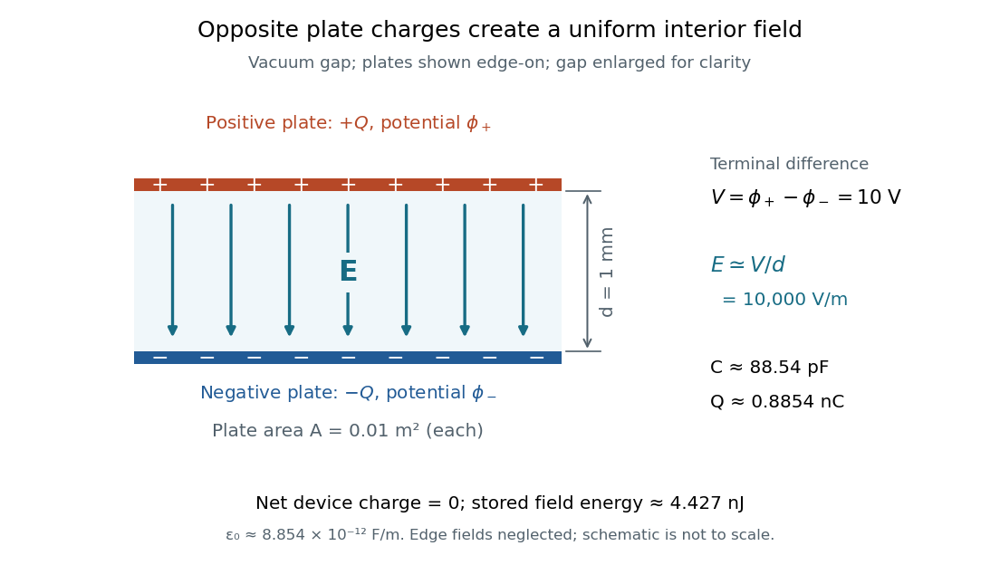

**[Figure 1](#image-uniform-electric-field-in-a-parallel-plate-capacitor). Uniform electric field in a parallel-plate capacitor**.

The formula makes design changes easy to predict: doubling the overlapping [area](differential-geometry.md#surface-area) doubles the [capacitance](#capacitance), and halving the gap doubles the [capacitance](#capacitance), with [permittivity](permittivity.md) fixed and the [fringing field of a capacitor](#fringing-field-of-a-capacitor) neglected. Doubling [permittivity](permittivity.md) also doubles [capacitance](#capacitance) if the material uniformly fills the gap and remains linear. This lets a compact device store more separated [electric charge](electric-charge.md) at the same terminal [electric potential difference](electric-field.md#electric-potential-difference).

The short derivation uses [surface charge density](electrostatics.md#surface-charge-density) $\sigma=Q/A$. In the interior, [Gauss's law](maxwell-equations.md#gauss-s-law) gives [electric field](electric-field.md) magnitude $E\simeq\sigma/\epsilon=Q/(\epsilon A)$. The [electric potential difference](electric-field.md#electric-potential-difference) is $V\simeq Ed=Qd/(\epsilon A)$, so dividing $Q$ by $V$ gives $C\simeq\epsilon A/d$. A narrow curved [capacitor](#capacitor) gap has the same leading local approximation when its width is much less than the curvature radius.

#### Fringing field of a capacitor

↑ **Parent:** [Parallel-plate capacitor](#parallel-plate-capacitor)

The [fringing field of a capacitor](#fringing-field-of-a-capacitor) is the nonuniform [electric field](electric-field.md) near the edges of its [electrical conductors](electric-charge.md#electrical-conductor), extending outside the gap. For a [parallel-plate capacitor](#parallel-plate-capacitor), neglecting it is useful when the gap is much smaller than both plate widths; the approximation $C\simeq\epsilon A/d$ is less reliable when these lengths become comparable.

Finite plates break the translational [symmetry](physics.md#symmetry-physics) of the infinite-plate model. Each [conductor in electrostatic equilibrium](electrostatics.md#conductor-in-electrostatic-equilibrium) is an [equipotential](electric-field.md#equipotential), so the [electric field](electric-field.md) must meet a smooth conducting surface normally. Near an edge, the [equipotentials](electric-field.md#equipotential) curve into the surrounding space and the [electric field](electric-field.md) changes both direction and magnitude. The [surface charge density](electrostatics.md#surface-charge-density) adjusts to enforce the conducting [boundary conditions](differential-equation.md#boundary-condition); it is not uniform all the way to a sharp edge. The [electrostatic boundary conditions at a conductor](electrostatics.md#electrostatic-boundary-conditions-at-a-conductor) explain why zero [electric field](electric-field.md) inside the metal does not imply zero [electric field](electric-field.md) just outside it.

The practical issue is where the nearly uniform region ends. A probe near the centre can support $E\simeq V/d$ while a probe close to an edge detects a lateral component and a different magnitude. A total [capacitance](#capacitance) reading also includes [electric flux](electric-field.md#electric-flux) outside the simple footprint. The [fringing field of a capacitor](#fringing-field-of-a-capacitor) can therefore matter in [permittivity](permittivity.md) measurements even when a central [electric field](electric-field.md) measurement looks nearly ideal. Keysight's three-[electrode](electrochemistry.md#electrode) fixture diverts the fringe contribution away from the measured response.[Solution: fringe capacitance and the three-electrode 16451B fixture](physics-bibliography.md#materials-measurement-dielectric-materials)

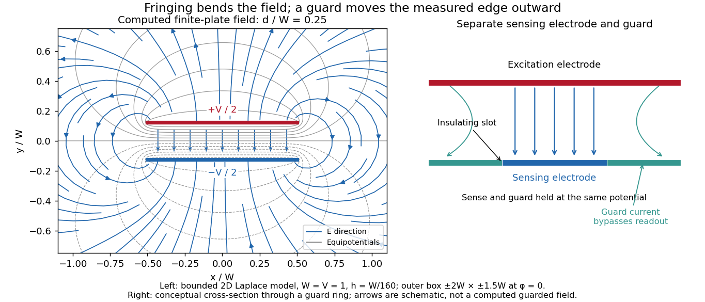

**[Figure 2](#image-finite-plate-electric-field-and-a-separate-guard-electrode-of-a-capacitor). Finite-plate electric field and a separate guard electrode of a capacitor**. Left: original [bounded two-dimensional capacitor field model](#bounded-two-dimensional-capacitor-field-model) with $d/W=0.25$, showing computed [equipotentials](electric-field.md#equipotential) and [electric field](electric-field.md) direction. The visible window is a crop of the stated bounded domain. Right: a conceptual cross-section through a surrounding guard ring, with an insulated central sensing [electrode](electrochemistry.md#electrode); the arrows are schematic, not a computed guarded solution. Neither panel is measured data.

##### Uniform-charge estimate at a capacitor corner

↑ **Parent:** [Fringing field of a capacitor](#fringing-field-of-a-capacitor)

Four uniform square charge-sheet pairs, rotated around a common corner, contribute equal normal fields there. Their [superposition](vector-space.md#superposition-principle) is a large central plate pair, so each contributes one quarter of its field. This gives $|E_n|\simeq\sigma/(4\epsilon_0)\simeq V/(4d)$ when the bulk charge-voltage relation is used. It is an approximation for prescribed uniform sheets, not an exact equipotential-conductor result. Reflection in the mid-plane does give zero tangential field for either model.

###### Charge redistribution at a capacitor corner

↑ **Parent:** [Uniform-charge estimate at a capacitor corner](#uniform-charge-estimate-at-a-capacitor-corner)

##### Capacitor gap aspect ratio

↑ **Parent:** [Fringing field of a capacitor](#fringing-field-of-a-capacitor)

The [capacitor gap aspect ratio](#capacitor-gap-aspect-ratio) compares the gap $d$ with a lateral plate width $W$. For rectangular plates of widths $W_x,W_z$, require both $d/W_x\ll1$ and $d/W_z\ll1$ for the leading [parallel-plate capacitor](#parallel-plate-capacitor) approximation. Large [area](differential-geometry.md#surface-area) alone is insufficient: a long narrow strip can have large [area](differential-geometry.md#surface-area) and still have $d$ comparable with its smaller width. In addition, the observation point must be many gap widths from an edge. Reducing $d/W$ improves the interior approximation without making the edge itself disappear.

In a two-dimensional straight gap, write the [electric potential](electric-field.md#electric-potential) as the infinite-plate solution plus a perturbation:

$$
\phi(x,y)=\frac{V}{d}y+\delta\phi(x,y),\qquad -\frac d2<y<\frac d2.
$$

The perturbation satisfies the [Laplace equation](partial-differential-equation.md#laplace-equation) and vanishes on the two ideal plates. [Separation of variables](partial-differential-equation.md#separation-of-variables) in a semi-infinite strip, with $s$ the distance inward from its entrance, gives transverse modes

$$
\delta\phi_n(s,y)=a_n e^{-n\pi s/d}\sin\!\left(\frac{n\pi(y+d/2)}{d}\right),\qquad n=1,2,\ldots.
$$

Thus edge disturbances have a natural penetration scale set by $d$. Modes forbidden by a particular [symmetry](physics.md#symmetry-physics) have zero coefficients; this expression is an explanation of localization in an ideal strip, not a universal numerical correction to finite-plate [capacitance](#capacitance). The outside [boundary conditions](differential-equation.md#boundary-condition) determine the coefficients.

**[Figure 3](#image-capacitor-gap-aspect-ratio-and-the-width-of-the-nearly-uniform-electric-field-region). Capacitor gap aspect ratio and the width of the nearly uniform electric field region**. Three original solutions of the same [bounded two-dimensional capacitor field model](#bounded-two-dimensional-capacitor-field-model) at $d/W=0.10,0.25,0.50$. The lower curves show $-E_y d/V$ on the midplane $y=0$; the dashed reference is the infinite-plate value inside the gap. The dashed value is not the infinite-plate prediction outside the plate footprint. All curves are calculated, with the same mesh and outer [Dirichlet boundary conditions](differential-equation.md#dirichlet-boundary-condition); they are neither measurements nor an exact open-domain three-dimensional [capacitance](#capacitance) calculation.

There is no single aspect-ratio cutoff guaranteeing an assigned accuracy: the requested observable, plate shape and thickness, surroundings, [dielectric](permittivity.md#dielectric) distribution, and guard geometry all matter. The small-gap approximation is local and is not uniform across an edge. It also does not justify extrapolating $C\simeq\epsilon A/d$ to arbitrarily large $d$, where finite [electrical conductors](electric-charge.md#electrical-conductor) and their external [electric field](electric-field.md) dominate. At fixed $V$, formally shrinking an ideal gap makes the interior [electric field](electric-field.md) grow like $1/d$; real [electric currents](electric-charge.md#electric-current) across an imperfectly insulating gap, surface roughness and contact eventually invalidate that ideal limit.

##### Bounded two-dimensional capacitor field model

↑ **Parent:** [Fringing field of a capacitor](#fringing-field-of-a-capacitor)

The diagrams solve an explicitly bounded [Dirichlet problem](analysis.md#dirichlet-problem) in a uniform charge-free medium of constant [permittivity](permittivity.md). Take a width scale $W=1$ and terminal [electric potential difference](electric-field.md#electric-potential-difference) $V=1$. Two zero-thickness ideal plate segments occupy $|x|\leq W/2$ at $y=\pm d/2$, with [electric potentials](electric-field.md#electric-potential) $\pm V/2$. Fix $\phi=0$ on the entire rectangle $x=\pm2W$, $y=\pm1.5W$. This boundary is an additional enclosing [equipotential](electric-field.md#equipotential), rather than a condition at infinity. The model is invariant along the omitted third direction. The connection between the [electric potential](electric-field.md#electric-potential), its [gradient](multivariable-calculus.md#gradient), and the charge-free [Laplace equation](partial-differential-equation.md#laplace-equation) follows from [electrostatics](electrostatics.md).[II.6–1, equations (6.3)–(6.6)](physics-bibliography.md#the-feynman-lectures-on-physics-volume-ii-by-richard-feynman-and-others)

On a square mesh of spacing $h=W/160$, the [finite difference method](finite-difference.md#finite-difference-method) imposes

$$
\phi_{i,j}=\frac14\left(\phi_{i+1,j}+\phi_{i-1,j}+\phi_{i,j+1}+\phi_{i,j-1}\right)
$$

at free nodes, while plate and outer nodes retain their prescribed [electric potentials](electric-field.md#electric-potential). There are $641\times481$ nodes. Each plotted gap aligns exactly with the mesh; the smallest gap has 16 mesh intervals. The generators solve the resulting [linear system](linear-algebra.md#system-of-linear-equations) by the [Conjugate gradient method](gradient-descent.md#conjugate-gradient-method), stopping when the maximum dimensionless five-point residual is below $2\times10^{-10}$, and use [central finite differences](finite-difference.md#central-finite-difference) to approximate $\mathbf E=-\nabla\phi$ away from plate nodes.

The [discrete maximum principle](finite-difference.md#discrete-maximum-principle) keeps the computed [electric potential](electric-field.md#electric-potential) between $-V/2$ and $+V/2$. Reflection checks require evenness in $x$ and oddness in $y$; halving $h$ tests discretization effects, while enlarging the outer rectangle tests sensitivity to its artificial [boundary conditions](differential-equation.md#boundary-condition). These are different checks: a small residual only establishes that the discrete equations were solved. Differentiating near zero-thickness endpoints is especially sensitive to the mesh, so the plots do not report a converged edge peak. No total [electric charge](electric-charge.md), exact open-domain three-dimensional [capacitance](#capacitance), or measured material property is extracted from this model.

For a bounded numerical check, compare $h=W/80$ with the plotted $h=W/160$ at midplane positions $x/W=0,0.25,0.40,0.50,0.60,0.80$. At $d/W=0.10$, the largest change in $-E_y d/V$ is approximately $0.0265$, at $x/W=0.50$; the other five sampled changes are below $0.00472$. At $d/W=0.25$, moving the outer rectangle from $\pm2W\times\pm1.5W$ to $\pm3W\times\pm2W$ while retaining $h=W/80$ changes these samples by at most approximately $0.00622$. These calculated sensitivities support the qualitative comparison and expose its limits; they are not experimental uncertainties or evidence that the artificial boundary has converged to infinity.

##### Mapping a capacitor fringing field

↑ **Parent:** [Fringing field of a capacitor](#fringing-field-of-a-capacitor)

The [Field Mapper Kit (PK-9023), Product Manual 012-04346D by PASCO scientific](physics-bibliography.md#field-mapper-kit-pk-9023-product-manual-012-04346d-by-pasco-scientific) (p. 3, Parallel plate capacitor) proposes a direct investigation of the plate-length-to-gap ratio using [conductive-paper electric potential mapping](electric-field.md#conductive-paper-electric-potential-mapping). Its finite straight [electrodes](electrochemistry.md#electrode) represent a cross-section of the plates. The apparatus is a gridded resistive sheet on a corkboard, silver-ink [electrodes](electrochemistry.md#electrode), pushpin electrical contacts, a $5$–$20\,\mathrm V$ direct supply capable of $25\,\mathrm{mA}$, and a [voltmeter](electric-field.md#voltmeter) with input [electrical resistance](electric-charge.md#electrical-resistance) at least $10\,\mathrm{M\Omega}$. The manual specifies waiting 20 minutes for the ink to reach its maximum [electrical conductivity](electric-charge.md#electrical-conductivity), then checking each [electrode](electrochemistry.md#electrode): its internal voltage drop should be no more than $1\%$ of the applied [electric potential difference](electric-field.md#electric-potential-difference).[pp. 1–2: required equipment, drying, contacts, electrode-conductivity check](physics-bibliography.md#field-mapper-kit-pk-9023-product-manual-012-04346d-by-pasco-scientific)

For the readout, keep one [voltmeter](electric-field.md#voltmeter) lead on the reference [electrode](electrochemistry.md#electrode) and scan the other across the sheet. Mark points having the same reading to trace an [equipotential](electric-field.md#equipotential). A second method holds the two probe tips at a fixed separation and pivots them to find the largest [electric potential difference](electric-field.md#electric-potential-difference); a suggested separation is one centimetre. Avoid printed grid marks when making contact.[pp. 8–10, Parts III–IV: equipotential tracing and paired-probe field-gradient mapping](physics-bibliography.md#charge-equipotential-and-field-mapper-es-9060-instruction-manual-by-pasco-scientific)

The inference follows from the measured [electric potential](electric-field.md#electric-potential), rather than assuming straight [electric field](electric-field.md) lines. With probe separation $\Delta s$ and direction $\widehat{\mathbf t}$, a local [finite difference](finite-difference.md) gives

$$
\mathbf E\cdot\widehat{\mathbf t}\simeq-\frac{\phi(P+\Delta s\widehat{\mathbf t})-\phi(P)}{\Delta s}.
$$

An arrow toward rising [electric potential](electric-field.md#electric-potential) follows $+\nabla\phi$, so it must be reversed to show $\mathbf E$. To investigate the [fringing field of a capacitor](#fringing-field-of-a-capacitor), compare contours well inside the gap with contours near and beyond the ends, then repeat at a changed gap while keeping the sheet boundary and plate length fixed. Curving contours and an outside [gradient](multivariable-calculus.md#gradient) establish nonuniformity in this planar setup. Compare $-E_y d/V$ at recorded positions to distinguish simple voltage rescaling from geometric changes; no measured values are supplied here.

Additional useful controls are repeat reference readings to detect drift, reversal of supply polarity, and repeating selected readings with reduced probe spacing. Keep contact quality and sheet edges fixed during the aspect-ratio comparison. Finite probe separation averages the [gradient](multivariable-calculus.md#gradient); reducing it improves spatial resolution but magnifies the effect of voltage uncertainty. [Voltmeter loading](electric-field.md#voltmeter-loading), imperfect ink [electrodes](electrochemistry.md#electrode), and inhomogeneous sheet [electrical conductivity](electric-charge.md#electrical-conductivity) can mimic distortions. These proposed checks supplement the manufacturer's electrode check, rather than claiming a completed experiment.

The sheet carries a steady [electric current](electric-charge.md#electric-current). For uniform [electrical conductivity](electric-charge.md#electrical-conductivity), [Ohm's law](electric-charge.md#ohm-s-law) and [electric charge conservation](electric-charge.md#charge-conservation) give the two-dimensional [Laplace equation](partial-differential-equation.md#laplace-equation) away from [electrodes](electrochemistry.md#electrode), as explained in [conductive-paper electric potential mapping](electric-field.md#conductive-paper-electric-potential-mapping). Uncontacted sheet edges have zero normal [electric current](electric-charge.md#electric-current), whereas the diagram model fixes zero outer [electric potential](electric-field.md#electric-potential). These distinct [boundary conditions](differential-equation.md#boundary-condition) must be matched before a quantitative comparison. The apparatus reveals a planar [electric potential](electric-field.md#electric-potential) map; it does not directly measure the free-space three-dimensional [capacitance](#capacitance) of metal plates.

##### Guard electrode of a capacitor

↑ **Parent:** [Fringing field of a capacitor](#fringing-field-of-a-capacitor)

A [guard electrode of a capacitor](#guard-electrode-of-a-capacitor) surrounds an electrically isolated sensing [electrode](electrochemistry.md#electrode) and is held at the same [electric potential](electric-field.md#electric-potential). The small insulating slot separates their readout paths. The guard extends the nearly planar [equipotential](electric-field.md#equipotential), moving the main outer edge away from the sensing region; it does not abolish the [fringing field of a capacitor](#fringing-field-of-a-capacitor) everywhere. In a capacitance fixture, fringe [electric current](electric-charge.md#electric-current) is routed through the guard instead of the sensing readout. Keysight describes this three-[electrode](electrochemistry.md#electrode) method in [Materials Measurement: Dielectric Materials](physics-bibliography.md#materials-measurement-dielectric-materials) (Solution, 16451B fixture).[Solution: guard absorbs current through fringe capacitance](physics-bibliography.md#materials-measurement-dielectric-materials)

Measuring the sensing and guard [electric currents](electric-charge.md#electric-current) together would include the diverted response again. Grounding an arbitrary surrounding [electrode](electrochemistry.md#electrode) also does not reproduce a guard unless its [electric potential](electric-field.md#electric-potential) matches the sensing [electrode](electrochemistry.md#electrode). Finite guard width, the insulating slot, plate misalignment and specimen air gaps limit the approximation. Use [capacitance measurement calibration](permittivity.md#capacitance-measurement-calibration) and the geometry appropriate to the sensing region when inferring [permittivity](permittivity.md). The source also warns that guarding changes the [electromagnetic field](#electromagnetic-field) unfavourably at high [frequency](wave.md#frequency), so the low-[frequency](wave.md#frequency) electrostatic picture has a restricted range.[Solution: air gaps, high-frequency guard limitations, fixture compensation](physics-bibliography.md#materials-measurement-dielectric-materials)

### Spherical capacitor

↑ **Parent:** [Capacitor](#capacitor)

Two concentric conducting spherical shells of radii $a<b$ with charges $Q,-Q$ have an [electric field](electric-field.md) only in the intervening vacuum: $E_r=Q/(4\pi\epsilon_0r^2)$ by [Gauss's law](maxwell-equations.md#gauss-s-law). Integrating gives a potential difference $Q(1/a-1/b)/(4\pi\epsilon_0)$, and hence the displayed [capacitance](#capacitance). The [electrostatic energy](electrostatics.md#electrostatic-energy) is $Q^2/(2C)$, either by charging work or by integrating $\epsilon_0|E|^2/2$ over the gap.

### Capacitor energy

↑ **Parent:** [Capacitor](#capacitor)

The [capacitor energy](#capacitor-energy) is the [electrostatic energy](electrostatics.md#electrostatic-energy) stored when [electric charge](electric-charge.md) is separated. For a linear [capacitor](#capacitor) of fixed positive [capacitance](#capacitance) $C$, plate [electric charge](electric-charge.md) magnitude $Q$, and terminal [electric potential difference](electric-field.md#electric-potential-difference) $V=Q/C$, it is

$$
U=\frac{Q^2}{2C}=\frac12CV^2=\frac12QV.
$$

The zero is the uncharged state. Thus the [capacitor energy](#capacitor-energy) is positive for nonzero $Q$, even though the total [electric charge](electric-charge.md) of the two plates is zero. [OpenStax University Physics 2, §8.3: energy stored in a capacitor](https://openstax.org/books/university-physics-volume-2/pages/8-3-energy-stored-in-a-capacitor).

For the [parallel-plate capacitor](#parallel-plate-capacitor) example, [capacitance](#capacitance) $C=8.854\times10^{-11}\,\mathrm F$ and terminal [electric potential difference](electric-field.md#electric-potential-difference) $V=10\,\mathrm V$ give

$$
U=\frac12(8.854\times10^{-11})(10)^2\,\mathrm J
=4.427\times10^{-9}\,\mathrm J=4.427\,\mathrm{nJ}.
$$

The plate [electric charge](electric-charge.md) magnitude is $Q=0.8854\,\mathrm{nC}$. Doubling terminal [electric potential difference](electric-field.md#electric-potential-difference) with [capacitance](#capacitance) unchanged doubles the plate [electric charge](electric-charge.md) magnitude and quadruples the [capacitor energy](#capacitor-energy).

**[Figure 4](#image-linear-electric-charge-and-quadratic-capacitor-energy-versus-electric-potential-difference). Linear electric charge and quadratic capacitor energy versus electric potential difference**.

The [electric charge](electric-charge.md) is a [linear function](vector-space.md#linear-function) of terminal [electric potential difference](electric-field.md#electric-potential-difference), while [capacitor energy](#capacitor-energy) is a [quadratic function](polynomial.md#quadratic-function). The second curve in each plot uses twice the [capacitance](#capacitance): at a given terminal [electric potential difference](electric-field.md#electric-potential-difference), both plate [electric charge](electric-charge.md) magnitude and [capacitor energy](#capacitor-energy) double. These relations let us calculate how much [energy](energy.md) an [electrical circuit](electrical-circuit.md) can receive when a [capacitor](#capacitor) discharges.

A brief charging argument explains the factor $1/2$. If the plate [electric charge](electric-charge.md) magnitude has reached $q$, the terminal [electric potential difference](electric-field.md#electric-potential-difference) is $q/C$. Transferring a further amount $dq$ of [electric charge](electric-charge.md) quasistatically requires [work](energy.md#work) $dW=(q/C)\,dq$. With the geometry and [permittivity](permittivity.md) fixed, the [integral](integral.md) is

$$
U=\int_0^Q\frac qC\,dq=\frac{Q^2}{2C}.
$$

Using $Q=CV$ gives the other two forms. This [integral](integral.md) accounts for the gradually rising terminal [electric potential difference](electric-field.md#electric-potential-difference); it is the [work](energy.md#work) stored in the [capacitor](#capacitor)'s [electric field](electric-field.md), rather than a claim that all [energy](energy.md) drawn from a fixed-voltage [battery](electrical-circuit.md#electric-battery) during charging ends up stored.

The field picture gives the same result. In the vacuum gap of a [parallel-plate capacitor](#parallel-plate-capacitor), the [electric field](electric-field.md) has [energy density](statistical-physics.md#energy-density) $u=\epsilon_0 E^2/2$. Multiplying by the gap [volume](geometry-and-topology.md#volume) $Ad$ gives the [electrostatic energy](electrostatics.md#electrostatic-energy)

$$
U\simeq\frac12\epsilon_0E^2Ad
=\frac12\frac{\epsilon_0 A}{d}V^2
=\frac12CV^2.
$$

For the worked example, $u=4.427\times10^{-4}\,\mathrm{J/m^3}$ and $Ad=10^{-5}\,\mathrm{m^3}$ reproduce $U=4.427\,\mathrm{nJ}$. The [electrostatic energy](electrostatics.md#electrostatic-energy) resides in the [electric field](electric-field.md) throughout the gap, despite overall [charge neutrality](electric-charge.md#charge-neutrality).

When [capacitance](#capacitance) changes, specify the constraint. At fixed plate [electric charge](electric-charge.md) magnitude $Q$, increasing [capacitance](#capacitance) decreases [capacitor energy](#capacitor-energy) $Q^2/(2C)$; doubling [capacitance](#capacitance) halves it. At fixed terminal [electric potential difference](electric-field.md#electric-potential-difference) $V$, increasing [capacitance](#capacitance) increases [capacitor energy](#capacitor-energy) $CV^2/2$; doubling [capacitance](#capacitance) doubles it. In the latter case a connected [battery](electrical-circuit.md#electric-battery) supplies additional [electric charge](electric-charge.md) and [energy](energy.md), and there may also be mechanical [work](energy.md#work). Use the [fixed-voltage capacitor energy balance](#fixed-voltage-capacitor-energy-balance) to account for all transfers before inferring a [force](force.md) from changing [capacitor energy](#capacitor-energy).

#### Magnetic-to-electric energy ratio in a driven disc capacitor

↑ **Parent:** [Capacitor energy](#capacitor-energy)

For thin parallel circular plates of radius $a$ and separation $L$, the quasistatic axial field $E_z(t)$ induces $H_\phi=\epsilon_0r\dot E_z/2$. Integrating cycle-averaged vacuum [energy](energy.md) [densities](fluid-mechanics.md#density) for sinusoidal drive gives $\overline U_B/\overline U_E=(\omega a/c)^2/8$. The same fields have radial Poynting [flux](mathematical-physics.md#flux) $S_r=-\epsilon_0rE_z\dot E_z/2$, whose leading net inward [power](energy.md#power) equals the time derivative of stored electric [energy](energy.md). The small ratio diagnoses the quasistatic regime.

#### Fixed-voltage capacitor energy balance

↑ **Parent:** [Capacitor energy](#capacitor-energy)

For a quasistatic change of [capacitance](#capacitance) at fixed terminal [electric potential difference](electric-field.md#electric-potential-difference), the [capacitor energy](#capacitor-energy) is $U=CV^2/2$ and plate [electric charge](electric-charge.md) is $Q=CV$. Electrical [work](energy.md#work) supplied to the [electric field](electric-field.md) by the [battery](electrical-circuit.md#electric-battery) is $V\,dQ$, so mechanical [work](energy.md#work) done on the [capacitor](#capacitor) is $dW_{\rm mech}=dU-V\,dQ=-V^2dC/2$. Increasing the separation of a [parallel-plate capacitor](#parallel-plate-capacitor) makes $dC<0$: mechanical [work](energy.md#work) is positive even though [electrostatic energy](electrostatics.md#electrostatic-energy) decreases, because electrical [energy](energy.md) returns to the source. Conversely, when $dC>0$, the [battery](electrical-circuit.md#electric-battery) supplies $V^2dC$: half increases [capacitor energy](#capacitor-energy) and half is available as mechanical [work](energy.md#work) done by the [electric field](electric-field.md). Differentiating [capacitor energy](#capacitor-energy) alone at fixed terminal [electric potential difference](electric-field.md#electric-potential-difference) omits this exchange with the [battery](electrical-circuit.md#electric-battery).

##### Dielectric insertion force at fixed voltage

↑ **Parent:** [Fixed-voltage capacitor energy balance](#fixed-voltage-capacitor-energy-balance)

At fixed [electric potential difference](electric-field.md#electric-potential-difference) $V$, a change of [capacitance](#capacitance) has electrical work input $V\,dQ=V^2dC$ and field-energy increase $dU=V^2dC/2$. The remaining half is mechanical [work](energy.md#work) done by the field, so the force in the direction of increasing overlap is $F_x=V^2C'(x)/2$. Equivalently the effective mechanical potential is $-CV^2/2$. For a [partially filled coaxial capacitor](electrostatics.md#partially-filled-coaxial-capacitor), this gives $F_x=\pi\epsilon_0(\epsilon_r-1)V^2/\ln(b/a)$, directed inward when $\epsilon_r>1$. The [fringing field of a capacitor](#fringing-field-of-a-capacitor) supplies the local field gradient and transmits this force even when its small correction to total capacitance is neglected.

## Electromagnetic interaction

↑ **Parent:** [Electromagnetism](electromagnetism.md)

The electromagnetic interaction is the long-range interaction of electrically charged matter with the electromagnetic field. Its massless gauge boson is the [photon](quantum-mechanics.md#photon).

## Electromagnetic radiation

↑ **Parent:** [Electromagnetism](electromagnetism.md)

[This section is present in another page, follow this link to view it.](electromagnetic-radiation.md)

## Right-hand rule

↑ **Parent:** [Electromagnetism](electromagnetism.md)  
ⓦ [Wiki](https://en.wikipedia.org/wiki/Right-hand_rule)

The right-hand rule fixes the orientation of a [cross product](vector-space.md#cross-product) and relates the circulation direction of an [electric current](electric-charge.md#electric-current) to the direction of its [magnetic field](magnetic-field.md).

## Electric charge

↑ **Parent:** [Electromagnetism](electromagnetism.md)

[This section is present in another page, follow this link to view it.](electric-charge.md)

## Electric field

↑ **Parent:** [Electromagnetism](electromagnetism.md)

[This section is present in another page, follow this link to view it.](electric-field.md)

## Magnetic field

↑ **Parent:** [Electromagnetism](electromagnetism.md)

[This section is present in another page, follow this link to view it.](magnetic-field.md)

## Permittivity

↑ **Parent:** [Electromagnetism](electromagnetism.md)

[This section is present in another page, follow this link to view it.](permittivity.md)

## Capacitance

↑ **Parent:** [Electromagnetism](electromagnetism.md)  
ⓦ [Wiki](https://en.wikipedia.org/wiki/Capacitance)

The [capacitance](#capacitance) of a linear two-terminal [capacitor](#capacitor) is the constant relating its separated [electric charge](electric-charge.md) to its terminal [electric potential difference](electric-field.md#electric-potential-difference):

$$
Q=CV,\qquad C=\frac QV\quad(V\ne0).
$$

Here $Q$ is the [electric charge](electric-charge.md) on one [electrical conductor](electric-charge.md#electrical-conductor), the other carries $-Q$, and $V$ is their [electric potential difference](electric-field.md#electric-potential-difference) with the same ordering. Reversing the terminal ordering reverses both $Q$ and $V$ and leaves [capacitance](#capacitance) unchanged. An ideal passive [capacitor](#capacitor) has $C\ge0$; an ordinary pair of separated [electrical conductors](electric-charge.md#electrical-conductor) with positive [permittivity](permittivity.md) has $C>0$. At $V=0$, use $Q=CV$ rather than the undefined ratio $0/0$.

For example, [electric charge](electric-charge.md) magnitude $Q=0.8854\,\mathrm{nC}$ at terminal [electric potential difference](electric-field.md#electric-potential-difference) $V=10\,\mathrm V$ gives [capacitance](#capacitance) $C=88.54\,\mathrm{pF}$. At $20\,\mathrm V$, the same linear [capacitor](#capacitor) has $Q=1.7708\,\mathrm{nC}$ and the same [capacitance](#capacitance). The plots in [capacitor energy](#capacitor-energy) show that [capacitance](#capacitance) is the [slope](euclidean-geometry.md#slope) of the [electric charge](electric-charge.md) versus terminal [electric potential difference](electric-field.md#electric-potential-difference) graph.

For fixed geometry and linear material response, [capacitance](#capacitance) depends on dimensions and [permittivity](permittivity.md), rather than the source's terminal [electric potential difference](electric-field.md#electric-potential-difference). This is why [capacitance](#capacitance) is a useful property of a component: once it is known, $Q=CV$ predicts the separated [electric charge](electric-charge.md) for each operating terminal [electric potential difference](electric-field.md#electric-potential-difference). The [SI](physics.md#international-system-of-units) unit is the [farad](#farad), $1\,\mathrm F=1\,\mathrm{C/V}$. [OpenStax University Physics 2, §8.1: capacitance and its unit](https://openstax.org/books/university-physics-volume-2/pages/8-1-capacitors-and-capacitance).

For combinations of [capacitors](#capacitor), the same terminal definition gives an equivalent [capacitance](#capacitance). Two identical [capacitors](#capacitor) of [capacitance](#capacitance) $C$ connected in parallel share the same terminal [electric potential difference](electric-field.md#electric-potential-difference), and their [electric charges](electric-charge.md) add, giving $C_{\rm eq}=2C$. Connected in series with an initially neutral isolated junction, they carry equal plate [electric charge](electric-charge.md) magnitudes and their terminal [electric potential differences](electric-field.md#electric-potential-difference) add, giving $C_{\rm eq}=C/2$. [OpenStax University Physics 2, §8.2: capacitors in series and in parallel](https://openstax.org/books/university-physics-volume-2/pages/8-2-capacitors-in-series-and-in-parallel).

### Electrostatic energy increase on equal-drop coalescence

↑ **Parent:** [Capacitance](#capacitance)

Two isolated conducting drops of [radius](topology.md#radius) $a$ and equal charge merge at fixed total charge and [volume](geometry-and-topology.md#volume). The new [radius](topology.md#radius) is $2^{1/3}a$, so its [capacitance](#capacitance) grows by only $2^{1/3}$ while total charge doubles. Relative to the sum of the initially separated self energies, the final [electric field](electric-field.md) [energy](energy.md) grows by $2^{2/3}$. Decreased surface [energy](energy.md) and/or applied mechanical work can supply that increase. Sufficiently large like charges need not coalesce spontaneously; [energy](energy.md) conservation is not a guarantee of merging. A maintained external [voltage](random-walk.md#voltage) would define a different problem.

### Gate capacitance

↑ **Parent:** [Capacitance](#capacitance)

The capacitive coupling between a control gate and an electronic channel or island. In a single-island model the gate lever arm is $\alpha_g=C_g/C_\Sigma$. A charging-only gate period is $e/C_g$, whereas an orbital gap enlarges that period.

### Specific capacitance

↑ **Parent:** [Capacitance](#capacitance)

[Capacitance](#capacitance) normalized by a stated mass or volume. Mass-specific differential capacitance is $C_{\rm sp}=m^{-1}dQ/dV$; electrode and full-device mass conventions must be distinguished.

### Arithmetic-harmonic bounds for dielectric capacitance

↑ **Parent:** [Capacitance](#capacitance)

For a [parallel-plate capacitor](#parallel-plate-capacitor) of area $A$ and separation $d$, filled by a spatially varying positive scalar [permittivity](permittivity.md), neglect edge fields. At fixed terminal voltage, the physical [electric potential](electric-field.md#electric-potential) minimizes $\int\varepsilon|\nabla V|^2\,d\mathcal V/2$. A linear trial potential gives the arithmetic upper bound. At fixed plate charge, minimizing $\int|\mathbf D|^2/(2\varepsilon)\,d\mathcal V$ over divergence-free [electric displacement fields](#electric-displacement-field) gives the harmonic lower bound by using a uniform trial displacement. The averages are volume averages. Layers parallel to the field attain the arithmetic bound; layers perpendicular to the field attain the harmonic bound. Equal volumes of vacuum and relative [permittivity](permittivity.md) $\epsilon$ therefore give $2\epsilon C_0/(1+\epsilon)\leq C\leq(1+\epsilon)C_0/2$, where $C_0=\varepsilon_0A/d$.

### Capacitance matrix

↑ **Parent:** [Capacitance](#capacitance)

For a collection of fixed [electrical conductors](electric-charge.md#electrical-conductor) in linear electrostatics, the [capacitance matrix](#capacitance-matrix) relates conductor charges to potentials relative to a specified reference: $Q_i=\sum_jC_{ij}V_j$. It includes mutual electrostatic effects omitted when each conductor is treated as an isolated capacitor. Its [electrostatic energy](electrostatics.md#electrostatic-energy) is $U=\tfrac12\mathbf V^{\mathsf T}\mathbf C\mathbf V=\tfrac12\sum_iQ_iV_i$. Geometry and separation are needed to determine its entries.

### Quantum capacitance

↑ **Parent:** [Capacitance](#capacitance)

The electronic contribution to differential [capacitance](#capacitance) arising from a change of [chemical potential](chemical-potential.md) as particles are added. For noninteracting [electrons](physics.md#electron) at zero [temperature](temperature.md), it is $e^2$ times the [density of states](quantum-ideal-gas-statistics.md#density-of-states) of the whole sample at the [Fermi energy](quantum-ideal-gas-statistics.md#fermi-energy). The [quantum capacitance of a graphene cone](chemical-substance.md#quantum-capacitance-of-a-graphene-cone) gives a worked example.

### Farad

↑ **Parent:** [Capacitance](#capacitance)  
ⓦ [Wiki](https://en.wikipedia.org/wiki/Farad)

The [farad](#farad), symbol $\mathrm F$, is the [SI](physics.md#international-system-of-units) unit of [capacitance](#capacitance):

$$
1\,\mathrm F=1\,\frac{\mathrm C}{\mathrm V}.
$$

A [capacitor](#capacitor) of [capacitance](#capacitance) $1\,\mathrm F$ carries separated [electric charge](electric-charge.md) magnitude $1\,\mathrm C$ at terminal [electric potential difference](electric-field.md#electric-potential-difference) $1\,\mathrm V$. A picofarad is $10^{-12}\,\mathrm F$, so the worked [parallel-plate capacitor](#parallel-plate-capacitor)'s [capacitance](#capacitance) $88.54\,\mathrm{pF}$ is $8.854\times10^{-11}\,\mathrm F$. [OpenStax University Physics 2, §8.1: the farad](https://openstax.org/books/university-physics-volume-2/pages/8-1-capacitors-and-capacitance).

### Capacitance of an isolated conducting sphere

↑ **Parent:** [Capacitance](#capacitance)

An isolated conducting sphere of radius $R$ in a medium of [permittivity](permittivity.md) $\epsilon$ has surface [electrostatic potential](electric-field.md#electric-potential) $V=Q/(4\pi\epsilon R)$ relative to infinity. Thus its [capacitance](#capacitance) is $C=Q/V=4\pi\epsilon R$.

#### Breakdown-limited energy of a conducting sphere

↑ **Parent:** [Capacitance of an isolated conducting sphere](#capacitance-of-an-isolated-conducting-sphere)

For an isolated smooth [conducting sphere](electrostatics.md#conducting-sphere) of radius $a$, [Gauss's law](maxwell-equations.md#gauss-s-law) gives surface [electric field](electric-field.md) $E_s=V/a$. Combining its [capacitance](#capacitance) $4\pi\epsilon_0a$ with [capacitor energy](#capacitor-energy) $CV^2/2$ gives the displayed bound when the surrounding medium has [dielectric strength](permittivity.md#dielectric-strength) $E_{\rm bd}$ and approximately vacuum [permittivity](permittivity.md). Nearby conductors, surface roughness and discharge geometry can lower the practical limit.

### Sphere-plane capacitance

↑ **Parent:** [Capacitance](#capacitance)

For a conducting sphere of radius $R$ at center height $h>R$ above a grounded infinite plane,

$$
C(R,h)=4\pi\epsilon R\sinh\alpha\sum_{n=1}^{\infty}\frac1{\sinh(n\alpha)},
\qquad\cosh\alpha=\frac hR.
$$

The distance $h$ is measured to the center, so the surface gap is $h-R$. Relative to the [capacitance of an isolated conducting sphere](#capacitance-of-an-isolated-conducting-sphere), the enhancement is $c(R/h)=C(R,h)/(4\pi\epsilon R)$.

The [method of images](mathematics.md#method-of-images) gives a constructive proof. At fixed sphere potential $V_s$, start with $q_0=4\pi\epsilon RV_s$ at height $z_0=h$ and place its opposite image below the plane. Cancel that image's nonconstant sphere potential by the successive charges

$$
q_{n+1}=\frac R{h+z_n}q_n,
\qquad z_{n+1}=h-\frac{R^2}{h+z_n},
$$

with opposite mirror charges below the plane at every step. The resulting sphere potential is $V_s$ and the plane potential is zero. Since $q_n=4\pi\epsilon RV_s\sinh\alpha/\sinh((n+1)\alpha)$, summing the sphere charges gives the displayed [capacitance](#capacitance). In particular $c(y)=1+y/2+O(y^2)$ for small $y$.

The exact sphere-plane boundary-value problem is also treated in [Behunin and colleagues' analysis of sphere-plane electrostatics](https://arxiv.org/abs/1206.6034).

### Capacitance per unit length

↑ **Parent:** [Capacitance](#capacitance)

Capacitance per unit length is the charge per unit length divided by the potential difference. A vacuum coaxial cable with radii $a<b$ has

$$
C'=\frac{2\pi\varepsilon_0}{\log(b/a)}.
$$

#### Two-wire capacitance at large separation

↑ **Parent:** [Capacitance per unit length](#capacitance-per-unit-length)

Replace two well-separated cylindrical conductors by opposite axial [line charges](electric-charge.md#line-charge). Their surface-to-surface potential difference is $\lambda[\ln(d/a_1)+\ln(d/a_2)]/(2\pi\epsilon)$, giving the displayed [capacitance per unit length](#capacitance-per-unit-length). The approximation needs $d\gg a_1,a_2$ and a homogeneous surrounding [permittivity](permittivity.md).

## Inductance

↑ **Parent:** [Electromagnetism](electromagnetism.md)  
ⓦ [Wiki](https://en.wikipedia.org/wiki/Inductance)

[Inductance](#inductance) relates [electric currents](electric-charge.md#electric-current) to the [magnetic flux linkage](#magnetic-flux-linkage) they produce. For a single linear coil with fixed geometry and magnetic response, its [self-inductance](#self-inductance) $L$ is the constant in

$$
\Lambda=LI.
$$

Here $\Lambda$ is [magnetic flux linkage](#magnetic-flux-linkage) from the coil's own [electric current](electric-charge.md#electric-current) $I$. The [SI](physics.md#international-system-of-units) unit of [inductance](#inductance) is the [henry](#henry-unit). Knowing [inductance](#inductance) lets us predict the induced [electromotive force](electric-charge.md#electromotive-force) when [electric current](electric-charge.md#electric-current) changes, and the [magnetic energy](electromagnetic-wave.md#magnetic-energy) stored by an [inductor](#inductor). [OpenStax University Physics 2, §14.2: self-inductance and inductors](https://openstax.org/books/university-physics-volume-2/pages/14-2-self-inductance-and-inductors).

For example, a coil of [self-inductance](#self-inductance) $0.5\,\mathrm H$ carrying [electric current](electric-charge.md#electric-current) $3\,\mathrm A$ has [magnetic flux linkage](#magnetic-flux-linkage) $1.5\,\mathrm{Wb}$. If its $100$ turns link the same [magnetic flux](magnetic-field.md#magnetic-flux), each turn has [magnetic flux](magnetic-field.md#magnetic-flux) $0.015\,\mathrm{Wb}$. Keeping the geometry and magnetic response fixed while doubling [electric current](electric-charge.md#electric-current) doubles [magnetic flux linkage](#magnetic-flux-linkage) and quadruples the [inductor](#inductor)'s [magnetic energy](electromagnetic-wave.md#magnetic-energy).

The comparison with [capacitance](#capacitance) is useful: a linear [capacitor](#capacitor) has $Q=CV$ and stores [capacitor energy](#capacitor-energy) $CV^2/2$ in its [electric field](electric-field.md), whereas a linear [inductor](#inductor) has $\Lambda=LI$ and stores [magnetic energy](electromagnetic-wave.md#magnetic-energy) $LI^2/2$ in its [magnetic field](magnetic-field.md). The [RLC circuit](electrical-circuit.md#rlc-circuit) brings both forms of [energy](energy.md) storage together.

### Inductance of a toroidal winding

↑ **Parent:** [Inductance](#inductance)

For a slender winding around a [toroid](differential-geometry.md#toroid) with $N$ turns, core area $A$, mean magnetic path length $\ell$ and approximately constant [magnetic permeability](maxwell-equations.md#permeability-electromagnetism) $\mu$, [Ampère's law](maxwell-equations.md#ampere-s-circuital-law) gives $H\ell=NI$. The linked magnetic flux is $N\Phi=N\mu HA$, so $L=N\Phi/I=\mu N^2A/\ell$. This approximation neglects flux leakage and variation across the core and assumes operation below [magnetic saturation](#magnetic-saturation). With a nonlinear magnetic core, an incremental inductance instead depends on differential permeability at the operating point.

#### Inductance of a rectangular-section toroid

↑ **Parent:** [Inductance of a toroidal winding](#inductance-of-a-toroidal-winding)

For a uniformly permeable [toroid](differential-geometry.md#toroid) with inner [radius](topology.md#radius) $a$, outer [radius](topology.md#radius) $b$ and axial height $h$, an ideal poloidal winding gives $H_\phi=NI/(2\pi r)$. Integrating the [magnetic flux density](magnetic-field.md) across its section gives $\Phi=\mu NIh\ln(b/a)/(2\pi)$ and hence the displayed [self-inductance](#self-inductance). It retains radial field variation when $b-a$ is not small. For two fully linked windings, replace $N^2$ by $N_1N_2$ to obtain their [mutual inductance](#mutual-inductance). Discrete turns, leakage and nonlinear core response limit the ideal formula.

##### Radial-path approximation for a cracked toroid

↑ **Parent:** [Inductance of a rectangular-section toroid](#inductance-of-a-rectangular-section-toroid)

In this [magnetic circuit](#magnetic-circuit) approximation, each circular path has air-gap [length](physics.md#length) $d$, core [length](physics.md#length) $2\pi r-d$, and the same normal [magnetic flux density](magnetic-field.md) in air and core. [Ampère's law](maxwell-equations.md#ampere-s-circuital-law) then gives $B(r)\simeq\mu_0\mu_rNI/[2\pi r+(\mu_r-1)d]$; integrating across the section gives the displayed [mutual inductance](#mutual-inductance). Even $d\ll a$ can strongly reduce inductance when $\mu_rd/a$ is appreciable. This is a path estimate, not an exact local field solution in the slit geometry. It neglects [magnetic fringing](#magnetic-fringing) and redistribution between paths. In particular, a literal field proportional to $\widehat{\boldsymbol\phi}/(r+q)$ everywhere in a current-free core is not curl-free; transverse corrections are required. Narrow-gap circuit approximations and their limitations are discussed in [§9.7, Example 9.7.1; paragraph following the example](physics-bibliography.md#electromagnetic-fields-and-energy-by-hermann-a-haus-and-james-r-melcher/magnetic-circuits).

#### Inductance of a toroid with an oblique narrow air gap

↑ **Parent:** [Inductance of a toroidal winding](#inductance-of-a-toroidal-winding)

Let a slender [toroid](differential-geometry.md#toroid) have core cross-section $A$, mean length $\ell$ and large relative [magnetic permeability](maxwell-equations.md#permeability-electromagnetism) $\mu$. Cut a narrow gap of perpendicular width $t$ whose faces make angle $\theta$ with the local core direction. Continuity of normal [magnetic flux density](magnetic-field.md) gives $B_{g,n}=B\sin\theta$; continuity of tangential [magnetic field intensity](#magnetic-field-intensity) gives $H_{g,t}=B\cos\theta/(\mu\mu_0)$. The gap field is nearly normal to the faces for large $\mu$. Its effective flux area is $A/\sin\theta$, so its leading [magnetic reluctance](#magnetic-reluctance) is $t\sin\theta/(\mu_0A)$. Adding core reluctance gives the displayed [self-inductance](#self-inductance). At $45^\circ$, $L\simeq\mu_0N^2A/(\ell/\mu+t/\sqrt2)$ and $H_g\simeq NI/(t+\sqrt2\ell/\mu)$. This retains $\mu t/\ell$ while neglecting fringing and corrections of relative order $t/\ell$ or $1/\mu$.

### Mutual inductance

↑ **Parent:** [Inductance](#inductance)

For two fixed linear coils, [mutual inductance](#mutual-inductance) $M$ relates [magnetic flux linkage](#magnetic-flux-linkage) in one coil to [electric current](electric-charge.md#electric-current) in the other: $\Lambda_{21}=MI_1$. The induced [electromotive force](electric-charge.md#electromotive-force) is $\mathcal E_2=-M\,dI_1/dt$ with consistent winding orientations. For reciprocal coils, $|M|=k\sqrt{L_1L_2}$, where $L_1,L_2$ are [self-inductances](#self-inductance) and $0\le k\le1$ measures magnetic coupling. Its [SI](physics.md#international-system-of-units) unit is the [henry](#henry-unit).

#### Mutual inductance of a straight wire and square coil

↑ **Parent:** [Mutual inductance](#mutual-inductance)

An N-turn square coil of side a lies in the plane of a long straight wire, with nearest edge at perpendicular distance s and parallel to the wire. Integrating $B=\mu_0I/(2\pi r)$ across the coil gives flux-linkage magnitude $\Lambda=\mu_0NaI\ln[(s+a)/s]/(2\pi)$. Its coefficient of I is the [mutual inductance](#mutual-inductance) magnitude; its sign depends on the selected loop normal and current directions. [Flux](mathematical-physics.md#flux) through one turn and N-turn [flux](mathematical-physics.md#flux) linkage must be distinguished.

##### Force on a resistive coil beside an alternating wire

↑ **Parent:** [Mutual inductance of a straight wire and square coil](#mutual-inductance-of-a-straight-wire-and-square-coil)

In a fixed square coil beside a long wire, neglect [self-inductance](#self-inductance) compared with resistance. A changing wire current induces coil current proportional to $dI/dt$. [Forces](force.md) on the two perpendicular sides cancel, and the unequal parallel-side fields give magnitude $\mu_0Na|Ii|[1/s-1/(s+a)]/(2\pi)$. When $I=I_0\sin\omega t$, the signed [force](force.md) alternates at twice the drive [frequency](wave.md#frequency) and has zero cycle mean, while Joule [dissipation](thermodynamics.md#dissipation) is positive with mean $\mathcal M^2\omega^2I_0^2/(2R)$. A fixed coil has no mechanical work despite its time-dependent [force](force.md).

#### Alternating-current induction levitation

↑ **Parent:** [Mutual inductance](#mutual-inductance)

A resistive loop with [self-inductance](#self-inductance) $L_r$ coupled by [mutual inductance](#mutual-inductance) $M(z)$ to an imposed [alternating current](electric-charge.md#alternating-current) obeys $L_r\dot I_r+RI_r=-M\dot I_s$. For $I_s=I_0\cos\omega t$, averaging the magnetic [force](force.md) $I_sI_rM'(z)$ gives $-I_0^2\omega^2ML_rM'/[2(R^2+\omega^2L_r^2)]$. It is repulsive where $MM'<0$. The [self-inductance](#self-inductance) supplies the current component opposite to the source current; a purely resistive, zero-inductance loop has zero average force in this model.

#### Coupled inductors

↑ **Parent:** [Mutual inductance](#mutual-inductance)

[Coupled inductors](#coupled-inductors) are [inductors](#inductor) whose [magnetic flux linkages](#magnetic-flux-linkage) depend on each other's [electric currents](electric-charge.md#electric-current). A two-circuit linear model uses two [self-inductances](#self-inductance) and a [mutual inductance](#mutual-inductance).

##### Inductance matrix

↑ **Parent:** [Coupled inductors](#coupled-inductors)

An [inductance matrix](#inductance-matrix) relates [magnetic flux linkages](#magnetic-flux-linkage) to [electric currents](electric-charge.md#electric-current) in a linear model of [coupled inductors](#coupled-inductors). For reciprocal two-coil coupling, $\mathbf L=\left(\begin{smallmatrix}L_1&M\\M&L_2\end{smallmatrix}\right)$. Its stored [magnetic energy](electromagnetic-wave.md#magnetic-energy) is $\mathbf i^T\mathbf L\mathbf i/2$. With $L_1,L_2>0$, it is a [positive-definite matrix](quadratic-form.md#positive-definite-matrix) exactly when $M^2<L_1L_2$. Equality is a singular limiting model requiring separate treatment.

### Magnetic flux linkage

↑ **Parent:** [Inductance](#inductance)

[Magnetic flux linkage](#magnetic-flux-linkage) adds the signed [magnetic fluxes](magnetic-field.md#magnetic-flux) through the turns of a coil:

$$
\Lambda=\sum_{k=1}^N\Phi_k,\qquad
\Phi_k=\int_{S_k}\mathbf B\cdot d\mathbf S.
$$

Choose each [oriented surface](differential-geometry.md#oriented-surface) $S_k$ consistently with positive [electric current](electric-charge.md#electric-current) around its turn using the [right-hand rule](#right-hand-rule). If all $N$ turns link approximately the same [magnetic flux](magnetic-field.md#magnetic-flux) $\Phi$, then $\Lambda\approx N\Phi$; equality holds when every turn links exactly the same [magnetic flux](magnetic-field.md#magnetic-flux). Uniform [magnetic field](magnetic-field.md) perpendicular to identical flat turns of [area](differential-geometry.md#surface-area) $A$ gives $\Phi=BA$. For a stipulated $100$-turn coil with [magnetic flux](magnetic-field.md#magnetic-flux) $0.015\,\mathrm{Wb}$ per turn, [magnetic flux linkage](#magnetic-flux-linkage) is $1.5\,\mathrm{Wb}$, not $0.015\,\mathrm{Wb}$. The turn count is dimensionless. [OpenStax University Physics 2, §14.2: flux through the turns of a coil](https://openstax.org/books/university-physics-volume-2/pages/14-2-self-inductance-and-inductors).

### Henry (unit)

↑ **Parent:** [Inductance](#inductance)  
ⓦ [Wiki](https://en.wikipedia.org/wiki/Henry_(unit))

The [henry](#henry-unit) is the [SI](physics.md#international-system-of-units) unit of [inductance](#inductance):

$$
1\,\mathrm H=1\,\frac{\mathrm{Wb}}{\mathrm A}
=1\,\frac{\mathrm{V\,s}}{\mathrm A}.
$$

A coil with [self-inductance](#self-inductance) $1\,\mathrm H$ has [magnetic flux linkage](#magnetic-flux-linkage) $1\,\mathrm{Wb}$ at [electric current](electric-charge.md#electric-current) $1\,\mathrm A$. A rate of change of [electric current](electric-charge.md#electric-current) $1\,\mathrm{A/s}$ produces induced [electromotive force](electric-charge.md#electromotive-force) of magnitude $1\,\mathrm V$. The [weber](magnetic-field.md#weber-unit) measures [magnetic flux](magnetic-field.md#magnetic-flux) and [magnetic flux linkage](#magnetic-flux-linkage); the [henry](#henry-unit) measures their ratio to [electric current](electric-charge.md#electric-current). [OpenStax University Physics 2, §14.2: the unit of self-inductance](https://openstax.org/books/university-physics-volume-2/pages/14-2-self-inductance-and-inductors).

### Self-inductance

↑ **Parent:** [Inductance](#inductance)

[Self-inductance](#self-inductance) is [inductance](#inductance) associated with a coil's own [electric current](electric-charge.md#electric-current), rather than [magnetic flux](magnetic-field.md#magnetic-flux) supplied by another coil. In the linear model, fixed geometry and magnetic response give constant $L$ in $\Lambda=LI$. With the turn orientations defined in [magnetic flux linkage](#magnetic-flux-linkage), [Faraday's law of induction](maxwell-equations.md#faraday-s-law-of-induction) gives the self-induced [electromotive force](electric-charge.md#electromotive-force)

$$
\mathcal E_{\rm ind}=-\frac{d\Lambda}{dt}=-L\frac{dI}{dt}.
$$

The final equality requires constant $L$; if the geometry changes, use $-d\Lambda/dt$. The minus sign expresses [Lenz's law](maxwell-equations.md#lenz-s-law): the induced [electromotive force](electric-charge.md#electromotive-force) opposes the change in [electric current](electric-charge.md#electric-current). It does not always oppose the [electric current](electric-charge.md#electric-current) itself. When positive [electric current](electric-charge.md#electric-current) decreases, the induced [electromotive force](electric-charge.md#electromotive-force) acts in its direction. [OpenStax University Physics 2, §14.2: self-induced emf and its direction](https://openstax.org/books/university-physics-volume-2/pages/14-2-self-inductance-and-inductors).

For terminal sign bookkeeping, label the ideal [inductor](#inductor)'s terminals $a,b$, choose positive [electric current](electric-charge.md#electric-current) entering $a$ and leaving $b$, and define $v_L$ as the terminal [electric potential difference](electric-field.md#electric-potential-difference) drop from $a$ to $b$ in the lumped [electrical circuit](electrical-circuit.md) model. This passive convention gives

$$
v_L=+L\frac{dI}{dt}=-\mathcal E_{\rm ind}.
$$

Thus a coil with [self-inductance](#self-inductance) $0.5\,\mathrm H$ and increasing [electric current](electric-charge.md#electric-current) $dI/dt=12\,\mathrm{A/s}$ has terminal drop $v_L=6\,\mathrm V$ and induced [electromotive force](electric-charge.md#electromotive-force) $\mathcal E_{\rm ind}=-6\,\mathrm V$. These signs describe the same process with different reference conventions. The [RL circuit](electrical-circuit.md#rl-circuit) uses the terminal-drop convention throughout.

A finite terminal [electric potential difference](electric-field.md#electric-potential-difference) cannot make the [electric current](electric-charge.md#electric-current) of an ideal [inductor](#inductor) with constant $L>0$ jump. Integrating its [differential equation](differential-equation.md) gives

$$
I(t_2)-I(t_1)=\frac1L\int_{t_1}^{t_2}v_L(t)\,dt.
$$

If $v_L$ stays bounded, the [integral](integral.md) tends to zero as the interval shrinks, ensuring [continuity](calculus.md#continuous-function) of [electric current](electric-charge.md#electric-current). A step in terminal [electric potential difference](electric-field.md#electric-potential-difference) changes $dI/dt$ immediately, while [electric current](electric-charge.md#electric-current) remains continuous. At constant [electric current](electric-charge.md#electric-current), the self-induced [electromotive force](electric-charge.md#electromotive-force) is zero, although the [inductor](#inductor)'s [magnetic energy](electromagnetic-wave.md#magnetic-energy) can remain nonzero.

#### Inductor

↑ **Parent:** [Self-inductance](#self-inductance)  
ⓦ [Wiki](https://en.wikipedia.org/wiki/Inductor)

An [inductor](#inductor) is an [electrical circuit](electrical-circuit.md) component designed to provide [self-inductance](#self-inductance), often a coil such as a [solenoid](magnetic-field.md#solenoid). An ideal linear [inductor](#inductor) has constant $L>0$ and zero [electrical resistance](electric-charge.md#electrical-resistance). Its stored [magnetic energy](electromagnetic-wave.md#magnetic-energy), with zero chosen at zero [electric current](electric-charge.md#electric-current), is

$$
U=\frac12LI^2.
$$

For [self-inductance](#self-inductance) $0.5\,\mathrm H$ and [electric current](electric-charge.md#electric-current) $3\,\mathrm A$, this gives $U=2.25\,\mathrm J$. Unlike [Joule heating](electric-charge.md#joule-heating), ideal storage is recoverable: the [inductor](#inductor) can return [energy](energy.md) to an [electrical circuit](electrical-circuit.md) when its [electric current](electric-charge.md#electric-current) decreases. [OpenStax University Physics 2, §14.3: energy stored by an inductor](https://openstax.org/books/university-physics-volume-2/pages/14-3-energy-in-a-magnetic-field).

The short derivation uses the terminal convention in [self-inductance](#self-inductance). The [power](energy.md#power) absorbed by an ideal [inductor](#inductor) is

$$
P_L=v_L I=LI\frac{dI}{dt}=\frac{d}{dt}\left(\frac12LI^2\right).
$$

Starting from zero [electric current](electric-charge.md#electric-current), the [integral](integral.md) of this [power](energy.md#power) gives

$$
U=\int_0^t P_L(t')\,dt'=\int_0^I Li\,di=\frac12LI^2.
$$

Positive $P_L$ increases stored [magnetic energy](electromagnetic-wave.md#magnetic-energy); negative $P_L$ returns [energy](energy.md). At constant [electric current](electric-charge.md#electric-current) $3\,\mathrm A$ in the example, $P_L=0$ and induced [electromotive force](electric-charge.md#electromotive-force) is zero, but $U=2.25\,\mathrm J$ still resides in the [magnetic field](magnetic-field.md). The [battery](electrical-circuit.md#electric-battery) in the steady [RL circuit](electrical-circuit.md#rl-circuit) supplies [Joule heating](electric-charge.md#joule-heating) in the [electrical resistance](electric-charge.md#electrical-resistance), rather than further increasing the [inductor](#inductor)'s [magnetic energy](electromagnetic-wave.md#magnetic-energy).

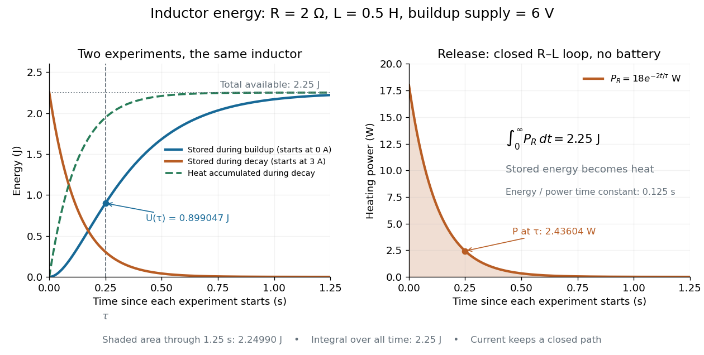

**[Figure 5](#image-stored-magnetic-energy-and-its-release-as-joule-heating-in-an-rl-circuit). Stored magnetic energy and its release as Joule heating in an RL circuit**. Left: the [inductor](#inductor)'s [magnetic energy](electromagnetic-wave.md#magnetic-energy) during buildup and a separate decay experiment starting at $3\,\mathrm A$. Right: the [power](energy.md#power) of [Joule heating](electric-charge.md#joule-heating) during decay; the shaded [integral](integral.md) over all time is $2.25\,\mathrm J$. The decay path stays closed through [electrical resistance](electric-charge.md#electrical-resistance) $2\,\Omega$ and [self-inductance](#self-inductance) $0.5\,\mathrm H$.

During the closed-loop release in [RL circuit](electrical-circuit.md#rl-circuit), stored [magnetic energy](electromagnetic-wave.md#magnetic-energy) plus accumulated [Joule heating](electric-charge.md#joule-heating) stays $2.25\,\mathrm J$. A real coil also has [electrical resistance](electric-charge.md#electrical-resistance), so its [Joule heating](electric-charge.md#joule-heating) must be included separately from ideal [inductor](#inductor) storage. The constant-$L$ formulas assume a fixed linear magnetic response.

##### Energy stored in a nonlinear inductor

↑ **Parent:** [Inductor](#inductor)

For a reversible device with flux linkage $\Psi$, electrical power is $I\dot\Psi$, so stored energy changes by $dU=I\,d\Psi$. This reduces to $U=LI^2/2$ only for a fixed linear [inductance](#inductance). [Hysteresis](critical-phenomenon.md#hysteresis) makes energy path dependent and introduces loss.

## Bound charge and bound current

↑ **Parent:** [Electromagnetism](electromagnetism.md)

Polarization and magnetization produce the effective sources

$$
\rho_{\rm b}=-\nabla\cdot P,
\qquad
J_{\rm b}=\partial_tP+\nabla\times M.
$$

Defining $D=\epsilon_0E+P$ and $H=B/\mu_0-M$ moves these sources into the macroscopic fields.

### Bound charge

↑ **Parent:** [Bound charge and bound current](#bound-charge-and-bound-current)

The effective [electric charge](electric-charge.md) associated with [electric polarization](#polarization-density) is bound charge. For [polarization density](#polarization-density) $\mathbf P$, its volume [charge density](electric-charge.md#charge-density) is $\rho_{\mathrm b}=-\nabla\cdot\mathbf P$. At a boundary with unpolarized surroundings, its [surface charge density](electrostatics.md#surface-charge-density) is $\sigma_{\mathrm b}=\mathbf P\cdot\mathbf n$, where $\mathbf n$ is the outward [unit normal vector](differential-geometry.md#unit-normal).

### Bound current

↑ **Parent:** [Bound charge and bound current](#bound-charge-and-bound-current)

The current associated with [electric polarization](#polarization-density) and [magnetization](#magnetization) in matter. If the magnetic response is neglected, it is $\mathbf J_b=\partial_t\mathbf P$. It is distinguished from a free conduction current in the [Maxwell equations in matter](maxwell-equations.md#maxwell-equations-in-matter).

### Polarization density

↑ **Parent:** [Bound charge and bound current](#bound-charge-and-bound-current)  
ⓦ [Wiki](https://en.wikipedia.org/wiki/Polarization_density)

Electric polarization is electric dipole moment per unit volume. It produces bound volume and surface charge

$$
\rho_{\rm b}=-\nabla\cdot\mathbf P,
\qquad
\sigma_{\rm b}=\mathbf P\cdot\mathbf n.
$$

Across an interface, the net bound sheet charge is $(\mathbf P_1-\mathbf P_2)\cdot\mathbf n$, where $\mathbf n$ points from medium one to medium two.

#### Born effective charge

↑ **Parent:** [Polarization density](#polarization-density)

A [tensor](multilinear-algebra.md#tensor) derivative of polarization with respect to a sublattice displacement at specified macroscopic electrical conditions. It includes electronic rearrangement and need not equal a formal ionic charge.

#### Paraelectricity

↑ **Parent:** [Polarization density](#polarization-density)

A phase without spontaneous switchable [electric polarization](#polarization-density), although an applied [electric field](electric-field.md) can induce [electric polarization](#polarization-density). A material can be [paraelectric](#paraelectricity) above a transition to a [ferroelectric](engineering.md#ferroelectricity) phase.

#### Spontaneous polarization

↑ **Parent:** [Polarization density](#polarization-density)

[electric polarization](#polarization-density) present in a polar material without an externally applied [electric field](electric-field.md).

#### Pyroelectricity

↑ **Parent:** [Polarization density](#polarization-density)

Change of spontaneous [electric polarization](#polarization-density) with [temperature](temperature.md).

##### Pyroelectric coefficient

↑ **Parent:** [Pyroelectricity](#pyroelectricity)

The [temperature](temperature.md) derivative of a component of spontaneous [electric polarization](#polarization-density) under stated mechanical/electrical constraints. An [electrode](electrochemistry.md#electrode) of area $A$ has ideal short-circuit response $I=pA\,dT/dt$. Mechanical constraints distinguish primary and secondary contributions.

##### Pyroelectric generator

↑ **Parent:** [Pyroelectricity](#pyroelectricity)

A device that delivers electrical charge during changes of [temperature](temperature.md) of a polar material.

##### Secondary pyroelectric effect

↑ **Parent:** [Pyroelectricity](#pyroelectricity)

The piezoelectric contribution to temperature-dependent [electric polarization](#polarization-density) caused by thermal [strain](continuum-mechanics.md#strain).

##### Primary pyroelectric effect

↑ **Parent:** [Pyroelectricity](#pyroelectricity)

The [temperature](temperature.md) dependence of [electric polarization](#polarization-density) at fixed [strain](continuum-mechanics.md#strain).

#### Depolarization field

↑ **Parent:** [Polarization density](#polarization-density)  
ⓦ [Wiki](https://en.wikipedia.org/wiki/Depolarization_field)

The [electric field](electric-field.md) produced by the [bound charge](#bound-charge) of a polarized body is its [depolarization field](#depolarization-field). For a uniformly polarized [ellipsoid](euclidean-geometry.md#ellipsoid) in [vacuum](physics.md#vacuum), the internal [depolarization field](#depolarization-field) is uniform and opposes the relevant component of the [electric polarization](#polarization-density): $E_{{\rm dep},i}=-N_iP_i/\epsilon_0$. Its dimensionless geometric factors obey $N_x+N_y+N_z=1$.

##### Depolarization factor of a dielectric ellipsoid

↑ **Parent:** [Depolarization field](#depolarization-field)

For a homogeneous linear isotropic [dielectric](permittivity.md#dielectric) in [vacuum](physics.md#vacuum), $P_i=\epsilon_0(\epsilon_r-1)E_{{\rm in},i}$. Combining this with the [depolarization field](#depolarization-field) and the imposed uniform [electric field](electric-field.md) gives $E_{{\rm in},i}=E_{0,i}/[1+N_i(\epsilon_r-1)]$. A [sphere](euclidean-geometry.md#sphere) has $N_i=1/3$. An infinite slab has $N=1$ normal to its faces and $N=0$ in its plane. A very long circular rod has $N=0$ along its axis and $N=1/2$ transverse to it. Slab and rod statements are limiting geometries, with end effects neglected; a finite cylinder does not generally have an exactly uniform internal [electric field](electric-field.md).

#### Uniformly polarized sphere

↑ **Parent:** [Polarization density](#polarization-density)

A sphere with constant [electric polarization](#polarization-density) $\mathbf P=P\widehat{\mathbf z}$ has zero volume bound charge and surface bound [charge density](electric-charge.md#charge-density) $\sigma_b=P\cos\theta$. Integrating $\mathbf r\sigma_b\,dA$ gives the displayed [electric dipole moment](electrostatics.md#electric-dipole-moment). The surface distribution is purely degree one in [spherical harmonics](analysis.md#spherical-harmonic), so its external static [electric potential](electric-field.md#electric-potential) is exactly dipolar. Its interior field is finite and is not that of a point singularity.

#### Electric displacement field

↑ **Parent:** [Polarization density](#polarization-density)  
ⓦ [Wiki](https://en.wikipedia.org/wiki/Electric_displacement_field)

The electric displacement is $\mathbf D=\epsilon_0\mathbf E+\mathbf P$ and obeys $\nabla\cdot\mathbf D=\rho_{\rm free}$. In a linear isotropic dielectric, $\mathbf D=\epsilon\mathbf E$.

### Magnetization

↑ **Parent:** [Bound charge and bound current](#bound-charge-and-bound-current)  
ⓦ [Wiki](https://en.wikipedia.org/wiki/Magnetization)

[Magnetization](#magnetization) is [magnetic dipole moment](#magnetic-dipole-moment) per unit [volume](geometry-and-topology.md#volume), described by a [vector field](multivariable-calculus.md#vector-field) $\mathbf M(\mathbf r)$. Average the microscopic [magnetic dipole moments](#magnetic-dipole-moment) in a small region of [volume](geometry-and-topology.md#volume) $\Delta V$ around the [point](geometry-and-topology.md#point-geometry) $\mathbf r$:

$$
\mathbf M(\mathbf r)\simeq\frac{1}{\Delta V}\sum_{i\in\Delta V}\mathbf m_i,
\qquad
\mathbf m_{\rm total}=\int_V\mathbf M\,dV.
$$

The averaging region should contain many microscopic constituents while being small compared with the distance over which the macroscopic [magnetization](#magnetization) varies. With [number density](statistical-physics.md#number-density) $n$ of identical constituents, this becomes $\mathbf M=n\langle\mathbf m\rangle$. [Magnetic dipole moment](#magnetic-dipole-moment) has [SI](physics.md#international-system-of-units) units $\mathrm{A\,m^2}$, so [magnetization](#magnetization) has units $\mathrm{A/m}$: [amperes](electric-charge.md#ampere) per metre. The average is a [vector](vector-space.md#vector) sum, not a sum of magnitudes.[Classical Electromagnetism: An intermediate level course by Richard Fitzpatrick; Magnetization, equations (856)–(857) and the surrounding averaging definition](physics-bibliography.md#classical-electromagnetism-an-intermediate-level-course-by-richard-fitzpatrick/magnetization)

Alignment can change [magnetization](#magnetization) without changing the magnitude of any individual [magnetic dipole moment](#magnetic-dipole-moment). In a constructed counting example, eight equal [magnetic dipole moments](#magnetic-dipole-moment) of magnitude $m_0$ occupy the same [volume](geometry-and-topology.md#volume) $\Delta V$. Six along $+z$ and two along $-z$ give $\mathbf M=4m_0\widehat{\mathbf z}/\Delta V$; turning the two opposing [magnetic dipole moments](#magnetic-dipole-moment) to $+z$ doubles [magnetization](#magnetization) to $8m_0\widehat{\mathbf z}/\Delta V$. Both arrangements have the same sum of magnitudes, $8m_0$. Changing the individual [magnetic dipole moments](#magnetic-dipole-moment) provides another possible response; their alignment and their magnitudes are distinct ingredients. Microscopic [spin](angular-momentum-operator.md#spin) contributes [magnetic dipole moment](#magnetic-dipole-moment) without being a literal rotating charged ball.

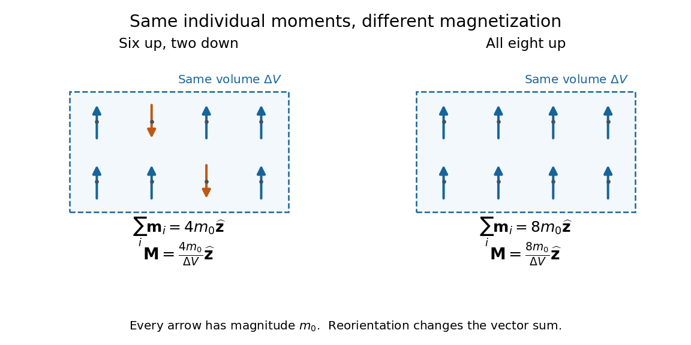

**[Figure 6](#image-magnetization-depends-on-the-vector-average-of-magnetic-dipole-moments). Magnetization depends on the vector average of magnetic dipole moments**. Original eight-[magnetic dipole moment](#magnetic-dipole-moment) counting model, with equal arrow lengths and equal averaging [volumes](geometry-and-topology.md#volume). Reorienting two arrows doubles the net [magnetic dipole moment](#magnetic-dipole-moment) without enlarging any individual [magnetic dipole moment](#magnetic-dipole-moment). The small count illustrates the sum; a macroscopic averaging region contains many more constituents.

Distinguish [magnetization](#magnetization) $\mathbf M$, [magnetic field](magnetic-field.md) $\mathbf B$, and [magnetic field intensity](#magnetic-field-intensity) $\mathbf H$. In [SI](physics.md#international-system-of-units),

$$
\mathbf B=\mu_0(\mathbf H+\mathbf M),\qquad
[\mathbf M]=[\mathbf H]=\mathrm{A/m},\qquad [\mathbf B]=\mathrm T.
$$

Here $\mu_0$ is the [vacuum permeability](maxwell-equations.md#vacuum-permeability), and $\mathrm T$ denotes the [tesla](magnetic-field.md#tesla-unit). [Magnetization](#magnetization) describes matter's [magnetic dipole moment](#magnetic-dipole-moment) density; [magnetic field](magnetic-field.md) enters the [Lorentz force](relativistic-electromagnetism.md#lorentz-force); [magnetic field intensity](#magnetic-field-intensity) separates the free [electric current](electric-charge.md#electric-current) contribution in the macroscopic equations. In particular, zero applied [magnetic field](magnetic-field.md) does not generally imply $\mathbf H=0$ inside a finite magnet: its [demagnetizing field](statistical-physics.md#demagnetizing-field) depends on shape.[Classical Electromagnetism: An intermediate level course by Richard Fitzpatrick; Magnetization, equations (860)–(864): current decomposition and definition of H](physics-bibliography.md#classical-electromagnetism-an-intermediate-level-course-by-richard-fitzpatrick/magnetization)

For stationary [electric polarization](#polarization-density), [magnetization](#magnetization) produces [bound current](#bound-current) in the [volume](geometry-and-topology.md#volume) and on its bounding [surface](topological-surface.md):

$$
\mathbf J_{\rm b}=\nabla\times\mathbf M,
\qquad
\mathbf K_{\rm b}=\mathbf M\times\mathbf n.
$$

The [curl](multivariable-calculus.md#curl) gives a [current density](electric-charge.md#current-density) in $\mathrm{A/m^2}$; $\mathbf K_{\rm b}$ is a [surface current density](electric-charge.md#surface-current-density) in $\mathrm{A/m}$. The [unit normal](differential-geometry.md#unit-normal) $\mathbf n$ points outward from the magnetized material into a region with zero [magnetization](#magnetization). Across an interface between two magnetized media, the net bound [current sheet](electric-charge.md#current-sheet) is

$$
\mathbf K_{\rm interface}=(\mathbf M_1-\mathbf M_2)\times\mathbf n,
$$

where the [unit normal](differential-geometry.md#unit-normal) points from medium 1 to medium 2. Both faces contribute: medium 2 has the opposite outward [normal vector](differential-geometry.md#normal-vector). This fixes the [cross product](vector-space.md#cross-product) sign. If [electric polarization](#polarization-density) changes with time, add its contribution $\partial_t\mathbf P$ to the [bound current](#bound-current).[Classical Electromagnetism by Richard Fitzpatrick; Permanent Ferromagnets, equation (716): volume and outward-surface magnetization currents](physics-bibliography.md#classical-electromagnetism-by-richard-fitzpatrick/permanent-ferromagnets)

A short proof outline explains why both contributions are needed. Write $\mathbf M_{\rm ext}=\mathbf M\,\chi_V$, where $\chi_V$ is the [indicator function](measure-theory.md#indicator-function) of the material's [volume](geometry-and-topology.md#volume). In the sense of [distributions](distribution-theory.md#distribution-mathematical-analysis), its [gradient](multivariable-calculus.md#gradient) is $\nabla\chi_V=-\mathbf n\delta_S$, with $\delta_S$ the [surface delta distribution](distribution-theory.md#surface-delta-distribution). The [product rule](calculus.md#product-rule) for the [curl](multivariable-calculus.md#curl) gives

$$
\nabla\times(\chi_V\mathbf M)
=\chi_V\nabla\times\mathbf M+(\mathbf M\times\mathbf n)\delta_S.
$$

Thus a constant interior [magnetization](#magnetization) can have zero interior [curl](multivariable-calculus.md#curl) and still produce a nonzero boundary [electric current](electric-charge.md#electric-current). Equivalently, neighboring ideal microscopic [current loops](#current-loop) cancel along shared edges while uncompensated edges remain on the outside. This [bound current](#bound-current) representation predicts the same macroscopic [magnetic field](magnetic-field.md) as the [magnetization](#magnetization) distribution; it does not require a wire or free charge transport around the magnet. Its usefulness is that the familiar [Biot-Savart law](#biot-savart-law) can now calculate the [magnetic field](magnetic-field.md) from a specified [magnetization](#magnetization).

A time-dependent average [magnetization](#magnetization) need not vary smoothly under a smooth drive. The [Barkhausen effect](#barkhausen-effect) resolves collective jumps through their induced [electromotive force](electric-charge.md#electromotive-force); [Barkhausen pulse area](#barkhausen-pulse-area) explains how that derivative readout relates to the underlying change.

#### Magnetization density

↑ **Parent:** [Magnetization](#magnetization)

For a lattice [spin](angular-momentum-operator.md#spin) system, [magnetization density](#magnetization-density) often means longitudinal [spin](angular-momentum-operator.md#spin) per site, $\langle S^z_{\rm tot}\rangle/N$. A magnetic moment per physical volume instead includes the gyromagnetic conversion and lattice-site [number density](statistical-physics.md#number-density). The convention should be specified when comparing a spin-chain result with SI [magnetization](#magnetization).

#### Zero-field-cooled magnetization

↑ **Parent:** [Magnetization](#magnetization)

[Magnetization](#magnetization) measured after cooling without an applied field and then applying a measuring field. Comparison with [field-cooled magnetization](#field-cooled-magnetization) probes history dependence and slow relaxation.

#### Field-cooled magnetization

↑ **Parent:** [Magnetization](#magnetization)

[Magnetization](#magnetization) measured after cooling in an applied field, which can select magnetic domains or bias blocked moments.

#### Magnetic saturation

↑ **Parent:** [Magnetization](#magnetization)

[Magnetic saturation](#magnetic-saturation) is the regime in which increasing the applied [magnetic field intensity](#magnetic-field-intensity) produces little further increase in [magnetization](#magnetization). The total [magnetic flux density](magnetic-field.md) can still increase through its vacuum contribution, $\mathbf B=\mu_0(\mathbf H+\mathbf M)$. Consequently a constant large [magnetic permeability](maxwell-equations.md#permeability-electromagnetism) cannot describe a core throughout this regime; ideal [magnetic circuit](#magnetic-circuit) predictions based on that assumption overestimate field concentration.

#### Uniformly magnetized cylinder

↑ **Parent:** [Magnetization](#magnetization)

Prescribe constant [magnetization](#magnetization) $\mathbf M=M\widehat{\mathbf z}$, with $M>0$, inside a [circular cylinder](differential-geometry.md#circular-cylinder) of [radius](topology.md#radius) $R$ and [length](physics.md#length) $L$, surrounded by zero [magnetization](#magnetization). In [cylindrical coordinates](multivariable-calculus.md#cylindrical-coordinate-system), the outward [unit normal](differential-geometry.md#unit-normal) on the curved [surface](topological-surface.md) is $\widehat{\mathbf r}$, so

$$
\mathbf J_{\rm b}=\mathbf0\quad\text{in the interior},\qquad
\mathbf K_{\rm b}=M\widehat{\mathbf z}\times\widehat{\mathbf r}
=M\widehat{\boldsymbol\phi}\quad\text{on the side}.
$$

The endcaps have outward [unit normals](differential-geometry.md#unit-normal) $+\widehat{\mathbf z}$ and $-\widehat{\mathbf z}$. Their [cross products](vector-space.md#cross-product) with [magnetization](#magnetization) vanish, so $\mathbf K_{\rm b}=0$ on each endcap. The side [bound current](#bound-current) circulates counterclockwise when viewed from $+z$, by the [right-hand rule](#right-hand-rule). Zero endcap [surface current density](electric-charge.md#surface-current-density) does not imply zero endcap [magnetic field](magnetic-field.md).

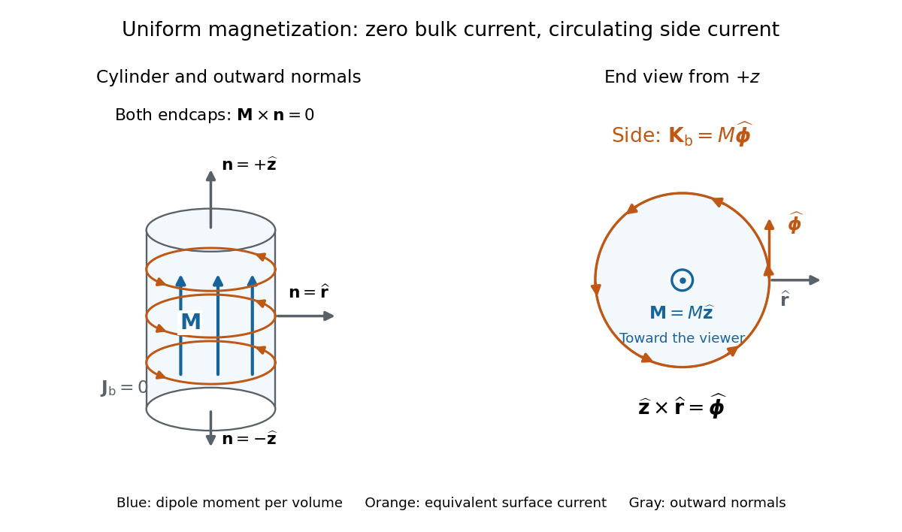

**[Figure 7](#image-a-uniformly-magnetized-circular-cylinder-is-equivalent-to-a-circumferential-bound-current-sheet). A uniformly magnetized circular cylinder is equivalent to a circumferential bound current sheet**. Original prescribed-[magnetization](#magnetization) geometry. Blue arrows represent $\mathbf M$; orange arrows represent side [surface current density](electric-charge.md#surface-current-density), not independent wires. The end view looks from $+z$. The endcap [unit normals](differential-geometry.md#unit-normal) are parallel or antiparallel to $\mathbf M$, so neither endcap carries [bound current](#bound-current). The drawing specifies source geometry, not a uniform finite-cylinder [magnetic field](magnetic-field.md).

For an original example, let $M=800\,\mathrm{A/m}$, $R=0.020\,\mathrm m$, and $L=0.10\,\mathrm m$. The [volume](geometry-and-topology.md#volume) and total [magnetic dipole moment](#magnetic-dipole-moment) are

$$
V=\pi R^2L=4\pi\times10^{-5}\,\mathrm{m^3},\qquad
\mathbf m=MV\widehat{\mathbf z}
=0.032\pi\,\mathrm{A\,m^2}\widehat{\mathbf z}
\approx0.100531\,\mathrm{A\,m^2}\widehat{\mathbf z}.
$$

Check the result independently using the equivalent [bound current](#bound-current): a side strip of axial [length](physics.md#length) $dz$ forms a [current loop](#current-loop) with $dI=M\,dz$ and [magnetic dipole moment](#magnetic-dipole-moment) $d\mathbf m=\pi R^2M\,dz\,\widehat{\mathbf z}$. Its [integral](integral.md) over $L$ gives the same $M\pi R^2L\widehat{\mathbf z}$. In particular, $ML=80\,\mathrm A$ is the sum of the equivalent loop [electric currents](electric-charge.md#electric-current) across a full axial cut; it is not a [surface current density](electric-charge.md#surface-current-density).

The side [surface current density](electric-charge.md#surface-current-density) has exactly the geometry of a continuum [solenoid](magnetic-field.md#solenoid) with $nI=M$, where $n$ is [solenoid turn density](magnetic-field.md#solenoid-turn-density). In the infinite-cylinder idealization with no applied [magnetic field](magnetic-field.md), the [long-solenoid approximation](magnetic-field.md#long-solenoid-approximation) therefore becomes

$$
\mathbf B_{\rm in}=\mu_0M\widehat{\mathbf z},\qquad
\mathbf B_{\rm out}=\mathbf0,\qquad\mathbf H=\mathbf0.
$$

The [limit](calculus.md#limit-of-a-function) is useful well away from the ends of a sufficiently long [circular cylinder](differential-geometry.md#circular-cylinder). A finite [circular cylinder](differential-geometry.md#circular-cylinder) instead has fringing [magnetic field](magnetic-field.md) and a [demagnetizing field](statistical-physics.md#demagnetizing-field). For this prescribed uniform [magnetization](#magnetization), integrate the [on-axis magnetic field of a circular current loop](#on-axis-magnetic-field-of-a-circular-current-loop), or substitute $nI=M$ in the [on-axis magnetic field of a finite solenoid](magnetic-field.md#on-axis-magnetic-field-of-a-finite-solenoid), to obtain the central [magnetic field](magnetic-field.md):

$$
B_z(0)=\mu_0M\frac{L}{\sqrt{L^2+4R^2}}.
$$

Our example has $L/(2R)=2.5$ and $B_z(0)/(\mu_0M)=5/\sqrt{29}\approx0.92848$, rather than unity. With the rounded [vacuum permeability](maxwell-equations.md#vacuum-permeability) $\mu_0\approx4\pi\times10^{-7}\,\mathrm{T\,m/A}$, this is approximately $0.9334\,\mathrm{mT}$, compared with the infinite-cylinder value $1.0053\,\mathrm{mT}$. These are model calculations for a prescribed [magnetization](#magnetization), not measured values or a solution for the self-consistent [magnetization](#magnetization) of an arbitrary material.

#### Vibrating-sample magnetometer

↑ **Parent:** [Magnetization](#magnetization)  
ⓦ [Wiki](https://en.wikipedia.org/wiki/Vibrating-sample_magnetometer)

A [vibrating-sample magnetometer](#vibrating-sample-magnetometer) measures a specimen's [magnetic dipole moment](#magnetic-dipole-moment) through the induced [electromotive force](electric-charge.md#electromotive-force) as it moves relative to stationary pickup coils. Dividing that [magnetic dipole moment](#magnetic-dipole-moment) by the specimen's independently determined [volume](geometry-and-topology.md#volume) gives its average [magnetization](#magnetization).

In [Simon Foner](physicist.md#simon-foner)'s 1959 apparatus, the specimen was weighed and glued to a mount. A loudspeaker drive moved it perpendicular to an applied uniform [magnetic field](magnetic-field.md) between magnet poles; stationary coils detected the induced [electromotive force](electric-charge.md#electromotive-force). A reference magnet on the same vibrating assembly generated a second coil [electromotive force](electric-charge.md#electromotive-force). Adjusting the reference [voltage divider](electrical-engineering.md#voltage-divider) to an electrical null compared the specimen signal with this reference. The [measurement calibration](physics.md#measurement-calibration) substituted a magnetically saturated pure [nickel](chemical-substance.md#nickel) sphere of known [magnetic dipole moment](#magnetic-dipole-moment); a specimen-removed reading corrected the mount's contribution. The calibrated signal inferred the specimen's [magnetic dipole moment](#magnetic-dipole-moment), not its local [magnetization](#magnetization) map. [Measurement uncertainty](physics.md#measurement-uncertainty) in the standard, positioning, finite specimen size, coil noise, and mechanical coupling limited the inference.[Versatile and Sensitive Vibrating-Sample Magnetometer, pp. 549–550, §I and Figs. 1–2; p. 553, §IV and Fig. 9; p. 554, §§V.A–B; p. 556, §§V.G and VI.A.1](physics-bibliography.md#versatile-and-sensitive-vibrating-sample-magnetometer-by-simon-foner)

The readout follows [Faraday's law of induction](maxwell-equations.md#faraday-s-law-of-induction). In a small-displacement model with constant projected [magnetic dipole moment](#magnetic-dipole-moment) $m$, let the pickup-coil [magnetic flux](magnetic-field.md#magnetic-flux) linkage be $\Phi(z)=g(z)m$ and the specimen motion be $z(t)=z_0+a\cos\omega t$. Here $g$ incorporates coil geometry and turn count, $a$ is the displacement [amplitude](wave.md#wave-amplitude), and $\omega$ is [angular frequency](lagrangian-mechanics.md#angular-frequency). To first order in displacement, with $g'(z_0)$ the [derivative](calculus.md#derivative) at the mean position,

$$
V(t)=-\frac{d\Phi}{dt}\simeq m\,g'(z_0)a\omega\sin\omega t.
$$

This is an original idealized readout relation: a larger induced [electromotive force](electric-charge.md#electromotive-force) can mean larger [magnetic dipole moment](#magnetic-dipole-moment), greater motion, or a changed coil position. A synchronously moving reference allows common motion factors to cancel in the ratio of induced [electromotive forces](electric-charge.md#electromotive-force). The [measurement calibration](physics.md#measurement-calibration) and specimen-removed control are therefore integral to the measurement. A single [amplitude](wave.md#wave-amplitude) reading cannot by itself distinguish microscopic alignment from a change in individual [magnetic dipole moments](#magnetic-dipole-moment).

#### Paramagnetism

↑ **Parent:** [Magnetization](#magnetization)  
ⓦ [Wiki](https://en.wikipedia.org/wiki/Paramagnetism)

In a linear isotropic regime, a paramagnetic material has positive [magnetic susceptibility](statistical-physics.md#magnetic-susceptibility): its induced [magnetization](#magnetization) is aligned with the applied [magnetic field intensity](#magnetic-field-intensity). [Molecular oxygen](chemical-substance.md#molecular-oxygen) supplies an example discussed through [molecular orbital theory](chemistry.md#molecular-orbital-theory) in the [covalent bond](covalent-bond.md) article.

##### Curie response of an arbitrary independent spin

↑ **Parent:** [Paramagnetism](#paramagnetism)

At fixed positive [temperature](temperature.md) and weak field, independent spin-$J$ moments have total moment $M=N(g\mu_B)^2J(J+1)B/(3k_BT)$. This is the [Curie law](statistical-physics.md#curie-s-law); the corresponding [density](fluid-mechanics.md#density) divides by the sample volume.

##### Brillouin magnetization formula

↑ **Parent:** [Paramagnetism](#paramagnetism)

For independent distinguishable moments with angular [momentum](momentum.md) $J$, define $y=g\mu_BB/(k_BT)$. The one-site [partition function](canonical-ensemble.md#canonical-partition-function) is $Z=\sinh[(J+1/2)y]/\sinh(y/2)$. Its logarithmic derivative gives $\langle\mu_z\rangle=g\mu_B[(J+1/2)\coth((J+1/2)y)-\tfrac12\coth(y/2)]$. At $J=1/2$ this reduces to $(g\mu_B/2)\tanh(y/2)$.

##### Thermally activated paramagnetism

↑ **Parent:** [Paramagnetism](#paramagnetism)

Paramagnetism arising when thermal excitation populates a magnetic manifold above a less magnetic or nonmagnetic ground manifold. Competing thermal population and orientational randomization can produce a maximum in susceptibility at an intermediate temperature.

<h5 id="curie-weiss-law">Curie–Weiss law</h5>

↑ **Parent:** [Paramagnetism](#paramagnetism)  
ⓦ [Wiki](https://en.wikipedia.org/wiki/Curie–Weiss_law)

The [Curie–Weiss law](#curie-weiss-law) approximates the [magnetic susceptibility](statistical-physics.md#magnetic-susceptibility) of interacting localized moments by $\chi=C/(T-\Theta)$ in a suitable paramagnetic temperature range. A positive Weiss temperature often reflects predominantly ferromagnetic interactions, while a negative value often reflects antiferromagnetic interactions. It is not a universal exact law through an ordering transition, and crystal-field effects or itinerant carriers can require another description.

###### Weiss temperature

↑ **Parent:** [Curie–Weiss law](#curie-weiss-law)

The fitted temperature $\Theta$ in $\chi=C/(T-\Theta)$. It summarizes the leading high-temperature influence of interactions and need not equal the ordering temperature.

##### Spin-one-half paramagnetic magnetization

↑ **Parent:** [Paramagnetism](#paramagnetism)

For independent localized two-state moments of projections $\pm\mu$ along a field, the one-ion partition function is $Z_1=2\cosh[\mu B/(k_BT)]$. Its thermal mean gives $M=n\mu\tanh[\mu B/(k_BT)]$. A $J=1/2$ ion has $\mu=g_J\mu_B/2$, so the special value $\mu=\mu_B$ additionally assumes $g_J=2$. At weak field the SI volume susceptibility is $\chi_H=\mu_0n\mu^2/(k_BT)$, neglecting demagnetizing corrections.

###### Independent-spin magnetic entropy

↑ **Parent:** [Spin-one-half paramagnetic magnetization](#spin-one-half-paramagnetic-magnetization)

For independent moments with magnetic energies $\mp\mu B$, $Z=(2\cosh x)^N$ and $S=Nk_B[\ln(2\cosh x)-x\tanh x]$, where $x=\mu B/(k_BT)$. This counts the magnetic orientations only, excluding translational and lattice [entropy](entropy.md).

#### Curie temperature

↑ **Parent:** [Magnetization](#magnetization)  
ⓦ [Wiki](https://en.wikipedia.org/wiki/Curie_temperature)

The Curie temperature is the transition temperature above which a ferromagnetic material loses spontaneous [magnetization](#magnetization). A hot conducting planetary core can generate a [magnetic field](magnetic-field.md) through [dynamo action](resistive-magnetohydrodynamics.md#dynamo-action) without behaving as a permanent magnet. The blocking temperature at which a mineral records crustal remanence also depends on its relaxation timescale and need not equal its Curie temperature.

#### Remanent magnetization

↑ **Parent:** [Magnetization](#magnetization)

Remanent magnetization is [magnetization](#magnetization) retained after the applied [magnetic field](magnetic-field.md) has been removed. Magnetic minerals cooling in an ambient field can preserve information about that field in a planetary crust. Such a record may outlive the [planetary dynamo](planetary-science.md#planetary-dynamo) which originally produced it. Crustal remanence therefore differs from a present field maintained by conducting-fluid motion.

#### Magnetization current

↑ **Parent:** [Magnetization](#magnetization)

A relativistic magnetization current has the form $J_{\mathrm{mag}}^\mu=\partial_\nu M^{\nu\mu}$ for an antisymmetric polarization-magnetization tensor. It is identically conserved because commuting derivatives contract an antisymmetric tensor.

#### Magnetic field intensity

↑ **Parent:** [Magnetization](#magnetization)

The magnetic field intensity is $\mathbf H=\mathbf B/\mu_0-\mathbf M$ and obeys $\nabla\times\mathbf H=\mathbf J_{\rm free}$ in magnetostatics. In a linear isotropic medium, $\mathbf B=\mu\mathbf H$.

#### Ferromagnetism

↑ **Parent:** [Magnetization](#magnetization)  
ⓦ [Wiki](https://en.wikipedia.org/wiki/Ferromagnetism)

[Ferromagnetism](#ferromagnetism) is collective magnetic order with [spontaneous magnetization](spin-model.md#spontaneous-magnetization) below a [Curie temperature](#curie-temperature). Interactions favor aligned [magnetic moments](#magnetic-dipole-moment); the [Ising model](spin-model.md#ising-model) represents a two-orientation version with positive coupling.

A [magnetic domain](#magnetic-domain) can possess [spontaneous magnetization](spin-model.md#spontaneous-magnetization) even when other domains cancel its contribution to the whole specimen. Compare this spatial cancellation between domains with [antiferromagnetism](#antiferromagnetism), where opposing [magnetic sublattices](#magnetic-sublattice) compensate within the ordered structure, and [ferrimagnetism](#ferrimagnetism), where their contributions are generally unequal. The [magnetic sublattice](#magnetic-sublattice) diagram makes the three local patterns explicit.

Smoothly sweeping an applied [magnetic field](magnetic-field.md) can reveal abrupt [magnetization](#magnetization) changes through the [Barkhausen effect](#barkhausen-effect). A [pickup coil](maxwell-equations.md#pickup-coil) detects the resulting changes of [magnetic flux](magnetic-field.md#magnetic-flux), making collective [magnetic domain wall](#magnetic-domain-wall) motion accessible as an electrical [signal](electrical-engineering.md#signal).

##### Hard magnetic material

↑ **Parent:** [Ferromagnetism](#ferromagnetism)

A [hard magnetic material](#hard-magnetic-material) strongly resists reversal of its [magnetization](#magnetization), giving high coercivity and useful remanence for permanent magnets. The relevant hardness is magnetic, not a mechanical strength rating.

##### Soft magnetic material

↑ **Parent:** [Ferromagnetism](#ferromagnetism)

A [soft magnetic material](#soft-magnetic-material) changes its [magnetization](#magnetization) relatively easily and has a low coercive field. High useful permeability and small [hysteresis](critical-phenomenon.md#hysteresis) losses favour such materials in electromagnets and alternating-field cores. “Soft” describes magnetic response rather than mechanical softness; electrically resistive [ferrimagnets](#ferrimagnetism) can also be magnetically soft.

##### Ferromagnet

↑ **Parent:** [Ferromagnetism](#ferromagnetism)

A [ferromagnet](#ferromagnet) is a material that exhibits [ferromagnetism](#ferromagnetism). Its [magnetic domains](#magnetic-domain) can cancel the net [magnetization](#magnetization) even while each domain remains ordered.

##### Magnetic domain

↑ **Parent:** [Ferromagnetism](#ferromagnetism)  
ⓦ [Wiki](https://en.wikipedia.org/wiki/Magnetic_domain)

A [magnetic domain](#magnetic-domain) is a region sharing an ordered magnetic orientation. Different [magnetic domains](#magnetic-domain) can reduce the total [magnetic moment](#magnetic-dipole-moment) without erasing the local [magnetic order](#magnetic-order). A zero total [magnetization](#magnetization) therefore does not by itself establish [antiferromagnetism](#antiferromagnetism).

###### Single-domain ferromagnetic particle

↑ **Parent:** [Magnetic domain](#magnetic-domain)

A ferromagnetic particle with no internal domain wall. [Magnetization](#magnetization) reversal can proceed by rotation or nonuniform modes; [thermal activation](statistical-physics.md#thermal-activation) and [anisotropy](continuum-mechanics.md#anisotropy) determine blocking and [coercivity](real-analysis.md#coercive-function). Small size alone does not guarantee a permanent hard magnet.

###### Magnetic domain wall

↑ **Parent:** [Magnetic domain](#magnetic-domain)  
ⓦ [Wiki](https://en.wikipedia.org/wiki/Domain_wall_(magnetism))

A [magnetic domain wall](#magnetic-domain-wall) separates differently oriented [magnetic domains](#magnetic-domain). Its motion changes their [volumes](geometry-and-topology.md#volume) and average [magnetization](#magnetization). It is a magnetic [domain wall](critical-phenomenon.md#domain-wall).

An original two-[magnetic domain](#magnetic-domain) model makes the collective change explicit. Suppose opposite regions have [magnetizations](#magnetization) $+M_s$ and $-M_s$ along the measuring axis, where $M_s$ is the local [saturation magnetization](statistical-physics.md#saturation-magnetization). If a [magnetic domain wall](#magnetic-domain-wall) sweeps [volume](geometry-and-topology.md#volume) $\Delta V$ from the negative region into the positive one, in a specimen of fixed [volume](geometry-and-topology.md#volume) $V$, then

$$
\Delta m=2M_s\Delta V,\qquad
\Delta M=\frac{2M_s\Delta V}{V}.
$$

The factor two comes from replacing $-M_s$ by $+M_s$. The local magnitude $M_s$ stays fixed while the average [magnetization](#magnetization) changes; the event size depends on the swept [volume](geometry-and-topology.md#volume), rather than a universal single-[spin](angular-momentum-operator.md#spin) increment.

###### Wall and stray-energy comparison in a magnetic particle

↑ **Parent:** [Magnetic domain wall](#magnetic-domain-wall)

A trial domain pattern costs wall energy $\gamma_wA_w$ and can release stray energy $\Delta U$. For a stable uniform ground state, $\gamma_wA_w\geq\Delta U$ within that trial model. Substituting the entire initial stray energy assumes that it is nearly all removed; a numerical lower bound independent of the domain geometry does not follow from single-domain observation alone.

###### Magnetic domain-wall pinning

↑ **Parent:** [Magnetic domain wall](#magnetic-domain-wall)

Spatial variations in [energy](energy.md), including [crystal defects](physical-chemistry.md#crystallographic-defect), can trap a [magnetic domain wall](#magnetic-domain-wall). This is [magnetic domain-wall pinning](#magnetic-domain-wall-pinning). Increasing the applied [magnetic field](magnetic-field.md) can release the wall into a collective jump.

##### Barkhausen effect

↑ **Parent:** [Ferromagnetism](#ferromagnetism)  
ⓦ [Wiki](https://en.wikipedia.org/wiki/Barkhausen_effect)

The [Barkhausen effect](#barkhausen-effect) consists of abrupt [magnetization](#magnetization) changes during a smooth applied [magnetic field](magnetic-field.md) sweep. Its inductive [signal](electrical-engineering.md#signal) is [Barkhausen noise](#barkhausen-effect), often arising from collective [magnetic domain wall](#magnetic-domain-wall) motion.[§I, p. 2: wall-motion interpretation](physics-bibliography.md#the-barkhausen-effect-by-gianfranco-durin-and-stefano-zapperi)

The distinction is between a smooth drive and an intermittent material response. A smooth macroscopic [hysteresis](critical-phenomenon.md#hysteresis) curve can hide smaller jumps. By [Faraday's law of induction](maxwell-equations.md#faraday-s-law-of-induction), a [pickup coil](maxwell-equations.md#pickup-coil) responds to the rate of change of linked [magnetic flux](magnetic-field.md#magnetic-flux), so a rapid jump can be conspicuous even when the total change is small. A pulse is not one [chemical atom](physics.md#atom-physics) flipping: neither its height nor the number of audible clicks counts individual [electron](physics.md#electron) [spins](angular-momentum-operator.md#spin). Qualitative crackling alone does not establish quantum [spin](angular-momentum-operator.md#spin); collective switching also admits a classical model with trapped interfaces. Compare the distinct mechanical readout of [angular momentum](momentum.md#angular-momentum) transfer in the [Einstein-de Haas effect](#einstein-de-haas-effect).

###### Inductive Barkhausen experiment

↑ **Parent:** [Barkhausen effect](#barkhausen-effect)

[Heinrich Barkhausen](physicist.md#heinrich-barkhausen)'s 1919 report used [iron](chemical-substance.md#iron), a 300-turn [pickup coil](maxwell-equations.md#pickup-coil), moving magnet, amplified telephone readout and galvanometer. Removing [iron](chemical-substance.md#iron) corrected drive pickup. [Appendix A, p. 46: later translation of the 1919 apparatus and blank control](physics-bibliography.md#the-barkhausen-effect-by-gianfranco-durin-and-stefano-zapperi)

A modern primary experiment by [Gianfranco Durin](physicist.md#gianfranco-durin) and [Stefano Zapperi](physicist.md#stefano-zapperi) used annealed [iron](chemical-substance.md#iron)–[silicon](chemical-substance.md#silicon) strips and amorphous alloys. A 60 cm [solenoid](magnetic-field.md#solenoid) swept a triangular [magnetic field intensity](#magnetic-field-intensity); a 50-turn [pickup coil](maxwell-equations.md#pickup-coil), wound within 1 mm, sensed the specimen. A preamplifier with a 3–20 kHz [low-pass filter](electrical-engineering.md#low-pass-filter) preceded sampling. Measurements selected the central [hysteresis](critical-phenomenon.md#hysteresis) region dominated by [magnetic domain wall](#magnetic-domain-wall) motion. Above-background threshold crossings defined event durations; integrating between crossings defined event sizes. These are reported procedures, rather than data generated for the diagrams.[pp. 1–2: apparatus, specimens and threshold integration](physics-bibliography.md#scaling-exponents-for-barkhausen-avalanches-in-polycrystals-and-amorphous-ferromagnets-by-gianfranco-durin-and-stefano-zapperi)

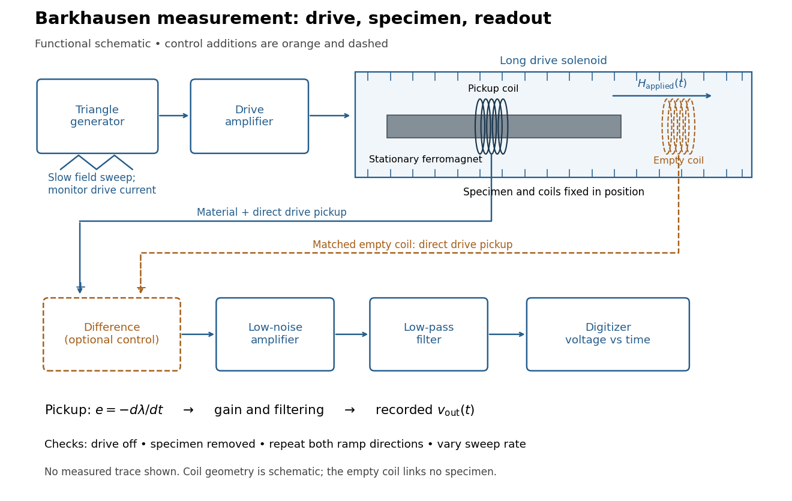

**[Figure 8](#image-barkhausen-effect-swept-magnetic-field-stationary-specimen-and-inductive-readout). Barkhausen effect: swept magnetic field, stationary specimen and inductive readout**. Original functional schematic of the modern measurement principle. The specimen and [pickup coil](maxwell-equations.md#pickup-coil) remain stationary; no torsional suspension or mechanical rotation is needed. The empty matching coil, difference stage and drive monitor show proposed controls, not an assertion that every component was present in the cited 2000 apparatus. The triangle indicates a drive waveform, not measured [Barkhausen noise](#barkhausen-effect).

For this stationary implementation, secure a thin [ferromagnet](#ferromagnet) and its [pickup coil](maxwell-equations.md#pickup-coil) inside a longer drive [solenoid](magnetic-field.md#solenoid), keeping their relative positions fixed. Drive the [solenoid](magnetic-field.md#solenoid) with a slow triangular [electric current](electric-charge.md#electric-current), monitor that [electric current](electric-charge.md#electric-current), and record the amplified, filtered induced [electromotive force](electric-charge.md#electromotive-force) with a digitizer. A speaker may make suitable frequencies audible, but the voltage record is needed for quantitative analysis. Slow variation of the drive does not require smooth [magnetization](#magnetization). A triangular drive supplies an approximately constant applied-field sweep rate along each ramp; it does not guarantee constant instantaneous $dM/dt$.

A proposed control sequence makes the inference testable. First record the electronics background with no drive. Repeat the same sweep with the specimen removed, retaining coil geometry: [mutual induction](#mutual-induction) from the drive can itself induce a voltage. A matching empty [pickup coil](maxwell-equations.md#pickup-coil) wired in opposition can suppress common drive pickup, after checking its matching. Compensation of air flux by an opposed coil is an established method.[§II.A.1, p. 4: opposed-coil compensation](physics-bibliography.md#the-barkhausen-effect-by-gianfranco-durin-and-stefano-zapperi) Then restore the specimen, repeat both sweep directions, reduce sweep rate, and compare the same [hysteresis](critical-phenomenon.md#hysteresis) region with fixed [amplifier](electrical-circuit.md#amplifier) gain, filter and threshold. Monitor drive irregularities and mechanical vibration; either can generate spurious pulses. These controls are recommendations for the schematic, rather than undocumented controls attributed to the modern paper.

A genuine material contribution should differ from the blank-coil record and change reproducibly with the magnetic preparation and sweep region. Quieting the drive tests drive-correlated pickup, but a held field need not eliminate all delayed material motion. Reversing the sweep is a consistency check on signed changes, not a demand that individual events retrace. A changing pulse count under a different filter or threshold cannot by itself establish changed microscopic dynamics. The useful inference is intermittent collective [magnetization](#magnetization) change within the instrument's [signal bandwidth](electrical-engineering.md#signal-bandwidth), with spatial detail left unresolved.

###### Barkhausen pulse area

↑ **Parent:** [Barkhausen effect](#barkhausen-effect)

Write the [magnetic flux linkage](#magnetic-flux-linkage) of the stationary [pickup coil](maxwell-equations.md#pickup-coil) as $\lambda=\sum_{n=1}^N\Phi_n$, in [SI](physics.md#international-system-of-units) units of [weber](magnetic-field.md#weber-unit). If every turn links the same [magnetic flux](magnetic-field.md#magnetic-flux) $\Phi$, then $\lambda=N\Phi$; the turn count is dimensionless. With a fixed winding and terminal convention, [Faraday's law of induction](maxwell-equations.md#faraday-s-law-of-induction) gives the induced [electromotive force](electric-charge.md#electromotive-force)

$$
e(t)=-\frac{d\lambda}{dt},\qquad
\int_{t_a}^{t_b}e(t)\,dt=-[\lambda(t_b)-\lambda(t_a)].
$$

This is the [fundamental theorem of calculus](calculus.md#fundamental-theorem-of-calculus) applied to [magnetic flux linkage](#magnetic-flux-linkage). Its units are $\mathrm{V\,s}=\mathrm{Wb}$, not [volts](physics.md#volt) alone. Reversing the leads reverses the sign. In a high-input-[electrical resistance](electric-charge.md#electrical-resistance) voltage measurement the input approximately follows this [electromotive force](electric-charge.md#electromotive-force); coil loading and the [frequency response](electrical-engineering.md#frequency-response) of the electronics require separate calibration.

Separate direct drive linkage from material linkage: $\lambda=\lambda_{\rm drive}+\lambda_{\rm material}$. Even an empty [pickup coil](maxwell-equations.md#pickup-coil) has $-d\lambda_{\rm drive}/dt$. In an ideal long, uniformly coupled specimen with negligible [demagnetizing field](statistical-physics.md#demagnetizing-field) correction and [eddy current](#eddy-current) shielding, a useful material approximation is

$$
\lambda_{\rm material}=\mu_0 N A_s M,\qquad
\int e_{\rm material}\,dt=-\mu_0 N A_s\Delta M.
$$

Here $A_s$ is specimen cross-sectional [area](differential-geometry.md#surface-area), not the larger coil aperture; $\mu_0$ is [vacuum permeability](maxwell-equations.md#vacuum-permeability) and $M$ the axial [magnetization](#magnetization) sampled by the coil. The units check directly: $(\mathrm{V\,s/(A\,m)})(\mathrm{m^2})(\mathrm{A/m})=\mathrm{V\,s}$. Finite geometry and nonuniform [magnetization](#magnetization) generally require a calibrated coupling in place of $\mu_0NA_s$. The exact linkage identity survives that failure of the uniform approximation.

As an original illustrative calculation, stipulate $N=100$, $A_s=10^{-6}\,\mathrm{m^2}$, $\Delta M=10^3\,\mathrm{A/m}$ and rounded $\mu_0=4\pi\times10^{-7}\,\mathrm{V\,s/(A\,m)}$. Then

$$
\Delta\lambda=4\pi\times10^{-8}\,\mathrm{Wb}
\approx0.125664\,\mu\mathrm{Wb},\qquad
\int e_{\rm material}\,dt\approx-0.125664\,\mathrm{mV\,ms}.
$$

A uniform change over $0.10\,\mathrm{ms}$ would give a rectangular pulse of $-1.25664\,\mathrm{mV}$; over $0.20\,\mathrm{ms}$ it gives $-0.628319\,\mathrm{mV}$ with the same area. Thus pulse height mixes change size with change speed. These numbers describe an ideal model, not observed pulses or material constants.

###### Discrete-jump model of Barkhausen noise

↑ **Parent:** [Barkhausen effect](#barkhausen-effect)

An explicit constructed model separates slow [magnetization](#magnetization) drift from discrete collective jumps:

$$
M(t)=M_0+rt+\sum_i\Delta M_i\Theta(t-t_i),\qquad
\frac{dM}{dt}=r+\sum_i\Delta M_i\delta(t-t_i).
$$

Here $\Theta$ is the [Heaviside step function](integral-transform.md#heaviside-step-function), $\delta$ the [Dirac delta function](distribution-theory.md#dirac-delta-function), $r$ a smooth drift rate, and $t_i$ the jump times. The ideal discontinuities stand for events shorter than the resolved timescale; actual [magnetic domain walls](#magnetic-domain-wall) move over finite times. This equation stipulates jump sizes rather than deriving them from atomic [spin](angular-momentum-operator.md#spin). With $K=\mu_0NA_s$ in the preceding geometry, subtracting the smooth background leaves $e_{\rm jump}=-K\sum_i\Delta M_i\delta(t-t_i)$.

Let a stable [linear filter](electrical-engineering.md#linear-filter) have causal [impulse response](green-s-function.md#impulse-response) $h(t)$, normalized by $\int h(t)\,dt=1$, and let $G$ be a constant dimensionless [voltage gain](electrical-circuit.md#voltage-gain). The output is a [convolution](fourier-analysis.md#convolution):

$$
v_{\rm out}(t)=G(h*e_{\rm jump})(t)
=-GK\sum_i\Delta M_i h(t-t_i).
$$

A simple [low-pass filter](electrical-engineering.md#low-pass-filter) has $h(t)=\Theta(t)e^{-t/\tau}/\tau$, with [time constant](analysis.md#time-constant) $\tau>0$. Its output pulse has peak proportional to $\Delta M_i/\tau$ and signed area $-GK\Delta M_i$. Integrating the [convolution](fourier-analysis.md#convolution) proves area preservation because $\int h=1$; a wider filter response lowers peaks and lengthens tails. This ideal filter models resolution, rather than claiming the cited instrument had exactly this response.

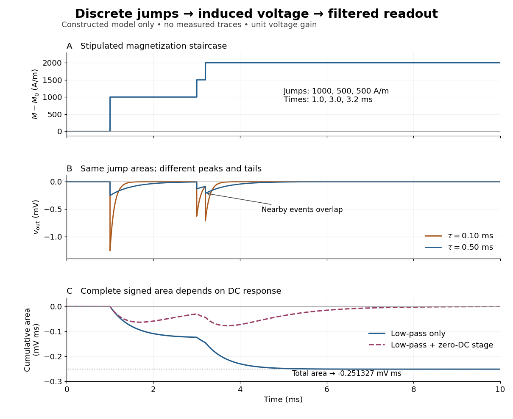

**[Figure 9](#image-constructed-magnetization-jumps-and-filtered-barkhausen-noise-voltage). Constructed magnetization jumps and filtered Barkhausen noise voltage**. Calculated model, not measured traces. The top panel stipulates three jumps of $1000$, $500$ and $500\,\mathrm{A/m}$ at $1.0$, $3.0$ and $3.2\,\mathrm{ms}$, with no smooth drift. The middle panel applies unit-gain exponential [low-pass filters](electrical-engineering.md#low-pass-filter) with $\tau=0.10$ and $0.50\,\mathrm{ms}$ and $K=4\pi\times10^{-11}\,\mathrm{V\,s\,m/A}$. The bottom panel shows cumulative signed [integrals](integral.md) for the broader filter, with and without an additional zero-DC stage of [time constant](analysis.md#time-constant) $1.0\,\mathrm{ms}$.

The nearby positive jumps in the figure have additive negative pulse areas even when their tails overlap. For $\tau=0.50\,\mathrm{ms}$ the first of the pair still has $e^{-0.2/0.5}=e^{-0.4}\approx0.67032$ of its initial height when the second arrives. Thresholding can merge those responses into one detected event; limited [signal bandwidth](electrical-engineering.md#signal-bandwidth) also obscures their separation. The total signed area still records the sum if the complete response is integrated, but cannot identify how that sum was partitioned into events. Equal simultaneous jumps are exactly indistinguishable from a single jump of their summed size in this linear measurement. Oppositely signed simultaneous changes can cancel.

Area preservation requires the stated electronics. A zero-DC stage after the [low-pass filter](electrical-engineering.md#low-pass-filter) has response

$$
q(t)=\delta(t)-\frac{\Theta(t)}{T}e^{-t/T},\qquad
\int q(t)\,dt=0.
$$

Consequently $\int G(q*h*e_{\rm jump})(t)\,dt=0$ over the complete response: a main pulse is followed by a compensating tail. Integrating only a threshold-selected lobe, clipping the record, or saturating the [amplifier](electrical-circuit.md#amplifier) breaks the simple pulse-area inference. Recovering a [magnetization](#magnetization) change from such a readout needs the calibrated [frequency response](electrical-engineering.md#frequency-response) and an appropriate reconstruction. Neither the audible crackle nor the displayed voltage is a direct staircase of [magnetization](#magnetization).

## Magnetic spherical-shell matching

↑ **Parent:** [Electromagnetism](electromagnetism.md)

Across an interface with no free surface current, the normal component of $B$ and tangential component of $H$ are continuous. For an axisymmetric spherical shell, harmonic scalar potentials have dipole form $(ar+b/r^2)\cos\theta$ in each radial region.

## Maxwell stress tensor

↑ **Parent:** [Electromagnetism](electromagnetism.md)  
ⓦ [Wiki](https://en.wikipedia.org/wiki/Maxwell_stress_tensor)

With electromagnetic momentum density $\mathbf g=\epsilon_0\mathbf E\times\mathbf B$, the momentum-flux convention

$$
\sigma_{ij}=-\epsilon_0E_iE_j+\frac{\epsilon_0}{2}E^2\delta_{ij}
-\frac1{\mu_0}B_iB_j+\frac1{2\mu_0}B^2\delta_{ij}
$$

satisfies

$$
\partial_tg_j+\partial_i\sigma_{ij}=-(\rho\mathbf E+\mathbf J\times\mathbf B)_j.
$$

<h3 id="radiation-force-density-without-ohm-s-law">Radiation-force density without Ohm's law</h3>

↑ **Parent:** [Maxwell stress tensor](#maxwell-stress-tensor)

For a monochromatic transverse field depending on $x,t$, with vacuum permittivity and permeability and arbitrary induced transverse current, Ampère's law gives $J_y=-\partial_xH_z-\epsilon_0\partial_tE_y$. Multiplying by $\mu_0H_z$ and averaging [Faraday's law](maxwell-equations.md#faraday-s-law-of-induction) gives the displayed gradient. No constitutive assumption $J=\sigma E$ is required. A steady average removes the field-momentum time derivative.

### Electromagnetic momentum density

↑ **Parent:** [Maxwell stress tensor](#maxwell-stress-tensor)

The electromagnetic momentum density in vacuum is $\mathbf g=\epsilon_0\mathbf E\times\mathbf B$. It equals the [Poynting vector](electromagnetic-wave.md#poynting-vector) divided by $c^2$, expressing the relativistic relation between energy flux and momentum density.

### Local conservation of electromagnetic momentum

↑ **Parent:** [Maxwell stress tensor](#maxwell-stress-tensor)

With the momentum-flux sign convention used for the [Maxwell stress tensor](#maxwell-stress-tensor), Maxwell's equations imply

$$
\nabla\mathbin{\cdot}\boldsymbol\sigma
+\partial_t\mathbf g=-\mathbf f_{\rm L},
$$

where $\mathbf g$ is the [electromagnetic momentum density](#electromagnetic-momentum-density) and $\mathbf f_{\rm L}$ is the [Lorentz force density](relativistic-electromagnetism.md#lorentz-force-density) exerted by the field on matter. Thus total field-plus-matter momentum is locally conserved.

### Radiation pressure on a perfectly absorbing surface

↑ **Parent:** [Maxwell stress tensor](#maxwell-stress-tensor)

A normally incident vacuum wave of time-averaged intensity $I$ transfers momentum $I/c$ per unit area and time to a perfectly absorbing surface, so its radiation pressure is

$$
p=\frac Ic.
$$

A perfect reflector reverses the normal momentum and gives $2I/c$.

## Proca action

↑ **Parent:** [Electromagnetism](electromagnetism.md)  
ⓦ [Wiki](https://en.wikipedia.org/wiki/Proca_action)

The Proca action adds $m^2A_\mu A^\mu/2$ to the Maxwell Lagrangian. It describes a massive spin-one field and explicitly breaks the Abelian gauge symmetry of the massless theory.

## Proca equation

↑ **Parent:** [Electromagnetism](electromagnetism.md)

With [Minkowski metric](special-relativity.md#minkowski-metric) signature $(+---)$ and source coupling $-\mu_0J_\mu A^\mu$ added to the [Proca action](#proca-action), a massive vector field coupled to a [conserved current](classical-field-theory.md#conserved-current) obeys

$$
\partial_\mu F^{\mu\nu}+m^2A^\nu=\mu_0J^\nu.
$$

In vacuum this gives $(\Box+m^2)A^\nu=0$ after imposing the dynamically derived [Lorenz constraint in Proca theory](#lorenz-constraint-in-proca-theory). The explicit mass term breaks the gauge invariance of the massless Maxwell theory.

### Proca field

↑ **Parent:** [Proca equation](#proca-equation)

A Proca field is a massive spin-one vector field. Its field equation enforces transversality and leaves three physical polarizations.

#### Proca propagator

↑ **Parent:** [Proca field](#proca-field)

For metric signature $(+---)$, the momentum-space Feynman propagator of a Proca field is

$$
\widetilde\Delta_{\mu\nu}(p)=\frac{-i}{p^2-m^2+i\epsilon}\left(\eta_{\mu\nu}-\frac{p_\mu p_\nu}{m^2}\right).
$$

The longitudinal numerator term inverts the massive vector kinetic operator without gauge fixing.

##### High-energy obstruction for a hard vector mass

↑ **Parent:** [Proca propagator](#proca-propagator)

A free [Proca field](#proca-field) is consistent and has three physical [particle polarizations](special-relativity.md#particle-polarization). The difficulty for generic interactions is the ultraviolet behavior of its [Proca propagator](#proca-propagator): the longitudinal numerator makes part of it approach order $1/m^2$, rather than decay as $1/k^2$. Longitudinal external [polarization vectors](relativistic-quantum-field.md#polarization-vector) also behave as $\varepsilon_L^\mu=k^\mu/m+O(m/E)$. Without suitable identities and cancellations, amplitudes grow with energy and perturbative counterterms of increasing dimension are needed. Conserved-current Abelian models and the [Stueckelberg mechanism](relativistic-quantum-field.md#stueckelberg-mechanism) are important exceptions; a massive interacting vector is not intrinsically inconsistent as an [effective field theory](quantum-field-theory.md#effective-field-theory).

##### Proca time-ordering contact term

↑ **Parent:** [Proca propagator](#proca-propagator)

For a free massive [Proca field](#proca-field) in the mostly-plus [Minkowski metric](special-relativity.md#minkowski-metric), the covariant inverse of the quadratic [action](lagrangian-mechanics.md#action) and the canonical [time-ordered product](perturbative-quantum-field-theory.md#time-ordered-product) of vector potentials differ locally. With [Fourier transform](fourier-transform.md) $e^{iq\cdot(x-y)}$, the covariant [Proca propagator](#proca-propagator) is $-i(\eta_{ab}+q_aq_b/m^2)/(q^2+m^2-i0)$, while the literal canonical [two-point correlation function](critical-phenomenon.md#two-point-correlation-function) subtracts $i\delta_a^0\delta_b^0/m^2$ in momentum space. The time component is nondynamical; its physical-mode numerator is $|\boldsymbol q|^2/m^2$, rather than $-1+(q^0)^2/m^2$. The difference is an instantaneous [Dirac delta function](distribution-theory.md#dirac-delta-function), not another propagating state. Both expressions agree away from coincidence. This distinction matters when identifying a covariant [Green function](green-s-function.md) with a canonical correlator in a constrained field theory.

#### Transverse vector field

↑ **Parent:** [Proca field](#proca-field)

A vector field is transverse when $\partial_\mu V^\mu=0$ in spacetime, or $\mathbf k\cdot\mathbf V=0$ for a spatial Fourier mode.

### Lorenz constraint in Proca theory

↑ **Parent:** [Proca equation](#proca-equation)

Taking a divergence and using antisymmetry of $F^{\mu\nu}$ and current conservation gives $m^2\partial_\mu A^\mu=0$. For nonzero mass, the Lorenz condition follows from the field equation rather than from a gauge choice.

### Yukawa potential

↑ **Parent:** [Proca equation](#proca-equation)  
ⓦ [Wiki](https://en.wikipedia.org/wiki/Yukawa_potential)

The static Green function of $\nabla^2-m^2$ in three dimensions is proportional to $e^{-mr}/r$. It describes an interaction screened beyond range $m^{-1}$ and tends to the Coulomb potential as $m\to0$.

## Relativistic Lorentz force

↑ **Parent:** [Electromagnetism](electromagnetism.md)

$m\,du^\mu/d\tau=qF^\mu{}_\nu u^\nu$ gives $d\mathbf p/dt=q(\mathbf E+\mathbf v\times\mathbf B)$ and $d(\gamma mc^2)/dt=q\mathbf E\cdot\mathbf v$.

### Constant-field relativistic Lorentz-force solution

↑ **Parent:** [Relativistic Lorentz force](#relativistic-lorentz-force)

For a constant [electromagnetic field tensor](relativistic-electromagnetism.md#electromagnetic-field-tensor), the [relativistic Lorentz force](#relativistic-lorentz-force) is a constant-coefficient linear system on [four-velocity](special-relativity.md#four-velocity), with solution

$$
u(\tau)=\exp\!\left(\frac qmF\tau\right)u(0).
$$

The electric-type blocks of $F$ generate hyperbolic rotations, while magnetic-type blocks generate ordinary rotations.

#### Relativistic motion in parallel electric and magnetic fields

↑ **Parent:** [Constant-field relativistic Lorentz-force solution](#constant-field-relativistic-lorentz-force-solution)

When uniform $\mathbf E$ and $\mathbf B$ are parallel, the [relativistic Lorentz force](#relativistic-lorentz-force) splits into independent hyperbolic motion along the fields and circular motion in the perpendicular plane. The circle is periodic in [proper time](special-relativity.md#proper-time), while electric acceleration makes the helix's longitudinal pitch grow exponentially from one proper-time cyclotron period to the next.

### Relativistic hyperbolic motion in a uniform electric field

↑ **Parent:** [Relativistic Lorentz force](#relativistic-lorentz-force)

A particle released from rest in a constant electric field parallel to its motion follows a spacetime hyperbola and has rapidity proportional to proper time.

This force law realizes [hyperbolic motion](special-relativity.md#hyperbolic-motion) with constant [proper acceleration](special-relativity.md#proper-acceleration).

### Null crossed electromagnetic field

↑ **Parent:** [Relativistic Lorentz force](#relativistic-lorentz-force)

Perpendicular fields with $\mathbf E\cdot\mathbf B=0$ and $E^2-c^2B^2=0$ form a null electromagnetic field. The constant-field Lorentz-force generator is nilpotent, so its exponential terminates as a polynomial.

Both invariants of the [electromagnetic field tensor](relativistic-electromagnetism.md#electromagnetic-field-tensor) vanish for this field class.

#### Relativistic trajectory in a constant null crossed field

↑ **Parent:** [Null crossed electromagnetic field](#null-crossed-electromagnetic-field)

Choose

$$
\mathbf B=B\,\mathbf e_z,\qquad
\mathbf E=cB\,\mathbf e_x,
\qquad
\Omega=\frac{qB}{m}.
$$

A particle released from rest at the origin has the proper-time trajectory

$$
t(\tau)=\tau+\frac{\Omega^2\tau^3}{6},
\qquad
x(\tau)=\frac{c\Omega\tau^2}{2},
\qquad
y(\tau)=-\frac{c\Omega^2\tau^3}{6},
\qquad z(\tau)=0.
$$

Eliminating [proper time](special-relativity.md#proper-time) gives the semicubical parabola

$$
\boxed{y^2=\frac{2qB}{9mc}x^3.}
$$

This signed coefficient assumes that the positive $x$ direction is chosen along $\mathbf E$; reversing that axis changes the signs of both $x^3$ and its coefficient.

## Charged particle in a uniform magnetic field

↑ **Parent:** [Electromagnetism](electromagnetism.md)  
ⓦ [Wiki](https://en.wikipedia.org/wiki/Charged_particle_in_a_uniform_magnetic_field)

A velocity cross magnetic-field force bends perpendicular motion into a circle while doing no work.

### Uniform magnetic field with axial harmonic confinement

↑ **Parent:** [Charged particle in a uniform magnetic field](#charged-particle-in-a-uniform-magnetic-field)

The cylindrical [vector](vector-space.md#vector) potential $A_\theta=\mu r$ gives a uniform axial [magnetic field](magnetic-field.md) $2\mu$, while [scalar potential](classical-field-theory.md#scalar-potential) $\lambda z^2$ supplies harmonic axial confinement for positive charge and positive $\lambda$. Transverse motion is cyclotron motion about a fixed guiding centre, and axial motion is an independent harmonic [oscillation](wave.md#oscillation). A circle centred on the cylindrical origin has $\dot\theta=-\Omega_c$ for positive charge.

#### Commensurate cyclotron and axial oscillations

↑ **Parent:** [Uniform magnetic field with axial harmonic confinement](#uniform-magnetic-field-with-axial-harmonic-confinement)

A rational ratio of axial and [cyclotron frequencies](quantum-theory.md#cyclotron-frequency) makes a nondegenerate combined orbit close after an integer number of turns. For ratio $p/q$ in lowest terms it closes after $q$ transverse periods and $p$ axial periods. An integer ratio is a sufficient special case. An irrational ratio instead gives [quasiperiodic motion](hamiltonian-mechanics.md#quasiperiodic-motion) when both component amplitudes are nonzero.

### Magnetic angular-momentum invariant

↑ **Parent:** [Charged particle in a uniform magnetic field](#charged-particle-in-a-uniform-magnetic-field)

For a particle obeying $m\dot{\mathbf v}=q\mathbf v\times\mathbf B$ in a constant uniform [magnetic field](magnetic-field.md), the displayed combination is conserved. The derivative of mechanical [angular momentum](momentum.md#angular-momentum) projected onto the field is canceled by the quadratic position term. This is the rotational analogue of the distinction between mechanical and [canonical momentum](hamiltonian-mechanics.md#canonical-momentum) in an electromagnetic field.

### Helical motion in a uniform magnetic field

↑ **Parent:** [Charged particle in a uniform magnetic field](#charged-particle-in-a-uniform-magnetic-field)

In a uniform [magnetic field](magnetic-field.md), the [Lorentz force](relativistic-electromagnetism.md#lorentz-force) leaves the component of [velocity](classical-mechanics.md#velocity) parallel to the field constant and rotates the perpendicular component at the nonrelativistic [cyclotron frequency](quantum-theory.md#cyclotron-frequency) $|q|B/m$. The resulting path is a [helix](topology.md#helix) around a field line.

### Guiding center

↑ **Parent:** [Charged particle in a uniform magnetic field](#charged-particle-in-a-uniform-magnetic-field)  
ⓦ [Wiki](https://en.wikipedia.org/wiki/Guiding_center)

The guiding center is the center of a charged particle's circular cyclotron orbit. In a nonuniform field it drifts slowly compared with the rapid [cyclotron frequency](quantum-theory.md#cyclotron-frequency).

#### On-axis entry into a solenoidal tube

↑ **Parent:** [Guiding center](#guiding-center)

A particle entering a uniform axial [magnetic field](magnetic-field.md) on the tube axis follows a transverse circle through that entry point. Its [guiding centre](#guiding-center) is one [Larmor radius](relativistic-electromagnetism.md#gyroradius) from the axis, so the maximum radial displacement from the axis is twice the [Larmor radius](relativistic-electromagnetism.md#gyroradius). For tube [radius](topology.md#radius) $a$, clearance requires $v_\perp\le |q|Ba/(2m)$ when the transit samples a complete gyration. If the transit is shorter, the actual sampled arc determines clearance instead. The axis is revisited after each full cyclotron [period](mathematics.md#period-of-a-function), not after each half-period.

##### Solenoidal time-of-flight energy window

↑ **Parent:** [On-axis entry into a solenoidal tube](#on-axis-entry-into-a-solenoidal-tube)

A nonrelativistic particle accepted only at a fixed flight time through an ideal uniform-field tube has fixed parallel [speed](classical-mechanics.md#speed) $v_\parallel=l/t_0$. On-axis entry and wall clearance bound the independent perpendicular [speed](classical-mechanics.md#speed) by $|q|Ba/(2m)$, provided a full gyration occurs before exit. Adding parallel and perpendicular [kinetic energies](energy.md#kinetic-energy) gives the displayed ideal [energy](energy.md) window, where $K_0=mv_\parallel^2/2$. The upper endpoint is a grazing limit; strict wall exclusion makes it a [supremum](real-analysis.md#supremum).

### Damped cyclotron motion

↑ **Parent:** [Charged particle in a uniform magnetic field](#charged-particle-in-a-uniform-magnetic-field)  
ⓦ [Wiki](https://en.wikipedia.org/wiki/Damped_cyclotron_motion)

Adding linear drag to cyclotron motion produces an exponentially contracting spiral.

## Electrostatics

↑ **Parent:** [Electromagnetism](electromagnetism.md)

[This section is present in another page, follow this link to view it.](electrostatics.md)

## Magnetostatics

↑ **Parent:** [Electromagnetism](electromagnetism.md)  
ⓦ [Wiki](https://en.wikipedia.org/wiki/Magnetostatics)

Magnetostatics studies time-independent magnetic fields and steady currents. In vacuum its field equations are $\nabla\mathbin\cdot\mathbf B=0$ and $\nabla\mathbin\times\mathbf B=\mu_0\mathbf J$.

### Uniform magnetic field in an off-axis cylindrical cavity

↑ **Parent:** [Magnetostatics](#magnetostatics)

Subtract a cylinder of [current density](electric-charge.md#current-density) $\mathbf J$ occupying the cavity from a complete current-carrying cylinder. Inside each cylinder, $\mathbf B=\mu_0\mathbf J\times\mathbf r/2$. The difference is independent of observation point and equals $\mu_0\mathbf J\times\mathbf b/2$, where $\mathbf b$ is the offset of the cavity axis. This assumes parallel axes, uniform [current density](electric-charge.md#current-density) in the remaining metal, and negligible end effects.

### Magnetic dipole

↑ **Parent:** [Magnetostatics](#magnetostatics)  
ⓦ [Wiki](https://en.wikipedia.org/wiki/Magnetic_dipole)

A localized magnetic source described at leading nonvanishing dipole order by a [magnetic dipole moment](#magnetic-dipole-moment). A small current loop is one classical model. The source object, its moment vector and the resulting [magnetic dipole field](magnetic-field.md#magnetic-dipole-field) are distinct concepts. At large distance from a source with nonzero dipole moment, higher multipoles give smaller corrections; if the dipole moment vanishes, a higher-order term can lead instead.

#### Small-angle magnetic dipole oscillation

↑ **Parent:** [Magnetic dipole](#magnetic-dipole)

A [magnetic dipole](#magnetic-dipole) of fixed magnitude $m_B$, free to rotate about an axis with [moment of inertia](rigid-body-dynamics.md#moment-of-inertia) $J$, has [potential energy](energy.md#potential-energy) $-m_BB\cos\theta$ in a uniform [magnetic field](magnetic-field.md). Near stable alignment, $J\ddot\theta=-m_BB\theta$, so its small-angle period is $2\pi\sqrt{J/(m_BB)}$. This neglects damping, bearing friction and any other restoring [torque](momentum.md#torque).

##### Oscillation of a uniformly wound coil

↑ **Parent:** [Small-angle magnetic dipole oscillation](#small-angle-magnetic-dipole-oscillation)

For a light nonmagnetic rod of length $l$ wound uniformly with $N$ thin turns of mean radius $a$, the [magnetic dipole moment](#magnetic-dipole-moment) is $m_B=NI\pi a^2$. Wire of cross-sectional [area](differential-geometry.md#surface-area) $A_w$ and [density](fluid-mechanics.md#density) $\rho$ has [mass](classical-mechanics.md#mass) approximately $M=2\pi aN\rho A_w$. The transverse central [moment of inertia](rigid-body-dynamics.md#moment-of-inertia) is $J=M(l^2/12+a^2/2)$ in the thin-winding approximation. Consequently the oscillation period in a transverse [magnetic field](magnetic-field.md) does not depend on the number of turns: wire inertia and magnetic moment both scale with $N$.

#### Magnetic tweezers

↑ **Parent:** [Magnetic dipole](#magnetic-dipole)

A generic instrument for [force](force.md) and [torque](momentum.md#torque) uses a magnetically responsive bead in a controlled [magnetic field](magnetic-field.md), with optical tracking. Translational [force](force.md) requires a field gradient. Permanent or anisotropic moments can feel orienting [torque](momentum.md#torque); an isotropic induced moment parallel to the field has no such [torque](momentum.md#torque). This definition concerns the physical instrument, without biological applications.

##### Magnetic anisotropy in orientational trapping

↑ **Parent:** [Magnetic tweezers](#magnetic-tweezers)

##### Transverse-fluctuation calibration of a tensioned tether

↑ **Parent:** [Magnetic tweezers](#magnetic-tweezers)

For a tether with extension $\ell$ and tensile load $F$, a small transverse coordinate costs $Fx^2/(2\ell)$. Equipartition gives $F=k_BT\ell/\langle x^2\rangle$ for one Cartesian transverse coordinate. Using the sum of two transverse variances changes the factor of two. Geometry and measurement filtering must match the calibration model.

###### Finite-exposure correction to fluctuation force calibration

↑ **Parent:** [Transverse-fluctuation calibration of a tensioned tether](#transverse-fluctuation-calibration-of-a-tensioned-tether)

For an equilibrium overdamped harmonic coordinate with covariance $\langle x(t)x(0)\rangle=V e^{-|t|/\tau}$, a camera exposure $\Delta$ records the average over that interval. Integrating the covariance twice gives $\operatorname{Var}(\bar x)=2V\Delta^{-2}\int_0^\Delta(\Delta-u)e^{-u/\tau}du$. The displayed reduction follows with $s=\Delta/\tau$. In the tether calibration $F=k_BTh/V$, ignoring exposure averaging overestimates the inferred [force](force.md). Independent localization-noise [variance](variance.md) instead adds to the measured [variance](variance.md) and biases it in the opposite direction. Other filters require their actual response functions.

##### Induced magnetic bead force

↑ **Parent:** [Magnetic tweezers](#magnetic-tweezers)

For a linear isotropic unsaturated effective susceptibility contrast $\Delta\chi$, the induced-moment energy is $-V\Delta\chi B^2/(2\mu_0)$, giving $\mathbf F=V\Delta\chi\nabla B^2/(2\mu_0)$. The one-half differs from the fixed permanent-dipole energy because the applied field creates the moment. Demagnetization and saturation are absorbed into or replace the assumed response model.

### Magnetic field of a rotating charged solid cylinder

↑ **Parent:** [Magnetostatics](#magnetostatics)

An infinite solid cylinder with radius $R$, prescribed uniform volume [charge density](electric-charge.md#charge-density) $\rho$, and [angular velocity](rigid-body-dynamics.md#angular-velocity) $\omega\hat{\mathbf z}$ has [current density](electric-charge.md#current-density) $\mathbf J=\rho\omega r\hat{\boldsymbol\phi}$. Treat a shell at radius $a$ and thickness $da$ as a [solenoid](magnetic-field.md#solenoid) carrying surface current $\rho\omega a\,da$. With no applied background [magnetic field](magnetic-field.md) and permeability $\mu$,

$$
\mathbf B(r)=\begin{cases}\dfrac{\mu\rho\omega}{2}(R^2-r^2)\hat{\mathbf z},&r<R,\\0,&r>R.\end{cases}
$$

The same result follows from [Ampère's circuital law](maxwell-equations.md#ampere-s-circuital-law), since $-dB_z/dr=\mu\rho\omega r$ inside.

### Magnetic circuit

↑ **Parent:** [Magnetostatics](#magnetostatics)  
ⓦ [Wiki](https://en.wikipedia.org/wiki/Magnetic_circuit)

A [magnetic circuit](#magnetic-circuit) approximates a narrow core and its gaps by sections carrying a common [magnetic flux](magnetic-field.md#magnetic-flux) $\Phi$. With negligible leakage and approximately uniform [magnetic flux density](magnetic-field.md) across each section, [Gauss's law for magnetism](maxwell-equations.md#gauss-s-law-for-magnetism) gives $B=\Phi/A$. The [magnetostatic Ampère law](maxwell-equations.md#magnetostatic-ampere-law) then gives $NI=\int H\,dl=\Phi\int dl/(\mu_0\mu_rA)$. This requires an appropriate material relation; constant [magnetic permeability](maxwell-equations.md#permeability-electromagnetism) is an approximation for an actual magnetic core.

#### Uniformly magnetized ring with a narrow gap

↑ **Parent:** [Magnetic circuit](#magnetic-circuit)

A rod of magnetic path length $l$ and tangential [magnetization](#magnetization) $M$ closed by a gap of width $a$ has constant flux in the one-dimensional [magnetic circuit](#magnetic-circuit) approximation. Equal cross sections and negligible leakage give $H_g=H_r+M$, while absence of free current gives $lH_r+aH_g=0$. Their solution is the displayed pair. Gap fringing or an unspecified cross-section change requires a more detailed field model.

#### Gap field of a tapered electromagnet

↑ **Parent:** [Magnetic circuit](#magnetic-circuit)

A uniform-radius magnetic arc of [length](physics.md#length) $L$ and [radius](topology.md#radius) $R$, two linear tapers of [length](physics.md#length) $s$ to [radius](topology.md#radius) $r$, and an unfringed vacuum gap of [length](physics.md#length) $h$ have the displayed gap field. Here $\mu_r=\mu/\mu_0$ and $B_g=\mu_0H_g$. Tapering concentrates flux, but at fixed winding current the gap-dominated limit is $H_g\simeq NI/h$ regardless of pole [area](differential-geometry.md#surface-area). Saturation and leakage prevent unrestricted field enhancement.

#### Magnetic fringing

↑ **Parent:** [Magnetic circuit](#magnetic-circuit)

[Magnetic fringing](#magnetic-fringing) is the spreading of [magnetic field lines](magnetic-field.md#magnetic-field-line) near an air gap or pole edge, so the gap's effective [magnetic flux](magnetic-field.md#magnetic-flux) area exceeds its geometrical pole-face [area](differential-geometry.md#surface-area). A gap much shorter than its transverse dimensions permits a leading uniform-field approximation. High core [magnetic permeability](maxwell-equations.md#permeability-electromagnetism) does not by itself justify neglecting [magnetic fringing](#magnetic-fringing) for a wide gap.

#### Magnetic reluctance

↑ **Parent:** [Magnetic circuit](#magnetic-circuit)  
ⓦ [Wiki](https://en.wikipedia.org/wiki/Magnetic_reluctance)

The [magnetic reluctance](#magnetic-reluctance) of a linear section of [magnetic circuit](#magnetic-circuit) is the ratio of the winding's integrated [magnetic field intensity](#magnetic-field-intensity) to the [magnetic flux](magnetic-field.md#magnetic-flux), with units $\mathrm{A\,Wb^{-1}}$. For uniform length $\ell$, cross-sectional [area](differential-geometry.md#surface-area) $A$, and relative [magnetic permeability](maxwell-equations.md#permeability-electromagnetism) $\mu_r$, $\mathcal R=\ell/(\mu_0\mu_rA)$. Series sections carrying the same [magnetic flux](magnetic-field.md#magnetic-flux) have additive [magnetic reluctances](#magnetic-reluctance), and $NI=\Phi\sum_i\mathcal R_i$.

##### Reluctance of a conical magnetic pole

↑ **Parent:** [Magnetic reluctance](#magnetic-reluctance)

For a linear-radius taper from $R$ to $r$ over [length](physics.md#length) $s$, constant absolute permeability $\mu$, and a common approximately axial flux, integrate $dx/[\mu\pi\{R-(R-r)x/s\}^2]$ to obtain the displayed reluctance. Leakage, fringing, nonuniform transverse fields and saturation limit this one-dimensional magnetic-circuit approximation.

### Magnetic scalar potential

↑ **Parent:** [Magnetostatics](#magnetostatics)  
ⓦ [Wiki](https://en.wikipedia.org/wiki/Magnetic_scalar_potential)

In a simply connected current-free region of constant [magnetic permeability](maxwell-equations.md#permeability-electromagnetism), [Ampère's circuital law](maxwell-equations.md#ampere-s-circuital-law) makes the [magnetic field](magnetic-field.md) curl-free, so it admits a scalar potential. The absence of magnetic monopoles then gives [Laplace's equation](partial-differential-equation.md#laplace-equation) for that potential. Some conventions define the potential for $\mathbf H$ instead of $\mathbf B$, differing by the constant permeability. Boundary conditions, including imposed fields at infinity, determine the potential up to an additive constant.

#### Gravity-equivalent magnetic surface density

↑ **Parent:** [Magnetic scalar potential](#magnetic-scalar-potential)

For an isolated razor-thin disk, rescale its exterior [magnetic scalar potential](#magnetic-scalar-potential) to satisfy $\sqrt{4\pi G/\mu_0}\mathbf B=-\nabla\Phi_M$. Comparing the normal magnetic boundary derivative with $\partial_z\Phi=2\pi G\Sigma$ identifies the displayed equivalent signed [surface density](astrophysical-disk.md#surface-density-of-a-disk). Both exterior potentials satisfy [Laplace's equation](partial-differential-equation.md#laplace-equation). The equivalent [surface density](astrophysical-disk.md#surface-density-of-a-disk) is a representation of the magnetic boundary data, rather than physical negative mass.

## Maxwell equations

↑ **Parent:** [Electromagnetism](electromagnetism.md)

[This section is present in another page, follow this link to view it.](maxwell-equations.md)

## Magnetic vector potential

↑ **Parent:** [Electromagnetism](electromagnetism.md)  
ⓦ [Wiki](https://en.wikipedia.org/wiki/Magnetic_vector_potential)

A magnetic vector potential satisfies B equal to its curl and is defined up to a gradient.

### Coulomb-gauge vector potential of a long solenoid

↑ **Parent:** [Magnetic vector potential](#magnetic-vector-potential)

For an ideal infinitely long [solenoid](magnetic-field.md#solenoid) with interior [magnetic field](magnetic-field.md) $B_0\hat{\mathbf z}$ and radius $R$, an axisymmetric [Coulomb gauge](#coulomb-gauge) representative of the [magnetic vector potential](#magnetic-vector-potential) is

$$
\mathbf A=A_\phi(r)\hat{\boldsymbol\phi},\qquad A_\phi(r)=\begin{cases}B_0r/2,&r<R,\\B_0R^2/(2r),&r>R.\end{cases}
$$

This follows from $2\pi rA_\phi=\Phi(r)$ by [Stokes theorem](multivariable-calculus.md#stokes-theorem). The exterior has zero [curl](multivariable-calculus.md#curl) but nonzero circulation around the enclosed [magnetic flux](magnetic-field.md#magnetic-flux). The [Coulomb gauge](#coulomb-gauge) condition alone does not eliminate every residual [gauge transformation](#gauge-transformation); symmetry and regularity select this customary representative.

### Magnetic helicity

↑ **Parent:** [Magnetic vector potential](#magnetic-vector-potential)  
ⓦ [Wiki](https://en.wikipedia.org/wiki/Magnetic_helicity)

The [magnetic helicity](#magnetic-helicity) integrates the [dot product](inner-product.md#dot-product) of a [magnetic vector potential](#magnetic-vector-potential) and its [magnetic field](magnetic-field.md). It measures linkage and twisting of magnetic flux. For a [solenoidal vector field](multivariable-calculus.md#solenoidal-vector-field) $\mathbf B$ tangent to the boundary, it is unchanged by the gauge transformation $\mathbf A\mapsto\mathbf A+\nabla\chi$, since the change is $\int_V\nabla\cdot(\chi\mathbf B)\,dV=\int_{\partial V}\chi\mathbf B\cdot d\mathbf S=0$. If its density satisfies $\partial_t h=\nabla\cdot(f\mathbf B-h\mathbf u)$ with both vector fields tangent to the boundary of a fixed volume, the [divergence theorem](multivariable-calculus.md#divergence-theorem) gives conservation of its integral. This is an instance of [helicity conservation by tangent boundary conditions](multivariable-calculus.md#helicity-conservation-by-tangent-boundary-conditions).

#### Magnetic-energy lower bound from helicity

↑ **Parent:** [Magnetic helicity](#magnetic-helicity)

In a bounded regular domain, fix the global extension or circulation convention for the [magnetic vector potential](#magnetic-vector-potential). A bounded inverse of [curl](multivariable-calculus.md#curl) on tangent [solenoidal vector fields](multivariable-calculus.md#solenoidal-vector-field) gives $\|\mathbf A\|_2\leq C_D\|\mathbf B\|_2$. The [Cauchy-Schwarz inequality](probability-and-statistics.md#cauchy-schwarz-inequality) then gives $|H_M|\leq C_D\|\mathbf B\|_2^2=2\mu_0 C_DE_B$. One construction extends the tangent field by zero outside the domain and uses the whole-space [Biot-Savart law](#biot-savart-law); its kernel of size $|\mathbf x-\mathbf y|^{-2}$ is integrable over a bounded region, giving the required $L^2$ bound. Nonzero conserved [magnetic helicity](#magnetic-helicity) therefore prevents complete decay of [magnetic energy](electromagnetic-wave.md#magnetic-energy).

#### Current helicity

↑ **Parent:** [Magnetic helicity](#magnetic-helicity)

Current helicity correlates a [magnetic field](magnetic-field.md) with its [curl](multivariable-calculus.md#curl), which is proportional to [electric current density](electric-charge.md#current-density). It differs from [magnetic helicity](#magnetic-helicity), which uses a [magnetic vector potential](#magnetic-vector-potential). For a solenoidal monochromatic field of wavenumber $k$ in a periodic domain, choose $\mathbf a_b=\nabla\times\mathbf b/k^2$. Then $\nabla\times\mathbf a_b=\mathbf b$ and $H_c=k^2\langle\mathbf a_b\cdot\mathbf b\rangle$.

#### Gauge dependence of helicity in an open magnetic flux tube

↑ **Parent:** [Magnetic helicity](#magnetic-helicity)

An open [flux tube](magnetic-field.md#flux-tube) carries [magnetic flux](magnetic-field.md#magnetic-flux) through its end caps. Its ordinary [magnetic helicity](#magnetic-helicity) can therefore change under a single-valued [gauge transformation](#gauge-transformation). For $\mathbf B=aR\mathbf e_\phi+b\mathbf e_z$ inside $R<R_0$ and zero outside, a regular family of [magnetic vector potentials](#magnetic-vector-potential) is $A_\phi=bR/2$, $A_z=C-aR^2/2$ inside and $A_\phi=bR_0^2/(2R)$, $A_z=C-aR_0^2/2$ outside. Their tangential components agree at $R_0$. Inside, $\mathbf A\cdot\mathbf B=bC$, so the helicity per unit length is $\pi bCR_0^2$. Changing $C$ is the gauge transformation $\Lambda=\Delta C\,z$, and changes this result whenever $b\ne0$. The convention $A_z=0$ outside gives $C=aR_0^2/2$ and helicity per unit length $\pi abR_0^4/2$, while $C=0$ gives zero. Without an end-cap or gauge convention the ordinary helicity is not unique.

#### Material transport of magnetic helicity density

↑ **Parent:** [Magnetic helicity](#magnetic-helicity)

For smooth [ideal magnetohydrodynamics](ideal-magnetohydrodynamics.md), write $\mathbf B=\nabla\times\mathbf A$ and $\partial_t\mathbf A=\mathbf u\times\mathbf B-\nabla\varphi$. The [continuity equation](mathematical-physics.md#continuity-equation) and induction equation give $D_t(\mathbf B/\rho)=(\mathbf B/\rho)\cdot\nabla\mathbf u$. The vector-potential equation becomes $D_t\mathbf A=\nabla(\mathbf u\cdot\mathbf A-\varphi)-(\nabla\mathbf u)^T\mathbf A$. Contracting these two equations cancels their velocity-gradient terms and proves

$$
D_t\left(\frac{\mathbf A\cdot\mathbf B}{\rho}\right)=\frac{\mathbf B}{\rho}\cdot\nabla(\mathbf u\cdot\mathbf A-\varphi).
$$

Consequently the [magnetic helicity](#magnetic-helicity) in a material volume satisfies $dH_m/dt=\int_{\partial V}(\mathbf u\cdot\mathbf A-\varphi)\mathbf B\cdot\mathbf n\,dS$. It is conserved when the [magnetic field](magnetic-field.md) is tangent to the boundary. A single-valued [gauge transformation](#gauge-transformation) changes $H_m$ by $\int_{\partial V}\Lambda\mathbf B\cdot\mathbf n\,dS$, which also vanishes under that condition.

### Radial-gauge potential for a divergence-free magnetic field

↑ **Parent:** [Magnetic vector potential](#magnetic-vector-potential)

For a smooth [divergence](multivariable-calculus.md#divergence)-free field on $\mathbb R^3$, the [differential form](differential-form.md) $F=\iota_{\mathbf B}(dx^1\wedge dx^2\wedge dx^3)$ is closed. The radial homotopy formula gives a global [magnetic vector potential](#magnetic-vector-potential) $\mathbf A(\mathbf x)=\int_0^1s\,\mathbf B(s\mathbf x)\times\mathbf x\,ds$ with [curl](multivariable-calculus.md#curl) $\mathbf B$. For constant $\mathbf B$, this reduces to $\mathbf A=\tfrac12\mathbf B\times\mathbf x$.

<h3 id="neumann-s-mutual-inductance-formula">Neumann's mutual-inductance formula</h3>

↑ **Parent:** [Magnetic vector potential](#magnetic-vector-potential)

For thin closed wire loops $C_1,C_2$, the mutual inductance is

$$
L_{12}=L_{21}
=\frac{\mu_0}{4\pi}
\oint_{C_1}\oint_{C_2}
\frac{dx_1\cdot dx_2}{|x_1-x_2|}.
$$

### Coulomb gauge

↑ **Parent:** [Magnetic vector potential](#magnetic-vector-potential)  
ⓦ [Wiki](https://en.wikipedia.org/wiki/Coulomb_gauge)

The Coulomb gauge imposes

$$
\nabla\cdot A=0
$$

on the [magnetic vector potential](#magnetic-vector-potential). A [gauge transformation](#gauge-transformation) $A\mapsto A+\nabla\chi$ reaches this gauge when $\chi$ solves

$$
\nabla^2\chi=-\nabla\cdot A.
$$

#### Radiation gauge

↑ **Parent:** [Coulomb gauge](#coulomb-gauge)

For a free [electromagnetic field](#electromagnetic-field) with suitable boundary conditions, combine [Coulomb gauge](#coulomb-gauge) $\partial_iA_i=0$ with $A_0=0$. [Gauss's law](maxwell-equations.md#gauss-s-law) makes the second condition consistent in the source-free problem. The remaining field operator is spatially transverse and describes the two radiative [photon](quantum-mechanics.md#photon) polarizations. A constrained scalar potential must be restored when charges are present.

### Gauge transformation

↑ **Parent:** [Magnetic vector potential](#magnetic-vector-potential)  
ⓦ [Wiki](https://en.wikipedia.org/wiki/Gauge_transformation)

The transformation $A\mapsto A+\nabla\chi$ leaves $B=\nabla\times A$ unchanged because the [curl](multivariable-calculus.md#curl) of a [gradient](multivariable-calculus.md#gradient) vanishes.

#### Gauge-covariant time translation

↑ **Parent:** [Gauge transformation](#gauge-transformation)

For the [Maxwell field](#electromagnetic-field), the variation $\delta A_\nu=\alpha F_{0\nu}=\alpha(\partial_0A_\nu-\partial_\nu A_0)$ is time translation combined with a [gauge transformation](#gauge-transformation). With constant $\alpha$, $\delta F_{\mu\nu}=\alpha\partial_0F_{\mu\nu}$, and the Lagrangian changes by $\alpha\partial_0\mathcal L$. Its [Noether current](classical-field-theory.md#noether-current) is directly the time component of the [gauge-invariant Maxwell stress-energy tensor](classical-field-theory.md#gauge-invariant-maxwell-stress-energy-tensor), providing the physical energy density without a potential-dependent improvement step.

### Magnetic dipole moment

↑ **Parent:** [Magnetic vector potential](#magnetic-vector-potential)  
ⓦ [Wiki](https://en.wikipedia.org/wiki/Magnetic_dipole_moment)

A [magnetic dipole moment](#magnetic-dipole-moment) is a [vector](vector-space.md#vector) that summarizes the strength and orientation of a localized magnetic source. For a planar [current loop](#current-loop), it is the [electric current](electric-charge.md#electric-current) times the [vector area](differential-geometry.md#vector-area): $\mathbf m=IA\widehat{\mathbf n}$. The [right-hand rule](#right-hand-rule) fixes the unit [normal vector](differential-geometry.md#normal-vector) $\widehat{\mathbf n}$: curl the fingers of the right hand along the [conventional current](electric-charge.md#conventional-current), and the thumb points along $\mathbf m$. This single [vector](vector-space.md#vector) predicts both the distant [magnetic dipole field](magnetic-field.md#magnetic-dipole-field) and the turning effect of an imposed [magnetic field](magnetic-field.md).[§11.5, equations 11.20–11.22: loop moment, winding count and torque](physics-bibliography.md#university-physics-volume-2-by-samuel-j-ling-and-others/11-5-force-and-torque-on-a-current-loop)

The [SI](physics.md#international-system-of-units) unit is [ampere](electric-charge.md#ampere) times square metre, $\mathrm{A\,m^2}$, equivalently [joule](physics.md#joule) per [tesla](magnetic-field.md#tesla-unit). A [magnetic dipole moment](#magnetic-dipole-moment) is neither a [magnetic field](magnetic-field.md) nor a [magnetic monopole](mathematical-physics.md#magnetic-monopole): a closed [current loop](#current-loop) can have a nonzero [magnetic dipole moment](#magnetic-dipole-moment) while its net outward [magnetic flux](magnetic-field.md#magnetic-flux) through any closed surface remains zero, as required by [Gauss's law for magnetism](maxwell-equations.md#gauss-s-law-for-magnetism).

For a localized, steady [electric current density](electric-charge.md#current-density) $\mathbf J(\mathbf r)$, the more general definition is

$$
\mathbf m=\frac12\int_{\mathbb R^3}\mathbf r\times\mathbf J(\mathbf r)\,d^3r.
$$

Here the [cross product](vector-space.md#cross-product) is integrated over the complete source, including return paths. Steadiness requires $\nabla\cdot\mathbf J=0$, and localization requires sufficiently rapid decay for the boundary terms to vanish. Under these assumptions the [localized steady-current moment identities](#localized-steady-current-moment-identities) give $\int\mathbf J\,d^3r=0$: shifting the origin by $\mathbf a$ changes the proposed [magnetic dipole moment](#magnetic-dipole-moment) by $-\tfrac12\mathbf a\times\int\mathbf J\,d^3r=0$. An isolated open wire segment does not satisfy these assumptions. [Localized Current Distribution](physics-bibliography.md#classical-electromagnetism-by-richard-fitzpatrick/localized-current-distribution).

#### Signed magneton convention for two oppositely charged spins

↑ **Parent:** [Magnetic dipole moment](#magnetic-dipole-moment)

For each particle the moment includes its signed charge and inverse mass. Writing both moments with one reference magneton requires effective signed magnetic factors. A shared symbol must not hide the sign change or imply equal magnitudes; the reference magneton is distinct from the SI vacuum permeability.

#### Differential magnetic moment

↑ **Parent:** [Magnetic dipole moment](#magnetic-dipole-moment)

With [energy](energy.md) convention $E=-\boldsymbol\mu\cdot\mathbf B$, the difference of physical moments is the negative derivative of a transition [energy](energy.md). Some trapping conventions instead call the positive [energy](energy.md) slope an effective magnetic moment. The sign convention must be stated; either gives the same absolute sensitivity of transition [frequency](wave.md#frequency) to a field fluctuation.

#### Magnetic moment of a rotating charged spherical shell

↑ **Parent:** [Magnetic dipole moment](#magnetic-dipole-moment)

For a uniformly charged spherical shell rotating rigidly in the quasistatic nonrelativistic model, a latitude strip carries current $dI=\sigma\omega a^2\sin\theta\,d\theta$. Its loop area is $\pi a^2\sin^2\theta$, so integration uses $\int_0^\pi\sin^3\theta\,d\theta=4/3$ and gives $\mathbf m=Qa^2\boldsymbol\omega/3$. For an isolated conducting shell, $Q=4\pi\epsilon_0aV$. Clockwise and counterclockwise descriptions require a viewing direction; the vector formula fixes the sign without that ambiguity.

#### Magnetic polarizability of a perfectly conducting sphere

↑ **Parent:** [Magnetic dipole moment](#magnetic-dipole-moment)

In the small-sphere oscillatory-field limit, [surface current density](electric-charge.md#surface-current-density) excludes the changing [magnetic field](magnetic-field.md). Adding a central magnetic dipole to a uniform applied field and imposing zero normal field at the sphere gives $\mathbf m=-2\pi a^3\mathbf H_{\rm inc}$. The minus sign expresses [diamagnetism](#diamagnetism); it does not make this dipole's backward radiation cancel the electric contribution.[section 8.4, Example 8.4.3](physics-bibliography.md#electromagnetic-fields-and-energy-by-hermann-a-haus-and-james-r-melcher)

#### Zeeman energy

↑ **Parent:** [Magnetic dipole moment](#magnetic-dipole-moment)

The energy of a magnetic dipole in an external field is $E=-\boldsymbol\mu\cdot\mathbf B$. For dimensionless angular-[momentum](momentum.md) projection $m$ and $\mu_z=-g\mu_Bm$, the energy is $g\mu_BBm$.

#### Spin-only magnetic moment

↑ **Parent:** [Magnetic dipole moment](#magnetic-dipole-moment)

The [spin-only magnetic moment](#spin-only-magnetic-moment) neglects orbital contributions and approximates $g$ by two: $\mu_{\mathrm{eff}}=g\sqrt{S(S+1)}\mu_B=\sqrt{n(n+2)}\mu_B$ for $n$ parallel unpaired [electrons](physics.md#electron). Four unpaired [electrons](physics.md#electron) give $\sqrt{24}\mu_B\simeq4.90\mu_B$.

##### Independent-spin magnetic moment

↑ **Parent:** [Spin-only magnetic moment](#spin-only-magnetic-moment)

For uncoupled centres with approximately equal $g=2$, squared [magnetic moments](#magnetic-dipole-moment) add: $\mu_{\rm eff}/\mu_B=2\sqrt{\sum_i S_i(S_i+1)}$. This does not assume that the individual [spins](angular-momentum-operator.md#spin) add to a definite total [spin](angular-momentum-operator.md#spin); appreciable [exchange interaction](#exchange-interaction) invalidates the independent-centre approximation.

#### Induced magnetic dipole

↑ **Parent:** [Magnetic dipole moment](#magnetic-dipole-moment)

A small linearly magnetizable sample has a [magnetic dipole moment](#magnetic-dipole-moment) induced by its applied field. In a fixed principal direction, write $m=\alpha_B B_0$; this convention gives $\alpha_B$ units $\mathrm{A\,m^2\,T^{-1}}$. A [uniformly magnetized ellipsoid](statistical-physics.md#uniformly-magnetized-ellipsoid) of volume $V$ has $\alpha_B=V\chi/[\mu_0(1+N_d\chi)]$. The effective interaction [potential energy](energy.md#potential-energy) at fixed source current is $-\alpha_BB_0^2/2$. The factor one half arises because the moment must be induced as the field is raised; differentiating $-m(B_0)B_0$ as though it described a permanent moment would count the response twice. The response model excludes remanence, nonlinear saturation and hysteresis.

##### Force on a small linearly magnetizable body

↑ **Parent:** [Induced magnetic dipole](#induced-magnetic-dipole)

For constant scalar response $\mathbf m=\alpha_B\mathbf B_0$ and a body small compared with the applied field's spatial variation scale, the gradient of the [induced magnetic dipole](#induced-magnetic-dipole) energy gives $\mathbf F=\alpha_B\nabla B_0^2/2$. Along an axis this is $F_z=m\,dB_0/dz$. For an ellipsoidal body, put $\chi_{\rm eff}=\chi/(1+N_d\chi)$ to obtain $F_z=\mu_0V\chi_{\rm eff}H_0H'_0$. Positive effective [magnetic susceptibility](statistical-physics.md#magnetic-susceptibility) attracts the body towards stronger field; a negative response repels it. Reversing the source current leaves the force unchanged because both the induced moment and the field gradient reverse. Shape and orientation enter through the [demagnetizing factor](statistical-physics.md#demagnetizing-factor), not merely through volume.

#### Barnett effect

↑ **Parent:** [Magnetic dipole moment](#magnetic-dipole-moment)  
🏷️ **Tags:** [Magnetization](#magnetization)  
ⓦ [Wiki](https://en.wikipedia.org/wiki/Barnett_effect)

The [Barnett effect](#barnett-effect) is the change of a body's [magnetization](#magnetization) caused by mechanical rotation. Turning the whole specimen can bias the internal [angular momentum](momentum.md#angular-momentum) carrying its [magnetic moments](#magnetic-dipole-moment), even with zero applied [magnetic field](magnetic-field.md). It is the reciprocal physical question to the [Einstein-de Haas effect](#einstein-de-haas-effect): impose rotation and measure [magnetization](#magnetization), rather than change [magnetization](#magnetization) and observe mechanical motion. The relation between the two becomes especially transparent when the same signed [gyromagnetic ratio](#gyromagnetic-ratio) connects [magnetic moment](#magnetic-dipole-moment) and internal [angular momentum](momentum.md#angular-momentum).

[Samuel Jackson Barnett](physicist.md#samuel-jackson-barnett) published [Magnetization by Rotation](https://journals.aps.org/pr/abstract/10.1103/PhysRev.6.239) on 1 October 1915 in Physical Review. The [Barnett rotation magnetometry experiment](#barnett-rotation-magnetometry-experiment) below provides an inspected modern example. The important distinction is between an equivalent term in a [Hamiltonian](hamiltonian-mechanics.md#hamiltonian) and the actual external [magnetic field](magnetic-field.md) measured by a [magnetometer](#magnetometer): the first biases the material; its resulting [magnetization](#magnetization) produces the second.

##### Barnett equivalent magnetic field

↑ **Parent:** [Barnett effect](#barnett-effect)

Let the specimen rotate uniformly with [angular velocity](rigid-body-dynamics.md#angular-velocity) $\boldsymbol\Omega=\Omega\widehat{\mathbf z}$. In its [rotating reference frame](mathematical-physics.md#rotating-reference-frame), the internal [Hamiltonian](hamiltonian-mechanics.md#hamiltonian) contains

$$
\mathcal H_{\rm rot}=\mathcal H_0-\Omega J_z.
$$

Here $J_z$ is the internal [angular momentum operator](angular-momentum-operator.md) about the rotation axis, and $\mathcal H_0$ contains the internal interactions and any imposed [magnetic field](magnetic-field.md) expressed in that frame. It does not include the separately treated rigid body's [rotational kinetic energy](energy.md#rotational-kinetic-energy). For a sector with [magnetic moment](#magnetic-dipole-moment) $m_z=\gamma J_z$, the rotational term has exactly the form of a [magnetic dipole potential energy](#magnetic-dipole-potential-energy):

$$
-\Omega J_z=-m_zB_\Omega,\qquad
B_\Omega=\frac{\Omega}{\gamma}.
$$

This [Barnett equivalent magnetic field](#barnett-equivalent-magnetic-field) has [tesla](magnetic-field.md#tesla-unit) units, with the angular convention for the signed [gyromagnetic ratio](#gyromagnetic-ratio): $\Omega$ is in radians per second, not revolutions per second. Its sign matters. For an electronic contribution with $\gamma<0$, positive $\Omega$ favors positive $J_z$ and negative $m_z$. A sector with $\gamma>0$ has the opposite magnetic sign. Equal $\Omega$ need not correspond to equal [Barnett fields](#barnett-equivalent-magnetic-field) for sectors having different [gyromagnetic ratios](#gyromagnetic-ratio).

A short derivation fixes the sign independently of any material model. Put $U(t)=\exp(-\mathrm i\Omega tJ_z/\hbar)$ and transform a laboratory [quantum state](quantum-system.md#quantum-state) by $|\psi_{\rm rot}\rangle=U^\dagger|\psi_{\rm lab}\rangle$. The [Schrödinger equation](mathematical-physics.md#schrodinger-equation) gives

$$
\mathcal H_{\rm rot}
=U^\dagger\mathcal H_{\rm lab}U-\mathrm i\hbar U^\dagger\dot U
=\mathcal H_0-\Omega J_z.
$$

The transformed laboratory term is denoted by $\mathcal H_0$; a laboratory perturbation not stationary in the rotating frame can make it time dependent. Establishing a steady thermal response also requires exchange of internal [angular momentum](momentum.md#angular-momentum) with the rotating body, for example through [spin-lattice relaxation](angular-momentum-operator.md#spin-lattice-relaxation). A mere relabeling of coordinates cannot polarize isolated, unrelaxed [spins](angular-momentum-operator.md#spin).

The [Barnett field](#barnett-equivalent-magnetic-field) is a useful description of [spin-rotation coupling](angular-momentum-operator.md#spin-rotation-coupling), not a claim that empty laboratory space acquires a uniform [magnetic flux density](magnetic-field.md) $\Omega/\gamma$. In particular, inserting it into the [Lorentz force](relativistic-electromagnetism.md#lorentz-force) on an unrelated test [electric charge](electric-charge.md) is unjustified. A nearby [magnetometer](#magnetometer) detects the specimen's actual stray [magnetic field](magnetic-field.md) and backgrounds, rather than directly detecting this internal [Hamiltonian](hamiltonian-mechanics.md#hamiltonian) parameter.

##### Independent spin Barnett response

↑ **Parent:** [Barnett effect](#barnett-effect)

Consider an explicitly stipulated dilute [independent spin-one-half two-level system](canonical-ensemble.md#independent-spin-one-half-two-level-system) with zero applied [magnetic field](magnetic-field.md). Each constituent has $J_z=\pm\hbar/2$ and $m_z=\gamma J_z$, with constant signed [gyromagnetic ratio](#gyromagnetic-ratio) $\gamma$. Ignore interactions and the specimen's own [magnetic field](magnetic-field.md). At positive [temperature](temperature.md) $T$, [thermal equilibrium](thermal-equilibrium.md) with the rotating lattice gives [energy levels](quantum-mechanics.md#energy-level) $E_\pm=\mp\hbar\Omega/2$. Define the dimensionless variable $x=\hbar\Omega/(2k_BT)$, where $\hbar$ is the [reduced Planck constant](quantum-mechanics.md#reduced-planck-constant) and $k_B$ is the [Boltzmann constant](thermodynamics.md#boltzmann-constant). The [partition function](canonical-ensemble.md#canonical-partition-function) and [Boltzmann distribution](thermodynamics.md#boltzmann-distribution) give

$$
Z=e^x+e^{-x}=2\cosh x,\qquad
p_+=\frac{e^x}{Z},\qquad p_-=\frac{e^{-x}}{Z}.
$$

Taking the [expected value](expected-value.md) gives

$$
\langle J_z\rangle=\frac\hbar2\tanh x,\qquad
\langle m_z\rangle=\gamma\frac\hbar2\tanh x,\qquad
M_z=n\gamma\frac\hbar2\tanh x,
$$

where $n$ is [number density](statistical-physics.md#number-density). This is the rotational version of the [independent-moment magnetic response](statistical-physics.md#independent-moment-magnetic-response). The [angular momentum](momentum.md#angular-momentum) aligns with positive rotation even when the [magnetic moment](#magnetic-dipole-moment) points oppositely. The [probability](probability-theory.md#probability) ratio $p_+/p_-=e^{2x}$ provides a direct population check of the sign.

For $|x|\ll1$, expand the [hyperbolic tangent](calculus.md#hyperbolic-tangent) to obtain

$$
M_z\simeq\frac{n\gamma\hbar^2}{4k_BT}\Omega
=\frac{n\gamma^2\hbar^2}{4k_BT}B_\Omega.
$$

The slope against $B_\Omega$ is positive for either sign of $\gamma$, while the slope against $\Omega$ has the sign of $\gamma$. At fixed $T>0$, reversing $\Omega$ reverses both means, and $\Omega=0$ gives zero. At fixed nonzero $\Omega$, the formal $T\to0^+$ limit saturates $|\langle J_z\rangle|$ at $\hbar/2$; the linear approximation must not be extrapolated there. At $T\to\infty$, the response vanishes. These limits describe the toy [canonical ensemble](canonical-ensemble.md), whose equilibration is assumed.

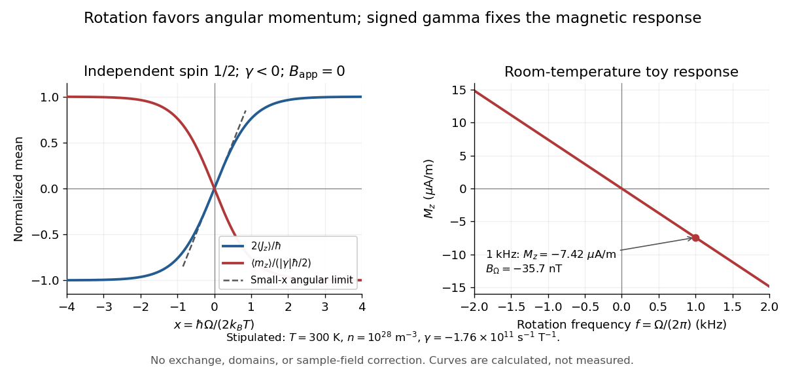

**[Figure 10](#image-signed-magnetic-moment-and-angular-momentum-response-to-rotation). Signed magnetic moment and angular momentum response to rotation**. Original calculated [Independent spin Barnett response](#independent-spin-barnett-response), with $\gamma<0$. The left panel reaches the formal saturation limits; the right panel is the extremely small-polarization room-[temperature](temperature.md) regime. The stipulated inputs describe a toy collection of independent [spins](angular-momentum-operator.md#spin); neither panel represents measurements of a [ferromagnet](#ferromagnet) or a fit to the gadolinium experiment.

For a numerical example, stipulate $n=10^{28}\,\mathrm{m^{-3}}$, $T=300\,\mathrm K$, $\gamma=-1.76\times10^{11}\,\mathrm{s^{-1}\,T^{-1}}$, and rotation [frequency](wave.md#frequency) $f=1000\,\mathrm{Hz}$. With $\Omega=2\pi f$, $\hbar=1.054571817\times10^{-34}\,\mathrm{J\,s}$, and $k_B=1.380649\times10^{-23}\,\mathrm{J/K}$, the model gives

$$
B_\Omega=-35.7\,\mathrm{nT},\qquad
x=8.00\times10^{-11},\qquad
M_z=-7.42\times10^{-6}\,\mathrm{A/m}.
$$

These are teaching inputs and calculated outputs, not measured material values. The corresponding internal [angular momentum](momentum.md#angular-momentum) density is $M_z/\gamma=+4.22\times10^{-17}\,\mathrm{J\,s/m^3}$. Keeping a rotor at prescribed $\Omega$ while its internal [angular momentum](momentum.md#angular-momentum) changes requires the drive to supply the appropriate angular [impulse](classical-mechanics.md#impulse). In an isolated body the mechanical part instead changes oppositely, as in [magnetomechanical angular momentum balance](#magnetomechanical-angular-momentum-balance). There is no creation of net [angular momentum](momentum.md#angular-momentum) by choosing a rotating frame.

##### Barnett response of a magnetic material

↑ **Parent:** [Barnett effect](#barnett-effect)

The two-state calculation is not a general formula for a [ferromagnet](#ferromagnet). [Exchange interactions](#exchange-interaction), [magnetic domains](#magnetic-domain), [magnetic domain-wall pinning](#magnetic-domain-wall-pinning), [magnetic anisotropy](#magnetic-anisotropy), and [hysteresis](critical-phenomenon.md#hysteresis) can determine which response is accessible. Both [spin angular momentum](angular-momentum-operator.md#spin) and [orbital angular momentum](quantum-mechanics.md#orbital-angular-momentum) can contribute; a single constant [gyromagnetic ratio](#gyromagnetic-ratio) may be only a restricted effective description. Rotation sets an internal bias, while the material and its preparation determine [magnetization](#magnetization). The [Barkhausen effect](#barkhausen-effect) illustrates why a smooth bias can produce jumps instead of the toy smooth curve.

For a limited, reversible, isotropic linear model, suppose the same intrinsic [volume magnetic susceptibility](statistical-physics.md#volume-magnetic-susceptibility) $\chi_v$ responds to the applied bias and to $B_\Omega/\mu_0$. For a uniformly magnetized [ellipsoid](euclidean-geometry.md#ellipsoid) along a principal axis, include its [demagnetizing factor](statistical-physics.md#demagnetizing-factor) $N_d$:

$$
H_{\rm int}=H_{\rm app}-N_dM_z,\qquad
M_z=\chi_v\left(H_{\rm app}-N_dM_z+\frac{B_\Omega}{\mu_0}\right).
$$

Solving this [linear equation](linear-algebra.md#linear-equation) yields

$$
M_z=\frac{\chi_v}{1+N_d\chi_v}
\left(H_{\rm app}+\frac{\Omega}{\mu_0\gamma}\right).
$$

Here $H_{\rm int}$ and $H_{\rm app}$ are actual [magnetic field intensities](#magnetic-field-intensity); the added rotational bias is an equivalent drive in the constitutive response. In [SI](physics.md#international-system-of-units), dimensionless $\chi_v$ multiplies an intensity in $\mathrm{A/m}$, so $M_z=\chi_v\Omega/\gamma$ would omit $\mu_0$ and have the wrong units. A susceptibility defined instead as $\partial M/\partial B$ has different units. State the convention before comparing formulas.

At zero applied [magnetic field intensity](#magnetic-field-intensity), a stipulated $\chi_v=3$ gives prefactor $3/2$ in a [sphere](euclidean-geometry.md#sphere), with $N_d=1/3$, and a prefactor approaching $3$ in a long axial [ellipsoid](euclidean-geometry.md#ellipsoid). This is a geometry check of the assumed linear model. A real cylinder does not have an exactly uniform [demagnetizing field](statistical-physics.md#demagnetizing-field), and an irreversible [ferromagnet](#ferromagnet) cannot in general be represented by this single linear equation. Inferring an intrinsic [gyromagnetic ratio](#gyromagnetic-ratio) requires an independently calibrated material response and a geometry-dependent conversion of the measured stray [magnetic field](magnetic-field.md).

##### Barnett rotation magnetometry experiment

↑ **Parent:** [Barnett effect](#barnett-effect)

The 2015 experiment used an air-driven nonmagnetic rotor containing polycrystalline [gadolinium](chemical-substance.md#gadolinium), with [magnetic shielding](#magnetic-shielding) and an external [fluxgate magnetometer](#fluxgate-magnetometer). Air drive reduced motor backgrounds. Measurements at 297–305 K were above the [Curie temperature](#curie-temperature), at rotation [frequencies](wave.md#frequency) up to 1.5 kHz. Reversing airflow reversed rotation and the magnetic signal; an empty capsule showed no speed-dependent signal. The readout measured stray [magnetic field](magnetic-field.md); geometry converted it to [magnetization](#magnetization). Sample [temperature](temperature.md) was checked immediately after stopping. Heating and the conversion model limit inference.[§§II–III, Figs. 1–2, note 22](physics-bibliography.md#barnett-effect-in-paramagnetic-states-by-masao-ono-and-others)

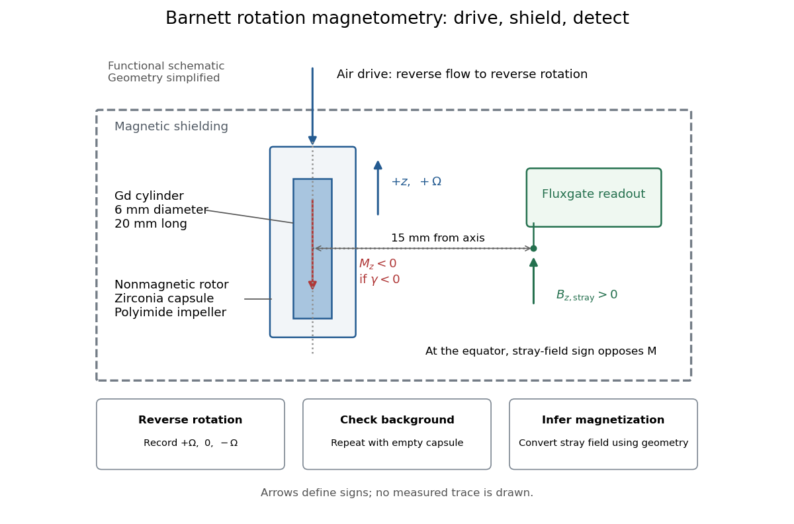

**[Figure 11](#image-barnett-rotation-magnetometry-experiment-controlled-rotation-and-stray-field-readout). Barnett rotation magnetometry experiment: controlled rotation and stray-field readout**. Original functional layout, with simplified geometry. The arrows independently explain the sign expected for $\gamma<0$: positive axial [angular velocity](rigid-body-dynamics.md#angular-velocity), negative axial [magnetization](#magnetization), and positive axial stray [magnetic field](magnetic-field.md) at an equatorial sensor. The air line indicates drive function. Dimensions and components follow the inspected experiment; this is neither its original figure nor measured data.

An additional analysis check follows from rotation [symmetry](physics.md#symmetry-physics). For signed sensor output $S$, separate

$$
S_{\rm odd}(\Omega)=\frac{S(+\Omega)-S(-\Omega)}2,\qquad
S_{\rm even}(\Omega)=\frac{S(+\Omega)+S(-\Omega)}2.
$$

An ideal linear [Barnett effect](#barnett-effect) appears in the odd component; a fixed offset appears in the even component. This is a proposed diagnostic, not a claim about the paper's processing. A background correlated with direction can also be odd: reversal alone is insufficient. Empty-rotor checks, zero-speed readings, calibration of sensor polarity, and controlled [temperature](temperature.md) changes test different errors. Equatorial stray-field sign must also be converted to [magnetization](#magnetization) sign: for an axial [magnetic dipole moment](#magnetic-dipole-moment), the [magnetic dipole field](magnetic-field.md#magnetic-dipole-field) at its equator points opposite to that [magnetic moment](#magnetic-dipole-moment). The apparatus diagram makes this otherwise easy-to-miss sign change visible.

#### Einstein-de Haas effect

↑ **Parent:** [Magnetic dipole moment](#magnetic-dipole-moment)  
ⓦ [Wiki](https://en.wikipedia.org/wiki/Einstein–de_Haas_effect)

The [Einstein-de Haas effect](#einstein-de-haas-effect) is mechanical rotation or twisting caused by a change in a body's [magnetization](#magnetization). The microscopic carriers of [magnetic dipole moment](#magnetic-dipole-moment) also carry [angular momentum](momentum.md#angular-momentum): changing their net orientation can transfer [angular momentum](momentum.md#angular-momentum) to the body. A freely suspended [ferromagnet](#ferromagnet) can therefore turn when its [magnetization](#magnetization) reverses. A suspension instead stores part of the response as an elastic twist. This makes a microscopic property accessible through a macroscopic [angle](geometry-and-topology.md#angle).

The central measurement compares a change of [magnetic dipole moment](#magnetic-dipole-moment) with transferred [angular momentum](momentum.md#angular-momentum), giving a [gyromagnetic ratio](#gyromagnetic-ratio). It complements an ordinary [magnetic dipole torque](#magnetic-dipole-torque) measurement: even with the applied [magnetic field](magnetic-field.md) parallel to the suspension axis, so that an ideal axial [magnetic dipole moment](#magnetic-dipole-moment) has $\mathbf m\times\mathbf B=\mathbf0$, changing [magnetization](#magnetization) can drive an axial twist. The external drive supplies [energy](energy.md); [conservation of angular momentum](momentum.md#conservation-of-angular-momentum) still requires accounting for the suspension and any external axial [torque](momentum.md#torque).

##### Magnetomechanical angular momentum balance

↑ **Parent:** [Einstein-de Haas effect](#einstein-de-haas-effect)

Let $m_z=\int_V M_z\,dV$ be the axial [magnetic dipole moment](#magnetic-dipole-moment), where $M_z$ is the axial [magnetization](#magnetization). Write $J_z$ for the internal [angular momentum](momentum.md#angular-momentum) associated with that [magnetic dipole moment](#magnetic-dipole-moment), and $I\dot\theta$ for the body's rotational [angular momentum](momentum.md#angular-momentum), with [moment of inertia](rigid-body-dynamics.md#moment-of-inertia) $I$. In a regime admitting a constant signed [gyromagnetic ratio](#gyromagnetic-ratio) $m_z=\gamma J_z$, axial [conservation of angular momentum](momentum.md#conservation-of-angular-momentum) gives

$$
\frac{d}{dt}(I\dot\theta+J_z)=\tau_{\rm ext},
\qquad I\ddot\theta=\tau_{\rm ext}-\frac{\dot m_z}{\gamma},
\qquad \tau_{\rm EdH}=-\frac{\dot m_z}{\gamma}.
$$

Here $\tau_{\rm EdH}$ names the internal reaction [torque](momentum.md#torque) on the body, not an additional external [torque](momentum.md#torque). The external term includes the suspension. The model assumes that the changing internal [angular momentum](momentum.md#angular-momentum) is transferred to the measured mechanical motion, with other storage or escape channels negligible on the observation timescale. A changing or non-collinear mixture of [orbital angular momentum](quantum-mechanics.md#orbital-angular-momentum) and [spin angular momentum](angular-momentum-operator.md#spin) need not admit a single constant $\gamma$.

During a reversal fast compared with the mechanical response, with negligible external angular [impulse](classical-mechanics.md#impulse), integrating the balance gives

$$
\Delta L_{\rm body}=-\Delta J_z=-\frac{\Delta m_z}{\gamma}.
$$

For $m_z:+m_s\to-m_s$ and an electronic $\gamma<0$, the body acquires $\Delta L_{\rm body}=2m_s/\gamma<0$: its initial rotation is toward $-z$ by the [right-hand rule](#right-hand-rule). Reversing the reversal reverses the impulse. Over a complete periodic cycle, $\Delta m_z=0$, so the net reaction angular [impulse](classical-mechanics.md#impulse) vanishes; a resonant alternating response does not imply steadily accumulating [angular momentum](momentum.md#angular-momentum).

The [orbital angular momentum](quantum-mechanics.md#orbital-angular-momentum) prediction can be derived without a material model. A charge $q$ traveling around a circle of [radius](topology.md#radius) $r$ at [angular frequency](lagrangian-mechanics.md#angular-frequency) $\omega$ has loop [electric current](electric-charge.md#electric-current) $q\omega/(2\pi)$ and [magnetic dipole moment](#magnetic-dipole-moment) $m=q\omega r^2/2$. Its [orbital angular momentum](quantum-mechanics.md#orbital-angular-momentum) is $L=m_e\omega r^2$, hence, for an [electron](physics.md#electron) with [electric charge](electric-charge.md) $-e$,

$$
\mathbf m_L=-\frac{e}{2m_e}\mathbf L,
\qquad \gamma_L=-\frac{e}{2m_e}.
$$

The [electron magnetic moment](#electron-magnetic-moment) associated with intrinsic [spin](angular-momentum-operator.md#spin) instead obeys

$$
\mathbf m_S=-g_s\frac{e}{2m_e}\mathbf S,
\qquad \gamma_S=-g_s\frac{e}{2m_e},\qquad g_s\simeq2.
$$

Here $e>0$ is the [elementary charge](electric-charge.md#elementary-charge), $m_e$ is the [electron mass](physics.md#electron-mass), and $g_s$ is the [electron spin g-factor](#electron-spin-g-factor).[pp. 299–300: orbital and intrinsic moments and the Dirac value](physics-bibliography.md#the-magnetic-moment-of-the-electron-by-polykarp-kusch) Thus the same change of [magnetic dipole moment](#magnetic-dipole-moment) corresponds to about half as much transferred [angular momentum](momentum.md#angular-momentum) in the pure-[spin](angular-momentum-operator.md#spin) model as in the [orbital angular momentum](quantum-mechanics.md#orbital-angular-momentum) model. This factor of two is a relation between [magnetic dipole moment](#magnetic-dipole-moment) and [angular momentum](momentum.md#angular-momentum), not evidence that an [electron](physics.md#electron) is literally a rotating charged sphere. In a material with both contributions, the inferred coefficient is a material-dependent magnetomechanical [gyromagnetic ratio](#gyromagnetic-ratio).

##### Einstein-de Haas experiment

↑ **Parent:** [Einstein-de Haas effect](#einstein-de-haas-effect)

In 1915, [Albert Einstein](physicist.md#albert-einstein) and [Wander Johannes de Haas](physicist.md#wander-johannes-de-haas) suspended a soft-[iron](chemical-substance.md#iron) cylinder by glass fibre between coaxial coils. Alternating [magnetization](#magnetization) drove torsional [resonance](dynamical-systems.md#resonance); a mirror reflected lamplight onto a scale. They compensated Earth's [magnetic field](magnetic-field.md), tilted the coils, and rotated the suspension attachment to test unwanted [magnetic dipole torques](#magnetic-dipole-torque). Added known [moment of inertia](rigid-body-dynamics.md#moment-of-inertia) calibrated the mechanical response.[§§4–5, pp. 702–706: apparatus, controls, calibration](physics-bibliography.md#experimental-proof-of-the-existence-of-ampere-s-molecular-currents-by-albert-einstein-and-wander-johannes-de-haas)

**[Figure 12](#image-einstein-de-haas-experiment-suspended-magnet-drive-and-optical-readout). Einstein-de Haas experiment: suspended magnet, drive and optical readout**. Original functional schematic of the first apparatus, rather than a scale reconstruction. The split coaxial coils leave an optical gap. The enlarged plan view explains the [optical lever](geometrical-optics.md#optical-lever); the calibration bar is attached for a separate calibration run. Compensation windings are represented by their function.

Their paper acknowledges a failed [phase](wave.md#phase-waves) determination and claims only ten-percent precision for the revised measurement. Its agreement with the orbital [gyromagnetic ratio](#gyromagnetic-ratio) prediction was not a direct discovery of [spin](angular-momentum-operator.md#spin).[§6, pp. 706–707: phase failure; §7, pp. 707–711: resonance, precision](physics-bibliography.md#experimental-proof-of-the-existence-of-ampere-s-molecular-currents-by-albert-einstein-and-wander-johannes-de-haas) Comparing that orbital [gyromagnetic ratio](#gyromagnetic-ratio) prediction with the [electron spin g-factor](#electron-spin-g-factor) explains why a successful qualitative demonstration of [angular momentum](momentum.md#angular-momentum) transfer can coexist with an inadequate quantitative interpretation. The stated precision is the authors' estimate; it does not establish that all [systematic errors](physics.md#systematic-error) were bounded by that amount.

The general control problem follows directly from the model. Unwanted [magnetic dipole torque](#magnetic-dipole-torque) can drive the same mechanical [resonance](dynamical-systems.md#resonance) as the desired reaction [torque](momentum.md#torque). In the ideal geometry $m_z$ and $B_z$ alone produce no axial [cross product](vector-space.md#cross-product), but transverse [magnetic dipole moments](#magnetic-dipole-moment), stray transverse [magnetic fields](magnetic-field.md) and imperfect alignment can. Nulling stray [magnetic fields](magnetic-field.md) and deliberately varying alignment test this contribution. Merely observing a large resonant twist cannot identify its cause.

For a nearly instantaneous magnetic response, a sinusoidal [magnetization](#magnetization) makes $m_z$ follow the drive while $-\dot m_z/\gamma$ is in [phase quadrature](wave.md#phase-quadrature). An ordinary magnetic contribution proportional to $m_z$ is then distinguishable by [phase](wave.md#phase-waves), after removing the mechanical [frequency response](electrical-engineering.md#frequency-response). [Hysteresis](critical-phenomenon.md#hysteresis) or delayed magnetic response can spoil this simple separation. The measured [magnetization](#magnetization), rather than the coil [electric current](electric-charge.md#electric-current) alone, must set the reference. Mechanical vibration, [magnetostriction](elasticity-physics.md#magnetostriction) coupled through imperfect geometry, and changing suspension properties require separate checks; none is eliminated simply by reversing the coil [electric current](electric-charge.md#electric-current).

##### Calibrated Einstein-de Haas torsion response

↑ **Parent:** [Einstein-de Haas effect](#einstein-de-haas-effect)

An original reduced model makes the calibration explicit. Let the [torsion pendulum](classical-mechanics.md#torsion-pendulum) have restoring [torque](momentum.md#torque) $-\kappa\theta$, with [torsion constant](classical-mechanics.md#torsion-constant) $\kappa$, and [viscous damping](wave-equation.md#viscous-damping) [torque](momentum.md#torque) $-b\dot\theta$, with $b>0$. Allow an unwanted axial [torque](momentum.md#torque) $\tau_p(t)$:

$$
I\ddot\theta+b\dot\theta+\kappa\theta
=-\frac{\dot m_z}{\gamma}+\tau_p(t),\qquad
\omega_0=\sqrt{\frac{\kappa}{I}},\qquad
Q=\frac{I\omega_0}{b}.
$$

Here $\omega_0$ is the undamped natural [angular frequency](lagrangian-mechanics.md#angular-frequency) and $Q$ the [quality factor](dynamical-systems.md#q-factor). The [forced harmonic oscillator](analysis.md#forced-harmonic-oscillator) response must be included before a twist can be interpreted as a [torque](momentum.md#torque).

Using the [complex amplitude](wave.md#complex-amplitude) convention $m_z(t)=\operatorname{Re}(\widetilde m e^{\mathrm i\omega t})$ and similarly for $\theta$ and $\tau_p$, differentiation multiplies by $\mathrm i\omega$. Substitution gives

$$
H_\tau(\omega)=\frac{1}{\kappa-I\omega^2+\mathrm i b\omega},
\qquad
\widetilde\theta=H_\tau(\omega)
\left(-\frac{\mathrm i\omega}{\gamma}\widetilde m+\widetilde\tau_p\right).
$$

This is the torque-to-twist [transfer function](control-theory.md#transfer-function). With $\widetilde\tau_p=0$ and real positive $\widetilde m=m_1$, the twist [amplitude](wave.md#wave-amplitude) is

$$
A_{\rm EdH}(\omega)=\frac{\omega m_1/|\gamma|}{\sqrt{(\kappa-I\omega^2)^2+(b\omega)^2}}.
$$

For $\gamma<0$, the twist [phase](wave.md#phase-waves) relative to $m_z$ is $\pi/2-\operatorname{atan2}(b\omega,\kappa-I\omega^2)$. At $\omega=\omega_0$ it is zero, although the reaction [torque](momentum.md#torque) leads $m_z$ by $\pi/2$. A [phase](wave.md#phase-waves) measured at the mirror is not automatically the [phase](wave.md#phase-waves) of the applied [torque](momentum.md#torque).

A fixed-[amplitude](wave.md#wave-amplitude) reference [torque](momentum.md#torque) $\tau_c\cos\omega t$ measures $|H_\tau|$ directly. The [Einstein-de Haas effect](#einstein-de-haas-effect) instead contains an extra factor $\omega$ when $m_1$ stays fixed. Consequently its twist [amplitude](wave.md#wave-amplitude) peaks exactly at $\omega_0$ in this model, whereas the fixed-[torque](momentum.md#torque) peak is at $\omega_0\sqrt{1-1/(2Q^2)}$ when $Q>1/\sqrt2$. To verify the first statement, divide the squared denominator of $A_{\rm EdH}$ by $\omega^2$: the quantity to minimize is $(\kappa/\omega-I\omega)^2+b^2$, minimized at $\omega_0$. Both response curves tend to zero at high [frequency](wave.md#frequency); only the magnetomechanical curve also tends to zero at zero [frequency](wave.md#frequency).

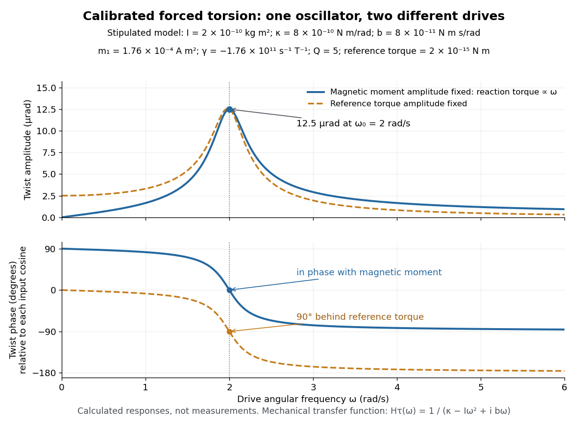

**[Figure 13](#image-calibrated-forced-torsion-distinguish-the-mechanical-response-from-the-magnetic-drive). Calibrated forced torsion: distinguish the mechanical response from the magnetic drive**. Original calculated curves, not historical measurements or fitted data. A constant reference [torque](momentum.md#torque) and a constant-[amplitude](wave.md#wave-amplitude) [magnetic dipole moment](#magnetic-dipole-moment) share the same mechanical [transfer function](control-theory.md#transfer-function). The lower plot uses each input's own cosine as its [phase](wave.md#phase-waves) reference. Markers at $\omega_0=2\,\mathrm{rad/s}$ show equal twist [amplitudes](wave.md#wave-amplitude) but different [phases](wave.md#phase-waves).

For a fully stipulated example, choose $I=2.00\times10^{-10}\,\mathrm{kg\,m^2}$, $\kappa=8.00\times10^{-10}\,\mathrm{N\,m/rad}$, $b=8.00\times10^{-11}\,\mathrm{N\,m\,s/rad}$, $\gamma=-1.76\times10^{11}\,\mathrm{s^{-1}\,T^{-1}}$, and $m_1=1.76\times10^{-4}\,\mathrm{A\,m^2}$. These teaching inputs give $\omega_0=2.00\,\mathrm{rad/s}$, $Q=5.00$, reaction [torque](momentum.md#torque) [amplitude](wave.md#wave-amplitude) $2.00\times10^{-15}\,\mathrm{N\,m}$ at $\omega_0$, and

$$
A_{\rm EdH}(\omega_0)=\frac{m_1}{|\gamma|b}=1.25\times10^{-5}\,\mathrm{rad}.
$$

An [optical lever](geometrical-optics.md#optical-lever) at distance $D=1.00\,\mathrm m$ gives small-displacement spot [amplitude](wave.md#wave-amplitude) $x\simeq2DA=25.0\,\mu\mathrm m$; its full peak-to-peak width is $4DA=50.0\,\mu\mathrm m$. For a fast reversal from $+m_1$ to $-m_1$, the same inputs give $\Delta L_{\rm body}=-2.00\times10^{-15}\,\mathrm{kg\,m^2/s}$ and initial $\Delta\dot\theta=-1.00\times10^{-5}\,\mathrm{rad/s}$, provided the external angular [impulse](classical-mechanics.md#impulse) is negligible.

One independent mechanical calibration adds known [moment of inertia](rigid-body-dynamics.md#moment-of-inertia) $\Delta I$, keeping $\kappa$ unchanged. If $T_a,T_b$ are the undamped [oscillation periods](classical-mechanics.md#period-of-an-oscillation) before and after adding it, then

$$
T_a^2=\frac{4\pi^2I}{\kappa},\qquad
T_b^2=\frac{4\pi^2(I+\Delta I)}{\kappa},\qquad
\kappa=\frac{4\pi^2\Delta I}{T_b^2-T_a^2}.
$$

For $\Delta I=I$ in the stipulated example, $T_a=\pi\,\mathrm s$ and $T_b=\sqrt2\pi\,\mathrm s$, recovering the chosen $I$ and $\kappa$. Real damped periods require a [damping](wave-equation.md#damping) correction: a free decay has angular envelope $e^{-bt/(2I)}$ and oscillation [angular frequency](lagrangian-mechanics.md#angular-frequency) $\sqrt{\kappa/I-(b/(2I))^2}$. Measuring that decay determines $b/(2I)$. Calibrating the optical scale, mechanical response and change of [magnetic dipole moment](#magnetic-dipole-moment) separately is what makes the inferred [gyromagnetic ratio](#gyromagnetic-ratio) meaningful.

#### Current loop

↑ **Parent:** [Magnetic dipole moment](#magnetic-dipole-moment)

A [current loop](#current-loop) is a closed path carrying [electric current](electric-charge.md#electric-current). For a thin wire following a closed [curve](topology.md#curve) $C$, the [volume integral](multivariable-calculus.md#volume-integral) defining its [magnetic dipole moment](#magnetic-dipole-moment) becomes a [line integral](multivariable-calculus.md#line-integral):

$$
\mathbf m=\frac I2\oint_C\mathbf r\times d\mathbf r=I\mathbf A,
\qquad
\mathbf A=\frac12\oint_C\mathbf r\times d\mathbf r.
$$

The [vector area](differential-geometry.md#vector-area) $\mathbf A$ is $A\widehat{\mathbf n}$ for a planar [current loop](#current-loop). For a nonplanar [current loop](#current-loop), use the [vector area](differential-geometry.md#vector-area), rather than the scalar [area](differential-geometry.md#surface-area) of an arbitrarily chosen spanning surface. Reversing the [electric current](electric-charge.md#electric-current) reverses $\mathbf m$ without changing the geometry. [Localized Current Distribution](physics-bibliography.md#classical-electromagnetism-by-richard-fitzpatrick/localized-current-distribution).

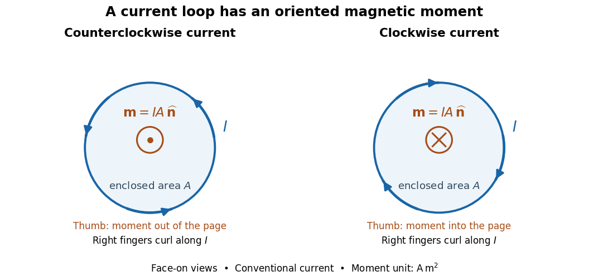

**[Figure 14](#image-current-direction-and-the-right-hand-rule-for-a-planar-magnetic-dipole-moment). Current direction and the right-hand rule for a planar magnetic dipole moment**. Viewed face-on, counterclockwise [conventional current](electric-charge.md#conventional-current) gives a [magnetic dipole moment](#magnetic-dipole-moment) out of the page, shown by a dot; reversing the [electric current](electric-charge.md#electric-current) gives a [magnetic dipole moment](#magnetic-dipole-moment) into the page, shown by a cross. The curled fingers follow the [electric current](electric-charge.md#electric-current) and the thumb follows the unit [normal vector](differential-geometry.md#normal-vector).

For $N$ closely spaced identical turns carrying the same [electric current](electric-charge.md#electric-current), the [magnetic dipole moments](#magnetic-dipole-moment) add: $\mathbf m=NIA\widehat{\mathbf n}$. Each turn contributes its own [vector area](differential-geometry.md#vector-area); unequal areas or differently oriented turns require a [vector](vector-space.md#vector) sum. As a calculated example, twelve circular turns of [radius](topology.md#radius) $R=3.0\,\mathrm{cm}$ carrying $I=0.40\,\mathrm A$ give $m=NI\pi R^2=1.36\times10^{-2}\,\mathrm{A\,m^2}$. This is an idealized example, not an experimental measurement.

##### Helmholtz coil

↑ **Parent:** [Current loop](#current-loop)  
ⓦ [Wiki](https://en.wikipedia.org/wiki/Helmholtz_coil)

A [Helmholtz coil](#helmholtz-coil) arrangement uses two identical coaxial circular windings separated by their [radius](topology.md#radius), carrying equal [electric currents](electric-charge.md#electric-current) in the same circulation sense. Their combined [magnetic field](magnetic-field.md) is especially uniform near the midpoint, making it useful for a [current-loop torque experiment](#current-loop-torque-experiment). The cancellation of the axial second [derivative](calculus.md#derivative) there follows from the [on-axis magnetic field of a circular current loop](#on-axis-magnetic-field-of-a-circular-current-loop).

#### Magnetic dipole torque

↑ **Parent:** [Magnetic dipole moment](#magnetic-dipole-moment)

An externally imposed [magnetic field](magnetic-field.md) that is nearly uniform over a rigid [current loop](#current-loop) produces the [torque](momentum.md#torque)

$$
\boldsymbol\tau=\mathbf m\times\mathbf B_{\mathrm{ext}},
\qquad
U=-\mathbf m\cdot\mathbf B_{\mathrm{ext}}=-mB\cos\theta.
$$

The [angle](geometry-and-topology.md#angle) $\theta$ is measured between the [magnetic dipole moment](#magnetic-dipole-moment) and the external [magnetic field](magnetic-field.md), not between the plane of the [current loop](#current-loop) and the [magnetic field](magnetic-field.md). The [magnetic dipole potential energy](#magnetic-dipole-potential-energy) uses a [dot product](inner-product.md#dot-product), whereas the [torque](momentum.md#torque) uses a [cross product](vector-space.md#cross-product). The [torque](momentum.md#torque) is largest when the [magnetic dipole moment](#magnetic-dipole-moment) is perpendicular to the [magnetic field](magnetic-field.md); parallel alignment minimizes the [potential energy](energy.md#potential-energy).[§11.5, equations 11.22–11.23: vector torque and orientation energy](physics-bibliography.md#university-physics-volume-2-by-samuel-j-ling-and-others/11-5-force-and-torque-on-a-current-loop)

For the sign convention $\mathbf B_{\mathrm{ext}}=B\widehat{\mathbf x}$ and $\mathbf m=m(\cos\theta\widehat{\mathbf x}+\sin\theta\widehat{\mathbf y})$, positive rotation increases $\theta$ and

$$
\tau_z=-mB\sin\theta=-\frac{dU}{d\theta}.
$$

Thus at $0<\theta<\pi$ the [torque](momentum.md#torque) turns the [magnetic dipole moment](#magnetic-dipole-moment) toward the external [magnetic field](magnetic-field.md). Both parallel and antiparallel alignment have zero [torque](momentum.md#torque), but they are respectively a [stable equilibrium](dynamical-systems.md#stable-equilibrium) and an [unstable equilibrium](dynamical-systems.md#unstable-equilibrium). With no [damping](wave-equation.md#damping), a freely released [current loop](#current-loop) can undergo [oscillation](wave.md#oscillation) around the [stable equilibrium](dynamical-systems.md#stable-equilibrium); settling requires [damping](wave-equation.md#damping).

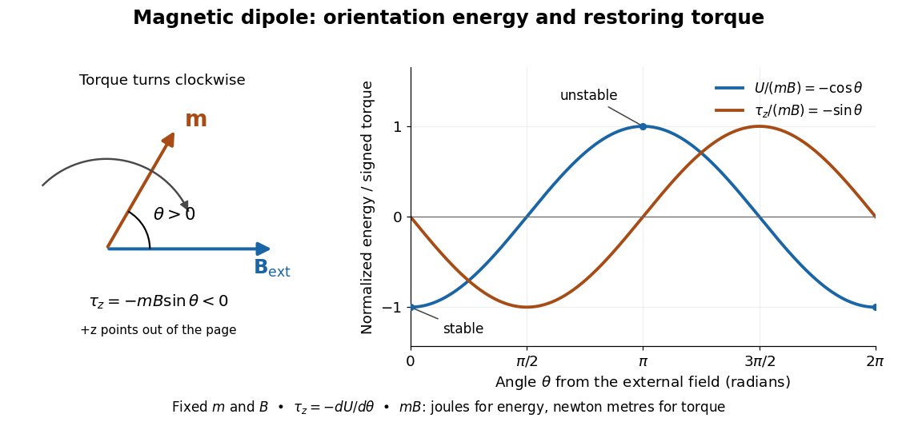

**[Figure 15](#image-angular-potential-energy-and-signed-torque-of-a-magnetic-dipole-in-an-imposed-field). Angular potential energy and signed torque of a magnetic dipole in an imposed field**. The ideal model has $U/(mB)=-\cos\theta$ and $\tau_z/(mB)=-\sin\theta$. The diagram fixes the external [magnetic field](magnetic-field.md) along positive $x$, so the [torque](momentum.md#torque) is clockwise for the illustrated positive [angle](geometry-and-topology.md#angle). These curves are calculated, not measured data.

In the twelve-turn example, take $B=0.020\,\mathrm T$ and $\theta=60\degree$. The predicted [torque](momentum.md#torque) is $\tau_z=-2.35\times10^{-4}\,\mathrm{N\,m}$ and the [magnetic dipole potential energy](#magnetic-dipole-potential-energy) is $U=-1.36\times10^{-4}\,\mathrm J$. The unit check is $(\mathrm{A\,m^2})\mathrm T=\mathrm{N\,m}=\mathrm J$; [torque](momentum.md#torque) and [energy](energy.md) have the same [physical dimensions](mathematical-physics.md#physical-dimension) but different physical meanings.

A short derivation starts with the [magnetic force on a current-carrying wire](relativistic-electromagnetism.md#magnetic-force-on-a-current-carrying-wire), $d\mathbf F=I\,d\mathbf r\times\mathbf B_{\mathrm{ext}}$. In an exactly uniform [magnetic field](magnetic-field.md), the net [force](force.md) is $I(\oint_Cd\mathbf r)\times\mathbf B_{\mathrm{ext}}=0$, but its [torque](momentum.md#torque) need not vanish: opposite sides produce a turning [couple](momentum.md#couple-mechanics). Integrating $\mathbf r\times d\mathbf F$ gives $\mathbf m\times\mathbf B_{\mathrm{ext}}$. Integrating $dU=-\tau_z\,d\theta$ at fixed $m$ and $B$ gives the orientation [potential energy](energy.md#potential-energy). This is the mechanical orientation [potential energy](energy.md#potential-energy) for a maintained [electric current](electric-charge.md#electric-current), with the external source held fixed; the [energy](energy.md) accounting for field and power supply is a separate problem. A varying external [magnetic field](magnetic-field.md) requires corrections across a finite [current loop](#current-loop), and can also give a net [force](force.md).

##### Current-loop torque experiment

↑ **Parent:** [Magnetic dipole torque](#magnetic-dipole-torque)

The PHYWE guide [Magnetic moment in the magnetic field](physics-bibliography.md#magnetic-moment-in-the-magnetic-field) makes the [magnetic dipole moment](#magnetic-dipole-moment) measurable. A circular test [current loop](#current-loop) sits between a pair of [Helmholtz coils](#helmholtz-coil), with separate supplies and meters for the test [electric current](electric-charge.md#electric-current) $I$ and field-producing [electric current](electric-charge.md#electric-current) $I_H$. The test [current loop](#current-loop) is mounted on a [torsion dynamometer](#torsion-dynamometer). The guide varies $I_H$, the number of turns, the test [electric current](electric-charge.md#electric-current), diameter, and the [angle](geometry-and-topology.md#angle) between the [magnetic dipole moment](#magnetic-dipole-moment) and [magnetic field](magnetic-field.md). Its angular settings are spaced by $15\degree$. The leads hang loosely and are twisted together to suppress extra [torque](momentum.md#torque); the instrument zero is checked frequently because moving leads can shift it. Its reported results include approximately linear dependence on each [electric current](electric-charge.md#electric-current) and on winding count, and approximately quadratic dependence on diameter.[pp. 4–9: theory, equipment, setup, angular settings, Table 1 and Figures 2–6](physics-bibliography.md#magnetic-moment-in-the-magnetic-field)

The readout is a balance of [torques](momentum.md#torque). According to the manufacturer's [Torsion dynamometer 0.01 N operating instructions](physics-bibliography.md#torsion-dynamometer-0-01-n-operating-instructions), a metallic band supplies the restoring [torque](momentum.md#torque). First set the indication to zero with the applied [force](force.md) absent and center the lever using the zero knob. Apply the load, then turn the indicating knob until the lever returns to its original zero position. The scale then reads a force equivalent, not a [torque](momentum.md#torque) directly. The quoted scale division is $0.1\,\mathrm{mN}$. For a [force](force.md) applied perpendicular to the calibration [lever arm](momentum.md#lever-arm) at distance $\ell$, the conversion is $\tau=F\ell$; a [current loop](#current-loop) applies a [couple](momentum.md#couple-mechanics), so its [torque](momentum.md#torque) must be compared with the calibrated restoring [torque](momentum.md#torque).[§§1–4: metallic-band compensation, zero procedure, force indication and scale specification](physics-bibliography.md#torsion-dynamometer-0-01-n-operating-instructions)

For a quantitative repeat, independently check that conversion with known [forces](force.md) at a measured perpendicular [lever arm](momentum.md#lever-arm), and check the imposed [magnetic field](magnetic-field.md) at the test [current loop](#current-loop). These are proposed calibration checks, not additional measurements reported here. The ideal [Helmholtz coil](#helmholtz-coil) model predicts

$$
B_0=\left(\frac45\right)^{3/2}\frac{\mu_0N_HI_H}{R_H},
\qquad
|\tau|=NI\pi R^2 B_0|\sin\theta|,
$$

where $N_H$ and $R_H$ are the winding count and radius of each field-producing [Helmholtz coil](#helmholtz-coil), distinct from $N$ and $R$ of the test [current loop](#current-loop). Derive $B_0$ by adding the [on-axis magnetic field of a circular current loop](#on-axis-magnetic-field-of-a-circular-current-loop) at distances $R_H/2$ from both coils. Independently calibrating $B_0$ and the restoring [torque](momentum.md#torque) lets a fitted [torque](momentum.md#torque) amplitude determine $m$ as amplitude divided by $B_0$, to compare with $NI\pi R^2$.

Useful additional controls are to reverse only $I$, reverse only $I_H$, and reverse both: the signed [torque](momentum.md#torque) should reverse in either single reversal and be unchanged in the double reversal. Record baselines with each [electric current](electric-charge.md#electric-current) separately zero, and subtract a nearby zero reading to reduce [torsion balance zero drift](classical-mechanics.md#torsion-balance-zero-drift). Repeat angular settings in both directions to reveal lead-dependent offsets. These are suggested controls. Limits include finite [magnetic field](magnetic-field.md) uniformity, uncertainty in effective winding area and angular zero, meter calibration, [Joule heating](electric-charge.md#joule-heating), and residual lead [torque](momentum.md#torque). An apparently sinusoidal trace alone does not establish the absolute [magnetic dipole moment](#magnetic-dipole-moment). No raw laboratory data or new measured values are claimed here.

###### Torsion dynamometer

↑ **Parent:** [Current-loop torque experiment](#current-loop-torque-experiment)  
🏷️ **Tags:** [Torsion balance](classical-mechanics.md#torsion-balance)

A [torsion dynamometer](#torsion-dynamometer) compares an applied [torque](momentum.md#torque) with the restoring [torque](momentum.md#torque) of a twisted elastic element. Returning the lever to its zero position allows a [current-loop torque experiment](#current-loop-torque-experiment) to hold the test orientation fixed while reading the compensating [torque](momentum.md#torque).

#### Far-field approximation for a current loop

↑ **Parent:** [Magnetic dipole moment](#magnetic-dipole-moment)

Far outside a localized steady source of size $a$, at distance $r\gg a$, its [multipole expansion](electrostatics.md#electric-multipole-expansion) starts with the [magnetic dipole moment](#magnetic-dipole-moment) if that moment is nonzero. In [vacuum](physics.md#vacuum), using [SI](physics.md#international-system-of-units) units,

$$
\mathbf A_{\mathrm{dip}}(\mathbf r)=\frac{\mu_0}{4\pi}\frac{\mathbf m\times\mathbf r}{r^3},
\qquad
\mathbf B_{\mathrm{dip}}(\mathbf r)=\frac{\mu_0}{4\pi r^3}\left[3(\mathbf m\cdot\widehat{\mathbf r})\widehat{\mathbf r}-\mathbf m\right],
$$

where $\mu_0$ is the [vacuum permeability](maxwell-equations.md#vacuum-permeability), $\widehat{\mathbf r}=\mathbf r/r$, and the [magnetic field](magnetic-field.md) is the [curl](multivariable-calculus.md#curl) of the [magnetic vector potential](#magnetic-vector-potential). The [magnetic dipole field](magnetic-field.md#magnetic-dipole-field) falls as $r^{-3}$, and the [magnetic vector potential](#magnetic-vector-potential) as $r^{-2}$. The [localized steady-current moment identities](#localized-steady-current-moment-identities) remove the putative $r^{-1}$ term in the [magnetic vector potential](#magnetic-vector-potential). No [magnetic monopole](mathematical-physics.md#magnetic-monopole) is needed. If different [current loops](#current-loop) cancel the total [magnetic dipole moment](#magnetic-dipole-moment), a higher term of the [multipole expansion](electrostatics.md#electric-multipole-expansion) supplies the leading distant [magnetic field](magnetic-field.md). [Localized Current Distribution](physics-bibliography.md#classical-electromagnetism-by-richard-fitzpatrick/localized-current-distribution).

The approximation is not valid at the center of a finite [current loop](#current-loop). For a circular [current loop](#current-loop) of [radius](topology.md#radius) $R$ and [electric current](electric-charge.md#electric-current) $I$, the exact [on-axis magnetic field of a circular current loop](#on-axis-magnetic-field-of-a-circular-current-loop) and the distant approximation are

$$
B_z(z)=\frac{\mu_0IR^2}{2(R^2+z^2)^{3/2}},
\qquad
B_{z,\mathrm{dip}}(z)=\frac{\mu_0IR^2}{2|z|^3}.
$$

Their ratio is $B_z/B_{z,\mathrm{dip}}=(1+R^2/z^2)^{-3/2}$: at $|z|=10R$, the approximate [magnetic field](magnetic-field.md) exceeds the exact [magnetic field](magnetic-field.md) by about $1.50\%$ relative to the exact value. Near the source, retain its geometry rather than replacing it with a point source specified only by its [magnetic dipole moment](#magnetic-dipole-moment).

#### Localized steady-current moment identities

↑ **Parent:** [Magnetic dipole moment](#magnetic-dipole-moment)

A localized steady [electric current density](electric-charge.md#current-density) satisfies $\nabla\cdot\mathbf j=0$. Integrate the divergences of $x_i\mathbf j$ and $x_ix_k\mathbf j$ over a region enclosing its support; all boundary fluxes vanish. The first identity removes the monopole term from the magnetic vector potential expansion. The antisymmetric first moment is equivalent to the [magnetic dipole moment](#magnetic-dipole-moment) $\frac12\int\mathbf x\times\mathbf j\,dV$.

#### Magnetic dipole potential energy

↑ **Parent:** [Magnetic dipole moment](#magnetic-dipole-moment)

In an external field that varies slowly across a localized magnetic dipole,

$$
U=-\mathbf m\cdot\mathbf B,
\qquad
\mathbf F=\nabla(\mathbf m\cdot\mathbf B).
$$

The [magnetic dipole moment](#magnetic-dipole-moment) determines the coupling to the external magnetic field.

##### Magnetic dipole force

↑ **Parent:** [Magnetic dipole potential energy](#magnetic-dipole-potential-energy)

For a small fixed [magnetic dipole moment](#magnetic-dipole-moment) $\mathbf m$ in a slowly varying external [magnetic field](magnetic-field.md), $U=-\mathbf m\cdot\mathbf B$ gives the displayed [force](force.md). For a compact current loop, integrate $I\,d\boldsymbol\ell\times\mathbf B$ to first order in the field's spatial variation to get the same result. For a coaxial small loop with $m_z=NI\pi a^2$, this becomes $F_z=m_z\,dB_z/dz$. A spatially uniform field can exert [torque](momentum.md#torque) but gives zero net [force](force.md); a field [gradient](multivariable-calculus.md#gradient) is essential. The approximation assumes the field does not appreciably vary over the dipole's dimensions.

##### Magnetic dipole interaction

↑ **Parent:** [Magnetic dipole potential energy](#magnetic-dipole-potential-energy)

The orientation-dependent interaction of two distant localized [magnetic dipole moments](#magnetic-dipole-moment). Its $r^{-3}$ scale makes close approach important in a concentrated magnetic-particle dispersion. Depending on geometry, it can favor chains, collective alignment or frustrated configurations.

#### Bohr magneton

↑ **Parent:** [Magnetic dipole moment](#magnetic-dipole-moment)  
ⓦ [Wiki](https://en.wikipedia.org/wiki/Bohr_magneton)

The Bohr magneton,

$$
\mu_B=\frac{e\hbar}{2m_e},
$$

is the natural unit of an electron's orbital and spin magnetic moment.

#### G-factor (physics)

↑ **Parent:** [Magnetic dipole moment](#magnetic-dipole-moment)  
ⓦ [Wiki](https://en.wikipedia.org/wiki/G-factor_(physics))

A dimensionless factor relating a system's [magnetic dipole moment](#magnetic-dipole-moment) to its [angular momentum](momentum.md#angular-momentum), with a specified charge and mass convention. Electron [spin](angular-momentum-operator.md#spin), orbital motion, and a combined atomic level have different [g-factors](#g-factor-physics); the convention must be stated before comparing them.

#### Anomalous magnetic moment

↑ **Parent:** [Magnetic dipole moment](#magnetic-dipole-moment)  
ⓦ [Wiki](https://en.wikipedia.org/wiki/Anomalous_magnetic_moment)

For a charged [spin one-half](angular-momentum-operator.md#spin-one-half) particle with the [Dirac equation](relativistic-quantum-field.md#dirac-equation) reference value $g=2$, the [anomalous magnetic moment](#anomalous-magnetic-moment) is conventionally expressed by the dimensionless quantity $a=(g-2)/2$. For the [electron](physics.md#electron), write $a_e=(g_s-2)/2$. A stipulated $g_s=2.0024$ would therefore mean $a_e=0.0012$: a $0.12\%$ excess of the spin-component moment over one [Bohr magneton](#bohr-magneton). This is a teaching input, not a quoted measurement.

#### Electron magnetic moment

↑ **Parent:** [Magnetic dipole moment](#magnetic-dipole-moment)  
ⓦ [Wiki](https://en.wikipedia.org/wiki/Electron_magnetic_moment)

The [electron magnetic moment](#electron-magnetic-moment) couples an [electron](physics.md#electron)'s [angular momentum](momentum.md#angular-momentum) to a [magnetic field](magnetic-field.md). Its intrinsic [spin](angular-momentum-operator.md#spin) contribution is

$$
\boldsymbol\mu_s=-g_s\mu_B\frac{\mathbf S}{\hbar},\qquad
\mu_B=\frac{e\hbar}{2m_e},\qquad e>0.
$$

Here $\mu_B$ is the [Bohr magneton](#bohr-magneton), and $g_s$ is the positive [electron spin g-factor](#electron-spin-g-factor) under this sign convention. The minus sign makes [magnetic dipole moment](#magnetic-dipole-moment) antiparallel to [spin angular momentum](angular-momentum-operator.md#spin). An [electron](physics.md#electron) in a [chemical atom](physics.md#atom-physics) can also contribute an orbital [magnetic dipole moment](#magnetic-dipole-moment); the measured response of a whole atomic level combines these contributions.

Measuring a tiny departure of $g_s$ from $2$ tests how well a theory predicts an [electron](physics.md#electron)'s interaction with its surroundings. The [Dirac equation](relativistic-quantum-field.md#dirac-equation) gives $g_s=2$ before [radiative corrections](perturbative-quantum-field-theory.md#radiative-correction); the [anomalous magnetic moment](#anomalous-magnetic-moment) makes a small correction experimentally accessible.[pp. 299–300: spin moment and Dirac prediction](physics-bibliography.md#the-magnetic-moment-of-the-electron-by-polykarp-kusch) A useful strategy is to compare two atomic [energy levels](quantum-mechanics.md#energy-level) whose orbital and [spin](angular-momentum-operator.md#spin) contributions have different weights, rather than trying to calibrate an absolute [magnetic field](magnetic-field.md) more accurately.

##### Electron spin g-factor

↑ **Parent:** [Electron magnetic moment](#electron-magnetic-moment)

The dimensionless coefficient in the [spin](angular-momentum-operator.md#spin) part of the [electron magnetic moment](#electron-magnetic-moment). It is distinct from a [gyromagnetic ratio](#gyromagnetic-ratio), which has units: in the angular convention, $\gamma_e=-g_se/(2m_e)$. It is also distinct from the [Landé g-factor](atomic-physics.md#lande-g-factor) $g_J$ of a combined atomic [angular momentum](momentum.md#angular-momentum) and from a nuclear or hyperfine [g-factor](#g-factor-physics).

For [spin one-half](angular-momentum-operator.md#spin-one-half), the largest magnitude of a spin-component [magnetic dipole moment](#magnetic-dipole-moment) is $g_s\mu_B/2$, not $g_s\mu_B$. Thus the ideal value $g_s=2$ gives one [Bohr magneton](#bohr-magneton). This follows directly from the [spin angular momentum](angular-momentum-operator.md#spin) projections $S_z=\pm\hbar/2$.

##### Kusch-Foley magnetic moment experiment

↑ **Parent:** [Electron magnetic moment](#electron-magnetic-moment)

[Polykarp Kusch](physicist.md#polykarp-kusch) and [Henry Michael Foley](physicist.md#henry-michael-foley) compared [hyperfine structure](quantum-mechanics.md#hyperfine-structure) resonance frequencies for different electronic states of [gallium](chemical-substance.md#gallium), [indium](chemical-substance.md#indium) and [sodium](chemical-substance.md#sodium). Their 1948 paper reports mutually consistent departures from the ratios expected with orbital factor $1$ and spin factor $2$. Comparing several states constrained the alternative explanation of perturbed atomic levels.[Abstract: atomic states, frequency comparisons and interpretation](physics-bibliography.md#the-magnetic-moment-of-the-electron-by-polykarp-kusch-and-henry-michael-foley-1948)

The [Rabi molecular beam magnetic resonance experiment](quantum-system.md#rabi-molecular-beam-magnetic-resonance-experiment) explains the readout principle: a resonant transition changes an atom's magnetic response, and hence its transmitted beam signal. Kusch describes rapidly interchangeable ovens, several [radio frequency](wave.md#radio-frequency) oscillators and careful field homogenization. Measurements taken during monotonic field drift were reduced to a common field.[pp. 303–304: resonance analysis, ovens, oscillators and field drift](physics-bibliography.md#the-magnetic-moment-of-the-electron-by-polykarp-kusch)

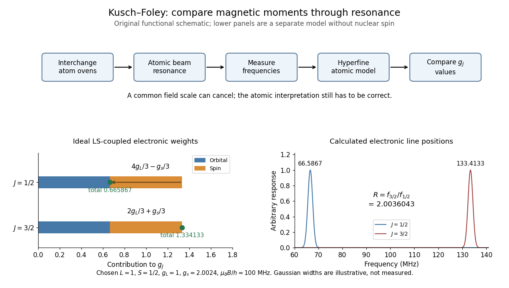

**[Figure 16](#image-compare-differently-weighted-atomic-magnetic-moments). Compare differently weighted atomic magnetic moments**. Original functional diagram of the [Kusch-Foley magnetic moment experiment](#kusch-foley-magnetic-moment-experiment) and a separate ideal [LS coupling](angular-momentum-operator.md#ls-coupling) calculation. The upper flow identifies the functions of beam preparation, resonance readout and atomic modeling; it is not a surviving apparatus drawing. The lower weights are calculated for $L=1$, $S=1/2$, $g_L=1$ and chosen $g_s=2.0024$, without nuclear [spin](angular-momentum-operator.md#spin). The frequencies in the teaching model cannot be substituted directly for measured hyperfine lines.

Real [hyperfine structure](quantum-mechanics.md#hyperfine-structure) lines are not simply bare electronic $g_J$ times field. Nuclear [magnetic moments](#magnetic-dipole-moment), known interaction constants and nonlinear field dependence enter the inference.[pp. 303–305: hyperfine modeling and atomic-state perturbations](physics-bibliography.md#the-magnetic-moment-of-the-electron-by-polykarp-kusch) Field homogeneity controls line broadening; alternating species addresses drift. Neither control removes an error in the atomic model. The beauty of the comparison is the separation of two problems: cancelling a shared calibration scale and testing whether several physical systems imply the same [electron spin g-factor](#electron-spin-g-factor).

##### Spin-orbit g-factor ratio from two P states

↑ **Parent:** [Electron magnetic moment](#electron-magnetic-moment)

An original reduced model makes the cancellation explicit. Assume [LS coupling](angular-momentum-operator.md#ls-coupling), neglect nuclear [spin](angular-momentum-operator.md#spin), and write the electronic [magnetic dipole moment](#magnetic-dipole-moment) as $-\mu_B(g_L\mathbf L+g_s\mathbf S)/\hbar$. For $L=1$, $S=1/2$, the projection used to derive the [Landé g-factor](atomic-physics.md#lande-g-factor) gives

$$
g_{3/2}=\frac{2g_L+g_s}{3},\qquad
g_{1/2}=\frac{4g_L-g_s}{3}.
$$

These coefficients follow by substituting $J=3/2$ or $1/2$ into the angular-momentum projection formula; neither level measures pure [spin](angular-momentum-operator.md#spin) alone. In a weak uniform [magnetic field](magnetic-field.md), adjacent electronic projections have spacing $h f_J=g_J\mu_B B$ when $g_J>0$. Therefore

$$
R=\frac{f_{3/2}}{f_{1/2}}=\frac{g_{3/2}}{g_{1/2}}
=\frac{2+x}{4-x},\qquad x=\frac{g_s}{g_L},\qquad
\boxed{x=\frac{4R-2}{R+1}.}
$$

The common [magnetic field](magnetic-field.md) and [Bohr magneton](#bohr-magneton) cancel. The ratio determines $g_s/g_L$, not $g_s$ without further knowledge of $g_L$. For $g_L=1$, it gives $a_e=(R-2)/(R+1)$. Small departures from $R=2$ are magnified differently from small departures of $g_s$ from $2$; the two fractional changes should not be identified.

With the stipulated inputs $g_L=1$, $g_s=2.0024$ and $\mu_BB/h=100\,\mathrm{MHz}$, the two electronic frequencies are $66.5867$ and $133.4133\,\mathrm{MHz}$. Their ratio is approximately $2.0036043$, and inversion recovers $a_e=0.0012$. These are ideal electronic lines, not historical [gallium](chemical-substance.md#gallium) data. Nuclear [spin](angular-momentum-operator.md#spin), mixing between levels and other deviations from [LS coupling](angular-momentum-operator.md#ls-coupling) require a more complete model in an actual atom.

###### Drift cancellation in a g-factor comparison

↑ **Parent:** [Spin-orbit g-factor ratio from two P states](#spin-orbit-g-factor-ratio-from-two-p-states)

Even a shared field does not cancel if it is sampled at different times. Write $f_A(t)=g_A C(t)$ and $f_B(t)=g_B C(t)$, where $C(t)=\mu_BB(t)/h$. As an original proposed diagnostic, bracket the $B$-state reading at $t=0$ with $A$-state readings at $t=\pm\tau$:

$$
R_{\rm bracket}=
\frac{f_B(0)}{\tfrac12[f_A(-\tau)+f_A(+\tau)]}.
$$

If $C(t)=C_0(1+bt)$, the denominator is exactly $g_A C_0$, so $R_{\rm bracket}=g_B/g_A$. A single earlier $A$ reading instead gives $R_{\rm unpaired}=(g_B/g_A)/(1-b\tau)$. For the preceding numerical model and $b\tau=0.001$, this unpaired comparison falsely gives approximately $a_e=0.00186649$; interpolation recovers $0.0012$. The sequence illustrates cancellation and is not asserted to be Kusch and Foley's exact historical timing protocol.

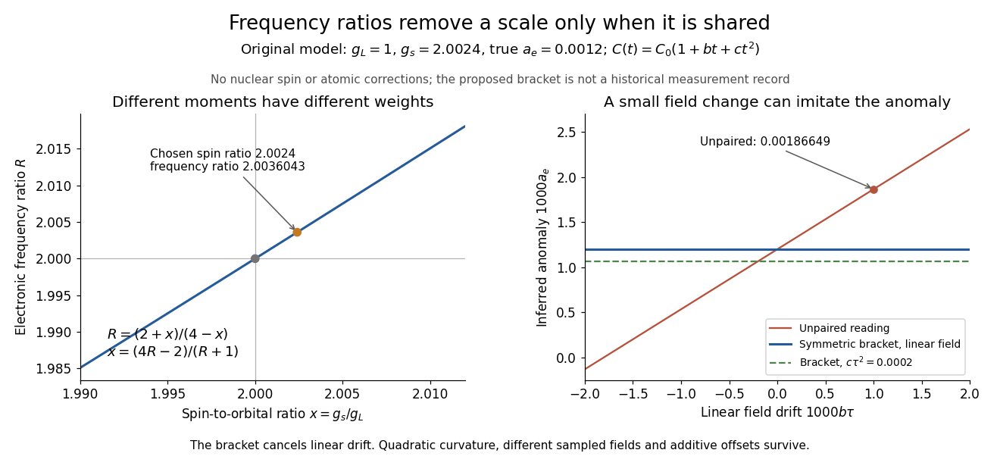

**[Figure 17](#image-cancel-a-shared-calibration-scale-without-hiding-its-limitations). Cancel a shared calibration scale without hiding its limitations**. Original calculations for [spin-orbit g-factor ratio from two P states](#spin-orbit-g-factor-ratio-from-two-p-states) and [drift cancellation in a g-factor comparison](#drift-cancellation-in-a-g-factor-comparison). All inputs are stipulated. The left plot shows the nonlinear inversion from a frequency ratio to a spin-to-orbital [g-factor](#g-factor-physics) ratio. The right plot contrasts an unpaired reading with a symmetric bracket under linear field drift; the dashed curve adds chosen quadratic curvature $c\tau^2=0.0002$. No curve is a measured resonance or a historical fit.

For a curved field $C(t)=C_0(1+bt+ct^2)$, the same calculation gives

$$
R_{\rm bracket}=\frac{g_B/g_A}{1+c\tau^2}.
$$

The linear drift cancels but the curvature remains. Different fields sampled by the two beams, additive frequency offsets and incorrect atomic corrections also survive. For a small ratio error $\delta R$, direct differentiation of the inverse relation gives

$$
\delta x\simeq\frac{6}{(R+1)^2}\,\delta R,\qquad
\delta a_e\simeq\frac{3}{(R+1)^2}\,\delta R\quad(g_L=1).
$$

Repeated readings can reduce random [measurement uncertainty](physics.md#measurement-uncertainty); agreement among genuinely different state comparisons is what tests shared [systematic errors](physics.md#systematic-error) in their interpretation.

#### Coulomb-gauge vector potential of a localized steady current

↑ **Parent:** [Magnetic dipole moment](#magnetic-dipole-moment)

If $\nabla\cdot J=0$ and the current decays enough for boundary terms to vanish, then

$$
A(x)=\frac{\mu_0}{4\pi}\int\frac{J(x')}{|x-x'|}\,d^3x'
$$

satisfies $\nabla\cdot A=0$. Its far field is

$$
A(x)=\frac{\mu_0}{4\pi}\frac{m\times x}{|x|^3}+\cdots.
$$

#### Gyromagnetic ratio

↑ **Parent:** [Magnetic dipole moment](#magnetic-dipole-moment)  
ⓦ [Wiki](https://en.wikipedia.org/wiki/Gyromagnetic_ratio)

The proportionality coefficient between a system's [magnetic dipole moment](#magnetic-dipole-moment) and [angular momentum](momentum.md#angular-momentum) when $\boldsymbol\mu=\gamma\mathbf J$ applies. In the angular convention, $\gamma$ is expressed in radians per second per [tesla](magnetic-field.md#tesla-unit); $\gamma/(2\pi)$ is the corresponding coefficient in cycles per second per [tesla](magnetic-field.md#tesla-unit). Its sign determines the relative orientations of the [magnetic dipole moment](#magnetic-dipole-moment) and [angular momentum](momentum.md#angular-momentum).

#### Nuclear magnetic moment

↑ **Parent:** [Magnetic dipole moment](#magnetic-dipole-moment)  
ⓦ [Wiki](https://en.wikipedia.org/wiki/Nuclear_magnetic_moment)

The [magnetic dipole moment](#magnetic-dipole-moment) of an [atomic nucleus](atomic-nucleus.md). Its relation to nuclear [spin](angular-momentum-operator.md#spin) is expressed by the [gyromagnetic ratio](#gyromagnetic-ratio); its interaction with an applied [magnetic field](magnetic-field.md) underlies [nuclear magnetic resonance](nuclear-magnetic-resonance.md).

##### Nuclear magneton

↑ **Parent:** [Nuclear magnetic moment](#nuclear-magnetic-moment)

The [nuclear magneton](#nuclear-magneton) is the unit of [magnetic moment](#magnetic-dipole-moment)

$$
\mu_N=\frac{e\hbar}{2m_p},
$$

where $m_p$ is the [proton](physics.md#proton) mass. For a [nuclear spin](atomic-nucleus.md#nuclear-spin) operator $\mathbf I$, the [nuclear magnetic moment](#nuclear-magnetic-moment) is $\boldsymbol\mu=g_I\mu_N\mathbf I/\hbar$. Consequently its [gyromagnetic ratio](#gyromagnetic-ratio) is $\gamma_I=g_I\mu_N/\hbar$, and its [Larmor frequency](angular-momentum-operator.md#larmor-frequency) in a uniform [magnetic field](magnetic-field.md) of magnitude $B$ is $|\gamma_I|B$. The [nuclear magneton](#nuclear-magneton) is smaller than the [Bohr magneton](#bohr-magneton) by the electron-to-proton mass ratio.

#### Magnetic dipole moment of a rigidly rotating charge distribution

↑ **Parent:** [Magnetic dipole moment](#magnetic-dipole-moment)

A circular charge distribution rotating with angular speed $\omega$ can be decomposed into current loops. A hoop of line density $\eta$ and radius $R$ has $m=\pi\eta\omega R^3\hat n$; a disc of surface density $\sigma$ has $m=\pi\sigma\omega R^4\hat n/4$.

##### Magnetic field of a rotating charged spherical body

↑ **Parent:** [Magnetic dipole moment of a rigidly rotating charge distribution](#magnetic-dipole-moment-of-a-rigidly-rotating-charge-distribution)

A uniformly charged solid sphere of total charge $Q$, radius $R$ and [angular velocity](rigid-body-dynamics.md#angular-velocity) $\boldsymbol\omega$ has [magnetic dipole moment](#magnetic-dipole-moment)

$$
\mathbf m=\frac12\int\mathbf r\times(\rho\boldsymbol\omega\times\mathbf r)\,d^3r=\frac{QR^2}{5}\boldsymbol\omega.
$$

For a uniformly charged thin spherical shell the coefficient is $1/3$ instead of $1/5$. At large distances the [magnetic field](magnetic-field.md) is a [magnetic dipole field](magnetic-field.md#magnetic-dipole-field), $\mathbf B=\mu_0[3(\mathbf m\cdot\hat{\mathbf r})\hat{\mathbf r}-\mathbf m]/(4\pi r^3)$. Its angularly averaged magnitude and [root mean square](analysis.md#root-mean-square) magnitude both scale as $r^{-3}$; its angularly averaged vector is zero. Steady rotation of this axisymmetric charge distribution produces [magnetostatics](#magnetostatics), not radiation.

## Biot-Savart law

↑ **Parent:** [Electromagnetism](electromagnetism.md)  
ⓦ [Wiki](https://en.wikipedia.org/wiki/Biot-Savart_law)

For a steady [current density](electric-charge.md#current-density) $J$, the [magnetic field](magnetic-field.md) is

$$
B(r)=\frac{\mu_0}{4\pi}\int
\frac{J(r')\times(r-r')}{|r-r'|^3}\,d^3r'.
$$

The [Biot-Savart law](#biot-savart-law) adds [magnetic field](magnetic-field.md) contributions from a specified [electric current](electric-charge.md#electric-current) distribution. The [vectors](vector-space.md#vector) $\mathbf r'$ and $\mathbf r$ locate source and observer; $\mathbf r-\mathbf r'$ points toward the observer. Here $\mu_0$ is [vacuum permeability](maxwell-equations.md#vacuum-permeability). For a thin wire carrying [electric current](electric-charge.md#electric-current) $I$, the [volume integral](multivariable-calculus.md#volume-integral) becomes a [line integral](multivariable-calculus.md#line-integral):

$$
\mathbf B(\mathbf r)=\frac{\mu_0 I}{4\pi}
\int_C\frac{d\boldsymbol\ell'\times(\mathbf r-\mathbf r')}
{|\mathbf r-\mathbf r'|^3},\qquad
 d\mathbf B=\frac{\mu_0}{4\pi}\frac{I\,d\boldsymbol\ell'\times\widehat{\mathbf R}}{R^2},
\quad \mathbf R=\mathbf r-\mathbf r'.
$$

Here $d\boldsymbol\ell'$ follows positive [conventional current](electric-charge.md#conventional-current); $\widehat{\mathbf R}$ is the [unit vector](vector-space.md#unit-vector) toward the observer. With fixed path orientation, reversing the [electric current](electric-charge.md#electric-current) replaces $I$ by $-I$. The [cross product](vector-space.md#cross-product) and [right-hand rule](#right-hand-rule) fix the direction. Reversing the source-to-observer displacement would give the wrong sign.[II.14–6, equations (14.37)–(14.38); II.14–7, equations (14.42)–(14.43), including the cross-product order](physics-bibliography.md#the-feynman-lectures-on-physics-volume-ii-by-richard-feynman-and-others)

The setting is [magnetostatics](#magnetostatics): time-independent [current density](electric-charge.md#current-density) and [charge density](electric-charge.md#charge-density), in [vacuum](physics.md#vacuum) or with the vacuum approximation for air. [Electric charge conservation](electric-charge.md#charge-conservation) then gives $\nabla\cdot\mathbf J=0$. A finite segment is part of a complete [electrical circuit](electrical-circuit.md); its endpoints cannot continuously accumulate [electric charge](electric-charge.md) in a steady state. The instantaneous integral above does not describe switching transients or [electromagnetic radiation](electromagnetic-radiation.md). In magnetic matter, specify the total [current density](electric-charge.md#current-density), including [magnetization current](#magnetization-current), rather than automatically replacing $\mu_0$ by an arbitrary [magnetic permeability](maxwell-equations.md#permeability-electromagnetism).[II.13–4, equations (13.12)–(13.13), steady-current and closed-circuit discussion; II.13–5, internal currents in magnetic matter](physics-bibliography.md#the-feynman-lectures-on-physics-volume-ii-by-richard-feynman-and-others)

The [superposition principle](vector-space.md#superposition-principle) makes the [Biot-Savart law](#biot-savart-law) useful even when the complete [electrical circuit](electrical-circuit.md) lacks the [symmetry](physics.md#symmetry-physics) needed to evaluate [Ampère's circuital law](maxwell-equations.md#ampere-s-circuital-law) directly. Integrate a straight piece, a curved piece, and the return path separately, then add their [magnetic fields](magnetic-field.md) as [vectors](vector-space.md#vector). The beauty is that a local oriented [current element](#current-element) produces both the circulating [magnetic field of a finite straight wire](#magnetic-field-of-a-finite-straight-wire) and the reinforcing [on-axis magnetic field of a circular current loop](#on-axis-magnetic-field-of-a-circular-current-loop).

An actual laboratory procedure is documented in WPI Physics Department's [Magnetic Field Mapping](https://users.wpi.edu/~kwu/Teaching/PH2651/biot-savart-law_MField_2017.pdf), §§1.2–1.2.3 and the single-coil checklist on p. 9. Preparation locates the active area of a [Hall effect](relativistic-electromagnetism.md#hall-effect) sensor using a small magnet. A field meter reads the component normal to that area. The wire apparatus is a wall-mounted square loop selectable between one and five conductors. The coil connects to a power supply and [ammeter](electric-charge.md#ammeter); its diameter and turn count are recorded. Align the sensor and scan distance. The control is a current-off background reading at each position, subtracted from the current-on reading. The inference compares corrected [magnetic field](magnetic-field.md) with position and the predicted geometry dependence. Active-area displacement, sensor tilt, background variation, and finite coil width limit that comparison. These are instructions, not reported measurements.[pp. 2–5, §§1.2–1.2.3: preparation, sensor orientation, wire background subtraction and single-coil apparatus; p. 9, single-coil checklist](physics-bibliography.md#magnetic-field-mapping-by-wpi-physics-department)

A further proposed control is to reverse $I$ at fixed sensor position and orientation. If the background and meter offset stay unchanged, the odd part isolates the [magnetic field](magnetic-field.md) from the [electric current](electric-charge.md#electric-current):

$$
\frac{B_{\rm read}(+I)-B_{\rm read}(-I)}2=B_{\rm current}.
$$

This is a deduction from the [superposition principle](vector-space.md#superposition-principle), not a reported WPI measurement. The measured component, sensor position, and complete return path must still match the model.

### Centre field of a rigidly rotating charged loop

↑ **Parent:** [Biot-Savart law](#biot-savart-law)

For planar charge rotating rigidly about its centre, $\mathbf v=\boldsymbol\Omega\times\mathbf r$. The magnetic contribution at the centre is $dB=\mu_0\Omega\,dq/(4\pi r)$, along the rotation axis. Integrate over the actual charge distribution; charges on a rotating polygon do not follow the sides of a stationary wire circuit.

### Magnetic field of a uniformly conducting strip

↑ **Parent:** [Biot-Savart law](#biot-savart-law)

For an infinitely long thin strip of width $w$ carrying uniform longitudinal current $I$, the [magnetic field](magnetic-field.md) a perpendicular [distance](geometry-and-topology.md#distance) $z>0$ above its centre has magnitude $B=\mu_0I\arctan(w/(2z))/(\pi w)$. Its near-sheet limit is $\mu_0I/(2w)$ and its distant line-current limit is $\mu_0I/(2\pi z)$.

### Magnetic-field cancellation of an arc and tangent leads

↑ **Parent:** [Biot-Savart law](#biot-savart-law)

For a circular arc of radius $R$ carrying clockwise [electric current](electric-charge.md#electric-current) $I$ and subtending angle $\theta$, with two tangent semi-infinite leads extending on the crossing side of the arc, the axial [magnetic field](magnetic-field.md) at height $h$ above the centre is

$$
B_z(h)=\frac{\mu_0I}{4\pi R}\left[\frac2{1+(h/R)^2}-\frac{\theta}{[1+(h/R)^2]^{3/2}}\right].
$$

The crossing is insulated. The positive term is from the two leads and the negative term from the arc, with $+z$ out of the clockwise-current plane. The [Biot-Savart law](#biot-savart-law) yields the lead integral $\int_0^\infty R(R^2+h^2+s^2)^{-3/2}\,ds=R/(R^2+h^2)$. Cancellation of the axial component gives the title formula, expanding to $\theta=2+h^2/R^2+O(h^4/R^4)$ in [radians](geometry-and-topology.md#radian). This is cancellation of one component away from the plane, not necessarily the entire [magnetic field](magnetic-field.md).

### Current element

↑ **Parent:** [Biot-Savart law](#biot-savart-law)

A [current element](#current-element) is the oriented infinitesimal wire contribution $I\,d\boldsymbol\ell'$ inside the [Biot-Savart law](#biot-savart-law). For uniform axial [current density](electric-charge.md#current-density) across [wire cross-sectional area](electric-charge.md#wire-cross-sectional-area) $A$, $I=JA$ and $d^3r'=A\,d\ell'$ imply $\mathbf J\,d^3r'=I\,d\boldsymbol\ell'$. This reduces a [volume integral](multivariable-calculus.md#volume-integral) to a [line integral](multivariable-calculus.md#line-integral) in the thin-wire approximation. It is an integration contribution, not an isolated steady source. [Conventional current](electric-charge.md#conventional-current) runs opposite the drift of negatively charged [electrons](physics.md#electron).

### Magnetic field of a finite straight wire

↑ **Parent:** [Biot-Savart law](#biot-savart-law)

Take a wire segment on the $y$ axis, with source positions $\mathbf r'=(0,s,0)$ for $s_1\le s\le s_2$, and positive [electric current](electric-charge.md#electric-current) along $+y$. Observe at $\mathbf r=(a,0,0)$, where $a>0$ is the perpendicular distance to the wire's supporting line. Choose $x$ rightward and $y$ upward, so $+z$ points out of the page. Then

$$
d\boldsymbol\ell'=\widehat{\mathbf y}\,ds,\qquad
\mathbf R=a\widehat{\mathbf x}-s\widehat{\mathbf y},\qquad
d\boldsymbol\ell'\times\mathbf R=-a\widehat{\mathbf z}\,ds.
$$

Thus the [magnetic field](magnetic-field.md) points into the page by the [right-hand rule](#right-hand-rule). The [Biot-Savart law](#biot-savart-law) and an elementary [antiderivative](integral.md#antiderivative) give

$$
\mathbf B=-\frac{\mu_0 I a}{4\pi}\widehat{\mathbf z}
\int_{s_1}^{s_2}\frac{ds}{(a^2+s^2)^{3/2}}
=-\frac{\mu_0I}{4\pi a}
\left[\frac{s}{\sqrt{a^2+s^2}}\right]_{s_1}^{s_2}\widehat{\mathbf z}.
$$

For an original worked example, choose $s_1=-0.12\,\mathrm m$, $s_2=0.12\,\mathrm m$, $a=0.05\,\mathrm m$, and $I=3\,\mathrm A$. Use $\mu_0\approx4\pi\times10^{-7}\,\mathrm{T\,m/A}$ for these rounded calculations. Each endpoint contributes $0.12/0.13=12/13$, so

$$
\mathbf B=-\frac{(10^{-7}\,\mathrm{T\,m/A})(3\,\mathrm A)}{0.05\,\mathrm m}
\frac{24}{13}\,\widehat{\mathbf z}
\approx-11.08\,\mu\mathrm T\,\widehat{\mathbf z}.
$$

These are calculated inputs and output, not laboratory data. The two endpoint [angles](geometry-and-topology.md#angle) measured from the perpendicular each have [sine](geometry-and-topology.md#sine) $12/13$; this recovers the equivalent endpoint-angle formula without depending on a diagram's angle-sign convention.

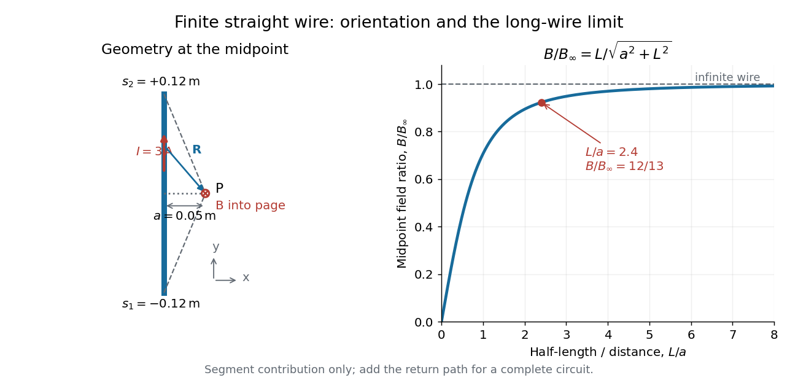

**[Figure 18](#image-finite-wire-biot-savart-law-source-geometry-orientation-and-the-long-wire-limit). Finite-wire Biot-Savart law: source geometry, orientation and the long-wire limit**. Original geometry for the $0.24\,\mathrm m$ segment and $0.05\,\mathrm m$ observation distance. The [electric current](electric-charge.md#electric-current) is upward; the [magnetic field](magnetic-field.md) at P points into the page. The right panel shows the calculated midpoint ratio $B_{\rm segment}/B_{\rm infinite}=L/\sqrt{a^2+L^2}$ versus half-[length](physics.md#length) divided by distance, with the example marked at $L/a=2.4$.

For a segment centered on the perpendicular foot, $s_1=-L$, $s_2=L$. Its [magnetic field](magnetic-field.md) magnitude is

$$
B=\frac{\mu_0I}{2\pi a}\frac{L}{\sqrt{a^2+L^2}}.
$$

The [limit](calculus.md#limit-of-a-function) $L/a\to\infty$ gives $B_\infty=\mu_0I/(2\pi a)$, consistent with [Ampère's circuital law](maxwell-equations.md#ampere-s-circuital-law) for an infinite straight wire. In the example, $B_\infty=12\,\mu\mathrm T$ and $B/B_\infty=12/13$: the infinite-wire value overestimates the segment value by $1/12$, or about $8.33\%$ of the segment value. For $a\gg L$, the isolated segment contribution instead behaves as $B\sim\mu_0I(2L)/(4\pi a^2)$. The complete localized [electrical circuit](electrical-circuit.md) has a different far-field behavior: return-path contributions cancel this leading segment term, leaving a [magnetic dipole field](magnetic-field.md#magnetic-dipole-field) when its [magnetic dipole moment](#magnetic-dipole-moment) is nonzero. Segment and whole-circuit limits must be distinguished.

The [SI](physics.md#international-system-of-units) units check directly: $\mu_0I/a$ has units $(\mathrm{T\,m/A})\mathrm A/\mathrm m=\mathrm T$, the [tesla](magnetic-field.md#tesla-unit). The apparent divergence as $a\to0$ is a failure of the thin-wire model near the conductor, not a prediction of infinite [magnetic field](magnetic-field.md) inside a real wire. This calculation gives only this segment's contribution; include the return wires before comparing with an apparatus.

### On-axis magnetic field of a circular current loop

↑ **Parent:** [Biot-Savart law](#biot-savart-law)

A circular loop of radius $R$ carrying [electric current](electric-charge.md#electric-current) $I$ has, on its axis,

$$
B(z)=\frac{\mu_0IR^2}{2(R^2+z^2)^{3/2}}\,\hat z,
$$

where the sign of $\hat z$ is fixed by the [right-hand rule](#right-hand-rule). At its centre, $B(0)=\mu_0I/(2R)$.

Put the loop in the $xy$ plane, centered at the origin, with positive [electric current](electric-charge.md#electric-current) counterclockwise when viewed from $+z$. The [right-hand rule](#right-hand-rule) then gives the central [magnetic field](magnetic-field.md) along $+z$. Parameterize source positions by the [angle](geometry-and-topology.md#angle) $\phi$ and observe at $(0,0,z)$:

$$
\mathbf r'=(R\cos\phi,R\sin\phi,0),\qquad
d\boldsymbol\ell'=R(-\sin\phi,\cos\phi,0)\,d\phi,
\qquad \mathbf R=(-R\cos\phi,-R\sin\phi,z).
$$

Here $R$ without bold type is the loop [radius](topology.md#radius), whereas $\mathbf R$ is the source-to-observer displacement. Their [cross product](vector-space.md#cross-product) is

$$
d\boldsymbol\ell'\times\mathbf R
=(Rz\cos\phi,Rz\sin\phi,R^2)\,d\phi.
$$

The denominator $|\mathbf R|^3=(R^2+z^2)^{3/2}$ is constant around the loop. The [integrals](integral.md) of [sine](geometry-and-topology.md#sine) and [cosine](geometry-and-topology.md#cosine) over a full turn vanish, while the axial contribution adds to $2\pi R^2$. Substitution into the [Biot-Savart law](#biot-savart-law) proves the on-axis formula. [Symmetry](physics.md#symmetry-physics) cancels transverse components; it does not cancel the axial components.

For an original one-turn example in the same vacuum approximation, choose $R=0.04\,\mathrm m$ and $I=2\,\mathrm A$. With $\mu_0\approx4\pi\times10^{-7}\,\mathrm{T\,m/A}$,

$$
B(0)=10\pi\,\mu\mathrm T\approx31.42\,\mu\mathrm T,\qquad
\frac{B(z)}{B(0)}=\left(1+\frac{z^2}{R^2}\right)^{-3/2}.
$$

At $z=0.03\,\mathrm m$, the source-to-observer distance is $0.05\,\mathrm m$, so $B(z)/B(0)=64/125=0.512$ and $B(z)\approx16.08\,\mu\mathrm T$. At $z=-0.03\,\mathrm m$, the [magnetic field](magnetic-field.md) has the same magnitude and still points along $+z$. The point has crossed the loop plane, but the loop's [electric current](electric-charge.md#electric-current) has not reversed. Reversing the [electric current](electric-charge.md#electric-current) reverses the [magnetic field](magnetic-field.md) on both sides.

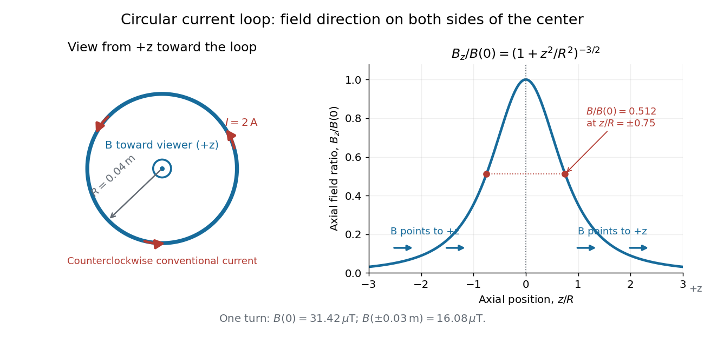

**[Figure 19](#image-circular-loop-magnetic-field-axial-reinforcement-and-equal-direction-on-both-sides). Circular-loop magnetic field: axial reinforcement and equal direction on both sides**. Original [electric current](electric-charge.md#electric-current) loop schematic and normalized on-axis calculation. The left view looks from $+z$, with counterclockwise [electric current](electric-charge.md#electric-current) and a central field directed toward the viewer. In the right panel, the arrows along the axis point toward $+z$ even for $z<0$; the calculated points at $z/R=\pm0.75$ have normalized field $0.512$. No experimental data are plotted.

For $|z|\ll R$, a [Taylor expansion](calculus.md#taylor-expansion) gives $B(z)/B(0)=1-3z^2/(2R^2)+O(z^4/R^4)$: the center is a smooth maximum, with zero first [derivative](calculus.md#derivative). For $|z|\gg R$,

$$
\mathbf B(z)\sim\frac{\mu_0IR^2}{2|z|^3}\widehat{\mathbf z}
=\frac{\mu_0m}{2\pi|z|^3}\widehat{\mathbf z},\qquad
m=I\pi R^2.
$$

This is the axial [magnetic dipole field](magnetic-field.md#magnetic-dipole-field) of [magnetic dipole moment](#magnetic-dipole-moment) $\mathbf m=I\pi R^2\widehat{\mathbf z}$.[II.14–5, equations (14.33)–(14.36): current times loop area and magnetic dipole field](physics-bibliography.md#the-feynman-lectures-on-physics-volume-ii-by-richard-feynman-and-others) A compact closed loop has an inverse-cube axial far field, in contrast to the inverse-distance field of the infinite straight wire. The [SI](physics.md#international-system-of-units) units of the exact loop formula are $\mu_0IR^2/(R^2+z^2)^{3/2}\sim\mu_0I/\text{length}$, hence [tesla](magnetic-field.md#tesla-unit).

For $N$ coincident turns carrying the same [electric current](electric-charge.md#electric-current), the [superposition principle](vector-space.md#superposition-principle) multiplies the ideal result by $N$. A real coil has radial width and axial [length](physics.md#length): if those are not negligible, integrate or sum over its individual turns. This is why a single measured coil diameter and a turn count may not determine the full spatial [magnetic field](magnetic-field.md) precisely. A collection of loops becomes a [solenoid](magnetic-field.md#solenoid); integrating their axial contributions gives the [on-axis magnetic field of a finite solenoid](magnetic-field.md#on-axis-magnetic-field-of-a-finite-solenoid).

### Magnetic-field cancellation between oppositely driven coaxial loops

↑ **Parent:** [Biot-Savart law](#biot-savart-law)

If coaxial loops of radii $R$ and $2R$, separated by $D$, carry currents $I$ and $2I$ in opposite senses, their on-axis fields cancel between the loops at distance $D/3$ from the smaller loop.

## Beltrami field

↑ **Parent:** [Electromagnetism](electromagnetism.md)  
ⓦ [Wiki](https://en.wikipedia.org/wiki/Beltrami_field)

A Beltrami field is a vector field parallel to its curl:

$$
\nabla\times J=\lambda J.
$$

If it is divergence-free and used as a magnetostatic current with constant nonzero $\lambda$, then $B=\mu_0J/\lambda$ solves $\nabla\times B=\mu_0J$ and $\nabla\cdot B=0$.

## Electromagnetic wave

↑ **Parent:** [Electromagnetism](electromagnetism.md)

[This section is present in another page, follow this link to view it.](electromagnetic-wave.md)

## Relativistic electromagnetism

↑ **Parent:** [Electromagnetism](electromagnetism.md)

[This section is present in another page, follow this link to view it.](relativistic-electromagnetism.md)

## Eddy current

↑ **Parent:** [Electromagnetism](electromagnetism.md)  
ⓦ [Wiki](https://en.wikipedia.org/wiki/Eddy_current)

An [eddy current](#eddy-current) is a circulating [electric current](electric-charge.md#electric-current) induced within an [electrical conductor](electric-charge.md#electrical-conductor) by changing [magnetic flux](magnetic-field.md#magnetic-flux), as described by [Faraday's law of induction](maxwell-equations.md#faraday-s-law-of-induction). Its [magnetic field](magnetic-field.md) opposes the inducing change according to [Lenz's law](maxwell-equations.md#lenz-s-law); [electrical resistance](electric-charge.md#electrical-resistance) converts electrical [energy](energy.md) into [heat](heat.md).

## Magnetism

↑ **Parent:** [Electromagnetism](electromagnetism.md)

Phenomena involving [magnetic fields](magnetic-field.md), including those produced by [electric currents](electric-charge.md#electric-current) and [magnetic moments](#magnetic-dipole-moment).

A small total [magnetic moment](#magnetic-dipole-moment) can hide extensive [magnetic order](#magnetic-order). Compare three questions: are the individual [magnetic moments](#magnetic-dipole-moment) nonzero, how are their directions correlated, and what is their [vector](vector-space.md#vector) sum? [Ferromagnetism](#ferromagnetism), [antiferromagnetism](#antiferromagnetism), and [ferrimagnetism](#ferrimagnetism) answer the second question differently. The third question alone cannot identify the order.

### Ultrarelativistic magnetic bending radius

↑ **Parent:** [Magnetism](#magnetism)

For motion perpendicular to a uniform magnetic field, the [Lorentz force](relativistic-electromagnetism.md#lorentz-force) gives $r=p/(|q|B)$. An ultrarelativistic massive particle has $pc\simeq E$, hence $r\simeq E/(|q|Bc)$. Total energy and [kinetic energy](energy.md#kinetic-energy) differ by the rest energy.

### Superparamagnetism

↑ **Parent:** [Magnetism](#magnetism)

A regime in which particle-scale magnetic moments reverse thermally on the observation timescale, giving little quasistatic remanence despite internally ordered single-domain particles. Being single-domain is not sufficient: anisotropy barriers and measurement time determine whether reversal is rapid. A finite-frequency drive can still produce relaxation losses.

<h4 id="neel-relaxation">Néel relaxation</h4>

↑ **Parent:** [Superparamagnetism](#superparamagnetism)

Thermally activated reorientation of a particle's internal magnetic moment across an anisotropy barrier. It differs from rotating the whole particle in a fluid. Its timescale can determine a measurement-dependent [magnetic blocking temperature](#magnetic-blocking-temperature).

### Magnetic blocking temperature

↑ **Parent:** [Magnetism](#magnetism)

The observation-timescale-dependent [temperature](temperature.md) below which a magnetic configuration no longer relaxes readily during a measurement. For [exchange bias](#exchange-bias) it can mark stable pinning of antiferromagnetic interfacial domains and can be below the bulk [Néel temperature](#neel-temperature). It is not identical to the thermodynamic onset of magnetic order.

### Saturation magnetic moment

↑ **Parent:** [Magnetism](#magnetism)

The magnetic moment approached when the available magnetic degrees of freedom are fully aligned.

### Orange-peel coupling

↑ **Parent:** [Magnetism](#magnetism)

A magnetostatic coupling caused by correlated roughness at interfaces of separated ferromagnetic films. Its tendency toward parallel alignment can modify a [pseudo spin valve](electric-charge.md#pseudo-spin-valve) switching loop; it is not itself interlayer exchange.

### Magnet

↑ **Parent:** [Magnetism](#magnetism)  
ⓦ [Wiki](https://en.wikipedia.org/wiki/Magnet)

A [magnet](#magnet) is a material object or current arrangement that produces a [magnetic field](magnetic-field.md). [Permanent magnets](#permanent-magnet) retain [magnetization](#magnetization), while [electromagnets](magnetic-field.md#electromagnet) use a supplied [electric current](electric-charge.md#electric-current) in a winding.

#### Permanent magnet

↑ **Parent:** [Magnet](#magnet)

A [permanent magnet](#permanent-magnet) retains [magnetization](#magnetization) after the applied magnetizing [magnetic field](magnetic-field.md) is removed. Its working [magnetic field](magnetic-field.md) persists without a driving [electric current](electric-charge.md#electric-current) in a winding.

### Magnetic anisotropy

↑ **Parent:** [Magnetism](#magnetism)

[Magnetic anisotropy](#magnetic-anisotropy) is a directional dependence of a material's magnetic properties. A preferred direction must be distinguished from an externally imposed [magnetic field](magnetic-field.md).

#### Uniaxial magnetic anisotropy

↑ **Parent:** [Magnetic anisotropy](#magnetic-anisotropy)

A magnetic energy preference for an axis, with the two opposite directions equivalent in a purely uniaxial model. An easy-axis energy can be written $K\sin^2\theta$ for $K>0$. A unidirectional term distinguishes the two directions and can instead shift a [hysteresis](critical-phenomenon.md#hysteresis).

#### Unidirectional magnetic anisotropy

↑ **Parent:** [Magnetic anisotropy](#magnetic-anisotropy)

A directional magnetic preference that distinguishes a [Magnetization](#magnetization) direction from its reverse, unlike a purely uniaxial easy-axis energy. A pinned interface can supply such a preference and produce [exchange bias](#exchange-bias). In a simple model its interfacial energy term is proportional to $-J_{\rm int}\cos\theta$.

#### Exchange bias

↑ **Parent:** [Magnetic anisotropy](#magnetic-anisotropy)

A displacement of a ferromagnetic [hysteresis](critical-phenomenon.md#hysteresis) loop's field centre caused by coupling to a prepared, sufficiently pinned magnetic environment, commonly an [antiferromagnet](#antiferromagnetism). Field cooling through the ordering/blocking range can establish a unidirectional interfacial spin preference. With switching fields $H_-,H_+$, the shift is $H_E=(H_++H_-)/2$, distinct from coercive half-width $(H_+-H_-)/2$. Reversing the cooling field, testing a full major loop and comparing uncoupled/zero-field-cooled controls help identify genuine bias.

#### g tensor

↑ **Parent:** [Magnetic anisotropy](#magnetic-anisotropy)

The tensor connecting [spin](angular-momentum-operator.md#spin) to magnetic moment in an effective [spin](angular-momentum-operator.md#spin) Hamiltonian. Its principal values specify direction-dependent Zeeman coupling.

### Magnetic shielding

↑ **Parent:** [Magnetism](#magnetism)

[Magnetic shielding](#magnetic-shielding) reduces an unwanted [magnetic field](magnetic-field.md) in a specified region. Residual fields and fields generated inside the shield still need to be assessed in a [magnetometer](#magnetometer) experiment.

### Magneto-optic Kerr effect

↑ **Parent:** [Magnetism](#magnetism)

### Interlayer exchange coupling

↑ **Parent:** [Magnetism](#magnetism)

#### Oscillatory spacer-mediated exchange

↑ **Parent:** [Interlayer exchange coupling](#interlayer-exchange-coupling)

Electrons reflected by two magnetic interfaces can mediate an interaction across a nonmagnetic metal spacer. The phase accumulated on traversing the spacer varies with its thickness, producing oscillatory contributions to $J(t)$ from [Fermi surface](fermi-liquid.md#fermi-surface) spanning vectors. In the sign convention in the title, positive $J$ favours parallel moments and negative $J$ antiparallel moments. Multiple periods, interface phase shifts, disorder and finite temperature prevent a universal sign rule based on thickness alone.

### Diamagnetism

↑ **Parent:** [Magnetism](#magnetism)  
ⓦ [Wiki](https://en.wikipedia.org/wiki/Diamagnetism)

[Diamagnetism](#diamagnetism) is a magnetic response in which the induced [magnetization](#magnetization) opposes the applied [magnetic field intensity](#magnetic-field-intensity). In a linear isotropic description, $\mathbf M=\chi\mathbf H$ with negative [magnetic susceptibility](statistical-physics.md#magnetic-susceptibility) $\chi$.

#### Diamagnetic levitation in an inverse-height field

↑ **Parent:** [Diamagnetism](#diamagnetism)

A small weakly susceptible [sphere](euclidean-geometry.md#sphere) has induced [magnetic energy](electromagnetic-wave.md#magnetic-energy) $-\chi VB^2/(2\mu_0)$ and vertical [force](force.md) $\chi VBB'/\mu_0$. In field magnitude $B=B_0r_0/z$, balancing [gravity](physics.md#gravity) gives the title height for $\chi<0$. The vertical [force](force.md) varies as $z^{-3}$, giving a restoring derivative at that equilibrium. Three-dimensional trapping cannot be established from an axial field magnitude alone; lateral field geometry and Maxwell constraints also matter.

#### Landau diamagnetism

↑ **Parent:** [Diamagnetism](#diamagnetism)  
ⓦ [Wiki](https://en.wikipedia.org/wiki/Landau_diamagnetism)

[Landau diamagnetism](#landau-diamagnetism) is the orbital response of mobile [electrons](physics.md#electron) to an applied [magnetic field](magnetic-field.md), arising from quantization of their transverse motion. For a noninteracting three-dimensional isotropic [electron](physics.md#electron) [gas](thermodynamics.md#gas) with quadratic dispersion, [electron spin](angular-momentum-operator.md#electron-spin) with $g=2$ and [magnetic fields](magnetic-field.md) weak enough for the smooth-response limit, its susceptibility is $\chi_L=-\chi_P/3$, where $\chi_P$ is the [Pauli paramagnetism](quantum-ideal-gas-statistics.md#pauli-paramagnetism) susceptibility. Band effective masses, interactions, dimensionality and resolved magnetic quantum oscillations can change this simple relation.

### Magnetometer

↑ **Parent:** [Magnetism](#magnetism)  
ⓦ [Wiki](https://en.wikipedia.org/wiki/Magnetometer)

A [magnetometer](#magnetometer) measures a [magnetic field](magnetic-field.md) or a specimen's [magnetic dipole moment](#magnetic-dipole-moment). A [vibrating-sample magnetometer](#vibrating-sample-magnetometer) determines the latter from the [electromotive force](electric-charge.md#electromotive-force) induced in pickup coils by specimen motion.

#### Fluxgate magnetometer

↑ **Parent:** [Magnetometer](#magnetometer)

A [fluxgate magnetometer](#fluxgate-magnetometer) uses a periodically driven magnetic core and pickup coils to measure a [magnetic field](magnetic-field.md).

### Magnetic order

↑ **Parent:** [Magnetism](#magnetism)

[Magnetic order](#magnetic-order) is a reproducible spatial organization of microscopic [magnetic moments](#magnetic-dipole-moment). A net [magnetization](#magnetization) describes their sum; a [staggered magnetization](statistical-physics.md#staggered-magnetization) describes an alternating pattern. These are different [order parameters](critical-phenomenon.md#order-parameter). For example, an alternating row of equal up and down arrows has zero sum but a definite pattern, whereas randomly oriented arrows can have a small sum without that pattern.

#### Short-range order

↑ **Parent:** [Magnetic order](#magnetic-order)

Correlations that extend over a finite local distance without establishing macroscopic long-range order.

#### Magnetic sublattice

↑ **Parent:** [Magnetic order](#magnetic-order)

A [magnetic sublattice](#magnetic-sublattice) groups sites with a common ordered [magnetic moment](#magnetic-dipole-moment) in a description of [magnetic order](#magnetic-order). In the simplest two-sublattice description, assign [magnetizations](#magnetization) $\mathbf M_A$ and $\mathbf M_B$ per total specimen [volume](geometry-and-topology.md#volume), so that

$$
\mathbf M=\mathbf M_A+\mathbf M_B,\qquad
\mathbf L=\mathbf M_A-\mathbf M_B.
$$

Here $\mathbf L$ is one normalization of the [staggered magnetization](statistical-physics.md#staggered-magnetization); conventions may include a factor $1/2$. Using the same total [volume](geometry-and-topology.md#volume) for both contributions is essential. Equal [magnetic moment](#magnetic-dipole-moment) per site does not imply equal sublattice contributions if the site populations differ.

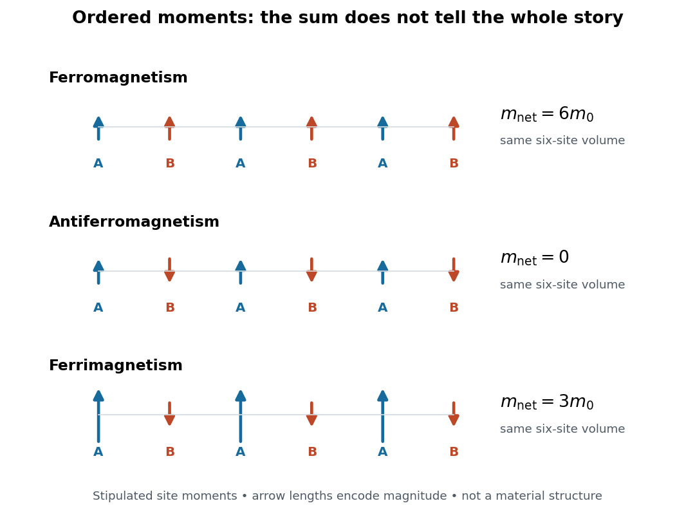

**[Figure 20](#image-ferromagnetism-antiferromagnetism-and-ferrimagnetism-order-and-the-net-magnetic-moment). Ferromagnetism, antiferromagnetism, and ferrimagnetism: order and the net magnetic moment**. Original counting diagrams with six sites in equal [volumes](geometry-and-topology.md#volume). Arrows are [magnetic moments](#magnetic-dipole-moment), not trajectories. The stipulated site contributions are $+m_0,+m_0$ for [ferromagnetism](#ferromagnetism), $+m_0,-m_0$ for [antiferromagnetism](#antiferromagnetism), and $+2m_0,-m_0$ for [ferrimagnetism](#ferrimagnetism). The two colors identify A and B sites. This schematic is not a measured material or the [crystal structure](physical-chemistry.md#crystal-structure) of [manganese(II) oxide](chemical-substance.md#manganese-ii-oxide).

In this six-site example, three A sites and three B sites give total [magnetic moments](#magnetic-dipole-moment) $6m_0$, $0$, and $3m_0$, respectively, along the chosen axis. The antiferromagnetic case has $\mathbf M=0$ but $\mathbf L=6m_0\widehat{\mathbf z}/V$. Cancellation of the sum leaves the alternating information intact.

#### Magnetic neutron diffraction

↑ **Parent:** [Magnetic order](#magnetic-order)

[Magnetic neutron diffraction](#magnetic-neutron-diffraction) uses scattering of [neutrons](neutron.md) by ordered [magnetic moments](#magnetic-dipole-moment) to infer [magnetic order](#magnetic-order). [Neutrons](neutron.md) also scatter from [atomic nuclei](atomic-nucleus.md), so a pattern can contain nuclear and magnetic contributions. A [Bragg scattering](quantum-scattering.md#bragg-scattering) peak encodes periodicity; it is not a photograph of an individual [spin](angular-momentum-operator.md#spin).

A minimal original calculation makes the extra periodicity visible. Consider identical nuclear scatterers at positions $x_n=na$, with equal neighboring separation $a$, and ordered [magnetic moments](#magnetic-dipole-moment) alternating between $+m_A$ and $-m_B$. A two-site repeating block of [length](physics.md#length) $2a$ has nuclear and magnetic [scattering amplitudes](quantum-scattering.md#scattering-amplitude), apart from common geometric factors,

$$
F_N(q)=b(1+e^{iqa}),\qquad
F_M(q)=m_A-m_Be^{iqa},\qquad
q=\frac{\pi h}{a},\quad h\in\mathbb Z.
$$

Here $b$ is the common nuclear scattering coefficient and $q$ the component of the scattering [wave vector](elasticity-physics.md#wavevector) along the row. The magnetic expression assumes equally scattering point [magnetic moments](#magnetic-dipole-moment) perpendicular to the scattering [wave vector](elasticity-physics.md#wavevector); real magnetic scattering measures the perpendicular component and has a [momentum](momentum.md)-dependent amplitude. This one-dimensional calculation is a periodicity illustration, not a finite-[temperature](temperature.md) solution for a chain.

For even $h$, $F_N=2b$ and $F_M=m_A-m_B$. For odd $h$, $F_N=0$ and $F_M=m_A+m_B$. Thus equivalent opposing [magnetic sublattices](#magnetic-sublattice), $m_A=m_B$, cancel in forward scattering but reinforce at the odd positions of the doubled period. The [intensity](wave.md#intensity-physics) is proportional to the squared magnitude of the [scattering amplitude](quantum-scattering.md#scattering-amplitude), so changing an amplitude's sign does not make a negative [intensity](wave.md#intensity-physics).

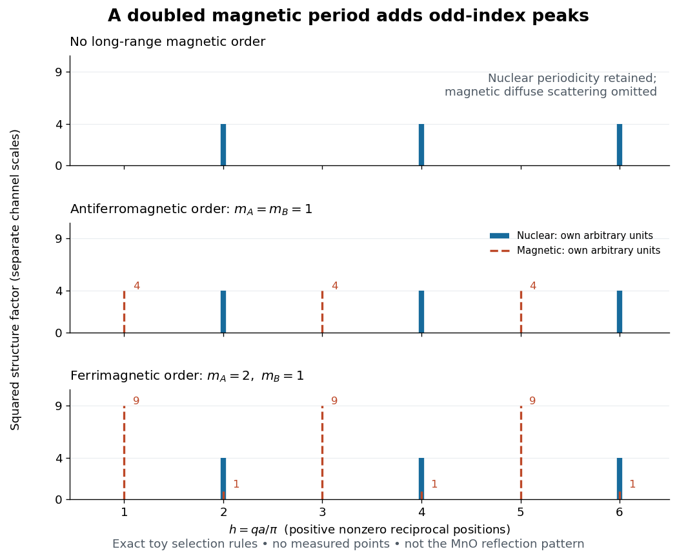

**[Figure 21](#image-an-alternating-magnetic-moment-pattern-creates-extra-reciprocal-lattice-peaks). An alternating magnetic moment pattern creates extra reciprocal lattice peaks**. Original exact two-site [crystal basis structure factor](quantum-scattering.md#crystal-basis-structure-factor) illustration, not historical measurements or a simulation of MnO. Nuclear strengths use $b=1$. Ordered magnetic strengths use $(m_A,m_B)=(1,1)$ or $(2,1)$; each channel is in its own arbitrary units, so their absolute heights cannot be compared. Thin solid nuclear sticks and dashed magnetic sticks coincide at even $h$ in the ferrimagnetic case. The top panel stipulates loss of long-range magnetic order while retaining nuclear periodicity; diffuse magnetic scattering is omitted, rather than asserted absent. Only positive nonzero $q$ is shown.

This calculation also exposes a useful difference between [antiferromagnetism](#antiferromagnetism) and [ferrimagnetism](#ferrimagnetism): with $m_A=2$ and $m_B=1$, magnetic squared amplitudes are $1$ at even $h$ and $9$ at odd $h$. Extra magnetic peaks can therefore occur in a [ferrimagnet](#ferrimagnetism) too. Identifying a real magnetic structure needs the full [crystal basis structure factor](quantum-scattering.md#crystal-basis-structure-factor), multiple reflections, and the allowed moment orientations, rather than a single extra peak.

##### Magnetic form factor

↑ **Parent:** [Magnetic neutron diffraction](#magnetic-neutron-diffraction)

The scattering-vector dependence of magnetic scattering from the spatial distribution of a magnetic moment, commonly suppressing magnetic intensity at large momentum transfer.

##### Manganese monoxide neutron diffraction experiment

↑ **Parent:** [Magnetic neutron diffraction](#magnetic-neutron-diffraction)

In 1949, [Clifford Shull](physicist.md#clifford-glenwood-shull) and [J. Samuel Smart](physics-author.md#j-samuel-smart) compared powdered [manganese(II) oxide](chemical-substance.md#manganese-ii-oxide) at room [temperature](temperature.md) and $80\,\mathrm K$. Powder preparation supplies many [crystal](thermodynamics.md#crystal) orientations. Their Fig. 1 records scattered-neutron [intensity](wave.md#intensity-physics) versus counter angle. Nuclear reflections remained, while the cold pattern gained strong reflections forbidden by the chemical [unit cell](quantum-scattering.md#unit-cell). They indexed these with a magnetic [unit cell](quantum-scattering.md#unit-cell) having twice the chemical cell edge. The warm pattern already contained diffuse magnetic scattering: loss of sharp magnetic peaks does not mean loss of individual [magnetic moments](#magnetic-dipole-moment).[Shull and Smart, Detection of Antiferromagnetism by Neutron Diffraction (1949), Fig. 1 and accompanying paragraphs; original reprint inspected at Carnegie Mellon University](physics-bibliography.md#detection-of-antiferromagnetism-by-neutron-diffraction-by-clifford-glenwood-shull-and-j-samuel-smart)

The source was Oak Ridge's graphite-moderated reactor. In Early Development of Neutron Scattering (1994), [Clifford Shull](physicist.md#clifford-glenwood-shull) describes how the early two-axis instruments used a monochromating [crystal](thermodynamics.md#crystal) to select the incident-neutron [wavelength](wave-equation.md#wavelength); a shielded neutron counter rotated around the specimen to record angular [intensity](wave.md#intensity-physics). This specifies the source–[monochromator](optical-instrument.md#monochromator)–sample–counter path, without identifying which instrument revision produced the MnO trace.[Early Development of Neutron Scattering (1994), pp. 99–103, Figs. 2–4, and p. 106, Fig. 8; inspected CMU reprint pp. 99–106](physics-bibliography.md#early-development-of-neutron-scattering-by-clifford-glenwood-shull)

The control was the same compound above and below magnetic ordering, with retained nuclear peaks identifying the underlying chemical periodicity. The original paper labels an aluminium impurity peak and defers a complete magnetic-structure account. It supplies neither a chemical synthesis recipe nor detailed cold-stage construction. The inference is periodic magnetic order, rather than a claim that every possible structural change was excluded at arbitrary resolution.[Fig. 1: aluminium impurity label, nuclear/magnetic indexing and room-temperature/80 K comparison; final paragraph before conclusion](physics-bibliography.md#detection-of-antiferromagnetism-by-neutron-diffraction-by-clifford-glenwood-shull-and-j-samuel-smart)

The connection to the measured angle is the [elastic Bragg scattering condition](quantum-scattering.md#elastic-bragg-scattering-condition). If the incident and outgoing [wave vectors](elasticity-physics.md#wavevector) have equal magnitude $2\pi/\lambda$ and make an angle $2\theta$, their difference has magnitude

$$
|\mathbf Q|=\frac{4\pi}{\lambda}\sin\theta.
$$

A longer real-space period supplies additional, smaller [reciprocal lattice](quantum-scattering.md#reciprocal-lattice) spacings, which can put magnetic reflections at new counter angles. In the one-dimensional toy model above, doubling the period changes the allowed spacing from $2\pi/a$ to $\pi/a$. The actual MnO indexing is three-dimensional; the toy row does not assert its reflection positions or relative peak strengths.

[Louis Néel](physicist.md#louis-neel) supplied the ordering theory; the 1949 diffraction work was a later experimental test. His 1970 [Nobel Prize in Physics](nobel-prize-in-physics.md) recognized [antiferromagnetism](#antiferromagnetism) and [ferrimagnetism](#ferrimagnetism). [Clifford Shull](physicist.md#clifford-glenwood-shull)'s neutron-diffraction award followed in 1994.[sections on neutron diffraction and magnetic ordering: Néel 1970 and Shull 1994](physics-bibliography.md#the-nobel-prizes-in-physics-1901-2000-by-nobelprize-org)

### Exchange interaction

↑ **Parent:** [Magnetism](#magnetism)  
ⓦ [Wiki](https://en.wikipedia.org/wiki/Exchange_interaction)

The [exchange interaction](#exchange-interaction) is an effective interaction between [spins](angular-momentum-operator.md#spin) originating in the quantum mechanics of [electrons](physics.md#electron). Its sign convention must accompany any formula. For the illustrative classical fixed-length [spin](angular-momentum-operator.md#spin) pair used here, write

$$
E=J\mathbf S_1\cdot\mathbf S_2=JS^2\cos\theta.
$$

With this plus-sign convention, $J>0$ favors antiparallel [spins](angular-momentum-operator.md#spin): $E(\pi)=-JS^2$, compared with $E(0)=+JS^2$. The [energy](energy.md) difference is $2JS^2$. If instead the [Hamiltonian](hamiltonian-mechanics.md#hamiltonian) is written with an overall minus sign, the same physical preference has a negative coupling. This prevents a sign convention in the [Ising model](spin-model.md#ising-model) from being mistaken for a disagreement about the ordering.

#### Indirect exchange

↑ **Parent:** [Exchange interaction](#exchange-interaction)

Magnetic moments can interact through intermediate orbitals or itinerant carriers rather than direct overlap alone. [Superexchange](#superexchange) uses virtual charge transfer, the [RKKY interaction](#rkky-interaction) uses conduction-electron spin response, and [double exchange](#double-exchange-mechanism) gains carrier kinetic energy through spin-dependent hopping. More than one mechanism can operate in the same solid, with different signs and ranges.

##### RKKY interaction

↑ **Parent:** [Indirect exchange](#indirect-exchange)

A local moment induces conduction-electron spin polarization, which mediates a second-order coupling to another moment. The static electronic spin susceptibility fixes the spatial interaction. For a three-dimensional spherical Fermi surface its leading large-distance form oscillates as $\cos(2k_FR)/R^3$, up to the overall sign convention and prefactor. The sign alternates with separation. Other band structures and dimensions change this form. [1954, original conduction-electron-mediated magnetic coupling](physics-bibliography.md#indirect-exchange-coupling-of-nuclear-magnetic-moments-by-conduction-electrons-by-m-a-ruderman-and-charles-kittel)

#### Exponential orbital-tail estimate of exchange

↑ **Parent:** [Exchange interaction](#exchange-interaction)

For localized orbitals with an exponential tail $e^{-\kappa r}$, overlap-mediated hopping over separation $d$ inherits an exponentially small factor $e^{-\kappa d}$, multiplied by geometry-dependent polynomial factors. A kinetic-exchange scale then falls approximately as $e^{-2\kappa d}$. Comparisons must use actual nearest-neighbour distances, not interchange [lattice](mathematical-logic.md#lattice) constants between different crystal structures. The estimate is not a replacement for a screened solid-state orbital calculation.

#### Conduction-electron-mediated exchange

↑ **Parent:** [Exchange interaction](#exchange-interaction)

A localized [magnetic moment](#magnetic-dipole-moment) can polarize a metal's [conduction electrons](quantum-mechanics.md#conduction-electron), whose response changes the energy of a second moment. This indirect [exchange interaction](#exchange-interaction) can be long ranged and oscillate in sign with separation because of the [Fermi surface](fermi-liquid.md#fermi-surface). In the three-dimensional isotropic free-electron asymptotic limit its range dependence is proportional to $\cos(2k_Fr)/r^3$, with coupling-dependent prefactor and sign convention. The original calculation for nuclear moments used their contact [hyperfine interaction](quantum-mechanics.md#hyperfine-interaction) with conduction electrons; it was motivated by nuclear magnetic resonance line widths in metallic silver.[1954 abstract and introduction: second-order hyperfine coupling, indirect spin interaction and broad natural-silver resonance lines](physics-bibliography.md#indirect-exchange-coupling-of-nuclear-magnetic-moments-by-conduction-electrons-by-m-a-ruderman-and-charles-kittel)

#### Double-exchange mechanism

↑ **Parent:** [Exchange interaction](#exchange-interaction)  
ⓦ [Wiki](https://en.wikipedia.org/wiki/Double-exchange_mechanism)

Double exchange couples localized magnetic moments through actual carrier hopping between sites of different valence. Strong local [Hund's coupling](chemistry.md#hund-s-coupling) makes hopping energetically easier when neighboring core spins align, lowering the carrier [kinetic energy](energy.md#kinetic-energy). In the classical strong-coupling limit, a common effective hopping is $t_{\rm eff}=t\cos(\theta/2)$ for relative spin angle $\theta$; aligned cores maximize its magnitude. Unlike insulating [superexchange](#superexchange), this mechanism directly connects carrier motion and magnetic alignment.[1951 abstract: the observed connection between conduction and ferromagnetism in manganese perovskites motivates the double-exchange mechanism](physics-bibliography.md#interaction-between-the-d-shells-in-the-transition-metals-ii-ferromagnetic-compounds-of-manganese-with-perovskite-structure-by-clarence-zener)

#### Coulomb exchange splitting of two orbitals

↑ **Parent:** [Exchange interaction](#exchange-interaction)

Let $a,b$ be distinct orthonormal spatial orbitals occupied by two identical [spin one-half](angular-momentum-operator.md#spin-one-half) particles, with a weak repulsive [Coulomb interaction](electrostatics.md#coulomb-interaction). The symmetric and antisymmetric spatial combinations have first-order [energy](energy.md) shifts $J+K$ and $J-K$, where $J$ is the direct Coulomb integral and

$$
K=g\int d^3r\,d^3r'\,\frac{a^*(\mathbf r)b(\mathbf r)b^*(\mathbf r')a(\mathbf r')}{|\mathbf r-\mathbf r'|},\qquad g>0.
$$

The Coulomb kernel has positive [Fourier transform](fourier-transform.md) $4\pi/|\mathbf k|^2$, so $K\ge0$. [Fermionic exchange symmetry](tensor-product-of-quantum-systems.md#fermi-dirac-statistics) pairs the symmetric spatial function with the [spin-one-half singlet state](angular-momentum-operator.md#spin-one-half-singlet-state) and the antisymmetric one with the [spin-one-half triplet state](angular-momentum-operator.md#spin-one-half-triplet-state). For these fixed orbitals the triplet lies lower by $2K$ when $K>0$. This does not compare arbitrary singlets and triplets with different orbital occupations; for negligible orbital overlap the splitting can vanish.

#### Superexchange

↑ **Parent:** [Exchange interaction](#exchange-interaction)  
ⓦ [Wiki](https://en.wikipedia.org/wiki/Superexchange)

[Superexchange](#superexchange) couples localized moments through virtual hopping via intermediate, often nonmagnetic, ligand orbitals. Half-filled orbitals sharing an effective hopping amplitude $t$ give an antiferromagnetic scale $J\simeq4|t|^2/U$ in the repulsive one-band limit. Ligand geometry, orbital occupation and exchange within intermediate states can change the balance and allow ferromagnetic coupling. Real charge motion can remain gapped while these virtual processes couple an insulating magnet's spins.

##### Three-site charge-transfer superexchange

↑ **Parent:** [Superexchange](#superexchange)

In a minimal [hole](quantum-mechanics.md#electron-hole) description of a metal–ligand–metal path, two [holes](quantum-mechanics.md#electron-hole) initially occupy separate metal orbitals and the ligand has no [hole](quantum-mechanics.md#electron-hole). Creating a virtual ligand [hole](quantum-mechanics.md#electron-hole) costs a charge-transfer [energy](energy.md) $\Delta$. Two hops generate an effective metal–metal hopping of order $t_{pd}^2/\Delta$; two more hops through metal [double occupancy](statistical-physics.md#double-occupancy) generate the antiferromagnetic scale in the title. Ligand [double occupancy](statistical-physics.md#double-occupancy) adds a channel with denominator $2\Delta+U_p$. Orbital geometry and intra-atomic exchange determine when the antiferromagnetic channel dominates.

#### Direct exchange

↑ **Parent:** [Exchange interaction](#exchange-interaction)

[Direct exchange](#direct-exchange) comes from Coulomb matrix elements between overlapping localized electronic orbitals together with the antisymmetry required by the [Pauli exclusion principle](tensor-product-of-quantum-systems.md#pauli-exclusion-principle). It produces a spin-dependent energy without being a classical dipole interaction. Its competition with kinetic processes and orbital occupation helps determine whether neighbouring moments prefer parallel or antiparallel alignment.

##### Direct Coulomb exchange versus kinetic exchange

↑ **Parent:** [Direct exchange](#direct-exchange)

A direct intersite Coulomb exchange integral acts without an intermediate doubly occupied state. In a repulsive one-band [Hubbard model](statistical-physics.md#hubbard-model), by contrast, virtual hopping into a doubly occupied state lowers the singlet [energy](energy.md) by $4t^2/U$ relative to the triplet. The latter is antiferromagnetic kinetic exchange, even when hopping is directly between neighbouring magnetic orbitals. Ligand-mediated [superexchange](#superexchange) introduces an intermediate ligand orbital as well.

### Antiferromagnetism

↑ **Parent:** [Magnetism](#magnetism)  
ⓦ [Wiki](https://en.wikipedia.org/wiki/Antiferromagnetism)

[Antiferromagnetism](#antiferromagnetism) is ordered compensation of [magnetic moments](#magnetic-dipole-moment). In the collinear two-sublattice model, $\mathbf M_A=-\mathbf M_B\ne0$: net [magnetization](#magnetization) vanishes but [staggered magnetization](statistical-physics.md#staggered-magnetization) remains. [Louis Néel](physicist.md#louis-neel) developed this possibility.[§5, pp.324–326: opposing ordered sublattices](physics-bibliography.md#magnetism-and-the-local-molecular-field-by-louis-neel)

For an original local [energy](energy.md) check, perturb the antiparallel pair in [exchange interaction](#exchange-interaction) by writing $\theta=\pi-\delta$. Then

$$
E=-JS^2\cos\delta=-JS^2+\frac12JS^2\delta^2+O(\delta^4).
$$

For $J>0$, a small relative rotation costs positive [energy](energy.md). This verifies a pair's preference; it does not prove a bulk ordering [temperature](temperature.md). A whole [crystal](thermodynamics.md#crystal) must satisfy many bonds simultaneously, and [thermal fluctuations](statistical-physics.md#thermal-fluctuation) and quantum effects matter. The [Heisenberg antiferromagnet](angular-momentum-operator.md#heisenberg-antiferromagnet) and [antiferromagnetic Ising model](spin-model.md#antiferromagnetic-ising-model) specify different assumptions about those collective degrees of freedom.

Why is the distinction useful? A measurement of zero [magnetization](#magnetization) cannot decide between an ordered alternating arrangement, a disordered ensemble, and oppositely magnetized [magnetic domains](#magnetic-domain). A spatial probe such as [magnetic neutron diffraction](#magnetic-neutron-diffraction) tests the pattern directly. The [manganese monoxide neutron diffraction experiment](#manganese-monoxide-neutron-diffraction-experiment) is a particularly clear example: the order adds a new periodic scattering signal even though the net [magnetic moment](#magnetic-dipole-moment) cancels.

#### Synthetic antiferromagnet

↑ **Parent:** [Antiferromagnetism](#antiferromagnetism)

Two or more ferromagnetic layers coupled to favour antiparallel alignment, often through a thin spacer. Compensating their magnetic moments reduces net stray fields while retaining a useful reference [magnetization](#magnetization) in spintronic structures.

#### Canted antiferromagnet

↑ **Parent:** [Antiferromagnetism](#antiferromagnetism)

An ordered magnet whose mainly opposed sublattice moments have a small uncompensated transverse component, producing weak [ferromagnetism](#ferromagnetism).

#### Spin ladder

↑ **Parent:** [Antiferromagnetism](#antiferromagnetism)

A coupled array of [spin](angular-momentum-operator.md#spin) chains with exchange links along legs and between legs.

##### Spin gap

↑ **Parent:** [Spin ladder](#spin-ladder)

A nonzero minimum excitation energy from the ground state to a magnetic excitation.

<h4 id="neel-temperature">Néel temperature</h4>

↑ **Parent:** [Antiferromagnetism](#antiferromagnetism)  
ⓦ [Wiki](https://en.wikipedia.org/wiki/Néel_temperature)

The [Néel temperature](#neel-temperature) marks loss of long-range [antiferromagnetism](#antiferromagnetism). A [Curie temperature](#curie-temperature) concerns [ferromagnetism](#ferromagnetism) or [ferrimagnetism](#ferrimagnetism); [magnetic compensation temperature](#magnetic-compensation-temperature) instead denotes cancellation within an ordered [ferrimagnet](#ferrimagnetism).[§5, pp.324–326; §§8,11–12: ordering versus compensation](physics-bibliography.md#magnetism-and-the-local-molecular-field-by-louis-neel)

In the simple collinear description, compare $|\mathbf L|$ across $T_N$, rather than expecting $|\mathbf M|$ to switch from nonzero to zero. Zero-field [magnetization](#magnetization) may be zero on both sides. A nonzero [magnetic susceptibility](statistical-physics.md#magnetic-susceptibility) is also compatible with [antiferromagnetism](#antiferromagnetism): an applied [magnetic field](magnetic-field.md) can disturb the cancellation. The [uniform response of a two-sublattice Ising antiferromagnet](spin-model.md#uniform-response-of-a-two-sublattice-ising-antiferromagnet) provides a model calculation.

### Ferrimagnetism

↑ **Parent:** [Magnetism](#magnetism)  
ⓦ [Wiki](https://en.wikipedia.org/wiki/Ferrimagnetism)

[Ferrimagnetism](#ferrimagnetism) has opposing, generally unequal ordered [magnetic sublattices](#magnetic-sublattice), with net [magnetization](#magnetization) $|M_A-M_B|$ in a collinear model. [Louis Néel](physicist.md#louis-neel) used it to explain magnetic oxides.[§8, pp.328–330: unequal sublattice contributions](physics-bibliography.md#magnetism-and-the-local-molecular-field-by-louis-neel)

The counting example in [magnetic sublattice](#magnetic-sublattice) gives $3(2m_0)-3(m_0)=3m_0$. Unequal populations also suffice: four sites carrying $+m_0$ and two carrying $-m_0$ give $2m_0$, even with identical individual magnitudes. Thus one must compare total sublattice contributions per common [volume](geometry-and-topology.md#volume), rather than merely asking whether two atomic species carry different [magnetic moments](#magnetic-dipole-moment).

Both [ferromagnetism](#ferromagnetism) and [ferrimagnetism](#ferrimagnetism) can produce a macroscopic magnet. Their internal organization differs: the latter retains opposing contributions. This makes [ferrimagnetism](#ferrimagnetism) a useful bridge between net [magnetization](#magnetization) and microscopic [magnetic order](#magnetic-order): reducing one opposing contribution can increase the net sum, even though the total sum of moment magnitudes decreases.

#### Magnetic compensation temperature

↑ **Parent:** [Ferrimagnetism](#ferrimagnetism)

At a [magnetic compensation temperature](#magnetic-compensation-temperature), $M_A=M_B\ne0$: an ordered [ferrimagnet](#ferrimagnetism) has zero net [magnetization](#magnetization). Such cancellation need not occur in every material.[§8, Fig.7; §§11–12, pp.335–338: cancellation within an ordered phase](physics-bibliography.md#magnetism-and-the-local-molecular-field-by-louis-neel)

For an original stipulated example, let $t=T/T_C$, with $0\le t\le1$, and prescribe sublattice magnitudes per common [volume](geometry-and-topology.md#volume) by

$$
M_A(t)=M_0(1-t),\qquad M_B(t)=\frac32M_0(1-t)^2,\qquad M_0>0.
$$

Take A along $+z$ and B along $-z$, retaining a fixed sublattice orientation convention. These are toy functions, not measured curves or a self-consistent [mean-field approximation](critical-phenomenon.md#mean-field-approximation). Their difference factors exactly:

$$
M_z(t)=M_A-M_B=\frac{M_0}{2}(1-t)(3t-1).
$$

At $t=0$, $M_z=-M_0/2$. At $t=1/3$, both magnitudes equal $2M_0/3$ and $M_z=0$: this is compensation with finite order. At $t=1/2$, $M_z=M_0/8>0$. At $t=1$, both magnitudes vanish: that endpoint represents the stipulated [Curie temperature](#curie-temperature), not another compensation point. For $t>1$ stipulate both ordered magnitudes zero; do not extrapolate the polynomials into negative sublattice magnitudes.

The sign change refers to the net component relative to the fixed A direction. A freely reorienting specimen in an applied [magnetic field](magnetic-field.md) need not display this signed branch directly. The example isolates the cancellation mechanism; it predicts neither a material's transition [temperature](temperature.md) nor its response to [magnetic domains](#magnetic-domain) or an applied [magnetic field](magnetic-field.md).

## ↑ Ancestors (3)

1. [Branches of physics](physics.md#branches-of-physics)
2. [Physics](physics.md)
3. [Codex Wiki](README.md)

## ← Incoming links (12)

- [Body force](fluid-mechanics.md#body-force)
- [Free charge](electric-charge.md#free-charge)
- [Gauge theory](classical-field-theory.md#gauge-theory)
- [Magnetic field strength](magnetic-field.md#magnetic-field-strength)
- [Maxwell equations](maxwell-equations.md)
- [Newton's third law](force.md#newton-s-third-law)
- [Solution](past-exam-of-the-mathematics-course-of-the-university-of-cambridge/2003/iii/paper-53.md#9/solution)
- [Physics](physics.md)
- [Poynting theorem](electromagnetic-wave.md#poynting-theorem)
- [Thermoelectric effect](thermoelectric-effect.md)
- [Ultraviolet](optics.md#ultraviolet)
- [Vector calculus](multivariable-calculus.md#vector-calculus)
