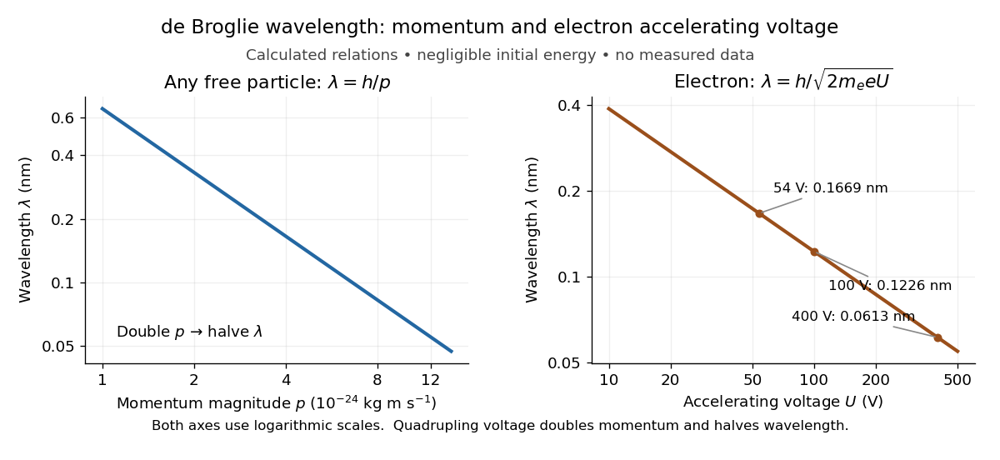

# Electron accelerating-voltage wavelength

↑ **Parent:** [de Broglie wavelength](de-broglie-wavelength.md)

Let an [electron](electron.md) start with negligible [kinetic energy](kinetic-energy.md) and move through an increase $U>0$ in [electric potential](electric-potential.md). Its [electric charge](electric-charge-split.md) is $q=-e$, where $e>0$ is the [elementary charge](elementary-charge.md), so the decrease in [potential energy](potential-energy.md) is $eU$. In a field-free region after acceleration,

$$
K=eU,\qquad |\mathbf p|=\sqrt{2m_e eU},\qquad \lambda=\frac{h}{\sqrt{2m_e eU}}\simeq\frac{1.2264\,\mathrm{nm}}{\sqrt{U/(1\,\mathrm V)}}.
$$

This is an [electron](electron.md) formula, not a universal conversion from [voltage](voltage.md) to [wavelength](wavelength.md). It assumes negligible initial [kinetic energy](kinetic-energy.md), negligible losses, and $eU\ll m_ec^2$, where $c$ is the [speed of light](speed-of-light.md). It describes the [de Broglie wavelength](de-broglie-wavelength.md) outside the crystal; the [potential energy](potential-energy.md) inside a material can change the local [kinetic momentum](kinetic-momentum.md).

For $U=54\,\mathrm V$, take $h=6.62607015\times10^{-34}\,\mathrm{J\,s}$, $e=1.602176634\times10^{-19}\,\mathrm C$, and $m_e\simeq9.1093837\times10^{-31}\,\mathrm{kg}$. The rounded [electron](electron.md) [mass](mass.md) is consistent with the 2022 recommended constants.[CODATA electron mass: numerical value and 2022 adjustment label](codata-value-electron-mass-by-national-institute-of-standards-and-technology.md)

$$
K=8.65175\times10^{-18}\,\mathrm J=54\,\mathrm{eV},\qquad
|\mathbf p|\simeq3.97019\times10^{-24}\,\mathrm{kg\,m\,s^{-1}},\qquad
\lambda\simeq1.66895\times10^{-10}\,\mathrm m=0.166895\,\mathrm{nm}.
$$

The [electronvolt](electronvolt.md) is an [energy](energy-split.md) unit: $54\,\mathrm{eV}$ must be converted to [joules](joule.md) before combining it with $m_e$ in SI units. [Dimensional analysis](dimensional-analysis.md) checks both steps:

$$
[eU]=\mathrm{C\,V}=\mathrm J,\qquad [\sqrt{2m_e eU}]=\sqrt{\mathrm{kg\,J}}=\mathrm{kg\,m\,s^{-1}},\qquad [h/p]=\frac{\mathrm{J\,s}}{\mathrm{kg\,m\,s^{-1}}}=\mathrm m.
$$

The resulting [velocity](velocity.md) is about $4.3584\times10^6\,\mathrm{m\,s^{-1}}$, or $0.01454c$, so the nonrelativistic assumption is consistent. For a larger accelerating [voltage](voltage.md), the [relativistic energy-momentum relation](energy-momentum-relation.md) gives $pc=\sqrt{K(K+2m_ec^2)}$, with $K=eU$, while $\lambda=h/p$ still holds. At $54\,\mathrm V$ the relativistic [wavelength](wavelength.md) is shorter by about $0.00264\%$.

Explicitly, the exact [special relativity](special-relativity-split.md) formula and its [nonrelativistic quantum mechanics](nonrelativistic-quantum-mechanics.md) limit are

$$
\lambda_{\mathrm{rel}}(U)
=\frac{hc}{\sqrt{eU(eU+2m_ec^2)}}
=\frac{h}{\sqrt{2m_e eU}}\left(1+\frac{eU}{2m_ec^2}\right)^{-1/2}
\underset{eU\ll m_ec^2}{\simeq}\frac{h}{\sqrt{2m_e eU}}.
$$

Here $K=eU$ is the gained [kinetic energy](kinetic-energy.md); the total [energy](energy-split.md) is $E=m_ec^2+K$. At $80\,\mathrm{kV}$, the [nonrelativistic quantum mechanics](nonrelativistic-quantum-mechanics.md) expression gives $4.336\,\mathrm{pm}$, about $3.84\%$ larger than the exact $4.176\,\mathrm{pm}$. This difference matters when using [electron diffraction](electron-diffraction.md) ring positions to infer [lattice plane](lattice-plane.md) spacings.

**[Figure 3](#image-de-broglie-wavelength-versus-momentum-and-electron-accelerating-voltage). de Broglie wavelength versus momentum and electron accelerating voltage**. [Source](de-broglie-wavelength-momentum-voltage.py). Original formula plots. Left: $\lambda=h/p$, with $p$ the [momentum](momentum-split.md) magnitude. Right: the nonrelativistic [electron accelerating-voltage wavelength](electron-accelerating-voltage-wavelength.md) for $10$–$500\,\mathrm V$ and negligible starting [kinetic energy](kinetic-energy.md). Labels mark calculated examples, including $54\,\mathrm V$; no points represent experimental measurements. Quadrupling $U$ doubles $p$ and halves $\lambda$.

## ↑ Ancestors (7)

1. [de Broglie wavelength](de-broglie-wavelength.md)
2. [Matter wave](matter-wave.md)
3. [Wave function](wave-function-split.md)
4. [Quantum mechanics](quantum-mechanics-split.md)
5. [Branches of physics](branches-of-physics.md)
6. [Physics](physics-split.md)
7. [Codex Wiki](split.md)

## ← Incoming links (4)

- [de Broglie wavelength](de-broglie-wavelength.md)
- [Electron accelerating-voltage wavelength](electron-accelerating-voltage-wavelength.md)
- [Electron microscope resolution](electron-microscope-resolution.md)
- [Thomson electron transmission diffraction experiment](thomson-electron-transmission-diffraction-experiment.md)
