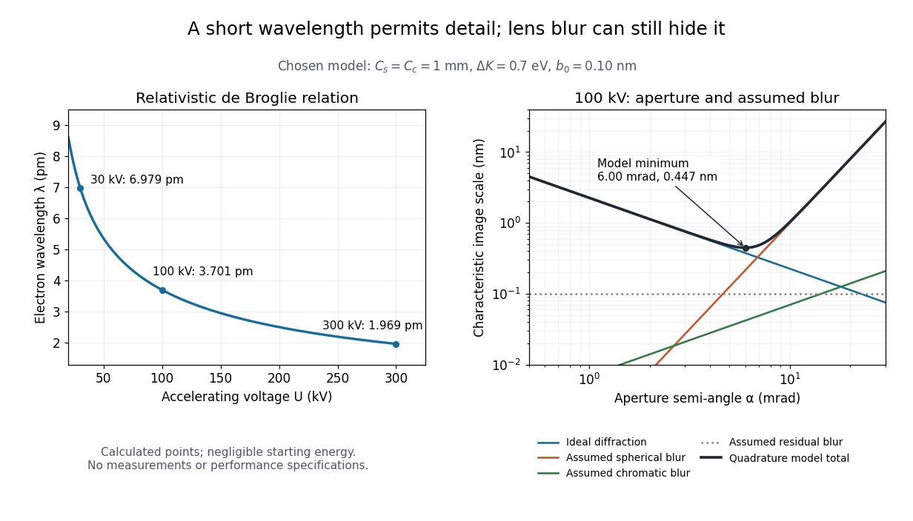

# Electron microscope resolution

↑ **Parent:** [Electron microscope](electron-microscope.md)

[Electron microscope resolution](electron-microscope-resolution.md) concerns distinguishable specimen detail under a specified contrast criterion. It depends on [diffraction](diffraction.md), lens defects, [electron](electron.md) energy spread, specimen motion and detection. A smaller [de Broglie wavelength](de-broglie-wavelength.md) permits finer detail in principle, but neither [wavelength](wavelength.md) nor [magnification](magnification.md) is the instrument's measured resolution.

For an [electron](electron.md) accelerated from negligible initial [kinetic energy](kinetic-energy.md) through a positive [electric potential difference](electric-potential-difference.md) $U$, combine $K=eU$, the [relativistic energy-momentum relation](energy-momentum-relation.md) and the [de Broglie wavelength](de-broglie-wavelength.md):

$$
p^2c^2=K(K+2m_ec^2),\qquad
\lambda(U)=\frac{h}{\sqrt{2m_e eU\left(1+\frac{eU}{2m_ec^2}\right)}}.
$$

Here $h$ is the [Planck constant](planck-constant.md), $m_e$ the [electron](electron.md) [mass](mass.md), $e$ the [elementary charge](elementary-charge.md), and $c$ the [speed of light](speed-of-light.md). This includes the relativistic correction omitted by the low-[voltage](voltage.md) [electron accelerating-voltage wavelength](electron-accelerating-voltage-wavelength.md) approximation. With $m_e\simeq9.1093837\times10^{-31}\,\mathrm{kg}$ and SI defining values of $h,e,c$, calculated [wavelengths](wavelength.md) are approximately $6.979$, $3.701$ and $1.969\,\mathrm{pm}$ at $30$, $100$ and $300\,\mathrm{kV}$ respectively. The rounded [mass](mass.md) agrees with the recommended value.[CODATA electron mass, 2022 adjustment](codata-value-electron-mass-by-national-institute-of-standards-and-technology.md)

For a circular aperture admitting a small semi-angle $\alpha$, the [Rayleigh criterion](rayleigh-criterion.md) suggests a [diffraction-limited resolution](diffraction-limited-resolution.md) scale $d_D=0.61\lambda/\alpha$. At $100\,\mathrm{kV}$ and $\alpha=10\,\mathrm{mrad}$, this gives $0.226\,\mathrm{nm}$, already much larger than the $0.00370\,\mathrm{nm}$ [wavelength](wavelength.md). This is an ideal aperture estimate. [Transmission electron microscopy](transmission-electron-microscopy.md) with coherent illumination and a particular specimen requires its own image-contrast analysis; this scale alone is not a universal two-feature resolution test.

An original illustrative blur model adds competing effects:

$$
b(\alpha)^2=\left(\frac{0.61\lambda}{\alpha}\right)^2
 +(C_s\alpha^3)^2
 +\left(C_c\alpha\frac{\Delta K}{K}\right)^2+b_0^2.
$$

Define $C_s\alpha^3$ as a characteristic transverse blur from the electron-lens analogue of [spherical aberration](spherical-aberration.md), and $C_c\alpha\Delta K/K$ as one from energy-dependent focusing, the analogue of [chromatic aberration](chromatic-aberration.md). The coefficients $C_s,C_c$ have units of length, $\Delta K$ is a chosen characteristic [kinetic energy](kinetic-energy.md) spread, and $b_0$ is a fixed residual blur. Adding their squares is a declared heuristic, not a measured [point spread function](point-spread-function-split.md) or a rigorous resolution theorem. The model omits contrast transfer, specimen scattering and signal statistics, so its minimum is only an estimate within its assumptions.

Choose $C_s=C_c=1\,\mathrm{mm}$, $\Delta K=0.7\,\mathrm{eV}$ and $b_0=0.10\,\mathrm{nm}$ at $K=100\,\mathrm{keV}$. At $5\,\mathrm{mrad}$, the four contributions are about $0.452$, $0.125$, $0.035$ and $0.100\,\mathrm{nm}$, giving $b\simeq0.480\,\mathrm{nm}$. At $10\,\mathrm{mrad}$, the [diffraction](diffraction.md) contribution falls to $0.226\,\mathrm{nm}$ but the assumed [spherical aberration](spherical-aberration.md) contribution grows to $1.00\,\mathrm{nm}$. Thus opening the aperture indefinitely worsens this model's image. All these values are calculations with chosen parameters, not observations of any microscope.

**[Figure 4](#image-short-electron-wavelength-and-competing-image-blur-scales). Short electron wavelength and competing image-blur scales**. [Source](electron-wavelength-resolution-budget.py). Original calculations, not measurements. Left: relativistic [de Broglie wavelength](de-broglie-wavelength.md) versus accelerating [voltage](voltage.md). Right: ideal [diffraction](diffraction.md) and assumed electron-lens blur contributions at $100\,\mathrm{kV}$, with their quadrature total. The marked minimum belongs only to the stated heuristic model and does not specify a historical or modern instrument's resolution.

## ↑ Ancestors (6)

1. [Electron microscope](electron-microscope.md)
2. [Electron optics](electron-optics.md)
3. [Optics](optics-split.md)
4. [Branches of physics](branches-of-physics.md)
5. [Physics](physics-split.md)
6. [Codex Wiki](split.md)

## ← Incoming links (7)

- [Electron microscope](electron-microscope.md)
- [Electron microscope resolution](electron-microscope-resolution.md)
- [Ernst Ruska](ernst-ruska.md)
- [Solution](past-exam-of-the-mphil-in-micro-and-nanotechnology-enterprise-course-of-the-university-of-cambridge/2017/paper-1/section-a-i/1/ii/solution.md)
- [Solution](past-exam-of-the-mphil-in-micro-and-nanotechnology-enterprise-course-of-the-university-of-cambridge/2018/paper-1/section-a-i/1/ii/solution.md)
- [Spatial resolution](spatial-resolution.md)
- [Transmission electron microscopy specimen dose and calibration](transmission-electron-microscopy-specimen-dose-and-calibration.md)
