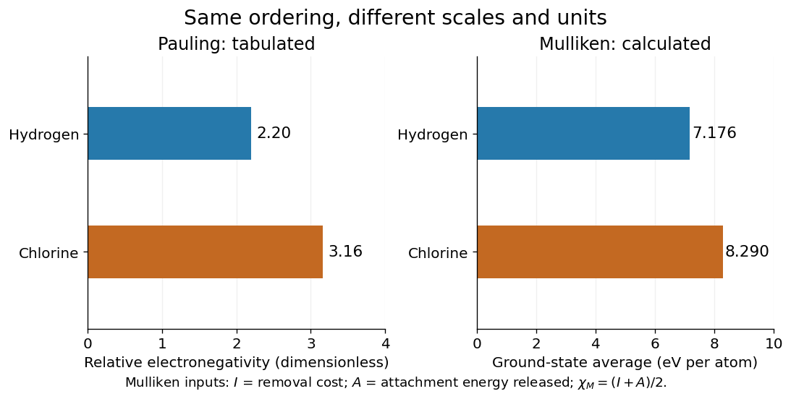
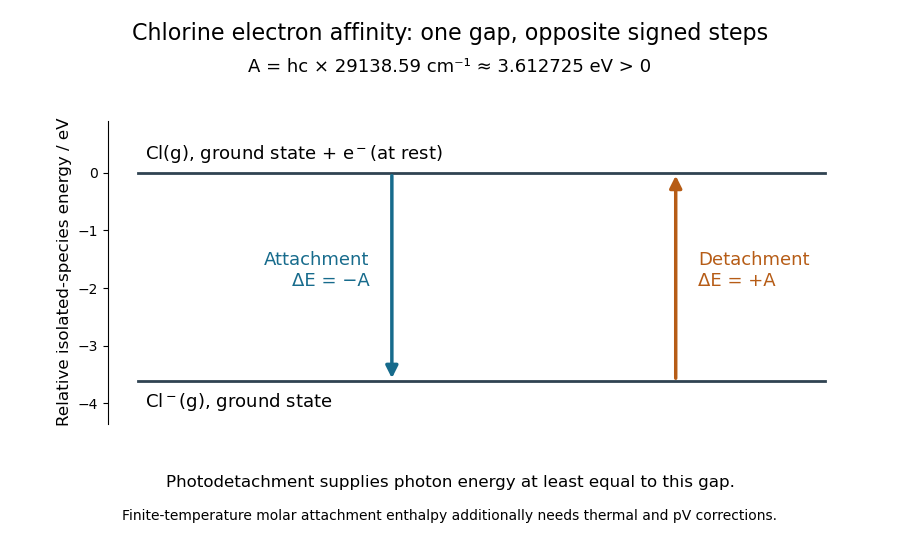
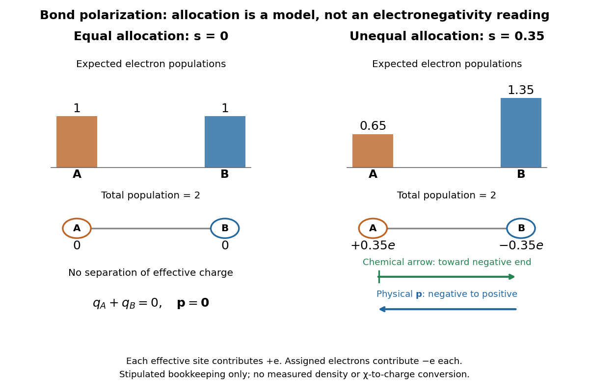
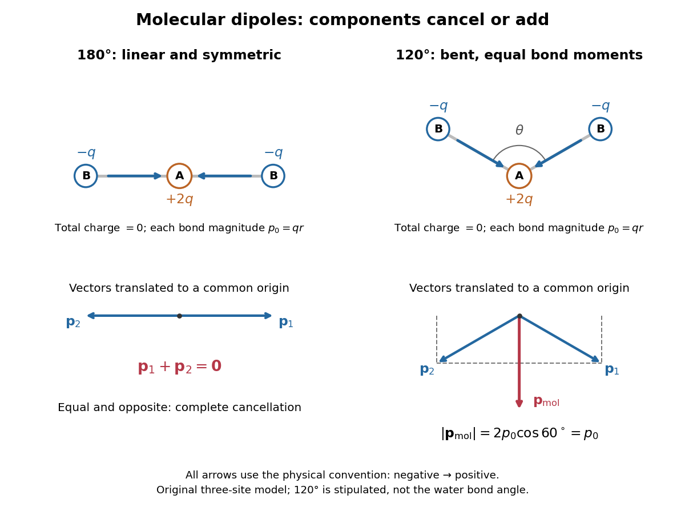

# Electronegativity

↑ **Parent:** [Chemical bond](chemical-bond.md)  
ⓦ [Wiki](https://en.wikipedia.org/wiki/Electronegativity)

[Electronegativity](electronegativity.md) describes a [chemical atom](physics.md#atom-physics)'s tendency to attract [electron density](chemistry.md#electron-density) towards itself in a [chemical bond](chemical-bond.md). It helps answer a useful question: when two different [chemical atoms](physics.md#atom-physics) share [electrons](physics.md#electron), which end of the [chemical bond](chemical-bond.md) tends to be richer in [electron density](chemistry.md#electron-density)? For [hydrogen chloride](#hydrogen-chloride), the answer is [chlorine](chemical-substance.md#chlorine): the [covalent bond](covalent-bond.md) is a [polar covalent bond](#polar-covalent-bond), conventionally written $\mathrm H^{\delta+}-\mathrm{Cl}^{\delta-}$. The symbols indicate [partial atomic charges](chemical-bond.md#partial-atomic-charge), not isolated [ions](chemistry.md#ion) carrying whole elementary [electric charges](electric-charge.md).[§7.2, “Pure vs. Polar Covalent Bonds”, HCl example](chemistry-bibliography.md#chemistry-2e-by-paul-flowers-and-others)

[Electronegativity](electronegativity.md) is a comparison scheme, not the number of [electrons](physics.md#electron) on a [chemical atom](physics.md#atom-physics). A [partial atomic charge](chemical-bond.md#partial-atomic-charge) depends on how the [electron density](chemistry.md#electron-density) is partitioned; [formal charge](covalent-bond.md#formal-charge) instead follows an integer allocation in a [Lewis structure](covalent-bond.md#lewis-structure). Neither is numerically equal to [electronegativity](electronegativity.md). Nor is [electronegativity](electronegativity.md) identical to [electron affinity](#electron-affinity), which concerns adding an [electron](physics.md#electron) to an isolated species. Different [electronegativity](electronegativity.md) scales use different measured inputs and conventions; compare numbers only after specifying the scale.[electronegativity](chemistry-bibliography.md#iupac-compendium-of-chemical-terminology-gold-book-by-international-union-of-pure-and-applied-chemistry/electronegativity)

For a concrete comparison, the Royal Society of Chemistry lists [Pauling electronegativities](#pauling-electronegativity) $\chi_{\rm P}(\mathrm H)=2.20$ and $\chi_{\rm P}(\mathrm{Cl})=3.16$. Their difference is $0.96$, so the [electronegativity](electronegativity.md) rule predicts [bond polarization](#bond-polarization) towards [chlorine](chemical-substance.md#chlorine) in [hydrogen chloride](#hydrogen-chloride). An isolated [molecular hydrogen](chemical-substance.md#molecular-hydrogen) [molecule](molecule.md) has identical ends and zero [electronegativity](electronegativity.md) difference. These examples explain a direction of unequal sharing, not a quantitative [partial atomic charge](chemical-bond.md#partial-atomic-charge).[Hydrogen — Element information, properties and uses](chemistry-bibliography.md#periodic-table-by-royal-society-of-chemistry/hydrogen-element-information-properties-and-uses)[Chlorine — Element information, properties and uses](chemistry-bibliography.md#periodic-table-by-royal-society-of-chemistry/chlorine-element-information-properties-and-uses)

**[Figure 1](#electronegativity-scales-hydrogen-chlorine). Pauling electronegativity and Mulliken electronegativity for hydrogen and chlorine: separate scales, separate units; the Mulliken electronegativity values are calculated from the stated ground-state inputs**.

A larger [electronegativity](electronegativity.md) difference often suggests stronger [bond polarization](#bond-polarization), but there is no universal numerical boundary where a [covalent bond](covalent-bond.md) suddenly becomes [ionic bonding](ionic-bonding.md). Tables of cutoffs are classification aids with exceptions. [Hydrogen fluoride](#hydrogen-fluoride), for example, is described by a [polar covalent bond](#polar-covalent-bond) even when its [electronegativity](electronegativity.md) difference exceeds a textbook's nominal ionic threshold. The actual [electron density](chemistry.md#electron-density), physical setting, and [chemical substance](chemical-substance.md)'s structure matter.[§7.2, “Electronegativity and Bond Type”, general-guide warning and HF exception](chemistry-bibliography.md#chemistry-2e-by-paul-flowers-and-others)

The distinction from [ionization energy](mathematical-physics.md#ionization-energy) is equally useful: an [ionization energy](mathematical-physics.md#ionization-energy) measures the cost of removing an [electron](physics.md#electron) from a specified isolated species, whereas [electronegativity](electronegativity.md) compares attraction for [electron density](chemistry.md#electron-density) in a bonded environment. Neither the removal cost alone nor the attachment release alone supplies a unique bonded-atom [electronegativity](electronegativity.md). A scale combines selected measured inputs with a model and a convention.[E01990: multiple definitions; Mulliken average versus Pauling bond-energy differences](chemistry-bibliography.md#iupac-compendium-of-chemical-terminology-gold-book-by-international-union-of-pure-and-applied-chemistry/electronegativity)

For an original relative comparison, stipulate fictitious bonded sites $A,B,C$ on one chosen [dimensionless](physics.md#dimensionless-quantity) [electronegativity](electronegativity.md) scale:

$$
\chi(A)=\chi_0,\qquad \chi(B)=\chi_0+\Delta\chi,\qquad
\chi(C)=\chi_0+2\Delta\chi,\qquad \Delta\chi>0.
$$

The [electronegativity](electronegativity.md) heuristic predicts [bond polarization](#bond-polarization) towards $B$ in $A-B$, towards $C$ in $B-C$, and towards $C$ in $A-C$. Shifting $\chi_0$ leaves every comparison unchanged. Although the $A-C$ difference is twice the $A-B$ difference, this does not make its [partial atomic charge](chemical-bond.md#partial-atomic-charge) or [bond dipole](#bond-dipole) twice as large: those require additional information about [electron density](chemistry.md#electron-density) and [bond length](chemical-bond.md#bond-length). These symbols describe a stipulated ordering, not a table of measured [chemical elements](chemical-substance.md#chemical-element).

Keep the chemical context attached to that ordering. A [chemical atom](physics.md#atom-physics) in a [molecule](molecule.md) has neighbours and an [electron configuration](chemistry.md#electron-configuration); an isolated-atom [energy](energy.md) scale and a bonded-atom comparison are different constructions. The [chemical environment dependence of electronegativity](#chemical-environment-dependence-of-electronegativity) explains why a table is a useful approximation rather than an immutable property of every site. Furthermore, an applied [electric field](electric-field.md) can induce [bond polarization](#bond-polarization) even between identical [chemical atoms](physics.md#atom-physics), through [electric polarizability](electrostatics.md#electric-polarizability); equal tabulated [electronegativity](electronegativity.md) does not forbid that response.

**Table of contents**

- [Allen electronegativity](#allen-electronegativity)
- [Pauling electronegativity](#pauling-electronegativity)
  - [Pauling bond-energy excess](#pauling-bond-energy-excess)
- [Mulliken electronegativity](#mulliken-electronegativity)
  - [Electron affinity](#electron-affinity)
    - [Electron attachment enthalpy](#electron-attachment-enthalpy)
    - [Photodetachment](#photodetachment)
      - [Photodetachment threshold](#photodetachment-threshold)
  - [Electronvolt](#electronvolt)
- [Experimental inputs to electronegativity scales](#experimental-inputs-to-electronegativity-scales)
- [Chemical environment dependence of electronegativity](#chemical-environment-dependence-of-electronegativity)
- [Dipole evidence for bond polarization](#dipole-evidence-for-bond-polarization)
  - [Debye (unit)](#debye-unit)
  - [Molecular beam electric resonance](#molecular-beam-electric-resonance)
- [Bond polarization](#bond-polarization)
  - [Bond dipole](#bond-dipole)
    - [Molecular dipole cancellation](#molecular-dipole-cancellation)
  - [Polar covalent bond](#polar-covalent-bond)
    - [Hydrogen chloride](#hydrogen-chloride)
    - [Hydrogen fluoride](#hydrogen-fluoride)

## Allen electronegativity

↑ **Parent:** [Electronegativity](electronegativity.md)

A scale proportional to the average spectroscopic one-electron binding energy of a free ground-state atom’s [valence electrons](chemical-bond.md#valence-electron). For an s,p atom, $\chi=C(n_s\varepsilon_s+n_p\varepsilon_p)/(n_s+n_p)$, with positive binding energies and a scale constant $C$. It distinguishes s and p binding rather than assigning both one Slater charge.[1989, spectroscopic definition](chemistry-bibliography.md#electronegativity-is-the-average-one-electron-energy-of-the-valence-shell-electrons-in-ground-state-free-atoms-by-leland-c-allen)

## Pauling electronegativity

↑ **Parent:** [Electronegativity](electronegativity.md)

[Pauling electronegativity](#pauling-electronegativity) is a relative, [dimensionless](physics.md#dimensionless-quantity) scale motivated by [bond-dissociation energies](chemical-bond.md#bond-dissociation-energy). The interesting observation is that a [chemical bond](chemical-bond.md) between unlike [chemical atoms](physics.md#atom-physics) can be stronger than a simple baseline inferred from the corresponding like-atom [chemical bonds](chemical-bond.md). An empirical excess [energy](energy.md) can then be associated with an [electronegativity](electronegativity.md) difference. The 1932 paper [The Nature of the Chemical Bond. IV. The Energy of Single Bonds and the Relative Electronegativity of Atoms](chemistry-bibliography.md#the-nature-of-the-chemical-bond-iv-the-energy-of-single-bonds-and-the-relative-electronegativity-of-atoms-by-linus-pauling) built such a map; its original coordinates used [hydrogen](chemical-substance.md#hydrogen) as zero, so those coordinates should not be mistaken for the modern tabulated [Pauling electronegativities](#pauling-electronegativity).[pp. 3576–3578, equation (1), Table III: H 0.00, Cl 0.94](chemistry-bibliography.md#the-nature-of-the-chemical-bond-iv-the-energy-of-single-bonds-and-the-relative-electronegativity-of-atoms-by-linus-pauling)

One arithmetic-baseline version of the [Pauling scale](#pauling-electronegativity) relation is

$$
\Delta_D=D_{AB}-\frac{D_{AA}+D_{BB}}{2},\qquad
\left|\chi_{\rm P}(A)-\chi_{\rm P}(B)\right|\approx\sqrt{\frac{\Delta_D}{1\,\mathrm{eV}}}.
$$

Here $D_{AB}$, $D_{AA}$ and $D_{BB}$ are consistently defined [bond-dissociation energies](chemical-bond.md#bond-dissociation-energy) per [molecule](molecule.md), and the [arithmetic mean](arithmetic.md#arithmetic-mean) is the chosen baseline. With molar [energies](energy.md) instead, write $\sqrt{\Delta_D/(96.485\,\mathrm{kJ\,mol^{-1}})}$, approximately $0.102\sqrt{\Delta_D/(1\,\mathrm{kJ\,mol^{-1}})}$. The denominator makes the result [dimensionless](physics.md#dimensionless-quantity); the factor $0.102$ is not a unit-independent magic constant. This is an empirical relation with a specified baseline, not a definition valid for every [chemical bond](chemical-bond.md).[§1 equation (1), coefficients for eV, kcal/mol and kJ/mol; §2.2, dependence on other bond properties](chemistry-bibliography.md#energy-electronegativity-and-chemical-bonding-by-stepan-s-batsanov)

For an explicitly synthetic example, suppose $D_{AA}=D_{BB}=300\,\mathrm{kJ\,mol^{-1}}$ and $D_{AB}=396.485\,\mathrm{kJ\,mol^{-1}}$ with the same temperature and dissociation convention. Then $\Delta_D=96.485\,\mathrm{kJ\,mol^{-1}}$ and the model gives an [electronegativity](electronegativity.md) difference of $1$. Replacing $D_{AB}$ by $300\,\mathrm{kJ\,mol^{-1}}$ gives zero; a negative excess would make this real square-root model inapplicable, not produce a negative [electronegativity](electronegativity.md) difference. These invented inputs illustrate the formula and are not measurements of named [chemical substances](chemical-substance.md).

Only differences appear, so adding the same constant to every [Pauling electronegativity](#pauling-electronegativity) leaves this relation unchanged. A reference value must fix the origin. The [bond-dissociation energies](chemical-bond.md#bond-dissociation-energy) alone also do not tell which endpoint attracts [electron density](chemistry.md#electron-density) more strongly, because interchanging $A$ and $B$ leaves the formula unchanged. Chemical comparisons fix that direction. Thus [Pauling electronegativity](#pauling-electronegativity) is useful as a compact ordering, while the underlying measured [energies](energy.md) and approximations remain essential.

### Pauling bond-energy excess

↑ **Parent:** [Pauling electronegativity](#pauling-electronegativity)

A [Pauling bond-energy excess](#pauling-bond-energy-excess) subtracts a chosen like-atom baseline from the unlike-atom [bond-dissociation energy](chemical-bond.md#bond-dissociation-energy). For an unequal-input arithmetic example, stipulate $D_{AA}=200$, $D_{BB}=450$ and $D_{AB}=421.485\,\mathrm{kJ\,mol^{-1}}$, all with one dissociation convention. The [arithmetic mean](arithmetic.md#arithmetic-mean) baseline and excess are

$$
D_{\rm base}=\frac{200+450}{2}=325\,\mathrm{kJ\,mol^{-1}},\qquad
\Delta_D=421.485-325=96.485\,\mathrm{kJ\,mol^{-1}}.
$$

The arithmetic-baseline [Pauling scale](#pauling-electronegativity) model therefore gives $|\chi_{\rm P}(A)-\chi_{\rm P}(B)|=\sqrt{96.485/96.485}=1$. The [bond-dissociation energy](chemical-bond.md#bond-dissociation-energy) $421.485$ is not itself the excess: subtracting the baseline is essential. All three numbers are stipulated, not experimental values for named [chemical elements](chemical-substance.md#chemical-element).

**[Figure 2](#image-pauling-bond-energy-excess-construction). Constructing a Pauling bond-energy excess from stipulated bond-dissociation energies and converting it to a dimensionless electronegativity difference**.

Changing the baseline changes the model. For the same stipulated inputs, a [geometric mean](arithmetic.md#geometric-mean) baseline would be $\sqrt{200\times450}=300\,\mathrm{kJ\,mol^{-1}}$, yielding an excess of $121.485\,\mathrm{kJ\,mol^{-1}}$ and a difference of approximately $1.122$. It is a different construction, even though both start from the same [bond-dissociation energies](chemical-bond.md#bond-dissociation-energy). State which baseline is used before comparing [electronegativity](electronegativity.md) differences.

The arithmetic-baseline [Pauling scale](#pauling-electronegativity) also has a useful inverse: a difference of $0.5$ corresponds to an excess of $24.12125\,\mathrm{kJ\,mol^{-1}}$, and a difference of $2$ corresponds to $385.94\,\mathrm{kJ\,mol^{-1}}$. Doubling the [electronegativity](electronegativity.md) difference quadruples the modeled excess. Interchanging the endpoint labels changes neither quantity; the [square root](algebra.md#square-root) alone cannot choose the direction of [bond polarization](#bond-polarization).

In [The Nature of the Chemical Bond. IV. The Energy of Single Bonds and the Relative Electronegativity of Atoms](chemistry-bibliography.md#the-nature-of-the-chemical-bond-iv-the-energy-of-single-bonds-and-the-relative-electronegativity-of-atoms-by-linus-pauling) (printed pp. 3576–3578, Table II and equation (1)), [Linus Pauling](chemistry-author.md#linus-pauling) organized excess [energies](energy.md) for [chemical bonds](chemical-bond.md) into an approximately additive map of their [square roots](algebra.md#square-root). He also identified a limitation: his H–F map separation of $2$ predicted an excess of $4.00\,\mathrm{eV}$, exceeding his table's value by $1.23\,\mathrm{eV}$. Those are historical values and a historical model discrepancy, not modern recommended inputs.[printed pp. 3576–3578, Table II, equation (1), and paragraph beginning “These coördinates”](chemistry-bibliography.md#the-nature-of-the-chemical-bond-iv-the-energy-of-single-bonds-and-the-relative-electronegativity-of-atoms-by-linus-pauling)

## Mulliken electronegativity

↑ **Parent:** [Electronegativity](electronegativity.md)

[Mulliken electronegativity](#mulliken-electronegativity) uses both the cost of removing an [electron](physics.md#electron) and the [energy](energy.md) released by accepting an [electron](physics.md#electron). For specified isolated-atom states, the common ground-state convention is

$$
\chi_{\rm M}=\frac{I+A_{\rm ea}}{2},\qquad
I=E(X^+)-E(X),\qquad A_{\rm ea}=E(X)-E(X^-).
$$

The free [electron](physics.md#electron)'s [energy](energy.md) is the zero reference. Here $I$ is the [ionization energy](mathematical-physics.md#ionization-energy) and $A_{\rm ea}$ is the [electron affinity](#electron-affinity), positive for exothermic attachment. If attachment is instead tabulated as the signed [energy](energy.md) change $\Delta E_{\rm attach}=E(X^-)-E(X)$, the same expression is $(I-\Delta E_{\rm attach})/2$. Stating the sign convention prevents adding the wrong quantities. The 1934 original treated suitable valence states, which are not automatically the ground states used in this example.[A New Electroaffinity Scale; Together with Data on Valence States and on Valence Ionization Potentials and Electron Affinities by Robert S. Mulliken](chemistry-bibliography.md#a-new-electroaffinity-scale-together-with-data-on-valence-states-and-on-valence-ionization-potentials-and-electron-affinities-by-robert-s-mulliken)

[Mulliken electronegativity](#mulliken-electronegativity) has [energy](energy.md) units before any additional rescaling. With $I$ and $A_{\rm ea}$ in [electronvolts](#electronvolt) per [chemical atom](physics.md#atom-physics), $\chi_{\rm M}$ is in [electronvolts](#electronvolt); with both in $\mathrm{kJ\,mol^{-1}}$, it is a molar [energy](energy.md). For [hydrogen](chemical-substance.md#hydrogen), the RSC ground-state inputs are $I=1312.05$ and $A_{\rm ea}=72.769\,\mathrm{kJ\,mol^{-1}}$, giving $\chi_{\rm M}=692.4095\,\mathrm{kJ\,mol^{-1}}\approx7.176\,\mathrm{eV}$ per [chemical atom](physics.md#atom-physics). For [chlorine](chemical-substance.md#chlorine), $I=1251.186$ and $A_{\rm ea}=348.575\,\mathrm{kJ\,mol^{-1}}$ give $799.8805\,\mathrm{kJ\,mol^{-1}}\approx8.290\,\mathrm{eV}$. These are calculated ground-state [Mulliken electronegativities](#mulliken-electronegativity), not the RSC's tabulated [Pauling electronegativities](#pauling-electronegativity).[Hydrogen — Element information, properties and uses](chemistry-bibliography.md#periodic-table-by-royal-society-of-chemistry/hydrogen-element-information-properties-and-uses)[Chlorine — Element information, properties and uses](chemistry-bibliography.md#periodic-table-by-royal-society-of-chemistry/chlorine-element-information-properties-and-uses)

Both schemes place [chlorine](chemical-substance.md#chlorine) above [hydrogen](chemical-substance.md#hydrogen) here, but their numerical differences cannot be subtracted from one another or equated. Dividing a molar [Mulliken electronegativity](#mulliken-electronegativity) by an [energy](energy.md) conversion factor changes units; it does not transform it into a [Pauling electronegativity](#pauling-electronegativity). A further empirical mapping would require its own calibration and stated domain.

### Electron affinity

↑ **Parent:** [Mulliken electronegativity](#mulliken-electronegativity)  
ⓦ [Wiki](https://en.wikipedia.org/wiki/Electron_affinity)

[Electron affinity](#electron-affinity) measures how strongly an isolated neutral species binds an additional [electron](physics.md#electron). In the spectroscopic convention used here, it is the positive [energy](energy.md) required to detach that [electron](physics.md#electron) from a bound [anion](chemistry.md#anion). With the free [electron](physics.md#electron) at rest assigned zero [energy](energy.md),

$$
A_{\rm ea}=E(X)+E(e^-)-E(X^-),\qquad
\Delta E_{\rm attach}=-A_{\rm ea}.
$$

The [quantum states](quantum-system.md#quantum-state) of $X$ and $X^-$ must be specified, usually their [ground states](quantum-mechanics.md#ground-state). Positive $A_{\rm ea}$ means that attachment lowers the [energy](energy.md); a signed attachment [energy](energy.md) is then negative. This convention agrees with the IUPAC definition and with the atomic tables used for [Mulliken electronegativity](#mulliken-electronegativity).[electron affinity](chemistry-bibliography.md#iupac-compendium-of-chemical-terminology-gold-book-by-international-union-of-pure-and-applied-chemistry/electron-affinity)

For [chlorine](chemical-substance.md#chlorine), a published [photodetachment threshold](#photodetachment-threshold) is $A_{\rm ea}/(hc)=29138.59(22)\,\mathrm{cm^{-1}}$, approximately $3.612725\,\mathrm{eV}$ per [chemical atom](physics.md#atom-physics). Here $h$ is the [Planck constant](quantum-mechanics.md#planck-constant), $c$ the [speed of light](special-relativity.md#speed-of-light), and the inverse-length unit expresses an [energy](energy.md) through a spectroscopic [wavenumber](wave-equation.md#wavenumber). The parentheses give the reported uncertainty in the last digits, not a range of possible sign conventions.[§2.3, printed pp. 6–7: reported threshold 29138.59(22) inverse centimetres](chemistry-bibliography.md#isotope-shift-in-the-electron-affinity-of-chlorine-by-u-berzinsh-and-others)

**[Figure 3](#image-electron-affinity-attachment-detachment-levels). Electron affinity of chlorine: positive detachment energy and negative attachment energy connect the same isolated-species levels; a finite-temperature electron attachment enthalpy needs additional corrections**.

An [electron affinity](#electron-affinity) is neither an [electronegativity](electronegativity.md) nor a [lattice energy](ionic-bonding.md#lattice-energy). The first describes a specified isolated-species [energy](energy.md) difference, [electronegativity](electronegativity.md) compares attraction for [electron density](chemistry.md#electron-density) in a [chemical bond](chemical-bond.md), and [lattice energy](ionic-bonding.md#lattice-energy) refers to an entire [ionic crystal](ionic-bonding.md#ionic-crystal) and separated gaseous [ions](chemistry.md#ion). A stable [anion](chemistry.md#anion) can therefore help explain [ionic bonding](ionic-bonding.md) without describing the full [energy](energy.md) balance for making a [salt](ionic-bonding.md#salt-chemistry).

#### Electron attachment enthalpy

↑ **Parent:** [Electron affinity](#electron-affinity)

An [electron attachment enthalpy](#electron-attachment-enthalpy) is the signed molar [enthalpy](enthalpy.md) change for a stated attachment reaction,

$$
X(g)+e^-(g)\longrightarrow X^-(g).
$$

For favourable attachment such as [chlorine](chemical-substance.md#chlorine)'s first attachment, the [electron attachment enthalpy](#electron-attachment-enthalpy) is negative. Its leading isolated-ground-state [energy](energy.md) contribution is $-N_{\rm A}A_{\rm ea}$, where $N_{\rm A}$ is the [Avogadro constant](physics.md#avogadro-constant). At finite [temperature](temperature.md), consistent thermal populations, translational contributions and the $pV$ term in [enthalpy](enthalpy.md) must also be included, together with the same gaseous-[electron](physics.md#electron) reference used in the corresponding [ionization energy](mathematical-physics.md#ionization-energy) term. Consequently a measured spectroscopic [electron affinity](#electron-affinity) is not automatically an exact $298.15\,\mathrm K$ attachment [enthalpy](enthalpy.md) with a minus sign. A [Born-Haber cycle](ionic-bonding.md#born-haber-cycle) must use compatible [enthalpies](enthalpy.md) throughout.

#### Photodetachment

↑ **Parent:** [Electron affinity](#electron-affinity)

[Photodetachment](#photodetachment) removes an [electron](physics.md#electron) from an [anion](chemistry.md#anion) using a [photon](quantum-mechanics.md#photon). For [chlorine](chemical-substance.md#chlorine), the reaction is $\mathrm{Cl}^-(g)+\gamma\longrightarrow\mathrm{Cl}(g)+e^-$. Measuring the minimum [photon](quantum-mechanics.md#photon) [energy](energy.md) for the specified final [quantum state](quantum-system.md#quantum-state) gives a [photodetachment threshold](#photodetachment-threshold) and hence an [electron affinity](#electron-affinity).

##### Photodetachment threshold

↑ **Parent:** [Photodetachment](#photodetachment)

In the published [chlorine](chemical-substance.md#chlorine) experiment, negative [ions](chemistry.md#ion) were accelerated and mass-selected, then overlapped with a tunable [laser](laser.md) beam. A downstream [electric field](electric-field.md) deflected charged [ions](chemistry.md#ion); neutral [chemical atoms](physics.md#atom-physics) continued to a plate, whose secondary [electrons](physics.md#electron) were counted. Scanning the [laser](laser.md) [frequency](wave.md#frequency) produced an onset in this neutral-atom signal. The apparatus therefore inferred an [electron affinity](#electron-affinity) from a threshold, rather than measuring the [heat](heat.md) of attachment.[§2, printed pp. 2–4, Figure 1: ion preparation, deflectors, neutral-atom secondary-emission detector and threshold fitting](chemistry-bibliography.md#isotope-shift-in-the-electron-affinity-of-chlorine-by-u-berzinsh-and-others)

Reversing the [laser](laser.md) direction and averaging the two thresholds corrected the first-order [Doppler shift](wave.md#doppler-effect). A [Fabry–Pérot interferometer](optical-instrument.md#fabry-perot-interferometer) and reference spectral lines calibrated the [frequency](wave.md#frequency). Finite [laser](laser.md) bandwidth, unresolved [quantum state](quantum-system.md#quantum-state) splitting and shifts of the calibration lines limited the inference; the authors included these effects in fitting and the error estimate. The level diagram shows only the extracted gap, not a measured signal curve.[§§2.1 and 2.3, printed pp. 3–7, equation (2), Figures 2 and 5: direction reversal, calibration, bandwidth and reference-line systematic shifts](chemistry-bibliography.md#isotope-shift-in-the-electron-affinity-of-chlorine-by-u-berzinsh-and-others)

### Electronvolt

↑ **Parent:** [Mulliken electronegativity](#mulliken-electronegativity)  
ⓦ [Wiki](https://en.wikipedia.org/wiki/Electronvolt)

An [electronvolt](#electronvolt) is $1.602176634\times10^{-19}\,\mathrm J$. One [electronvolt](#electronvolt) per particle corresponds to approximately $96.485\,\mathrm{kJ\,mol^{-1}}$.[Fundamental Physical Constants — Complete Listing by National Institute of Standards and Technology and others](chemistry-bibliography.md#fundamental-physical-constants-complete-listing-by-national-institute-of-standards-and-technology-and-others)

## Experimental inputs to electronegativity scales

↑ **Parent:** [Electronegativity](electronegativity.md)

The contrast between [Pauling electronegativity](#pauling-electronegativity) and [Mulliken electronegativity](#mulliken-electronegativity) becomes clearer by following the measurements into the formulas. A [Pauling bond-energy excess](#pauling-bond-energy-excess) compares three compatible [bond-dissociation energies](chemical-bond.md#bond-dissociation-energy); [Mulliken electronegativity](#mulliken-electronegativity) takes the [arithmetic mean](arithmetic.md#arithmetic-mean) of an [ionization energy](mathematical-physics.md#ionization-energy) and an [electron affinity](#electron-affinity). The former asks how much stronger an unlike-atom [chemical bond](chemical-bond.md) is than a stipulated baseline; the latter combines two different isolated-species [energy](energy.md) gaps.

Actual readouts precede those model choices. In the [nitrogen dissociation threshold from fragment images](chemical-bond.md#nitrogen-dissociation-threshold-from-fragment-images), fitted squared image radii versus assigned excitation [energies](energy.md) reveal a threshold after accounting for the product [quantum states](quantum-system.md#quantum-state). In the [chlorine](chemical-substance.md#chlorine) [photodetachment threshold](#photodetachment-threshold) experiment, mass-selected [anions](chemistry.md#anion) overlap a tunable [laser](laser.md), and neutral-atom counts reveal the onset of [electron](physics.md#electron) detachment. Opposite [laser](laser.md) directions control the [Doppler shift](wave.md#doppler-effect). That second threshold supplies an [electron affinity](#electron-affinity), not an [electronegativity](electronegativity.md); the [Mulliken scale](#mulliken-electronegativity) still needs an independent [ionization energy](mathematical-physics.md#ionization-energy).[§1, recoil-energy/image-radius equation; §3.2, Figure 5, squared image sizes versus term energies; §3.2, threshold channel assignment](chemistry-bibliography.md#accurate-measurements-of-the-bond-dissociation-energies-of-14n2-14n15n-and-15n2-by-liya-lu-and-others)[§2, printed pp. 2–4, Figure 1: mass selection and neutral counting; §2.1, direction reversal](chemistry-bibliography.md#isotope-shift-in-the-electron-affinity-of-chlorine-by-u-berzinsh-and-others)

For an original arithmetic comparison, stipulate isolated-species $I=(8,7,6)\,\mathrm{eV}$ and positive attachment-release $A_{\rm ea}=(0.5,3,3)\,\mathrm{eV}$ for fictitious species $A,B,C$. Their [Mulliken electronegativities](#mulliken-electronegativity) are $(4.25,5,4.5)\,\mathrm{eV}$. The largest [ionization energy](mathematical-physics.md#ionization-energy) belongs to $A$, while the largest [Mulliken electronegativity](#mulliken-electronegativity) belongs to $B$: accepting an [electron](physics.md#electron) matters as well as retaining one. Using signed attachment [energies](energy.md) $(-0.5,-3,-3)\,\mathrm{eV}$ in $(I-\Delta E_{\rm attach})/2$ gives exactly the same results.

**[Figure 4](#image-electronegativity-scale-inputs-and-orderings). Stipulated inputs to Mulliken electronegativity and arithmetic-baseline Pauling electronegativity: different energies, units and orderings**.

Independently stipulate $D_{RR}=300$ and $D_{XX}=(200,300,450)\,\mathrm{kJ\,mol^{-1}}$ for $X=A,B,C$, with unlike-atom values

$$
D_{RX}=\frac{D_{RR}+D_{XX}}{2}+96.485\,s_X^2\,\mathrm{kJ\,mol^{-1}},\qquad
(s_A,s_B,s_C)=(0.5,1,1.5).
$$

Thus $D_{RX}=(274.12125,396.485,592.09125)\,\mathrm{kJ\,mol^{-1}}$, and the [Pauling scale](#pauling-electronegativity) differences from $R$ are $(0.5,1,1.5)$. If all three fictitious species are placed above $R$ on that scale, their ordering is $A<B<C$, whereas the stipulated [Mulliken scale](#mulliken-electronegativity) gives $A<C<B$. The [bond-dissociation energies](chemical-bond.md#bond-dissociation-energy) and isolated-species [energies](energy.md) were invented independently: this demonstrates what the formulas do, not a measured disagreement for actual [chemical elements](chemical-substance.md#chemical-element). A unit conversion cannot force these two input models to agree.

## Chemical environment dependence of electronegativity

↑ **Parent:** [Electronegativity](electronegativity.md)

A tabulated [electronegativity](electronegativity.md) is useful because it compresses many comparisons, but one number per [chemical element](chemical-substance.md#chemical-element) suppresses chemical context. Changing the bonded partners, [bond length](chemical-bond.md#bond-length) or [electron configuration](chemistry.md#electron-configuration) changes the conditions under which a [chemical atom](physics.md#atom-physics) attracts [electron density](chemistry.md#electron-density). The [bond-dissociation energy](chemical-bond.md#bond-dissociation-energy) can change for reasons beyond [bond polarization](#bond-polarization), so attributing every extra unit of [energy](energy.md) solely to an [electronegativity](electronegativity.md) difference is an approximation.[§2.2, opening paragraph: bond distance and atomic valence affect bond energy](chemistry-bibliography.md#energy-electronegativity-and-chemical-bonding-by-stepan-s-batsanov)

An [oxidation state](chemical-reaction.md#oxidation-state) labels a formal allocation of [electrons](physics.md#electron); it is not a measured [partial atomic charge](chemical-bond.md#partial-atomic-charge). State-sensitive [electronegativity](electronegativity.md) models may give different values for different [oxidation states](chemical-reaction.md#oxidation-state) or [electron configurations](chemistry.md#electron-configuration), while a simple [chemical element](chemical-substance.md#chemical-element) table intentionally provides a common comparison convention. Likewise, replacing an isolated [chemical atom](physics.md#atom-physics) by a site in an [ionic crystal](ionic-bonding.md#ionic-crystal) introduces a surrounding [electric field](electric-field.md) and many neighbours. Applying the same tabulated [electronegativity](electronegativity.md) without adjustment becomes an additional assumption.[§2.1, Table 1 and valence footnotes; §2.2, Table 2; §2.3, opening paragraph on cooperative effects in solids](chemistry-bibliography.md#energy-electronegativity-and-chemical-bonding-by-stepan-s-batsanov)

For the ground-state [Mulliken scale](#mulliken-electronegativity), the state dependence is visible directly in the formula. Replacing $X$ by $X^+$ replaces $E(X^+)-E(X)$ with $E(X^{2+})-E(X^+)$ as the removal cost, and replaces $E(X)-E(X^-)$ with $E(X^+)-E(X)$ as the attachment release. These are different [ionization energies](mathematical-physics.md#ionization-energy) and [electron affinities](#electron-affinity). This isolated-[ion](chemistry.md#ion) arithmetic does not claim that a bonded [chemical atom](physics.md#atom-physics) with the same formal [oxidation state](chemical-reaction.md#oxidation-state) is an isolated [ion](chemistry.md#ion). In a [molecule](molecule.md), the actual [electron density](chemistry.md#electron-density) and [dipole evidence for bond polarization](#dipole-evidence-for-bond-polarization) supply complementary information about that environment.

## Dipole evidence for bond polarization

↑ **Parent:** [Electronegativity](electronegativity.md)

A permanent [electric dipole moment](electrostatics.md#electric-dipole-moment) gives evidence of separated positive and negative [electric charge](electric-charge.md) in an overall neutral [molecule](molecule.md). This is a more direct probe of [chemical polarity](physical-chemistry.md#chemical-polarity) than an [electronegativity](electronegativity.md) table. For [hydrogen chloride](#hydrogen-chloride), NIST lists about $1.109$ [debye](#debye-unit) for the lowest vibrational state and $1.093$ [debye](#debye-unit) for the equilibrium value. They describe different averaging conventions, not two contradictory measurements. The NIST WebBook traces the vibrational value $1.1085$ [debye](#debye-unit) to molecular-beam electric-resonance measurements in 1970.[HCl (Hydrogen chloride): experimental data by National Institute of Standards and Technology](chemistry-bibliography.md#hcl-hydrogen-chloride-experimental-data-by-national-institute-of-standards-and-technology)[Hydrogen chloride: Constants of diatomic molecules by Klaus P. Huber and others](chemistry-bibliography.md#hydrogen-chloride-constants-of-diatomic-molecules-by-klaus-p-huber-and-others)

How does [molecular beam electric resonance](#molecular-beam-electric-resonance) reveal an [electric dipole moment](electrostatics.md#electric-dipole-moment)? A source and apertures form a beam of [molecules](molecule.md) in [vacuum](physics.md#vacuum). A first nonuniform [electric field](electric-field.md), A, selects [quantum states](quantum-system.md#quantum-state) through their different [Stark effects](mathematical-physics.md#stark-effect). In a central region, C, electrodes supply a nearly uniform [electric field](electric-field.md) and applied radiation drives transitions at selected [frequencies](wave.md#frequency). A second nonuniform [electric field](electric-field.md), B, analyzes the outgoing [quantum states](quantum-system.md#quantum-state); a detector measures the rate of arriving [molecules](molecule.md). In a transmission-loss arrangement, resonant radiation transfers some [molecules](molecule.md) to a [quantum state](quantum-system.md#quantum-state) rejected by B, so the measured arrival rate dips. The observable is a change in detected [molecules](molecule.md) as the radiation [frequency](wave.md#frequency) is scanned, rather than light absorption itself. This general apparatus description is documented in a later experimental thesis; it is not a reconstruction of the exact 1970 HCl instrument.[§2, printed pp. 11–14: fields A, C and B, detected flux, parallel plates, radiation and detector](chemistry-bibliography.md#high-resolution-molecular-beam-study-of-alkali-cyanides-by-johannes-jacobus-van-vaals)

**[Figure 5](#bond-dipole-beam-resonance). Molecular beam electric resonance: schematic state selection and a synthetic Stark effect signal from a rigid rotor model; neither apparatus dimensions nor signal curves are measured HCl data**.

The inference comes from how transition [frequencies](wave.md#frequency) change with the known [electric field](electric-field.md). The interaction $-\boldsymbol\mu\cdot\mathbf E$ couples the [electric dipole moment](electrostatics.md#electric-dipole-moment) to the [electric field](electric-field.md); fitting the [quantum mechanics](quantum-mechanics.md) of the relevant rotational states extracts its magnitude. A free rotating [molecule](molecule.md) need not show a first-order shift proportional to $|\mathbf E|$: the weak-field [Stark effect](mathematical-physics.md#stark-effect) can be quadratic. The diagram uses a simplified [rigid rotor](molecule.md#rigid-rotor), with $B$ an [energy](energy.md) constant, to illustrate this behavior. It omits the fine details of actual spectra.

Useful controls include scans with the radiation off to measure the baseline arrival rate, repeated scans at several calibrated [electric fields](electric-field.md), and agreement between independently assigned transitions. These are methodological checks, not claims about undocumented steps of the 1970 experiment. Field calibration and state assignment limit the inferred [electric dipole moment](electrostatics.md#electric-dipole-moment). The published 1970 abstract confirms analysis of HCl and DCl beam-resonance spectra and combination with [infrared spectroscopy](chemistry.md#infrared-spectroscopy) intensities to obtain a distance-dependent [electric dipole moment](electrostatics.md#electric-dipole-moment); its full apparatus and calibration record were unavailable here.[pp. 1686–1703, authored abstract; full text unavailable](chemistry-bibliography.md#dipole-moment-and-hyperfine-parameters-of-h35cl-and-d35cl-by-e-w-kaiser)

Even an accurately measured [electric dipole moment](electrostatics.md#electric-dipole-moment) is not an absolute [partial atomic charge](chemical-bond.md#partial-atomic-charge). Replacing a [hydrogen chloride](#hydrogen-chloride) [molecule](molecule.md) by two point [electric charges](electric-charge.md) $\pm q$ separated by [bond length](chemical-bond.md#bond-length) $r$ gives $|\mu|=|q|r$. Using $1.109$ [debye](#debye-unit) and $r=1.27455\times10^{-10}\,\mathrm m$ gives $|q|\approx0.181$ times the elementary [electric charge](electric-charge.md). This is an effective two-point model, combining a vibrationally averaged [electric dipole moment](electrostatics.md#electric-dipole-moment) with an equilibrium [bond length](chemical-bond.md#bond-length), not a unique partition of the actual [electron density](chemistry.md#electron-density) or a measured “18.1 percent ionic bond”.[Hydrogen chloride: Constants of diatomic molecules by Klaus P. Huber and others](chemistry-bibliography.md#hydrogen-chloride-constants-of-diatomic-molecules-by-klaus-p-huber-and-others)

For a [molecule](molecule.md) with several [chemical bonds](chemical-bond.md), [molecular geometry](molecule.md#molecular-geometry) can cancel opposing contributions to the total [electric dipole moment](electrostatics.md#electric-dipole-moment). [Carbon dioxide](chemical-substance.md#carbon-dioxide) illustrates why an overall [nonpolar molecule](physical-chemistry.md#nonpolar-molecule) need not have unpolarized individual [chemical bonds](chemical-bond.md). An [electronegativity](electronegativity.md) comparison helps anticipate local [bond polarization](#bond-polarization); the measured molecular [electric dipole moment](electrostatics.md#electric-dipole-moment) tests the entire [electric charge](electric-charge.md) distribution.

### Debye (unit)

↑ **Parent:** [Dipole evidence for bond polarization](#dipole-evidence-for-bond-polarization)  
ⓦ [Wiki](https://en.wikipedia.org/wiki/Debye)

The [debye](#debye-unit) is a unit of [electric dipole moment](electrostatics.md#electric-dipole-moment): $1\,\mathrm D\approx3.33564\times10^{-30}\,\mathrm{C\,m}$.[5. Special Units, Fundamental Constants, and Useful Conversion Factors](chemistry-bibliography.md#triatomic-spectral-database-by-national-institute-of-standards-and-technology/5-special-units-fundamental-constants-and-useful-conversion-factors)

### Molecular beam electric resonance

↑ **Parent:** [Dipole evidence for bond polarization](#dipole-evidence-for-bond-polarization)

The apparatus and dipole inference are described under [dipole evidence for bond polarization](#dipole-evidence-for-bond-polarization). The [rigid rotor](molecule.md#rigid-rotor) supplies a general starting model for rotational [quantum states](quantum-system.md#quantum-state); [rotational spectroscopy](molecule.md#rotational-spectroscopy) measures their transition [frequencies](wave.md#frequency), while [molecular beam electric resonance](#molecular-beam-electric-resonance) can select and analyze states through their [Stark effects](mathematical-physics.md#stark-effect).

An actual implementation gives substance to the apparatus description above. In [Johannes Jacobus van Vaals](chemistry-author.md#johannes-jacobus-van-vaals)'s experiments, heated samples expanded with [argon](chemical-substance.md#argon) through a nozzle, then [molecular beam skimmers](physics.md#molecular-beam-skimmer) formed the [molecular beam](physics.md#molecular-beam) in [vacuum](physics.md#vacuum). Nonuniform [electric fields](electric-field.md) selected and analyzed [quantum states](quantum-system.md#quantum-state); parallel plates housed the [microwave](electromagnetic-radiation.md#microwave) interaction. A [surface ionization detector](physics.md#surface-ionization-detector) supplied [electric current](electric-charge.md#electric-current) to an [electronic amplifier](electrical-circuit.md#electronic-amplifier) and a [lock-in amplifier](electrical-circuit.md#lock-in-amplifier). Resonant transfer into a rejected [quantum state](quantum-system.md#quantum-state) reduced the detected flux. [Phase locking](dynamical-systems.md#phase-locking) stabilized the [microwave](electromagnetic-radiation.md#microwave) [frequencies](wave.md#frequency); an absorber suppressed reflections that could distort [spectral lines](stellar-astrophysics.md#spectral-line). The thesis reports preliminary [electric dipole moment](electrostatics.md#electric-dipole-moment) components for gaseous [potassium cyanide](ionic-bonding.md#potassium-cyanide) from measurements in nonzero [electric fields](electric-field.md). Such inference uses the [Stark effect](mathematical-physics.md#stark-effect), rather than measuring [electronegativity](electronegativity.md). The source notes restrictions from [electric-dipole selection rules](quantum-mechanics.md#electric-dipole-selection-rule) and [molecular beam](physics.md#molecular-beam) transit time; its preliminary dipole report is not a full calibration record. These are documented features of this apparatus, not proposed controls for the earlier [hydrogen chloride](#hydrogen-chloride) experiment.[chapter I §2, printed pp. 11–14: source, A/C/B fields, detector, phase locking, absorber and limitations; chapter III, printed p. 49, reference note 29: preliminary dipole components measured in nonzero fields](chemistry-bibliography.md#high-resolution-molecular-beam-study-of-alkali-cyanides-by-johannes-jacobus-van-vaals)

## Bond polarization

↑ **Parent:** [Electronegativity](electronegativity.md)

[Bond polarization](#bond-polarization) is unequal sharing of [electron density](chemistry.md#electron-density) across a [chemical bond](chemical-bond.md). An [electronegativity](electronegativity.md) difference is a heuristic for its direction and tendency, not a unique [partial atomic charge](chemical-bond.md#partial-atomic-charge).

A simple two-site model makes the notation explicit. Represent each site by effective positive [electric charge](electric-charge.md) $+e$, and allocate expected [electron](physics.md#electron) populations $1-s$ to $A$ and $1+s$ to $B$, with $0\leq s<1$. Here $e$ is the [elementary charge](electric-charge.md#elementary-charge); these effective sites omit the internal structure of real [chemical atoms](physics.md#atom-physics). Subtraction gives

$$
q_A=e-e(1-s)=se,\qquad q_B=e-e(1+s)=-se,\qquad q_A+q_B=0.
$$

For the stipulated illustration $s=0.35$, the populations are $0.65$ and $1.35$, and the effective [partial atomic charges](chemical-bond.md#partial-atomic-charge) are $+0.35e$ and $-0.35e$. Fractional expected populations do not split an individual [electron](physics.md#electron) into pieces. The total population remains two, and the pair remains neutral. No formula connecting $s$ to $\Delta\chi$ has been assumed; many [electron density](chemistry.md#electron-density) distributions and partitioning conventions can share one qualitative [electronegativity](electronegativity.md) ordering.

**[Figure 6](#image-bond-polarization-populations-and-arrows). Stipulated two-site bond polarization: expected electron populations, effective partial atomic charges, and opposite chemical and physical arrow conventions**. Original model with $s=0$ and $s=0.35$, effective positive site charges $+e$, and two expected [electrons](physics.md#electron) in total. The population bars are bookkeeping weights, not a measured [electron density](chemistry.md#electron-density) map. Arrow lengths illustrate direction only; no empirical [electronegativity](electronegativity.md) values or charge calibration are implied.

### Bond dipole

↑ **Parent:** [Bond polarization](#bond-polarization)

A [bond dipole](#bond-dipole) represents the separation of positive and negative [electric charge](electric-charge.md) associated with a [chemical bond](chemical-bond.md). In a neutral two-[point charge](electric-field.md#point-charge) model put $+q$ at $\mathbf r_A$ and $-q$ at $\mathbf r_B$, with $q>0$. Its physical [electric dipole moment](electrostatics.md#electric-dipole-moment) is

$$
\mathbf p_b=q\mathbf r_A-q\mathbf r_B=-q\mathbf d,\qquad
\mathbf d=\mathbf r_B-\mathbf r_A,\qquad |\mathbf p_b|=q|\mathbf d|.
$$

If $B$ is the negative end, the physical [electric dipole moment](electrostatics.md#electric-dipole-moment) points from $B$ to $A$. The customary crossed-tail chemical arrow points towards the negative, more [electronegative](electronegativity.md) end, from $A$ to $B$. It therefore has the opposite direction. State the convention before doing [vector addition](vector-space.md#vector-addition); use physical [electric dipole moments](electrostatics.md#electric-dipole-moment) in the interaction [potential energy](energy.md#potential-energy) $U=-\mathbf p\cdot\mathbf E$, where $\mathbf E$ is the [electric field](electric-field.md).[§7.6, “Molecular Polarity and Dipole Moment”, Figure 7.26: arrow towards the more electronegative end, with a plus at the tail](chemistry-bibliography.md#chemistry-2e-by-paul-flowers-and-others)

For a fixed neutral [molecule](molecule.md), its complete [electric dipole moment](electrostatics.md#electric-dipole-moment) follows from all [atomic nuclei](atomic-nucleus.md) and the [electron density](chemistry.md#electron-density), not just [point charges](electric-field.md#point-charge) assigned to sites. If $n(\mathbf r)$ is the expected number of [electrons](physics.md#electron) per unit [volume](geometry-and-topology.md#volume), the corresponding [charge density](electric-charge.md#charge-density) is $\rho_e(\mathbf r)=-en(\mathbf r)$; the nuclear terms contribute separately. Partitioning that distribution into [bond dipoles](#bond-dipole) is a model. [Lone pairs](covalent-bond.md#lone-pair) and [electric polarization](electromagnetism.md#polarization-density) within a [chemical atom](physics.md#atom-physics) can contribute as well. A measured molecular [electric dipole moment](electrostatics.md#electric-dipole-moment) cannot uniquely recover every individual [bond dipole](#bond-dipole) or [partial atomic charge](chemical-bond.md#partial-atomic-charge).

#### Molecular dipole cancellation

↑ **Parent:** [Bond dipole](#bond-dipole)

[Molecular dipole cancellation](#molecular-dipole-cancellation) occurs when nonzero contributions to a [molecule](molecule.md)'s [electric dipole moment](electrostatics.md#electric-dipole-moment) cancel under [vector addition](vector-space.md#vector-addition). In a [bond dipole](#bond-dipole) model, use $\mathbf p_{\rm mol}=\sum_b\mathbf p_b$; adding magnitudes instead discards the [molecular geometry](molecule.md#molecular-geometry). A symmetric [linear molecule](molecule.md#linear-molecule) with two equivalent opposed [bond dipoles](#bond-dipole) has $\mathbf p_1=p_0\widehat{\mathbf x}$ and $\mathbf p_2=-p_0\widehat{\mathbf x}$, hence zero total [electric dipole moment](electrostatics.md#electric-dipole-moment) even though each [chemical bond](chemical-bond.md) is polarized. [Carbon dioxide](chemical-substance.md#carbon-dioxide) provides the familiar molecular example; [water](chemical-substance.md#water)'s [bent molecular geometry](molecule.md#bent-molecular-geometry) permits a nonzero total.[§7.6, Figure 7.27 and accompanying paragraphs: cancellation in carbon dioxide, noncancellation in water](chemistry-bibliography.md#chemistry-2e-by-paul-flowers-and-others)

For an original geometry calculation, give a fictitious three-site model $AB_2$ a central effective [electric charge](electric-charge.md) $+2q$ at the origin and two terminal [electric charges](electric-charge.md) $-q$ at

$$
\mathbf r_1=r\bigl(-\sin(\theta/2),\cos(\theta/2)\bigr),\qquad
\mathbf r_2=r\bigl(\sin(\theta/2),\cos(\theta/2)\bigr),\qquad 0<\theta\leq\pi.
$$

Here $r$ is the stipulated [bond length](chemical-bond.md#bond-length), $\theta$ the [angle](geometry-and-topology.md#angle) between the two connections, and $q>0$ is independent of any [electronegativity](electronegativity.md) scale. Equivalently, split the central $+2q$ into two colocated $+q$ contributions, one for each neutral [bond dipole](#bond-dipole). With $p_0=qr$, the physical [electric dipole moments](electrostatics.md#electric-dipole-moment) point from the terminal sites towards the central site:

$$
\begin{aligned}
\mathbf p_1&=p_0\bigl(\sin(\theta/2),-\cos(\theta/2)\bigr),\\
\mathbf p_2&=p_0\bigl(-\sin(\theta/2),-\cos(\theta/2)\bigr),\\
\mathbf p_{\rm mol}&=\mathbf p_1+\mathbf p_2
=\bigl(0,-2p_0\cos(\theta/2)\bigr).
\end{aligned}
$$

The sideways components cancel; the components along the [angle bisector](geometry-and-topology.md#angle-bisector) add. Thus $|\mathbf p_{\rm mol}|=2p_0\cos(\theta/2)$. At $\theta=180^\circ$ the result is zero; at the stipulated $\theta=120^\circ$ it is exactly $p_0$. This is an angle example for a model, not the measured angle or [electric dipole moment](electrostatics.md#electric-dipole-moment) of [water](chemical-substance.md#water).

**[Figure 7](#image-molecular-dipole-components-and-cancellation). Vector addition of physical bond dipoles in a stipulated neutral three-site model: cancellation at $180^\circ$, a bisector resultant at $120^\circ$**. Central effective [electric charge](electric-charge.md) $+2q$, terminal [electric charges](electric-charge.md) $-q$, and equal [bond lengths](chemical-bond.md#bond-length) $r$. Arrows point from negative to positive [electric charge](electric-charge.md). The lower panels translate the [bond dipoles](#bond-dipole) to a common origin and show their components; they are vectors, not electron trajectories or extra bonds.

Opposition alone is insufficient: a [linear molecule](molecule.md#linear-molecule) with unequal opposed [bond dipoles](#bond-dipole) of magnitudes $p_1$ and $p_2$ retains magnitude $|p_1-p_2|$. Conversely, symmetry can enforce exact cancellation beyond a particular [bond dipole](#bond-dipole) partition. If the complete [charge density](electric-charge.md#charge-density) invariant under [point reflection](euclidean-geometry.md#point-reflection) about the origin satisfies $\rho(\mathbf r)=\rho(-\mathbf r)$, contributions to $\int\mathbf r\rho(\mathbf r)\,d^3r$ cancel in pairs. That [proof](foundations-of-mathematics.md#mathematical-proof) uses the whole [electric charge](electric-charge.md) distribution, including [lone pairs](covalent-bond.md#lone-pair) and [atomic nuclei](atomic-nucleus.md). It explains why molecular [symmetry](physics.md#symmetry-physics) is stronger evidence for zero permanent [electric dipole moment](electrostatics.md#electric-dipole-moment) than a rule based only on tabulated [electronegativity](electronegativity.md) differences.

A permanent molecular [electric dipole moment](electrostatics.md#electric-dipole-moment) is specified relative to the [molecule](molecule.md)'s orientation. An ensemble with random orientations can have zero mean laboratory [vector](vector-space.md#vector) while each [molecule](molecule.md) is polar. That orientational average differs from internal [molecular dipole cancellation](#molecular-dipole-cancellation). The [Stark effect](mathematical-physics.md#stark-effect) and [molecular beam electric resonance](#molecular-beam-electric-resonance) probe molecular [electric dipole moments](electrostatics.md#electric-dipole-moment) through state-dependent responses to an [electric field](electric-field.md).

### Polar covalent bond

↑ **Parent:** [Bond polarization](#bond-polarization)

A [polar covalent bond](#polar-covalent-bond) shares [electrons](physics.md#electron) unequally, as in [hydrogen chloride](#hydrogen-chloride).

The word “polar” qualifies the sharing within a [covalent bond](covalent-bond.md); it does not require complete transfer of an [electron](physics.md#electron) or an isolated [cation](chemistry.md#cation)–[anion](chemistry.md#anion) pair. In $A^{\delta+}-B^{\delta-}$, the signs identify the relatively electron-poor and electron-rich ends, while $\delta$ leaves the amount unspecified. A neutral [Lewis structure](covalent-bond.md#lewis-structure) can give both [chemical atoms](physics.md#atom-physics) zero [formal charge](covalent-bond.md#formal-charge) and still correspond to a [polar covalent bond](#polar-covalent-bond): equal division of the [bond pair](covalent-bond.md#bond-pair) is a formal allocation, whereas [bond polarization](#bond-polarization) concerns the actual [electron density](chemistry.md#electron-density).

Local and molecular descriptions answer different questions. Calling one [chemical bond](chemical-bond.md) a [polar covalent bond](#polar-covalent-bond) does not establish that the whole [molecule](molecule.md) is a [polar molecule](physical-chemistry.md#polar-molecule). Combine the [bond dipoles](#bond-dipole) with the [molecular geometry](molecule.md#molecular-geometry), then check for [molecular dipole cancellation](#molecular-dipole-cancellation). This lets a short [electronegativity](electronegativity.md) comparison explain a local tendency without confusing it with the observable [electric dipole moment](electrostatics.md#electric-dipole-moment) of the whole [molecule](molecule.md).

#### Hydrogen chloride

↑ **Parent:** [Polar covalent bond](#polar-covalent-bond)  
ⓦ [Wiki](https://en.wikipedia.org/wiki/Hydrogen_chloride)

#### Hydrogen fluoride

↑ **Parent:** [Polar covalent bond](#polar-covalent-bond)  
ⓦ [Wiki](https://en.wikipedia.org/wiki/Hydrogen_fluoride)

## ↑ Ancestors (3)

1. [Chemical bond](chemical-bond.md)
2. [Chemistry](chemistry.md)
3. [Codex Wiki](README.md)

## ← Incoming links (19)

- [Bond-dissociation energy](chemical-bond.md#bond-dissociation-energy)
- [Bond polarization](#bond-polarization)
- [Chemical environment dependence of electronegativity](#chemical-environment-dependence-of-electronegativity)
- [Dipole evidence for bond polarization](#dipole-evidence-for-bond-polarization)
- [Electron affinity](#electron-affinity)
- [Electron transfer and ionic character](ionic-bonding.md#electron-transfer-and-ionic-character)
- [Electronegativity](electronegativity.md)
- [Experimental inputs to electronegativity scales](#experimental-inputs-to-electronegativity-scales)
- [Ionic approximation of bonds](chemical-reaction.md#ionic-approximation-of-bonds)
- [Molecular beam electric resonance](#molecular-beam-electric-resonance)
- [Molecular dipole cancellation](#molecular-dipole-cancellation)
- [Solution](past-exam-of-the-chemistry-b-course-of-the-university-of-cambridge/2024/paper-2.md#b9/a/solution)
- [Solution](past-exam-of-the-chemistry-b-course-of-the-university-of-cambridge/2025/paper-2.md#b6/a/solution)
- [Solution](past-exam-of-the-chemistry-course-of-the-year-1-of-the-natural-sciences-course-of-the-university-of-cambridge/2021/paper-1.md#6/a/ii/solution)
- [Solution](past-exam-of-the-chemistry-course-of-the-year-1-of-the-natural-sciences-course-of-the-university-of-cambridge/2023/paper-1.md#6/a/solution)
- [Solution](past-exam-of-the-chemistry-course-of-the-year-1-of-the-natural-sciences-course-of-the-university-of-cambridge/2023/paper-1.md#6/c/solution)
- [Pauling bond-energy excess](#pauling-bond-energy-excess)
- [Pauling electronegativity](#pauling-electronegativity)
- [Polar covalent bond](#polar-covalent-bond)
