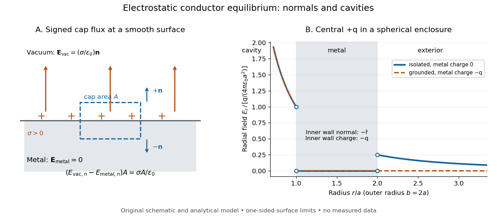

# Electrostatic boundary conditions at a conductor

↑ **Parent:** [Conductor in electrostatic equilibrium](conductor-in-electrostatic-equilibrium.md)

The [electrostatic boundary conditions at a conductor](electrostatic-boundary-conditions-at-a-conductor.md) relate the one-sided total [electric fields](electric-field-split.md) at a smooth metal–[vacuum](vacuum.md) interface. Choose a [unit normal](unit-normal.md) $\mathbf n$ **from metal into the adjacent vacuum**, let $\mathbf E_{\rm metal}$ and $\mathbf E_{\rm vac}$ be the two limiting [electric fields](electric-field-split.md), and let $\sigma$ be the signed [surface charge density](surface-charge-density.md). A thin [Gaussian pillbox](gaussian-pillbox.md) with cap [area](surface-area.md) $A$ has outward cap normals $+\mathbf n$ on the [vacuum](vacuum.md) side and $-\mathbf n$ on the metal side. As its height tends to zero, its side [electric flux](electric-flux.md) tends to zero for bounded local [electric fields](electric-field-split.md), leaving

$$
A\mathbf E_{\rm vac}\cdot\mathbf n-A\mathbf E_{\rm metal}\cdot\mathbf n=\frac{\sigma A}{\epsilon_0},\qquad \mathbf n\cdot(\mathbf E_{\rm vac}-\mathbf E_{\rm metal})=\frac{\sigma}{\epsilon_0}.
$$

The minus sign comes from the second outward cap normal, not from the sign of the [electric charge](electric-charge-split.md). A shrinking rectangular loop across the interface and the zero closed [line integral](line-integral.md) in [electrostatics](electrostatics-split.md) give continuity of the [tangential component](tangential-component.md):

$$
\mathbf n\times(\mathbf E_{\rm vac}-\mathbf E_{\rm metal})=\mathbf0.
$$

For a [conductor in electrostatic equilibrium](conductor-in-electrostatic-equilibrium.md), $\mathbf E_{\rm metal}=\mathbf0$, hence

$$
\boxed{\mathbf E_{\rm vac}=\frac{\sigma}{\epsilon_0}\mathbf n,\qquad \Phi|_S=V_c,\qquad \sigma=-\epsilon_0\left.\frac{\partial\Phi}{\partial n}\right|_{\rm vac}.}
$$

Thus positive [surface charge density](surface-charge-density.md) gives an [electric field](electric-field-split.md) away from metal and negative [surface charge density](surface-charge-density.md) gives an [electric field](electric-field-split.md) toward metal. The derivative uses the same chosen [unit normal](unit-normal.md), from the [vacuum](vacuum.md) side. The ideal surface layer has no unique [electric field](electric-field-split.md) value on the layer itself; these are limiting values. Ordinary surface [electric charge](electric-charge-split.md) preserves continuity of [electric potential](electric-potential.md); an ideal [electric dipole](electric-dipole.md) sheet would require a different model. [Richard Fitzpatrick, Boundary conditions for E and D: pillbox and loop conditions](https://farside.ph.utexas.edu/teaching/em/lectures/node70.html).

Here “exterior” means just outside the **metal**, including the [vacuum](vacuum.md) within a [cavity in a conductor](cavity-in-a-conductor.md). On a spherical inner wall of radius $a$, its [unit normal](unit-normal.md) from metal into the [cavity in a conductor](cavity-in-a-conductor.md) is $-\widehat{\mathbf r}$. A central positive [point charge](point-charge.md) $q$ gives $\mathbf E_{\rm vac}=q\widehat{\mathbf r}/(4\pi\epsilon_0a^2)$ there, so

$$
\sigma_{\rm inner}=-\frac{q}{4\pi a^2},\qquad \int_{S_{\rm inner}}\sigma_{\rm inner}\,dA=-q.
$$

The outward normal of the [cavity in a conductor](cavity-in-a-conductor.md) as a volume is instead $+\widehat{\mathbf r}$; confusing these two [unit normals](unit-normal.md) reverses the inferred sign. For a stipulated spherical enclosure with inner radius $a$, outer radius $b$, no external sources and total isolated metal [electric charge](electric-charge-split.md) $Q_c$, [spherical symmetry](spherical-symmetry.md) and [Gauss's law](gauss-s-law.md) give the analytical model

$$
E_r(r)=\begin{cases}
q/(4\pi\epsilon_0r^2),&0<r<a,\\
0,&a<r<b,\\
(Q_c+q)/(4\pi\epsilon_0r^2),&r>b.
\end{cases}
$$

Its outer [surface charge density](surface-charge-density.md) is $(Q_c+q)/(4\pi b^2)$. Grounding to $V_c=0$ with zero [electric potential](electric-potential.md) at infinity instead gives $Q_c=-q$ and zero exterior [electric field](electric-field-split.md), while preserving the same nonzero [electric field](electric-field-split.md) inside the charged [cavity in a conductor](cavity-in-a-conductor.md).

**[Figure 5](#image-signed-gaussian-pillbox-accounting-and-an-analytical-charged-cavity-in-a-conductor). Signed Gaussian pillbox accounting and an analytical charged cavity in a conductor**. Original schematic and analytical model, not measured data. Left: the two cap normals give the normal [electric field](electric-field-split.md) jump at a positive metal–[vacuum](vacuum.md) surface. Right: a central positive [point charge](point-charge.md) in a spherical enclosure with $b=2a$; solid blue is an isolated initially neutral enclosure, and dashed orange is a grounded enclosure. Both have zero [electric field](electric-field-split.md) in the metal and the same nonzero [electric field](electric-field-split.md) in the [cavity in a conductor](cavity-in-a-conductor.md). The jumps show one-sided limits, with the point-source singularity excluded.

As a numerical sign check, stipulate $q=1\,\mathrm{nC}$, $a=0.10\,\mathrm m$, $b=0.20\,\mathrm m$ and $1/(4\pi\epsilon_0)\simeq8.99\times10^9\,\mathrm{N\,m^2/C^2}$. The inner [electric field](electric-field-split.md) is approximately $899\,\mathrm{N/C}$ along $+\widehat{\mathbf r}$, but $\mathbf E_{\rm vac}\cdot\mathbf n=-899\,\mathrm{N/C}$ and $\sigma_{\rm inner}\simeq-7.96\,\mathrm{nC/m^2}$. An isolated neutral enclosure has $+1\,\mathrm{nC}$ on the outer wall, approximately $+1.99\,\mathrm{nC/m^2}$ and $225\,\mathrm{N/C}$ just outside. Multiplying each [surface charge density](surface-charge-density.md) by its spherical [surface area](surface-area.md) recovers the signed wall [electric charges](electric-charge-split.md).

The local result uses the total [electric field](electric-field-split.md), including all induced and imposed sources. The factor $\sigma/\epsilon_0$ follows from the zero metal-side [electric field](electric-field-split.md); a symmetric isolated sheet in [vacuum](vacuum.md) instead has magnitude $|\sigma|/(2\epsilon_0)$ on each side. [Feynman, Leighton and Sands, II.5.9: why a conductor differs from an isolated charge sheet](https://www.feynmanlectures.caltech.edu/II_05.html#Ch5-S9). At sharp corners, limiting [electric fields](electric-field-split.md) can be singular and the smooth local pillbox argument needs care. In material outside the metal, use the normal free-charge jump of the [electric displacement field](electric-displacement-field.md) and the material's [permittivity](permittivity-split.md), as in [electrostatic interface boundary conditions](electrostatic-interface-boundary-conditions.md). [Richard Fitzpatrick, Boundary conditions for E and D: free and bound surface charge](https://farside.ph.utexas.edu/teaching/em/lectures/node70.html).

**Table of contents**

- [Surface charge density](surface-charge-density.md)

## ↑ Ancestors (6)

1. [Conductor in electrostatic equilibrium](conductor-in-electrostatic-equilibrium.md)
2. [Electrostatics](electrostatics-split.md)
3. [Electromagnetism](electromagnetism-split.md)
4. [Branches of physics](branches-of-physics.md)
5. [Physics](physics-split.md)
6. [Codex Wiki](split.md)

## ← Incoming links (7)

- [Electrostatic boundary conditions at a conductor](electrostatic-boundary-conditions-at-a-conductor.md)
- [Fringing field of a capacitor](fringing-field-of-a-capacitor.md)
- [Solution](past-exam-of-the-mathematics-course-of-the-university-of-cambridge/2009/ib/paper-1/16a/a/solution.md)
- [Solution](past-exam-of-the-mathematics-course-of-the-university-of-cambridge/2014/ib/paper-2/18a/solution.md)
- [Solution](past-exam-of-the-mathematics-course-of-the-university-of-cambridge/2016/ib/paper-1/16d/d/solution.md)
- [Solution](past-exam-of-the-mathematics-course-of-the-university-of-cambridge/2019/iii/paper-344/3/e/solution.md)
- [Solution](past-exam-of-the-mathematics-course-of-the-university-of-cambridge/2024/ib/paper-3/15c/solution.md)
