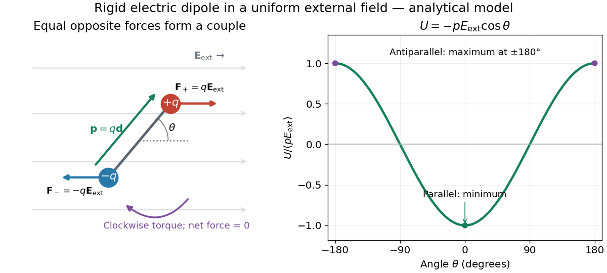
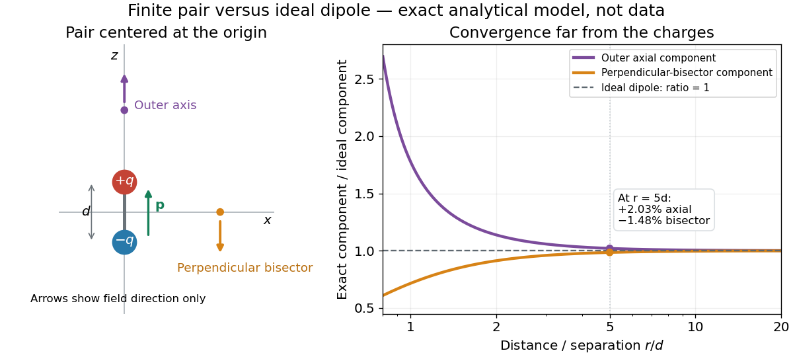

# Electrostatics

↑ **Parent:** [Electromagnetism](electromagnetism.md)  
ⓦ [Wiki](https://en.wikipedia.org/wiki/Electrostatics)

[Electrostatics](electrostatics.md) studies time-independent [electric charge](electric-charge.md) distributions and their [electric fields](electric-field.md). In [vacuum](physics.md#vacuum), its local equations in [SI](physics.md#international-system-of-units) units are

$$
\nabla\cdot\mathbf E=\frac{\rho}{\epsilon_0},\qquad \nabla\times\mathbf E=\mathbf0,\qquad \mathbf E=-\nabla\Phi,\qquad \nabla^2\Phi=-\frac{\rho}{\epsilon_0}.
$$

Here $\rho$ is [charge density](electric-charge.md#charge-density), $\epsilon_0$ is [vacuum permittivity](permittivity.md#vacuum-permittivity), and $\Phi$ is [electric potential](electric-field.md#electric-potential). [Gauss's law](maxwell-equations.md#gauss-s-law) supplies the [divergence](multivariable-calculus.md#divergence) equation; the static form of [Faraday's law of induction](maxwell-equations.md#faraday-s-law-of-induction) supplies the zero [curl](multivariable-calculus.md#curl). The [Poisson equation](partial-differential-equation.md#poisson-s-equation) becomes [Laplace's equation](partial-differential-equation.md#laplace-equation) where there is no [electric charge](electric-charge.md). Prescribed [electric charges](electric-charge.md) give [electric fields](electric-field.md) through [Coulomb's law](#coulomb-s-law) and the [superposition principle](vector-space.md#superposition-principle); mobile [electric charges](electric-charge.md) on an [electrical conductor](electric-charge.md#electrical-conductor) instead require solving for their distribution together with the [electric potential](electric-field.md#electric-potential). [Richard Fitzpatrick, Electrostatics and magnetostatics: field equations and boundary data](https://farside.ph.utexas.edu/teaching/em/lectures/node40.html).

The useful distinction is between prescribed sources and prescribed [boundary conditions](differential-equation.md#boundary-condition). On a grounded [electrical conductor](electric-charge.md#electrical-conductor), an external connection fixes its [electric potential](electric-field.md#electric-potential) relative to an [electrical reference potential](electric-field.md#electrical-reference-potential) and allows [electric charge](electric-charge.md) to enter or leave. On an isolated [electrical conductor](electric-charge.md#electrical-conductor), total [electric charge](electric-charge.md) is fixed and its constant [electric potential](electric-field.md#electric-potential) is an unknown. A neutral isolated [electrical conductor](electric-charge.md#electrical-conductor) can therefore have a nonzero local [surface charge density](#surface-charge-density) through [electrostatic induction](electric-charge.md#electrostatic-induction). Equal [electric potentials](electric-field.md#electric-potential) also do not imply equal [electric charges](electric-charge.md): [charge sharing between distant connected spheres](#charge-sharing-between-distant-connected-spheres) gives a simple geometric example. [Feynman, Leighton and Sands, II.6: charged conductors and connected-sphere estimates](https://www.feynmanlectures.caltech.edu/II_06.html#Ch6-S6).

[Electrostatics](electrostatics.md) is useful because a spatial [boundary value problem](boundary-value-problem.md) replaces the need to follow every moving [charge carrier](electric-charge.md#charge-carrier) during [charge relaxation](electric-charge.md#charge-relaxation). It describes the settled state of a [capacitor](electromagnetism.md#capacitor) and explains [electrostatic shielding](#electrostatic-shielding) of sensitive equipment. Its assumptions must match the apparatus: stationary boundaries and sources, negligible time variation of the [magnetic field](magnetic-field.md), and enough time for [charge relaxation](electric-charge.md#charge-relaxation). A metal carrying a maintained [electric current](electric-charge.md#electric-current) through finite [electrical resistance](electric-charge.md#electrical-resistance) generally needs a nonzero internal [electric field](electric-field.md) by [Ohm's law](electric-charge.md#ohm-s-law); it is not a [conductor in electrostatic equilibrium](#conductor-in-electrostatic-equilibrium). Static macroscopic [electric charge](electric-charge.md) also does not mean that every [electron](physics.md#electron) is motionless. [Feynman, Leighton and Sands, II.7.1: conductor potentials as boundary-value problems](https://www.feynmanlectures.caltech.edu/II_07.html#Ch7-S1).

**Table of contents**

- [Uniqueness of an electrostatic dielectric boundary-value problem](#uniqueness-of-an-electrostatic-dielectric-boundary-value-problem)
  - [Uniqueness theorem for the electrostatic potential](#uniqueness-theorem-for-the-electrostatic-potential)
- [Electrostatic screening](#electrostatic-screening)
- [Conducting-wedge potential expansion](#conducting-wedge-potential-expansion)
  - [Electrostatic corner-field exponent](#electrostatic-corner-field-exponent)
- [Electrostatic pressure](#electrostatic-pressure)
- [Half-immersed conducting sphere in a dielectric](#half-immersed-conducting-sphere-in-a-dielectric)
- [Conducting sphere](#conducting-sphere)
- [Potential of an inverse-radius spherical charge density](#potential-of-an-inverse-radius-spherical-charge-density)
- [Electric double layer](#electric-double-layer)
  - [Charge regulation](#charge-regulation)
  - [Dukhin number](#dukhin-number)
  - [Stern model](#stern-model)
  - [Charge reversal](#charge-reversal)
  - [Zeta potential](#zeta-potential)
  - [Diffuse layer](#diffuse-layer)
  - [Co-ion](#co-ion)
  - [Stern layer](#stern-layer)
  - [Electro-osmosis](#electro-osmosis)
    - [Uniform wall charge and polymer entry scaling](#uniform-wall-charge-and-polymer-entry-scaling)
    - [One-charged-wall electro-osmotic channel](#one-charged-wall-electro-osmotic-channel)
      - [Neutral-charge versus fixed-potential channel boundary](#neutral-charge-versus-fixed-potential-channel-boundary)
      - [Velocity maximum in a one-charged-wall channel](#velocity-maximum-in-a-one-charged-wall-channel)
    - [Helmholtz-Smoluchowski electro-osmotic velocity](#helmholtz-smoluchowski-electro-osmotic-velocity)
  - [Coion](#coion)
- [Earnshaw's theorem](#earnshaw-s-theorem)
- [Faraday's ice pail experiment](#faraday-s-ice-pail-experiment)
- [Electrostatic interface boundary conditions](#electrostatic-interface-boundary-conditions)
- [Debye–Hückel approximation](#debye-huckel-approximation)
  - [Planar Debye-Hückel double layer](#planar-debye-huckel-double-layer)
  - [Debye-Hückel potential of a charged sphere](#debye-huckel-potential-of-a-charged-sphere)
  - [Screened sinusoidal surface-charge mode](#screened-sinusoidal-surface-charge-mode)
    - [Phase registration of screened charged sheets](#phase-registration-of-screened-charged-sheets)
- [Bjerrum length](#bjerrum-length)
- [Poisson-Boltzmann equation](#poisson-boltzmann-equation)
  - [Planar counterion-only double layer](#planar-counterion-only-double-layer)
  - [Nonlinear planar Poisson-Boltzmann profile](#nonlinear-planar-poisson-boltzmann-profile)
  - [Nonlinear counterion accumulation in planar screening](#nonlinear-counterion-accumulation-in-planar-screening)
  - [Linearized planar screening solution](#linearized-planar-screening-solution)
    - [Ion-density convention in the Debye screening length](#ion-density-convention-in-the-debye-screening-length)
  - [Boltzmann ion densities in a symmetric electrolyte](#boltzmann-ion-densities-in-a-symmetric-electrolyte)
  - [Osmotic stress in a symmetric electric double layer](#osmotic-stress-in-a-symmetric-electric-double-layer)
  - [Grahame equation](#grahame-equation)
    - [Diffuse-layer differential capacitance](#diffuse-layer-differential-capacitance)
  - [Neutral cylindrical cell model](#neutral-cylindrical-cell-model)
    - [Infinite-dilution limit of cylindrical counterions](#infinite-dilution-limit-of-cylindrical-counterions)
  - [Cylindrical counterion-only Poisson-Boltzmann profile](#cylindrical-counterion-only-poisson-boltzmann-profile)
  - [Counterion condensation](#counterion-condensation)
    - [Manning condensed fraction](#manning-condensed-fraction)
    - [Cylindrical screening charge](#cylindrical-screening-charge)
    - [Manning parameter](#manning-parameter)
- [Coulomb's law](#coulomb-s-law)
  - [Coulomb force](#coulomb-force)
  - [Coulomb interaction](#coulomb-interaction)
  - [Coulomb potential energy](#coulomb-potential-energy)
    - [Electrostatic potential of a uniformly charged disk](#electrostatic-potential-of-a-uniformly-charged-disk)
- [Electrostatic equilibrium](#electrostatic-equilibrium)
- [Conductor in electrostatic equilibrium](#conductor-in-electrostatic-equilibrium)
  - [Charged sheet between grounded parallel plates](#charged-sheet-between-grounded-parallel-plates)
  - [Cavity in a conductor](#cavity-in-a-conductor)
  - [Electrostatic shielding](#electrostatic-shielding)
  - [Electrostatic boundary conditions at a conductor](#electrostatic-boundary-conditions-at-a-conductor)
    - [Surface charge density](#surface-charge-density)
  - [Charge sharing between distant connected spheres](#charge-sharing-between-distant-connected-spheres)
  - [Charge on connected concentric spherical shells](#charge-on-connected-concentric-spherical-shells)
  - [Induced charge on a conducting sphere in a uniform electric field](#induced-charge-on-a-conducting-sphere-in-a-uniform-electric-field)
    - [Conducting hemispherical protrusion in a uniform field](#conducting-hemispherical-protrusion-in-a-uniform-field)
- [Electrostatic energy](#electrostatic-energy)
  - [Electrostatic energy of a three-plate capacitor](#electrostatic-energy-of-a-three-plate-capacitor)
  - [Electrostatic energy of a uniformly charged solid sphere](#electrostatic-energy-of-a-uniformly-charged-solid-sphere)
  - [Electrostatic energy of alternating-charge concentric shells](#electrostatic-energy-of-alternating-charge-concentric-shells)
  - [Electrostatic energy of a uniformly charged spherical shell](#electrostatic-energy-of-a-uniformly-charged-spherical-shell)
  - [Electrostatic potential energy of point charges](#electrostatic-potential-energy-of-point-charges)
  - [Coaxial cylindrical capacitor](#coaxial-cylindrical-capacitor)
    - [Partially filled coaxial capacitor](#partially-filled-coaxial-capacitor)
      - [Dielectric-rise voltmeter](#dielectric-rise-voltmeter)
    - [Coaxial capacitor with grounded inner and outer cylinders](#coaxial-capacitor-with-grounded-inner-and-outer-cylinders)
- [Electric dipole moment](#electric-dipole-moment)
  - [Electric polarizability](#electric-polarizability)
    - [Harmonic-oscillator electric polarizability](#harmonic-oscillator-electric-polarizability)
    - [Polarizability tensor](#polarizability-tensor)
      - [Rank-one needle polarizability](#rank-one-needle-polarizability)
    - [Dynamic electric polarizability](#dynamic-electric-polarizability)
      - [Harmonic-oscillator dipole response to switched radiation](#harmonic-oscillator-dipole-response-to-switched-radiation)
    - [Induced dipole moment and quadratic energy shift](#induced-dipole-moment-and-quadratic-energy-shift)
      - [Charge-induced dipole attraction](#charge-induced-dipole-attraction)
  - [Time derivative of the electric dipole moment](#time-derivative-of-the-electric-dipole-moment)
  - [Electric dipole](#electric-dipole)
    - [Electric dipole field](#electric-dipole-field)
    - [Electric dipole-dipole interaction](#electric-dipole-dipole-interaction)
      - [Transverse electric-dipole pair energy](#transverse-electric-dipole-pair-energy)
      - [Dipole depolarization](#dipole-depolarization)
- [Electric multipole expansion](#electric-multipole-expansion)
  - [Electric quadrupole moment](#electric-quadrupole-moment)
  - [Electric quadrupole](#electric-quadrupole)
    - [Planar quadrupole potential](#planar-quadrupole-potential)
  - [Multipole expansion of three collinear charges](#multipole-expansion-of-three-collinear-charges)
    - [Dipole and quadrupole scaling limits of three collinear charges](#dipole-and-quadrupole-scaling-limits-of-three-collinear-charges)
    - [Transverse force from a collinear electric quadrupole](#transverse-force-from-a-collinear-electric-quadrupole)

## Uniqueness of an electrostatic dielectric boundary-value problem

↑ **Parent:** [Electrostatics](electrostatics.md)

For positive scalar [permittivities](permittivity.md) and specified free charges, fixed conductor potentials, [dielectric](permittivity.md#dielectric) matching conditions and decay at infinity, the electrostatic field is unique. Subtract two proposed potentials and integrate $\nabla\cdot(\epsilon\,\delta\phi\nabla\delta\phi)$. The boundary terms vanish or cancel across [dielectric](permittivity.md#dielectric) interfaces, leaving $\int\epsilon|\nabla\delta\phi|^2dV=0$. Hence the difference field is zero, with any potential constant fixed by the boundary convention.

### Uniqueness theorem for the electrostatic potential

↑ **Parent:** [Uniqueness of an electrostatic dielectric boundary-value problem](#uniqueness-of-an-electrostatic-dielectric-boundary-value-problem)

In a vacuum domain with specified [charge density](electric-charge.md#charge-density), fixed boundary [electric potential](electric-field.md#electric-potential) and the appropriate condition at infinity, two solutions of the [Poisson equation](partial-differential-equation.md#poisson-s-equation) have difference $w$ satisfying $\nabla^2w=0$ with zero boundary data. Integration by parts gives $\int|\nabla w|^2dV=0$; hence their [electric fields](electric-field.md) coincide, and their potentials coincide after fixing the constant. This is the Dirichlet case of the more general dielectric uniqueness result. It justifies the exterior field constructed by the [method of images](mathematics.md#method-of-images).

## Electrostatic screening

↑ **Parent:** [Electrostatics](electrostatics.md)

Mobile [electric charges](electric-charge.md) redistribute in response to an imposed [electric potential](electric-field.md#electric-potential), partly compensating its field. The induced density response and the Poisson equation must be solved self-consistently. Classical dilute mobile ions lead to the [Debye–Hückel approximation](#debye-huckel-approximation); a degenerate electron system instead has a response set by its electronic compressibility and interactions. A high charge response can pin a partly occupied [Landau level](quantum-theory.md#landau-level) near the [Fermi energy](quantum-ideal-gas-statistics.md#fermi-energy), whereas an incompressible gap suppresses that response. [electrostatic screening](#electrostatic-screening) is not a claim that every material perfectly excludes every static field.

## Conducting-wedge potential expansion

↑ **Parent:** [Electrostatics](electrostatics.md)

In a charge-free wedge $0<\theta<\alpha$ bounded by equal-potential conductor faces, separation of Laplace's equation gives the displayed local harmonic expansion. Bounded potential at a finite corner removes negative powers. Outer [boundary conditions](differential-equation.md#boundary-condition) determine the remaining coefficients; the conductor potential alone does not determine a nonconstant solution in an unbounded domain.

### Electrostatic corner-field exponent

↑ **Parent:** [Conducting-wedge potential expansion](#conducting-wedge-potential-expansion)

If the lowest allowed angular harmonic has a nonzero coefficient, differentiating its potential gives the displayed field scale. The field vanishes at a right-angle recess, stays finite at a smooth face, and diverges at a protruding conducting corner whose exterior vacuum [angle](geometry-and-topology.md#angle) exceeds $\pi$. A rounded tip cuts off the ideal power law at its [radius](topology.md#radius) scale. If the first coefficient vanishes, the first nonzero higher harmonic determines the exponent instead.

## Electrostatic pressure

↑ **Parent:** [Electrostatics](electrostatics.md)

The outward normal electric traction on an equipotential conductor adjoining a linear isotropic dielectric, for the ideal normal-field configuration, is $p_e=\epsilon E_n^2/2=\mathbf E\cdot\mathbf D/2$. Integrating this normal traction over a surface gives the electric [force](force.md). It is a field-stress contribution; mechanical [pressure](pressure.md) and dielectric boundary conditions must be included when determining an actual fluid-interface equilibrium.

## Half-immersed conducting sphere in a dielectric

↑ **Parent:** [Electrostatics](electrostatics.md)

An equipotential sphere centred in a flat interface between vacuum and a linear dielectric admits the same potential $C/r$ in both media. The radial field is tangential at the interface, so tangential E and normal D boundary conditions are satisfied. Displacement flux through the hemispheres gives $Q=2\pi\epsilon_0(1+\epsilon_r)C$, yielding the displayed sphere potential. E has equal magnitude at equal radius; D and free surface charge are larger by $\epsilon_r$ on the dielectric side.

Integrating [electrostatic pressure](#electrostatic-pressure) gives a [force](force.md) toward the dielectric of magnitude $Q^2(\epsilon_r-1)/[8\pi\epsilon_0(1+\epsilon_r)^2a^2]$. A deforming liquid interface or surface tension needs additional mechanical conditions beyond this ideal flat-interface solution.

## Conducting sphere

↑ **Parent:** [Electrostatics](electrostatics.md)

A spherical [electrical conductor](electric-charge.md#electrical-conductor) has constant [electric potential](electric-field.md#electric-potential) throughout its connected interior in [electrostatic equilibrium](#electrostatic-equilibrium). For an isolated sphere in a homogeneous medium, spherical symmetry and [Gauss's law](maxwell-equations.md#gauss-s-law) give the exterior field of a point [electric charge](electric-charge.md) at its center.

## Potential of an inverse-radius spherical charge density

↑ **Parent:** [Electrostatics](electrostatics.md)

A charge cloud $\rho=A/r$ for $0<r<a$ encloses $Q(r)=2\pi Ar^2$. With no central point charge and potential zero at infinity, [Gauss's law](maxwell-equations.md#gauss-s-law) gives $\phi=A(2a-r)/(2\epsilon_0)$ inside and $Aa^2/(2\epsilon_0r)$ outside. The [density](fluid-mechanics.md#density) singularity is integrable, and the potential is finite at the origin.

## Electric double layer

↑ **Parent:** [Electrostatics](electrostatics.md)

An [electric double layer](#electric-double-layer) consists of an interfacial [electric charge](electric-charge.md) and the compensating distribution of mobile [ions](chemistry.md#ion) in the adjacent [chemical solution](mixture.md#solution-chemistry). [Counterions](chemistry.md#counterion) are enriched and [coions](#coion) depleted near a simple charged interface. A diffuse layer is described approximately by the [Poisson-Boltzmann equation](#poisson-boltzmann-equation); a compact specifically adsorbed layer requires additional surface chemistry. Overlap of diffuse layers can produce a screened repulsion between like-charged [colloids](mixture.md#colloid).

### Charge regulation

↑ **Parent:** [Electric double layer](#electric-double-layer)

A surface can change its [surface charge density](#surface-charge-density) as its local [electric potential](electric-field.md#electric-potential) and solution composition change, for example through reversible ionization or [ion](chemistry.md#ion) adsorption. This couples the surface reaction equilibrium to the surrounding [electric double layer](#electric-double-layer). Fixed-charge and fixed-potential models are limiting boundary conditions rather than interchangeable descriptions. Salt or [pH](acid-base-chemistry.md#ph) changes can therefore alter both electrostatic screening and the repulsion amplitude.

### Dukhin number

↑ **Parent:** [Electric double layer](#electric-double-layer)

A dimensionless ratio comparing surface conduction with bulk conduction over a characteristic length. With pore radius r and surface conductance $K_s$, one convention is $\mathrm{Du}=K_s/(\sigma r)$; the cylindrical surface-to-bulk conductance ratio is twice this value.

### Stern model

↑ **Parent:** [Electric double layer](#electric-double-layer)

A model separating a compact interfacial layer from a diffuse [ion](chemistry.md#ion) distribution. Specified [adsorption](physical-chemistry.md#adsorption) and boundary conditions determine the potential at the outer compact-layer boundary; a diffuse-layer equation alone does not determine specific [adsorption](physical-chemistry.md#adsorption).

### Charge reversal

↑ **Parent:** [Electric double layer](#electric-double-layer)

Overcompensation of an initial interfacial charge by adsorbed species or correlated [ions](chemistry.md#ion), so the charge or potential inferred outside the compact interfacial region has the opposite sign. Screening of a fixed boundary charge alone is not the same mechanism.

### Zeta potential

↑ **Parent:** [Electric double layer](#electric-double-layer)

The electrokinetic potential at a hydrodynamic slipping plane relative to bulk solution. It need not equal the potential at the physical solid surface.

### Diffuse layer

↑ **Parent:** [Electric double layer](#electric-double-layer)

The spatially extended ionic atmosphere screening a charged surface beyond the compact [Stern layer](#stern-layer).

### Co-ion

↑ **Parent:** [Electric double layer](#electric-double-layer)

An ion with the same charge sign as the surface or fixed charge being screened. In a simple diffuse layer it is depleted near a similarly charged surface.

### Stern layer

↑ **Parent:** [Electric double layer](#electric-double-layer)

The compact interfacial region associated with finite ion closest approach and specifically adsorbed charge. A diffuse electrolyte layer lies beyond it.

### Electro-osmosis

↑ **Parent:** [Electric double layer](#electric-double-layer)  
ⓦ [Wiki](https://en.wikipedia.org/wiki/Electro-osmosis)

Electro-osmosis is fluid motion driven by an applied [electric field](electric-field.md) acting on mobile [electric charge](electric-charge.md) near a surface. A charged interface attracts a diffuse population of [counterions](chemistry.md#counterion) in an [electric double layer](#electric-double-layer). A field component tangent to the interface exerts a force density $\rho_e\mathbf E$ on that mobile charge; momentum transfer to the surrounding [solvent](mixture.md#solvent) drives flow opposed by [viscous stress](dynamic-viscosity.md#viscous-stress-tensor). In a capillary [electrophoresis](physical-chemistry.md#electrophoresis) measurement, this flow advects the sample as well as its electrical drift relative to the fluid. Locally, the measured axial [velocity](classical-mechanics.md#velocity) is $v_{\mathrm{observed}}=u_{\mathrm{eo}}+\mu_{\mathrm{ep}}E$, where $u_{\mathrm{eo}}$ is the electroosmotic fluid velocity and $\mu_{\mathrm{ep}}$ is the [electrophoretic mobility](physical-chemistry.md#electrophoretic-mobility). [MIT OpenCourseWare, lecture 15: electroosmotic flow driven by the force on diffuse-double-layer charge](https://ocw.mit.edu/courses/6-777j-design-and-fabrication-of-microelectromechanical-devices-spring-2007/ecbd3da50020e79e0cbb85a43a9604c1_07lecture15.pdf)

#### Uniform wall charge and polymer entry scaling

↑ **Parent:** [Electro-osmosis](#electro-osmosis)

A homogeneous charged channel can add a constant electro-osmotic drift to the ideal electrophoretic [velocity](classical-mechanics.md#velocity) at fixed field. It changes the coefficient of a linear length-versus-entry-time law without generating a new [length](physics.md#length) exponent. Charge-dependent adsorption, heterogeneous trapping or cancellation of drift followed by [diffusion](thermodynamics.md#diffusion) lies outside that simple claim; wall charge cannot be excluded as an indirect cause in every real experiment.

#### One-charged-wall electro-osmotic channel

↑ **Parent:** [Electro-osmosis](#electro-osmosis)

With $\psi(0)=\zeta$, $\psi\prime(d)=0$ and no slip at either wall, linear screening gives $\psi/\zeta=\cosh[\kappa(d-x)]/\cosh(\kappa d)$. The [velocity](classical-mechanics.md#velocity) is $v/U=1-(1-\operatorname{sech}\kappa d)x/d-\cosh[\kappa(d-x)]/\cosh(\kappa d)$. This electrically neutral-wall boundary assumes no external normal field; it differs from a grounded wall.

##### Neutral-charge versus fixed-potential channel boundary

↑ **Parent:** [One-charged-wall electro-osmotic channel](#one-charged-wall-electro-osmotic-channel)

Zero wall charge constrains the jump in normal electric displacement, while fixing a wall potential is a separate electrical condition. Taking the external normal field to vanish gives a zero normal derivative at an ideal uncharged wall. A grounded wall may carry induced charge even though its imposed potential is zero.

##### Velocity maximum in a one-charged-wall channel

↑ **Parent:** [One-charged-wall electro-osmotic channel](#one-charged-wall-electro-osmotic-channel)

Differentiating the screened-channel [velocity](classical-mechanics.md#velocity) gives $x_{\max}=d-\kappa^{-1}\operatorname{arsinh}[(\cosh\kappa d-1)/(\kappa d)]$. For $\kappa d\gg1$, $x_{\max}\simeq\log(\kappa d)/\kappa$. The outer flow declines almost linearly to the passive no-slip wall rather than forming a symmetric plug.

#### Helmholtz-Smoluchowski electro-osmotic velocity

↑ **Parent:** [Electro-osmosis](#electro-osmosis)

In a half-space with no [pressure](pressure.md) gradient, Stokes balance and Poisson electrostatics give $\eta v\prime\prime=\varepsilon E\psi\prime\prime$. No slip at the wall and zero bulk shear imply $v=\varepsilon E(\psi-\zeta)/\eta$. The bulk [velocity](classical-mechanics.md#velocity) is $U=-\varepsilon\zeta E/\eta$; it is not the fluid speed at the no-slip wall.

### Coion

↑ **Parent:** [Electric double layer](#electric-double-layer)

A [coion](#coion) has [electric charge](electric-charge.md) of the same sign as the reference interface or particle. Its [number density](statistical-physics.md#number-density) is depleted near that interface in the simplest [Poisson-Boltzmann equation](#poisson-boltzmann-equation) description. A [counterion](chemistry.md#counterion) has the opposite sign. These roles depend on the reference charge: near a positively charged sphere in magnesium chloride, magnesium ions are coions and chloride ions are counterions.

<h2 id="earnshaw-s-theorem">Earnshaw's theorem</h2>

↑ **Parent:** [Electrostatics](electrostatics.md)  
ⓦ [Wiki](https://en.wikipedia.org/wiki/Earnshaw's_theorem)

For a point [electric charge](electric-charge.md) in a charge-free neighbourhood, a static [electric potential](electric-field.md#electric-potential) obeys [Laplace's equation](partial-differential-equation.md#laplace-equation). The [maximum principle for harmonic functions](partial-differential-equation.md#maximum-principle-for-harmonic-functions) excludes a strict interior minimum or maximum of that [electric potential](electric-field.md#electric-potential), hence a strict minimum of the charge's [potential energy](energy.md#potential-energy). A static [electric field](electric-field.md) alone therefore cannot provide stable three-dimensional confinement under these assumptions.

<h2 id="faraday-s-ice-pail-experiment">Faraday's ice pail experiment</h2>

↑ **Parent:** [Electrostatics](electrostatics.md)

[Faraday's ice pail experiment](#faraday-s-ice-pail-experiment) distinguishes **redistribution** of [electric charge](electric-charge.md) by [electrostatic induction](electric-charge.md#electrostatic-induction) from **transfer** of [electric charge](electric-charge.md) by contact. Lower a charged body into an initially neutral isolated metal pail: an externally connected [electrometer](electric-charge.md#electrometer) responds even though the body never touches the metal. Withdraw the body without contact and the response disappears. Repeat with conductive contact before withdrawal and a residual response can remain. The striking point is that an exterior response does not establish that the pail has gained net [electric charge](electric-charge.md).

**Apparatus and readout.** A modern implementation uses two concentric wire-mesh cylinders: a 10 cm diameter, 15 cm high inner pail on insulating rods and a grounded outer shield. Connect the [electrometer](electric-charge.md#electrometer)'s signal lead to the inner pail and its reference lead to the shield. Momentarily ground and zero the signal assembly, then isolate it; the shield remains grounded. A charged disk on an insulating handle goes into the lower half without touching. The [electrometer](electric-charge.md#electrometer) measures [electric potential difference](electric-field.md#electric-potential-difference) in [volts](physics.md#volt), with sign determined by the lead connections. It does not directly measure [electric charge](electric-charge.md) in [coulombs](physics.md#coulomb).[Basic Electrostatics System, instruction manual 012-07227G, printed pp. 9–10, 13–15, Figure 1.1 and Procedure 1A](physics-bibliography.md#basic-electrostatics-system-es-9080b-instruction-manual-012-07227g-by-cecilia-hernandez)

**[Figure 1](#image-faraday-s-ice-pail-experiment-apparatus-and-isolated-versus-grounded-electric-charge-accounting). Faraday's ice pail experiment: apparatus and isolated versus grounded electric charge accounting**. Original qualitative schematics. The open pail approximates enclosure; the two closed [cavity in a conductor](#cavity-in-a-conductor) panels stipulate exact enclosure, [electrostatic equilibrium](#electrostatic-equilibrium), no exterior sources and zero [electric potential](electric-field.md#electric-potential) at infinity. Signs denote total [electric charges](electric-charge.md), not a measured or uniform [surface charge density](#surface-charge-density).

**A charge ledger before contact.** To separate exact reasoning from the open apparatus, first idealize the pail as a closed [cavity in a conductor](#cavity-in-a-conductor) with one internal body of total [electric charge](electric-charge.md) $q$. Let the isolated metal have total [electric charge](electric-charge.md) $Q_0$. The metal's [electric field](electric-field.md) is zero at [electrostatic equilibrium](#electrostatic-equilibrium).[Richard Fitzpatrick, Ideal Conductors, equations 2.124–2.126: zero field and constant potential in metal](physics-bibliography.md#intermediate-college-physics-by-richard-fitzpatrick/ideal-conductors) A [Gaussian surface](maxwell-equations.md#gaussian-surface) enclosing the [cavity in a conductor](#cavity-in-a-conductor) but lying wholly in the metal therefore has zero [electric flux](electric-field.md#electric-flux). [Gauss's law](maxwell-equations.md#gauss-s-law) and [charge conservation](electric-charge.md#charge-conservation) give

$$
q+Q_{\rm inner}=0,\qquad Q_{\rm inner}+Q_{\rm outer}=Q_0,\qquad Q_{\rm outer}=Q_0+q.
$$

For $Q_0=0$ and $q>0$, the inner-wall total is $-q$ and the outer-wall total is $+q$: the metal remains neutral. The exterior [electric field](electric-field.md) can therefore be nonzero without any transfer from the body. The connected [electrometer](electric-charge.md#electrometer) and signal cable belong to the same isolated conducting assembly and share its exterior [electric charge](electric-charge.md). The zero-[electric field](electric-field.md) assertion concerns metal, not the occupied [cavity in a conductor](#cavity-in-a-conductor).

This ledger fixes totals, not the local [surface charge density](#surface-charge-density). Moving an off-center body changes the inner-wall distribution while its [integral](integral.md) remains $-q$. With fixed outer geometry, fixed $Q_0+q$ and unchanged exterior sources, [Uniqueness of the Dirichlet problem](analysis.md#uniqueness-of-the-dirichlet-problem) together with the fixed total outer [electric charge](electric-charge.md) determines the same exterior solution: the outside cannot reveal the body's position or detailed internal distribution. For example, internal bodies with stipulated [electric charges](electric-charge.md) $+2q$ and $-q$ give the same total exterior response as a single body with $+q$. Internal bodies with $+q$ and $-q$ can give a null exterior response while retaining a nonzero internal [electric field](electric-field.md). This is why a null reading cannot establish an empty [cavity in a conductor](#cavity-in-a-conductor).

**Withdrawal is the control.** Record a baseline, insert without contact, withdraw, and check return to baseline. After a fresh zero, repeat with the charged disk touching the inner wall, then withdraw and record the residual response. Finally zero the pail and reinsert the disk without contact to test remaining [electric charge](electric-charge.md). Keep the operator grounded, discharge unwanted handle [electric charge](electric-charge.md), and keep the unused charged disk distant. Dirty supports and humidity promote leakage. These controls separate transfer from [electrostatic induction](electric-charge.md#electrostatic-induction) and stray coupling.[Basic Electrostatics System, instruction manual 012-07227G, printed pp. 4–5 and 14–15, Procedure 1A steps 3–8: handle charge, withdrawal, contact and disk retest](physics-bibliography.md#basic-electrostatics-system-es-9080b-instruction-manual-012-07227g-by-cecilia-hernandez)

**[Figure 2](#image-faraday-s-ice-pail-experiment-qualitative-withdrawal-contact-and-grounding-sequences). Faraday's ice pail experiment: qualitative withdrawal, contact and grounding sequences**. Stipulated ideal-model outcomes for a body initially carrying positive [electric charge](electric-charge.md) $q$, with a separate neutral initial state for each row. No measured [electric potential differences](electric-field.md#electric-potential-difference) or time scale are depicted. The grounding sequence disconnects ground before withdrawal; reversing that order removes its residual [electric charge](electric-charge.md).

In the ideal contact test, the internal body is itself an [electrical conductor](electric-charge.md#electrical-conductor) and makes a conducting connection to the wall. After [charge relaxation](electric-charge.md#charge-relaxation), body and enclosure become a single [equipotential](electric-field.md#equipotential); the remaining charge-free void has zero [electric field](electric-field.md). The body then carries no excess [electric charge](electric-charge.md) on surfaces facing that void. Withdrawal without subsequent charging leaves total metal [electric charge](electric-charge.md) $Q_0+q$. A coated paddle can retain [electric charge](electric-charge.md) on insulating patches, so merely touching it does not guarantee complete transfer. A residual reading establishes some transfer under the controls; the disk retest checks the stronger claim of complete transfer. The ideal argument assumes no leakage and no relevant contact-generated charging.

**Grounding changes the ledger.** With no exterior sources and zero [electric potential](electric-field.md#electric-potential) at infinity, a closed grounded enclosure has zero exterior [electric field](electric-field.md), inner-wall [electric charge](electric-charge.md) $-q$ and zero outer-wall [electric charge](electric-charge.md).[II.5, §5–10, final shielding argument: a closed grounded conducting shell separates the two electrostatic problems](physics-bibliography.md#the-feynman-lectures-on-physics-volume-ii-by-richard-feynman-and-others) Consequently, disconnecting ground before withdrawal retains total metal [electric charge](electric-charge.md) $-q$, which moves to the exterior after withdrawal. Keeping ground connected during withdrawal instead restores zero [electric charge](electric-charge.md). A lasting opposite-sign response can therefore arise through grounding without body–wall contact.

For the real open pail, no [Gaussian surface](maxwell-equations.md#gaussian-surface) lying wholly in metal closes over the mouth. Increasing insertion depth and seeking a stable response tests whether enclosure is a good approximation; mesh openings, rim proximity and nearby objects limit it. In a fixed-geometry approximation, the positive insertion response obeys $\Delta V\simeq q/C_{\rm eff}$, where $C_{\rm eff}$ is the effective [capacitance](electromagnetism.md#capacitance) of the pail, shield, cable and [electrometer](electric-charge.md#electrometer) input. Changed geometry changes that conversion. Wait for [charge relaxation](electric-charge.md#charge-relaxation) and instrument settling at each step, while keeping the observation short compared with leakage. The experiment probes settled [electrostatics](electrostatics.md); it does not establish shielding against arbitrary changing [electromagnetic fields](electromagnetism.md#electromagnetic-field).

## Electrostatic interface boundary conditions

↑ **Parent:** [Electrostatics](electrostatics.md)

Across a charged dielectric interface the tangential [electric field](electric-field.md) is continuous and the normal displacement jump is the fixed [surface charge density](#surface-charge-density). Without a dipole sheet the [electrostatic potential](electric-field.md#electric-potential) is continuous. For a charge sheet with equal [permittivity](permittivity.md) on both sides, its normal potential derivative has jump $-\sigma_{\rm fixed}/\varepsilon$. Setting the field to zero on one side is an additional physical boundary assumption, as in a conductor or a negligible-exterior-admittance idealization.

<h2 id="debye-huckel-approximation">Debye–Hückel approximation</h2>

↑ **Parent:** [Electrostatics](electrostatics.md)

The Debye–Hückel approximation linearizes mobile-ion Boltzmann densities about a neutral bulk electrolyte. It is valid for ionic potential energies small compared with $k_BT$. The inverse [Debye–Hückel screening length](mathematical-biology.md#debye-huckel-screening-length) satisfies $\kappa_D^2=\sum_i n_i z_i^2e^2/(\varepsilon k_BT)$. The quadratic screened charging free energy includes both [electric field](electric-field.md) energy and the linearized ionic-response term $\varepsilon\kappa_D^2\phi^2/2$.

<h3 id="planar-debye-huckel-double-layer">Planar Debye-Hückel double layer</h3>

↑ **Parent:** [Debye–Hückel approximation](#debye-huckel-approximation)

For a plane bounding a symmetric electrolyte in $x>0$, assume no displacement field on the other side, bulk potential zero, and $|ze\psi|\ll k_BT$. The [Debye–Hückel approximation](#debye-huckel-approximation) gives $\psi''=\kappa^2\psi$, whose decaying solution is $\psi_0e^{-\kappa x}$. The [electrostatic interface boundary conditions](#electrostatic-interface-boundary-conditions) give $\sigma=-\varepsilon\psi'(0^+)=\varepsilon\kappa\psi_0$. Equivalently, its diffuse [charge density](electric-charge.md#charge-density) is $\rho_e=-\varepsilon\kappa^2\psi$ and its integral is $-\sigma$. Here $\varepsilon=\varepsilon_0\varepsilon_r$ in SI units and $\kappa^2=2z^2e^2n_\infty/(\varepsilon k_BT)$ when $n_\infty$ counts each ionic species. An isolated sheet with identical electrolyte on both sides has two diffuse layers, so the total sheet charge is $2\varepsilon\kappa\psi_0$ instead. A surface geometry and the field on its other side must therefore be specified.

<h3 id="debye-huckel-potential-of-a-charged-sphere">Debye-Hückel potential of a charged sphere</h3>

↑ **Parent:** [Debye–Hückel approximation](#debye-huckel-approximation)

For a uniformly charged sphere of radius $a$, total [electric charge](electric-charge.md) $Q$, and an exterior dilute electrolyte of [permittivity](permittivity.md) $\varepsilon$, the [Debye–Hückel approximation](#debye-huckel-approximation) gives $(r^2\phi')'=\kappa^2r^2\phi$. Decay at infinity and [Gauss's law](maxwell-equations.md#gauss-s-law), $-\varepsilon\phi'(a)=Q/(4\pi a^2)$, select the displayed [electric potential](electric-field.md#electric-potential). Substituting $u=r\phi$ reduces the proof to $u''=\kappa^2u$. The screening parameter is $\kappa^2=\sum_i z_i^2e^2n_{i,\infty}/(\varepsilon k_BT)$, and the [ion](chemistry.md#ion) profiles are $n_i\simeq n_{i,\infty}(1-z_ie\phi/(k_BT))$. The validity condition is $|z_i e\phi(a)|\ll k_BT$ for every relevant species. Integrating the diffuse [charge density](electric-charge.md#charge-density) using the radial equation gives total screening charge $-Q$.

### Screened sinusoidal surface-charge mode

↑ **Parent:** [Debye–Hückel approximation](#debye-huckel-approximation)

A lateral sinusoidal [surface charge density](#surface-charge-density) with wave number $k$ in the [Debye–Hückel approximation](#debye-huckel-approximation) generates vertical exponential or hyperbolic functions with inverse length $p=\sqrt{k^2+\kappa_D^2}$. In a homogeneous electrolyte filling all space, an isolated sheet at $z_s$ produces $\phi=\sigma_k(x)e^{-p|z-z_s|}/(2\varepsilon p)$. Boundary conditions determine the normalization when the electrolyte occupies only a gap.

#### Phase registration of screened charged sheets

↑ **Parent:** [Screened sinusoidal surface-charge mode](#screened-sinusoidal-surface-charge-mode)

Two equally modulated charge sheets in identical full-space electrolyte have charging energy per area $\alpha^2[1+e^{-pd}\cos\theta]/(4\varepsilon p)$, where $p=\sqrt{k^2+\kappa_D^2}$. Its phase-dependent interaction favors a half-wavelength offset, with opposite charge patches facing each other. For an electrolyte gap with negligible exterior displacement response, the energy is instead $\alpha^2[\coth(pd)+\cos\theta/\sinh(pd)]/(2\varepsilon p)$, with the same minimizing phase. Absolute energies require specified exterior [electrostatic interface boundary conditions](#electrostatic-interface-boundary-conditions).

## Bjerrum length

↑ **Parent:** [Electrostatics](electrostatics.md)  
ⓦ [Wiki](https://en.wikipedia.org/wiki/Bjerrum_length)

For a chosen reference charge $q$, the separation at which its Coulomb interaction energy equals $k_BT$. The charge-$q$ convention is $\ell_B=q^2/(4\pi\epsilon_{\rm abs}k_BT)$ in SI, or $\ell_B=\beta q^2/\epsilon$ in [Gaussian units](electromagnetism.md#gaussian-units). The commonly tabulated value uses the elementary charge; changing [counterion](chemistry.md#counterion) valence requires tracking that reference convention. It sets the strength of [counterion condensation](#counterion-condensation).

## Poisson-Boltzmann equation

↑ **Parent:** [Electrostatics](electrostatics.md)  
ⓦ [Wiki](https://en.wikipedia.org/wiki/Poisson–Boltzmann_equation)

A mean-field coupling of the [Poisson equation](partial-differential-equation.md#poisson-s-equation) to an ideal [Boltzmann distribution](thermodynamics.md#boltzmann-distribution) of mobile [ions](chemistry.md#ion). In [Gaussian units](electromagnetism.md#gaussian-units) with uniform dielectric constant $\epsilon$, $\nabla^2\phi=-(4\pi/\epsilon)[\rho_f+\sum_i q_i n_{i,0}e^{-\beta q_i\phi}]$. The potential reference and chemical potentials determine the normalization factors. It neglects discrete-ion correlations and assumes local [thermal equilibrium](thermal-equilibrium.md). A counterion-only model is not the same equation as a symmetric salt reservoir.

### Planar counterion-only double layer

↑ **Parent:** [Poisson-Boltzmann equation](#poisson-boltzmann-equation)

A negatively charged plane with monovalent positive [counterions](chemistry.md#counterion) in $z>0$ and no salt reservoir has the mean-field profile displayed above, where $b=e/(2\pi\ell_B|\sigma|)$ and [Bjerrum length](#bjerrum-length) $\ell_B=e^2/(4\pi\varepsilon k_BT)$. Its potential relative to the wall is $2k_BT\log(1+z/b)/e$. The positive-ion [charge density](electric-charge.md#charge-density) integrates to $|\sigma|$, neutralizing the plane; the field decays algebraically. The potential has no finite zero-at-infinity reference, unlike the screened symmetric-reservoir problem.

### Nonlinear planar Poisson-Boltzmann profile

↑ **Parent:** [Poisson-Boltzmann equation](#poisson-boltzmann-equation)

For a symmetric monovalent point-ion electrolyte next to a plane, define $u=e\psi/(k_BT)$ and $\kappa_D^2=2e^2n_\infty/(\varepsilon k_BT)$, with $n_\infty$ the [density](fluid-mechanics.md#density) of each sign. The [Poisson-Boltzmann equation](#poisson-boltzmann-equation) becomes $u''=\kappa_D^2\sinh u$. Multiplying by $u'$ and matching zero field and potential in the bulk gives $(u')^2=2\kappa_D^2(\cosh u-1)$. The decaying branch integrates to the displayed profile, reducing to $u_0e^{-\kappa_Dz}$ at weak potential. This solution assumes a salt reservoir and is distinct from a counterion-only [diffuse layer](#diffuse-layer).

### Nonlinear counterion accumulation in planar screening

↑ **Parent:** [Poisson-Boltzmann equation](#poisson-boltzmann-equation)

A strong negative surface potential creates exponentially enhanced positive [counterion](chemistry.md#counterion) [density](fluid-mechanics.md#density) and exponentially suppressed negative [co-ion](#co-ion) [density](fluid-mechanics.md#density). The [co-ion](#co-ion) population remains positive, unlike an extrapolated linear approximation. Finite ion size and [correlations](variance.md#pearson-correlation-coefficient) eventually limit the applicability of point-ion [mean-field theory](statistical-physics.md#mean-field-theory).

### Linearized planar screening solution

↑ **Parent:** [Poisson-Boltzmann equation](#poisson-boltzmann-equation)

For $|e\psi|\ll k_BT$, $\psi\prime\prime=\kappa^2\psi$ with $\kappa^2=2e^2n_0/(\varepsilon k_BT)$ for a symmetric monovalent salt with per-species reservoir [density](fluid-mechanics.md#density) $n_0$. The half-space solution with $\psi(0)=\zeta$ and vanishing bulk potential is $\zeta e^{-\kappa x}$. If [density](fluid-mechanics.md#density) denotes the sum of species, the written factor of two changes.

#### Ion-density convention in the Debye screening length

↑ **Parent:** [Linearized planar screening solution](#linearized-planar-screening-solution)

### Boltzmann ion densities in a symmetric electrolyte

↑ **Parent:** [Poisson-Boltzmann equation](#poisson-boltzmann-equation)

For point [ions](chemistry.md#ion) of charge $\pm e$ in potential $\psi$, equilibrium electrochemical potentials give $n_\pm=n_0\exp[\mp e\psi/(k_BT)]$, with $n_0$ the reservoir [density](fluid-mechanics.md#density) of each species. The charge [density](fluid-mechanics.md#density) is $-2en_0\sinh[e\psi/(k_BT)]$. A negative wall enriches positive [counterions](chemistry.md#counterion) and depletes negative [co-ions](#co-ion).

### Osmotic stress in a symmetric electric double layer

↑ **Parent:** [Poisson-Boltzmann equation](#poisson-boltzmann-equation)

For a symmetric electrolyte with mobile charges $\pm q$, bulk density $n_0$ of each sign, and constant permittivity $\varepsilon$, the [Poisson-Boltzmann equation](#poisson-boltzmann-equation) gives $n_\pm=n_0e^{\mp q\psi/(k_BT)}$. In planar geometry let $E=-\psi'$ and $\rho=q(n_+-n_-)$. Then $k_BT(n_++n_-)'=\rho E$ and $\varepsilon EE'=\rho E$ by [Gauss's law](maxwell-equations.md#gauss-s-law), proving that the displayed bulk-subtracted normal stress is constant. At the midpoint of identical equally charged plates, symmetry gives $E=0$ and $\Pi=2n_0k_BT[\cosh(q\psi_{\rm mid}/(k_BT))-1]$. Its ionic [osmotic pressure](cell-membrane.md#osmotic-pressure) and electrostatic contributions together transmit the force; bare surface-charge repulsion alone omits essential terms.

### Grahame equation

↑ **Parent:** [Poisson-Boltzmann equation](#poisson-boltzmann-equation)

For a planar surface contacting a symmetric monovalent ideal electrolyte on one side, the [Poisson-Boltzmann equation](#poisson-boltzmann-equation) is $\psi''=(2en_\infty/\varepsilon)\sinh(e\psi/(k_BT))$. Multiplication by $\psi'$ and integration using the zero field and zero potential in the bulk gives

$$
(\psi')^2=\frac{8n_\infty k_BT}{\varepsilon}\sinh^2\left(\frac{e\psi}{2k_BT}\right).
$$

The solution decays towards the bulk, and the boundary condition $\sigma=-\varepsilon\psi'(0^+)$ therefore yields the displayed charge-potential relation, with $\kappa^2=2e^2n_\infty/(\varepsilon k_BT)$. Its small-potential limit is the [planar Debye-Hückel double layer](#planar-debye-huckel-double-layer). It is nonlinear but still a mean-field model with point-like [ions](chemistry.md#ion) and constant [permittivity](permittivity.md); it does not include a compact interfacial layer or finite-ion-size saturation.

#### Diffuse-layer differential capacitance

↑ **Parent:** [Grahame equation](#grahame-equation)

Differentiate the [Grahame equation](#grahame-equation) for a planar symmetric monovalent electrolyte with respect to surface potential at fixed reservoir [concentration](mathematical-physics.md#concentration) and [temperature](temperature.md). The result is the displayed [capacitance](electromagnetism.md#capacitance) per unit [area](differential-geometry.md#surface-area). It approaches $\varepsilon\kappa_D$ in the [Debye–Hückel approximation](#debye-huckel-approximation). A compact surface layer can contribute a separate series [capacitance](electromagnetism.md#capacitance); point-ion packing assumptions also fail at sufficiently high near-surface [concentration](mathematical-physics.md#concentration).[section VI, equations (43)–(48), printed p. 474](chemistry-bibliography.md#the-electrical-double-layer-and-the-theory-of-electrocapillarity-by-david-c-grahame)

### Neutral cylindrical cell model

↑ **Parent:** [Poisson-Boltzmann equation](#poisson-boltzmann-equation)

Confine the [counterions](chemistry.md#counterion) of a uniformly charged infinite cylinder within a coaxial cylinder of radius $R$, with total mobile line charge $\lambda$. The [electric field](electric-field.md) vanishes at $R$, while its surface value at $a$ is fixed by the bare line charge. This gives $a\phi'(a)=2\lambda/\epsilon$ and $R\phi'(R)=0$ in [Gaussian units](electromagnetism.md#gaussian-units). Sending $R/a\to\infty$ defines the [infinite-dilution limit of cylindrical counterions](#infinite-dilution-limit-of-cylindrical-counterions).

#### Infinite-dilution limit of cylindrical counterions

↑ **Parent:** [Neutral cylindrical cell model](#neutral-cylindrical-cell-model)

In a neutral counterion-only cylindrical cell, send the outer radius to infinity at fixed cylinder charge. Below the [Manning parameter](#manning-parameter) threshold, number density tends to zero at each fixed radius. Above threshold, the [cylindrical counterion-only Poisson-Boltzmann profile](#cylindrical-counterion-only-poisson-boltzmann-profile) retains line charge $\lambda-q/\ell_B$ locally, while the rest recedes to infinity. Therefore the limit of the full finite-cell charge integral is not the charge integral of the pointwise limiting density.

### Cylindrical counterion-only Poisson-Boltzmann profile

↑ **Parent:** [Poisson-Boltzmann equation](#poisson-boltzmann-equation)

For $u=\log(r/a)$ and $\Phi=\beta q\phi-2u$, a counterion-only [Poisson-Boltzmann equation](#poisson-boltzmann-equation) reduces to $\Phi''=-Ce^{-\Phi}$. Conditions $\Phi(0)=0$, $\Phi\to\infty$ and $\Phi'\to0$ give $\Phi=2\log(1+bu)$, $b=\sqrt{C/2}>0$. Matching surface [Gauss's law](maxwell-equations.md#gauss-s-law) gives $b=\eta-1$, so this branch requires the [Manning parameter](#manning-parameter) $\eta>1$. Its number density is $n(r)=(\eta-1)^2(a/r)^2/[2\pi\ell_Ba^2(1+(\eta-1)\log(r/a))^2]$. It leaves residual line-charge magnitude $q/\ell_B$.

### Counterion condensation

↑ **Parent:** [Poisson-Boltzmann equation](#poisson-boltzmann-equation)  
ⓦ [Wiki](https://en.wikipedia.org/wiki/Counterion_condensation)

Localization of a finite fraction of oppositely charged [ions](chemistry.md#ion) near a charged object even as the confining volume grows without bound. In the salt-free infinite-cylinder mean-field model, the [Manning parameter](#manning-parameter) must exceed one for a nonzero limiting local density. The condensed charge does not include [ions](chemistry.md#ion) that escape to infinity; finite-cell charge neutrality and the local infinite-volume limit must not be interchanged.

#### Manning condensed fraction

↑ **Parent:** [Counterion condensation](#counterion-condensation)

In the mean-field infinite-dilution cylinder model, the fraction of neutralizing charge that remains localized is $f_c=\max(1-1/\eta,0)$, where $\eta$ is the [Manning parameter](#manning-parameter). For $\eta>1$, integrating the [cylindrical counterion-only Poisson-Boltzmann profile](#cylindrical-counterion-only-poisson-boltzmann-profile) gives $Q_c=\lambda-q/\ell_B$. Below threshold, the local limiting density vanishes even though every finite neutral cell contains the full [counterion](chemistry.md#counterion) charge.

#### Cylindrical screening charge

↑ **Parent:** [Counterion condensation](#counterion-condensation)

The positive mobile charge per unit axial length accumulated from cylinder radius $a$ to $r$ is $Q(r)=2\pi\int_a^r s\rho(s)\,ds$. For fixed negative line charge $-\lambda$, [Gauss's law](maxwell-equations.md#gauss-s-law) gives signed radial [electric field](electric-field.md) $E_r=2[-\lambda+Q(r)]/(\epsilon r)$ in [Gaussian units](electromagnetism.md#gaussian-units). Its absolute value is the field magnitude. An integral over a local infinite-dilution profile measures condensed charge, rather than every [ion](chemistry.md#ion) in a finite neutral cell.

#### Manning parameter

↑ **Parent:** [Counterion condensation](#counterion-condensation)

The dimensionless line-charge coupling $\eta=\lambda\ell_B/q$, with negative cylinder line charge $-\lambda$ and [counterions](chemistry.md#counterion) of charge $q>0$. Here the [Bjerrum length](#bjerrum-length) uses the same reference charge $q$. The mean-field infinite-dilution threshold is $\eta=1$. If $\ell_B$ is instead tabulated for elementary charge $e$ and [counterions](chemistry.md#counterion) have charge $ze$, the corresponding coupling is $z\lambda\ell_B/e$.

<h2 id="coulomb-s-law">Coulomb's law</h2>

↑ **Parent:** [Electrostatics](electrostatics.md)  
ⓦ [Wiki](https://en.wikipedia.org/wiki/Coulomb's_law)

[Coulomb's law](#coulomb-s-law) gives the mutual [electric force](electric-field.md#electric-force) between stationary [point charges](electric-field.md#point-charge) in [vacuum](physics.md#vacuum). Put [electric charges](electric-charge.md) $q_1$ and $q_2$ at $\mathbf r_1$ and $\mathbf r_2$, and define the [displacement](classical-mechanics.md#displacement) **from charge 1 to charge 2** by $\mathbf r=\mathbf r_2-\mathbf r_1$, with separation $r=|\mathbf r|>0$ and [unit vector](vector-space.md#unit-vector) $\widehat{\mathbf r}=\mathbf r/r$. In [SI](physics.md#international-system-of-units) units, the [force](force.md) on charge 2 due to charge 1 is

$$
\boxed{\mathbf F_{2\leftarrow1}=kq_1q_2\frac{\mathbf r}{|\mathbf r|^3}=\frac{kq_1q_2}{r^2}\widehat{\mathbf r},\qquad k=\frac{1}{4\pi\varepsilon_0}.}
$$

Here $\varepsilon_0$ is the [vacuum permittivity](permittivity.md#vacuum-permittivity). The magnitude is $k|q_1q_2|/r^2$. If $q_1q_2>0$, the [force](force.md) on charge 2 points away from charge 1; if $q_1q_2<0$, it points toward charge 1. Interchanging the charges gives $\mathbf F_{1\leftarrow2}=-\mathbf F_{2\leftarrow1}$, consistent with [Newton's third law](force.md#newton-s-third-law) in this electrostatic setting. [OpenStax, University Physics II, §5.3: Coulomb's law](https://openstax.org/books/university-physics-volume-2/pages/5-3-coulombs-law).

For a fully computed example, stipulate $q_1=+2\,\mathrm{nC}$, $q_2=-3\,\mathrm{nC}$, $\mathbf r_1=\mathbf0$, $\mathbf r_2=0.20\,\mathrm m\,\widehat{\mathbf x}$ and the approximate value $k=8.99\times10^9\,\mathrm{N\,m^2/C^2}$. Then

$$
\mathbf F_{2\leftarrow1}=\frac{(8.99\times10^9)(2\times10^{-9})(-3\times10^{-9})}{(0.20)^2}\,\mathrm N\,\widehat{\mathbf x}=-1.3485\times10^{-6}\,\mathrm N\,\widehat{\mathbf x}.
$$

The [force](force.md) is attractive, of magnitude $1.3485\times10^{-6}\,\mathrm N$. The source [electric field](electric-field.md) at charge 2 is $\mathbf E_1(\mathbf r_2)=449.5\,\mathrm{N/C}\,\widehat{\mathbf x}$, pointing away from the positive source. Multiplication by the negative $q_2$ reverses the direction to give the attractive [force](force.md). This field excludes charge 2's own self-field.

Holding the [electric charges](electric-charge.md) fixed while changing the separation from $R$ to $2R$ or $3R$ gives the normalized [inverse-square law](physics.md#inverse-square-law) values

$$
\frac{|\mathbf F(R)|}{|\mathbf F(R)|}=1,\qquad \frac{|\mathbf F(2R)|}{|\mathbf F(R)|}=\frac14,\qquad \frac{|\mathbf F(3R)|}{|\mathbf F(R)|}=\frac19.
$$

For the stipulated example, separations $0.20$, $0.40$ and $0.60\,\mathrm m$ give magnitudes $1.3485\times10^{-6}$, $3.37125\times10^{-7}$ and $1.498333\ldots\times10^{-7}\,\mathrm N$. The diagram computes these ratios and uses one common arrow-length scale for both sign choices.

**[Figure 3](#image-equal-and-opposite-coulomb-force-vectors-like-charges-repel-unlike-charges-attract-and-doubling-or-tripling-separation-gives-one-quarter-or-one-ninth-of-the-force). Equal and opposite Coulomb force vectors: like charges repel, unlike charges attract, and doubling or tripling separation gives one quarter or one ninth of the force**.

The [inverse-square law](physics.md#inverse-square-law) has a geometric explanation through [Gauss's law](maxwell-equations.md#gauss-s-law): a source [point charge](electric-field.md#point-charge) gives fixed total [electric flux](electric-field.md#electric-flux) through a concentric [sphere](euclidean-geometry.md#sphere), whose [surface area](differential-geometry.md#surface-area) is $4\pi r^2$. Dividing that flux by the area gives a radial [electric field](electric-field.md) proportional to $1/r^2$. This connects a pairwise [force](force.md) calculation to a global conservation-like accounting of field sources. For several stationary [point charges](electric-field.md#point-charge), the [superposition principle](vector-space.md#superposition-principle) adds the individual [electric fields](electric-field.md) as [vectors](vector-space.md#vector), and $\mathbf F_i=q_i\mathbf E_{\mathrm{other}}(\mathbf r_i)$ uses all sources except charge $i$ itself. The [Coulomb potential energy](#coulomb-potential-energy) gives an alternative route when the desired quantity is [work](energy.md#work) rather than instantaneous [force](force.md).

### Coulomb force

↑ **Parent:** [Coulomb's law](#coulomb-s-law)

### Coulomb interaction

↑ **Parent:** [Coulomb's law](#coulomb-s-law)

Interaction described by the [Coulomb potential](#coulomb-potential-energy) and its associated [Coulomb force](#coulomb-force).

### Coulomb potential energy

↑ **Parent:** [Coulomb's law](#coulomb-s-law)

The [Coulomb potential energy](#coulomb-potential-energy) is the interaction [potential energy](energy.md#potential-energy) of two [point charges](electric-field.md#point-charge) in [vacuum](physics.md#vacuum). With separation $r>0$, [electric charges](electric-charge.md) $q_1,q_2$, $k=1/(4\pi\varepsilon_0)$ and zero [potential energy](energy.md#potential-energy) at infinite separation,

$$
\boxed{U(r)=\frac{kq_1q_2}{r}.}
$$

This is mutual interaction [energy](energy.md); it does not include the divergent self-energies of ideal [point charges](electric-field.md#point-charge). Unlike [electric potential](electric-field.md#electric-potential), which has units of [volts](physics.md#volt), $U$ has [SI](physics.md#international-system-of-units) units of joules. With charge 1 fixed and positive radial direction away from it, the [conservative force](energy.md#conservative-force) in [Coulomb's law](#coulomb-s-law) gives

$$
U(r)-U(\infty)=-\int_\infty^r\frac{kq_1q_2}{s^2}\,ds=\frac{kq_1q_2}{r},\qquad
F_r=-\frac{dU}{dr}=\frac{kq_1q_2}{r^2}.
$$

Thus the $1/r$ [potential energy](energy.md#potential-energy) and the [inverse-square law](physics.md#inverse-square-law) for [force](force.md) are two descriptions of the same interaction. [OpenStax, University Physics II, §7.1: electric potential energy](https://openstax.org/books/university-physics-volume-2/pages/7-1-electric-potential-energy).

For $q_1=+2\,\mathrm{nC}$, $q_2=-3\,\mathrm{nC}$ and $r=0.20\,\mathrm m$, using the stipulated approximation $k=8.99\times10^9\,\mathrm{N\,m^2/C^2}$,

$$
U=\frac{(8.99\times10^9)(2\times10^{-9})(-3\times10^{-9})}{0.20}\,\mathrm J=-2.697\times10^{-7}\,\mathrm J.
$$

At $r=0.40\,\mathrm m$, $U=-1.3485\times10^{-7}\,\mathrm J$. Separating the pair from $0.20$ to $0.40\,\mathrm m$ therefore requires external [work](energy.md#work) $\Delta U=+1.3485\times10^{-7}\,\mathrm J$ if the initial and final [kinetic energies](energy.md#kinetic-energy) agree; the [electric force](electric-field.md#electric-force) does $-1.3485\times10^{-7}\,\mathrm J$ of [work](energy.md#work). Separating them all the way to infinity requires $+2.697\times10^{-7}\,\mathrm J$. The negative initial [potential energy](energy.md#potential-energy) means that the pair lies below the chosen separated reference; it does not mean a negative [kinetic energy](energy.md#kinetic-energy).

Like-signed [electric charges](electric-charge.md) have positive $U$, which decreases as they separate, so their [electric force](electric-field.md#electric-force) is repulsive. Opposite-signed [electric charges](electric-charge.md) have negative $U$, which decreases as they approach, so their [electric force](electric-field.md#electric-force) is attractive. This attractive interaction supplies the [Coulomb potential](#coulomb-potential-energy) used in the [hydrogen atom](mathematical-physics.md#hydrogen-atom); determining its stationary quantum states also requires [quantum mechanics](quantum-mechanics.md). [Feynman lectures III.19, §19–1: the Schrödinger equation for hydrogen](https://www.feynmanlectures.caltech.edu/III_19.html#Ch19-S1). Dividing $U$ by a nonzero test [electric charge](electric-charge.md) $q_2$ gives the source's [electric potential](electric-field.md#electric-potential) $\Phi_1=kq_1/r$. More generally, the [electrostatic potential energy of point charges](#electrostatic-potential-energy-of-point-charges) sums each unordered charge pair once. This [energy](energy.md) description is useful because [work](energy.md#work) between two separations follows from endpoint values, without integrating a complicated trajectory.

#### Electrostatic potential of a uniformly charged disk

↑ **Parent:** [Coulomb potential energy](#coulomb-potential-energy)

A thin disk of radius $a>0$ in $z=0$ carries uniform [surface charge density](#surface-charge-density) $\sigma=Q/(\pi a^2)$. Summing the [Coulomb potential](#coulomb-potential-energy) of concentric rings gives the displayed axis potential, with zero reference at infinity. Put $A=\sigma/(2\epsilon_0)$, use [spherical coordinates](multivariable-calculus.md#spherical-coordinate-system) $z=r\cos\theta$, and let $P_2(t)=(3t^2-1)/2$. The near-center expansion, separately harmonic above and below the charged sheet, is

$$
\psi(r,\theta)=A\left[a-r|\cos\theta|+\frac{r^2}{2a}P_2(\cos\theta)+O(r^4/a^3)\right].
$$

The absolute value represents the jump in normal [electric field](electric-field.md) across the sheet; a single regular [solid harmonic](analysis.md#solid-harmonic) series cannot describe both half-spaces simultaneously. The constant and quadratic coefficients follow from the positive-axis Taylor series, and reflection symmetry supplies the other half-space. The far-field [multipole expansion](#electric-multipole-expansion) is

$$
\psi(r,\theta)=\frac{Q}{4\pi\epsilon_0}\left[\frac1r-\frac{a^2}{4r^3}P_2(\cos\theta)+O(a^4/r^5)\right].
$$

The monopole is the total charge, the dipole vanishes by reflection symmetry, and the next term is the axisymmetric [electric quadrupole](#electric-quadrupole). These expansions converge for $r<a$ within each source-free half-space and for $r>a$ in the exterior, respectively; at a point of the sheet their potentials have continuous limiting values but their normal derivatives differ.

## Electrostatic equilibrium

↑ **Parent:** [Electrostatics](electrostatics.md)

A state with a stationary [electric charge](electric-charge.md) distribution and no net drift of mobile charge driven by the [electric field](electric-field.md). A [conductor in electrostatic equilibrium](#conductor-in-electrostatic-equilibrium) has zero interior [electric field](electric-field.md), while bound charges in an insulating material need not move to eliminate its interior field.

## Conductor in electrostatic equilibrium

↑ **Parent:** [Electrostatics](electrostatics.md)

A [conductor in electrostatic equilibrium](#conductor-in-electrostatic-equilibrium) is an [electrical conductor](electric-charge.md#electrical-conductor) at rest whose mobile [charge carriers](electric-charge.md#charge-carrier) have finished redistributing, with no maintained bulk [electric current](electric-charge.md#electric-current). In the ideal macroscopic model,

$$
\mathbf E_{\rm metal}=\mathbf0,\qquad \Phi=V_c\ \text{on each connected conductor},\qquad \rho_{\rm metal}=0.
$$

A residual bulk [electric field](electric-field.md) would drive further [electric charge](electric-charge.md) redistribution. The [electric potential difference](electric-field.md#electric-potential-difference) between any two points joined through the metal is $-\int\mathbf E\cdot d\mathbf l=0$, so each connected piece is an [equipotential](electric-field.md#equipotential). [Gauss's law](maxwell-equations.md#gauss-s-law) then gives zero net bulk [charge density](electric-charge.md#charge-density). This is a statement about net macroscopic [electric charge](electric-charge.md), not the absence of positive [atomic nuclei](atomic-nucleus.md) and negative [electrons](physics.md#electron). Excess [electric charge](electric-charge.md) is represented by [surface charge density](#surface-charge-density); atomic surface structure is outside this continuum model. [Samuel Ling, William Moebs and Jeff Sanny, Conductors in electrostatic equilibrium](https://openstax.org/books/university-physics-volume-2/pages/6-4-conductors-in-electrostatic-equilibrium).

The word **inside** must distinguish metal from a [cavity in a conductor](#cavity-in-a-conductor). A completely enclosed, charge-free [cavity in a conductor](#cavity-in-a-conductor) has constant boundary [electric potential](electric-field.md#electric-potential) $V_c$. The constant solution of [Laplace's equation](partial-differential-equation.md#laplace-equation) and [Uniqueness of the Dirichlet problem](analysis.md#uniqueness-of-the-dirichlet-problem) give $\Phi=V_c$ and $\mathbf E=\mathbf0$ throughout the [cavity in a conductor](#cavity-in-a-conductor), regardless of its shape or external [electric charges](electric-charge.md). Grounding is unnecessary for this inward [electrostatic shielding](#electrostatic-shielding); an isolated enclosure can change its overall [electric potential](electric-field.md#electric-potential) without producing an internal [electric field](electric-field.md). Zero enclosed net [electric charge](electric-charge.md) alone would only give zero [electric flux](electric-field.md#electric-flux). A positive and negative pair inside a [cavity in a conductor](#cavity-in-a-conductor) can have zero total [electric charge](electric-charge.md) and a nonzero [electric field](electric-field.md). [Richard Fitzpatrick, Ideal Conductors: charge-free cavities and uniqueness](physics-bibliography.md#intermediate-college-physics-by-richard-fitzpatrick/ideal-conductors).

If fixed [electric charges](electric-charge.md) inside a [cavity in a conductor](#cavity-in-a-conductor) sum to $q$, a [Gaussian surface](maxwell-equations.md#gaussian-surface) lying entirely in the metal and enclosing that [cavity in a conductor](#cavity-in-a-conductor) has zero [electric flux](electric-field.md#electric-flux). Thus the total induced inner-wall [electric charge](electric-charge.md) is $-q$. For one such [cavity in a conductor](#cavity-in-a-conductor) and an isolated enclosure with total metal [electric charge](electric-charge.md) $Q_c$, the outer-wall [electric charge](electric-charge.md) is $Q_c+q$. In particular, an initially neutral isolated enclosure generally has an exterior [electric field](electric-field.md) when $q\ne0$. For fixed internal sources, external changes only shift the constant [electric potential](electric-field.md#electric-potential) inside an isolated enclosure, leaving the internal [electric field](electric-field.md) unchanged. [Aritro Pathak, On the electrostatic equilibrium of charges and cavities in a conductor](https://arxiv.org/abs/1609.04248).

A grounded enclosure fixes $V_c=0$ and can acquire metal [electric charge](electric-charge.md) $-q$; with no exterior sources and $\Phi\to0$ at infinity, [Uniqueness of the Dirichlet problem](analysis.md#uniqueness-of-the-dirichlet-problem) gives zero exterior [electric field](electric-field.md). With external sources present, the exterior [electric field](electric-field.md) need not vanish, but it is independent of the internal sources at fixed grounded boundary [electric potential](electric-field.md#electric-potential). [Feynman, Leighton and Sands, II.5.10: shielding by a closed grounded enclosure](https://www.feynmanlectures.caltech.edu/II_05.html#Ch5-S10).

[Faraday's ice pail experiment](#faraday-s-ice-pail-experiment) makes the distinction between redistribution and transfer visible. In his letter of 4 February 1843, Faraday described an insulated pewter pail connected by wire to a gold-leaf [electrometer](electric-charge.md#electrometer), and a brass ball suspended on a long dry silk thread to reduce the hand's influence. He discharged the pail and charged the ball away from it. Lowering the ball without contact produced leaf divergence, which grew during entry and became approximately independent of further depth; withdrawing it collapsed the leaves. Contact with the bottom transferred [electric charge](electric-charge.md), and the withdrawn ball was discharged. The readout was leaf divergence, not a direct map of the internal [electric field](electric-field.md). These observations distinguish [electrostatic induction](electric-charge.md#electrostatic-induction) from contact transfer of [electric charge](electric-charge.md). [Thomas B. Greenslade Jr., Faraday Ice Pail, reproducing Faraday's 1843 letter](https://physics.kenyon.edu/EarlyApparatus/Static_Electricity/Faradays_Ice_Pail/Faraday_Ice_Pail.html).

For a modern version of [Faraday's ice pail experiment](#faraday-s-ice-pail-experiment), connect an insulated inner metal pail to the signal input of a high-input-impedance [electrometer](electric-charge.md#electrometer), with its reference lead and an outer shield grounded. Zero and momentarily ground the pail, then isolate the signal side. Lower a charged paddle deeply without touching and record the [electric potential difference](electric-field.md#electric-potential-difference); withdraw it and check return to zero. Repeat with contact, then withdrawal: a residual reading indicates transferred [electric charge](electric-charge.md). Reverse the paddle's sign and repeat. The [electrometer](electric-charge.md#electrometer) reads [volts](physics.md#volt); inferring [electric charge](electric-charge.md) requires the effective [capacitance](electromagnetism.md#capacitance) of pail, cable and input, so a stable reading at fixed geometry is a relative measure, not automatically a value in [coulombs](physics.md#coulomb). Keep supports clean, nearby charged objects distant, and the operator grounded; humidity can cause leakage. [PASCO, Basic Electrostatics System manual, equipment description and demonstration 1A](https://cdn.pasco.com/product_document/Basic-Electrostatics-Sys-Manual-ES-9080B1.pdf#page=13).

**[Figure 4](#image-faraday-s-ice-pail-experiment-insertion-without-contact-versus-transfer-by-contact). Faraday's ice pail experiment: insertion without contact versus transfer by contact**. Original procedural schematic, not measured data or a reproduction of historical apparatus. The deep-insertion charge accounting idealizes a nearly enclosing pail; positive exterior [electric charge](electric-charge.md) is shared over the pail and connected signal assembly. The grounded outer shield and reference connection are shown in the insertion panel. Exact closed-enclosure predictions apply to a fully enclosed [cavity in a conductor](#cavity-in-a-conductor), not automatically to an open pail near its rim.

A complementary [electrostatic shielding](#electrostatic-shielding) demonstration uses a charged hollow metal enclosure, a small metal sampling ball on an insulating handle, and an [electrometer](electric-charge.md#electrometer). Discharge the sampling ball between trials; touch it to the exterior, withdraw it, and transfer its collected [electric charge](electric-charge.md) to the [electrometer](electric-charge.md#electrometer). Repeat by touching the inner wall without touching the exterior during withdrawal. The exterior sample produces a response, whereas the inner sample gives a null within instrument sensitivity. This compares accessible surface responses rather than assuming a perfectly spherical enclosure. [Feynman, Leighton and Sands, II.5.8: inner and outer sampling of a charged conductor](https://www.feynmanlectures.caltech.edu/II_05.html#Ch5-S8). Useful additional controls are an uncharged enclosure baseline, a repeat exterior sample to verify sensitivity, and repeated trials at different depths. An access hole, charged handle, leakage or disturbed [surface charge density](#surface-charge-density) limits the inference; a null bounds detectable transfer, rather than proving an exactly zero [electric field](electric-field.md). An open pail's depth plateau tests good enclosure empirically. Neither demonstration establishes shielding of arbitrary time-dependent [electromagnetic fields](electromagnetism.md#electromagnetic-field).

### Charged sheet between grounded parallel plates

↑ **Parent:** [Conductor in electrostatic equilibrium](#conductor-in-electrostatic-equilibrium)

Place an infinite sheet of [surface charge density](#surface-charge-density) $\sigma$ at $z=0$ between grounded conducting planes $z=\pm d/2$, in [vacuum](physics.md#vacuum). Reflection symmetry and [Gauss's law](maxwell-equations.md#gauss-s-law) give $E_z=\sigma\operatorname{sgn}(z)/(2\varepsilon_0)$ in the two gaps. Integrating the [electric field](electric-field.md) with zero [electric potential](electric-field.md#electric-potential) at the conductors gives $V(z)=\sigma(d/2-|z|)/(2\varepsilon_0)$. Each facing conducting surface carries induced [surface charge density](#surface-charge-density) $-\sigma/2$. For $\sigma>0$, an [electron](physics.md#electron) released from rest at a plate reaches the sheet with [kinetic energy](energy.md#kinetic-energy) $e\sigma d/(4\varepsilon_0)$; its nonrelativistic [speed](classical-mechanics.md#speed) follows from $m_ev^2/2$.

### Cavity in a conductor

↑ **Parent:** [Conductor in electrostatic equilibrium](#conductor-in-electrostatic-equilibrium)

A [cavity in a conductor](#cavity-in-a-conductor) is a void surrounded by an [electrical conductor](electric-charge.md#electrical-conductor); **completely enclosed** is the essential qualification in exact [electrostatic shielding](#electrostatic-shielding) arguments. At [electrostatic equilibrium](#electrostatic-equilibrium), the surrounding connected metal is an [equipotential](electric-field.md#equipotential). An empty closed [cavity in a conductor](#cavity-in-a-conductor) has constant [electric potential](electric-field.md#electric-potential) and zero [electric field](electric-field.md), even if the metal is isolated and charged. An occupied closed [cavity in a conductor](#cavity-in-a-conductor) generally has a nonzero [electric field](electric-field.md); its inner-wall total [electric charge](electric-charge.md) cancels the total [electric charge](electric-charge.md) of the internal sources. These are distinct statements, illustrated by [Faraday's ice pail experiment](#faraday-s-ice-pail-experiment).[Richard Fitzpatrick, Ideal Conductors, equations 2.127 and the following uniqueness argument: a charge-free enclosed cavity](physics-bibliography.md#intermediate-college-physics-by-richard-fitzpatrick/ideal-conductors)

### Electrostatic shielding

↑ **Parent:** [Conductor in electrostatic equilibrium](#conductor-in-electrostatic-equilibrium)

[Electrostatic shielding](#electrostatic-shielding) decouples interior and exterior [electric fields](electric-field.md) using a [conductor in electrostatic equilibrium](#conductor-in-electrostatic-equilibrium). Exterior sources cannot produce an [electric field](electric-field.md) in an empty closed [cavity in a conductor](#cavity-in-a-conductor), whether grounded or isolated. Outward independence requires grounding: internal sources can affect an isolated enclosure's exterior, as in [Faraday's ice pail experiment](#faraday-s-ice-pail-experiment). Grounding makes the exterior solution independent of internal sources, while allowing exterior sources' own response. Openings and changing [electromagnetic fields](electromagnetism.md#electromagnetic-field) need additional analysis.[II.5, §5–10, concluding paragraphs on inward shielding and closed grounded enclosures](physics-bibliography.md#the-feynman-lectures-on-physics-volume-ii-by-richard-feynman-and-others)

### Electrostatic boundary conditions at a conductor

↑ **Parent:** [Conductor in electrostatic equilibrium](#conductor-in-electrostatic-equilibrium)

The [electrostatic boundary conditions at a conductor](#electrostatic-boundary-conditions-at-a-conductor) relate the one-sided total [electric fields](electric-field.md) at a smooth metal–[vacuum](physics.md#vacuum) interface. Choose a [unit normal](differential-geometry.md#unit-normal) $\mathbf n$ **from metal into the adjacent vacuum**, let $\mathbf E_{\rm metal}$ and $\mathbf E_{\rm vac}$ be the two limiting [electric fields](electric-field.md), and let $\sigma$ be the signed [surface charge density](#surface-charge-density). A thin [Gaussian pillbox](maxwell-equations.md#gaussian-pillbox) with cap [area](differential-geometry.md#surface-area) $A$ has outward cap normals $+\mathbf n$ on the [vacuum](physics.md#vacuum) side and $-\mathbf n$ on the metal side. As its height tends to zero, its side [electric flux](electric-field.md#electric-flux) tends to zero for bounded local [electric fields](electric-field.md), leaving

$$
A\mathbf E_{\rm vac}\cdot\mathbf n-A\mathbf E_{\rm metal}\cdot\mathbf n=\frac{\sigma A}{\epsilon_0},\qquad \mathbf n\cdot(\mathbf E_{\rm vac}-\mathbf E_{\rm metal})=\frac{\sigma}{\epsilon_0}.
$$

The minus sign comes from the second outward cap normal, not from the sign of the [electric charge](electric-charge.md). A shrinking rectangular loop across the interface and the zero closed [line integral](multivariable-calculus.md#line-integral) in [electrostatics](electrostatics.md) give continuity of the [tangential component](differential-geometry.md#tangential-component):

$$
\mathbf n\times(\mathbf E_{\rm vac}-\mathbf E_{\rm metal})=\mathbf0.
$$

For a [conductor in electrostatic equilibrium](#conductor-in-electrostatic-equilibrium), $\mathbf E_{\rm metal}=\mathbf0$, hence

$$
\boxed{\mathbf E_{\rm vac}=\frac{\sigma}{\epsilon_0}\mathbf n,\qquad \Phi|_S=V_c,\qquad \sigma=-\epsilon_0\left.\frac{\partial\Phi}{\partial n}\right|_{\rm vac}.}
$$

Thus positive [surface charge density](#surface-charge-density) gives an [electric field](electric-field.md) away from metal and negative [surface charge density](#surface-charge-density) gives an [electric field](electric-field.md) toward metal. The derivative uses the same chosen [unit normal](differential-geometry.md#unit-normal), from the [vacuum](physics.md#vacuum) side. The ideal surface layer has no unique [electric field](electric-field.md) value on the layer itself; these are limiting values. Ordinary surface [electric charge](electric-charge.md) preserves continuity of [electric potential](electric-field.md#electric-potential); an ideal [electric dipole](#electric-dipole) sheet would require a different model. [Richard Fitzpatrick, Boundary conditions for E and D: pillbox and loop conditions](https://farside.ph.utexas.edu/teaching/em/lectures/node70.html).

Here “exterior” means just outside the **metal**, including the [vacuum](physics.md#vacuum) within a [cavity in a conductor](#cavity-in-a-conductor). On a spherical inner wall of radius $a$, its [unit normal](differential-geometry.md#unit-normal) from metal into the [cavity in a conductor](#cavity-in-a-conductor) is $-\widehat{\mathbf r}$. A central positive [point charge](electric-field.md#point-charge) $q$ gives $\mathbf E_{\rm vac}=q\widehat{\mathbf r}/(4\pi\epsilon_0a^2)$ there, so

$$
\sigma_{\rm inner}=-\frac{q}{4\pi a^2},\qquad \int_{S_{\rm inner}}\sigma_{\rm inner}\,dA=-q.
$$

The outward normal of the [cavity in a conductor](#cavity-in-a-conductor) as a volume is instead $+\widehat{\mathbf r}$; confusing these two [unit normals](differential-geometry.md#unit-normal) reverses the inferred sign. For a stipulated spherical enclosure with inner radius $a$, outer radius $b$, no external sources and total isolated metal [electric charge](electric-charge.md) $Q_c$, [spherical symmetry](geometry-and-topology.md#spherical-symmetry) and [Gauss's law](maxwell-equations.md#gauss-s-law) give the analytical model

$$
E_r(r)=\begin{cases}
q/(4\pi\epsilon_0r^2),&0<r<a,\\
0,&a<r<b,\\
(Q_c+q)/(4\pi\epsilon_0r^2),&r>b.
\end{cases}
$$

Its outer [surface charge density](#surface-charge-density) is $(Q_c+q)/(4\pi b^2)$. Grounding to $V_c=0$ with zero [electric potential](electric-field.md#electric-potential) at infinity instead gives $Q_c=-q$ and zero exterior [electric field](electric-field.md), while preserving the same nonzero [electric field](electric-field.md) inside the charged [cavity in a conductor](#cavity-in-a-conductor).

**[Figure 5](#image-signed-gaussian-pillbox-accounting-and-an-analytical-charged-cavity-in-a-conductor). Signed Gaussian pillbox accounting and an analytical charged cavity in a conductor**. Original schematic and analytical model, not measured data. Left: the two cap normals give the normal [electric field](electric-field.md) jump at a positive metal–[vacuum](physics.md#vacuum) surface. Right: a central positive [point charge](electric-field.md#point-charge) in a spherical enclosure with $b=2a$; solid blue is an isolated initially neutral enclosure, and dashed orange is a grounded enclosure. Both have zero [electric field](electric-field.md) in the metal and the same nonzero [electric field](electric-field.md) in the [cavity in a conductor](#cavity-in-a-conductor). The jumps show one-sided limits, with the point-source singularity excluded.

As a numerical sign check, stipulate $q=1\,\mathrm{nC}$, $a=0.10\,\mathrm m$, $b=0.20\,\mathrm m$ and $1/(4\pi\epsilon_0)\simeq8.99\times10^9\,\mathrm{N\,m^2/C^2}$. The inner [electric field](electric-field.md) is approximately $899\,\mathrm{N/C}$ along $+\widehat{\mathbf r}$, but $\mathbf E_{\rm vac}\cdot\mathbf n=-899\,\mathrm{N/C}$ and $\sigma_{\rm inner}\simeq-7.96\,\mathrm{nC/m^2}$. An isolated neutral enclosure has $+1\,\mathrm{nC}$ on the outer wall, approximately $+1.99\,\mathrm{nC/m^2}$ and $225\,\mathrm{N/C}$ just outside. Multiplying each [surface charge density](#surface-charge-density) by its spherical [surface area](differential-geometry.md#surface-area) recovers the signed wall [electric charges](electric-charge.md).

The local result uses the total [electric field](electric-field.md), including all induced and imposed sources. The factor $\sigma/\epsilon_0$ follows from the zero metal-side [electric field](electric-field.md); a symmetric isolated sheet in [vacuum](physics.md#vacuum) instead has magnitude $|\sigma|/(2\epsilon_0)$ on each side. [Feynman, Leighton and Sands, II.5.9: why a conductor differs from an isolated charge sheet](https://www.feynmanlectures.caltech.edu/II_05.html#Ch5-S9). At sharp corners, limiting [electric fields](electric-field.md) can be singular and the smooth local pillbox argument needs care. In material outside the metal, use the normal free-charge jump of the [electric displacement field](electromagnetism.md#electric-displacement-field) and the material's [permittivity](permittivity.md), as in [electrostatic interface boundary conditions](#electrostatic-interface-boundary-conditions). [Richard Fitzpatrick, Boundary conditions for E and D: free and bound surface charge](https://farside.ph.utexas.edu/teaching/em/lectures/node70.html).

#### Surface charge density

↑ **Parent:** [Electrostatic boundary conditions at a conductor](#electrostatic-boundary-conditions-at-a-conductor)  
ⓦ [Wiki](https://en.wikipedia.org/wiki/Surface_charge_density)

Surface charge density is electric charge per unit area. At a conductor in electrostatic equilibrium it equals $\epsilon_0\mathbf E_{\rm out}\mathbin{\cdot}\mathbf n$ for the normal pointing out of the conductor.

### Charge sharing between distant connected spheres

↑ **Parent:** [Conductor in electrostatic equilibrium](#conductor-in-electrostatic-equilibrium)

Two widely separated conducting spheres of radii $R_1,R_2$ connected by a thin wire have equal potentials, so a total charge $Q$ divides as

$$
Q_i=\frac{R_i}{R_1+R_2}Q.
$$

### Charge on connected concentric spherical shells

↑ **Parent:** [Conductor in electrostatic equilibrium](#conductor-in-electrostatic-equilibrium)

Two connected concentric spherical shells form one equipotential conductor. In the absence of charge in the inner cavity, all net charge lies on the exterior surface of the outer shell.

### Induced charge on a conducting sphere in a uniform electric field

↑ **Parent:** [Conductor in electrostatic equilibrium](#conductor-in-electrostatic-equilibrium)

A neutral conducting sphere of radius $R$ in the field $E\widehat z$ has exterior potential and induced surface charge

$$
\Phi=-E\left(r-\frac{R^3}{r^2}\right)\cos\theta,
\qquad
\sigma=3\epsilon_0E\cos\theta.
$$

The surface integral of $\sigma$ is zero.

#### Conducting hemispherical protrusion in a uniform field

↑ **Parent:** [Induced charge on a conducting sphere in a uniform electric field](#induced-charge-on-a-conducting-sphere-in-a-uniform-electric-field)

A grounded hemispherical boss of radius $a$ on the grounded plane $z=0$ in an otherwise uniform downward [electric field](electric-field.md) has the displayed exterior [electric potential](electric-field.md#electric-potential), with $r^2=x^2+y^2+z^2$. It vanishes both on the hemisphere $r=a$ and on the surrounding plane, and tends to $E_0z$ at large distance. The outward normal field gives surface charge $-3\varepsilon_0E_0\cos\theta$ on the hemisphere and $-\varepsilon_0E_0(1-a^3/s^3)$ on the plane at cylindrical radius $s>a$. The apex field is $3E_0$, so a field-limited breakdown voltage is reduced by a factor three. For a capacitor with finite spacing $d\gg a$, this is a leading local approximation; it is not an exact solution on the distant second plate.

## Electrostatic energy

↑ **Parent:** [Electrostatics](electrostatics.md)  
ⓦ [Wiki](https://en.wikipedia.org/wiki/Electrostatic_energy)

Electrostatic energy can be written as one half the charge-potential integral or epsilon-zero over two times the electric-field energy integral.

### Electrostatic energy of a three-plate capacitor

↑ **Parent:** [Electrostatic energy](#electrostatic-energy)

In the parallel-plate approximation, a central plate at potential $V$ between grounded plates at $z=\pm H$ forms two parallel capacitors of gaps $H+a$ and $H-a$. Summing their field energies gives the displayed formula. At fixed voltage it is minimized at $a=0$. Finite circular plates have fringe fields; the uniform-gap expression assumes those edge corrections are neglected.

### Electrostatic energy of a uniformly charged solid sphere

↑ **Parent:** [Electrostatic energy](#electrostatic-energy)

A solid sphere of radius $R$ and uniform [charge density](electric-charge.md#charge-density) has total [electric charge](electric-charge.md) $Q$. [Gauss law](maxwell-equations.md#gauss-s-law) gives the radial [electric field](electric-field.md) $E_r=Qr/(4\pi\epsilon_0R^3)$ inside and $E_r=Q/(4\pi\epsilon_0r^2)$ outside. The [electric potential](electric-field.md#electric-potential) vanishing at infinity is $Q(3-r^2/R^2)/(8\pi\epsilon_0R)$ inside and $Q/(4\pi\epsilon_0r)$ outside. Integrating the [electrostatic energy](#electrostatic-energy) density $\epsilon_0E^2/2$ over both regions gives $U=3Q^2/(20\pi\epsilon_0R)$. In a fixed-density family with $Q\propto Z$ and $R^3\propto Z$, the [electrostatic energy](#electrostatic-energy) scales as $Z^{5/3}$.

### Electrostatic energy of alternating-charge concentric shells

↑ **Parent:** [Electrostatic energy](#electrostatic-energy)

A first spherical shell with charge $q$ followed by shells of charges $2(-1)^{n+1}q$ leaves enclosed charge $(-1)^{n+1}q$ after each shell. [Gauss's law](maxwell-equations.md#gauss-s-law) therefore gives the same squared [electric field](electric-field.md) $q^2/(16\pi^2\epsilon_0^2r^4)$ in every gap outside the first radius. Integrating the [electrostatic energy](#electrostatic-energy) density over all space gives $W=q^2/(8\pi\epsilon_0r_1)$, independent of the other shell radii.

### Electrostatic energy of a uniformly charged spherical shell

↑ **Parent:** [Electrostatic energy](#electrostatic-energy)

A thin spherical shell of radius $a$ carrying total charge $Q$ has surface potential

$$
\Phi(a)=\frac{Q}{4\pi\epsilon_0a}
$$

and electrostatic self-energy

$$
U=\frac12Q\Phi(a)=\frac{Q^2}{8\pi\epsilon_0a}.
$$

### Electrostatic potential energy of point charges

↑ **Parent:** [Electrostatic energy](#electrostatic-energy)

For distinct [point charges](electric-field.md#point-charge) $q_i$ at positions $r_i$, the electrostatic [potential energy](energy.md#potential-energy) is

$$
U=\frac1{4\pi\epsilon_0}\sum_{i<j}\frac{q_iq_j}{|r_i-r_j|}.
$$

When some charges are fixed, the terms depending on a movable charge form its potential energy in their [electric potential](electric-field.md#electric-potential).

### Coaxial cylindrical capacitor

↑ **Parent:** [Electrostatic energy](#electrostatic-energy)

For coaxial cylinders of radii $a<b$ and length $L\gg b$, carrying charges per unit length $\pm\lambda$,

$$
E(r)=\frac{\lambda}{2\pi\epsilon_0r}\widehat r,
\qquad
V=\frac{\lambda}{2\pi\epsilon_0}\log\frac ba,
\qquad
C=\frac{2\pi\epsilon_0L}{\log(b/a)}.
$$

The field energy is $U=\lambda^2L\log(b/a)/(4\pi\epsilon_0)=QV/2$.

#### Partially filled coaxial capacitor

↑ **Parent:** [Coaxial cylindrical capacitor](#coaxial-cylindrical-capacitor)

A long [coaxial cylindrical capacitor](#coaxial-cylindrical-capacitor) of length $L$ and radii $a,b$ has a dielectric-filled overlap of length $x$ and [relative permittivity](quantum-mechanics.md#relative-permittivity) $\epsilon_r$. Neglecting end and interface fringing, its filled and vacuum portions are in parallel because both share the same two conductors. The [electric potential difference](electric-field.md#electric-potential-difference) $V$ produces $E_r=V/[r\ln(b/a)]$ in either portion; the [electric displacement field](electromagnetism.md#electric-displacement-field) and electrode charge differ by the local permittivity. Adding their capacitances gives the title formula. The dielectric boundary is axial while the interior [electric field](electric-field.md) is radial and tangential to that interface, consistent with the [electrostatic interface boundary conditions](#electrostatic-interface-boundary-conditions).

##### Dielectric-rise voltmeter

↑ **Parent:** [Partially filled coaxial capacitor](#partially-filled-coaxial-capacitor)

At fixed applied [voltage](random-walk.md#voltage), the mechanical potential of a [capacitor](electromagnetism.md#capacitor) and its source includes $-CV^2/2$. Increasing the liquid overlap of a [partially filled coaxial capacitor](#partially-filled-coaxial-capacitor) therefore pulls the liquid upward. Balancing $V^2(dC/dh)/2$ against the excess [hydrostatic pressure](fluid-mechanics.md#hydrostatic-pressure) times the annular area gives the title formula for a wide external reservoir. Its differential sensitivity is $2\Delta h/V$; it vanishes at zero bias and measures the magnitude, rather than the sign, of [voltage](random-walk.md#voltage).

#### Coaxial capacitor with grounded inner and outer cylinders

↑ **Parent:** [Coaxial cylindrical capacitor](#coaxial-cylindrical-capacitor)

A driven cylindrical conductor between two grounded coaxial conductors forms two [coaxial cylindrical capacitors](#coaxial-cylindrical-capacitor) in parallel. For radii $a,\lambda a,2a$, the [capacitance per unit length](electromagnetism.md#capacitance-per-unit-length) is the sum $C'=2\pi\epsilon_0[1/\log\lambda+1/\log(2/\lambda)]$. Writing $u=\log\lambda$ and $L=\log2$, the function $1/u+1/(L-u)$ is strictly [convex](real-analysis.md#convex-function) on $(0,L)$ and symmetric about $L/2$. Hence $C'$ has its unique minimum at $\lambda=\sqrt2$, with value $8\pi\epsilon_0/\log2$. As $\lambda=1+\delta$ approaches the inner conductor, $C'\sim2\pi\epsilon_0/\delta$, agreeing with the local [parallel-plate capacitor](electromagnetism.md#parallel-plate-capacitor) approximation.

## Electric dipole moment

↑ **Parent:** [Electrostatics](electrostatics.md)  
ⓦ [Wiki](https://en.wikipedia.org/wiki/Electric_dipole_moment)

The [electric dipole moment](#electric-dipole-moment) measures the first spatial moment of signed [electric charge](electric-charge.md). For localized [point charges](electric-field.md#point-charge) $q_i$ at positions $\mathbf r_i$, or an integrable [charge density](electric-charge.md#charge-density) $\rho(\mathbf r)$ with a finite first moment, define

$$
\mathbf p=\sum_i q_i\mathbf r_i,
\qquad
\mathbf p=\int\mathbf r\rho(\mathbf r)\,d^3r,
\qquad
Q=\sum_iq_i=\int\rho(\mathbf r)\,d^3r.
$$

[Richard Fitzpatrick, Electric Dipoles: continuous definition](https://farside.ph.utexas.edu/teaching/jk1/lectures/node20.html).

The [electric dipole moment](#electric-dipole-moment) is a [vector](vector-space.md#vector) with [SI](physics.md#international-system-of-units) units $\mathrm{C\,m}$: [coulombs](physics.md#coulomb) times [length](physics.md#length) in metres. Opposite [electric charges](electric-charge.md) can cancel in $Q$ while contributing in the same direction to $\mathbf p$. For a neutral pair with positive [electric charge](electric-charge.md) $q>0$ at $\mathbf r_+$ and negative [electric charge](electric-charge.md) $-q$ at $\mathbf r_-$,

$$
\mathbf d=\mathbf r_+-\mathbf r_-,\qquad \mathbf p=q\mathbf d.
$$

Thus the [electric dipole moment](#electric-dipole-moment) points from negative to positive [electric charge](electric-charge.md), not along the attraction between the two [point charges](electric-field.md#point-charge). [Ling, Moebs and Sanny, University Physics 2, 5.7: charge-pair geometry and dipole moment](https://openstax.org/books/university-physics-volume-2/pages/5-7-electric-dipoles).

Changing the coordinate origin changes the position vectors, not the physical [electric charge](electric-charge.md) distribution. If the new origin is at $\mathbf a$ relative to the old origin, $\mathbf r_i'=\mathbf r_i-\mathbf a$, so direct substitution gives

$$
\mathbf p'=\sum_iq_i(\mathbf r_i-\mathbf a)=\mathbf p-Q\mathbf a.
$$

Consequently [charge neutrality](electric-charge.md#charge-neutrality) makes the [electric dipole moment](#electric-dipole-moment) independent of the origin. For a system with nonzero total [electric charge](electric-charge.md), always specify the origin: a single [point charge](electric-field.md#point-charge) at the old origin has $\mathbf p=0$ but $\mathbf p'=-Q\mathbf a$. This is coordinate bookkeeping, not a newly created [electric dipole](#electric-dipole). The full [electric potential](electric-field.md#electric-potential) stays the same at the same physical point; the terms of its [electric multipole expansion](#electric-multipole-expansion) and the observation coordinates change together.

As a stipulated numerical example, put $+2\,\mathrm{nC}$ at $(1,0,0)\,\mathrm{mm}$ and $-2\,\mathrm{nC}$ at $(-1,0,0)\,\mathrm{mm}$. Their total [electric charge](electric-charge.md) is zero and $\mathbf p=(4\times10^{-12},0,0)\,\mathrm{C\,m}$. Translating the origin by $(3,-2,0)\,\mathrm{mm}$ leaves this [electric dipole moment](#electric-dipole-moment) unchanged. Adding $+1\,\mathrm{nC}$ at the old origin instead gives $Q=1\,\mathrm{nC}$ and $\mathbf p'=(1,2,0)\times10^{-12}\,\mathrm{C\,m}$. Distinguishing these two cases prevents the mistaken claim that every [electric dipole moment](#electric-dipole-moment) is independent of the origin.

The usefulness of the [electric dipole moment](#electric-dipole-moment) is compression: many internal [electric charges](electric-charge.md) determine one [vector](vector-space.md#vector) governing the leading distant [electric potential](electric-field.md#electric-potential) of a neutral localized object when $\mathbf p\ne0$. [Feynman, Leighton and Sands, II.6.2: distant dipole fields](https://www.feynmanlectures.caltech.edu/II_06.html#Ch6-S2). A [polar molecule](physical-chemistry.md#polar-molecule) need not literally contain two [point charges](electric-field.md#point-charge); its [atomic nuclei](atomic-nucleus.md) and [electron density](chemistry.md#electron-density) collectively give an [electric dipole moment](#electric-dipole-moment). For example, the [chemical polarity](physical-chemistry.md#chemical-polarity) of [water](chemical-substance.md#water) reflects its [bent molecular geometry](molecule.md#bent-molecular-geometry), whereas the symmetric linear [molecular geometry](molecule.md#molecular-geometry) of [carbon dioxide](chemical-substance.md#carbon-dioxide) makes its permanent [electric dipole moment](#electric-dipole-moment) vanish. [Flowers, Theopold, Langley and Robinson, Chemistry 2e, 7.6: molecular geometry and polarity](https://openstax.org/books/chemistry-2e/pages/7-6-molecular-structure-and-polarity). A collection of such [electric dipole moments](#electric-dipole-moment) per unit volume gives [electric polarization](electromagnetism.md#polarization-density). [Richard Fitzpatrick, Polarization: dipole moment per unit volume](https://farside.ph.utexas.edu/teaching/jk1/Electromagnetism/node40.html).

### Electric polarizability

↑ **Parent:** [Electric dipole moment](#electric-dipole-moment)

Electric polarizability relates an induced [electric dipole moment](#electric-dipole-moment) to an applied [electric field](electric-field.md). In a weak-field model with [linearity](vector-space.md#linearity), $\mathbf d_{\rm ind}=\boldsymbol\alpha\mathbf E$. A [tensor](multilinear-algebra.md#tensor) response allows different [electric field](electric-field.md) directions to induce [electric dipole moments](#electric-dipole-moment) in different directions. A response that changes with [molecular rotation](molecule.md#molecular-rotation) enables [rotational Raman spectroscopy](molecule.md#rotational-raman-spectroscopy).

#### Harmonic-oscillator electric polarizability

↑ **Parent:** [Electric polarizability](#electric-polarizability)

A bound charge in a harmonic restoring potential has induced [electric dipole moment](#electric-dipole-moment) $d=(q^2/k)E$. Completing the square proves this for every static field within the strictly harmonic model. First-order [nondegenerate perturbation theory](quantum-mechanics.md#nondegenerate-perturbation-theory) gives the same coefficient because the [position operator](quantum-mechanics.md#position-operator) connects the unperturbed [ground state](quantum-mechanics.md#ground-state) only to the first excited state. This exact response coefficient does not make its two-state [wavefunction](wave-function.md) approximation exact.

#### Polarizability tensor

↑ **Parent:** [Electric polarizability](#electric-polarizability)

The linear response relating an induced [electric dipole moment](#electric-dipole-moment) to an applied [electric field](electric-field.md). In ordinary nonresonant [Raman spectroscopy](optics.md#raman-spectroscopy), changes in its symmetric components during a [normal mode](wave-equation.md#normal-mode) determine activity. These components transform like $x^2,y^2,z^2,xy,xz,yz$.

##### Rank-one needle polarizability

↑ **Parent:** [Polarizability tensor](#polarizability-tensor)

A slender high-permittivity particle responds mainly along its axis $\mathbf u$, giving $\boldsymbol\alpha\simeq\alpha_\parallel\mathbf u\mathbf u^{\mathsf T}$. Far-field projection into an observation plane leaves one real [polarization](wave.md#polarization-waves) direction. Every nonzero output is therefore linearly polarized in this leading approximation, even for circular or unpolarized input.

#### Dynamic electric polarizability

↑ **Parent:** [Electric polarizability](#electric-polarizability)

The dynamic electric polarizability relates the induced [electric dipole moment](#electric-dipole-moment) at a driving frequency to the applied [electric field](electric-field.md) at that frequency in [linear response theory](statistical-physics.md#linear-response-theory). A complex coefficient can encode both a dispersive phase and absorption. For a charged one-dimensional [quantum harmonic oscillator](quantum-harmonic-oscillator.md) with charge magnitude $e$, mass $m$, and natural frequency $\omega_0$, the undamped response is

$$
\alpha(\omega)=\frac{e^2}{m(\omega_0^2-\omega^2)}.
$$

One derivation uses the oscillator [electric-dipole selection rule](quantum-mechanics.md#electric-dipole-selection-rule) and first-order [time-dependent perturbation theory](quantum-mechanics.md#time-dependent-perturbation-theory). The same result follows from the classical [Lorentz oscillator model](permittivity.md#lorentz-oscillator-model): $m\ddot z+m\omega_0^2z=-eE$ and $d=-ez$ imply $\ddot d+\omega_0^2d=e^2E/m$. At exact resonance there is no bounded periodic response without damping; a finite switch-on produces secular growth rather than a finite steady-state value of the pole expression.

##### Harmonic-oscillator dipole response to switched radiation

↑ **Parent:** [Dynamic electric polarizability](#dynamic-electric-polarizability)

For a localized [quantum harmonic oscillator](quantum-harmonic-oscillator.md) along $z$, let the transverse [magnetic vector potential](electromagnetism.md#magnetic-vector-potential) be $A_z(t)=2A_0\cos(\theta-\omega t)$ for $t>0$, with zero potential before the switch. The [Coulomb gauge](electromagnetism.md#coulomb-gauge) form of [minimal coupling](quantum-theory.md#minimal-coupling) gives $H_1=eA_zp_z/m$. The [creation operator](quantum-harmonic-oscillator.md#creation-operator) [matrix element](vector-space.md#matrix-element) $\langle1|p_z|0\rangle=i\sqrt{m\hbar\omega_0/2}$ means that only $|1\rangle$ is reached at first order from the [ground state](quantum-mechanics.md#ground-state). Its [interaction picture](quantum-system.md#interaction-picture) amplitude is

$$
b_1=eA_0\sqrt{\frac{\omega_0}{2m\hbar}}
\left[e^{i\theta}F_{\omega_0-\omega}(t)+e^{-i\theta}F_{\omega_0+\omega}(t)\right],\qquad
F_\nu(t)=\int_0^t e^{i\nu t'}dt'.
$$

In particular $F_0=t$, so resonant finite-time expressions are nonsingular. The induced [electric dipole moment](#electric-dipole-moment) is $-2e\sqrt{\hbar/(2m\omega_0)}\operatorname{Re}(e^{-i\omega_0t}b_1)$. It contains a driven component with the [dynamic electric polarizability](#dynamic-electric-polarizability) and free-frequency transients required by the initial conditions. The discontinuity in $A_z$ gives an impulsive [electric field](electric-field.md) and an initial mechanical velocity $eA_z(0^+)/m$ even though the initial canonical [momentum](momentum.md) has zero mean.

#### Induced dipole moment and quadratic energy shift

↑ **Parent:** [Electric polarizability](#electric-polarizability)

For a nondegenerate parity-symmetric ground state in an external [electric field](electric-field.md), write the perturbation as $V=-E\hat d$. The first-order state correction gives

$$
\langle\hat d\rangle=2E\sum_{k\ne0}\frac{|\langle k|\hat d|0\rangle|^2}{E_k^{(0)}-E_0^{(0)}}+O(E^3)=\alpha E+O(E^3).
$$

The positive coefficient $\alpha$ is the [electric polarizability](#electric-polarizability) along the applied direction. Meanwhile [second-order nondegenerate perturbation theory](quantum-mechanics.md#second-order-nondegenerate-perturbation-theory) gives $\delta E_0^{(2)}=-\alpha E^2/2$. Thus the induced [electric dipole moment](#electric-dipole-moment) satisfies $d=-2\delta E_0^{(2)}/E$, not $-\delta E_0^{(2)}/E$. The [Hellmann–Feynman theorem](quantum-mechanics.md#hellmann-feynman-theorem) independently gives $d=-\partial E_0/\partial E$.

##### Charge-induced dipole attraction

↑ **Parent:** [Induced dipole moment and quadratic energy shift](#induced-dipole-moment-and-quadratic-energy-shift)

A neutral isotropic atom with static [electric polarizability](#electric-polarizability) $\alpha>0$ in the field of a distant point charge $Q$ has induced dipole $\mathbf p=\alpha\mathbf E$ and energy $U=-\alpha E^2/2$. Since $E=|Q|/(4\pi\epsilon_0r^2)$,

$$
U(r)=-\frac{\alpha Q^2}{2(4\pi\epsilon_0)^2r^4},\qquad F_r=-\frac{dU}{dr}=-\frac{2\alpha Q^2}{(4\pi\epsilon_0)^2r^5}.
$$

The negative radial force is attractive for either sign of $Q$. Reversing $Q$ reverses the induced dipole but not the energy or leading force. The factor $1/2$ accounts for the work of inducing the dipole; using the permanent-dipole energy $-\mathbf p\cdot\mathbf E$ without that work would double the answer. The approximation assumes weak fields, a slowly varying field across the atom and negligible electronic overlap.

### Time derivative of the electric dipole moment

↑ **Parent:** [Electric dipole moment](#electric-dipole-moment)

For a localized charge and current distribution satisfying [charge conservation from Maxwell equations](maxwell-equations.md#charge-conservation-from-maxwell-equations),

$$
\dot{\mathbf p}=\int\mathbf J(x,t)\,d^3x.
$$

### Electric dipole

↑ **Parent:** [Electric dipole moment](#electric-dipole-moment)  
ⓦ [Wiki](https://en.wikipedia.org/wiki/Electric_dipole)

A finite [electric dipole](#electric-dipole) consists of equal and opposite [electric charges](electric-charge.md) separated by a nonzero [displacement](classical-mechanics.md#displacement). It has [charge neutrality](electric-charge.md#charge-neutrality) but a nonzero [electric dipole moment](#electric-dipole-moment) $\mathbf p=q\mathbf d$. An ideal point [electric dipole](#electric-dipole) is the mathematical limit $d=|\mathbf d|\to0$ with $\mathbf p$ fixed, so $q$ must increase as $1/d$. Shrinking the separation while holding $q$ fixed instead makes the [electric dipole moment](#electric-dipole-moment) vanish. The ideal [electric dipole](#electric-dipole) describes an exterior [electric field](electric-field.md); it does not reproduce the two near-charge singularities or the internal structure of a [molecule](molecule.md). [Richard Fitzpatrick, Electric Dipoles: the fixed-moment point limit](https://farside.ph.utexas.edu/teaching/jk1/lectures/node20.html).

Place the pair's midpoint at the origin and write $k_e=1/(4\pi\epsilon_0)$, where $\epsilon_0$ is [vacuum permittivity](permittivity.md#vacuum-permittivity). By [superposition principle](vector-space.md#superposition-principle) and [Coulomb's law](#coulomb-s-law), its exact [electric potential](electric-field.md#electric-potential) away from the two [point charges](electric-field.md#point-charge) is

$$
\Phi_{\rm pair}(\mathbf r)=k_eq\left(\frac1{|\mathbf r-\mathbf d/2|}-\frac1{|\mathbf r+\mathbf d/2|}\right).
$$

For $r=|\mathbf r|\gg d$, retain the first nonzero term of a [Taylor series](calculus.md#taylor-series). The [electric potential](electric-field.md#electric-potential) and its negative [gradient](multivariable-calculus.md#gradient) become

$$
\Phi_{\rm dip}(\mathbf r)=k_e\frac{\mathbf p\cdot\widehat{\mathbf r}}{r^2},
\qquad
\mathbf E_{\rm dip}(\mathbf r)=\frac{k_e}{r^3}\left[3(\mathbf p\cdot\widehat{\mathbf r})\widehat{\mathbf r}-\mathbf p\right],\qquad r>0.
$$

Here $\widehat{\mathbf r}=\mathbf r/r$ and the products in parentheses are [dot products](inner-product.md#dot-product). These are exact exterior formulas for the ideal [electric dipole](#electric-dipole) and distant approximations for a finite pair. The [electric field](electric-field.md) on the outer axis points along $\mathbf p$ with magnitude $2k_ep/r^3$; on the perpendicular bisector it points opposite $\mathbf p$ with magnitude $k_ep/r^3$. This directional structure is what a scalar total [electric charge](electric-charge.md) misses. [Feynman, Leighton and Sands, II.6.2: exact pair potential and dipole expansion](https://www.feynmanlectures.caltech.edu/II_06.html#Ch6-S2).

In a prescribed uniform external [electric field](electric-field.md) $\mathbf E_{\rm ext}$, a rigid pair has opposite [forces](force.md) $\mathbf F_\pm=\pm q\mathbf E_{\rm ext}$. Its net [force](force.md) is zero, but summing their moments about the midpoint gives the [torque](momentum.md#torque)

$$
\boldsymbol\tau=\frac{\mathbf d}{2}\times q\mathbf E_{\rm ext}+\left(-\frac{\mathbf d}{2}\right)\times\left(-q\mathbf E_{\rm ext}\right)=\mathbf p\times\mathbf E_{\rm ext}.
$$

The [cross product](vector-space.md#cross-product) makes the [torque](momentum.md#torque) perpendicular to both the [electric dipole moment](#electric-dipole-moment) and the external [electric field](electric-field.md). If $\theta$ is the angle from $\mathbf E_{\rm ext}$ to $\mathbf p$ in their plane, the signed turning [torque](momentum.md#torque) is $\tau_\theta=-pE_{\rm ext}\sin\theta$. It tends to reduce a small positive $\theta$. [Ling, Moebs and Sanny, University Physics 2, 5.7: forces and torque on a dipole](https://openstax.org/books/university-physics-volume-2/pages/5-7-electric-dipoles).

The external interaction [potential energy](energy.md#potential-energy), with zero chosen at $\theta=\pi/2$, is

$$
U=-\mathbf p\cdot\mathbf E_{\rm ext}=-pE_{\rm ext}\cos\theta,\qquad \tau_\theta=-\frac{dU}{d\theta}.
$$

Parallel alignment minimizes this [potential energy](energy.md#potential-energy); antiparallel alignment maximizes it even though the [torque](momentum.md#torque) is zero in both positions. This omits the pair's constant internal binding [potential energy](energy.md#potential-energy) and assumes a fixed permanent [electric dipole moment](#electric-dipole-moment). [Richard Fitzpatrick, Classical Electromagnetism, exercise 2.10: dipole torque and energy](https://farside.ph.utexas.edu/teaching/jk1/Electromagnetism.pdf).

**[Figure 6](#image-neutral-charge-pair-and-orientation-energy-in-a-uniform-electric-field). Neutral charge pair and orientation energy in a uniform electric field**. Original analytical illustration for a rigid [electric dipole](#electric-dipole). Equal opposite [forces](force.md) cancel in translation but give a clockwise [torque](momentum.md#torque) at the depicted positive angle. The [potential energy](energy.md#potential-energy) curve is the dimensionless model $U/(pE_{\rm ext})=-\cos\theta$, not measured data.

A nonuniform external [electric field](electric-field.md) can exert a net [force](force.md) on a neutral [electric dipole](#electric-dipole). Before taking the small-pair approximation, the exact external [force](force.md) is $\mathbf F=q[\mathbf E_{\rm ext}(\mathbf R+\mathbf d/2)-\mathbf E_{\rm ext}(\mathbf R-\mathbf d/2)]$, where $\mathbf R$ is the midpoint. A first-order [Taylor series](calculus.md#taylor-series) gives, for a fixed [electric dipole moment](#electric-dipole-moment) and an external [electric field](electric-field.md) varying slowly across $d$,

$$
\mathbf F\simeq(\mathbf p\cdot\nabla)\mathbf E_{\rm ext}=\nabla(\mathbf p\cdot\mathbf E_{\rm ext})
$$

in [electrostatics](electrostatics.md). The last equality uses the vanishing [curl](multivariable-calculus.md#curl) of the external [electric field](electric-field.md), with $\mathbf p$ held fixed while differentiating. Thus uniform external [electric fields](electric-field.md) turn a misaligned [electric dipole](#electric-dipole), whereas gradients can also move its midpoint. For example, the local source-free [electric field](electric-field.md) $\mathbf E_{\rm ext}=Gx\widehat{\mathbf x}+(E_0-Gy)\widehat{\mathbf y}$ gives $\mathbf F=(Gp_x,-Gp_y,0)$, so reversing the [electric dipole moment](#electric-dipole-moment) reverses the net [force](force.md). This stipulated local model has zero [divergence](multivariable-calculus.md#divergence) and zero [curl](multivariable-calculus.md#curl).

A motivating experiment is Filsinger and colleagues' study of electrostatic deflection of [polar molecules](physical-chemistry.md#polar-molecule). Benzonitrile ($\mathrm{C_7H_5N}$) in [helium](chemical-substance.md#helium) expanded from a pulsed valve into [vacuum](physics.md#vacuum); two 1-mm skimmers narrowed the beam before a 15-cm deflector. A grounded trough and a high-voltage rod produced a vertical [electric field](electric-field.md) gradient. Scanning a focused [laser](laser.md) vertically downstream and recording benzonitrile ions from [photoionization](atomic-physics.md#photoionization) measured the beam's relative density. With voltage off, the profile spanned about 2 mm; applying voltage shifted and broadened it upwards. At 10 kV, many [molecules](molecule.md) lay outside the original profile. [Filsinger et al., Quantum state selection, alignment, and orientation of large molecules using static electric and laser fields, sections II and III A, figure 3](https://pure.mpg.de/pubman/item/item_736019_2/component/file_736018/433451%28filsinger%29.pdf).

Interpretation uses a [quantum state](quantum-system.md#quantum-state)'s [Stark effect](mathematical-physics.md#stark-effect) [energy](energy.md) $W(E)$: $\mu_{\rm eff}=-dW/dE$ gives $F_y=\mu_{\rm eff}\,\partial_yE$. States whose [energy](energy.md) falls with increasing [electric field](electric-field.md) seek stronger fields. The voltage-off profile controls the mechanical aperture. Inferring state populations needs calculated trajectories, [speed](classical-mechanics.md#speed) distributions and a rotational [temperature](temperature.md) model; profile displacement alone does not measure a permanent [electric dipole moment](#electric-dipole-moment) uniquely. This is an electric [Stark effect](mathematical-physics.md#stark-effect) experiment, with [photoionization](atomic-physics.md#photoionization) occurring after deflection. [Filsinger et al., section III A: Stark slopes, trajectory modelling and state selection](https://pure.mpg.de/pubman/item/item_736019_2/component/file_736018/433451%28filsinger%29.pdf).

For the symmetric finite pair, the first omitted [electric multipole expansion](#electric-multipole-expansion) term after the [electric dipole](#electric-dipole) is third order, so typical relative errors scale as $(d/r)^2$. This stronger error estimate need not hold for an arbitrary neutral [molecule](molecule.md) with a nonzero [electric quadrupole moment](#electric-quadrupole-moment). A concrete check for a pair on the $z$ axis compares the exact and ideal [electric fields](electric-field.md) at $r>d/2$ on the positive axis and at $r>0$ on the perpendicular bisector:

$$
\frac{E_{z,\rm pair}(0,0,r)}{E_{z,\rm dip}(0,0,r)}=\left(1-\frac{d^2}{4r^2}\right)^{-2},
\qquad
\frac{E_{z,\rm pair}(r,0,0)}{E_{z,\rm dip}(r,0,0)}=\left(1+\frac{d^2}{4r^2}\right)^{-3/2}.
$$

Both perpendicular-bisector components are negative. At $r=5d$, the ratios are approximately $1.0203$ and $0.9852$: errors of $+2.03\%$ and $-1.48\%$ relative to the ideal [electric field](electric-field.md). The condition $r\gg d$ concerns observing the pair's own [electric field](electric-field.md); the separate condition for its external [force](force.md) approximation concerns variation of the applied [electric field](electric-field.md) across the pair.

**[Figure 7](#image-finite-charge-pair-approaching-its-ideal-electric-dipole-field). Finite charge pair approaching its ideal electric dipole field**. Original geometry and analytical field-ratio curves for two [point charges](electric-field.md#point-charge) $\pm q$ separated by $d$. The outer axial [electric field](electric-field.md) points along the [electric dipole moment](#electric-dipole-moment); the perpendicular-bisector [electric field](electric-field.md) points against it. The curves compare exact [Coulomb's law](#coulomb-s-law) sums with the ideal [electric dipole](#electric-dipole) prediction and are models, not experimental measurements.

#### Electric dipole field

↑ **Parent:** [Electric dipole](#electric-dipole)

At distances large compared with the separation of a neutral charge pair, its [electric field](electric-field.md) has the displayed leading form in terms of the [electric dipole moment](#electric-dipole-moment) $\mathbf p$. Measure the polar angle from $\mathbf p$. The radial and angular components are $E_r=2p\cos\theta/(4\pi\epsilon_0r^3)$ and $E_\theta=p\sin\theta/(4\pi\epsilon_0r^3)$, giving $|\mathbf E|=p\sqrt{1+3\cos^2\theta}/(4\pi\epsilon_0r^3)$. At fixed radius the polar field magnitude is twice the equatorial one. This leading neutral-pair field falls as $r^{-3}$, faster than the $r^{-2}$ [electric field](electric-field.md) of an isolated [point charge](electric-field.md#point-charge).

#### Electric dipole-dipole interaction

↑ **Parent:** [Electric dipole](#electric-dipole)

Two point dipoles separated by $\mathbf r$ have interaction proportional to

$$
\frac{\mathbf p_1\cdot\mathbf p_2}{r^3}
-\frac{3(\mathbf p_1\cdot\mathbf r)(\mathbf p_2\cdot\mathbf r)}{r^5}.
$$

The formula combines the source [electric dipole](#electric-dipole) field with the second dipole's coupling to that field.

##### Transverse electric-dipole pair energy

↑ **Parent:** [Electric dipole-dipole interaction](#electric-dipole-dipole-interaction)

The point-dipole [energy](energy.md) is $[\mathbf p_1\cdot\mathbf p_2-3(\mathbf p_1\cdot\hat r)(\mathbf p_2\cdot\hat r)]/(4\pi\epsilon_0r^3)$. If the separation is perpendicular to the first dipole, the second term vanishes. Parallel dipoles then have positive [energy](energy.md) $p_1p_2/(4\pi\epsilon_0r^3)$, while mutually perpendicular dipoles give zero in this approximation. Real molecular interactions can include multipoles, induction and short-range contributions beyond this point-dipole term.

##### Dipole depolarization

↑ **Parent:** [Electric dipole-dipole interaction](#electric-dipole-dipole-interaction)

Reduction of an effective [electric dipole moment](#electric-dipole-moment) by the opposing local field of neighboring dipoles.

## Electric multipole expansion

↑ **Parent:** [Electrostatics](electrostatics.md)

For a localized charge distribution, the far [electric potential](electric-field.md#electric-potential) is an inverse-radius expansion whose first terms are the total charge monopole, the electric dipole moment, and the electric quadrupole moment.

### Electric quadrupole moment

↑ **Parent:** [Electric multipole expansion](#electric-multipole-expansion)

The trace-free [electric quadrupole moment](#electric-quadrupole-moment) is a symmetric tensor measuring the second-order term in an [electric multipole expansion](#electric-multipole-expansion). For a localized charge distribution its contribution to the far-field [electrostatic potential](electric-field.md#electric-potential) is $Q_{ij}\widehat r_i\widehat r_j/(8\pi\epsilon_0r^3)$, with summation over indices. The moment may be nonzero even when the total [electric charge](electric-charge.md) or [electric dipole moment](#electric-dipole-moment) is nonzero; it should not be confused with an [electric quadrupole](#electric-quadrupole) whose lower moments vanish. Changing the origin generally changes the tensor when lower moments are nonzero.

### Electric quadrupole

↑ **Parent:** [Electric multipole expansion](#electric-multipole-expansion)  
ⓦ [Wiki](https://en.wikipedia.org/wiki/Electric_quadrupole)

An electric quadrupole is a charge distribution whose total charge and [electric dipole moment](#electric-dipole-moment) vanish while its second charge moment does not. Its potential decays as $r^{-3}$.

#### Planar quadrupole potential

↑ **Parent:** [Electric quadrupole](#electric-quadrupole)

This [electric potential](electric-field.md#electric-potential) is harmonic and independent of $z$. Its [electric field](electric-field.md) is linear in transverse position, with a saddle at the origin. For $A>0$, field lines approach along the $x$ axis and leave along the $y$ axis; off-axis field lines satisfy $xy=\mathrm{constant}$. Equipotentials satisfy $x^2-y^2=\mathrm{constant}$. This is a local planar [electric quadrupole](#electric-quadrupole) geometry, not the decaying far field of an isolated three-dimensional quadrupole.

### Multipole expansion of three collinear charges

↑ **Parent:** [Electric multipole expansion](#electric-multipole-expansion)

For charges $-Q,NQ,-MQ$ at $z=d,0,-d$, respectively,

$$
\Phi(r,\theta)=\frac{Q}{4\pi\epsilon_0}\left[
\frac{N-M-1}{r}+\frac{(M-1)d\cos\theta}{r^2}
-\frac{(M+1)d^2P_2(\cos\theta)}{r^3}+O(r^{-4})\right].
$$

The monopole vanishes when $N=M+1$, the dipole vanishes when $M=1$, and both vanish when $(N,M)=(2,1)$.

#### Dipole and quadrupole scaling limits of three collinear charges

↑ **Parent:** [Multipole expansion of three collinear charges](#multipole-expansion-of-three-collinear-charges)

Subject to $N=M+1$, keeping $Qd$ fixed as $d\to0$ gives a finite point-dipole limit when $M\ne1$. Keeping $Qd^2$ fixed gives a finite pure-quadrupole limit only when $M=1$; otherwise the dipole diverges.

#### Transverse force from a collinear electric quadrupole

↑ **Parent:** [Multipole expansion of three collinear charges](#multipole-expansion-of-three-collinear-charges)

For charges $-Q,2Q,-Q$ at $z=d,0,-d$, the exact force on a charge $-Q$ at $(x,0,0)$ is

$$
F=-\frac{Q^2x}{2\pi\epsilon_0}
\left(\frac1{|x|^3}-\frac1{(x^2+d^2)^{3/2}}\right)\widehat x.
$$

It points toward the origin for every nonzero $x$.

## ↑ Ancestors (4)

1. [Electromagnetism](electromagnetism.md)
2. [Branches of physics](physics.md#branches-of-physics)
3. [Physics](physics.md)
4. [Codex Wiki](README.md)

## ← Incoming links (30)

- [Active site](enzyme.md#active-site)
- [Bounded two-dimensional capacitor field model](electromagnetism.md#bounded-two-dimensional-capacitor-field-model)
- [Electric dipole](#electric-dipole)
- [Electric field line](electric-field.md#electric-field-line)
- [Electric potential](electric-field.md#electric-potential)
- [Electric potential difference](electric-field.md#electric-potential-difference)
- [Electromagnetic radiation](electromagnetic-radiation.md)
- [Electrostatic boundary conditions at a conductor](#electrostatic-boundary-conditions-at-a-conductor)
- [Electrostatics](electrostatics.md)
- [Faraday's ice pail experiment](#faraday-s-ice-pail-experiment)
- [Gauss's law](maxwell-equations.md#gauss-s-law)
- [Intermolecular force](force.md#intermolecular-force)
- [Ionic bonding](ionic-bonding.md)
- [LS coupling](angular-momentum-operator.md#ls-coupling)
- [Solution](past-exam-of-the-biochemistry-course-of-the-university-of-cambridge/2025/paper-1.md#section-ii/5/solution)
- [Solution](past-exam-of-the-biochemistry-course-of-the-university-of-cambridge/2025/paper-1.md#section-ii/6/solution)
- [Solution](past-exam-of-the-biochemistry-course-of-the-university-of-cambridge/2025/paper-1.md#section-ii/7/solution)
- [Solution](past-exam-of-the-chemistry-b-course-of-the-university-of-cambridge/2022/paper-1.md#b5/a/i/solution)
- [Solution](past-exam-of-the-mathematics-course-of-the-university-of-cambridge/2014/iii/paper-71.md#3/solution)
- [Solution](past-exam-of-the-mathematics-course-of-the-university-of-cambridge/2016/ib/paper-1.md#16d/a/solution)
- [Solution](past-exam-of-the-physics-b-course-of-the-university-of-cambridge/2010/paper-2a.md#section-d/d17/a/solution)
- [Solution](past-exam-of-the-physics-b-course-of-the-university-of-cambridge/2015/paper-1.md#section-b/b6/solution)
- [Solution](past-exam-of-the-physics-b-course-of-the-university-of-cambridge/2022/paper-2.md#section-b/b7/a/solution)
- [Solution](past-exam-of-the-physics-b-course-of-the-university-of-cambridge/2022/paper-2.md#section-b/b7/b/solution)
- [Solution](past-exam-of-the-physics-course-of-the-year-1-of-the-natural-sciences-course-of-the-university-of-cambridge/2015/paper-1.md#section-e/e15/a/solution)
- [Solution](past-exam-of-the-physics-course-of-the-year-1-of-the-natural-sciences-course-of-the-university-of-cambridge/2015/paper-1.md#section-e/e15/b/solution)
- [Solution](past-exam-of-the-physics-course-of-the-year-1-of-the-natural-sciences-course-of-the-university-of-cambridge/2017.md#section-e/14/solution)
- [Rayleigh scattering by a small sphere](electromagnetic-radiation.md#rayleigh-scattering-by-a-small-sphere)
- [SEC protein conformation experiment](chromatography.md#sec-protein-conformation-experiment)
- [Two-dimensional Coulomb bound state](quantum-system.md#two-dimensional-coulomb-bound-state)
