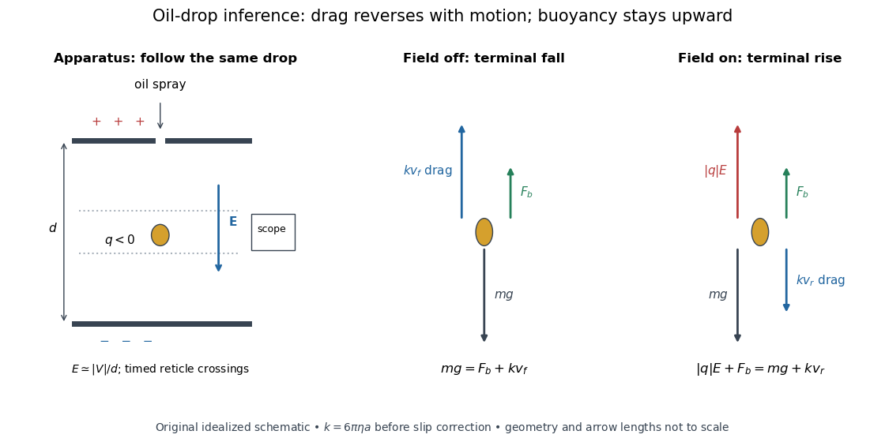

# Elementary charge

↑ **Parent:** [Electric charge](electric-charge-split.md)  
ⓦ [Wiki](https://en.wikipedia.org/wiki/Elementary_charge)

The [elementary charge](elementary-charge.md) is the positive magnitude $e$ of the [electron](electron.md)'s [electric charge](electric-charge-split.md), not the signed [electric charge](electric-charge-split.md) of the [electron](electron.md) itself:

$$
q_{\mathrm{electron}}=-e,\qquad q_{\mathrm{proton}}=+e,\qquad e=1.602176634\times10^{-19}\,\mathrm C\quad\text{exactly in SI}.
$$

Since the 2019 revision of the [SI](international-system-of-units.md), this numerical value defines the [ampere](ampere.md) together with the definition of the second; $1\,\mathrm C=1\,\mathrm{A\,s}$. Thus today's numerical exactness is a choice of units, whereas measured [electric charges](electric-charge-split.md) still have experimental uncertainty. An [oil drop experiment](oil-drop-experiment.md) can test [charge quantization](charge-quantization.md) and the apparatus calibration; it does not supply a new uncertain defining value of $e$ in today's [SI](international-system-of-units.md). [BIPM, The International System of Units, ninth edition, sections 2.2 and 2.3.1, the ampere](https://www.bipm.org/documents/20126/41483022/SI-Brochure-9-EN.pdf).

For ordinary isolated [chemical atoms](atom-physics.md), [ions](ion.md) and charged objects whose net [electric charge](electric-charge-split.md) is counted through [protons](proton.md) and [electrons](electron.md), [charge quantization](charge-quantization.md) gives $Q=ne$ with signed [integer](integer-split.md) $n$. A neutral [chemical atom](atom-physics.md) that loses two [electrons](electron.md) becomes an [ion](ion.md) of [electric charge](electric-charge-split.md) $+2e$. A toy object with $10^9$ excess [electrons](electron.md) has $Q=-0.1602176634\,\mathrm{nC}$. Conversely, the scale $1\,\mathrm{nC}/e\simeq6.24\times10^9$ explains why laboratory [electric charge](electric-charge-split.md) often looks continuous: billions of microscopic increments fit into a small macroscopic amount. Averaged [charge density](charge-density.md) is a continuum description, not a claim that each particle has an arbitrarily divisible [electric charge](electric-charge-split.md).

The ordinary-matter qualifier matters. In the [Standard Model](standard-model-split.md), [quarks](quark.md) have [electric charges](electric-charge-split.md) $+2e/3$ or $-e/3$, and [antiquarks](antiquark.md) have the opposite signs. [Confinement](confinement.md) means these are constituents of [hadrons](hadron.md), not isolated fractionally charged particles collected by an [oil drop experiment](oil-drop-experiment.md). The usual valence [quark](quark.md) sums give $2(2e/3)-e/3=e$ for a [proton](proton.md) and $2e/3-2(e/3)=0$ for a [neutron](neutron-split.md). Thus [elementary charge](elementary-charge.md) should not be defined as the smallest nonzero [electric charge](electric-charge-split.md) of every constituent in particle theory. [Amsler, DeGrand and Krusche, Particle Data Group, Quark Model, sections 15.1–15.2 and table 15.1](https://pdg.lbl.gov/2022/reviews/rpp2022-rev-quark-model.pdf).

The beautiful experimental idea behind the [oil drop experiment](oil-drop-experiment.md) is to determine a microscopic [electric charge](electric-charge-split.md) by watching a visible carrier move. In his 1913 paper, Millikan timed the descent and electrically driven ascent of individual oil drops, repeatedly changing a drop's [electric charge](electric-charge-split.md) through capture of air [ions](ion.md). His apparatus used parallel plates separated by $16\,\mathrm{mm}$, a roughly $5300\,\mathrm V$ source, and an optical scale to measure travel distances. He reported multiple relationships among a given drop's inferred [electric charges](electric-charge-split.md). He also found that uncorrected [Stokes's law](stokes-s-law.md) gave a size-dependent inferred elementary unit, and introduced a pressure-dependent slip correction. These were measured relationships with calibration and model uncertainties, not exact readings of today's defined $e$. [R. A. Millikan, On the Elementary Electrical Charge and the Avogadro Constant, Physical Review 2 (1913), 109–143, especially pp. 109–112 and 115–116](https://grundpraktikum.physik.uni-saarland.de/gpalt/Anleitungen/Ergaenzungen/Versuche/Millikan/Millikan%20-%20On%20the%20Elementary%20Electrical%20Charge%20and%20the%20Avogadro%20Constant.pdf).

**[Figure 2](#image-oil-drop-experiment-apparatus-and-terminal-force-balances). Oil drop experiment: apparatus and terminal force balances**. [Source](electric-charge-oil-drop-forces.py). Original schematic for a negative drop between a positive upper plate and negative lower plate. The [electric field](electric-field-split.md) points downward and the [electric force](electric-force.md) upward. [Drag](drag-physics.md) opposes each direction of motion; [buoyancy](buoyancy.md) remains upward. Geometry and arrow lengths are not to scale, and no historical measurements are recreated.

A modern instructional implementation sprays low-volatility oil of known [density](density.md) through a plate aperture, illuminates the drops, and follows one through a calibrated optical scale. Measure the plate spacing $d$, [electric potential difference](electric-potential-difference.md) $V$, air [temperature](temperature-split.md) and [pressure](pressure-split.md). Time a fixed distance $L$ with the [electric field](electric-field-split.md) off to get a terminal falling speed $v_f=L/t_f$. Then choose the field polarity to drive the same drop upward and measure $v_r=L/t_r$. Repeat timings at a fixed [electric charge](electric-charge-split.md), and compare before and after an ion-capture event. The same drop is especially useful because its [radius](radius.md) and [mass](mass.md) need not be inferred anew for each charge state. [PASCO, Millikan Oil Drop Apparatus AP-8210B manual, introduction, theory and experimental procedure](https://cdn.pasco.com/product_document/Millikan-Oil-Drop-Manual-AP-8210B.pdf).

Here is the leading continuum model, retaining [buoyancy](buoyancy.md). Assume a drop shaped as a [sphere](sphere.md) of [radius](radius.md) $a$, oil and air [densities](density.md) $\rho_o$ and $\rho_a$, air [dynamic viscosity](dynamic-viscosity-split.md) $\eta$, and [gravitational acceleration](gravitational-acceleration.md) $g$. Define the downward effective weight $W$ and positive [linear drag](linear-drag.md) coefficient $k$ by

$$
W=\frac{4\pi a^3}{3}(\rho_o-\rho_a)g,\qquad k=6\pi\eta a,\qquad E\simeq\frac{|V|}{d}.
$$

At [terminal velocity](terminal-velocity.md), the net [force](force-split.md) vanishes. Falling with no [electric field](electric-field-split.md), the upward [drag force](drag-physics.md) balances weight minus [buoyancy](buoyancy.md). Rising with the [electric force](electric-force.md) upward, the [drag force](drag-physics.md) reverses and joins the downward effective weight:

$$
kv_f=W,\qquad |q|E=W+kv_r=k(v_f+v_r).
$$

Consequently the uncorrected estimates are

$$
a=\sqrt{\frac{9\eta v_f}{2(\rho_o-\rho_a)g}},\qquad |q|=\frac{6\pi\eta a(v_f+v_r)d}{|V|}.
$$

The observed direction of response, with known field polarity, supplies the sign of $q$. A suspended drop gives the alternative balance $|q|E=W$, but it still requires a determination of $W$: balancing a drop alone does not determine its [electric charge](electric-charge-split.md).

For an explicitly invented continuum example, stipulate $a=1\,\mu\mathrm m$, $\rho_o=900\,\mathrm{kg\,m^{-3}}$, $\rho_a=1.2\,\mathrm{kg\,m^{-3}}$, $\eta=1.8\times10^{-5}\,\mathrm{Pa\,s}$, $g=9.81\,\mathrm{m\,s^{-2}}$, $q=-5e$ and a downward $E=10^5\,\mathrm{V\,m^{-1}}$. The balances predict $W\simeq3.69\times10^{-14}\,\mathrm N$, $v_f\simeq0.109\,\mathrm{mm\,s^{-1}}$ and $v_r\simeq0.127\,\mathrm{mm\,s^{-1}}$. Substituting those speeds recovers $|q|=5e$ within rounding. This checks the algebra; it is not a precision prediction for real micrometre drops, which need a slip correction.

The inference has two distinct parts. Compare inferred [electric charges](electric-charge-split.md) or charge changes with a common unit, seeking $q_i\simeq n_i e$ within uncertainty, rather than demanding exact ratios of rounded measurements. Then establish the absolute scale through [electric field](electric-field-split.md), [density](density.md), [dynamic viscosity](dynamic-viscosity-split.md) and distance/time calibration. If the observed steps are all even multiples, their common spacing alone cannot exclude an unobserved smaller unit. Air motion, evaporation and mistimed crossings can alter inferred [electric charge](electric-charge-split.md) without an ion-capture event. Small [Reynolds number](reynolds-number.md) supports [Stokes's law](stokes-s-law.md), but does not by itself justify its no-slip continuum coefficient: a significant ratio of air [mean free path](mean-free-path.md) to drop [radius](radius.md) requires a slip correction. Millikan's comparison of different drop sizes and pressures addressed that systematic limitation; the modern PASCO manual also includes the correction. Agreement supports [charge quantization](charge-quantization.md) for the observed carriers within experimental resolution, rather than proving a universal statement about every possible particle.

Multiplying $e$ by the [Avogadro constant](avogadro-constant.md) gives the [Faraday constant](faraday-constant.md), $F=N_Ae$, the [electric charge](electric-charge-split.md) per [mole](mole-unit.md) of singly charged carriers. This connects counting individual [electric charges](electric-charge-split.md) with bulk [electrochemistry](electrochemistry-split.md). [NIST, CODATA 2022 defining constants and Faraday constant](https://physics.nist.gov/cuu/pdf/wall_2022.pdf).

**Table of contents**

- [Oil drop experiment](oil-drop-experiment.md)
  - [Oil drop charge readout and calibration](oil-drop-charge-readout-and-calibration.md)
  - [Charge lattice inference from oil drops](charge-lattice-inference-from-oil-drops.md)

## ↑ Ancestors (5)

1. [Electric charge](electric-charge-split.md)
2. [Electromagnetism](electromagnetism-split.md)
3. [Branches of physics](branches-of-physics.md)
4. [Physics](physics-split.md)
5. [Codex Wiki](split.md)

## ← Incoming links (88)

- [Aharonov-Bohm effect](aharonov-bohm-effect.md)
- [Ampere](ampere.md)
- [Atomic nucleus](atomic-nucleus-split.md)
- [Atomic number](atomic-number.md)
- [Atomic units](atomic-units.md)
- [Blue light-emitting diode](blue-light-emitting-diode.md)
- [Bond polarization](bond-polarization.md)
- [Bubble-chamber stereo reconstruction](bubble-chamber-stereo-reconstruction.md)
- [Cathode-ray attenuation with finite detector acceptance](cathode-ray-attenuation-with-finite-detector-acceptance.md)
- [CCD clocked charge transfer](ccd-clocked-charge-transfer.md)
- [Charge lattice inference from oil drops](charge-lattice-inference-from-oil-drops.md)
- [Charge-to-mass ratio](charge-to-mass-ratio.md)
- [Circular-orbit derivation of the Bohr model](circular-orbit-derivation-of-the-bohr-model.md)
- [Classical electron radius](classical-electron-radius.md)
- [CODATA recommended values of the fundamental physical constants 2014 by National Institute of Standards and Technology](codata-recommended-values-of-the-fundamental-physical-constants-2014-by-national-institute-of-standards-and-technology.md)
- [Cold-plasma radio dispersion](cold-plasma-radio-dispersion.md)
- [Current density](current-density.md)
- [Depletion region](depletion-region.md)
- [Drude model](drude-model.md)
- [Einstein photoelectric equation](einstein-photoelectric-equation.md)
- [Electric charge](electric-charge-split.md)
- [Electrochemical potential](electrochemical-potential.md)
- [Electrolyte](electrolyte.md)
- [Electron accelerating-voltage wavelength](electron-accelerating-voltage-wavelength.md)
- [Electron microscope resolution](electron-microscope-resolution.md)
- [Electron optics](electron-optics.md)
- [Elementary charge](elementary-charge.md)
- [Faraday constant](faraday-constant.md)
- [Filling factor (quantum Hall effect)](filling-factor-quantum-hall-effect.md)
- [Flux-lattice spacing](flux-lattice-spacing.md)
- [Formal charge](formal-charge.md)
- [Franck-Hertz experiment](franck-hertz-experiment.md)
- [Franck-Hertz retarding collector transfer](franck-hertz-retarding-collector-transfer.md)
- [Frank-Tamm formula](frank-tamm-formula.md)
- [Gate control of graphene carrier density](gate-control-of-graphene-carrier-density.md)
- [Glycine protonation](glycine-protonation.md)
- [Glycine speciation model](glycine-speciation-model.md)
- [Intrinsic nuclear quadrupole moment](intrinsic-nuclear-quadrupole-moment.md)
- [Iodide](iodide.md)
- [Ion](ion.md)
- [Ionization-chamber charge-loss model](ionization-chamber-charge-loss-model.md)
- [Lamb shift quenching readout](lamb-shift-quenching-readout.md)
- [Linear Stark effect in the first excited hydrogen eigenspace](linear-stark-effect-in-the-first-excited-hydrogen-eigenspace.md)
- [Magnetic length](magnetic-length.md)
- [Magnetomechanical angular momentum balance](magnetomechanical-angular-momentum-balance.md)
- [Membrane charge separation](membrane-charge-separation.md)
- [Nitrate](nitrate.md)
- [Nobel Prize in Physics in 1923](nobel-prize-in-physics-in-1923.md)
- [Nuclear charge distribution](nuclear-charge-distribution.md)
- [Oil drop charge readout and calibration](oil-drop-charge-readout-and-calibration.md)
- [Oil drop experiment](oil-drop-experiment.md)
- [Oxidation state sum rule](oxidation-state-sum-rule.md)
- [Solution](past-exam-of-the-advanced-quantum-physics-course-of-the-university-of-cambridge/2022/section-b/4/a/solution.md)
- [Solution](past-exam-of-the-particle-and-nuclear-physics-course-of-the-university-of-cambridge/2019/section-b/5/solution.md)
- [Solution](past-exam-of-the-physics-a-course-of-the-university-of-cambridge/2011/paper-2/section-b/b8/solution.md)
- [Solution](past-exam-of-the-physics-a-course-of-the-university-of-cambridge/2018/paper-2/section-c/c11/b/solution.md)
- [Solution](past-exam-of-the-physics-a-course-of-the-university-of-cambridge/2021/paper-2/section-d/d9/a/solution.md)
- [Solution](past-exam-of-the-physics-course-of-the-year-1-of-the-natural-sciences-course-of-the-university-of-cambridge/2022/section-a/5/solution.md)
- [Solution](past-exam-of-the-physics-of-nanoelectronic-systems-course-of-the-university-of-cambridge/2016/paper-1/1/solution.md)
- [Solution](past-exam-of-the-soft-condensed-matter-course-of-the-university-of-cambridge/2017/1/b/solution.md)
- [Solution](past-exam-of-the-soft-condensed-matter-course-of-the-university-of-cambridge/2022/section-b/6/c/solution.md)
- [Permanganate](permanganate.md)
- [Photocurrent](photocurrent.md)
- [Photodiode](photodiode.md)
- [Photoelectron binding energy reference](photoelectron-binding-energy-reference.md)
- [Polyatomic ion](polyatomic-ion.md)
- [Proton exclusion by magnetic rigidity and range](proton-exclusion-by-magnetic-rigidity-and-range.md)
- [Pulsar dispersion delay](pulsar-dispersion-delay.md)
- [Quantum Hall effect](quantum-hall-effect.md)
- [Quark-model constituent bookkeeping](quark-model-constituent-bookkeeping.md)
- [Radical (chemistry)](radical-chemistry.md)
- [Redox electron balance](redox-electron-balance.md)
- [Rutherford scattering](rutherford-scattering.md)
- [Semiconductor](semiconductor-split.md)
- [Shockley diode equation](shockley-diode-equation.md)
- [Shot noise](shot-noise.md)
- [Shot noise counting model](shot-noise-counting-model.md)
- [Spin separation at a smooth quantum Hall edge](spin-separation-at-a-smooth-quantum-hall-edge.md)
- [Stoichiometry of ionic compounds](stoichiometry-of-ionic-compounds.md)
- [Thermal voltage](thermal-voltage.md)
- [Thermionic Richardson constant](thermionic-richardson-constant.md)
- [Transmission electron microscopy specimen dose and calibration](transmission-electron-microscopy-specimen-dose-and-calibration.md)
- [Tunnel diode](tunnel-diode.md)
- [Ultraviolet](ultraviolet.md)
- [Vacuum permittivity](vacuum-permittivity.md)
- [von Klitzing constant](von-klitzing-constant.md)
- [Wannier-Mott exciton](wannier-mott-exciton.md)
- [X-ray tube](x-ray-tube.md)
