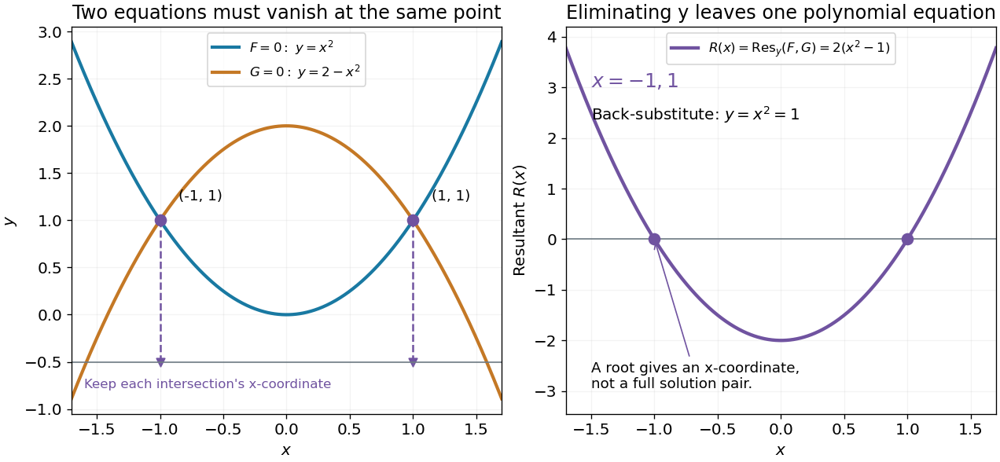

# Eliminating a variable with a resultant

↑ **Parent:** [Resultant](resultant.md)

Consider the original pair of [polynomial equations](polynomial-equation.md)

$$
F(x,y)=y-x^2=0,\qquad G(x,y)=y+x^2-2=0.
$$

Treat them as [polynomials](polynomial-split.md) in $y$ with [coefficients](coefficient.md) in $\mathbb R[x]$. Their [Sylvester matrix](sylvester-matrix.md) and [resultant](resultant.md) are

$$
S_y(F,G)=\begin{pmatrix}1&-x^2\\1&x^2-2\end{pmatrix},\qquad
R(x)=\operatorname{Res}_y(F,G)=2(x^2-1).
$$

Every common solution must therefore have $x=-1$ or $x=1$. Back-substitution into $F=0$ gives $y=x^2=1$, and both pairs also satisfy $G=0$. The complete real solution set is

$$
\boxed{\{(-1,1),(1,1)\}.}
$$

Here elimination and direct substitution agree: subtracting $F$ from $G$ gives $2x^2-2$, exactly the same condition.

**[Figure 8](#image-polynomial-elimination-keeps-the-possible-first-coordinates-of-intersections). Polynomial elimination keeps the possible first coordinates of intersections**. Original [parabola](parabola.md) example. Left: both equations vanish at the two marked intersections; dashed lines retain their $x$-coordinates on an auxiliary horizontal reference line at $y=-1/2$. Right: the [resultant](resultant.md) has zeros at those coordinates. Substitution recovers $y=1$ and verifies each full solution pair.

In general, first solve the one-[variable](variable-mathematics.md) [resultant](resultant.md) equation, then recover and check the other coordinate in both original [polynomial equations](polynomial-equation.md). A real coordinate candidate can correspond only to nonreal values of the eliminated [variable](variable-mathematics.md). Also, vanishing [leading coefficients](leading-coefficient-of-a-polynomial.md) require the separate check in [degree drop in a specialized resultant](degree-drop-in-a-specialized-resultant.md). The general elimination-and-back-substitution method is described in the lecture's §3.1.[Algebraic Techniques and Semidefinite Optimization, MIT 6.972, Spring 2006; MIT 6.972, Lecture 6, p. 6-3, §3.1 Polynomial equations: eliminate one variable, solve and back-substitute](algebraic-techniques-and-semidefinite-optimization-mit-6-972-spring-2006/lecture-6-resultants-and-discriminants.md)

**Table of contents**

- [Degree drop in a specialized resultant](degree-drop-in-a-specialized-resultant.md)

## ↑ Ancestors (6)

1. [Resultant](resultant.md)
2. [Polynomial](polynomial-split.md)
3. [Algebra](algebra-split.md)
4. [Area of mathematics](area-of-mathematics.md)
5. [Mathematics](mathematics-split.md)
6. [Codex Wiki](split.md)

## ← Incoming links (1)

- [Resultant](resultant.md)
