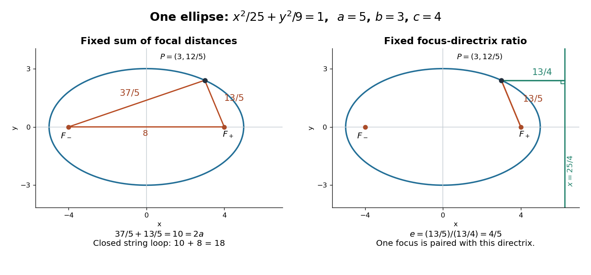

# Ellipse

↑ **Parent:** [Conic section](conic-section.md)  
ⓦ [Wiki](https://en.wikipedia.org/wiki/Ellipse)

An ellipse is the [locus](locus-mathematics.md) of [points](point-geometry.md) whose [Euclidean distances](euclidean-distance.md) from two fixed [foci of a conic](focus-of-a-conic.md) have constant sum $2a$. If the distance between the [foci of a conic](focus-of-a-conic.md) is $d<2a$, the [semi-major and semi-minor axes](semi-major-and-semi-minor-axes.md) are $a$ and $\sqrt{4a^2-d^2}/2$. Writing $c=d/2$ gives the conventional relation $b^2=a^2-c^2$.[Precalculus 2e, §10.1, ellipse definition and Deriving the Equation of an Ellipse Centered at the Origin, Figure 5](precalculus-2e-by-jay-abramson/10-1-the-ellipse.md)

For an original calculation, choose $a=5$, $b=3$, and hence $c=4$. The [ellipse](ellipse.md)

$$
\boxed{\frac{x^2}{25}+\frac{y^2}{9}=1}
$$

has [foci of a conic](focus-of-a-conic.md) $F_-=(-4,0)$ and $F_+=(4,0)$. The point $P=(3,12/5)$ lies on it since $9/25+16/25=1$. Its focal distances are

$$
|P-F_-|=\frac{37}5,\qquad |P-F_+|=\frac{13}5,\qquad |P-F_-|+|P-F_+|=10.
$$

Its [eccentricity of a conic](eccentricity-of-a-conic.md) is $e=4/5$. The matching [directrix of a conic](directrix-of-a-conic.md) for $F_+$ is $x=a/e=25/4$, and the perpendicular distance from $P$ to that [straight line](straight-line.md) is $13/4$. Therefore the ratio of focal distance to directrix distance is $(13/5)/(13/4)=4/5$, agreeing with $e$.

**[Figure 7](#image-one-ellipse-has-a-constant-focal-distance-sum-and-a-constant-focus-directrix-ratio). One ellipse has a constant focal-distance sum and a constant focus-directrix ratio**. Original example with semiaxes $5,3$, foci at $(\pm4,0)$, and $P=(3,12/5)$. The left triangle represents a taut closed-loop construction; the right panel uses one matched focus and directrix. All lengths are in the same arbitrary unit.

The constant sum can be turned into a construction. Fix a pin at each [focus of a conic](focus-of-a-conic.md) and pull a closed string loop taut with a pencil. In this example the segment between the pins has length $8$, so a loop of length $18$ leaves $10$ for the two pencil-to-pin segments. Moving the pencil while keeping that loop taut traces the [ellipse](ellipse.md). This is a geometric prediction from the length constraint, not an assertion about a measured drawing.

The parametrization $x=5\cos t$, $y=3\sin t$ maps the [unit circle](complex-unit-circle.md) onto this [ellipse](ellipse.md). It makes plotting easy, but is an [affine map](affine-map.md) rather than an [isometry](isometry.md): horizontal and vertical lengths have different scale factors. An [ellipse](ellipse.md) is not a [circle](circle.md) under the original [Euclidean metric](euclidean-metric.md) merely because this map exists. Its two semiaxes and [eccentricity of a conic](eccentricity-of-a-conic.md) retain the metric information lost by that equivalence.

A useful proof outline begins with $|X-F_-|+|X-F_+|=2a$. Isolate one [square root](square-root.md), square, and then repeat; the resulting [quadratic equation](quadratic-equation.md) is $x^2/a^2+y^2/(a^2-c^2)=1$. Since $a>c$, the quantities isolated before squaring have the required signs, so the reverse implication introduces no extra branch. The condition $a>c$ is essential: at equality the focal-distance locus becomes the [line segment](line-segment.md) between the [foci of a conic](focus-of-a-conic.md).

**Table of contents**

- [Steiner inellipse](steiner-inellipse.md)
- [Affine image of a circle](affine-image-of-a-circle.md)
- [Semi-major and semi-minor axes](semi-major-and-semi-minor-axes.md)
- [Ellipse perimeter expansion near a circle](ellipse-perimeter-expansion-near-a-circle.md)
- [Nondegenerate ellipse](nondegenerate-ellipse.md)
  - [Parity and upper bound for transverse ellipse intersections](parity-and-upper-bound-for-transverse-ellipse-intersections.md)
- [Focal line](focal-line.md)

## ↑ Ancestors (6)

1. [Conic section](conic-section.md)
2. [Euclidean geometry](euclidean-geometry-split.md)
3. [Geometry and topology](geometry-and-topology-split.md)
4. [Area of mathematics](area-of-mathematics.md)
5. [Mathematics](mathematics-split.md)
6. [Codex Wiki](split.md)

## ← Incoming links (142)

- [Affine image of a circle](affine-image-of-a-circle.md)
- [Cholesky decomposition as a sum of squares](cholesky-decomposition-as-a-sum-of-squares.md)
- [Classical mechanics](classical-mechanics-split.md)
- [Cold-atom measurement of the gravitational constant](cold-atom-measurement-of-the-gravitational-constant.md)
- [Complete elliptic integral of the second kind](complete-elliptic-integral-of-the-second-kind.md)
- [Conic section](conic-section.md)
- [Conic type discriminant](conic-type-discriminant.md)
- [Controls and limitations of a Foucault pendulum](controls-and-limitations-of-a-foucault-pendulum.md)
- [Covariance ellipse](covariance-ellipse.md)
- [Diagonal scaling for a two-dimensional linear system](diagonal-scaling-for-a-two-dimensional-linear-system.md)
- [Eccentricity of a conic](eccentricity-of-a-conic.md)
- [Ellipse](ellipse.md)
- [Ellipse perimeter expansion near a circle](ellipse-perimeter-expansion-near-a-circle.md)
- [Ellipsoid level sets of a positive-definite quadratic form](ellipsoid-level-sets-of-a-positive-definite-quadratic-form.md)
- [Elliptic bob path at zero horizontal momentum](elliptic-bob-path-at-zero-horizontal-momentum.md)
- [Elliptic characteristics of a planar transport equation](elliptic-characteristics-of-a-planar-transport-equation.md)
- [Elliptic cone](elliptic-cone.md)
- [Elliptic cylinder](elliptic-cylinder.md)
- [Elliptic integral of the second kind](elliptic-integral-of-the-second-kind.md)
- [Elliptical polarization](elliptical-polarization.md)
- [Equal-time sectors of a Kepler ellipse](equal-time-sectors-of-a-kepler-ellipse.md)
- [Exact linear Foucault pendulum trajectory](exact-linear-foucault-pendulum-trajectory.md)
- [Finite-dimensional spectral theorem](finite-dimensional-spectral-theorem.md)
- [Fixed-step gradient descent on a positive-definite quadratic](fixed-step-gradient-descent-on-a-positive-definite-quadratic.md)
- [Focal line](focal-line.md)
- [Geometry and topology](geometry-and-topology-split.md)
- [Hermitian form](hermitian-form.md)
- [Hyperbola](hyperbola.md)
- [Inferring an inverse-square force from Kepler laws](inferring-an-inverse-square-force-from-kepler-laws.md)
- [Jones vector](jones-vector.md)
- [Kepler's first law](kepler-s-first-law.md)
- [Kepler's laws of planetary motion](kepler-s-laws-of-planetary-motion.md)
- [Kepler's second law](kepler-s-second-law.md)
- [Kepler's third law](kepler-s-third-law.md)
- [Knot](knot.md)
- [Laboratory paths of an equal-mass binary](laboratory-paths-of-an-equal-mass-binary.md)
- [Latitude law of Foucault precession](latitude-law-of-foucault-precession.md)
- [Left singular vector](left-singular-vector.md)
- [Locus (mathematics)](locus-mathematics.md)
- [Matrix preconditioning](matrix-preconditioning.md)
- [Orbital observations behind the area law](orbital-observations-behind-the-area-law.md)
- [Orthogonal projection of a circle between planes](orthogonal-projection-of-a-circle-between-planes.md)
- [Orthogonal trajectory](orthogonal-trajectory.md)
- [Parabola](parabola.md)
- [Parity and upper bound for transverse ellipse intersections](parity-and-upper-bound-for-transverse-ellipse-intersections.md)
- [Particle ellipses for rotating shallow-water waves](particle-ellipses-for-rotating-shallow-water-waves.md)
- [Solution](past-exam-of-the-mathematics-course-of-the-university-of-cambridge/2001/ia/paper-4/9a/solution.md)
- [Solution](past-exam-of-the-mathematics-course-of-the-university-of-cambridge/2003/iii/paper-26/6/solution.md)
- [Solution](past-exam-of-the-mathematics-course-of-the-university-of-cambridge/2004/ia/paper-4/10a/solution.md)
- [Solution](past-exam-of-the-mathematics-course-of-the-university-of-cambridge/2005/ia/paper-4/3c/solution.md)
- [Solution](past-exam-of-the-mathematics-course-of-the-university-of-cambridge/2006/iii/paper-85/1/a/solution.md)
- [Solution](past-exam-of-the-mathematics-course-of-the-university-of-cambridge/2007/ia/paper-3/9a/ii/solution.md)
- [Solution](past-exam-of-the-mathematics-course-of-the-university-of-cambridge/2011/ia/paper-2/8a/b/solution.md)
- [Solution](past-exam-of-the-mathematics-course-of-the-university-of-cambridge/2013/ia/paper-4/9b/b/solution.md)
- [Solution](past-exam-of-the-mathematics-course-of-the-university-of-cambridge/2013/ib/paper-2/18d/solution.md)
- [Solution](past-exam-of-the-mathematics-course-of-the-university-of-cambridge/2015/iii/paper-65/2/solution.md)
- [Solution](past-exam-of-the-mathematics-course-of-the-university-of-cambridge/2016/iii/paper-321/2/d/ii/solution.md)
- [Solution](past-exam-of-the-mathematics-course-of-the-university-of-cambridge/2018/ii/paper-2/25i/c/solution.md)
- [Solution](past-exam-of-the-mathematics-course-of-the-university-of-cambridge/2018/iii/paper-316/2/vi/solution.md)
- [Solution](past-exam-of-the-mathematics-course-of-the-university-of-cambridge/2018/iii/paper-316/3/v/solution.md)
- [Solution](past-exam-of-the-mathematics-course-of-the-university-of-cambridge/2018/iii/paper-316/3/vi/solution.md)
- [Solution](past-exam-of-the-mathematics-course-of-the-university-of-cambridge/2018/iii/paper-316/4/i/solution.md)
- [Solution](past-exam-of-the-mathematics-course-of-the-university-of-cambridge/2018/iii/paper-316/4/ii/solution.md)
- [Solution](past-exam-of-the-mathematics-course-of-the-university-of-cambridge/2018/iii/paper-338/1/b/v/solution.md)
- [Solution](past-exam-of-the-mathematics-course-of-the-university-of-cambridge/2018/iii/paper-345/1/a/solution.md)
- [Solution](past-exam-of-the-mathematics-course-of-the-university-of-cambridge/2021/ia/paper-4/10c/c/ii/solution.md)
- [Solution](past-exam-of-the-mathematics-course-of-the-university-of-cambridge/2022/ia/paper-1/1b/a/iii/solution.md)
- [Solution](past-exam-of-the-mathematics-course-of-the-university-of-cambridge/2024/iii/paper-309/1/b/iv/solution.md)
- [Solution](past-exam-of-the-mathematics-course-of-the-year-1-of-the-natural-sciences-course-of-the-university-of-cambridge/2002/paper-2/12/a/solution.md)
- [Solution](past-exam-of-the-mathematics-course-of-the-year-1-of-the-natural-sciences-course-of-the-university-of-cambridge/2003/paper-2/12/solution.md)
- [Solution](past-exam-of-the-mathematics-course-of-the-year-1-of-the-natural-sciences-course-of-the-university-of-cambridge/2004/paper-1/10/b/i/solution.md)
- [Solution](past-exam-of-the-mathematics-course-of-the-year-1-of-the-natural-sciences-course-of-the-university-of-cambridge/2004/paper-1/10/c/i/solution.md)
- [Solution](past-exam-of-the-mathematics-course-of-the-year-1-of-the-natural-sciences-course-of-the-university-of-cambridge/2007/paper-2/section-b/9/solution.md)
- [Solution](past-exam-of-the-mathematics-course-of-the-year-1-of-the-natural-sciences-course-of-the-university-of-cambridge/2008/paper-1/11/solution.md)
- [Solution](past-exam-of-the-mathematics-course-of-the-year-1-of-the-natural-sciences-course-of-the-university-of-cambridge/2008/paper-1/17/a/iv/solution.md)
- [Solution](past-exam-of-the-mathematics-course-of-the-year-1-of-the-natural-sciences-course-of-the-university-of-cambridge/2009/paper-1/10/a/solution.md)
- [Solution](past-exam-of-the-mathematics-course-of-the-year-1-of-the-natural-sciences-course-of-the-university-of-cambridge/2009/paper-2/18/b/solution.md)
- [Solution](past-exam-of-the-mathematics-course-of-the-year-1-of-the-natural-sciences-course-of-the-university-of-cambridge/2010/paper-2/11/b/solution.md)
- [Solution](past-exam-of-the-mathematics-course-of-the-year-1-of-the-natural-sciences-course-of-the-university-of-cambridge/2011/paper-1/13/b/i/solution.md)
- [Solution](past-exam-of-the-mathematics-course-of-the-year-1-of-the-natural-sciences-course-of-the-university-of-cambridge/2011/paper-1/13/b/ii/solution.md)
- [Solution](past-exam-of-the-mathematics-course-of-the-year-1-of-the-natural-sciences-course-of-the-university-of-cambridge/2011/paper-2/16/b/solution.md)
- [Solution](past-exam-of-the-mathematics-course-of-the-year-1-of-the-natural-sciences-course-of-the-university-of-cambridge/2013/paper-1/1/a/solution.md)
- [Solution](past-exam-of-the-mathematics-course-of-the-year-1-of-the-natural-sciences-course-of-the-university-of-cambridge/2014/paper-1/20/a/solution.md)
- [Solution](past-exam-of-the-mathematics-course-of-the-year-1-of-the-natural-sciences-course-of-the-university-of-cambridge/2014/paper-1/5/b/solution.md)
- [Solution](past-exam-of-the-mathematics-course-of-the-year-1-of-the-natural-sciences-course-of-the-university-of-cambridge/2016/paper-1/20/b/i/solution.md)
- [Solution](past-exam-of-the-mathematics-course-of-the-year-1-of-the-natural-sciences-course-of-the-university-of-cambridge/2016/paper-1/20/b/ii/solution.md)
- [Solution](past-exam-of-the-mathematics-course-of-the-year-1-of-the-natural-sciences-course-of-the-university-of-cambridge/2016/paper-1/20/c/solution.md)
- [Solution](past-exam-of-the-mathematics-course-of-the-year-1-of-the-natural-sciences-course-of-the-university-of-cambridge/2016/paper-2/17/b/iv/solution.md)
- [Solution](past-exam-of-the-mathematics-course-of-the-year-1-of-the-natural-sciences-course-of-the-university-of-cambridge/2016/paper-2/17/b/vi/solution.md)
- [Solution](past-exam-of-the-mathematics-course-of-the-year-1-of-the-natural-sciences-course-of-the-university-of-cambridge/2017/paper-1/12/b/i/solution.md)
- [Solution](past-exam-of-the-mathematics-course-of-the-year-1-of-the-natural-sciences-course-of-the-university-of-cambridge/2017/paper-1/20/b/solution.md)
- [Solution](past-exam-of-the-mathematics-course-of-the-year-1-of-the-natural-sciences-course-of-the-university-of-cambridge/2019/paper-1/11/c/solution.md)
- [Solution](past-exam-of-the-mathematics-course-of-the-year-1-of-the-natural-sciences-course-of-the-university-of-cambridge/2019/paper-1/2/solution.md)
- [Solution](past-exam-of-the-mathematics-course-of-the-year-1-of-the-natural-sciences-course-of-the-university-of-cambridge/2020/paper-1/11/b/i/solution.md)
- [Solution](past-exam-of-the-mathematics-course-of-the-year-1-of-the-natural-sciences-course-of-the-university-of-cambridge/2021/paper-1/10/solution.md)
- [Solution](past-exam-of-the-mathematics-course-of-the-year-1-of-the-natural-sciences-course-of-the-university-of-cambridge/2021/paper-2/12/a/solution.md)
- [Solution](past-exam-of-the-mathematics-course-of-the-year-1-of-the-natural-sciences-course-of-the-university-of-cambridge/2021/paper-2/12/d/solution.md)
- [Solution](past-exam-of-the-mathematics-course-of-the-year-1-of-the-natural-sciences-course-of-the-university-of-cambridge/2022/paper-1/11/c/i/solution.md)
- [Solution](past-exam-of-the-mathematics-course-of-the-year-1-of-the-natural-sciences-course-of-the-university-of-cambridge/2022/paper-1/11/c/ii/solution.md)
- [Solution](past-exam-of-the-mathematics-course-of-the-year-1-of-the-natural-sciences-course-of-the-university-of-cambridge/2022/paper-1/11/c/iii/solution.md)
- [Solution](past-exam-of-the-mathematics-course-of-the-year-1-of-the-natural-sciences-course-of-the-university-of-cambridge/2024/paper-2/19/b/i/solution.md)
- [Solution](past-exam-of-the-mathematics-course-of-the-year-1-of-the-natural-sciences-course-of-the-university-of-cambridge/2024/paper-2/19/b/ii/solution.md)
- [Solution](past-exam-of-the-mathematics-course-of-the-year-2-of-the-natural-sciences-course-of-the-university-of-cambridge/2013/paper-1/7/iii/solution.md)
- [Solution](past-exam-of-the-mathematics-course-of-the-year-2-of-the-natural-sciences-course-of-the-university-of-cambridge/2013/paper-1/7/iv/solution.md)
- [Solution](past-exam-of-the-mathematics-course-of-the-year-2-of-the-natural-sciences-course-of-the-university-of-cambridge/2023/paper-1/1/b/solution.md)
- [Solution](past-exam-of-the-mathematics-course-of-the-year-2-of-the-natural-sciences-course-of-the-university-of-cambridge/2024/paper-1/6/c/solution.md)
- [Solution](past-exam-of-the-optics-and-electrodynamics-course-of-the-university-of-cambridge/2021/section-b/b4/b/solution.md)
- [Solution](past-exam-of-the-optics-and-electrodynamics-course-of-the-university-of-cambridge/2021/section-b/b4/e/solution.md)
- [Solution](past-exam-of-the-physics-a-course-of-the-university-of-cambridge/2022/paper-2/section-a/2/solution.md)
- [Solution](past-exam-of-the-physics-b-course-of-the-university-of-cambridge/2011/paper-1/section-b/b8/b/solution.md)
- [Solution](past-exam-of-the-physics-b-course-of-the-university-of-cambridge/2012/paper-1/section-c/c11/i/solution.md)
- [Solution](past-exam-of-the-physics-b-course-of-the-university-of-cambridge/2012/paper-1/section-c/c11/ii/solution.md)
- [Solution](past-exam-of-the-physics-b-course-of-the-university-of-cambridge/2014/paper-2/section-a/a2/solution.md)
- [Solution](past-exam-of-the-physics-b-course-of-the-university-of-cambridge/2015/paper-1/section-c/c10/solution.md)
- [Solution](past-exam-of-the-physics-b-course-of-the-university-of-cambridge/2021/paper-1/section-b/b6/a/solution.md)
- [Solution](past-exam-of-the-physics-b-course-of-the-university-of-cambridge/2021/paper-1/section-b/b6/c/solution.md)
- [Solution](past-exam-of-the-physics-b-course-of-the-university-of-cambridge/2021/paper-1/section-b/b6/d/solution.md)
- [Solution](past-exam-of-the-physics-b-course-of-the-university-of-cambridge/2021/paper-1/section-b/b6/e/solution.md)
- [Solution](past-exam-of-the-physics-b-course-of-the-university-of-cambridge/2022/paper-1/section-a/a1/solution.md)
- [Solution](past-exam-of-the-physics-course-of-the-year-1-of-the-natural-sciences-course-of-the-university-of-cambridge/2012/paper-1/section-e/e15/b/solution.md)
- [Solution](past-exam-of-the-physics-course-of-the-year-1-of-the-natural-sciences-course-of-the-university-of-cambridge/2014/paper-1/e15/d/solution.md)
- [Solution](past-exam-of-the-physics-course-of-the-year-1-of-the-natural-sciences-course-of-the-university-of-cambridge/2015/paper-1/section-e/e15/c/solution.md)
- [Solution](past-exam-of-the-physics-course-of-the-year-1-of-the-natural-sciences-course-of-the-university-of-cambridge/2016/paper-1/section-e/e15/a/solution.md)
- [Solution](past-exam-of-the-physics-course-of-the-year-1-of-the-natural-sciences-course-of-the-university-of-cambridge/2018/section-e/15/d/solution.md)
- [Solution](past-exam-of-the-physics-course-of-the-year-1-of-the-natural-sciences-course-of-the-university-of-cambridge/2021/section-b/8/b/solution.md)
- [Phase retardation](phase-retardation.md)
- [Polarization (waves)](polarization-waves.md)
- [Positive definiteness](positive-definiteness.md)
- [Positive-definiteness threshold in a two-by-two family](positive-definiteness-threshold-in-a-two-by-two-family.md)
- [Prolate spheroid](prolate-spheroid.md)
- [Real spectral theorem](real-spectral-theorem.md)
- [Right singular vector](right-singular-vector.md)
- [Semi-major and semi-minor axes](semi-major-and-semi-minor-axes.md)
- [Semilatus rectum](semilatus-rectum.md)
- [Signed swept area](signed-swept-area.md)
- [Simple harmonic motion](simple-harmonic-motion.md)
- [Singular value decomposition](singular-value-decomposition.md)
- [Spheroid](spheroid.md)
- [Steiner inellipse](steiner-inellipse.md)
- [UNSW Foucault pendulum observation](unsw-foucault-pendulum-observation.md)
- [Virial theorem on a Kepler ellipse](virial-theorem-on-a-kepler-ellipse.md)
- [Weighted Euclidean inner product](weighted-euclidean-inner-product.md)
