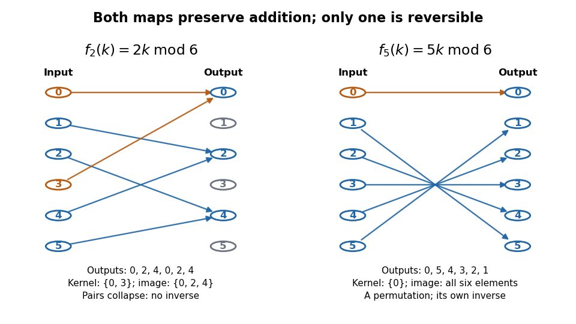

# Endomorphism

↑ **Parent:** [Morphism](morphism.md)  
ⓦ [Wiki](https://en.wikipedia.org/wiki/Endomorphism)

An [endomorphism](endomorphism.md) is a [morphism](morphism.md) $f:X\to X$: its source and target are the same object, with the same specified structure. For a [group](group-split.md) it is an operation-preserving [group homomorphism](group-homomorphism.md) back into that [group](group-split.md); for a [vector space](vector-space-split.md) it is a [linear endomorphism](linear-endomorphism.md); for a [ring](ring.md) it is a [ring endomorphism](ring-endomorphism.md). A self-map must satisfy the chosen compatibility conditions to qualify. The notation $\operatorname{End}_{\mathcal C}(X)$ records the [category](category-split.md) $\mathcal C$ in which these conditions are imposed. See [Riehl, Category Theory in Context, Definition 1.1.10 and the following paragraph](https://emilyriehl.github.io/files/context.pdf).

An [endomorphism](endomorphism.md) can lose information or miss part of its target. On the additive [integers](integer-split.md), $d(k)=2k$ preserves [addition](addition.md) and is [injective](injective-function.md), but is not [surjective](surjective-function.md): no [integer](integer-split.md) maps to $1$. On the [vector space](vector-space-split.md) $\mathbb R^2$ over the [real numbers](real-number.md), the [linear endomorphism](linear-endomorphism.md) $P(x,y)=(x,0)$ loses the second coordinate, so it is neither [injective](injective-function.md) nor [surjective](surjective-function.md). Neither is an [automorphism](automorphism.md). The same doubling rule becomes a [group isomorphism](group-isomorphism.md) when its target is the additive [even integers](even-number.md), as explained under [isomorphism](isomorphism.md).

The [finite cyclic group](finite-cyclic-group.md) $C_6=\mathbb Z/6\mathbb Z$ offers a small example of information loss that can be drawn completely. With [addition](addition.md) in [modular arithmetic](modular-arithmetic-split.md), the [endomorphism](endomorphism.md) $f_2(k)=2k\pmod6$ sends the inputs $0,1,2,3,4,5$ to $0,2,4,0,2,4$. Its [image of a group homomorphism](image-of-a-group-homomorphism.md) is $\{0,2,4\}$ and its [kernel of a group homomorphism](kernel-of-a-group-homomorphism.md) is $\{0,3\}$. Each reached output has two inputs; the other three outputs are missed.

**[Figure 4](#image-two-endomorphisms-of-the-additive-cyclic-group-modulo-six). Two endomorphisms of the additive cyclic group modulo six**. [Source](cyclic-group-endomorphism-maps.py). Every arrow maps an input to its output, rather than taking one step of repeated [addition](addition.md). The [endomorphism](endomorphism.md) $f_2(k)=2k\pmod6$ collapses pairs; the [group automorphism](group-automorphism.md) $f_5(k)=5k\pmod6$ is a [bijection](bijection.md). Orange marks the [kernel of a group homomorphism](kernel-of-a-group-homomorphism.md) in each panel.

For an [endomorphism](endomorphism.md) of a [group](group-split.md) or [ring](ring.md) with a finite underlying [set](set-split.md), [injectivity](injective-function.md) is equivalent to [surjectivity](surjective-function.md) by counting; either condition makes it an [automorphism](automorphism.md). The additive [integers](integer-split.md) example shows why the finiteness assumption matters. A [linear endomorphism](linear-endomorphism.md) of a finite-dimensional [vector space](vector-space-split.md) also has equivalent [injectivity](injective-function.md) and [surjectivity](surjective-function.md), this time by the [rank-nullity theorem](rank-nullity-theorem.md) even when its underlying [set](set-split.md) is infinite.

Self-maps can be iterated without changing the object: $f^2=f\circ f$, $f^3=f\circ f\circ f$, and so on. [Composition in a category](composition-in-a-category.md) and the [identity morphism](identity-morphism.md) make the [endomorphisms](endomorphism.md) of a fixed object in a [locally small category](locally-small-category.md) into a [monoid](monoid.md). This packages repeated compatible operations, including irreversible ones, into a single structure.

The general language has a documented historical milestone in the 1945 paper of [Samuel Eilenberg](samuel-eilenberg.md) and [Saunders Mac Lane](saunders-mac-lane.md). They defined [categories](category-split.md) of objects and compatible maps, and distinguished maps admitting inverses within that [category](category-split.md). Their examples included [groups](group-split.md), [vector spaces](vector-space-split.md), and [topological spaces](topological-space.md). This gave a common framework for compatible self-maps and their invertible cases. See [Eilenberg and Mac Lane, General Theory of Natural Equivalences, pp. 234 and 237–239](https://people.math.osu.edu/cogdell.1/6112-Eilenberg%26MacLane-www.pdf).

**Table of contents**

- [Endomorphism of a finite cyclic group](endomorphism-of-a-finite-cyclic-group.md)
- [Linear endomorphism](linear-endomorphism.md)
- [Singular endomorphism has a nonzero two-sided annihilator](singular-endomorphism-has-a-nonzero-two-sided-annihilator.md)

## ↑ Ancestors (5)

1. [Morphism](morphism.md)
2. [Algebra](algebra-split.md)
3. [Area of mathematics](area-of-mathematics.md)
4. [Mathematics](mathematics-split.md)
5. [Codex Wiki](split.md)

## ← Incoming links (95)

- [Adjoint compatibility of additive Jordan decomposition](adjoint-compatibility-of-additive-jordan-decomposition.md)
- [Algebraic differential operator ring](algebraic-differential-operator-ring.md)
- [Automorphism](automorphism.md)
- [Chern curvature](chern-curvature.md)
- [CM elliptic curve](cm-elliptic-curve.md)
- [CM Tate module stabilizer](cm-tate-module-stabilizer.md)
- [Complex matrix](complex-matrix.md)
- [Composition of mixed tensors](composition-of-mixed-tensors.md)
- [Conjugation averaging on a compact group](conjugation-averaging-on-a-compact-group.md)
- [Direct summand](direct-summand.md)
- [Endomorphism](endomorphism.md)
- [Endomorphism bundle](endomorphism-bundle.md)
- [Endomorphism-induced tensor derivation](endomorphism-induced-tensor-derivation.md)
- [Endomorphism of a finite cyclic group](endomorphism-of-a-finite-cyclic-group.md)
- [Endomorphism-valued exterior product](endomorphism-valued-exterior-product.md)
- [Equality in the rank-sum and nullity-product inequalities](equality-in-the-rank-sum-and-nullity-product-inequalities.md)
- [Finite-index image of a free-group endomorphism is surjective](finite-index-image-of-a-free-group-endomorphism-is-surjective.md)
- [Finite residual contains surjective endomorphism kernels](finite-residual-contains-surjective-endomorphism-kernels.md)
- [Flatness criterion from Lefschetz commutation](flatness-criterion-from-lefschetz-commutation.md)
- [General linear Lie algebra](general-linear-lie-algebra.md)
- [Group automorphism](group-automorphism.md)
- [Group isomorphism](group-isomorphism.md)
- [Homology of an integer torus endomorphism](homology-of-an-integer-torus-endomorphism.md)
- [Kronecker quiver](kronecker-quiver.md)
- [Lubin–Tate formal group](lubin-tate-formal-group.md)
- [Matrix of a bilinear form](matrix-of-a-bilinear-form.md)
- [Metric independence of curvature Dolbeault powers](metric-independence-of-curvature-dolbeault-powers.md)
- [Nilpotence of commutation by a nilpotent endomorphism](nilpotence-of-commutation-by-a-nilpotent-endomorphism.md)
- [Nilpotent commutator preserves generalized eigenspaces](nilpotent-commutator-preserves-generalized-eigenspaces.md)
- [Non-Hopfian group](non-hopfian-group.md)
- [Parallel metrics with a common Levi-Civita connection](parallel-metrics-with-a-common-levi-civita-connection.md)
- [Solution](past-exam-of-the-mathematics-course-of-the-university-of-cambridge/2001/iii/paper-19/2/solution.md)
- [Solution](past-exam-of-the-mathematics-course-of-the-university-of-cambridge/2002/ib/paper-1/14g/a/solution.md)
- [Solution](past-exam-of-the-mathematics-course-of-the-university-of-cambridge/2002/ib/paper-1/5g/solution.md)
- [Solution](past-exam-of-the-mathematics-course-of-the-university-of-cambridge/2002/iii/paper-20/9/solution.md)
- [Solution](past-exam-of-the-mathematics-course-of-the-university-of-cambridge/2003/ib/paper-3/7g/solution.md)
- [Solution](past-exam-of-the-mathematics-course-of-the-university-of-cambridge/2003/iii/paper-14/6/solution.md)
- [Solution](past-exam-of-the-mathematics-course-of-the-university-of-cambridge/2004/iii/paper-2/5/a/solution.md)
- [Solution](past-exam-of-the-mathematics-course-of-the-university-of-cambridge/2004/iii/paper-20/2/i/solution.md)
- [Solution](past-exam-of-the-mathematics-course-of-the-university-of-cambridge/2004/iii/paper-20/3/solution.md)
- [Solution](past-exam-of-the-mathematics-course-of-the-university-of-cambridge/2004/iii/paper-23/1/solution.md)
- [Solution](past-exam-of-the-mathematics-course-of-the-university-of-cambridge/2005/iii/paper-15/5/solution.md)
- [Solution](past-exam-of-the-mathematics-course-of-the-university-of-cambridge/2006/ib/paper-1/9h/solution.md)
- [Solution](past-exam-of-the-mathematics-course-of-the-university-of-cambridge/2006/ib/paper-4/11e/a/solution.md)
- [Solution](past-exam-of-the-mathematics-course-of-the-university-of-cambridge/2006/iii/paper-29/1/i/solution.md)
- [Solution](past-exam-of-the-mathematics-course-of-the-university-of-cambridge/2006/iii/paper-3/1/solution.md)
- [Solution](past-exam-of-the-mathematics-course-of-the-university-of-cambridge/2007/ib/paper-2/1g/solution.md)
- [Solution](past-exam-of-the-mathematics-course-of-the-university-of-cambridge/2007/iii/paper-15/3/a/solution.md)
- [Solution](past-exam-of-the-mathematics-course-of-the-university-of-cambridge/2007/iii/paper-15/3/c/solution.md)
- [Solution](past-exam-of-the-mathematics-course-of-the-university-of-cambridge/2007/iii/paper-87/3/b/solution.md)
- [Solution](past-exam-of-the-mathematics-course-of-the-university-of-cambridge/2007/iii/paper-87/5/solution.md)
- [Solution](past-exam-of-the-mathematics-course-of-the-university-of-cambridge/2008/iii/paper-7/4/b/solution.md)
- [Solution](past-exam-of-the-mathematics-course-of-the-university-of-cambridge/2009/ib/paper-2/10g/solution.md)
- [Solution](past-exam-of-the-mathematics-course-of-the-university-of-cambridge/2009/ib/paper-3/10g/solution.md)
- [Solution](past-exam-of-the-mathematics-course-of-the-university-of-cambridge/2009/ib/paper-4/1g/solution.md)
- [Solution](past-exam-of-the-mathematics-course-of-the-university-of-cambridge/2009/iii/paper-17/4/b/solution.md)
- [Solution](past-exam-of-the-mathematics-course-of-the-university-of-cambridge/2009/iii/paper-17/5/b/solution.md)
- [Solution](past-exam-of-the-mathematics-course-of-the-university-of-cambridge/2009/iii/paper-23/4/c/solution.md)
- [Solution](past-exam-of-the-mathematics-course-of-the-university-of-cambridge/2009/iii/paper-23/6/solution.md)
- [Solution](past-exam-of-the-mathematics-course-of-the-university-of-cambridge/2010/iii/paper-21/1/solution.md)
- [Solution](past-exam-of-the-mathematics-course-of-the-university-of-cambridge/2010/iii/paper-23/1/solution.md)
- [Solution](past-exam-of-the-mathematics-course-of-the-university-of-cambridge/2010/iii/paper-23/3/solution.md)
- [Solution](past-exam-of-the-mathematics-course-of-the-university-of-cambridge/2010/iii/paper-23/4/solution.md)
- [Solution](past-exam-of-the-mathematics-course-of-the-university-of-cambridge/2010/iii/paper-3/1/solution.md)
- [Solution](past-exam-of-the-mathematics-course-of-the-university-of-cambridge/2012/iii/paper-22/2/b/solution.md)
- [Solution](past-exam-of-the-mathematics-course-of-the-university-of-cambridge/2012/iii/paper-22/3/solution.md)
- [Solution](past-exam-of-the-mathematics-course-of-the-university-of-cambridge/2012/iii/paper-25/5/c/solution.md)
- [Solution](past-exam-of-the-mathematics-course-of-the-university-of-cambridge/2012/iii/paper-3/3/solution.md)
- [Solution](past-exam-of-the-mathematics-course-of-the-university-of-cambridge/2012/iii/paper-3/4/solution.md)
- [Solution](past-exam-of-the-mathematics-course-of-the-university-of-cambridge/2013/iii/paper-1/1/solution.md)
- [Solution](past-exam-of-the-mathematics-course-of-the-university-of-cambridge/2014/iii/paper-2/5/solution.md)
- [Solution](past-exam-of-the-mathematics-course-of-the-university-of-cambridge/2014/iii/paper-3/3/b/solution.md)
- [Solution](past-exam-of-the-mathematics-course-of-the-university-of-cambridge/2014/iii/paper-4/4/solution.md)
- [Solution](past-exam-of-the-mathematics-course-of-the-university-of-cambridge/2015/iii/paper-1/1/solution.md)
- [Solution](past-exam-of-the-mathematics-course-of-the-university-of-cambridge/2016/iii/paper-104/3/iv/solution.md)
- [Solution](past-exam-of-the-mathematics-course-of-the-university-of-cambridge/2017/iii/paper-115/2/c/solution.md)
- [Solution](past-exam-of-the-mathematics-course-of-the-university-of-cambridge/2017/iii/paper-115/2/d/solution.md)
- [Solution](past-exam-of-the-mathematics-course-of-the-university-of-cambridge/2017/iii/paper-128/4/solution.md)
- [Solution](past-exam-of-the-mathematics-course-of-the-university-of-cambridge/2017/iii/paper-128/6/solution.md)
- [Solution](past-exam-of-the-mathematics-course-of-the-university-of-cambridge/2023/iii/paper-101/1/c/solution.md)
- [Solution](past-exam-of-the-mathematics-course-of-the-university-of-cambridge/2026/iii/paper-101/1/c/i/solution.md)
- [Period obstruction to integration of a Lie algebra homomorphism](period-obstruction-to-integration-of-a-lie-algebra-homomorphism.md)
- [Primary matrix centralizer formula](primary-matrix-centralizer-formula.md)
- [Representation of an associative algebra](representation-of-an-associative-algebra.md)
- [Scaled Lie derivative defect identity](scaled-lie-derivative-defect-identity.md)
- [Semisimple category](semisimple-category.md)
- [Semisimplicity of the reduced Temperley-Lieb category](semisimplicity-of-the-reduced-temperley-lieb-category.md)
- [Similarity invariance of trace](similarity-invariance-of-trace.md)
- [Singular endomorphism has a nonzero two-sided annihilator](singular-endomorphism-has-a-nonzero-two-sided-annihilator.md)
- [Spectrum of a finite-dimensional commutative algebra](spectrum-of-a-finite-dimensional-commutative-algebra.md)
- [Square matrix](square-matrix.md)
- [Surjective endomorphism of a Noetherian ring is an automorphism](surjective-endomorphism-of-a-noetherian-ring-is-an-automorphism.md)
- [Tate module](tate-module.md)
- [Top of an indecomposable projective module](top-of-an-indecomposable-projective-module.md)
- [Trace of a permuted tensor power](trace-of-a-permuted-tensor-power.md)
