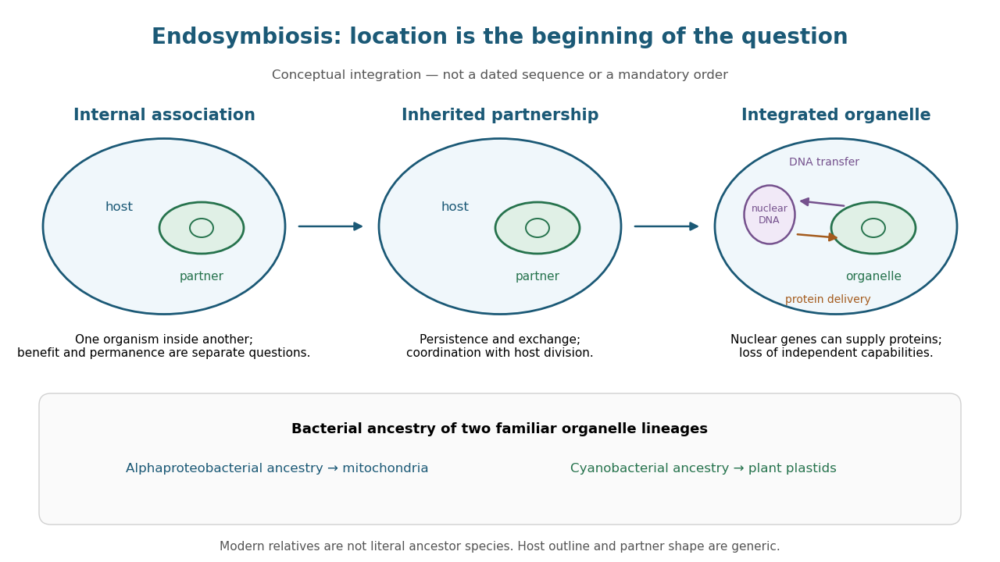

# Endosymbiosis

↑ **Parent:** [Ecology](ecology-split.md)

[Endosymbiosis](endosymbiosis.md) is an ecological association in which one [organism](organism-split.md), the [endosymbiont](endosymbiont.md), lives inside another. The definition specifies location, not that both partners benefit, nor that the internal partner has become an [organelle](organelle.md). An intracellular association can remain an association between distinct [organisms](organism-split.md). [Endosymbiotic theory](endosymbiotic-theory.md) addresses a different question: how particular ancestral [bacteria](bacteria.md) became inherited, functionally integrated [organelles](organelle.md) during [evolution](evolution.md).

The striking consequence is that a [eukaryotic](eukaryote.md) [biological cell](biological-cell-split.md) can combine histories: its nuclear lineage and its [mitochondria](mitochondria.md) need not have the same ancestry. [Mitochondria](mitochondria.md) have bacterial ancestry related to [Alphaproteobacteria](alphaproteobacteria.md); the [plastids](plastid.md) of [plants](plant.md) and many [algae](algae.md), including [chloroplasts](chloroplast.md), have ancestry within [cyanobacteria](cyanobacteria.md). These are ancestral lineages, not a claim that a named living bacterial [species](species.md) is the literal ancestor. Present-day [bacteria](bacteria.md) and [organelles](organelle.md) have both evolved since their shared ancestors. [Opening paragraphs and “The endosymbiont: when and who?”: bacterial origins and uncertainty about closest relatives](origin-and-evolution-of-plastids-and-photosynthesis-in-eukaryotes-by-geoffrey-i-mcfadden.md)

**[Figure 3](#image-from-an-internal-partner-to-an-integrated-organelle). From an internal partner to an integrated organelle**. Original conceptual schematic, not an observed historical sequence. Persistence, metabolic exchange, [endosymbiotic gene transfer](endosymbiotic-gene-transfer.md), [organelle protein import](organelle-protein-import.md) and coordination of division illustrate integration; they are not dated stages in a compulsory order. The illustrated partner is generic, and the host outline does not specify the ancestral host of [mitochondria](mitochondria.md). The protein-delivery arrow abbreviates nuclear [gene expression](gene-expression.md), [biological translation](translation-biology.md) in the [cytosol](cytosol.md) and [organelle protein import](organelle-protein-import.md); it does not place [protein](protein-split.md) synthesis inside the [cell nucleus](cell-nucleus.md).

**Table of contents**

- [Endosymbiont](endosymbiont.md)
- [Endosymbiotic theory](endosymbiotic-theory.md)
  - [Evidence for bacterial ancestry of organelles](evidence-for-bacterial-ancestry-of-organelles.md)
  - [Endosymbiotic gene transfer](endosymbiotic-gene-transfer.md)
    - [Functional plastid-to-nucleus gene transfer experiment](functional-plastid-to-nucleus-gene-transfer-experiment.md)

## ↑ Ancestors (3)

1. [Ecology](ecology-split.md)
2. [Biology](biology-split.md)
3. [Codex Wiki](split.md)

## ← Incoming links (7)

- [Cyanobacteria](cyanobacteria.md)
- [Endosymbiont](endosymbiont.md)
- [Endosymbiosis](endosymbiosis.md)
- [Eukaryote](eukaryote.md)
- [Functional plastid-to-nucleus gene transfer experiment](functional-plastid-to-nucleus-gene-transfer-experiment.md)
- [Mitochondria](mitochondria.md)
- [Two-domain system](two-domain-system.md)
