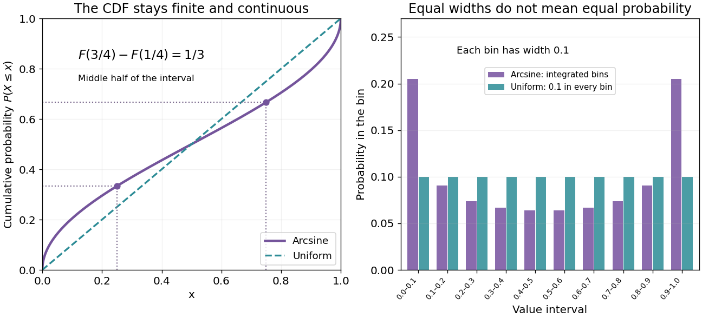

# Endpoint concentration in the arcsine distribution

↑ **Parent:** [Arcsine distribution](arcsine-distribution.md)

An unbounded [probability density function](probability-density-function.md) does not imply an atom. Here

$$
\mathbb P(X=0)=\mathbb P(X=1)=0,\qquad
\mathbb P(0<X<\varepsilon)=\frac2\pi\arcsin\sqrt\varepsilon
\sim\frac2\pi\sqrt\varepsilon\quad(\varepsilon\downarrow0).
$$

The last equivalence follows from $\arcsin u/u\to1$. The endpoint interval has much more [probability](probability.md) than the same interval under a [uniform distribution](continuous-uniform-distribution.md), whose value is $\varepsilon$, but its [probability](probability.md) still tends to zero. This is an [integrable singularity](integrable-singularity.md).

For example, the first 1% of the unit interval contains about $6.377\%$ of the [probability](probability.md); the last 1% contains the same amount because the [arcsine distribution](arcsine-distribution.md) is a [symmetric probability distribution](symmetric-probability-distribution.md). Each exact endpoint still has zero [probability](probability.md). Density and interval [probability](probability.md) answer different questions.

**[Figure 2](#image-endpoint-density-diverges-but-every-finite-bin-has-finite-probability). Endpoint density diverges, but every finite bin has finite probability**. Original exact curves and bin probabilities. Left: the arcsine [cumulative distribution function](cumulative-distribution-function.md) compared with the uniform one. Right: ten equal-width bins have probabilities $F((j+1)/10)-F(j/10)$, not heights sampled from the divergent density. Their total is one.

A numerical integration routine must respect these endpoint [integrable singularities](integrable-singularity.md). The substitution $x=\sin^2\theta$ gives

$$
f(x)\,dx=\frac2\pi\,d\theta,\qquad0<\theta<\pi/2.
$$

It turns a difficult-looking density integral into a constant measure in angle. Integrating finite bins is also a faithful way to draw the distribution near its endpoints; sampling $f(0)$ to make a bar height is not.

## ↑ Ancestors (8)

1. [Arcsine distribution](arcsine-distribution.md)
2. [Continuous probability distribution](continuous-probability-distribution-split.md)
3. [Probability distribution](probability-distribution-split.md)
4. [Probability theory](probability-theory-split.md)
5. [Probability and statistics](probability-and-statistics-split.md)
6. [Area of mathematics](area-of-mathematics.md)
7. [Mathematics](mathematics-split.md)
8. [Codex Wiki](split.md)
