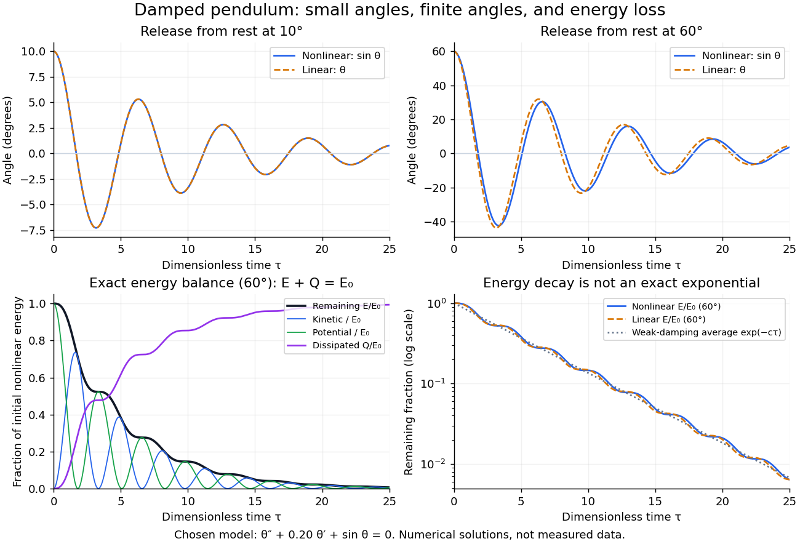

# Energy dissipation of a damped pendulum

↑ **Parent:** [Damped pendulum](damped-pendulum.md)

For the normalized [damped pendulum](damped-pendulum.md), the sum of [kinetic energy](kinetic-energy.md) and gravitational [potential energy](potential-energy.md), divided by $mg\ell$, is

$$
E(\tau)=\frac12\dot\theta^2+1-\cos\theta,\qquad
\dot E=\dot\theta(\ddot\theta+\sin\theta)=-c\dot\theta^2\leq0.
$$

The [chain rule](chain-rule.md) and the full nonlinear equation give this identity exactly, without a [small-angle approximation](small-angle-approximation.md). Here $\dot\theta=d\theta/d\tau$ as in [damped pendulum](damped-pendulum.md). In physical units the [mechanical energy](mechanical-energy.md) and the [power](power.md) of the resisting [torque](torque.md) are

$$
\mathcal E(t)=\frac12m\ell^2\left(\frac{d\theta}{dt}\right)^2+mg\ell(1-\cos\theta),\qquad
\frac{d\mathcal E}{dt}=-b\left(\frac{d\theta}{dt}\right)^2.
$$

The pendulum's lost [mechanical energy](mechanical-energy.md) is transferred to the damper and surroundings; it does not violate [conservation of energy](conservation-of-energy.md). In an ideal viscous [dashpot](dashpot.md) this loss is [frictional heating](frictional-heating.md). The exact cumulative balance is particularly useful for checking a numerical solution:

$$
Q(\tau)=c\int_0^\tau\dot\theta(s)^2\,ds,\qquad E(\tau)+Q(\tau)=E(0).
$$

**[Figure 5](#image-illustrative-nonlinear-and-linear-damped-pendulum-solutions-at-10-and-60-degrees-with-exact-mechanical-energy-transfer-and-loss-no-measured-data). Illustrative nonlinear and linear damped pendulum solutions at 10 and 60 degrees, with exact mechanical energy transfer and loss; no measured data**.

The figure uses $c=0.20$ and release from rest. Over $0\leq\tau\leq25$, the largest angular discrepancy between the nonlinear solution and the [damped harmonic oscillator](damped-harmonic-oscillator.md) solution is approximately $0.000702\,\mathrm{rad}$ ($0.0402^\circ$) for a $10^\circ$ release, but $0.14995\,\mathrm{rad}$ ($8.592^\circ$) for a $60^\circ$ release. Their nonlinear initial energies are $1-\cos10^\circ\approx0.015192$ and $1-\cos60^\circ=0.5$, respectively. At $\tau=25$ the remaining fractions are approximately $0.0064080$ and $0.0063757$. These are illustrative calculations from specified initial conditions, not observations. The generator uses a [Runge-Kutta method](runge-kutta-method.md) and integrates $Q$ alongside the motion; halving its step and independently integrating $c\dot\theta^2$ checks the result.

For $\ell=1\,\mathrm m$ and $g=9.81\,\mathrm{m/s^2}$, the first three nonlinear same-side swing intervals after a $60^\circ$ release are approximately $2.1008$, $2.0378$, and $2.0221\,\mathrm s$. They approach the linear-model [oscillation period](period-of-an-oscillation.md) $2.0162\,\mathrm s$ as the [amplitude](wave-amplitude.md) shrinks. After a $10^\circ$ release the corresponding intervals are already about $2.0185$, $2.0168$, and $2.0164\,\mathrm s$. This makes the experiment's period drift a quantitative test of the [small-angle approximation](small-angle-approximation.md), rather than an automatic reason to change the damping coefficient.

At a turning point, $\dot\theta=0$ and $\dot E=0$ even though the swing is losing [mechanical energy](mechanical-energy.md) over the cycle. Its [potential energy](potential-energy.md) there is $E_n=1-\cos A_n$, so measured turning [angles](angle.md) give successive energies without estimating [angular velocity](angular-velocity.md). In the proposed decay experiment, multiply these values by $mg\ell$ to obtain energies in [joules](joule.md), then subtract adjacent same-side energies to estimate the loss over each full swing. Only for small [amplitudes](wave-amplitude.md) is $E_n\simeq A_n^2/2$. In the linear underdamped model, same-side peak energies consequently satisfy $E_{n+1}/E_n=e^{-\gamma T_d}$, the square of the angular [amplitude](wave-amplitude.md) ratio. For the illustrative parameters above this energy ratio is approximately $0.2828$. Between turning points, [kinetic energy](kinetic-energy.md) and [potential energy](potential-energy.md) continue to exchange while their sum decreases; the energy slope vanishes briefly at each extremum and is negative whenever the bob moves.

It is therefore inaccurate to replace the exact identity by $\dot E=-cE$. Even for the linear model, $E_{\mathrm{lin}}=(\dot\theta^2+\theta^2)/2$ has $\dot E_{\mathrm{lin}}=-c\dot\theta^2$. For weak damping and small [angles](angle.md), cycle averaging gives $\langle\dot\theta^2\rangle\simeq\langle E_{\mathrm{lin}}\rangle$, so the averaged energy approximately follows $e^{-c\tau}$ while angular [amplitude](wave-amplitude.md) follows $e^{-c\tau/2}$. This [exponential decay](exponential-decay.md) is an approximation to the energy trace; the same-side peak ratio is exact within the linear model. The figure distinguishes the actual energy curves from this averaging approximation.

The energy identity also gives a global conclusion without solving the nonlinear equation. If $E$ were constant on a positive-length interval, then $\dot\theta$ would vanish throughout it; the equation would force $\sin\theta=0$, making the entire trajectory an [equilibrium](equilibrium-point-of-a-dynamical-system.md). Every nonstationary trajectory therefore loses [mechanical energy](mechanical-energy.md) over every positive-length interval, even though its instantaneous [derivative](derivative.md) can vanish at a turning point. A nonconstant periodic motion would have to return to its initial [mechanical energy](mechanical-energy.md), so it is impossible for this undriven [damped pendulum](damped-pendulum.md). Oscillations near a [stable focus](stable-spiral.md) are successive, shrinking swings, not a repeating cycle. Moreover, if $E(0)<2$, the [angle](angle.md) cannot reach an upright [equilibrium](equilibrium-point-of-a-dynamical-system.md), whose [potential energy](potential-energy.md) is $2$; such motion stays within its original potential well. This is the usefulness of the energy description: one scalar balance controls both the observed decay and which nonlinear motions remain accessible.

## ↑ Ancestors (6)

1. [Damped pendulum](damped-pendulum.md)
2. [Simple pendulum](simple-pendulum.md)
3. [Classical mechanics](classical-mechanics-split.md)
4. [Branches of physics](branches-of-physics.md)
5. [Physics](physics-split.md)
6. [Codex Wiki](split.md)

## ← Incoming links (3)

- [Damped pendulum](damped-pendulum.md)
- [Solution](past-exam-of-the-mathematics-course-of-the-university-of-cambridge/2014/ia/paper-2/8b/i/solution.md)
- [Solution](past-exam-of-the-mathematics-course-of-the-university-of-cambridge/2014/ia/paper-2/8b/iv/solution.md)
