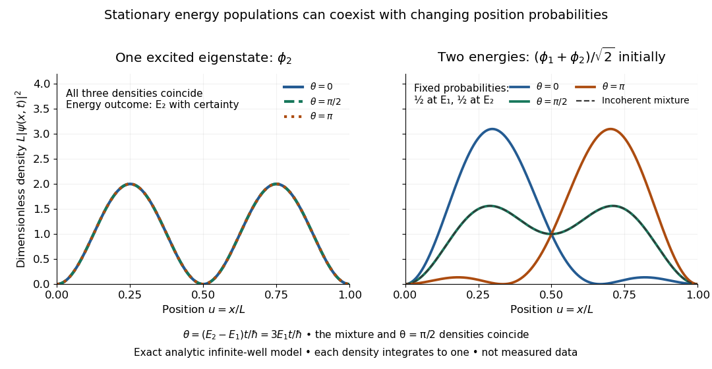

# Energy eigenspace

↑ **Parent:** [Energy eigenvalue](energy-eigenvalue-split.md)

The energy eigenspace at $E$ is the [vector subspace](vector-subspace.md)

$$
\mathcal E_E=\ker(H-EI)=\{\psi\in D(H):H\psi=E\psi\},
$$

where $H$ is the [Hamiltonian operator](hamiltonian-quantum-mechanics.md) and $I$ is the [identity operator](identity-operator.md). It is nonzero exactly when $E$ is an [energy eigenvalue](energy-eigenvalue-split.md). Its [dimension](dimension-vector-space.md) is the multiplicity of that [energy eigenvalue](energy-eigenvalue-split.md); [degenerate energy levels](degenerate-energy-levels.md) have multiplicity greater than one. The [ground-state subspace](ground-state-subspace.md) is $\mathcal E_{E_0}$, and its [dimension](dimension-vector-space.md) is the [ground-state degeneracy](ground-state-degeneracy.md). A vector in an [energy eigenspace](energy-eigenspace.md) need not be one of a specially chosen [orthonormal basis](orthonormal-basis.md) of [energy eigenstates](energy-eigenstate.md).

[Linearity](linearity.md) makes the useful point immediate: if $H\phi_1=E\phi_1$ and $H\phi_2=E\phi_2$, then $H(a\phi_1+b\phi_2)=E(a\phi_1+b\phi_2)$. Every normalized nonzero combination stays in the same [energy eigenspace](energy-eigenspace.md). For a time-independent [Hamiltonian operator](hamiltonian-quantum-mechanics.md), its evolution is multiplication by the common [global phase](global-phase.md) $e^{-iEt/\hbar}$, so it is a [stationary state](stationary-state.md). A [quantum superposition](quantum-superposition.md) within a degenerate [energy eigenspace](energy-eigenspace.md) can change spatial shape when its coefficients are chosen differently, but its density does not subsequently beat under this unchanged [Hamiltonian operator](hamiltonian-quantum-mechanics.md).

Across distinct [energy eigenspaces](energy-eigenspace.md), relative [quantum phases](quantum-phase.md) evolve. For orthonormal [eigenfunctions](eigenfunction.md) $\phi_1,\phi_2$ of the [Hamiltonian operator](hamiltonian-quantum-mechanics.md) with [energy eigenvalues](energy-eigenvalue-split.md) $E_1\ne E_2$, an equal-weight [quantum superposition](quantum-superposition.md) has

$$
\psi(x,t)=\frac{e^{-iE_1t/\hbar}\phi_1(x)+e^{-iE_2t/\hbar}\phi_2(x)}{\sqrt2},
$$

and position [probability density](probability-density.md)

$$
|\psi(x,t)|^2=\frac{|\phi_1(x)|^2+|\phi_2(x)|^2}{2}+\operatorname{Re}\!\left[\phi_1(x)^*\phi_2(x)e^{-i(E_2-E_1)t/\hbar}\right].
$$

The interference term can change local probabilities even though the [Born rule](born-rule.md) assigns the same time-independent probability $1/2$ to each [energy measurement](energy-measurement.md) outcome. [Orthogonality](orthogonal-vectors.md) makes its integral zero, preserving [wavefunction normalization](wavefunction-normalization.md). This [pure state](pure-state.md) is not a [stationary state](stationary-state.md); some particular measurement distributions may nevertheless remain constant. An incoherent [mixed state](mixed-state.md) with the same energy populations has no such interference term.

**[Figure 1](#image-an-excited-energy-eigenstate-can-be-stationary-while-a-two-energy-superposition-beats). An excited energy eigenstate can be stationary while a two-energy superposition beats**. Exact [infinite square well](infinite-square-well.md) densities, not measured data, with $u=x/L$ and $\theta=(E_2-E_1)t/\hbar$. The left panel shows the unchanged density of the second [energy eigenstate](energy-eigenstate.md) at three times. The right panel shows a coherent equal-weight [quantum superposition](quantum-superposition.md) at $\theta=0,\pi/2,\pi$; its energy populations remain $1/2,1/2$. The dashed curve is the density of the corresponding incoherent [mixed state](mixed-state.md).

For the pictured [infinite square well](infinite-square-well.md), $\theta=3E_1t/\hbar$ and the interference repeats after $T=2\pi\hbar/(3E_1)$. At $t=0$, direct integration gives $\langle x\rangle=L/2-16L/(9\pi^2)$; halfway through the period it is $L/2+16L/(9\pi^2)$. This is a moving [expectation value](expectation-value.md), rather than a trajectory of an individual particle. The distinction between an [energy eigenspace](energy-eigenspace.md) and a combination of different [energy eigenspaces](energy-eigenspace.md) is what makes the different behavior possible.

## ↑ Ancestors (5)

1. [Energy eigenvalue](energy-eigenvalue-split.md)
2. [Quantum mechanics](quantum-mechanics-split.md)
3. [Branches of physics](branches-of-physics.md)
4. [Physics](physics-split.md)
5. [Codex Wiki](split.md)

## ← Incoming links (16)

- [Circular ladder operators of a two-dimensional oscillator](circular-ladder-operators-of-a-two-dimensional-oscillator.md)
- [Energy eigenspace](energy-eigenspace.md)
- [Energy eigenvalue](energy-eigenvalue-split.md)
- [Energy populations and evolving relative phases](energy-populations-and-evolving-relative-phases.md)
- [Franck-Hertz experiment](franck-hertz-experiment.md)
- [Ground-state degeneracy](ground-state-degeneracy.md)
- [Solution](past-exam-of-the-mathematics-course-of-the-university-of-cambridge/2006/ii/paper-2/33d/solution.md)
- [Solution](past-exam-of-the-mathematics-course-of-the-university-of-cambridge/2009/ib/paper-1/15b/solution.md)
- [Solution](past-exam-of-the-mathematics-course-of-the-university-of-cambridge/2019/ii/paper-4/32b/solution.md)
- [Solution](past-exam-of-the-mathematics-course-of-the-university-of-cambridge/2022/ii/paper-1/35d/b/solution.md)
- [Solution](past-exam-of-the-physics-a-course-of-the-university-of-cambridge/2010/paper-2/section-c/c10/a/solution.md)
- [Solution](past-exam-of-the-physics-a-course-of-the-university-of-cambridge/2022/paper-1/section-b/b6/e/solution.md)
- [Solution](past-exam-of-the-physics-a-course-of-the-university-of-cambridge/2022/paper-1/section-b/b7/b/solution.md)
- [Solution](past-exam-of-the-physics-a-course-of-the-university-of-cambridge/2022/paper-1/section-b/b7/c/solution.md)
- [Solution](past-exam-of-the-physics-a-course-of-the-university-of-cambridge/2022/paper-1/section-d/d9/solution.md)
- [Quantum variational principle](quantum-variational-principle.md)
