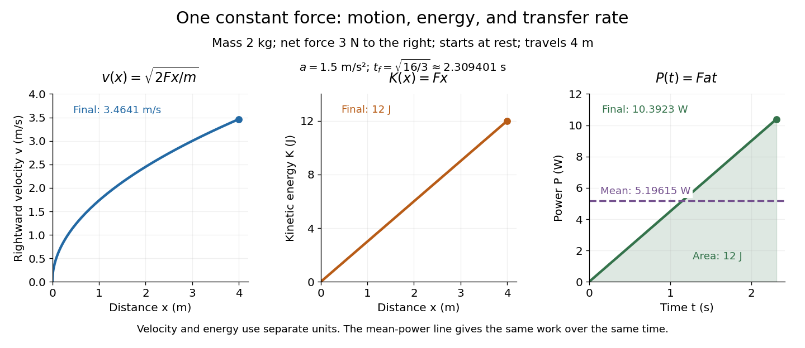
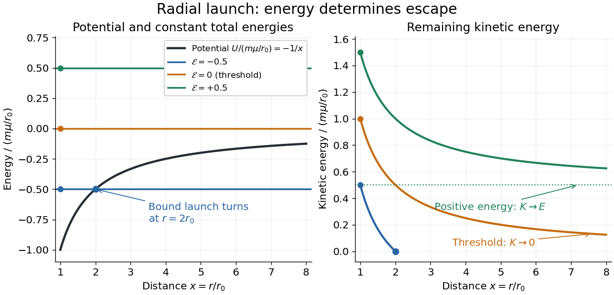
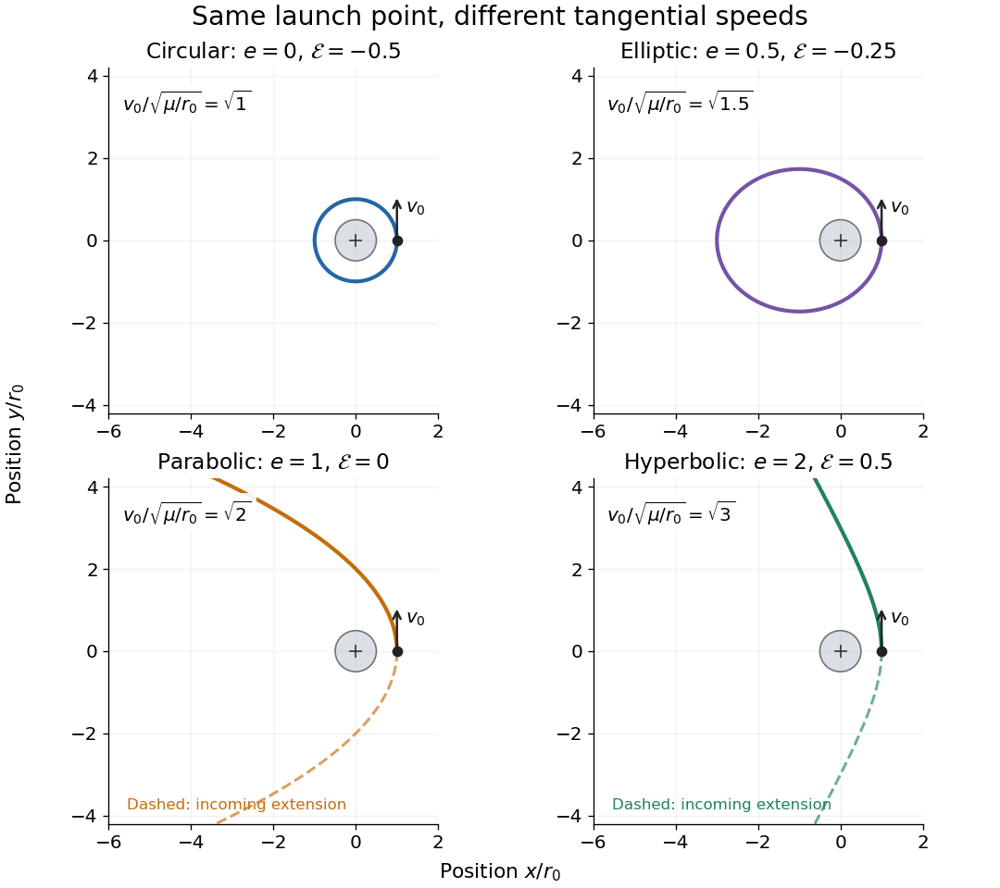

# Energy

↑ **Parent:** [Classical mechanics](classical-mechanics.md)  
ⓦ [Wiki](https://en.wikipedia.org/wiki/Energy)

Energy is a conserved scalar quantity associated with time-translation symmetry.

**Table of contents**

- [Energy harvesting](#energy-harvesting)
- [Mechanical energy harvesting](#mechanical-energy-harvesting)
  - [Piezoelectric energy harvesting](#piezoelectric-energy-harvesting)
    - [Piezoelectric polymer](#piezoelectric-polymer)
    - [Piezoelectric ceramic](#piezoelectric-ceramic)
  - [Electromagnetic energy harvesting](#electromagnetic-energy-harvesting)
  - [Electrostatic energy harvesting](#electrostatic-energy-harvesting)
- [Specific energy](#specific-energy)
  - [Ragone plot](#ragone-plot)
- [Q value](#q-value)
- [Energy function](#energy-function)
- [Mechanical energy](#mechanical-energy)
  - [Conservation of mechanical energy](#conservation-of-mechanical-energy)
- [Work](#work)
  - [Work done by a constant force](#work-done-by-a-constant-force)
  - [Work-energy theorem](#work-energy-theorem)
  - [Power](#power)
    - [Specific power](#specific-power)
    - [Peak power](#peak-power)
    - [Instantaneous power](#instantaneous-power)
    - [Average power](#average-power)
- [Kinetic energy](#kinetic-energy)
  - [Kinetic energy correction factor](#kinetic-energy-correction-factor)
  - [Relativistic kinetic energy](#relativistic-kinetic-energy)
  - [Rigid rotation minimizes kinetic energy at fixed angular momentum](#rigid-rotation-minimizes-kinetic-energy-at-fixed-angular-momentum)
  - [Kinetic energy decomposition about the center of mass](#kinetic-energy-decomposition-about-the-center-of-mass)
  - [Unit-direction kinetic-energy identity](#unit-direction-kinetic-energy-identity)
  - [Kinetic energy density](#kinetic-energy-density)
  - [Rotational kinetic energy](#rotational-kinetic-energy)
- [Potential energy](#potential-energy)
  - [Lennard-Jones potential](#lennard-jones-potential)
  - [Harmonic potential](#harmonic-potential)
  - [Potential well](#potential-well)
    - [Half-line square-root potential well](#half-line-square-root-potential-well)
  - [Repulsive inverse-square potential](#repulsive-inverse-square-potential)
    - [Scattering in a repulsive inverse-square potential](#scattering-in-a-repulsive-inverse-square-potential)
  - [Gravitational energy](#gravitational-energy)
  - [Available potential energy](#available-potential-energy)
    - [Background potential energy](#background-potential-energy)
  - [Potential function](#potential-function)
  - [Central potential](#central-potential)
    - [Newton's theorem of revolving orbits](#newton-s-theorem-of-revolving-orbits)
  - [Conservative force](#conservative-force)
    - [Nonconservative force](#nonconservative-force)
  - [Inverse-square potential](#inverse-square-potential)
    - [Angular momentum and the escape energy threshold](#angular-momentum-and-the-escape-energy-threshold)
    - [Falling bodies and lunar motion as tests of gravity](#falling-bodies-and-lunar-motion-as-tests-of-gravity)
    - [Lunar laser ranging](#lunar-laser-ranging)
      - [Retroreflector](#retroreflector)
        - [Corner reflector](#corner-reflector)
  - [Exponential cusp potential](#exponential-cusp-potential)
  - [Escape velocity](#escape-velocity)
    - [Escape by jumping from a uniform-density asteroid](#escape-by-jumping-from-a-uniform-density-asteroid)
    - [Molecular escape-speed temperature estimate](#molecular-escape-speed-temperature-estimate)
    - [Escape-energy balance diagram](#escape-energy-balance-diagram)
    - [Tangential launch trajectories across the escape threshold](#tangential-launch-trajectories-across-the-escape-threshold)
    - [Zero-energy escape takes infinite time](#zero-energy-escape-takes-infinite-time)
    - [Escape speed, circular speed, and propulsion](#escape-speed-circular-speed-and-propulsion)
    - [Spacecraft tracking and the limits of the escape model](#spacecraft-tracking-and-the-limits-of-the-escape-model)
    - [Spacecraft trajectory](#spacecraft-trajectory)
      - [Orbit determination](#orbit-determination)
    - [Escape and circular speeds inside an isolated uniform sphere](#escape-and-circular-speeds-inside-an-isolated-uniform-sphere)
  - [Equipotential surface](#equipotential-surface)
    - [Equipotential curve](#equipotential-curve)
- [Turning point](#turning-point)
- [Binding energy](#binding-energy)

## Energy harvesting

↑ **Parent:** [Energy](energy.md)

Collection of ambient light, heat flow, thermal cycling, motion or other available [energy](energy.md) into a usable electrical supply. Available average power, conversion loss and peak-load buffering must be distinguished.

## Mechanical energy harvesting

↑ **Parent:** [Energy](energy.md)

Conversion of mechanical motion or deformation into electrical [energy](energy.md).

### Piezoelectric energy harvesting

↑ **Parent:** [Mechanical energy harvesting](#mechanical-energy-harvesting)

Electrical generation from mechanically induced [electric polarization](electromagnetism.md#polarization-density) in a piezoelectric element.

#### Piezoelectric polymer

↑ **Parent:** [Piezoelectric energy harvesting](#piezoelectric-energy-harvesting)

A polymer exhibiting [piezoelectricity](quantum-mechanics.md#piezoelectricity). A compliant, low-density film can accept larger bending or strain than a brittle ceramic, while low [permittivity](permittivity.md) can yield a large [voltage](random-walk.md#voltage) coefficient despite a modest charge coefficient. Extractable [energy](energy.md) still depends on mechanical input, [capacitance](electromagnetism.md#capacitance) and electrical loading.

#### Piezoelectric ceramic

↑ **Parent:** [Piezoelectric energy harvesting](#piezoelectric-energy-harvesting)

A ceramic material used for [piezoelectricity](quantum-mechanics.md#piezoelectricity), often offering large charge response and electromechanical coupling with comparatively high stiffness. Brittle fracture, mechanical impedance matching and mounting conditions can limit a vibration harvester. A high charge coefficient alone is not a device [power](#power) ranking.

### Electromagnetic energy harvesting

↑ **Parent:** [Mechanical energy harvesting](#mechanical-energy-harvesting)

Conversion of mechanical motion into electrical output through changing [magnetic flux](magnetic-field.md#magnetic-flux).

### Electrostatic energy harvesting

↑ **Parent:** [Mechanical energy harvesting](#mechanical-energy-harvesting)

Conversion using changes in [capacitance](electromagnetism.md#capacitance) of a charged or electrically biased structure.

## Specific energy

↑ **Parent:** [Energy](energy.md)

Energy per unit mass, with units such as $\mathrm{J\,kg^{-1}}$ or $\mathrm{Wh\,kg^{-1}}$. Active-material, cell and packaged-system mass bases can give very different values.

### Ragone plot

↑ **Parent:** [Specific energy](#specific-energy)

A logarithmic comparison of [specific power](#specific-power) against [specific energy](#specific-energy) for storage or conversion devices. With consistent [mass](classical-mechanics.md#mass) and [energy](energy.md) units, constant-duration lines satisfy $p_s=e_s/t$. The plotted capability depends on operating conditions and [mass](classical-mechanics.md#mass) convention.

## Q value

↑ **Parent:** [Energy](energy.md)

The [Q value](#q-value) of a reaction or [particle decay](physics.md#particle-decay) is the initial total rest [energy](energy.md) minus the final total rest [energy](energy.md). Positive $Q$ releases [kinetic energy](#kinetic-energy); a negative $Q$ requires energy supplied by incident motion or another source. Atomic and bare nuclear [mass](classical-mechanics.md#mass) conventions must be distinguished when counting [electrons](physics.md#electron) in [beta decay](physics.md#beta-decay).

## Energy function

↑ **Parent:** [Energy](energy.md)

For a Lagrangian $L(q,\dot q,t)$, its energy function is

$$
E=\sum_i\dot q_i\frac{\partial L}{\partial\dot q_i}-L.
$$

It is conserved along Euler-Lagrange trajectories when $L$ has no explicit time dependence.

## Mechanical energy

↑ **Parent:** [Energy](energy.md)  
ⓦ [Wiki](https://en.wikipedia.org/wiki/Mechanical_energy)

Mechanical energy is the sum of [kinetic energy](#kinetic-energy) and [potential energy](#potential-energy). It is conserved when all forces are conservative and the potential has no explicit time dependence.

### Conservation of mechanical energy

↑ **Parent:** [Mechanical energy](#mechanical-energy)

For constant masses, a time-independent [potential energy](#potential-energy) $V$ and forces $\boldsymbol F_i=-\nabla_iV+\boldsymbol R_i$ with zero total extra power $\sum_i\boldsymbol R_i\cdot\boldsymbol v_i=0$, [Newton's second law](force.md#newton-s-second-law) gives $dT/dt=-dV/dt$. Thus [mechanical energy](#mechanical-energy) is conserved. Smooth stationary constraint reactions and a purely magnetic [Lorentz force](relativistic-electromagnetism.md#lorentz-force) supply zero power. This is more restrictive than [conservation of energy](mathematical-physics.md#conservation-of-energy) in general, which may include thermal or other internal forms.

## Work

↑ **Parent:** [Energy](energy.md)  
ⓦ [Wiki](https://en.wikipedia.org/wiki/Work_(physics))

[Work](#work) measures the [energy](energy.md) transferred by a [force](force.md) as its point of application moves. For a [point mass](classical-mechanics.md#point-mass) following a path $C$, add the contribution of the [force](force.md) along each small [displacement](classical-mechanics.md#displacement):

$$
W=\int_C\mathbf F\cdot d\mathbf r
=\int_{t_i}^{t_f}\mathbf F(t)\cdot\mathbf v(t)\,dt.
$$

This [line integral](multivariable-calculus.md#line-integral) uses the actual path, and the [dot product](inner-product.md#dot-product) selects the component of [force](force.md) along the motion. A large [force](force.md) perpendicular to every small [displacement](classical-mechanics.md#displacement) does zero [work](#work); holding something still also does zero mechanical [work](#work) on it, even if holding it feels tiring. The [SI](physics.md#international-system-of-units) unit is $\mathrm J=\mathrm{N\,m}$. [OpenStax University Physics 1, §7.1: Work](https://openstax.org/books/university-physics-volume-1/pages/7-1-work)

The usefulness of [work](#work) is that it connects a description in terms of [forces](force.md) and distances to one in terms of [energy](energy.md). The [work-energy theorem](#work-energy-theorem) gives the change in [kinetic energy](#kinetic-energy) from the total net [work](#work), often without solving for the entire motion. The [work](#work) of one selected [force](force.md) equals that change only when the other [forces](force.md) contribute zero total [work](#work).

### Work done by a constant force

↑ **Parent:** [Work](#work)

For a fixed [force](force.md) $\mathbf F$ and endpoint [displacement](classical-mechanics.md#displacement) $\Delta\mathbf r$, the [line integral](multivariable-calculus.md#line-integral) reduces to a [dot product](inner-product.md#dot-product):

$$
W=\mathbf F\cdot\Delta\mathbf r=Fd\cos\theta,
\qquad F=|\mathbf F|,\quad d=|\Delta\mathbf r|.
$$

Here $\theta$ is the [angle](geometry-and-topology.md#angle) between the [force](force.md) and the [displacement](classical-mechanics.md#displacement). For straight motion, $d$ is also the distance traveled. A $3\,\mathrm N$ [force](force.md) acting along a $4\,\mathrm m$ [displacement](classical-mechanics.md#displacement) does $12\,\mathrm J$ of [work](#work). Turning the same [force](force.md) perpendicular to the [displacement](classical-mechanics.md#displacement) gives $\cos(\pi/2)=0$ and zero [work](#work); reversing it gives $\cos\pi=-1$ and $-12\,\mathrm J$. At $\theta=\pi/3$, the [work](#work) is $6\,\mathrm J$. These signs describe [energy](energy.md) transferred to or from the moving body. [OpenStax University Physics 1, §7.1: Constant-force work](https://openstax.org/books/university-physics-volume-1/pages/7-1-work)

**[Figure 1](#image-work-from-parallel-perpendicular-and-opposing-forces). Work from parallel, perpendicular, and opposing forces**. Each left panel shows a $3\,\mathrm N$ [force](force.md) and a rightward $4\,\mathrm m$ [displacement](classical-mechanics.md#displacement). Each right panel plots the along-path [force](force.md) component against distance; its signed area is the [work](#work): $12$, $0$, or $-12\,\mathrm J$. The arrows compare directions; their lengths do not compare quantities with different units. The three panels prescribe motion to illustrate [work](#work); they are separate cases, not successive stages of one journey.

### Work-energy theorem

↑ **Parent:** [Work](#work)

For a [point mass](classical-mechanics.md#point-mass) of constant [mass](classical-mechanics.md#mass) $m$ observed in an [inertial frame](mathematical-physics.md#inertial-frame), the net [work](#work) along its actual path equals its change in [kinetic energy](#kinetic-energy):

$$
W_{\mathrm{net}}=\int_{t_a}^{t_b}\mathbf F_{\mathrm{net}}(t)\cdot\mathbf v(t)\,dt
=\int_a^b\mathbf F_{\mathrm{net}}\cdot d\mathbf r
=\frac12m|\mathbf v_b|^2-\frac12m|\mathbf v_a|^2.
$$

The middle expression is a [line integral](multivariable-calculus.md#line-integral); the [dot product](inner-product.md#dot-product) selects the component of [force](force.md) along the [displacement](classical-mechanics.md#displacement). Positive net [work](#work) increases [speed](classical-mechanics.md#speed), negative net [work](#work) decreases it, and zero net [work](#work) leaves the endpoint [speeds](classical-mechanics.md#speed) equal. Equal endpoint [speeds](classical-mechanics.md#speed) do not imply equal [velocities](classical-mechanics.md#velocity): a perpendicular [force](force.md) can continually change direction while doing zero [work](#work). [MIT mechanics, Chapter 13, section 13.11](https://ocw.mit.edu/courses/8-01sc-classical-mechanics-fall-2016/mit8_01scs22_chapter13.pdf)

The bridge to [Newton's second law](force.md#newton-s-second-law) is short: take the [dot product](inner-product.md#dot-product) of $m\dot{\mathbf v}=\mathbf F_{\mathrm{net}}$ with [velocity](classical-mechanics.md#velocity). The [chain rule](calculus.md#chain-rule) gives $d(m|\mathbf v|^2/2)/dt=\mathbf F_{\mathrm{net}}\cdot\mathbf v$, equating the rate of change of [kinetic energy](#kinetic-energy) to instantaneous [power](#power). Integrating gives the theorem. No [conservative force](#conservative-force) assumption entered this argument; [friction](newtonian-mechanics.md#friction) also contributes to the net [work](#work).

For the [harmonic oscillator](classical-mechanics.md#simple-harmonic-motion) with [spring](elasticity-physics.md#spring) stiffness $k=2\,\mathrm{N/m}$, release a [mass](classical-mechanics.md#mass) $m=0.5\,\mathrm{kg}$ from rest at $x=0.3\,\mathrm m$. The [spring](elasticity-physics.md#spring) exerts $F=-kx$. Its [work](#work) before the first passage through $x=0$ is

$$
W=\int_{0.3\,\mathrm m}^{0}(-kx)\,dx
=\frac12k(0.3\,\mathrm m)^2=0.09\,\mathrm J.
$$

Thus $mv^2/2=0.09\,\mathrm J$ gives [speed](classical-mechanics.md#speed) $0.6\,\mathrm{m/s}$ there. The [velocity](classical-mechanics.md#velocity) is negative on this passage because the [position](classical-mechanics.md#position) is decreasing. The [energy](energy.md) calculation alone determines its magnitude, so the direction still requires information about the motion.

For a time-independent [potential energy](#potential-energy) $V$, the [conservative force](#conservative-force) contributes [work](#work) $-\Delta V$. Separating all other [work](#work) as $W_{\mathrm{other}}$ gives $\Delta(T+V)=W_{\mathrm{other}}$. Consequently [conservation of mechanical energy](#conservation-of-mechanical-energy) requires zero net other [work](#work); the [work-energy theorem](#work-energy-theorem) itself does not require that conservation. With [damping](wave-equation.md#damping), [mechanical energy](#mechanical-energy) decreases even though the theorem remains valid. [MIT mechanics, Chapter 14: mechanical energy and nonconservative work](https://ocw.mit.edu/courses/8-01sc-classical-mechanics-fall-2016/mit8_01scs22_chapter14.pdf)

### Power

↑ **Parent:** [Work](#work)  
ⓦ [Wiki](https://en.wikipedia.org/wiki/Power_(physics))

[Power](#power) describes how quickly [energy](energy.md) is transferred. For mechanical [work](#work), the instantaneous [power](#power) supplied by a [force](force.md) is

$$
P(t)=\frac{dW}{dt}=\mathbf F(t)\cdot\mathbf v(t),
\qquad W=\int_{t_i}^{t_f}P(t)\,dt.
$$

The [SI](physics.md#international-system-of-units) unit is $\mathrm W=\mathrm{J/s}=\mathrm{N\,m/s}$, distinct from the [velocity](classical-mechanics.md#velocity) unit $\mathrm{m/s}$. The italic symbol $W$ for [work](#work) and the upright unit $\mathrm W$ for [power](#power) mean different things. Two processes can transfer the same [energy](energy.md) while requiring different [powers](#power): doing $12\,\mathrm J$ of [work](#work) in $2\,\mathrm s$ requires an average $6\,\mathrm W$, whereas doing it in $4\,\mathrm s$ requires an average $3\,\mathrm W$. [OpenStax University Physics 1, §7.4: Power](https://openstax.org/books/university-physics-volume-1/pages/7-4-power)

#### Specific power

↑ **Parent:** [Power](#power)

Power output or input divided by the relevant mass, commonly expressed in watts per kilogram. Device-level and active-material values cannot be compared without stating their different mass bases.

#### Peak power

↑ **Parent:** [Power](#power)

The maximum instantaneous [power](#power) in a specified pulse.

#### Instantaneous power

↑ **Parent:** [Power](#power)

[Instantaneous power](#instantaneous-power) is [power](#power) at a particular moment. Consider a [point mass](classical-mechanics.md#point-mass) with [mass](classical-mechanics.md#mass) $m=2\,\mathrm{kg}$, initially at rest, acted on by a constant net [force](force.md) $F=3\,\mathrm N$ along a straight path. [Newton's second law](force.md#newton-s-second-law) gives constant [acceleration](classical-mechanics.md#acceleration) $a=F/m=1.5\,\mathrm{m/s^2}$, hence [velocity](classical-mechanics.md#velocity) $v(t)=at$ and

$$
P(t)=Fat=(4.5\,\mathrm{W/s})t.
$$

The [instantaneous power](#instantaneous-power) starts at zero even though the [force](force.md) is nonzero, because the initial [velocity](classical-mechanics.md#velocity) is zero. At distance $4\,\mathrm m$, the [kinetic energy](#kinetic-energy) example below gives [speed](classical-mechanics.md#speed) $\sqrt{12}\,\mathrm{m/s}$, so the final [instantaneous power](#instantaneous-power) is $3\sqrt{12}\,\mathrm W\approx10.3923\,\mathrm W$. Negative [instantaneous power](#instantaneous-power) means the selected [force](force.md) is removing [energy](energy.md) at that moment.

#### Average power

↑ **Parent:** [Power](#power)

[Average power](#average-power) divides the [work](#work) over a nonzero interval by the elapsed [time](classical-mechanics.md#time-in-physics). For the same $2\,\mathrm{kg}$ [point mass](classical-mechanics.md#point-mass) driven from rest through $4\,\mathrm m$ by a net $3\,\mathrm N$ [force](force.md), the [displacement](classical-mechanics.md#displacement) is $x(t)=at^2/2$. Thus

$$
t_f=\sqrt{\frac{2(4\,\mathrm m)}{1.5\,\mathrm{m/s^2}}}
=\sqrt{16/3}\,\mathrm s\approx2.309401\,\mathrm s,
\qquad \overline P=\frac{12\,\mathrm J}{t_f}
\approx5.19615\,\mathrm W.
$$

This [average power](#average-power) is half the final [instantaneous power](#instantaneous-power) because $P(t)$ is a [linear function](vector-space.md#linear-function) of [time](classical-mechanics.md#time-in-physics), starting at zero. Its [graph of a function](function.md#graph-of-a-function) bounds a [triangle](euclidean-geometry.md#triangle) of area $P(t_f)t_f/2=12\,\mathrm J$; the horizontal line at [average power](#average-power) encloses a [rectangle](euclidean-geometry.md#rectangle) with the same area. In general, an endpoint value of [instantaneous power](#instantaneous-power) does not determine [average power](#average-power). [OpenStax University Physics 1, §7.4: Average and instantaneous power](https://openstax.org/books/university-physics-volume-1/pages/7-4-power)

## Kinetic energy

↑ **Parent:** [Energy](energy.md)  
ⓦ [Wiki](https://en.wikipedia.org/wiki/Kinetic_energy)

[Kinetic energy](#kinetic-energy) is the [energy](energy.md) associated with motion. For a nonrelativistic [point mass](classical-mechanics.md#point-mass) of [mass](classical-mechanics.md#mass) $m>0$, measured in a specified [inertial frame](mathematical-physics.md#inertial-frame),

$$
K=\frac12m\mathbf v\cdot\mathbf v=\frac12mv^2,
\qquad v=|\mathbf v|.
$$

Here $\mathbf v$ is [velocity](classical-mechanics.md#velocity) and $v$ is [speed](classical-mechanics.md#speed); $T$ is another common symbol for [kinetic energy](#kinetic-energy). The [dot product](inner-product.md#dot-product) makes $K$ nonnegative regardless of the direction of [velocity](classical-mechanics.md#velocity). At fixed [mass](classical-mechanics.md#mass), doubling [speed](classical-mechanics.md#speed) quadruples [kinetic energy](#kinetic-energy): a $2\,\mathrm{kg}$ [point mass](classical-mechanics.md#point-mass) at $2\,\mathrm{m/s}$ has $4\,\mathrm J$, whereas at $4\,\mathrm{m/s}$ it has $16\,\mathrm J$. The [SI](physics.md#international-system-of-units) units are $\mathrm{kg\,m^2/s^2}=\mathrm J$. Different [reference frames](mathematical-physics.md#reference-frame) can assign different [velocities](classical-mechanics.md#velocity) and therefore different [kinetic energies](#kinetic-energy). [OpenStax University Physics 1, §7.2: Kinetic energy](https://openstax.org/books/university-physics-volume-1/pages/7-2-kinetic-energy)

A short outline explains why [kinetic energy](#kinetic-energy) has this formula. In a nonrelativistic [inertial frame](mathematical-physics.md#inertial-frame), constant [mass](classical-mechanics.md#mass) and [Newton's second law](force.md#newton-s-second-law) give, using the [chain rule](calculus.md#chain-rule),

$$
\frac{dK}{dt}=m\mathbf v\cdot\frac{d\mathbf v}{dt}
=\mathbf F_{\mathrm{net}}\cdot\mathbf v.
$$

Integrating over [time](classical-mechanics.md#time-in-physics) proves the [work-energy theorem](#work-energy-theorem), $W_{\mathrm{net}}=K_f-K_i$. The net [force](force.md) is the sum of all [forces](force.md), and $W_{\mathrm{net}}$ is their total [work](#work), not merely the [work](#work) of a chosen driving [force](force.md). This route to final [speed](classical-mechanics.md#speed) is useful when the [forces](force.md) as [functions](function.md) of [position](classical-mechanics.md#position) are known but the full motion as a function of [time](classical-mechanics.md#time-in-physics) would be harder to find. [OpenStax University Physics 1, §7.3: Work–energy theorem](https://openstax.org/books/university-physics-volume-1/pages/7-3-work-energy-theorem)

In the running example, a $2\,\mathrm{kg}$ [point mass](classical-mechanics.md#point-mass) starts at rest and receives a constant net $3\,\mathrm N$ [force](force.md) through $4\,\mathrm m$. Its net [work](#work) is $12\,\mathrm J$, so

$$
K_f=12\,\mathrm J,
\qquad v_f=\sqrt{\frac{2K_f}{m}}
=\sqrt{12}\,\mathrm{m/s}\approx3.4641\,\mathrm{m/s}.
$$

At any intermediate distance $x\ge0$, $K(x)=(3\,\mathrm N)x$ and $v(x)=\sqrt{2Fx/m}$: [kinetic energy](#kinetic-energy) is a [linear function](vector-space.md#linear-function) of distance, while [speed](classical-mechanics.md#speed) is proportional to the [square root](algebra.md#square-root) of distance. If a net opposing $3\,\mathrm N$ braking [force](force.md) subsequently acts for $4\,\mathrm m$, it does $-12\,\mathrm J$ of [work](#work) and brings this [point mass](classical-mechanics.md#point-mass) to rest. Negative net [work](#work) decreases [kinetic energy](#kinetic-energy); it does not make [kinetic energy](#kinetic-energy) negative. Beyond the stopping point the motion must be reconsidered, since the [point mass](classical-mechanics.md#point-mass) cannot keep moving forward with a negative $K$.

**[Figure 2](#image-kinetic-energy-velocity-and-power-for-a-constant-net-force). Kinetic energy, velocity, and power for a constant net force**. A $2\,\mathrm{kg}$ [point mass](classical-mechanics.md#point-mass) starts at rest under a net $3\,\mathrm N$ [force](force.md). The left two panels show rightward [velocity](classical-mechanics.md#velocity) $v(x)=\sqrt{2Fx/m}$ and [kinetic energy](#kinetic-energy) $K(x)=Fx$ over $0\le x\le4\,\mathrm m$, with separate axes for their different units. The right panel shows [instantaneous power](#instantaneous-power) $P(t)=Fat$ up to $t_f\approx2.309401\,\mathrm s$ and [average power](#average-power) $\overline P\approx5.19615\,\mathrm W$. The shaded area is $12\,\mathrm J$ of [work](#work). All values follow from the stated idealized model.

[Kinetic energy](#kinetic-energy) also makes the exchange with [potential energy](#potential-energy) intuitive: a falling body's loss of [gravitational potential energy](#gravitational-energy) can appear as increased [kinetic energy](#kinetic-energy). The formula above applies when [speed](classical-mechanics.md#speed) is small compared with the [speed of light](special-relativity.md#speed-of-light); at higher [speeds](classical-mechanics.md#speed), [special relativity](special-relativity.md) changes the expression. [Feynman Lectures I, chapter 4, §§4–2 and 4–3: Energy of position and motion](https://www.feynmanlectures.caltech.edu/I_04.html)

### Kinetic energy correction factor

↑ **Parent:** [Kinetic energy](#kinetic-energy)

For unidirectional flow through area $A$ with mean speed $\overline u$, the outgoing kinetic-energy flux is $\tfrac12\rho A\alpha\overline u^3$, where $\alpha=(A\overline u^3)^{-1}\int_Au^3dA$. Cubing the mean speed generally differs from averaging the cube. A uniform profile has $\alpha=1$; circular laminar [Hagen-Poiseuille flow](viscous-fluid-flow.md#hagen-poiseuille-equation) has $\alpha=2$.

### Relativistic kinetic energy

↑ **Parent:** [Kinetic energy](#kinetic-energy)

For a free particle of [rest mass](special-relativity.md#invariant-mass) $m$, subtract its [rest energy](special-relativity.md#rest-energy) $mc^2$ from its total [energy](energy.md) $\gamma mc^2$, where $\gamma$ is the [Lorentz factor](special-relativity.md#lorentz-factor). The low-[speed](classical-mechanics.md#speed) [binomial series](sequence-and-series.md#binomial-series) gives $K=mv^2/2+3mv^4/(8c^2)+O(mv^6/c^4)$, recovering classical [kinetic energy](#kinetic-energy).

### Rigid rotation minimizes kinetic energy at fixed angular momentum

↑ **Parent:** [Kinetic energy](#kinetic-energy)

For rotational motion about a fixed axis, let $r$ be cylindrical radius, $v$ the signed tangential [velocity](classical-mechanics.md#velocity), and $dm$ the mass measure. Define the [kinetic energy](#kinetic-energy), axial [angular momentum](momentum.md#angular-momentum), and [moment of inertia](rigid-body-dynamics.md#moment-of-inertia) by

$$
K=\frac12\int v^2\,dm,\qquad L=\int rv\,dm,\qquad I=\int r^2\,dm>0.
$$

The [Cauchy-Schwarz inequality](probability-and-statistics.md#cauchy-schwarz-inequality) gives $L^2\leq(\int v^2dm)(\int r^2dm)=2KI$. More precisely, direct expansion gives the nonnegative energy gap

$$
K-\frac{L^2}{2I}=\frac12\int\left(v-\frac LI r\right)^2dm.
$$

Thus the minimum at fixed $L$ and fixed mass distribution occurs exactly when $v=(L/I)r$ almost everywhere with respect to $dm$. This means constant [angular velocity](rigid-body-dynamics.md#angular-velocity) $\Omega=L/I$, or [solid-body rotation](rigid-body-dynamics.md#solid-body-rotation). If the profile is continuous, the equality holds at every point in the mass support.

For a uniform unit-density [cylinder](geometry-and-topology.md#cylinder-geometry) of radius $a$, height $h$, and [volume](geometry-and-topology.md#volume) $V=\pi a^2h$, the [moment of inertia](rigid-body-dynamics.md#moment-of-inertia) is $I=Va^2/2$. Therefore $K\geq L^2/(Va^2)$, with equality for $\omega(r)=2L/(Va^2)$. Multiplying by a uniform nonunit [density](fluid-mechanics.md#density) changes the mass measure and $I$ consistently.

### Kinetic energy decomposition about the center of mass

↑ **Parent:** [Kinetic energy](#kinetic-energy)

Writing particle positions relative to the [center of mass](classical-mechanics.md#center-of-mass) as $\rho_i=r_i-R$ makes $\sum_i m_i\rho_i=0$, so the cross term in the squared [velocities](classical-mechanics.md#velocity) vanishes. The total [kinetic energy](#kinetic-energy) splits into center-of-mass translation and relative motion as displayed. For a [rigid body](rigid-body-dynamics.md), the latter is $\tfrac12 I\omega^2$, where $I$ is the [moment of inertia](rigid-body-dynamics.md#moment-of-inertia) about the instantaneous rotation axis through the [center of mass](classical-mechanics.md#center-of-mass).

### Unit-direction kinetic-energy identity

↑ **Parent:** [Kinetic energy](#kinetic-energy)

For a twice differentiable position away from the origin, write $\mathbf r=r\mathbf u$ with radial [unit vector](vector-space.md#unit-vector) $\mathbf u$. Its unit-length constraint gives $\mathbf u\cdot\dot{\mathbf u}=0$ and $\mathbf u\cdot\ddot{\mathbf u}=-|\dot{\mathbf u}|^2$, separating radial and directional contributions to speed and [kinetic energy](#kinetic-energy). The identity is kinematic and does not require a particular force law.

### Kinetic energy density

↑ **Parent:** [Kinetic energy](#kinetic-energy)

The kinetic energy density of a continuum with mass density $\rho$ and velocity $\mathbf v$ is $\rho|\mathbf v|^2/2$. For a displacement field, the material velocity is its time derivative.

### Rotational kinetic energy

↑ **Parent:** [Kinetic energy](#kinetic-energy)  
ⓦ [Wiki](https://en.wikipedia.org/wiki/Rotational_kinetic_energy)

[Rotational kinetic energy](#rotational-kinetic-energy) is the [kinetic energy](#kinetic-energy) of a [rigid body](rigid-body-dynamics.md)'s rotation. For pure rotation about an axis fixed in an [inertial frame](mathematical-physics.md#inertial-frame),

$$
K_{\mathrm{rot}}=\frac12I\omega^2,
\qquad I=\int r_\perp^2\,dm,
\qquad \omega=|\boldsymbol\omega|.
$$

Here $r_\perp$ is the perpendicular distance of a [mass](classical-mechanics.md#mass) element $dm$ from that axis, $I$ is the [moment of inertia](rigid-body-dynamics.md#moment-of-inertia) about that same axis, and $\omega$ is the common [angular speed](rigid-body-dynamics.md#angular-speed), measured in [radians](geometry-and-topology.md#radian) per second. The [rigid body](rigid-body-dynamics.md) assumption fixes the relative positions of the [mass](classical-mechanics.md#mass) elements; they share [angular velocity](rigid-body-dynamics.md#angular-velocity) but have different [speeds](classical-mechanics.md#speed) $v=\omega r_\perp$. Summing their [kinetic energies](#kinetic-energy) $dm\,v^2/2$ gives the formula. This is a nonrelativistic model; deformation or internal motion can contribute additional [kinetic energy](#kinetic-energy).[§10.4](physics-bibliography.md#university-physics-volume-1-by-william-moebs-and-others/10-4-moment-of-inertia-and-rotational-kinetic-energy)

For a computed example, take a uniform disc and an ideal thin ring, each of [mass](classical-mechanics.md#mass) $M=2\,\mathrm{kg}$ and radius $R=0.30\,\mathrm m$, rotating about its central perpendicular axis at [angular speed](rigid-body-dynamics.md#angular-speed) $10\,\mathrm{rad/s}$. The [moment of inertia of a uniform disc](rigid-body-dynamics.md#moment-of-inertia-of-a-uniform-disc) is $MR^2/2=0.090\,\mathrm{kg\,m^2}$, while the ring has [moment of inertia](rigid-body-dynamics.md#moment-of-inertia) $MR^2=0.180\,\mathrm{kg\,m^2}$. Their [rotational kinetic energies](#rotational-kinetic-energy) are therefore $4.5\,\mathrm J$ and $9.0\,\mathrm J$. The ring stores twice the [energy](energy.md) at the same [angular speed](rigid-body-dynamics.md#angular-speed), because more [mass](classical-mechanics.md#mass) lies farther from the axis. At the same nonzero [rotational kinetic energy](#rotational-kinetic-energy), its [angular speed](rigid-body-dynamics.md#angular-speed) would instead be $1/\sqrt{2}$ times the disc's. This makes radial placement useful for storing [energy](energy.md) in a rotating wheel, although a real design must also withstand the stresses of rotation.

For fixed-axis rotation with constant [moment of inertia](rigid-body-dynamics.md#moment-of-inertia), write the signed rotation rate as $\Omega=\dot\theta$, with [angle](geometry-and-topology.md#angle) $\theta$ in [radians](geometry-and-topology.md#radian). The axial component of net external [torque](momentum.md#torque) obeys $\tau_{\mathrm{axis}}=I\dot\Omega$, so the [work-energy theorem](#work-energy-theorem) becomes

$$
\frac{dK_{\mathrm{rot}}}{dt}=\tau_{\mathrm{axis}}\Omega,
\qquad \Delta K_{\mathrm{rot}}=\int\tau_{\mathrm{axis}}\,d\theta.
$$

An opposing [torque](momentum.md#torque) removes [rotational kinetic energy](#rotational-kinetic-energy); bearing [friction](newtonian-mechanics.md#friction) must be included in the net [torque](momentum.md#torque). The signed $\Omega$ matters when the direction reverses. Rotation about a fixed axis need not be about a [principal axis](rigid-body-dynamics.md#principal-axis): the scalar [energy](energy.md) formula still holds, but transverse bearing [torques](momentum.md#torque) can be needed to maintain that axis.

For general [rigid body](rigid-body-dynamics.md) motion, use the [inertia tensor](rigid-body-dynamics.md#inertia-tensor) $\mathsf I_G$ about the [centre of mass](classical-mechanics.md#center-of-mass) $G$:

$$
K_{\mathrm{total}}=\frac12M|\mathbf V_G|^2+\frac12\boldsymbol\omega^{\mathsf T}\mathsf I_G\boldsymbol\omega,
\qquad \mathbf L_G=\mathsf I_G\boldsymbol\omega.
$$

This is the [kinetic-energy decomposition about the centre of mass](classical-mechanics.md#kinetic-energy-decomposition-about-the-centre-of-mass). In a [principal body frame](rigid-body-dynamics.md#principal-body-frame), the rotational term is $\tfrac12(I_1\omega_1^2+I_2\omega_2^2+I_3\omega_3^2)$, using the [principal moments of inertia](rigid-body-dynamics.md#principal-moment-of-inertia). Away from a [principal axis](rigid-body-dynamics.md#principal-axis), [angular momentum](momentum.md#angular-momentum) and [angular velocity](rigid-body-dynamics.md#angular-velocity) need not be parallel. A freely rotating asymmetric [rigid body](rigid-body-dynamics.md) can change the direction of [angular velocity](rigid-body-dynamics.md#angular-velocity) relative to the body even while [rotational kinetic energy](#rotational-kinetic-energy) remains constant; [Euler equations for a torque-free rigid body](rigid-body-dynamics.md#euler-equations-for-a-torque-free-rigid-body) govern that motion. One constant axial [moment of inertia](rigid-body-dynamics.md#moment-of-inertia) is then insufficient.[Chapter 20: Rotation in space](physics-bibliography.md#the-feynman-lectures-on-physics-volume-i-by-richard-feynman-and-others/chapter-20-rotation-in-space)

## Potential energy

↑ **Parent:** [Energy](energy.md)  
ⓦ [Wiki](https://en.wikipedia.org/wiki/Potential_energy)

[Potential energy](#potential-energy) assigns [energy](energy.md) to a system's arrangement, so a change of arrangement accounts for the [work](#work) done by a [conservative force](#conservative-force). For a time-independent [potential energy](#potential-energy) $V(\mathbf r)$,

$$
\mathbf F=-\nabla V,
\qquad W_{\mathrm{conservative}}=V_i-V_f=-\Delta V.
$$

The [gradient](multivariable-calculus.md#gradient) points toward increasing [potential energy](#potential-energy); the [force](force.md) points toward decreasing [potential energy](#potential-energy). Only differences matter: adding a constant to $V$ changes neither the [force](force.md) nor its [work](#work). This endpoint rule follows by substituting $-\nabla V$ into the [line integral](multivariable-calculus.md#line-integral) for [work](#work). [OpenStax University Physics 1, §8.2: Conservative forces and potential energy](https://openstax.org/books/university-physics-volume-1/pages/8-2-conservative-and-non-conservative-forces)

Near [Earth](planetary-science.md#earth)'s surface, stipulate constant [gravitational acceleration](newton-s-law-of-universal-gravitation.md#gravitational-acceleration) $g=9.81\,\mathrm{m/s^2}$ and measure height $h$ upward from a chosen zero. Then [gravitational potential energy](#gravitational-energy) is $V=mgh$. Raising a $2\,\mathrm{kg}$ [mass](classical-mechanics.md#mass) by $0.5\,\mathrm m$ increases its [gravitational potential energy](#gravitational-energy) by $9.81\,\mathrm J$, while [gravity](physics.md#gravity) does $-9.81\,\mathrm J$ of [work](#work). These are computed model values, not measurements of a particular lift. An ideal [spring](elasticity-physics.md#spring) obeying [Hooke's law](elasticity-physics.md#hooke-s-law) instead has $V=kx^2/2$, with [displacement](classical-mechanics.md#displacement) $x$ from its relaxed state and [spring constant](elasticity-physics.md#spring-constant) $k$: $k=100\,\mathrm{N/m}$ and $x=0.2\,\mathrm m$ give $V=2\,\mathrm J$ relative to $x=0$. [OpenStax University Physics 1, §8.1: Gravity and spring examples](https://openstax.org/books/university-physics-volume-1/pages/8-1-potential-energy-of-a-system)

### Lennard-Jones potential

↑ **Parent:** [Potential energy](#potential-energy)  
ⓦ [Wiki](https://en.wikipedia.org/wiki/Lennard-Jones_potential)

Named after [John Lennard-Jones](physicist.md#john-lennard-jones), this is a pair [potential energy](#potential-energy) combining steep short-range repulsion with nonretarded [London dispersion force](force.md#london-dispersion-force) attraction. Its minimum is $U=-\epsilon$ at $r=2^{1/6}\sigma$, found by differentiation. The power twelve is a convenient model for repulsion, rather than an exact consequence of the [Pauli exclusion principle](tensor-product-of-quantum-systems.md#pauli-exclusion-principle). The power six in the attractive energy follows from second-order coupling of atomic [electric dipoles](electrostatics.md#electric-dipole), before retardation matters.

### Harmonic potential

↑ **Parent:** [Potential energy](#potential-energy)

A quadratic [potential energy](#potential-energy) about a stable [equilibrium](dynamical-systems.md#equilibrium-point-of-a-dynamical-system). In one dimension $k>0$ is the restoring stiffness and the [force](force.md) is $-dV/dx=-kx$. A [mass](classical-mechanics.md#mass) $m$ undergoing undamped motion has [angular frequency](lagrangian-mechanics.md#angular-frequency) $\sqrt{k/m}$. A smooth potential with a nondegenerate local minimum is approximately harmonic for sufficiently small [displacements](classical-mechanics.md#displacement); higher-order terms describe departures from [simple harmonic motion](classical-mechanics.md#simple-harmonic-motion).

### Potential well

↑ **Parent:** [Potential energy](#potential-energy)  
ⓦ [Wiki](https://en.wikipedia.org/wiki/Potential_well)

A region of lower [potential energy](#potential-energy) surrounded by higher [potential energy](#potential-energy); a particle must gain sufficient [energy](energy.md) to escape classically.

#### Half-line square-root potential well

↑ **Parent:** [Potential well](#potential-well)

A confining [Quantum Hamiltonian](quantum-system.md#hamiltonian-quantum-mechanics) on $x>0$ with $a>0$, potential $a\sqrt x$ and a [Dirichlet boundary condition](differential-equation.md#dirichlet-boundary-condition) at zero has natural length $\ell=(\hbar^2/(2ma))^{2/5}$ and [energy](energy.md) $E_*=(\hbar^2a^4/(2m))^{1/5}$. Rescaling $x=\ell y$ gives $H/E_*=-d^2/dy^2+\sqrt y$, so every [energy eigenvalue](energy-eigenvalue.md) scales as $E_*$. The potential [derivative](calculus.md#derivative) diverges at the wall even though the potential itself is finite there.

### Repulsive inverse-square potential

↑ **Parent:** [Potential energy](#potential-energy)

This [potential energy](#potential-energy) generates a repulsive [central force](mathematical-physics.md#central-force) $F_r=-V'(r)=2c/r^3$. It is an inverse-square potential but an inverse-cube force; the powers must not be confused with the Coulomb or gravitational potential proportional to $1/r$.

#### Scattering in a repulsive inverse-square potential

↑ **Parent:** [Repulsive inverse-square potential](#repulsive-inverse-square-potential)

For $V(r)=c/r^2$ with $c>0$, nonzero physical [angular momentum](momentum.md#angular-momentum) $h$ and positive [energy](energy.md) $E$, put $\beta=\sqrt{1+2mc/h^2}>1$ and $r_{\min}=\sqrt{(c+h^2/(2m))/E}$. Direct integration of the [effective potential](mathematical-physics.md#effective-potential) radial equation gives the displayed [orbit](dynamical-systems.md#orbit-dynamical-system). It has one radial minimum and two straight-line asymptotes separated by polar angle $\pi/\beta$. The repulsive scattering deflection is $\pi-\pi/\beta$; no bounded or circular orbit exists at finite positive energy.

### Gravitational energy

↑ **Parent:** [Potential energy](#potential-energy)  
ⓦ [Wiki](https://en.wikipedia.org/wiki/Gravitational_energy)

The potential energy associated with gravitational interactions. For a self-gravitating spherical body with a fixed dimensionless density profile, $E_{\rm grav}=-C GM^2/R$ for a positive profile-dependent constant $C$; a uniform sphere has $C=3/5$. The $R^{-1}$ scaling competes with the same radius dependence of ultrarelativistic [electron degeneracy pressure](quantum-ideal-gas-statistics.md#electron-degeneracy-pressure) in a white dwarf, giving the [Chandrasekhar mass](stellar-astrophysics.md#chandrasekhar-limit) scale.

### Available potential energy

↑ **Parent:** [Potential energy](#potential-energy)

The portion of a fluid system's [potential energy](#potential-energy) that can be released by admissible rearrangement relative to a stable reference state. In a uniformly stratified incompressible fluid, the quadratic density is $A=\rho_0N^2\xi_z^2/2=\rho_0b^2/(2N^2)$, where $\xi_z$ is vertical [fluid displacement](fluid-mechanics.md#lagrangian-displacement-fluid-mechanics) and $b$ the buoyancy perturbation. It is positive for stable stratification and measures the restoring energy of [internal gravity waves](gravity-wave.md#internal-wave).

#### Background potential energy

↑ **Parent:** [Available potential energy](#available-potential-energy)

The background potential energy is the [gravitational potential energy](#gravitational-energy) of the statically stable state obtained by adiabatically sorting a fluid's parcels. The difference $A=P-P_b$ is [available potential energy](#available-potential-energy). Pure rearrangement changes $A$ but not $P_b$; irreversible density mixing can increase $P_b$. Molecular exchange with [internal energy](internal-energy.md) must be separated when defining an irreversible mixing rate.

### Potential function

↑ **Parent:** [Potential energy](#potential-energy)

A potential function $V$ assigns a [scalar](vector-space.md#scalar) to each point of a configuration or spatial domain. In mechanics it represents [potential energy](#potential-energy), and its negative [gradient](multivariable-calculus.md#gradient) gives the corresponding [conservative force](#conservative-force).

### Central potential

↑ **Parent:** [Potential energy](#potential-energy)  
ⓦ [Wiki](https://en.wikipedia.org/wiki/Central_potential)

A central potential depends only on distance from a fixed centre, $V(\mathbf x)=V(|\mathbf x|)$. Its force is radial, and rotational symmetry implies conservation of [angular momentum](momentum.md#angular-momentum).

<h4 id="newton-s-theorem-of-revolving-orbits">Newton's theorem of revolving orbits</h4>

↑ **Parent:** [Central potential](#central-potential)

Adding an inverse-cube [force](force.md) can preserve radial motion while rescaling angular motion. For potential $-A/r+B/r^2$ and [angular momentum](momentum.md#angular-momentum) $L$, the radial [effective potential](mathematical-physics.md#effective-potential) equals that of $-A/r$ with effective [angular momentum](momentum.md#angular-momentum) $\sqrt{L^2+2mB}$ when this is real.

### Conservative force

↑ **Parent:** [Potential energy](#potential-energy)  
ⓦ [Wiki](https://en.wikipedia.org/wiki/Conservative_force)

A force is conservative when its work depends only on the endpoints. On a simply connected domain this is equivalent to $F=-\nabla V$ for a [potential energy](#potential-energy) $V$.

#### Nonconservative force

↑ **Parent:** [Conservative force](#conservative-force)

A nonconservative force has path-dependent work. On a simply connected domain, a continuously differentiable force is nonconservative exactly when its curl does not vanish identically.

### Inverse-square potential

↑ **Parent:** [Potential energy](#potential-energy)

Here [inverse-square potential](#inverse-square-potential) means the [potential energy](#potential-energy) associated with an attractive [inverse-square law](physics.md#inverse-square-law) for a [central force](mathematical-physics.md#central-force): the [potential energy](#potential-energy) itself varies as inverse distance. For $k>0$ and [position](classical-mechanics.md#position) $\mathbf r$ with $r=|\mathbf r|>0$,

$$
V(r)=-\frac{k}{r},\qquad V(\infty)=0,\qquad \mathbf F=-\nabla V=-\frac{k}{r^2}\widehat{\mathbf r}=-\frac{k\mathbf r}{r^3}.
$$

The [gradient](multivariable-calculus.md#gradient) makes the distinction explicit: doubling $r$ halves the magnitude of [potential energy](#potential-energy) but quarters the magnitude of [force](force.md). The neighboring [repulsive inverse-square potential](#repulsive-inverse-square-potential) instead has [potential energy](#potential-energy) proportional to $r^{-2}$ and an inverse-cube [force](force.md); the two naming conventions must be distinguished.

For [Newton's law of universal gravitation](newton-s-law-of-universal-gravitation.md), $k=GMm$, where $G$ is the [gravitational constant](newton-s-law-of-universal-gravitation.md#gravitational-constant). Treat the attracting [mass](classical-mechanics.md#mass) $M$ as an isolated fixed [point mass](classical-mechanics.md#point-mass), or as a body with [spherical symmetry](geometry-and-topology.md#spherical-symmetry) and exterior [test particle](classical-mechanics.md#test-particle) of constant [mass](classical-mechanics.md#mass) $m\ll M$. The [spherical shell theorem](mathematical-physics.md#spherical-shell-theorem) gives the same exterior [Newtonian gravitational potential energy](newton-s-law-of-universal-gravitation.md#newtonian-gravitational-potential-energy) $U=-GMm/r$ without requiring uniform [mass density](fluid-mechanics.md#density). Here $r$ is measured from the centre, and the formula applies outside the body; it does not describe its interior. The [Newtonian gravitational potential](newton-s-law-of-universal-gravitation.md#newtonian-gravitational-potential) per unit [mass](classical-mechanics.md#mass) is $\Phi=U/m=-GM/r$.[§13–2, equations 13.11–13.12: radial work and conserved energy; §13–4: gravitational field outside a sphere](physics-bibliography.md#the-feynman-lectures-on-physics-volume-i-by-richard-feynman-and-others/chapter-13-work-and-potential-energy-a)

The negative sign records binding relative to infinite separation, rather than a negative [kinetic energy](#kinetic-energy). Moving from $r_1$ to $r_2>r_1$ increases [potential energy](#potential-energy) by

$$
\Delta V=k\left(\frac1{r_1}-\frac1{r_2}\right)>0,\qquad W_{\mathrm{gravity}}=-\Delta V.
$$

Because the [force](force.md) is a [conservative force](#conservative-force), this [work](#work) depends on the endpoints, including for a curved path. Integrating $dV/dr=k/r^2$ with zero at infinity gives $V=-k/r$; adding a constant leaves the [force](force.md) unchanged but shifts the numerical escape [energy](energy.md) threshold by that same constant. This is why the reference at infinity must accompany an [escape velocity](#escape-velocity) calculation.

For an exact synthetic comparison, stipulate the [standard gravitational parameter](newton-s-law-of-universal-gravitation.md#standard-gravitational-parameter) $\mu=GM=8\,\mathrm{m^3/s^2}$ and a $1\,\mathrm{kg}$ [test particle](classical-mechanics.md#test-particle). At $r=2\,\mathrm m$, $U=-4\,\mathrm J$ and the inward [force](force.md) has magnitude $2\,\mathrm N$; at $r=4\,\mathrm m$, $U=-2\,\mathrm J$ and the inward [force](force.md) has magnitude $0.5\,\mathrm N$. The increase is $2\,\mathrm J$ of [potential energy](#potential-energy). These stipulated parameters are an arithmetic example, not observations of a particular body. The [escape-energy balance diagram](#escape-energy-balance-diagram) uses the same parameters.

#### Angular momentum and the escape energy threshold

↑ **Parent:** [Inverse-square potential](#inverse-square-potential)

In the isolated model, [conservation of energy](mathematical-physics.md#conservation-of-energy) and [angular momentum conservation](momentum.md#conservation-of-angular-momentum) reduce the exterior [test particle](classical-mechanics.md#test-particle)'s motion to

$$
\varepsilon=\frac{E}{m}=\frac{\dot r^2}{2}+\frac{h^2}{2r^2}-\frac{\mu}{r},\qquad h=|\mathbf r\times\mathbf v|,\qquad \mu=GM.
$$

Here $\varepsilon$ is [specific orbital energy](celestial-mechanics.md#specific-orbital-energy) and $h$ is [specific angular momentum](celestial-mechanics.md#specific-angular-momentum). The [effective potential](mathematical-physics.md#effective-potential) is $\Phi_{\mathrm{eff}}=h^2/(2r^2)-\mu/r$. A zero radial [velocity](classical-mechanics.md#velocity) is a radial [turning point](#turning-point), and need not mean zero total [speed](classical-mechanics.md#speed): at the [periapsis](celestial-mechanics.md#periapsis) or [apoapsis](celestial-mechanics.md#apoapsis) of a nonradial [Kepler orbit](celestial-mechanics.md#kepler-orbit), tangential [velocity](classical-mechanics.md#velocity) remains. Thus the vertical gap between $\varepsilon$ and $-\mu/r$ represents total [kinetic energy](#kinetic-energy) per unit [mass](classical-mechanics.md#mass), whereas the gap above $\Phi_{\mathrm{eff}}$ represents its radial part.

For $h>0$, the [orbital eccentricity](celestial-mechanics.md#orbital-eccentricity) obeys $e^2=1+2\varepsilon h^2/\mu^2$. Negative $\varepsilon$ gives an [elliptic orbit](celestial-mechanics.md#elliptic-orbit), including a [circular orbit](classical-mechanics.md#circular-orbit) at its minimum allowed [energy](energy.md); zero $\varepsilon$ gives a [parabolic trajectory](celestial-mechanics.md#parabolic-trajectory); positive $\varepsilon$ gives a [hyperbolic Kepler orbit](celestial-mechanics.md#hyperbolic-kepler-orbit). The [effective potential](mathematical-physics.md#effective-potential) tends to zero from below at infinity, so its outer region creates no extra positive escape barrier. This explains why [escape velocity](#escape-velocity) depends on [energy](energy.md) even though [angular momentum](momentum.md#angular-momentum) changes the path. The $h=0$ case is radial motion, rather than a nondegenerate [parabola](euclidean-geometry.md#parabola) or [hyperbola](euclidean-geometry.md#hyperbola); inward radial motion can end in collision.

#### Falling bodies and lunar motion as tests of gravity

↑ **Parent:** [Inverse-square potential](#inverse-square-potential)

One motivating laboratory demonstration compares two balls initially at the same height. A switch releases one vertically when the other leaves a horizontal track; arranging their paths to meet gives a collision as the readout of equal downward [displacement](classical-mechanics.md#displacement) over equal [time](classical-mechanics.md#time-in-physics). Equal initial height and synchronized release control the comparison. This tests the local independence of horizontal motion and [free fall](newton-s-law-of-universal-gravitation.md#free-fall), under nearly constant [gravitational acceleration](newton-s-law-of-universal-gravitation.md#gravitational-acceleration); it does not measure an [inverse-square law](physics.md#inverse-square-law).[§7–4, figure 7–3: synchronized release and midair collision](physics-bibliography.md#the-feynman-lectures-on-physics-volume-i-by-richard-feynman-and-others/chapter-7-the-theory-of-gravitation)

A complementary astronomical comparison uses the [Moon](planetary-science.md#moon)'s distance and [orbital period](celestial-mechanics.md#orbital-period) to infer inward [centripetal acceleration](classical-mechanics.md#centripetal-acceleration), $a=4\pi^2r/T^2$, and compares it with surface [gravitational acceleration](newton-s-law-of-universal-gravitation.md#gravitational-acceleration) scaled by $(R/r)^2$. The approximately sixtyfold distance ratio gives the approximately $1/3600$ prediction. The inference links terrestrial [free fall](newton-s-law-of-universal-gravitation.md#free-fall) to a lunar [orbit](dynamical-systems.md#orbit-dynamical-system). Distance calibration matters; the [circular orbit](classical-mechanics.md#circular-orbit) approximation and the [Sun](stellar-astrophysics.md#sun)'s [tidal force](newton-s-law-of-universal-gravitation.md#tidal-force) limit this elementary comparison.[§7–4: lunar distance, period, and the inverse-square comparison](physics-bibliography.md#the-feynman-lectures-on-physics-volume-i-by-richard-feynman-and-others/chapter-7-the-theory-of-gravitation)

#### Lunar laser ranging

↑ **Parent:** [Inverse-square potential](#inverse-square-potential)

[Lunar laser ranging](#lunar-laser-ranging) gives a more discriminating [orbit](dynamical-systems.md#orbit-dynamical-system) readout. An observatory directs short [laser](laser.md) pulses at a [retroreflector](#retroreflector) array on the [Moon](planetary-science.md#moon), and a detector records returning [photons](quantum-mechanics.md#photon). Round-trip [time](classical-mechanics.md#time-in-physics), statistically combined over several returns, constrains distance; [pressure](pressure.md) and [temperature](temperature.md) accompany the readout. The fitted model includes [Newtonian gravity](newton-s-law-of-universal-gravitation.md#gravitational-acceleration), terrestrial and lunar rotation, geophysical effects, and corrections from [general relativity](general-relativity.md). Comparing [orbit determination](#orbit-determination) residuals across stations and model choices checks consistency. The inspected study reports $1.8\,\mathrm{cm}$ weighted [root mean square](analysis.md#root-mean-square) residuals for its 2005–2011 ranges, rather than for a bare isolated [inverse-square potential](#inverse-square-potential). It tests the [equivalence principle](general-relativity.md#equivalence-principle) using the [Earth](planetary-science.md#earth) and [Moon](planetary-science.md#moon)'s response to the [Sun](stellar-astrophysics.md#sun); it is not a direct [escape velocity](#escape-velocity) measurement. Uneven coverage near new and full [Moon](planetary-science.md#moon), [radiation pressure](pressure.md#radiation-pressure), and thermal expansion of reflector mounts limit that inference.[§§2–3, pp. 3–6: pulse timing, normal points, model and figure 1; §4, pp. 7–8: consistency checks and radiation/thermal effects](physics-bibliography.md#lunar-laser-ranging-tests-of-the-equivalence-principle-by-james-g-williams-and-others)

##### Retroreflector

↑ **Parent:** [Lunar laser ranging](#lunar-laser-ranging)

A [retroreflector](#retroreflector) returns incident [light](optics.md#light) approximately toward its source. Corner-cube arrays make the [lunar laser ranging](#lunar-laser-ranging) round trip possible.

###### Corner reflector

↑ **Parent:** [Retroreflector](#retroreflector)  
ⓦ [Wiki](https://en.wikipedia.org/wiki/Corner_reflector)

Three mutually perpendicular mirrors reverse a ray's direction when it encounters all three. With [orthonormal](inner-product.md#orthonormal-set) normals $a,b,c$, write the reflections as $I-2P_a$, $I-2P_b$, $I-2P_c$. Their [orthogonal projection matrices](inner-product.md#orthogonal-projection-matrix) have pairwise products zero and sum to $I$ by the [resolution of the identity in an orthonormal basis](inner-product.md#resolution-of-the-identity-in-an-orthonormal-basis). The product of the three reflections is therefore $-I$. It reverses every incident direction independently of the order in which the mirrors are met. Real apertures restrict which incoming rays actually reach all three reflecting faces. Such [retroreflectors](#retroreflector) provide the returning-light geometry in [lunar laser ranging](#lunar-laser-ranging).

### Exponential cusp potential

↑ **Parent:** [Potential energy](#potential-energy)

The even potential

$$
V(x)=V_\infty(1-e^{-|x|/\lambda})
$$

has a cusp at the origin and approaches the finite value $V_\infty$. Motions below that value oscillate between symmetric turning points; motions above it escape.

### Escape velocity

↑ **Parent:** [Potential energy](#potential-energy)  
ⓦ [Wiki](https://en.wikipedia.org/wiki/Escape_velocity)

The [escape velocity](#escape-velocity) is the least initial [speed](classical-mechanics.md#speed) that permits a freely coasting body to move arbitrarily far from an isolated attracting body. Despite its conventional name, it is a [speed](classical-mechanics.md#speed), not a unique [velocity](classical-mechanics.md#velocity) vector. For a fixed [point mass](classical-mechanics.md#point-mass) $M$, or outside a body with [spherical symmetry](geometry-and-topology.md#spherical-symmetry), set [Newtonian gravitational potential energy](newton-s-law-of-universal-gravitation.md#newtonian-gravitational-potential-energy) zero at infinity. An exterior [test particle](classical-mechanics.md#test-particle) of constant [mass](classical-mechanics.md#mass) $m\ll M$ then has

$$
U(r)=-\frac{GMm}{r},\qquad E=\frac12mv^2-\frac{GMm}{r},\qquad v_{\mathrm{esc}}(r)=\sqrt{\frac{2GM}{r}}=\sqrt{\frac{2\mu}{r}}.
$$

Here $\mu=GM$ is the [standard gravitational parameter](newton-s-law-of-universal-gravitation.md#standard-gravitational-parameter), and $r$ is distance from the centre, not height above the surface. Set $r=R$ for surface [escape velocity](#escape-velocity). Evaluate [velocity](classical-mechanics.md#velocity) in the body's rest [inertial frame](mathematical-physics.md#inertial-frame). Neglect [drag](fluid-mechanics.md#drag-physics), later [rocket thrust](momentum.md#rocket-thrust), other bodies' [gravity](physics.md#gravity), and relativistic effects.[§13.3, equations 13.4–13.6 and “Escape velocity”: infinity reference, small test mass and exterior launch](physics-bibliography.md#university-physics-volume-1-by-william-moebs-and-others/13-3-gravitational-potential-energy-and-total-energy)

[Conservation of energy](mathematical-physics.md#conservation-of-energy) gives the threshold by requiring $E\geq0$: at infinity the [potential energy](#potential-energy) tends to zero and the [kinetic energy](#kinetic-energy) cannot be negative. If $E=0$, the outward motion loses [speed](classical-mechanics.md#speed) continuously toward zero. If $E>0$, the asymptotic [speed](classical-mechanics.md#speed) is $v_\infty=\sqrt{2E/m}=\sqrt{v_0^2-v_{\mathrm{esc}}(r_0)^2}$. If $E<0$, infinity is inaccessible. For a radial outward launch, its outer [turning point](#turning-point) is $r_{\max}=-GMm/E$. For nonradial motion use [angular momentum and the escape energy threshold](#angular-momentum-and-the-escape-energy-threshold) to distinguish zero radial [velocity](classical-mechanics.md#velocity) from zero total [speed](classical-mechanics.md#speed).

Direction still determines the [orbit](dynamical-systems.md#orbit-dynamical-system) and whether the body hits an obstacle. An initially inward [velocity](classical-mechanics.md#velocity) can cause collision even when $E\geq0$. For an isolated spherical body, an exterior outward launch, or a tangential launch at or above [escape velocity](#escape-velocity), has an outward escape branch without intersecting the body. A [parabolic trajectory](celestial-mechanics.md#parabolic-trajectory) is the nonradial threshold path; a [hyperbolic Kepler orbit](celestial-mechanics.md#hyperbolic-kepler-orbit) has positive [energy](energy.md). The formula specifies their required local [speed](classical-mechanics.md#speed), not their orientation.[§13.3, “Energy and gravitationally bound objects”: scalar energy and finite-body collisions](physics-bibliography.md#university-physics-volume-1-by-william-moebs-and-others/13-3-gravitational-potential-energy-and-total-energy)

#### Escape by jumping from a uniform-density asteroid

↑ **Parent:** [Escape velocity](#escape-velocity)

For a spherical nonrotating asteroid of the same mean [mass density](fluid-mechanics.md#density) as a reference planet of radius R and surface [gravity](physics.md#gravity) g, the [mass](classical-mechanics.md#mass) scales as r cubed. Its surface [escape speed](#escape-velocity) therefore obeys $v_{\rm esc}^2=2gr^2/R$. A take-off [speed](classical-mechanics.md#speed) $v_J$ permits escape for $r\leq v_J\sqrt{R/(2g)}$. If that same take-off [speed](classical-mechanics.md#speed) gives ballistic height H above the reference planet, $v_J^2=2gH$, and the limiting asteroid radius is $\sqrt{RH}$. A chosen H is an explicit performance estimate, not a universal human constant.

#### Molecular escape-speed temperature estimate

↑ **Parent:** [Escape velocity](#escape-velocity)

Equating the molecular root-mean-square speed to the surface [escape velocity](#escape-velocity) gives $3k_BT/m=2GM/R$, or $T=2mGM/(3k_BR)$. This compares speed scales; the high-speed tail can escape below that [temperature](temperature.md), and molecular dissociation can invalidate the assumed species at high [temperature](temperature.md).

#### Escape-energy balance diagram

↑ **Parent:** [Escape velocity](#escape-velocity)

Use the synthetic [standard gravitational parameter](newton-s-law-of-universal-gravitation.md#standard-gravitational-parameter) $\mu=8\,\mathrm{m^3/s^2}$ and launch distance $r_0=2\,\mathrm m$. Then [escape speed](#escape-velocity) is $2\sqrt2\,\mathrm{m/s}$. Three outward radial launches give exact comparisons: $v_0=2\,\mathrm{m/s}$ has [specific orbital energy](celestial-mechanics.md#specific-orbital-energy) $-2\,\mathrm{J/kg}$ and stops outward at $r=4\,\mathrm m$; $v_0=2\sqrt2\,\mathrm{m/s}$ has zero [specific orbital energy](celestial-mechanics.md#specific-orbital-energy); $v_0=2\sqrt3\,\mathrm{m/s}$ has [specific orbital energy](celestial-mechanics.md#specific-orbital-energy) $+2\,\mathrm{J/kg}$ and asymptotic [speed](classical-mechanics.md#speed) $2\,\mathrm{m/s}$. The second case has [speed](classical-mechanics.md#speed) $2\,\mathrm{m/s}$ at $r=4\,\mathrm m$. Doubling $r_0$ divides [escape speed](#escape-velocity) by $\sqrt2$, whereas doubling $M$ at fixed $r_0$ multiplies it by $\sqrt2$. Changing the [test particle](classical-mechanics.md#test-particle)'s [mass](classical-mechanics.md#mass) changes $E$ but cancels from the [escape speed](#escape-velocity).

**[Figure 3](#image-the-inverse-square-potential-and-kinetic-energy-budget-for-three-radial-launch-speeds). The inverse-square potential and kinetic energy budget for three radial launch speeds**. Computed curves use $x=r/r_0$ and $\mathcal E=\varepsilon/(\mu/r_0)$. The left panel compares $U/m=-\mu/r$ with constant [specific orbital energies](celestial-mechanics.md#specific-orbital-energy) $\mathcal E=-1/2,0,+1/2$. The right panel shows [kinetic energy](#kinetic-energy) per unit [mass](classical-mechanics.md#mass), divided by $\mu/r_0$, equal to $\mathcal E+1/x$. Only the physically allowed outward branch is drawn for negative [energy](energy.md), ending at $x=2$. These are synthetic predictions, not measurements.

#### Tangential launch trajectories across the escape threshold

↑ **Parent:** [Escape velocity](#escape-velocity)

The same initial distance can lead to strikingly different [orbits](dynamical-systems.md#orbit-dynamical-system). Let $s=v_0/\sqrt{\mu/r_0}\geq1$ and launch tangentially in one [orbital plane](celestial-mechanics.md#orbital-plane). Then [periapsis](celestial-mechanics.md#periapsis) is the launch point, [specific angular momentum](celestial-mechanics.md#specific-angular-momentum) is $h=r_0v_0$, and

$$
\frac{\varepsilon}{\mu/r_0}=\frac{s^2}{2}-1,\qquad e=s^2-1,\qquad \frac{r}{r_0}=\frac{s^2}{1+(s^2-1)\cos f},
$$

where $f$ is [true anomaly](celestial-mechanics.md#true-anomaly). These follow by combining the initial [specific orbital energy](celestial-mechanics.md#specific-orbital-energy) with the [orbital eccentricity](celestial-mechanics.md#orbital-eccentricity) relation and the [Kepler orbit](celestial-mechanics.md#kepler-orbit) equation. With $\mu=8\,\mathrm{m^3/s^2}$ and $r_0=2\,\mathrm m$, the initial [speeds](classical-mechanics.md#speed) $2$, $\sqrt6$, $2\sqrt2$, and $2\sqrt3\,\mathrm{m/s}$ give $e=0,1/2,1,2$: a [circular orbit](classical-mechanics.md#circular-orbit), an [elliptic orbit](celestial-mechanics.md#elliptic-orbit) with [apoapsis distance](celestial-mechanics.md#apocentre-distance) $6\,\mathrm m$, a [parabolic trajectory](celestial-mechanics.md#parabolic-trajectory), and a [hyperbolic Kepler orbit](celestial-mechanics.md#hyperbolic-kepler-orbit). The two open paths have asymptotic [speeds](classical-mechanics.md#speed) zero and $2\,\mathrm{m/s}$ respectively. Their different directions at large distance are part of the [Kepler orbit](celestial-mechanics.md#kepler-orbit), not an extra scalar escape threshold.

**[Figure 4](#image-tangential-launches-give-circular-elliptic-parabolic-and-hyperbolic-kepler-orbits). Tangential launches give circular, elliptic, parabolic, and hyperbolic Kepler orbits**. All panels use equal spatial scales, a fixed attracting centre at the origin, a launch point $(r_0,0)$, and an initially upward [velocity](classical-mechanics.md#velocity). The gray body's radius is stipulated as $R=r_0/2$, so all displayed paths remain exterior. Colored solid curves follow motion after launch; dashed curves on the open [orbits](dynamical-systems.md#orbit-dynamical-system) are their incoming extensions, not an additional part of the launch. Open curves continue beyond the viewing window. The normalized launch [speeds](classical-mechanics.md#speed) and [specific orbital energies](celestial-mechanics.md#specific-orbital-energy) are computed from the stated isolated model.

#### Zero-energy escape takes infinite time

↑ **Parent:** [Escape velocity](#escape-velocity)

“Arrives at infinity with zero [speed](classical-mechanics.md#speed)” is an asymptotic statement. For outward radial motion at zero [specific orbital energy](celestial-mechanics.md#specific-orbital-energy),

$$
\dot r=\sqrt{\frac{2\mu}{r}},\qquad t(r)=\frac{2}{3\sqrt{2\mu}}\left(r^{3/2}-r_0^{3/2}\right),\qquad r(t)=\left(r_0^{3/2}+\frac32\sqrt{2\mu}\,t\right)^{2/3}.
$$

Every finite distance takes finite [time](classical-mechanics.md#time-in-physics), but $t(r)\to\infty$ as $r\to\infty$. There is no instant of rest at an infinitely distant destination. Differentiating the displayed solution gives $\ddot r=-\mu/r^2$, independently checking [Newton's second law](force.md#newton-s-second-law). In the synthetic example, reaching $r=4\,\mathrm m$ takes exactly $(4-\sqrt2)/3\,\mathrm s\approx0.861929\,\mathrm s$. For nonzero [specific angular momentum](celestial-mechanics.md#specific-angular-momentum), the [Barker equation](celestial-mechanics.md#barker-equation) gives the corresponding infinite-[time](classical-mechanics.md#time-in-physics) limit along a [parabolic trajectory](celestial-mechanics.md#parabolic-trajectory). Positive-[energy](energy.md) escape also takes infinite [time](classical-mechanics.md#time-in-physics) to reach infinity; it retains nonzero asymptotic [speed](classical-mechanics.md#speed).

#### Escape speed, circular speed, and propulsion

↑ **Parent:** [Escape velocity](#escape-velocity)

For a [circular orbit](classical-mechanics.md#circular-orbit), [gravity](physics.md#gravity) supplies [centripetal acceleration](classical-mechanics.md#centripetal-acceleration), giving $v_c^2/r=\mu/r^2$. Thus

$$
v_c=\sqrt{\frac{\mu}{r}},\qquad v_{\mathrm{esc}}=\sqrt2\,v_c,\qquad \varepsilon_c=-\frac{\mu}{2r}.
$$

A body in a [circular orbit](classical-mechanics.md#circular-orbit) is bound despite its continuous [free fall](newton-s-law-of-universal-gravitation.md#free-fall). At the same $r$, escape needs twice its [kinetic energy](#kinetic-energy) per unit [mass](classical-mechanics.md#mass). An instantaneous forward tangential [velocity](classical-mechanics.md#velocity) increment from the [circular orbit](classical-mechanics.md#circular-orbit) requires $\Delta v=(\sqrt2-1)v_c$, rather than the full [escape speed](#escape-velocity) from rest. In the synthetic example this is exactly $2(\sqrt2-1)\,\mathrm{m/s}\approx0.828427\,\mathrm{m/s}$.[§13.4, “Circular Orbits” and “Energy in Circular Orbits”: centripetal balance and negative total energy](physics-bibliography.md#university-physics-volume-1-by-william-moebs-and-others/13-4-satellite-orbits-and-energy)

[Escape speed](#escape-velocity) is a coasting threshold, not a required continuously maintained [speed](classical-mechanics.md#speed) or a measure of [rocket propellant](momentum.md#rocket-propellant). A powered vehicle can start at rest and acquire [energy](energy.md) gradually. The [rocket equation](momentum.md#rocket-equation) relates an ideal [velocity](classical-mechanics.md#velocity) increment to [rocket exhaust speed](momentum.md#rocket-exhaust-speed) and [rocket mass ratio](momentum.md#rocket-mass-ratio); [rocket thrust](momentum.md#rocket-thrust), [drag](fluid-mechanics.md#drag-physics), and the timing and direction of propulsion affect a real ascent. Rotation also changes the relation between surface-relative [velocity](classical-mechanics.md#velocity) and the [inertial frame](mathematical-physics.md#inertial-frame) used in the calculation.

Reaching another body is a finite-destination [spacecraft trajectory](#spacecraft-trajectory) problem. In the synthetic radial example, a launch at $2\,\mathrm{m/s}$ reaches $r=4\,\mathrm m$ while remaining bound. A spacecraft can similarly encounter the [Moon](planetary-science.md#moon) on a bound geocentric transfer; actual planning must include the [Moon](planetary-science.md#moon)'s [gravity](physics.md#gravity), target motion, arrival [velocity](classical-mechanics.md#velocity), and any propulsion needed for capture. Escaping [Earth](planetary-science.md#earth) alone does not imply escaping the [Sun](stellar-astrophysics.md#sun), because the relevant [reference frame](mathematical-physics.md#reference-frame) and attracting [mass](classical-mechanics.md#mass) have changed. The isolated formula describes one gravitational well; a full mission requires more than its scalar threshold.

#### Spacecraft tracking and the limits of the escape model

↑ **Parent:** [Escape velocity](#escape-velocity)

Operational evidence comes from reconstructing a spacecraft's motion. A ground antenna transmits a coded signal; the spacecraft returns it. Corrected round-trip [time](classical-mechanics.md#time-in-physics) constrains distance, while the [Doppler effect](wave.md#doppler-effect) of a coherent carrier constrains the line-of-sight [relative velocity](classical-mechanics.md#relative-velocity). NASA's navigation account describes calibration of onboard turnaround delays before launch, calibration of ground delays before use, and corrections for the [terrestrial atmosphere](planetary-science.md#terrestrial-atmosphere). Measurements over multiple stations and epochs constrain the [orbit](dynamical-systems.md#orbit-dynamical-system); range and [Doppler effect](wave.md#doppler-effect) alone do not directly give all transverse motion. Navigators compare a fitted [spacecraft trajectory](#spacecraft-trajectory) with later tracking and remeasure after propulsion to assess the maneuver. The account identifies [radiation pressure](pressure.md#radiation-pressure) and imperfect propulsion as disturbances. This provides practical checks of a dynamical model and its corrections, rather than a laboratory measurement of a universal [escape speed](#escape-velocity). The simple [inverse-square potential](#inverse-square-potential) predicts an unpowered exterior arc; accurate navigation includes additional [forces](force.md) and measurement delays.[Chapter 13: Navigation](physics-bibliography.md#basics-of-space-flight-2017-edition-by-dave-doody/chapter-13-navigation)

#### Spacecraft trajectory

↑ **Parent:** [Escape velocity](#escape-velocity)

A [spacecraft trajectory](#spacecraft-trajectory) is the path traced by a spacecraft's [position](classical-mechanics.md#position) over [time](classical-mechanics.md#time-in-physics). An unpowered exterior arc can approximate a [Kepler orbit](celestial-mechanics.md#kepler-orbit); other bodies' [gravity](physics.md#gravity), [radiation pressure](pressure.md#radiation-pressure), and propulsion can change it.

##### Orbit determination

↑ **Parent:** [Spacecraft trajectory](#spacecraft-trajectory)

[Orbit determination](#orbit-determination) infers a body's [position](classical-mechanics.md#position) and [velocity](classical-mechanics.md#velocity) from observations and an [equation of motion](classical-mechanics.md#equation-of-motion). It is an [inverse problem](inverse-problem.md); a [residual of an inverse problem](inverse-problem.md#residual-of-an-inverse-problem) compares an observed readout with its modeled prediction.

#### Escape and circular speeds inside an isolated uniform sphere

↑ **Parent:** [Escape velocity](#escape-velocity)

For a sphere of radius $r_0$ and uniform [mass density](fluid-mechanics.md#density) $\rho_0$, with no surrounding [mass](classical-mechanics.md#mass) and [gravitational potential](newton-s-law-of-universal-gravitation.md#newtonian-potential-of-a-point-mass) zero at infinity, the [spherical shell theorem](mathematical-physics.md#spherical-shell-theorem) gives $V_c^2=4\pi G\rho_0r^2/3$ inside. Matching to the exterior point-mass potential gives $\Phi(r)=-(2\pi G\rho_0/3)(3r_0^2-r^2)$. Since $v_e^2=-2\Phi$, the displayed relation follows for $0<r\leq r_0$. Exterior shells leave the interior [circular speed](galaxy.md#circular-speed) unchanged but deepen the potential and change the [escape velocity](#escape-velocity); a uniform core alone is insufficient to determine escape.

### Equipotential surface

↑ **Parent:** [Potential energy](#potential-energy)

An equipotential surface is a level set of a scalar potential. Its gradient and the corresponding conservative force are normal to every smooth level surface.

#### Equipotential curve

↑ **Parent:** [Equipotential surface](#equipotential-surface)

An equipotential curve is a planar level curve of a scalar potential. Where the gradient is nonzero, its tangent is perpendicular to that gradient. In [potential flow](fluid-mechanics.md#potential-flow), it is therefore perpendicular to the [velocity field](fluid-mechanics.md#velocity-field); this distinguishes equipotential curves from [streamlines](fluid-mechanics.md#streamline).

## Turning point

↑ **Parent:** [Energy](energy.md)

A turning point of one-dimensional motion is a position where the kinetic energy and instantaneous velocity vanish before the direction of motion reverses.

## Binding energy

↑ **Parent:** [Energy](energy.md)  
ⓦ [Wiki](https://en.wikipedia.org/wiki/Binding_energy)

[Binding energy](#binding-energy) is the [energy](energy.md) required to separate a [bound state](quantum-system.md#bound-state) into specified free constituents. For an [electron](physics.md#electron) bound in a [chemical atom](physics.md#atom-physics), neglecting this cost is an assumption of the free-[electron](physics.md#electron) [Compton scattering](mathematical-physics.md#compton-scattering) model.

## ↑ Ancestors (4)

1. [Classical mechanics](classical-mechanics.md)
2. [Branches of physics](physics.md#branches-of-physics)
3. [Physics](physics.md)
4. [Codex Wiki](README.md)

## ← Incoming links (2241)

- [Absorption edge](electromagnetic-radiation.md#absorption-edge)
- [Absorption (electromagnetic radiation)](radiometry.md#absorption-electromagnetic-radiation)
- [AC Stark shift](mathematical-physics.md#ac-stark-shift)
- [Accretion corona](astrophysical-disk.md#accretion-corona)
- [Activation energy](chemical-kinetics.md#activation-energy)
- [Active transport](cell-membrane.md#active-transport)
- [Additivity of Boltzmann entropy](entropy.md#additivity-of-boltzmann-entropy)
- [Adenosine diphosphate](molecule.md#adenosine-diphosphate)
- [Adenosine triphosphate](molecule.md#adenosine-triphosphate)
- [Adiabatic compression](first-law-of-thermodynamics.md#adiabatic-compression)
- [Adiabatic demagnetization](temperature.md#adiabatic-demagnetization)
- [Adiabatic expansion](first-law-of-thermodynamics.md#adiabatic-expansion)
- [Adiabatic process](first-law-of-thermodynamics.md#adiabatic-process)
- [Adiabatic wall](thermodynamics.md#adiabatic-wall)
- [Adiabatic work in a comoving volume](cosmology.md#adiabatic-work-in-a-comoving-volume)
- [Adsorbed polymer train](polymer.md#adsorbed-polymer-train)
- [Adsorption confinement free energy](physical-chemistry.md#adsorption-confinement-free-energy)
- [Affine rescaling of a null geodesic tangent](riemannian-geometry.md#affine-rescaling-of-a-null-geodesic-tangent)
- [Albedo](geophysics.md#albedo)
- [Albert Einstein](physicist.md#albert-einstein)
- [Alfvén wave](ideal-magnetohydrodynamics.md#alfven-wave)
- [Alfvén wave energy transport](ideal-magnetohydrodynamics.md#alfven-wave-energy-transport)
- [Allowed beta-decay momentum spectrum](physics.md#allowed-beta-decay-momentum-spectrum)
- [Ambipolar damping](ideal-magnetohydrodynamics.md#ambipolar-damping)
- [Ammonia inversion transition](maser.md#ammonia-inversion-transition)
- [Amplifier](electrical-circuit.md#amplifier)
- [Anderson localization](wave.md#anderson-localization)
- [Angular-frequency Planck energy density](statistical-physics.md#angular-frequency-planck-energy-density)
- [Angular momentum and the escape energy threshold](#angular-momentum-and-the-escape-energy-threshold)
- [Angular scattering probability from complex amplitudes](wave-function.md#angular-scattering-probability-from-complex-amplitudes)
- [Anisotropic quantum harmonic oscillator](quantum-harmonic-oscillator.md#anisotropic-quantum-harmonic-oscillator)
- [Annihilation](relativistic-quantum-field.md#annihilation)
- [Annual modulation in dark-matter direct detection](cosmology.md#annual-modulation-in-dark-matter-direct-detection)
- [Anti-Stokes Raman scattering](optics.md#anti-stokes-raman-scattering)
- [Antibonding orbital](chemistry.md#antibonding-orbital)
- [Antidamping](wave-equation.md#antidamping)
- [Antiferromagnetism](electromagnetism.md#antiferromagnetism)
- [Antiproton mass from momentum and velocity](relativistic-quantum-field.md#antiproton-mass-from-momentum-and-velocity)
- [Apparent magnitude](astrophysics.md#apparent-magnitude)
- [ASCA: MCG-6-30-15 by NASA HEASARC](physics-bibliography.md#asca-mcg-6-30-15-by-nasa-heasarc)
- [Astrophysical S factor](stellar-astrophysics.md#astrophysical-s-factor)
- [Asymptotic freedom](perturbative-quantum-field-theory.md#asymptotic-freedom)
- [Asynchronous Hopfield energy descent](statistical-learning.md#asynchronous-hopfield-energy-descent)
- [Atomic and nuclear beta-decay energy conventions](physics.md#atomic-and-nuclear-beta-decay-energy-conventions)
- [Attosecond physics](laser.md#attosecond-physics)
- [Attosecond streaking](laser.md#attosecond-streaking)
- [Attractive branch of the Kepler–isochrone transformation](celestial-mechanics.md#attractive-branch-of-the-kepler-isochrone-transformation)
- [Axisymmetric radiation carries no axial angular momentum](gravitational-wave.md#axisymmetric-radiation-carries-no-axial-angular-momentum)
- [Band offset](semiconductor.md#band-offset)
- [Barkla characteristic X-ray experiment](electromagnetic-radiation.md#barkla-characteristic-x-ray-experiment)
- [Barotropic matter-vacuum acceleration transition](cosmology.md#barotropic-matter-vacuum-acceleration-transition)
- [Baryon hyperfine mass formula](physics.md#baryon-hyperfine-mass-formula)
- [Battery load power and efficiency](electrical-circuit.md#battery-load-power-and-efficiency)
- [BCS coherence factors](fermi-liquid.md#bcs-coherence-factors)
- [BCS coherence length](fermi-liquid.md#bcs-coherence-length)
- [BCS dimensionless coupling](fermi-liquid.md#bcs-dimensionless-coupling)
- [BCS quasiparticle](fermi-liquid.md#bcs-quasiparticle)
- [BCS quasiparticle spectrum](fermi-liquid.md#bcs-quasiparticle-spectrum)
- [BCS theory](fermi-liquid.md#bcs-theory)
- [BDF2 discrete energy identity](numerical-analysis.md#bdf2-discrete-energy-identity)
- [Beam hardening](electromagnetic-radiation.md#beam-hardening)
- [Beam splitter](optical-instrument.md#beam-splitter)
- [Beamed gamma-ray optical depth](astrophysics.md#beamed-gamma-ray-optical-depth)
- [Bernoulli's principle](euler-equations-for-an-inviscid-fluid.md#bernoulli-s-principle)
- [Bertozzi's electron speed-energy experiment](special-relativity.md#bertozzi-s-electron-speed-energy-experiment)
- [Bethe stellar energy-production theory](stellar-astrophysics.md#bethe-stellar-energy-production-theory)
- [Biexciton](quantum-mechanics.md#biexciton)
- [Binary-pulsar orbital decay](stellar-astrophysics.md#binary-pulsar-orbital-decay)
- [Binding energy](#binding-energy)
- [Biochemistry](biochemistry.md)
- [Biological cell](biological-cell.md)
- [Birefringent walk-off](maxwell-equations.md#birefringent-walk-off)
- [Black-body radiation](statistical-physics.md#black-body-radiation)
- [Blackbody peak and detector response](astrophysics.md#blackbody-peak-and-detector-response)
- [Blast wave](transport-equation.md#blast-wave)
- [Blue light-emitting diode](electrical-circuit.md#blue-light-emitting-diode)
- [Bogomolny classification of a rescaled phi-six kink](classical-field-theory-soliton.md#bogomolny-classification-of-a-rescaled-phi-six-kink)
- [Bohr model](mathematical-physics.md#bohr-model)
- [Boltzmann distribution](thermodynamics.md#boltzmann-distribution)
- [Boltzmann distribution and state degeneracy](thermodynamics.md#boltzmann-distribution-and-state-degeneracy)
- [Boltzmann distribution in a four-state system](thermodynamics.md#boltzmann-distribution-in-a-four-state-system)
- [Boltzmann distribution ratios and energy reference](thermodynamics.md#boltzmann-distribution-ratios-and-energy-reference)
- [Boltzmann distribution temperature limits in a finite system](thermodynamics.md#boltzmann-distribution-temperature-limits-in-a-finite-system)
- [Boltzmann entropy of a two-box occupancy](entropy.md#boltzmann-entropy-of-a-two-box-occupancy)
- [Boltzmann machine](statistical-learning.md#boltzmann-machine)
- [Boltzmann's entropy formula](entropy.md#boltzmann-s-entropy-formula)
- [Bond-dissociation energy](chemical-bond.md#bond-dissociation-energy)
- [Bond-dissociation enthalpy](chemical-bond.md#bond-dissociation-enthalpy)
- [Bond-length alternation](chemical-bond.md#bond-length-alternation)
- [Bond order](chemistry.md#bond-order)
- [Bond pair](covalent-bond.md#bond-pair)
- [Bond potential-well depth](chemical-bond.md#bond-potential-well-depth)
- [Bonding orbital](chemistry.md#bonding-orbital)
- [Born statistical scattering interpretation](wave-function.md#born-statistical-scattering-interpretation)
- [Bose condensation in a three-dimensional harmonic trap](quantum-ideal-gas-statistics.md#bose-condensation-in-a-three-dimensional-harmonic-trap)
- [Bothe-Geiger coincidence experiment](electromagnetic-radiation.md#bothe-geiger-coincidence-experiment)
- [Bound-electron scattering without a Thomson frequency window](mathematical-physics.md#bound-electron-scattering-without-a-thomson-frequency-window)
- [Bound-state matching in a symmetric stepped well](mathematical-physics.md#bound-state-matching-in-a-symmetric-stepped-well)
- [Boundary-pressure correction to the virial theorem](classical-mechanics.md#boundary-pressure-correction-to-the-virial-theorem)
- [Boundary work and mean-flow energy of an internal wave](gravity-wave.md#boundary-work-and-mean-flow-energy-of-an-internal-wave)
- [Boyle's law](second-law-of-thermodynamics.md#boyle-s-law)
- [Breit frame](standard-model.md#breit-frame)
- [Bubble-chamber kinematic fitting](particle-detection.md#bubble-chamber-kinematic-fitting)
- [Bubble-chamber nucleation model](particle-detection.md#bubble-chamber-nucleation-model)
- [Butadiene](optics.md#butadiene)
- [Calibrated one-loop QCD evolution](perturbative-quantum-field-theory.md#calibrated-one-loop-qcd-evolution)
- [Caloric theory](thermodynamics.md#caloric-theory)
- [Calorimeter calibration](calorimetry.md#calorimeter-calibration)
- [Calorimeter heat-loss correction](calorimetry.md#calorimeter-heat-loss-correction)
- [Calorimeter (particle physics)](particle-detection.md#calorimeter-particle-physics)
- [Calorimetry](calorimetry.md)
- [Canonical energy variance](canonical-ensemble.md#canonical-energy-variance)
- [Canonical ensemble](canonical-ensemble.md)
- [Canonical oscillator coordinate variance](quantum-harmonic-oscillator.md#canonical-oscillator-coordinate-variance)
- [Canonical partition function](canonical-ensemble.md#canonical-partition-function)
- [Capacitor](electromagnetism.md#capacitor)
- [Capacitor energy](electromagnetism.md#capacitor-energy)
- [Capacity of an isotropic oscillator shell](quantum-harmonic-oscillator.md#capacity-of-an-isotropic-oscillator-shell)
- [Carbohydrate](chemical-substance.md#carbohydrate)
- [Carbon fixation](biology.md#carbon-fixation)
- [Carnot's theorem](second-law-of-thermodynamics.md#carnot-s-theorem)
- [Cathode-ray attenuation with finite detector acceptance](relativistic-electromagnetism.md#cathode-ray-attenuation-with-finite-detector-acceptance)
- [Cellular respiration](biology.md#cellular-respiration)
- [Chadwick neutron discovery experiment](neutron.md#chadwick-neutron-discovery-experiment)
- [Characteristic X-ray](electromagnetic-radiation.md#characteristic-x-ray)
- [Charge conservation](electric-charge.md#charge-conservation)
- [Charge density wave](physics.md#charge-density-wave)
- [Charged-current neutrino-electron threshold](standard-model.md#charged-current-neutrino-electron-threshold)
- [Chemical bond](chemical-bond.md)
- [Chemical environment dependence of electronegativity](electronegativity.md#chemical-environment-dependence-of-electronegativity)
- [Chemical potential](chemical-potential.md)
- [Chemical potential of a two-dimensional ideal Fermi gas](quantum-ideal-gas-statistics.md#chemical-potential-of-a-two-dimensional-ideal-fermi-gas)
- [Chemical potential of an adsorbed species on equivalent sites](physical-chemistry.md#chemical-potential-of-an-adsorbed-species-on-equivalent-sites)
- [Chemical shift in photoelectron spectroscopy](physical-chemistry.md#chemical-shift-in-photoelectron-spectroscopy)
- [Chern insulator](topological-quantum-matter.md#chern-insulator)
- [Chirped pulse amplification](laser.md#chirped-pulse-amplification)
- [Chirped pulse amplification energy budget](laser.md#chirped-pulse-amplification-energy-budget)
- [Chlorophyll](biology.md#chlorophyll)
- [Circular bending energy of an elastic filament](mathematical-biology.md#circular-bending-energy-of-an-elastic-filament)
- [Circular ladder operators of a two-dimensional oscillator](quantum-mechanics.md#circular-ladder-operators-of-a-two-dimensional-oscillator)
- [Circular-orbit derivation of the Bohr model](mathematical-physics.md#circular-orbit-derivation-of-the-bohr-model)
- [Classical Heisenberg model](angular-momentum-operator.md#classical-heisenberg-model)
- [Classical mechanics](classical-mechanics.md)
- [Classically allowed region](mathematical-physics.md#classically-allowed-region)
- [Clausius statement of the second law](second-law-of-thermodynamics.md#clausius-statement-of-the-second-law)
- [Clock transition](quantum-mechanics.md#clock-transition)
- [Closed-return induction under a voltage pulse](maxwell-equations.md#closed-return-induction-under-a-voltage-pulse)
- [Closed system](thermodynamics.md#closed-system)
- [Cloud albedo](geophysics.md#cloud-albedo)
- [Cluster-beam deposition](engineering.md#cluster-beam-deposition)
- [Cockcroft-Walton generator](particle-accelerator.md#cockcroft-walton-generator)
- [Coefficient of performance](thermodynamics.md#coefficient-of-performance)
- [Coherent-field condensate variational state](quantum-theory.md#coherent-field-condensate-variational-state)
- [Coherent harmonic pulse-train model](laser.md#coherent-harmonic-pulse-train-model)
- [Coherent-state oscillator expectation values](quantum-theory.md#coherent-state-oscillator-expectation-values)
- [Cold-atom collapse and revival after a lattice quench](quantum-mechanics.md#cold-atom-collapse-and-revival-after-a-lattice-quench)
- [Cold radial magnetohydrodynamic wind integral](ideal-magnetohydrodynamics.md#cold-radial-magnetohydrodynamic-wind-integral)
- [Collective nuclear model](atomic-nucleus.md#collective-nuclear-model)
- [Collective-rotation constraints for a Skyrmion](classical-field-theory-soliton.md#collective-rotation-constraints-for-a-skyrmion)
- [Collinear inelastic capture followed by two photons](special-relativity.md#collinear-inelastic-capture-followed-by-two-photons)
- [Comoving momentum](linear-cosmological-density-perturbation.md#comoving-momentum)
- [Compact stellar object](stellar-astrophysics.md#compact-stellar-object)
- [Composition-dependent temperature selection of hydrogen burning](stellar-astrophysics.md#composition-dependent-temperature-selection-of-hydrogen-burning)
- [Compound nucleus](physics.md#compound-nucleus)
- [Compressed supersymmetric spectrum](supersymmetry.md#compressed-supersymmetric-spectrum)
- [Compton recoil kinematics](mathematical-physics.md#compton-recoil-kinematics)
- [Compton scattering](mathematical-physics.md#compton-scattering)
- [Compton scattering experiment of 1923](mathematical-physics.md#compton-scattering-experiment-of-1923)
- [Compton wavelength](mathematical-physics.md#compton-wavelength)
- [Condensation energy of a superconductor](superconductivity.md#condensation-energy-of-a-superconductor)
- [Conditional motional heating and recoil averaging](atomic-physics.md#conditional-motional-heating-and-recoil-averaging)
- [Conditional photon-number bias](quantum-optics.md#conditional-photon-number-bias)
- [Constant-entropy magnetic cooling example](temperature.md#constant-entropy-magnetic-cooling-example)
- [Constant-power rotational acceleration](rigid-body-dynamics.md#constant-power-rotational-acceleration)
- [Constant-radius accretion energy budget](stellar-astrophysics.md#constant-radius-accretion-energy-budget)
- [Contact interaction between two ring modes](quantum-mechanics.md#contact-interaction-between-two-ring-modes)
- [Contact potential difference](quantum-mechanics.md#contact-potential-difference)
- [Controllability Gramian](control-theory.md#controllability-gramian)
- [Convection](convection.md)
- [Convective adjustment](geophysics.md#convective-adjustment)
- [Cooper pair binding energy](fermi-liquid.md#cooper-pair-binding-energy)
- [Cooper problem](fermi-liquid.md#cooper-problem)
- [Coriolis force does no work](mathematical-physics.md#coriolis-force-does-no-work)
- [Correlated diphoton mass resolution](special-relativity.md#correlated-diphoton-mass-resolution)
- [Cosmic microwave background temperature in energy units](cosmic-microwave-background.md#cosmic-microwave-background-temperature-in-energy-units)
- [Cosmological spectral flux-density relation](cosmology.md#cosmological-spectral-flux-density-relation)
- [Coulomb angular-momentum intertwining](mathematical-physics.md#coulomb-angular-momentum-intertwining)
- [Coulomb exchange splitting of two orbitals](electromagnetism.md#coulomb-exchange-splitting-of-two-orbitals)
- [Coulomb excitation](atomic-nucleus.md#coulomb-excitation)
- [Coulomb integral](chemistry.md#coulomb-integral)
- [Coulomb potential energy](electrostatics.md#coulomb-potential-energy)
- [Counting spin orbitals in an electron shell](tensor-product-of-quantum-systems.md#counting-spin-orbitals-in-an-electron-shell)
- [Coupled oscillator](wave.md#coupled-oscillator)
- [Coupled resonant circuit demonstration](electrical-engineering.md#coupled-resonant-circuit-demonstration)
- [Coupled thermal histories of layered mantle convection](geophysics.md#coupled-thermal-histories-of-layered-mantle-convection)
- [Coupled torsional pendulums](classical-mechanics.md#coupled-torsional-pendulums)
- [Covalent bond](covalent-bond.md)
- [CRESST experiment](cosmology.md#cresst-experiment)
- [Critical velocity of a homogeneous condensate](statistical-physics.md#critical-velocity-of-a-homogeneous-condensate)
- [Cross-pair cancellation need not diagonalize a bosonic Hamiltonian](quantum-field-theory.md#cross-pair-cancellation-need-not-diagonalize-a-bosonic-hamiltonian)
- [Crossover from Gaussian to Thomas–Fermi condensate](quantum-ideal-gas-statistics.md#crossover-from-gaussian-to-thomas-fermi-condensate)
- [Cryogenics](temperature.md#cryogenics)
- [Cubic velocity anti-damping](singular-perturbation.md#cubic-velocity-anti-damping)
- [Current-biased Josephson phase dynamics](superconductivity.md#current-biased-josephson-phase-dynamics)
- [Current-distance test of vacuum tunnelling](quantum-mechanics.md#current-distance-test-of-vacuum-tunnelling)
- [Cyclic phase of a spin in a rotating field](quantum-mechanics.md#cyclic-phase-of-a-spin-in-a-rotating-field)
- [Cyclotron energy and orbit radius](particle-accelerator.md#cyclotron-energy-and-orbit-radius)
- [Cyclotron mass in a graphene cone](chemical-substance.md#cyclotron-mass-in-a-graphene-cone)
- [Cyclotron Resonance of Electrons and Holes in Silicon and Germanium Crystals by Gene Dresselhaus and others](physics-bibliography.md#cyclotron-resonance-of-electrons-and-holes-in-silicon-and-germanium-crystals-by-gene-dresselhaus-and-others)
- [Damping](wave-equation.md#damping)
- [Damping ratio](wave-equation.md#damping-ratio)
- [Dark-energy equation-of-state reconstruction](cosmology.md#dark-energy-equation-of-state-reconstruction)
- [DC Josephson effect](superconductivity.md#dc-josephson-effect)
- [de Broglie phase harmony](wave-function.md#de-broglie-phase-harmony)
- [Debye heat capacity](quantum-ideal-gas-statistics.md#debye-heat-capacity)
- [Debye T-cubed test](heat.md#debye-t-cubed-test)
- [Deep inelastic scattering](standard-model.md#deep-inelastic-scattering)
- [Degeneracy of normal modes](wave-equation.md#degeneracy-of-normal-modes)
- [Degenerate-electron pressure crossover](stellar-astrophysics.md#degenerate-electron-pressure-crossover)
- [Degenerate semiconductor](semiconductor.md#degenerate-semiconductor)
- [Delayed cooling of an inflated giant planet](exoplanet.md#delayed-cooling-of-an-inflated-giant-planet)
- [Delocalization energy](chemistry.md#delocalization-energy)
- [Derivative jump of a free scalar time-ordered two-point function](quantum-field-theory.md#derivative-jump-of-a-free-scalar-time-ordered-two-point-function)
- [Dielectric capacitor response](permittivity.md#dielectric-capacitor-response)
- [Dielectric loss](permittivity.md#dielectric-loss)
- [Dielectric strength](permittivity.md#dielectric-strength)
- [Differential magnetic moment](electromagnetism.md#differential-magnetic-moment)
- [Digital optical module](particle-detection.md#digital-optical-module)
- [Dimensional crossover of thermal cavity radiation](statistical-physics.md#dimensional-crossover-of-thermal-cavity-radiation)
- [Dimensionless Wigner-Seitz radius](quantum-mechanics.md#dimensionless-wigner-seitz-radius)
- [Dipole evidence for bond polarization](electronegativity.md#dipole-evidence-for-bond-polarization)
- [Direct Coulomb exchange versus kinetic exchange](electromagnetism.md#direct-coulomb-exchange-versus-kinetic-exchange)
- [Discovery of asymptotic freedom and the 2004 Nobel Prize](perturbative-quantum-field-theory.md#discovery-of-asymptotic-freedom-and-the-2004-nobel-prize)
- [Discrete wavelet transform](fourier-analysis.md#discrete-wavelet-transform)
- [Dispersive atom-cavity coupling](perturbative-quantum-field-theory.md#dispersive-atom-cavity-coupling)
- [Displacement pseudomomentum of an internal gravity wave](gravity-wave.md#displacement-pseudomomentum-of-an-internal-gravity-wave)
- [Dissipated energy per oscillatory shear cycle](rheology.md#dissipated-energy-per-oscillatory-shear-cycle)
- [Dissipation](thermodynamics.md#dissipation)
- [Double heterostructure laser](semiconductor.md#double-heterostructure-laser)
- [Driven two-level Rabi model](quantum-system.md#driven-two-level-rabi-model)
- [Dulong-Petit law](heat.md#dulong-petit-law)
- [Duty cycle](electrical-circuit.md#duty-cycle)
- [Dynamics of Astrophysical Discs, Lecture 5: Boundary Conditions and Steady Accretion by Gordon I. Ogilvie](physics-bibliography.md#dynamics-of-astrophysical-discs-lecture-5-boundary-conditions-and-steady-accretion-by-gordon-i-ogilvie)
- [Ecosystem](ecology.md#ecosystem)
- [Eddy current](electromagnetism.md#eddy-current)
- [Effusive molecular energy flux](kinetic-theory.md#effusive-molecular-energy-flux)
- [Einstein-de Haas effect](electromagnetism.md#einstein-de-haas-effect)
- [Einstein photoelectric equation](quantum-mechanics.md#einstein-photoelectric-equation)
- [Einstein solid](heat.md#einstein-solid)
- [Elastic energy uniqueness with restoring boundary springs](wave-equation.md#elastic-energy-uniqueness-with-restoring-boundary-springs)
- [Elastic Properties of Lipid Bilayers: Theory and Possible Experiments by Wolfgang Helfrich](physics-bibliography.md#elastic-properties-of-lipid-bilayers-theory-and-possible-experiments-by-wolfgang-helfrich)
- [Elastic rebound model](geophysics.md#elastic-rebound-model)
- [Elastic rethermalization of a trapped atomic gas](atomic-physics.md#elastic-rethermalization-of-a-trapped-atomic-gas)
- [Electric battery](electrical-circuit.md#electric-battery)
- [Electric dipole](electrostatics.md#electric-dipole)
- [Electric-field displacement of a quantum harmonic oscillator](quantum-harmonic-oscillator.md#electric-field-displacement-of-a-quantum-harmonic-oscillator)
- [Electric field of a uniformly moving point charge](relativistic-electromagnetism.md#electric-field-of-a-uniformly-moving-point-charge)
- [Electric potential](electric-field.md#electric-potential)
- [Electric potential difference](electric-field.md#electric-potential-difference)
- [Electrical calorimetry of a resistor](electric-charge.md#electrical-calorimetry-of-a-resistor)
- [Electrical engineering](electrical-engineering.md)
- [Electrical reactance](electrical-circuit.md#electrical-reactance)
- [Electrolysis](electrochemistry.md#electrolysis)
- [Electromagnetic calorimeter](particle-detection.md#electromagnetic-calorimeter)
- [Electromagnetic radiation](electromagnetic-radiation.md)
- [Electromagnetism](electromagnetism.md)
- [Electron accelerating-voltage wavelength](wave-function.md#electron-accelerating-voltage-wavelength)
- [Electron affinity](electronegativity.md#electron-affinity)
- [Electron attachment enthalpy](electronegativity.md#electron-attachment-enthalpy)
- [Electron beam proximity correction](engineering.md#electron-beam-proximity-correction)
- [Electron energy analyzer](optical-instrument.md#electron-energy-analyzer)
- [Electron energy loss spectroscopy](physics.md#electron-energy-loss-spectroscopy)
- [Electron-gas correlation energy](physics.md#electron-gas-correlation-energy)
- [Electron-gas spin polarization](chemistry.md#electron-gas-spin-polarization)
- [Electron hole](quantum-mechanics.md#electron-hole)
- [Electron-hole recombination](quantum-mechanics.md#electron-hole-recombination)
- [Electron-induced pair-production threshold](perturbative-quantum-field-theory.md#electron-induced-pair-production-threshold)
- [Electron-positron thermal pair abundance](quantum-ideal-gas-statistics.md#electron-positron-thermal-pair-abundance)
- [Electron recoil](particle-detection.md#electron-recoil)
- [Electron spectrometer](optical-instrument.md#electron-spectrometer)
- [Electron spectroscopy](physics.md#electron-spectroscopy)
- [Electron transfer and ionic character](ionic-bonding.md#electron-transfer-and-ionic-character)
- [Electron transport chain](biochemistry.md#electron-transport-chain)
- [Electronegativity](electronegativity.md)
- [Electronic contrast in scanning tunneling microscopy](quantum-mechanics.md#electronic-contrast-in-scanning-tunneling-microscopy)
- [Electronic heat capacity](heat.md#electronic-heat-capacity)
- [Electrostatic acceleration energy gain](particle-accelerator.md#electrostatic-acceleration-energy-gain)
- [Electrostatic energy increase on equal-drop coalescence](electromagnetism.md#electrostatic-energy-increase-on-equal-drop-coalescence)
- [Electrostatic model of ionic binding](ionic-bonding.md#electrostatic-model-of-ionic-binding)
- [Electroweak interaction](standard-model.md#electroweak-interaction)
- [Empirical evidence for nuclear shells](atomic-nucleus.md#empirical-evidence-for-nuclear-shells)
- [Emulsion](mixture.md#emulsion)
- [Endpoint and continuous polarization thresholds of a contact electron gas](chemistry.md#endpoint-and-continuous-polarization-thresholds-of-a-contact-electron-gas)
- [Energy balance](mathematical-physics.md#energy-balance)
- [Energy-band width](bloch-s-theorem.md#energy-band-width)
- [Energy barrier](statistical-physics.md#energy-barrier)
- [Energy coupling](chemical-reaction.md#energy-coupling)
- [Energy eigenvalue](energy-eigenvalue.md)
- [Energy flow (ecology)](ecology.md#energy-flow-ecology)
- [Energy harvesting](#energy-harvesting)
- [Energy in a rectangular membrane mode](wave-equation.md#energy-in-a-rectangular-membrane-mode)
- [Energy landscape](statistical-physics.md#energy-landscape)
- [Energy Levels of Neutral Helium by National Institute of Standards and Technology](physics-bibliography.md#energy-levels-of-neutral-helium-by-national-institute-of-standards-and-technology)
- [Energy of a deep-water standing gravity wave](fluid-mechanics.md#energy-of-a-deep-water-standing-gravity-wave)
- [Energy populations and evolving relative phases](quantum-system.md#energy-populations-and-evolving-relative-phases)
- [Energy-preserving change of rolling radius](classical-mechanics.md#energy-preserving-change-of-rolling-radius)
- [Energy profile (chemistry)](chemical-kinetics.md#energy-profile-chemistry)
- [Energy resolution](physics.md#energy-resolution)
- [Energy selectivity for evaporation to increase phase-space density](atomic-physics.md#energy-selectivity-for-evaporation-to-increase-phase-space-density)
- [Energy uniqueness for traction-driven elasticity](wave-equation.md#energy-uniqueness-for-traction-driven-elasticity)
- [Entropy density of a photon gas](statistical-physics.md#entropy-density-of-a-photon-gas)
- [Entropy maximization under thermal contact](thermal-equilibrium.md#entropy-maximization-under-thermal-contact)
- [Enzyme](enzyme.md)
- [Equal-degeneracy two-level energy and heat capacity](canonical-ensemble.md#equal-degeneracy-two-level-energy-and-heat-capacity)
- [Equilibrium heat capacity of interconverting states](heat.md#equilibrium-heat-capacity-of-interconverting-states)
- [Equipartition theorem](canonical-ensemble.md#equipartition-theorem)
- [Escape-energy balance diagram](#escape-energy-balance-diagram)
- [Escape speed, circular speed, and propulsion](#escape-speed-circular-speed-and-propulsion)
- [Escape velocity](#escape-velocity)
- [Evanescent probability current](quantum-mechanics.md#evanescent-probability-current)
- [Evanescent transverse electric mode in a rectangular waveguide](electromagnetic-wave.md#evanescent-transverse-electric-mode-in-a-rectangular-waveguide)
- [Evaporation truncation parameter](atomic-physics.md#evaporation-truncation-parameter)
- [Evaporative cooling energy balance](atomic-physics.md#evaporative-cooling-energy-balance)
- [Exact variational solution in a two-level system](quantum-theory.md#exact-variational-solution-in-a-two-level-system)
- [Exchange interaction](electromagnetism.md#exchange-interaction)
- [Excitation energy](quantum-mechanics.md#excitation-energy)
- [Excited state](energy-eigenvalue.md#excited-state)
- [Excited-state variational constraint](quantum-mechanics.md#excited-state-variational-constraint)
- [Exciton](quantum-mechanics.md#exciton)
- [Exciton absorption experiment in copper(I) oxide](quantum-mechanics.md#exciton-absorption-experiment-in-copper-i-oxide)
- [Exciton binding energy](quantum-mechanics.md#exciton-binding-energy)
- [Exciton dimensionality from peak spacings](quantum-mechanics.md#exciton-dimensionality-from-peak-spacings)
- [Exciton optical transition](quantum-mechanics.md#exciton-optical-transition)
- [Exclusion and the energy of two electrons in three spatial levels](tensor-product-of-quantum-systems.md#exclusion-and-the-energy-of-two-electrons-in-three-spatial-levels)
- [Experimental inputs to electronegativity scales](electronegativity.md#experimental-inputs-to-electronegativity-scales)
- [Exponential variational trial for a square-root half-line well](quantum-theory.md#exponential-variational-trial-for-a-square-root-half-line-well)
- [Face-on frequency shift of a circular Schwarzschild source](schwarzschild-spacetime.md#face-on-frequency-shift-of-a-circular-schwarzschild-source)
- [Fermi-edge heat-capacity counting](heat.md#fermi-edge-heat-capacity-counting)
- [Fermi energy](quantum-ideal-gas-statistics.md#fermi-energy)
- [Fermi energy of a model electron gas](quantum-ideal-gas-statistics.md#fermi-energy-of-a-model-electron-gas)
- [Fermi-energy oscillations in a two-dimensional electron gas](quantum-theory.md#fermi-energy-oscillations-in-a-two-dimensional-electron-gas)
- [Fermi function](physics.md#fermi-function)
- [Fermi liquid](fermi-liquid.md)
- [Fermi sea](quantum-ideal-gas-statistics.md#fermi-sea)
- [Fermi window](quantum-ideal-gas-statistics.md#fermi-window)
- [Field-amplitude beating of coupled Klein-Gordon modes](wave-equation.md#field-amplitude-beating-of-coupled-klein-gordon-modes)
- [Finite-acceptance dilution of beta asymmetry](standard-model.md#finite-acceptance-dilution-of-beta-asymmetry)
- [Finite battery charge reservoir](electrical-circuit.md#finite-battery-charge-reservoir)
- [Finite-box ground-energy convention in Bose condensation](quantum-ideal-gas-statistics.md#finite-box-ground-energy-convention-in-bose-condensation)
- [Finite heat bath](thermal-equilibrium.md#finite-heat-bath)
- [Finite rectangular barrier matching](quantum-mechanics.md#finite-rectangular-barrier-matching)
- [Finite sigma-model energy need not give a limit at infinity](classical-field-theory-soliton.md#finite-sigma-model-energy-need-not-give-a-limit-at-infinity)
- [Finite-size condensate chemical potential](quantum-ideal-gas-statistics.md#finite-size-condensate-chemical-potential)
- [Finite-size rounding](statistical-physics.md#finite-size-rounding)
- [Finite-system analyticity](statistical-physics.md#finite-system-analyticity)
- [Finite-volume angular source selection](quantum-field-theory.md#finite-volume-angular-source-selection)
- [First law of thermodynamics](first-law-of-thermodynamics.md)
- [First-order thermal isolation](heat.md#first-order-thermal-isolation)
- [First-to-zero-sound crossover](fermi-liquid.md#first-to-zero-sound-crossover)
- [Fixed-number two-mode condensate](quantum-ideal-gas-statistics.md#fixed-number-two-mode-condensate)
- [Fixed-target antiproton production threshold](relativistic-quantum-field.md#fixed-target-antiproton-production-threshold)
- [Fixed-voltage capacitor energy balance](electromagnetism.md#fixed-voltage-capacitor-energy-balance)
- [Fixed-x electron scattering kinematics](standard-model.md#fixed-x-electron-scattering-kinematics)
- [Fluence](radiometry.md#fluence)
- [Fluorescence](fluorescence.md)
- [Fock operator](chemistry.md#fock-operator)
- [Focusing semilinear wave equation](wave-equation.md#focusing-semilinear-wave-equation)
- [Foil areal number density](atomic-physics.md#foil-areal-number-density)
- [Force-tilted activation barrier](chemical-kinetics.md#force-tilted-activation-barrier)
- [Forced Eady edge wave](hydrodynamic-stability.md#forced-eady-edge-wave)
- [Forced evaporative cooling](atomic-physics.md#forced-evaporative-cooling)
- [Formal charge](covalent-bond.md#formal-charge)
- [Förster resonance energy transfer](biology.md#forster-resonance-energy-transfer)
- [Four-spin Ising ring](spin-model.md#four-spin-ising-ring)
- [Four-wave mixing](optics.md#four-wave-mixing)
- [Fourth-power thermal boundary model](temperature.md#fourth-power-thermal-boundary-model)
- [Fractionally charged Laughlin quasihole](relativistic-electromagnetism.md#fractionally-charged-laughlin-quasihole)
- [Franck-Hertz energy-loss model](energy-eigenvalue.md#franck-hertz-energy-loss-model)
- [Franck-Hertz experiment](energy-eigenvalue.md#franck-hertz-experiment)
- [Franck-Hertz repeated-loss collection model](energy-eigenvalue.md#franck-hertz-repeated-loss-collection-model)
- [Franck-Hertz retarding collector transfer](energy-eigenvalue.md#franck-hertz-retarding-collector-transfer)
- [Franck-Hertz spacing fit and contact offset](energy-eigenvalue.md#franck-hertz-spacing-fit-and-contact-offset)
- [Franken and colleagues frequency-doubling experiment](optics.md#franken-and-colleagues-frequency-doubling-experiment)
- [Free charge](electric-charge.md#free-charge)
- [Free expansion](thermodynamics.md#free-expansion)
- [Free molecular flow](kinetic-theory.md#free-molecular-flow)
- [Free-particle momentum convention](wave-function.md#free-particle-momentum-convention)
- [Frequency doubling of an induction-driven rotating loop](electromagnetic-wave.md#frequency-doubling-of-an-induction-driven-rotating-loop)
- [FRET acceptor](biology.md#fret-acceptor)
- [FRET donor](biology.md#fret-donor)
- [Frictional heating](newtonian-mechanics.md#frictional-heating)
- [Fröhlich canonical transformation](quantum-ideal-gas-statistics.md#frohlich-canonical-transformation)
- [From deep inelastic scaling to asymptotic freedom](perturbative-quantum-field-theory.md#from-deep-inelastic-scaling-to-asymptotic-freedom)
- [Front velocity](dispersion-relation.md#front-velocity)
- [Frustrated Ising triangle](spin-model.md#frustrated-ising-triangle)
- [Fugacity (statistical mechanics)](statistical-physics.md#fugacity-statistical-mechanics)
- [Galactic feedback](galaxy.md#galactic-feedback)
- [Gamma-ray compactness problem](astrophysics.md#gamma-ray-compactness-problem)
- [Gauge-coupling sign in Ginzburg-Landau superconductivity](superconductivity.md#gauge-coupling-sign-in-ginzburg-landau-superconductivity)
- [Gaussian chirped pulse compression](laser.md#gaussian-chirped-pulse-compression)
- [Gaussian evolution in an inverted harmonic oscillator](wave-function.md#gaussian-evolution-in-an-inverted-harmonic-oscillator)
- [Gaussian perturbation of a quantum harmonic oscillator](quantum-mechanics.md#gaussian-perturbation-of-a-quantum-harmonic-oscillator)
- [Gaussian variational bounds for a quartic oscillator](quantum-theory.md#gaussian-variational-bounds-for-a-quartic-oscillator)
- [Gaussian variational energy for the harmonic oscillator](quantum-theory.md#gaussian-variational-energy-for-the-harmonic-oscillator)
- [Generalized forces](classical-mechanics.md#generalized-forces)
- [Geodesic conserved quantity from a Killing vector](killing-vector-field.md#geodesic-conserved-quantity-from-a-killing-vector)
- [Geodesic equation in a uniformly rotating Minkowski chart](mathematical-physics.md#geodesic-equation-in-a-uniformly-rotating-minkowski-chart)
- [Gershgorin disc](numerical-analysis.md#gershgorin-disc)
- [Glaser bubble-chamber experiment](particle-detection.md#glaser-bubble-chamber-experiment)
- [Glycolysis cofactor recycling](biochemistry.md#glycolysis-cofactor-recycling)
- [Goldreich–Sridhar turbulence](turbulence.md#goldreich-sridhar-turbulence)
- [Graph Laplacian quadratic form](graph-theory.md#graph-laplacian-quadratic-form)
- [Graphene](chemical-substance.md#graphene)
- [Graphene zone-boundary band separation](chemical-substance.md#graphene-zone-boundary-band-separation)
- [Gravitational rms escape and collapse speeds](classical-mechanics.md#gravitational-rms-escape-and-collapse-speeds)
- [Gravitational wave](gravitational-wave.md)
- [Gross atomic structure](atomic-physics.md#gross-atomic-structure)
- [Ground state](quantum-mechanics.md#ground-state)
- [Ground-state degeneracy](quantum-mechanics.md#ground-state-degeneracy)
- [Ground-state dissociation energy](chemical-bond.md#ground-state-dissociation-energy)
- [Ground-state energy](quantum-mechanics.md#ground-state-energy)
- [Group velocity](dispersion-relation.md#group-velocity)
- [Half-line square-root potential well](#half-line-square-root-potential-well)
- [Half-wave rectifier](electrical-circuit.md#half-wave-rectifier)
- [Hamiltonian (quantum mechanics)](quantum-system.md#hamiltonian-quantum-mechanics)
- [Hard-sphere gas](statistical-physics.md#hard-sphere-gas)
- [Harmonic map](differential-geometry.md#harmonic-map)
- [Harmonic-oscillator recoil matrix element](atomic-physics.md#harmonic-oscillator-recoil-matrix-element)
- [Harmonic-trap chemical-potential pinning](quantum-ideal-gas-statistics.md#harmonic-trap-chemical-potential-pinning)
- [Harmonic-trap energy-zero convention](quantum-ideal-gas-statistics.md#harmonic-trap-energy-zero-convention)
- [Harmonic vibrational energy levels](molecule.md#harmonic-vibrational-energy-levels)
- [Hartree-Fock electron gas](chemistry.md#hartree-fock-electron-gas)
- [Hasselmann stochastic climate model](geophysics.md#hasselmann-stochastic-climate-model)
- [Healing length](quantum-ideal-gas-statistics.md#healing-length)
- [Heat](heat.md)
- [Heat balance with volumetric heat generation](diffusion-equation.md#heat-balance-with-volumetric-heat-generation)
- [Heat bath](thermal-equilibrium.md#heat-bath)
- [Heat bath relaxation with finite capacity](thermal-equilibrium.md#heat-bath-relaxation-with-finite-capacity)
- [Heat capacity for a two-dimensional linear fermion dispersion](quantum-ideal-gas-statistics.md#heat-capacity-for-a-two-dimensional-linear-fermion-dispersion)
- [Heat capacity ratio](ideal-gas.md#heat-capacity-ratio)
- [Heat engine](thermodynamics.md#heat-engine)
- [Heat-engine calorimetry](thermodynamics.md#heat-engine-calorimetry)
- [Heat-flow reversal along a thermodynamic path](first-law-of-thermodynamics.md#heat-flow-reversal-along-a-thermodynamic-path)
- [Heat pump](thermodynamics.md#heat-pump)
- [Heat-pump calorimetry](thermodynamics.md#heat-pump-calorimetry)
- [Heat released by hydrogen spin conversion](molecule.md#heat-released-by-hydrogen-spin-conversion)
- [Heisenberg uncertainty relation](quantum-theory.md#heisenberg-uncertainty-relation)
- [Helium variational effective charge](quantum-theory.md#helium-variational-effective-charge)
- [Hertz spark transmission and detection experiment](electromagnetic-radiation.md#hertz-spark-transmission-and-detection-experiment)
- [Heterolysis](chemical-bond.md#heterolysis)
- [Higgs boson discovery in 2012](standard-model.md#higgs-boson-discovery-in-2012)
- [Higgs field](standard-model.md#higgs-field)
- [Higgs field potential](standard-model.md#higgs-field-potential)
- [Higgs resonance resolution and background model](standard-model.md#higgs-resonance-resolution-and-background-model)
- [High-energy shift from a central delta barrier](quantum-mechanics.md#high-energy-shift-from-a-central-delta-barrier)
- [High-speed charge and isotope scaling of electronic stopping](particle-detection.md#high-speed-charge-and-isotope-scaling-of-electronic-stopping)
- [Highest occupied molecular orbital](chemistry.md#highest-occupied-molecular-orbital)
- [Hofstadter nuclear electron scattering experiment](atomic-nucleus.md#hofstadter-nuclear-electron-scattering-experiment)
- [Holonomic constraint](classical-mechanics.md#holonomic-constraint)
- [Homothetic gravitational motion](newton-s-law-of-universal-gravitation.md#homothetic-gravitational-motion)
- [Hopf criticality for an asymmetric Lienard center](bifurcation-theory.md#hopf-criticality-for-an-asymmetric-lienard-center)
- [Hopfield network](statistical-learning.md#hopfield-network)
- [Hopfield recall from a corrupted cue](statistical-learning.md#hopfield-recall-from-a-corrupted-cue)
- [Horizon-scaling cosmic string network](cosmology.md#horizon-scaling-cosmic-string-network)
- [Horizon-scaling domain wall network](critical-phenomenon.md#horizon-scaling-domain-wall-network)
- [Hot ionized medium](galaxy.md#hot-ionized-medium)
- [How long before the end of inflation were observable perturbations produced? by Andrew R. Liddle and Samuel M. Leach](physics-bibliography.md#how-long-before-the-end-of-inflation-were-observable-perturbations-produced-by-andrew-r-liddle-and-samuel-m-leach)
- [Hubbard kinetic exchange](statistical-physics.md#hubbard-kinetic-exchange)
- [Hückel method](chemistry.md#huckel-method)
- [Hückel square-to-trapezium distortion](chemistry.md#huckel-square-to-trapezium-distortion)
- [Hydraulic flow in an inverted channel](reduced-gravity.md#hydraulic-flow-in-an-inverted-channel)
- [Hydrogen ground-state probability beyond the classical turning point](mathematical-physics.md#hydrogen-ground-state-probability-beyond-the-classical-turning-point)
- [Hydrogen Lamb splitting](atomic-physics.md#hydrogen-lamb-splitting)
- [Hydrogen transition wavelengths in the Bohr model](mathematical-physics.md#hydrogen-transition-wavelengths-in-the-bohr-model)
- [Ice-melting calorimetry](statistical-physics.md#ice-melting-calorimetry)
- [IceCube 2013 astrophysical-neutrino experiment](particle-detection.md#icecube-2013-astrophysical-neutrino-experiment)
- [Ideal Bose-gas heat capacity below condensation](quantum-ideal-gas-statistics.md#ideal-bose-gas-heat-capacity-below-condensation)
- [Ideal gas](ideal-gas.md)
- [Imperfect soft Duffing-van der Pol oscillator](dynamical-systems.md#imperfect-soft-duffing-van-der-pol-oscillator)
- [Implicit solution](differential-equation.md#implicit-solution)
- [Impulse of magnetic braking](electromagnetism.md#impulse-of-magnetic-braking)
- [Independent head-tail reversal symmetry](critical-phenomenon.md#independent-head-tail-reversal-symmetry)
- [Independent-moment magnetic response](statistical-physics.md#independent-moment-magnetic-response)
- [Inductance](electromagnetism.md#inductance)
- [Inductive oscillation of a sliding rod on inclined rails](electric-charge.md#inductive-oscillation-of-a-sliding-rod-on-inclined-rails)
- [Inductively coupled plasma](physics.md#inductively-coupled-plasma)
- [Inductor](electromagnetism.md#inductor)
- [Inelastic collision](classical-mechanics.md#inelastic-collision)
- [Inelastic neutron scattering](neutron.md#inelastic-neutron-scattering)
- [Inelastic scattering](quantum-scattering.md#inelastic-scattering)
- [Inelastic X-ray scattering](quantum-scattering.md#inelastic-x-ray-scattering)
- [Infrared](optics.md#infrared)
- [Initial curvature incompatibility at a moment-free beam end](elasticity-physics.md#initial-curvature-incompatibility-at-a-moment-free-beam-end)
- [Inner mitochondrial membrane](biological-cell.md#inner-mitochondrial-membrane)
- [Instantaneous power](#instantaneous-power)
- [Instantaneous-reheating horizon matching](cosmic-inflation.md#instantaneous-reheating-horizon-matching)
- [Integrated Compton parameter](mathematical-physics.md#integrated-compton-parameter)
- [Intensive and extensive thermodynamic quantities](thermodynamics.md#intensive-and-extensive-thermodynamic-quantities)
- [Interaction-dominated ground state with nearly ideal condensation temperature](quantum-ideal-gas-statistics.md#interaction-dominated-ground-state-with-nearly-ideal-condensation-temperature)
- [Interference (wave propagation)](physical-optics.md#interference-wave-propagation)
- [Internal energy](internal-energy.md)
- [Internal energy and system boundaries](internal-energy.md#internal-energy-and-system-boundaries)
- [Internal energy of an ideal gas](ideal-gas.md#internal-energy-of-an-ideal-gas)
- [Internal pair-production target energy in a relativistic blob](astrophysics.md#internal-pair-production-target-energy-in-a-relativistic-blob)
- [Internal-wave response of a sharp buoyancy interface](gravity-wave.md#internal-wave-response-of-a-sharp-buoyancy-interface)
- [International System of Units](physics.md#international-system-of-units)
- [Invariant-mass selection of bubble-chamber events](particle-detection.md#invariant-mass-selection-of-bubble-chamber-events)
- [Inverse beta decay threshold](physics.md#inverse-beta-decay-threshold)
- [Inverse Compton scattering](mathematical-physics.md#inverse-compton-scattering)
- [Inverse construction of a quantum potential](mathematical-physics.md#inverse-construction-of-a-quantum-potential)
- [Inverse-cube central orbit classification](mathematical-physics.md#inverse-cube-central-orbit-classification)
- [Inverse-square potential](#inverse-square-potential)
- [Ion-dipole attraction](ionic-bonding.md#ion-dipole-attraction)
- [Ionic approximation of bonds](chemical-reaction.md#ionic-approximation-of-bonds)
- [Irradiance](radiometry.md#irradiance)
- [Ising model](spin-model.md#ising-model)
- [Ising ring bond correlation](spin-model.md#ising-ring-bond-correlation)
- [Ising ring magnetization fluctuations](spin-model.md#ising-ring-magnetization-fluctuations)
- [Isobaric analog state](standard-model.md#isobaric-analog-state)
- [Isolated attosecond pulse](laser.md#isolated-attosecond-pulse)
- [Isolated system](thermodynamics.md#isolated-system)
- [Isothermal expansion](second-law-of-thermodynamics.md#isothermal-expansion)
- [Isothermal free-energy change of a Van der Waals gas](pressure.md#isothermal-free-energy-change-of-a-van-der-waals-gas)
- [Isothermal ideal-gas work](second-law-of-thermodynamics.md#isothermal-ideal-gas-work)
- [Isothermal-isobaric ensemble](statistical-physics.md#isothermal-isobaric-ensemble)
- [Isotropic explosion source](wave-equation.md#isotropic-explosion-source)
- [Jablonski diagram](fluorescence.md#jablonski-diagram)
- [Jacobi integral of a rigidly rotating potential](hamiltonian-mechanics.md#jacobi-integral-of-a-rigidly-rotating-potential)
- [James Prescott Joule](physicist.md#james-prescott-joule)
- [Josephson coupling energy](superconductivity.md#josephson-coupling-energy)
- [Josephson junction](superconductivity.md#josephson-junction)
- [Joule](physics.md#joule)
- [Joule heating](electric-charge.md#joule-heating)
- [Kapitza thermal boundary experiment](temperature.md#kapitza-thermal-boundary-experiment)
- [Kelvin-Planck statement of the second law](second-law-of-thermodynamics.md#kelvin-planck-statement-of-the-second-law)
- [Kelvin thermoelectric relation](thermoelectric-effect.md#kelvin-thermoelectric-relation)
- [Kepler–harmonic radial duality](celestial-mechanics.md#kepler-harmonic-radial-duality)
- [Kerr ISCO spin limits](astrophysical-black-hole.md#kerr-isco-spin-limits)
- [Killing energy with positive time signature](killing-vector-field.md#killing-energy-with-positive-time-signature)
- [Kinematic reversibility of Stokes flow](stokes-flow.md#kinematic-reversibility-of-stokes-flow)
- [Kinetic energy](#kinetic-energy)
- [Kinetic energy released by relativistic decay](special-relativity.md#kinetic-energy-released-by-relativistic-decay)
- [Kinetic estimates of gas transport coefficients](kinetic-theory.md#kinetic-estimates-of-gas-transport-coefficients)
- [Klein paradox](wave-equation.md#klein-paradox)
- [Kurie plot](physics.md#kurie-plot)
- [Laboratory evidence for the Hoyle state](stellar-astrophysics.md#laboratory-evidence-for-the-hoyle-state)
- [Lamb-Mössbauer factor](mossbauer-effect.md#lamb-mossbauer-factor)
- [Lamb shift](atomic-physics.md#lamb-shift)
- [Lamb shift quenching readout](atomic-physics.md#lamb-shift-quenching-readout)
- [Landau criterion](statistical-physics.md#landau-criterion)
- [Landau quasiparticle](fermi-liquid.md#landau-quasiparticle)
- [Landau quasiparticle energy functional](fermi-liquid.md#landau-quasiparticle-energy-functional)
- [Laser](laser.md)
- [Laser flash analysis](heat.md#laser-flash-analysis)
- [Laser threshold](laser.md#laser-threshold)
- [Latent heat of fusion](statistical-physics.md#latent-heat-of-fusion)
- [Lattice energy](ionic-bonding.md#lattice-energy)
- [Lattice gas](statistical-physics.md#lattice-gas)
- [Lawrence-Livingston cyclotron experiment](particle-accelerator.md#lawrence-livingston-cyclotron-experiment)
- [LC circuit](electrical-circuit.md#lc-circuit)
- [Leaking and trapped SH-wave reverberations](wave-equation.md#leaking-and-trapped-sh-wave-reverberations)
- [Lenard cathode-ray window experiment](relativistic-electromagnetism.md#lenard-cathode-ray-window-experiment)
- [Lenz's law](maxwell-equations.md#lenz-s-law)
- [Level-set representation of the joint density of states](quantum-ideal-gas-statistics.md#level-set-representation-of-the-joint-density-of-states)
- [Lewis structure](covalent-bond.md#lewis-structure)
- [Light-emitting diode](electrical-circuit.md#light-emitting-diode)
- [Light-emitting diode efficiency](electrical-circuit.md#light-emitting-diode-efficiency)
- [Limits of adiabatic demagnetization](temperature.md#limits-of-adiabatic-demagnetization)
- [Linear attenuation coefficient](electromagnetic-radiation.md#linear-attenuation-coefficient)
- [Linear-profile spherical blast wave](compressible-flow.md#linear-profile-spherical-blast-wave)
- [Linear time-invariant system](electrical-engineering.md#linear-time-invariant-system)
- [Lipid](chemical-substance.md#lipid)
- [Liquefaction enthalpy budget](temperature.md#liquefaction-enthalpy-budget)
- [Liquid scintillator](physics.md#liquid-scintillator)
- [Lithium proton reaction energy](particle-accelerator.md#lithium-proton-reaction-energy)
- [Lithium reaction laboratory recoil](particle-accelerator.md#lithium-reaction-laboratory-recoil)
- [Local density of states](quantum-ideal-gas-statistics.md#local-density-of-states)
- [Local-density sound speed of a condensate](quantum-ideal-gas-statistics.md#local-density-sound-speed-of-a-condensate)
- [Local Joule heating rate](electric-charge.md#local-joule-heating-rate)
- [Logarithmic energy gain from a Peierls distortion](quantum-ideal-gas-statistics.md#logarithmic-energy-gain-from-a-peierls-distortion)
- [Lossless limit of magnetic loop braking](maxwell-equations.md#lossless-limit-of-magnetic-loop-braking)
- [Low-energy Fermi-liquid quasiparticle lifetime](fermi-liquid.md#low-energy-fermi-liquid-quasiparticle-lifetime)
- [Low-temperature heat capacity measurement](heat.md#low-temperature-heat-capacity-measurement)
- [Low-temperature heat capacity of a three-dimensional Fermi gas](quantum-ideal-gas-statistics.md#low-temperature-heat-capacity-of-a-three-dimensional-fermi-gas)
- [Lowest Landau level](quantum-theory.md#lowest-landau-level)
- [Luminosity](astrophysics.md#luminosity)
- [Lyman series](mathematical-physics.md#lyman-series)
- [Macrostate](statistical-physics.md#macrostate)
- [Magic number](atomic-nucleus.md#magic-number)
- [Magnetic braking](electromagnetism.md#magnetic-braking)
- [Magnetic coenergy](electromagnetic-wave.md#magnetic-coenergy)
- [Magnetic dipole torque](electromagnetism.md#magnetic-dipole-torque)
- [Magnetic domain-wall pinning](electromagnetism.md#magnetic-domain-wall-pinning)
- [Magnetic energy density](magnetic-field.md#magnetic-energy-density)
- [Magnetic field from a Zeeman diagram](atomic-physics.md#magnetic-field-from-a-zeeman-diagram)
- [Magnetic hysteresis](critical-phenomenon.md#magnetic-hysteresis)
- [Magnetic-to-electric energy ratio in a driven disc capacitor](electromagnetism.md#magnetic-to-electric-energy-ratio-in-a-driven-disc-capacitor)
- [Magnitude difference](astrophysics.md#magnitude-difference)
- [Major-axis relaxation theorem](rigid-body-dynamics.md#major-axis-relaxation-theorem)
- [Malus's law](wave.md#malus-s-law)
- [Marginally bound circular Schwarzschild orbit](schwarzschild-spacetime.md#marginally-bound-circular-schwarzschild-orbit)
- [Maser](maser.md)
- [Maser cavity](maser.md#maser-cavity)
- [Maser microwave energy budget](maser.md#maser-microwave-energy-budget)
- [Maser state selection](maser.md#maser-state-selection)
- [Mass dependence of fixed-barrier tunnelling](analysis.md#mass-dependence-of-fixed-barrier-tunnelling)
- [Mass-equivalent cosmological critical density](cosmology.md#mass-equivalent-cosmological-critical-density)
- [Mass threshold after photon absorption](special-relativity.md#mass-threshold-after-photon-absorption)
- [Matrix mechanics](quantum-mechanics.md#matrix-mechanics)
- [Maximum deflection in soft-photon capture](special-relativity.md#maximum-deflection-in-soft-photon-capture)
- [Maximum elastic recoil energy fraction](neutron.md#maximum-elastic-recoil-energy-fraction)
- [Maximum laboratory deflection in relativistic elastic scattering](classical-mechanics.md#maximum-laboratory-deflection-in-relativistic-elastic-scattering)
- [Mean energy of a two-dimensional Fermi gas](quantum-ideal-gas-statistics.md#mean-energy-of-a-two-dimensional-fermi-gas)
- [Mean-lifetime survival energy estimate](special-relativity.md#mean-lifetime-survival-energy-estimate)
- [Mean logarithmic energy decrement](neutron.md#mean-logarithmic-energy-decrement)
- [Measuring a solar cell's current-voltage characteristic](quantum-mechanics.md#measuring-a-solar-cell-s-current-voltage-characteristic)
- [Mechanical energy harvesting](#mechanical-energy-harvesting)
- [Mechanical input and thermal storage in a calorimeter](thermodynamics.md#mechanical-input-and-thermal-storage-in-a-calorimeter)
- [Membrane bending rigidity](mathematical-biology.md#membrane-bending-rigidity)
- [Membrane transport](cell-membrane.md#membrane-transport)
- [Methane chlorination chain](chemistry.md#methane-chlorination-chain)
- [Microstate](statistical-physics.md#microstate)
- [Microstate multiplier from photon absorption](entropy.md#microstate-multiplier-from-photon-absorption)
- [Millikan photoelectric experiment](quantum-mechanics.md#millikan-photoelectric-experiment)
- [Minimum-separation binding-energy bounds](newton-s-law-of-universal-gravitation.md#minimum-separation-binding-energy-bounds)
- [Missing four-momentum in electron-positron collisions](standard-model.md#missing-four-momentum-in-electron-positron-collisions)
- [Mixed electromagnetic energy-flux signs](relativistic-electromagnetism.md#mixed-electromagnetic-energy-flux-signs)
- [Mobility edge](wave.md#mobility-edge)
- [Mobility gap](wave.md#mobility-gap)
- [Molecular motor](biology.md#molecular-motor)
- [Molecular orbital theory](chemistry.md#molecular-orbital-theory)
- [Mössbauer discovery experiment](mossbauer-effect.md#mossbauer-discovery-experiment)
- [Mössbauer effect](mossbauer-effect.md)
- [Mössbauer velocity scan](mossbauer-effect.md#mossbauer-velocity-scan)
- [Motional carrier transition](atomic-physics.md#motional-carrier-transition)
- [Motional sideband](atomic-physics.md#motional-sideband)
- [Mulliken electronegativity](electronegativity.md#mulliken-electronegativity)
- [Multiphoton photoemission](quantum-mechanics.md#multiphoton-photoemission)
- [Muon-neutrino electron recoil spectrum](standard-model.md#muon-neutrino-electron-recoil-spectrum)
- [Muonic atom](physics.md#muonic-atom)
- [Natural units](mathematical-physics.md#natural-units)
- [Negative-energy gravitational collision](celestial-mechanics.md#negative-energy-gravitational-collision)
- [Negative-energy minimum-separation upper bound](newton-s-law-of-universal-gravitation.md#negative-energy-minimum-separation-upper-bound)
- [Negative heat capacity of a virialized gravitational system](classical-mechanics.md#negative-heat-capacity-of-a-virialized-gravitational-system)
- [Net radiative heat exchange](heat.md#net-radiative-heat-exchange)
- [Neutral current](standard-model.md#neutral-current)
- [Neutrino directional-coincidence model](particle-detection.md#neutrino-directional-coincidence-model)
- [Neutrino-electron elastic scattering](quantum-scattering.md#neutrino-electron-elastic-scattering)
- [Neutrinoless double beta decay](physics.md#neutrinoless-double-beta-decay)
- [Neutron activation](neutron.md#neutron-activation)
- [Neutron activation buildup and decay](neutron.md#neutron-activation-buildup-and-decay)
- [Neutron-capture excitation energy](physics.md#neutron-capture-excitation-energy)
- [Neutron capture resonance](neutron.md#neutron-capture-resonance)
- [Neutron diffraction](neutron.md#neutron-diffraction)
- [Neutron flux](neutron.md#neutron-flux)
- [Neutron moderation](neutron.md#neutron-moderation)
- [Neutron-proton radiative capture](nuclear-force.md#neutron-proton-radiative-capture)
- [Neutron-rich magnesium shell-closure test](atomic-nucleus.md#neutron-rich-magnesium-shell-closure-test)
- [Neutron scattering](neutron.md#neutron-scattering)
- [Neutron scattering kinematics](neutron.md#neutron-scattering-kinematics)
- [Neutron separation energy](atomic-nucleus.md#neutron-separation-energy)
- [Newtonian binary chirp](gravitational-wave.md#newtonian-binary-chirp)
- [Nitrogen dissociation threshold from fragment images](chemical-bond.md#nitrogen-dissociation-threshold-from-fragment-images)
- [No static finite-energy lump in three-dimensional pure Yang-Mills theory](classical-field-theory-soliton.md#no-static-finite-energy-lump-in-three-dimensional-pure-yang-mills-theory)
- [Noninteracting Coulomb-shell filling](mathematical-physics.md#noninteracting-coulomb-shell-filling)
- [Noninteracting subsystems](canonical-ensemble.md#noninteracting-subsystems)
- [Normal-mode energy exchange](wave-equation.md#normal-mode-energy-exchange)
- [Normal modes of a double pendulum](lagrangian-mechanics.md#normal-modes-of-a-double-pendulum)
- [Nuclear alpha-decay recoil correction](physics.md#nuclear-alpha-decay-recoil-correction)
- [Nuclear elastic electron scattering cross-section](atomic-nucleus.md#nuclear-elastic-electron-scattering-cross-section)
- [Nuclear elastic electron scattering kinematics](atomic-nucleus.md#nuclear-elastic-electron-scattering-kinematics)
- [Nuclear emulsion track experiment](photography.md#nuclear-emulsion-track-experiment)
- [Nuclear excited state](atomic-nucleus.md#nuclear-excited-state)
- [Nuclear force](nuclear-force.md)
- [Nuclear level reconstruction from energy differences](atomic-nucleus.md#nuclear-level-reconstruction-from-energy-differences)
- [Nuclear level scheme](atomic-nucleus.md#nuclear-level-scheme)
- [Nuclear mass defect](chemical-substance.md#nuclear-mass-defect)
- [Nuclear matrix element](atomic-nucleus.md#nuclear-matrix-element)
- [Nuclear neutron scattering length](neutron.md#nuclear-neutron-scattering-length)
- [Nuclear pore transport balance](biological-cell.md#nuclear-pore-transport-balance)
- [Nuclear quadrupole vibration](atomic-nucleus.md#nuclear-quadrupole-vibration)
- [Nuclear reaction cross-section](physics.md#nuclear-reaction-cross-section)
- [Nuclear reaction Q-value](physics.md#nuclear-reaction-q-value)
- [Nuclear-recoil kinematics of WIMP scattering](atomic-nucleus.md#nuclear-recoil-kinematics-of-wimp-scattering)
- [Nuclear-recoil quenching factor](atomic-nucleus.md#nuclear-recoil-quenching-factor)
- [Nuclear rotational band](atomic-nucleus.md#nuclear-rotational-band)
- [Nuclear rotational inertia relative to a rigid sphere](atomic-nucleus.md#nuclear-rotational-inertia-relative-to-a-rigid-sphere)
- [Nuclear rotational spectroscopy evidence](atomic-nucleus.md#nuclear-rotational-spectroscopy-evidence)
- [Nuclear separation energy](atomic-nucleus.md#nuclear-separation-energy)
- [Nuclear shell closure](atomic-nucleus.md#nuclear-shell-closure)
- [Nuclide](chemical-substance.md#nuclide)
- [Observed radiative flux](astrophysics.md#observed-radiative-flux)
- [Occupation of an interacting localized electron level](bloch-s-theorem.md#occupation-of-an-interacting-localized-electron-level)
- [Odd radial perturbations preserve timelike-geodesic periods](general-relativity.md#odd-radial-perturbations-preserve-timelike-geodesic-periods)
- [Ohm's law](electric-charge.md#ohm-s-law)
- [Omega baryon discovery experiment](physics.md#omega-baryon-discovery-experiment)
- [One-dimensional Anderson chain](wave.md#one-dimensional-anderson-chain)
- [One-dimensional free-electron density of states](quantum-ideal-gas-statistics.md#one-dimensional-free-electron-density-of-states)
- [One-dimensional photon-gas thermodynamics](statistical-physics.md#one-dimensional-photon-gas-thermodynamics)
- [One-loop QCD antiscreening](perturbative-quantum-field-theory.md#one-loop-qcd-antiscreening)
- [One-mode Raman spectrum example](optics.md#one-mode-raman-spectrum-example)
- [Opaque barrier approximation](quantum-mechanics.md#opaque-barrier-approximation)
- [Optical absorption](optics.md#optical-absorption)
- [Optical dipole trap](atomic-physics.md#optical-dipole-trap)
- [Optical-electrical heating non-equivalence](radiometry.md#optical-electrical-heating-non-equivalence)
- [Optimal transient amplification of a viscous shearing wave](gravitational-instability-of-an-astrophysical-disk.md#optimal-transient-amplification-of-a-viscous-shearing-wave)
- [Ornstein-Uhlenbeck Fokker-Planck equation](probability-theory.md#ornstein-uhlenbeck-fokker-planck-equation)
- [Orr mechanism](hydrodynamic-stability.md#orr-mechanism)
- [Ortho-para conversion heat](molecule.md#ortho-para-conversion-heat)
- [Oscillator energy dissipation](wave-equation.md#oscillator-energy-dissipation)
- [Oscillator ground-state density in a comparison wavelength](quantum-harmonic-oscillator.md#oscillator-ground-state-density-in-a-comparison-wavelength)
- [Oscillator uncertainty and allocation of classical energy](quantum-harmonic-oscillator.md#oscillator-uncertainty-and-allocation-of-classical-energy)
- [Outgoing radiation pulse](electromagnetic-radiation.md#outgoing-radiation-pulse)
- [P-SV displacement potentials](wave-equation.md#p-sv-displacement-potentials)
- [Paddle-wheel calorimetry energy balance](internal-energy.md#paddle-wheel-calorimetry-energy-balance)
- [Pair-energy double counting in Hartree orbital sums](quantum-mechanics.md#pair-energy-double-counting-in-hartree-orbital-sums)
- [Pair mass versus collision energy](particle-detection.md#pair-mass-versus-collision-energy)
- [Pair production](perturbative-quantum-field-theory.md#pair-production)
- [Pairing gap](fermi-liquid.md#pairing-gap)
- [Parabolic-band optical energy sharing](bloch-s-theorem.md#parabolic-band-optical-energy-sharing)
- [Parallel-spin degeneracy for equal-and-opposite moments](angular-momentum-operator.md#parallel-spin-degeneracy-for-equal-and-opposite-moments)
- [Parity-consistent filling of a free-fermion band](topological-quantum-matter.md#parity-consistent-filling-of-a-free-fermion-band)
- [Parity-constrained variational bound](quantum-theory.md#parity-constrained-variational-bound)
- [Partial decay width](relativistic-quantum-field.md#partial-decay-width)
- [Participation ratio](wave.md#participation-ratio)
- [Particle accelerator](particle-accelerator.md)
- [Particle on a uniformly rotating inclined plane](mathematical-physics.md#particle-on-a-uniformly-rotating-inclined-plane)
- [Particle saturation in a homogeneous Bose gas](quantum-ideal-gas-statistics.md#particle-saturation-in-a-homogeneous-bose-gas)
- [Paschen-Back transition-channel count](atomic-physics.md#paschen-back-transition-channel-count)
- [Passive sign convention](electrical-circuit.md#passive-sign-convention)
- [Solution](past-exam-of-the-advanced-quantum-condensed-matter-physics-course-of-the-university-of-cambridge/2012/paper-1.md#1/solution)
- [Solution](past-exam-of-the-advanced-quantum-condensed-matter-physics-course-of-the-university-of-cambridge/2015/paper-1.md#1/a/solution)
- [Solution](past-exam-of-the-advanced-quantum-condensed-matter-physics-course-of-the-university-of-cambridge/2015/paper-1.md#1/c/solution)
- [Solution](past-exam-of-the-advanced-quantum-condensed-matter-physics-course-of-the-university-of-cambridge/2015/paper-1.md#1/d/solution)
- [Solution](past-exam-of-the-advanced-quantum-condensed-matter-physics-course-of-the-university-of-cambridge/2015/paper-1.md#1/solution)
- [Solution](past-exam-of-the-advanced-quantum-condensed-matter-physics-course-of-the-university-of-cambridge/2015/paper-1.md#2/a/solution)
- [Solution](past-exam-of-the-advanced-quantum-condensed-matter-physics-course-of-the-university-of-cambridge/2015/paper-1.md#2/b/solution)
- [Solution](past-exam-of-the-advanced-quantum-condensed-matter-physics-course-of-the-university-of-cambridge/2015/paper-1.md#2/c/solution)
- [Solution](past-exam-of-the-advanced-quantum-condensed-matter-physics-course-of-the-university-of-cambridge/2015/paper-1.md#3/a/solution)
- [Solution](past-exam-of-the-advanced-quantum-condensed-matter-physics-course-of-the-university-of-cambridge/2015/paper-1.md#3/d/solution)
- [Solution](past-exam-of-the-advanced-quantum-condensed-matter-physics-course-of-the-university-of-cambridge/2015/paper-1.md#3/f/solution)
- [Solution](past-exam-of-the-advanced-quantum-condensed-matter-physics-course-of-the-university-of-cambridge/2016/paper-1.md#1/b/solution)
- [Solution](past-exam-of-the-advanced-quantum-condensed-matter-physics-course-of-the-university-of-cambridge/2016/paper-1.md#1/solution)
- [Solution](past-exam-of-the-advanced-quantum-condensed-matter-physics-course-of-the-university-of-cambridge/2016/paper-1.md#2/solution)
- [Solution](past-exam-of-the-advanced-quantum-condensed-matter-physics-course-of-the-university-of-cambridge/2016/paper-1.md#3/b/solution)
- [Solution](past-exam-of-the-advanced-quantum-condensed-matter-physics-course-of-the-university-of-cambridge/2016/paper-1.md#3/c/solution)
- [Solution](past-exam-of-the-advanced-quantum-physics-course-of-the-university-of-cambridge/2013/paper-1.md#3/solution)
- [Solution](past-exam-of-the-advanced-quantum-physics-course-of-the-university-of-cambridge/2014/paper-1.md#1/a/solution)
- [Solution](past-exam-of-the-advanced-quantum-physics-course-of-the-university-of-cambridge/2014/paper-1.md#1/b/solution)
- [Solution](past-exam-of-the-advanced-quantum-physics-course-of-the-university-of-cambridge/2014/paper-1.md#2/b/solution)
- [Solution](past-exam-of-the-advanced-quantum-physics-course-of-the-university-of-cambridge/2014/paper-1.md#3/a/solution)
- [Solution](past-exam-of-the-advanced-quantum-physics-course-of-the-university-of-cambridge/2014/paper-1.md#4/solution)
- [Solution](past-exam-of-the-advanced-quantum-physics-course-of-the-university-of-cambridge/2015/paper-1.md#2/a/solution)
- [Solution](past-exam-of-the-advanced-quantum-physics-course-of-the-university-of-cambridge/2015/paper-1.md#2/b/solution)
- [Solution](past-exam-of-the-advanced-quantum-physics-course-of-the-university-of-cambridge/2015/paper-1.md#2/c/solution)
- [Solution](past-exam-of-the-advanced-quantum-physics-course-of-the-university-of-cambridge/2015/paper-1.md#3/solution)
- [Solution](past-exam-of-the-advanced-quantum-physics-course-of-the-university-of-cambridge/2017.md#1/c/solution)
- [Solution](past-exam-of-the-advanced-quantum-physics-course-of-the-university-of-cambridge/2017.md#2/b/solution)
- [Solution](past-exam-of-the-advanced-quantum-physics-course-of-the-university-of-cambridge/2017.md#2/c/solution)
- [Solution](past-exam-of-the-advanced-quantum-physics-course-of-the-university-of-cambridge/2017.md#4/solution)
- [Solution](past-exam-of-the-advanced-quantum-physics-course-of-the-university-of-cambridge/2018.md#section-a/1/c/solution)
- [Solution](past-exam-of-the-advanced-quantum-physics-course-of-the-university-of-cambridge/2018.md#section-b/b3/solution)
- [Solution](past-exam-of-the-advanced-quantum-physics-course-of-the-university-of-cambridge/2018.md#section-b/b4/solution)
- [Solution](past-exam-of-the-advanced-quantum-physics-course-of-the-university-of-cambridge/2021.md#section-a/1/solution)
- [Solution](past-exam-of-the-astrophysical-fluid-dynamics-course-of-the-university-of-cambridge/2012/paper-1.md#2/a/solution)
- [Solution](past-exam-of-the-astrophysical-fluid-dynamics-course-of-the-university-of-cambridge/2012/paper-1.md#2/c/solution)
- [Solution](past-exam-of-the-astrophysical-fluid-dynamics-course-of-the-university-of-cambridge/2012/paper-1.md#3/solution)
- [Solution](past-exam-of-the-astrophysical-fluid-dynamics-course-of-the-university-of-cambridge/2012/paper-1.md#4/solution)
- [Solution](past-exam-of-the-astrophysical-fluid-dynamics-course-of-the-university-of-cambridge/2013/paper-1.md#2/a/solution)
- [Solution](past-exam-of-the-astrophysical-fluid-dynamics-course-of-the-university-of-cambridge/2013/paper-1.md#2/b/solution)
- [Solution](past-exam-of-the-astrophysical-fluid-dynamics-course-of-the-university-of-cambridge/2013/paper-1.md#2/c/solution)
- [Solution](past-exam-of-the-astrophysical-fluid-dynamics-course-of-the-university-of-cambridge/2014/paper-1.md#2/a/solution)
- [Solution](past-exam-of-the-astrophysical-fluid-dynamics-course-of-the-university-of-cambridge/2014/paper-1.md#2/b/solution)
- [Solution](past-exam-of-the-astrophysical-fluid-dynamics-course-of-the-university-of-cambridge/2014/paper-1.md#4/solution)
- [Solution](past-exam-of-the-astrophysical-fluid-dynamics-course-of-the-university-of-cambridge/2015/paper-1.md#1/a/solution)
- [Solution](past-exam-of-the-astrophysical-fluid-dynamics-course-of-the-university-of-cambridge/2015/paper-1.md#2/a/solution)
- [Solution](past-exam-of-the-astrophysical-fluid-dynamics-course-of-the-university-of-cambridge/2016/paper-1.md#1/b/solution)
- [Solution](past-exam-of-the-astrophysical-fluid-dynamics-course-of-the-university-of-cambridge/2016/paper-1.md#1/c/solution)
- [Solution](past-exam-of-the-astrophysical-fluid-dynamics-course-of-the-university-of-cambridge/2016/paper-1.md#2/b/solution)
- [Solution](past-exam-of-the-astrophysical-fluid-dynamics-course-of-the-university-of-cambridge/2016/paper-1.md#2/c/solution)
- [Solution](past-exam-of-the-astrophysical-fluid-dynamics-course-of-the-university-of-cambridge/2016/paper-1.md#3/c/solution)
- [Solution](past-exam-of-the-astrophysical-fluid-dynamics-course-of-the-university-of-cambridge/2017.md#2/b/solution)
- [Solution](past-exam-of-the-astrophysical-fluid-dynamics-course-of-the-university-of-cambridge/2018.md#section-a/a1/a/solution)
- [Solution](past-exam-of-the-astrophysical-fluid-dynamics-course-of-the-university-of-cambridge/2019.md#section-a/1/solution)
- [Solution](past-exam-of-the-astrophysical-fluid-dynamics-course-of-the-university-of-cambridge/2019.md#section-b/5/solution)
- [Solution](past-exam-of-the-astrophysical-fluid-dynamics-course-of-the-university-of-cambridge/2022.md#section-a/2/solution)
- [Solution](past-exam-of-the-astrophysical-fluid-dynamics-course-of-the-university-of-cambridge/2022.md#section-b/4/d/solution)
- [Solution](past-exam-of-the-astrophysical-fluid-dynamics-course-of-the-university-of-cambridge/2022.md#section-b/5/a/solution)
- [Solution](past-exam-of-the-atomic-and-optical-physics-course-of-the-university-of-cambridge/2012/paper-1.md#1/solution)
- [Solution](past-exam-of-the-atomic-and-optical-physics-course-of-the-university-of-cambridge/2012/paper-1.md#3/a/solution)
- [Solution](past-exam-of-the-atomic-and-optical-physics-course-of-the-university-of-cambridge/2012/paper-1.md#3/c/solution)
- [Solution](past-exam-of-the-atomic-and-optical-physics-course-of-the-university-of-cambridge/2013/paper-1.md#1/solution)
- [Solution](past-exam-of-the-atomic-and-optical-physics-course-of-the-university-of-cambridge/2013/paper-1.md#2/solution)
- [Solution](past-exam-of-the-atomic-and-optical-physics-course-of-the-university-of-cambridge/2013/paper-1.md#3/a/solution)
- [Solution](past-exam-of-the-atomic-and-optical-physics-course-of-the-university-of-cambridge/2013/paper-1.md#3/b/solution)
- [Solution](past-exam-of-the-atomic-and-optical-physics-course-of-the-university-of-cambridge/2014/paper-1.md#1/solution)
- [Solution](past-exam-of-the-atomic-and-optical-physics-course-of-the-university-of-cambridge/2014/paper-1.md#2/solution)
- [Solution](past-exam-of-the-atomic-and-optical-physics-course-of-the-university-of-cambridge/2015/paper-1.md#1/solution)
- [Solution](past-exam-of-the-atomic-and-optical-physics-course-of-the-university-of-cambridge/2015/paper-1.md#2/solution)
- [Solution](past-exam-of-the-atomic-and-optical-physics-course-of-the-university-of-cambridge/2015/paper-1.md#3/a/solution)
- [Solution](past-exam-of-the-atomic-and-optical-physics-course-of-the-university-of-cambridge/2015/paper-1.md#3/b/solution)
- [Solution](past-exam-of-the-atomic-and-optical-physics-course-of-the-university-of-cambridge/2015/paper-1.md#3/c/solution)
- [Solution](past-exam-of-the-atomic-and-optical-physics-course-of-the-university-of-cambridge/2016/paper-1.md#1/solution)
- [Solution](past-exam-of-the-atomic-and-optical-physics-course-of-the-university-of-cambridge/2016/paper-1.md#2/a/solution)
- [Solution](past-exam-of-the-atomic-and-optical-physics-course-of-the-university-of-cambridge/2016/paper-1.md#2/b/solution)
- [Solution](past-exam-of-the-atomic-and-optical-physics-course-of-the-university-of-cambridge/2016/paper-1.md#2/c/solution)
- [Solution](past-exam-of-the-atomic-and-optical-physics-course-of-the-university-of-cambridge/2016/paper-1.md#3/solution)
- [Solution](past-exam-of-the-biochemistry-course-of-the-university-of-cambridge/2025/paper-2.md#section-ii/5/solution)
- [Solution](past-exam-of-the-biochemistry-course-of-the-university-of-cambridge/2025/paper-2.md#section-ii/7/solution)
- [Solution](past-exam-of-the-biochemistry-course-of-the-university-of-cambridge/2025/paper-4.md#section-i/2/solution)
- [Solution](past-exam-of-the-biochemistry-course-of-the-university-of-cambridge/2025/paper-4.md#section-iii/7/solution)
- [Solution](past-exam-of-the-biochemistry-course-of-the-university-of-cambridge/2025/paper-4.md#section-iii/8/solution)
- [Solution](past-exam-of-the-biochemistry-course-of-the-university-of-cambridge/2025/paper-4.md#section-iv/11/solution)
- [Solution](past-exam-of-the-biochemistry-course-of-the-university-of-cambridge/2025/paper-4.md#section-iv/9/solution)
- [Solution](past-exam-of-the-chemistry-a-course-of-the-university-of-cambridge/2021/paper-1.md#a2/a/ii/solution)
- [Solution](past-exam-of-the-chemistry-a-course-of-the-university-of-cambridge/2021/paper-1.md#a2/c/vi/solution)
- [Solution](past-exam-of-the-chemistry-a-course-of-the-university-of-cambridge/2021/paper-2.md#a10/a/ii/solution)
- [Solution](past-exam-of-the-chemistry-a-course-of-the-university-of-cambridge/2021/paper-2.md#a6/a/solution)
- [Solution](past-exam-of-the-chemistry-a-course-of-the-university-of-cambridge/2021/paper-2.md#a7/b/solution)
- [Solution](past-exam-of-the-chemistry-a-course-of-the-university-of-cambridge/2021/paper-2.md#a7/c/solution)
- [Solution](past-exam-of-the-chemistry-a-course-of-the-university-of-cambridge/2021/paper-2.md#a8/a/i/solution)
- [Solution](past-exam-of-the-chemistry-a-course-of-the-university-of-cambridge/2021/paper-2.md#a9/a/i/solution)
- [Solution](past-exam-of-the-chemistry-a-course-of-the-university-of-cambridge/2021/paper-2.md#a9/a/iii/solution)
- [Solution](past-exam-of-the-chemistry-a-course-of-the-university-of-cambridge/2022/paper-1.md#a1/b/iii/solution)
- [Solution](past-exam-of-the-chemistry-a-course-of-the-university-of-cambridge/2022/paper-1.md#a1/b/iv/solution)
- [Solution](past-exam-of-the-chemistry-a-course-of-the-university-of-cambridge/2022/paper-1.md#a1/b/v/solution)
- [Solution](past-exam-of-the-chemistry-a-course-of-the-university-of-cambridge/2022/paper-1.md#a2/a/ii/solution)
- [Solution](past-exam-of-the-chemistry-a-course-of-the-university-of-cambridge/2022/paper-1.md#a2/c/i/solution)
- [Solution](past-exam-of-the-chemistry-a-course-of-the-university-of-cambridge/2022/paper-1.md#a4/a/ii/solution)
- [Solution](past-exam-of-the-chemistry-a-course-of-the-university-of-cambridge/2022/paper-1.md#a4/b/i/solution)
- [Solution](past-exam-of-the-chemistry-a-course-of-the-university-of-cambridge/2022/paper-1.md#a4/b/ii/solution)
- [Solution](past-exam-of-the-chemistry-a-course-of-the-university-of-cambridge/2022/paper-1.md#a4/b/iii/solution)
- [Solution](past-exam-of-the-chemistry-a-course-of-the-university-of-cambridge/2022/paper-1.md#a4/c/i/1/solution)
- [Solution](past-exam-of-the-chemistry-a-course-of-the-university-of-cambridge/2022/paper-1.md#a4/c/ii/solution)
- [Solution](past-exam-of-the-chemistry-a-course-of-the-university-of-cambridge/2022/paper-2.md#a10/a/ii/solution)
- [Solution](past-exam-of-the-chemistry-a-course-of-the-university-of-cambridge/2022/paper-2.md#a10/b/iv/solution)
- [Solution](past-exam-of-the-chemistry-a-course-of-the-university-of-cambridge/2022/paper-2.md#a6/a/solution)
- [Solution](past-exam-of-the-chemistry-a-course-of-the-university-of-cambridge/2022/paper-2.md#a6/d/solution)
- [Solution](past-exam-of-the-chemistry-a-course-of-the-university-of-cambridge/2022/paper-2.md#a7/a/solution)
- [Solution](past-exam-of-the-chemistry-a-course-of-the-university-of-cambridge/2022/paper-2.md#a7/c/solution)
- [Solution](past-exam-of-the-chemistry-a-course-of-the-university-of-cambridge/2022/paper-2.md#a9/b/ii/1/solution)
- [Solution](past-exam-of-the-chemistry-a-course-of-the-university-of-cambridge/2022/paper-2.md#a9/b/iii/solution)
- [Solution](past-exam-of-the-chemistry-a-course-of-the-university-of-cambridge/2023/paper-1.md#a2/a/solution)
- [Solution](past-exam-of-the-chemistry-a-course-of-the-university-of-cambridge/2023/paper-1.md#a2/b/i/solution)
- [Solution](past-exam-of-the-chemistry-a-course-of-the-university-of-cambridge/2023/paper-1.md#a2/b/ii/solution)
- [Solution](past-exam-of-the-chemistry-a-course-of-the-university-of-cambridge/2023/paper-1.md#a2/b/iii/solution)
- [Solution](past-exam-of-the-chemistry-a-course-of-the-university-of-cambridge/2023/paper-1.md#a3/a/i/solution)
- [Solution](past-exam-of-the-chemistry-a-course-of-the-university-of-cambridge/2023/paper-1.md#a3/a/ii/solution)
- [Solution](past-exam-of-the-chemistry-a-course-of-the-university-of-cambridge/2023/paper-1.md#a4/a/iv/solution)
- [Solution](past-exam-of-the-chemistry-a-course-of-the-university-of-cambridge/2023/paper-1.md#a5/b/ii/solution)
- [Solution](past-exam-of-the-chemistry-a-course-of-the-university-of-cambridge/2023/paper-1.md#a5/b/iii/solution)
- [Solution](past-exam-of-the-chemistry-a-course-of-the-university-of-cambridge/2023/paper-1.md#a5/b/iv/solution)
- [Solution](past-exam-of-the-chemistry-course-of-the-year-1-of-the-natural-sciences-course-of-the-university-of-cambridge/2025.md#2/a/i/solution)
- [Solution](past-exam-of-the-chemistry-course-of-the-year-1-of-the-natural-sciences-course-of-the-university-of-cambridge/2025.md#2/a/ii/solution)
- [Solution](past-exam-of-the-chemistry-course-of-the-year-1-of-the-natural-sciences-course-of-the-university-of-cambridge/2025.md#2/a/iii/solution)
- [Solution](past-exam-of-the-chemistry-course-of-the-year-1-of-the-natural-sciences-course-of-the-university-of-cambridge/2025.md#6/a/ii/solution)
- [Solution](past-exam-of-the-chemistry-course-of-the-year-3-of-the-natural-sciences-course-of-the-university-of-cambridge/2021/paper-2a.md#section-a/18/solution)
- [Solution](past-exam-of-the-chemistry-course-of-the-year-3-of-the-natural-sciences-course-of-the-university-of-cambridge/2022/paper-2b.md#section-a/25/a/solution)
- [Solution](past-exam-of-the-chemistry-course-of-the-year-3-of-the-natural-sciences-course-of-the-university-of-cambridge/2022/paper-2b.md#section-a/25/b/solution)
- [Solution](past-exam-of-the-chemistry-course-of-the-year-3-of-the-natural-sciences-course-of-the-university-of-cambridge/2022/paper-2b.md#section-a/26/b/solution)
- [Solution](past-exam-of-the-chemistry-course-of-the-year-3-of-the-natural-sciences-course-of-the-university-of-cambridge/2022/paper-2b.md#section-a/26/c/solution)
- [Solution](past-exam-of-the-chemistry-course-of-the-year-3-of-the-natural-sciences-course-of-the-university-of-cambridge/2022/paper-2b.md#section-b/33/a/solution)
- [Solution](past-exam-of-the-chemistry-course-of-the-year-3-of-the-natural-sciences-course-of-the-university-of-cambridge/2022/paper-2b.md#section-b/33/c/ii/solution)
- [Solution](past-exam-of-the-chemistry-course-of-the-year-3-of-the-natural-sciences-course-of-the-university-of-cambridge/2022/paper-2b.md#section-b/33/c/iii/solution)
- [Solution](past-exam-of-the-chemistry-course-of-the-year-3-of-the-natural-sciences-course-of-the-university-of-cambridge/2022/paper-2b.md#section-b/34/a/solution)
- [Solution](past-exam-of-the-chemistry-course-of-the-year-3-of-the-natural-sciences-course-of-the-university-of-cambridge/2022/paper-2b.md#section-b/34/b/solution)
- [Solution](past-exam-of-the-chemistry-course-of-the-year-3-of-the-natural-sciences-course-of-the-university-of-cambridge/2022/paper-2b.md#section-b/34/c/solution)
- [Solution](past-exam-of-the-chemistry-course-of-the-year-3-of-the-natural-sciences-course-of-the-university-of-cambridge/2022/paper-2b.md#section-b/34/d/iii/solution)
- [Solution](past-exam-of-the-chemistry-course-of-the-year-3-of-the-natural-sciences-course-of-the-university-of-cambridge/2022/paper-2b.md#section-b/35/c/i/solution)
- [Solution](past-exam-of-the-chemistry-course-of-the-year-3-of-the-natural-sciences-course-of-the-university-of-cambridge/2022/paper-2b.md#section-b/36/a/iv/solution)
- [Solution](past-exam-of-the-chemistry-course-of-the-year-3-of-the-natural-sciences-course-of-the-university-of-cambridge/2022/paper-2b.md#section-b/36/c/i/solution)
- [Solution](past-exam-of-the-chemistry-course-of-the-year-3-of-the-natural-sciences-course-of-the-university-of-cambridge/2022/paper-2b.md#section-b/36/c/ii/solution)
- [Solution](past-exam-of-the-chemistry-course-of-the-year-3-of-the-natural-sciences-course-of-the-university-of-cambridge/2022/paper-3.md#47/a/solution)
- [Solution](past-exam-of-the-chemistry-course-of-the-year-3-of-the-natural-sciences-course-of-the-university-of-cambridge/2022/paper-3.md#47/c/solution)
- [Solution](past-exam-of-the-chemistry-course-of-the-year-3-of-the-natural-sciences-course-of-the-university-of-cambridge/2022/paper-3.md#48/f/solution)
- [Solution](past-exam-of-the-chemistry-course-of-the-year-3-of-the-natural-sciences-course-of-the-university-of-cambridge/2022/paper-3.md#49/a/i/solution)
- [Solution](past-exam-of-the-chemistry-course-of-the-year-3-of-the-natural-sciences-course-of-the-university-of-cambridge/2022/paper-3.md#49/c/iv/solution)
- [Solution](past-exam-of-the-exoplanets-and-planetary-systems-course-of-the-university-of-cambridge/2016/paper-1.md#2/solution)
- [Solution](past-exam-of-the-formation-of-structure-in-the-universe-course-of-the-university-of-cambridge/2012/paper-1.md#1/a/solution)
- [Solution](past-exam-of-the-formation-of-structure-in-the-universe-course-of-the-university-of-cambridge/2012/paper-1.md#1/c/solution)
- [Solution](past-exam-of-the-formation-of-structure-in-the-universe-course-of-the-university-of-cambridge/2012/paper-1.md#3/solution)
- [Solution](past-exam-of-the-formation-of-structure-in-the-universe-course-of-the-university-of-cambridge/2013/paper-1.md#1/c/solution)
- [Solution](past-exam-of-the-formation-of-structure-in-the-universe-course-of-the-university-of-cambridge/2013/paper-1.md#1/d/solution)
- [Solution](past-exam-of-the-formation-of-structure-in-the-universe-course-of-the-university-of-cambridge/2013/paper-1.md#2/solution)
- [Solution](past-exam-of-the-formation-of-structure-in-the-universe-course-of-the-university-of-cambridge/2014/paper-1.md#3/a/solution)
- [Solution](past-exam-of-the-formation-of-structure-in-the-universe-course-of-the-university-of-cambridge/2014/paper-1.md#3/b/solution)
- [Solution](past-exam-of-the-formation-of-structure-in-the-universe-course-of-the-university-of-cambridge/2014/paper-1.md#3/c/solution)
- [Solution](past-exam-of-the-frontiers-of-experimental-condensed-matter-physics-course-of-the-university-of-cambridge/2012/paper-1.md#1/b/solution)
- [Solution](past-exam-of-the-frontiers-of-experimental-condensed-matter-physics-course-of-the-university-of-cambridge/2012/paper-1.md#1/c/solution)
- [Solution](past-exam-of-the-frontiers-of-experimental-condensed-matter-physics-course-of-the-university-of-cambridge/2012/paper-1.md#3/a/solution)
- [Solution](past-exam-of-the-frontiers-of-experimental-condensed-matter-physics-course-of-the-university-of-cambridge/2012/paper-1.md#3/b/solution)
- [Solution](past-exam-of-the-frontiers-of-experimental-condensed-matter-physics-course-of-the-university-of-cambridge/2013/paper-1.md#1/c/solution)
- [Solution](past-exam-of-the-frontiers-of-experimental-condensed-matter-physics-course-of-the-university-of-cambridge/2013/paper-1.md#2/a/solution)
- [Solution](past-exam-of-the-frontiers-of-experimental-condensed-matter-physics-course-of-the-university-of-cambridge/2013/paper-1.md#2/b/solution)
- [Solution](past-exam-of-the-frontiers-of-observational-astrophysics-course-of-the-university-of-cambridge/2012/paper-1.md#3/c/solution)
- [Solution](past-exam-of-the-frontiers-of-observational-astrophysics-course-of-the-university-of-cambridge/2013/paper-1.md#1/solution)
- [Solution](past-exam-of-the-frontiers-of-observational-astrophysics-course-of-the-university-of-cambridge/2013/paper-1.md#3/b/solution)
- [Solution](past-exam-of-the-frontiers-of-observational-astrophysics-course-of-the-university-of-cambridge/2014/paper-1.md#1/solution)
- [Solution](past-exam-of-the-gauge-field-theory-course-of-the-university-of-cambridge/2012/paper-1.md#3/b/solution)
- [Solution](past-exam-of-the-gauge-field-theory-course-of-the-university-of-cambridge/2013/paper-1.md#3/c/solution)
- [Solution](past-exam-of-the-gauge-field-theory-course-of-the-university-of-cambridge/2014/paper-1.md#3/a/solution)
- [Solution](past-exam-of-the-mathematics-course-of-the-university-of-cambridge/2001/iii/paper-35.md#2/solution)
- [Solution](past-exam-of-the-mathematics-course-of-the-university-of-cambridge/2001/iii/paper-41.md#1/ii/solution)
- [Solution](past-exam-of-the-mathematics-course-of-the-university-of-cambridge/2001/iii/paper-47.md#3/solution)
- [Solution](past-exam-of-the-mathematics-course-of-the-university-of-cambridge/2001/iii/paper-47.md#6/solution)
- [Solution](past-exam-of-the-mathematics-course-of-the-university-of-cambridge/2001/iii/paper-59.md#2/solution)
- [Solution](past-exam-of-the-mathematics-course-of-the-university-of-cambridge/2001/iii/paper-59.md#3/solution)
- [Solution](past-exam-of-the-mathematics-course-of-the-university-of-cambridge/2001/iii/paper-67.md#1/ii/solution)
- [Solution](past-exam-of-the-mathematics-course-of-the-university-of-cambridge/2002/ib/paper-2.md#18d/c/solution)
- [Solution](past-exam-of-the-mathematics-course-of-the-university-of-cambridge/2002/ib/paper-3.md#12a/solution)
- [Solution](past-exam-of-the-mathematics-course-of-the-university-of-cambridge/2002/ib/paper-3.md#20d/a/solution)
- [Solution](past-exam-of-the-mathematics-course-of-the-university-of-cambridge/2002/ib/paper-3.md#2a/solution)
- [Solution](past-exam-of-the-mathematics-course-of-the-university-of-cambridge/2002/iii/paper-46.md#1/i/solution)
- [Solution](past-exam-of-the-mathematics-course-of-the-university-of-cambridge/2002/iii/paper-46.md#1/ii/solution)
- [Solution](past-exam-of-the-mathematics-course-of-the-university-of-cambridge/2002/iii/paper-46.md#2/i/solution)
- [Solution](past-exam-of-the-mathematics-course-of-the-university-of-cambridge/2002/iii/paper-46.md#3/solution)
- [Solution](past-exam-of-the-mathematics-course-of-the-university-of-cambridge/2002/iii/paper-49.md#1/solution)
- [Solution](past-exam-of-the-mathematics-course-of-the-university-of-cambridge/2002/iii/paper-54.md#2/solution)
- [Solution](past-exam-of-the-mathematics-course-of-the-university-of-cambridge/2002/iii/paper-54.md#4/solution)
- [Solution](past-exam-of-the-mathematics-course-of-the-university-of-cambridge/2002/iii/paper-56.md#1/a/solution)
- [Solution](past-exam-of-the-mathematics-course-of-the-university-of-cambridge/2002/iii/paper-56.md#1/c/solution)
- [Solution](past-exam-of-the-mathematics-course-of-the-university-of-cambridge/2002/iii/paper-56.md#1/d/solution)
- [Solution](past-exam-of-the-mathematics-course-of-the-university-of-cambridge/2002/iii/paper-67.md#1/solution)
- [Solution](past-exam-of-the-mathematics-course-of-the-university-of-cambridge/2002/iii/paper-70.md#1/solution)
- [Solution](past-exam-of-the-mathematics-course-of-the-university-of-cambridge/2002/iii/paper-70.md#2/solution)
- [Solution](past-exam-of-the-mathematics-course-of-the-university-of-cambridge/2002/iii/paper-70.md#4/solution)
- [Solution](past-exam-of-the-mathematics-course-of-the-university-of-cambridge/2002/iii/paper-71.md#1/a/solution)
- [Solution](past-exam-of-the-mathematics-course-of-the-university-of-cambridge/2002/iii/paper-71.md#2/b/solution)
- [Solution](past-exam-of-the-mathematics-course-of-the-university-of-cambridge/2002/iii/paper-71.md#4/a/solution)
- [Solution](past-exam-of-the-mathematics-course-of-the-university-of-cambridge/2002/iii/paper-71.md#7/b/solution)
- [Solution](past-exam-of-the-mathematics-course-of-the-university-of-cambridge/2003/ia/paper-4.md#10e/solution)
- [Solution](past-exam-of-the-mathematics-course-of-the-university-of-cambridge/2003/ia/paper-4.md#11e/solution)
- [Solution](past-exam-of-the-mathematics-course-of-the-university-of-cambridge/2003/ia/paper-4.md#12e/solution)
- [Solution](past-exam-of-the-mathematics-course-of-the-university-of-cambridge/2003/ia/paper-4.md#9e/solution)
- [Solution](past-exam-of-the-mathematics-course-of-the-university-of-cambridge/2003/ib/paper-3.md#10a/solution)
- [Solution](past-exam-of-the-mathematics-course-of-the-university-of-cambridge/2003/ib/paper-3.md#20a/solution)
- [Solution](past-exam-of-the-mathematics-course-of-the-university-of-cambridge/2003/iii/paper-71.md#1/a/solution)
- [Solution](past-exam-of-the-mathematics-course-of-the-university-of-cambridge/2003/iii/paper-71.md#2/a/solution)
- [Solution](past-exam-of-the-mathematics-course-of-the-university-of-cambridge/2003/iii/paper-71.md#2/b/solution)
- [Solution](past-exam-of-the-mathematics-course-of-the-university-of-cambridge/2003/iii/paper-71.md#3/a/solution)
- [Solution](past-exam-of-the-mathematics-course-of-the-university-of-cambridge/2003/iii/paper-71.md#7/b/solution)
- [Solution](past-exam-of-the-mathematics-course-of-the-university-of-cambridge/2004/ia/paper-2.md#7b/i/solution)
- [Solution](past-exam-of-the-mathematics-course-of-the-university-of-cambridge/2004/ia/paper-2.md#7b/ii/solution)
- [Solution](past-exam-of-the-mathematics-course-of-the-university-of-cambridge/2004/ia/paper-2.md#7b/solution)
- [Solution](past-exam-of-the-mathematics-course-of-the-university-of-cambridge/2004/ia/paper-4.md#10a/solution)
- [Solution](past-exam-of-the-mathematics-course-of-the-university-of-cambridge/2004/ia/paper-4.md#12a/solution)
- [Solution](past-exam-of-the-mathematics-course-of-the-university-of-cambridge/2004/ia/paper-4.md#3a/solution)
- [Solution](past-exam-of-the-mathematics-course-of-the-university-of-cambridge/2004/ib/paper-1.md#17b/solution)
- [Solution](past-exam-of-the-mathematics-course-of-the-university-of-cambridge/2004/ib/paper-1.md#18b/solution)
- [Solution](past-exam-of-the-mathematics-course-of-the-university-of-cambridge/2004/ib/paper-1.md#20c/solution)
- [Solution](past-exam-of-the-mathematics-course-of-the-university-of-cambridge/2004/ib/paper-1.md#8d/solution)
- [Solution](past-exam-of-the-mathematics-course-of-the-university-of-cambridge/2004/ib/paper-3.md#9d/solution)
- [Solution](past-exam-of-the-mathematics-course-of-the-university-of-cambridge/2004/iii/paper-44.md#2/solution)
- [Solution](past-exam-of-the-mathematics-course-of-the-university-of-cambridge/2004/iii/paper-44.md#3/a/solution)
- [Solution](past-exam-of-the-mathematics-course-of-the-university-of-cambridge/2004/iii/paper-44.md#3/d/solution)
- [Solution](past-exam-of-the-mathematics-course-of-the-university-of-cambridge/2004/iii/paper-51.md#1/solution)
- [Solution](past-exam-of-the-mathematics-course-of-the-university-of-cambridge/2004/iii/paper-60.md#2/b/solution)
- [Solution](past-exam-of-the-mathematics-course-of-the-university-of-cambridge/2004/iii/paper-63.md#3/solution)
- [Solution](past-exam-of-the-mathematics-course-of-the-university-of-cambridge/2004/iii/paper-63.md#4/solution)
- [Solution](past-exam-of-the-mathematics-course-of-the-university-of-cambridge/2004/iii/paper-66.md#1/solution)
- [Solution](past-exam-of-the-mathematics-course-of-the-university-of-cambridge/2004/iii/paper-67.md#1/b/solution)
- [Solution](past-exam-of-the-mathematics-course-of-the-university-of-cambridge/2004/iii/paper-67.md#2/c/solution)
- [Solution](past-exam-of-the-mathematics-course-of-the-university-of-cambridge/2004/iii/paper-67.md#3/a/solution)
- [Solution](past-exam-of-the-mathematics-course-of-the-university-of-cambridge/2004/iii/paper-67.md#3/b/solution)
- [Solution](past-exam-of-the-mathematics-course-of-the-university-of-cambridge/2004/iii/paper-73.md#1/solution)
- [Solution](past-exam-of-the-mathematics-course-of-the-university-of-cambridge/2004/iii/paper-73.md#2/solution)
- [Solution](past-exam-of-the-mathematics-course-of-the-university-of-cambridge/2004/iii/paper-75.md#1/a/solution)
- [Solution](past-exam-of-the-mathematics-course-of-the-university-of-cambridge/2004/iii/paper-75.md#1/b/solution)
- [Solution](past-exam-of-the-mathematics-course-of-the-university-of-cambridge/2004/iii/paper-75.md#5/a/solution)
- [Solution](past-exam-of-the-mathematics-course-of-the-university-of-cambridge/2004/iii/paper-79.md#1/solution)
- [Solution](past-exam-of-the-mathematics-course-of-the-university-of-cambridge/2004/iii/paper-79.md#3/iii/solution)
- [Solution](past-exam-of-the-mathematics-course-of-the-university-of-cambridge/2005/ia/paper-4.md#11c/solution)
- [Solution](past-exam-of-the-mathematics-course-of-the-university-of-cambridge/2005/ia/paper-4.md#3c/solution)
- [Solution](past-exam-of-the-mathematics-course-of-the-university-of-cambridge/2005/ib/paper-2.md#16g/solution)
- [Solution](past-exam-of-the-mathematics-course-of-the-university-of-cambridge/2005/ib/paper-2.md#17h/solution)
- [Solution](past-exam-of-the-mathematics-course-of-the-university-of-cambridge/2005/ii/paper-1.md#32d/solution)
- [Solution](past-exam-of-the-mathematics-course-of-the-university-of-cambridge/2005/ii/paper-1.md#33b/solution)
- [Solution](past-exam-of-the-mathematics-course-of-the-university-of-cambridge/2005/ii/paper-1.md#35c/solution)
- [Solution](past-exam-of-the-mathematics-course-of-the-university-of-cambridge/2005/ii/paper-2.md#10d/b/solution)
- [Solution](past-exam-of-the-mathematics-course-of-the-university-of-cambridge/2005/ii/paper-2.md#15d/a/solution)
- [Solution](past-exam-of-the-mathematics-course-of-the-university-of-cambridge/2005/ii/paper-2.md#30c/solution)
- [Solution](past-exam-of-the-mathematics-course-of-the-university-of-cambridge/2005/ii/paper-2.md#33b/solution)
- [Solution](past-exam-of-the-mathematics-course-of-the-university-of-cambridge/2005/ii/paper-2.md#9c/solution)
- [Solution](past-exam-of-the-mathematics-course-of-the-university-of-cambridge/2005/ii/paper-4.md#15d/solution)
- [Solution](past-exam-of-the-mathematics-course-of-the-university-of-cambridge/2005/ii/paper-4.md#30c/solution)
- [Solution](past-exam-of-the-mathematics-course-of-the-university-of-cambridge/2005/ii/paper-4.md#32d/solution)
- [Solution](past-exam-of-the-mathematics-course-of-the-university-of-cambridge/2005/ii/paper-4.md#33b/solution)
- [Solution](past-exam-of-the-mathematics-course-of-the-university-of-cambridge/2005/ii/paper-4.md#34d/solution)
- [Solution](past-exam-of-the-mathematics-course-of-the-university-of-cambridge/2005/ii/paper-4.md#35b/solution)
- [Solution](past-exam-of-the-mathematics-course-of-the-university-of-cambridge/2005/ii/paper-4.md#36c/solution)
- [Solution](past-exam-of-the-mathematics-course-of-the-university-of-cambridge/2005/ii/paper-4.md#37e/solution)
- [Solution](past-exam-of-the-mathematics-course-of-the-university-of-cambridge/2005/ii/paper-4.md#38e/solution)
- [Solution](past-exam-of-the-mathematics-course-of-the-university-of-cambridge/2005/iii/paper-56.md#1/solution)
- [Solution](past-exam-of-the-mathematics-course-of-the-university-of-cambridge/2005/iii/paper-56.md#2/solution)
- [Solution](past-exam-of-the-mathematics-course-of-the-university-of-cambridge/2005/iii/paper-73.md#1/i/solution)
- [Solution](past-exam-of-the-mathematics-course-of-the-university-of-cambridge/2005/iii/paper-73.md#2/iv/solution)
- [Solution](past-exam-of-the-mathematics-course-of-the-university-of-cambridge/2005/iii/paper-73.md#2/v/solution)
- [Solution](past-exam-of-the-mathematics-course-of-the-university-of-cambridge/2005/iii/paper-73.md#3/solution)
- [Solution](past-exam-of-the-mathematics-course-of-the-university-of-cambridge/2005/iii/paper-82.md#3/b/solution)
- [Solution](past-exam-of-the-mathematics-course-of-the-university-of-cambridge/2006/ii/paper-2.md#15d/b/ii/solution)
- [Solution](past-exam-of-the-mathematics-course-of-the-university-of-cambridge/2006/ii/paper-3.md#15c/i/solution)
- [Solution](past-exam-of-the-mathematics-course-of-the-university-of-cambridge/2006/ii/paper-3.md#15c/solution)
- [Solution](past-exam-of-the-mathematics-course-of-the-university-of-cambridge/2006/iii/paper-56.md#1/solution)
- [Solution](past-exam-of-the-mathematics-course-of-the-university-of-cambridge/2006/iii/paper-61.md#2/b/solution)
- [Solution](past-exam-of-the-mathematics-course-of-the-university-of-cambridge/2006/iii/paper-61.md#4/solution)
- [Solution](past-exam-of-the-mathematics-course-of-the-university-of-cambridge/2006/iii/paper-62.md#3/a/solution)
- [Solution](past-exam-of-the-mathematics-course-of-the-university-of-cambridge/2006/iii/paper-62.md#3/c/solution)
- [Solution](past-exam-of-the-mathematics-course-of-the-university-of-cambridge/2006/iii/paper-62.md#3/d/solution)
- [Solution](past-exam-of-the-mathematics-course-of-the-university-of-cambridge/2006/iii/paper-77.md#1/solution)
- [Solution](past-exam-of-the-mathematics-course-of-the-university-of-cambridge/2006/iii/paper-85.md#1/d/solution)
- [Solution](past-exam-of-the-mathematics-course-of-the-university-of-cambridge/2007/iii/paper-65.md#1/a/solution)
- [Solution](past-exam-of-the-mathematics-course-of-the-university-of-cambridge/2007/iii/paper-65.md#1/b/solution)
- [Solution](past-exam-of-the-mathematics-course-of-the-university-of-cambridge/2007/iii/paper-65.md#1/d/solution)
- [Solution](past-exam-of-the-mathematics-course-of-the-university-of-cambridge/2007/iii/paper-65.md#3/b/solution)
- [Solution](past-exam-of-the-mathematics-course-of-the-university-of-cambridge/2007/iii/paper-65.md#3/c/solution)
- [Solution](past-exam-of-the-mathematics-course-of-the-university-of-cambridge/2007/iii/paper-65.md#4/b/solution)
- [Solution](past-exam-of-the-mathematics-course-of-the-university-of-cambridge/2007/iii/paper-65.md#4/c/solution)
- [Solution](past-exam-of-the-mathematics-course-of-the-university-of-cambridge/2007/iii/paper-75.md#1/c/solution)
- [Solution](past-exam-of-the-mathematics-course-of-the-university-of-cambridge/2007/iii/paper-75.md#3/a/solution)
- [Solution](past-exam-of-the-mathematics-course-of-the-university-of-cambridge/2007/iii/paper-75.md#3/b/solution)
- [Solution](past-exam-of-the-mathematics-course-of-the-university-of-cambridge/2007/iii/paper-77.md#1/i/solution)
- [Solution](past-exam-of-the-mathematics-course-of-the-university-of-cambridge/2008/ii/paper-1.md#10e/solution)
- [Solution](past-exam-of-the-mathematics-course-of-the-university-of-cambridge/2008/ii/paper-1.md#15e/i/solution)
- [Solution](past-exam-of-the-mathematics-course-of-the-university-of-cambridge/2008/ii/paper-1.md#33e/solution)
- [Solution](past-exam-of-the-mathematics-course-of-the-university-of-cambridge/2008/ii/paper-1.md#7a/ii/solution)
- [Solution](past-exam-of-the-mathematics-course-of-the-university-of-cambridge/2008/ii/paper-1.md#9a/solution)
- [Solution](past-exam-of-the-mathematics-course-of-the-university-of-cambridge/2008/iii/paper-66.md#3/a/solution)
- [Solution](past-exam-of-the-mathematics-course-of-the-university-of-cambridge/2008/iii/paper-66.md#3/b/solution)
- [Solution](past-exam-of-the-mathematics-course-of-the-university-of-cambridge/2008/iii/paper-66.md#4/solution)
- [Solution](past-exam-of-the-mathematics-course-of-the-university-of-cambridge/2009/iii/paper-42.md#2/solution)
- [Solution](past-exam-of-the-mathematics-course-of-the-university-of-cambridge/2009/iii/paper-62.md#1/solution)
- [Solution](past-exam-of-the-mathematics-course-of-the-university-of-cambridge/2009/iii/paper-62.md#3/a/solution)
- [Solution](past-exam-of-the-mathematics-course-of-the-university-of-cambridge/2009/iii/paper-62.md#3/b/solution)
- [Solution](past-exam-of-the-mathematics-course-of-the-university-of-cambridge/2009/iii/paper-64.md#3/b/i/solution)
- [Solution](past-exam-of-the-mathematics-course-of-the-university-of-cambridge/2009/iii/paper-64.md#4/b/solution)
- [Solution](past-exam-of-the-mathematics-course-of-the-university-of-cambridge/2009/iii/paper-64.md#4/c/solution)
- [Solution](past-exam-of-the-mathematics-course-of-the-university-of-cambridge/2009/iii/paper-65.md#1/v/solution)
- [Solution](past-exam-of-the-mathematics-course-of-the-university-of-cambridge/2009/iii/paper-65.md#2/iii/solution)
- [Solution](past-exam-of-the-mathematics-course-of-the-university-of-cambridge/2009/iii/paper-65.md#4/ii/solution)
- [Solution](past-exam-of-the-mathematics-course-of-the-university-of-cambridge/2010/ii/paper-2.md#15d/solution)
- [Solution](past-exam-of-the-mathematics-course-of-the-university-of-cambridge/2010/ii/paper-4.md#9d/solution)
- [Solution](past-exam-of-the-mathematics-course-of-the-university-of-cambridge/2011/ii/paper-3.md#9c/solution)
- [Solution](past-exam-of-the-mathematics-course-of-the-university-of-cambridge/2012/iii/paper-59.md#4/solution)
- [Solution](past-exam-of-the-mathematics-course-of-the-university-of-cambridge/2013/ia/paper-4.md#12b/a/solution)
- [Solution](past-exam-of-the-mathematics-course-of-the-university-of-cambridge/2013/ia/paper-4.md#12b/b/solution)
- [Solution](past-exam-of-the-mathematics-course-of-the-university-of-cambridge/2013/ia/paper-4.md#9b/a/i/solution)
- [Solution](past-exam-of-the-mathematics-course-of-the-university-of-cambridge/2013/iii/paper-72.md#2/a/solution)
- [Solution](past-exam-of-the-mathematics-course-of-the-university-of-cambridge/2014/ia/paper-4.md#10c/solution)
- [Solution](past-exam-of-the-mathematics-course-of-the-university-of-cambridge/2014/ia/paper-4.md#12c/solution)
- [Solution](past-exam-of-the-mathematics-course-of-the-university-of-cambridge/2014/iii/paper-40.md#1/i/solution)
- [Solution](past-exam-of-the-mathematics-course-of-the-university-of-cambridge/2014/iii/paper-40.md#2/iii/solution)
- [Solution](past-exam-of-the-mathematics-course-of-the-university-of-cambridge/2014/iii/paper-40.md#3/iii/solution)
- [Solution](past-exam-of-the-mathematics-course-of-the-university-of-cambridge/2014/iii/paper-40.md#4/solution)
- [Solution](past-exam-of-the-mathematics-course-of-the-university-of-cambridge/2014/iii/paper-47.md#1/solution)
- [Solution](past-exam-of-the-mathematics-course-of-the-university-of-cambridge/2014/iii/paper-47.md#2/i/solution)
- [Solution](past-exam-of-the-mathematics-course-of-the-university-of-cambridge/2014/iii/paper-47.md#2/ii/solution)
- [Solution](past-exam-of-the-mathematics-course-of-the-university-of-cambridge/2014/iii/paper-47.md#2/iii/solution)
- [Solution](past-exam-of-the-mathematics-course-of-the-university-of-cambridge/2014/iii/paper-47.md#2/iv/solution)
- [Solution](past-exam-of-the-mathematics-course-of-the-university-of-cambridge/2014/iii/paper-47.md#3/solution)
- [Solution](past-exam-of-the-mathematics-course-of-the-university-of-cambridge/2014/iii/paper-58.md#1/solution)
- [Solution](past-exam-of-the-mathematics-course-of-the-university-of-cambridge/2014/iii/paper-58.md#3/solution)
- [Solution](past-exam-of-the-mathematics-course-of-the-university-of-cambridge/2014/iii/paper-58.md#4/solution)
- [Solution](past-exam-of-the-mathematics-course-of-the-university-of-cambridge/2014/iii/paper-74.md#2/a/i/solution)
- [Solution](past-exam-of-the-mathematics-course-of-the-university-of-cambridge/2014/iii/paper-74.md#2/a/ii/solution)
- [Solution](past-exam-of-the-mathematics-course-of-the-university-of-cambridge/2015/ii/paper-2.md#28b/b/solution)
- [Solution](past-exam-of-the-mathematics-course-of-the-university-of-cambridge/2015/ii/paper-2.md#33c/a/solution)
- [Solution](past-exam-of-the-mathematics-course-of-the-university-of-cambridge/2015/ii/paper-2.md#34d/a/solution)
- [Solution](past-exam-of-the-mathematics-course-of-the-university-of-cambridge/2015/ii/paper-2.md#36b/solution)
- [Solution](past-exam-of-the-mathematics-course-of-the-university-of-cambridge/2015/ii/paper-2.md#7d/a/solution)
- [Solution](past-exam-of-the-mathematics-course-of-the-university-of-cambridge/2015/ii/paper-2.md#7d/b/solution)
- [Solution](past-exam-of-the-mathematics-course-of-the-university-of-cambridge/2015/iii/paper-10.md#3/1/solution)
- [Solution](past-exam-of-the-mathematics-course-of-the-university-of-cambridge/2015/iii/paper-44.md#4/solution)
- [Solution](past-exam-of-the-mathematics-course-of-the-university-of-cambridge/2015/iii/paper-49.md#1/solution)
- [Solution](past-exam-of-the-mathematics-course-of-the-university-of-cambridge/2015/iii/paper-49.md#3/solution)
- [Solution](past-exam-of-the-mathematics-course-of-the-university-of-cambridge/2015/iii/paper-8.md#1/c/solution)
- [Solution](past-exam-of-the-mathematics-course-of-the-university-of-cambridge/2015/iii/paper-8.md#1/d/solution)
- [Solution](past-exam-of-the-mathematics-course-of-the-university-of-cambridge/2015/iii/paper-8.md#3/d/solution)
- [Solution](past-exam-of-the-mathematics-course-of-the-university-of-cambridge/2016/ia/paper-4.md#3b/iii/solution)
- [Solution](past-exam-of-the-mathematics-course-of-the-university-of-cambridge/2016/ia/paper-4.md#9b/b/solution)
- [Solution](past-exam-of-the-mathematics-course-of-the-university-of-cambridge/2016/iii/paper-301.md#2/solution)
- [Solution](past-exam-of-the-mathematics-course-of-the-university-of-cambridge/2016/iii/paper-301.md#3/solution)
- [Solution](past-exam-of-the-mathematics-course-of-the-university-of-cambridge/2016/iii/paper-306.md#1/i/solution)
- [Solution](past-exam-of-the-mathematics-course-of-the-university-of-cambridge/2016/iii/paper-306.md#2/ii/solution)
- [Solution](past-exam-of-the-mathematics-course-of-the-university-of-cambridge/2016/iii/paper-306.md#3/ii/solution)
- [Solution](past-exam-of-the-mathematics-course-of-the-university-of-cambridge/2016/iii/paper-311.md#4/a/iii/solution)
- [Solution](past-exam-of-the-mathematics-course-of-the-university-of-cambridge/2017/ia/paper-2.md#5c/c/i/solution)
- [Solution](past-exam-of-the-mathematics-course-of-the-university-of-cambridge/2017/ia/paper-4.md#10a/b/i/solution)
- [Solution](past-exam-of-the-mathematics-course-of-the-university-of-cambridge/2017/ia/paper-4.md#9a/a/solution)
- [Solution](past-exam-of-the-mathematics-course-of-the-university-of-cambridge/2017/ia/paper-4.md#9a/b/solution)
- [Solution](past-exam-of-the-mathematics-course-of-the-university-of-cambridge/2017/ib/paper-4.md#6b/a/solution)
- [Solution](past-exam-of-the-mathematics-course-of-the-university-of-cambridge/2017/ii/paper-1.md#14c/solution)
- [Solution](past-exam-of-the-mathematics-course-of-the-university-of-cambridge/2017/ii/paper-1.md#32c/solution)
- [Solution](past-exam-of-the-mathematics-course-of-the-university-of-cambridge/2017/ii/paper-1.md#34d/solution)
- [Solution](past-exam-of-the-mathematics-course-of-the-university-of-cambridge/2017/ii/paper-1.md#36d/solution)
- [Solution](past-exam-of-the-mathematics-course-of-the-university-of-cambridge/2017/ii/paper-1.md#38b/i/solution)
- [Solution](past-exam-of-the-mathematics-course-of-the-university-of-cambridge/2017/ii/paper-1.md#38b/ii/solution)
- [Solution](past-exam-of-the-mathematics-course-of-the-university-of-cambridge/2017/ii/paper-3.md#13c/b/solution)
- [Solution](past-exam-of-the-mathematics-course-of-the-university-of-cambridge/2017/ii/paper-3.md#33c/solution)
- [Solution](past-exam-of-the-mathematics-course-of-the-university-of-cambridge/2017/ii/paper-3.md#9c/b/solution)
- [Solution](past-exam-of-the-mathematics-course-of-the-university-of-cambridge/2017/iii/paper-301.md#3/solution)
- [Solution](past-exam-of-the-mathematics-course-of-the-university-of-cambridge/2017/iii/paper-301.md#4/c/solution)
- [Solution](past-exam-of-the-mathematics-course-of-the-university-of-cambridge/2017/iii/paper-302.md#4/solution)
- [Solution](past-exam-of-the-mathematics-course-of-the-university-of-cambridge/2017/iii/paper-308.md#1/solution)
- [Solution](past-exam-of-the-mathematics-course-of-the-university-of-cambridge/2017/iii/paper-308.md#2/solution)
- [Solution](past-exam-of-the-mathematics-course-of-the-university-of-cambridge/2017/iii/paper-308.md#3/solution)
- [Solution](past-exam-of-the-mathematics-course-of-the-university-of-cambridge/2017/iii/paper-311.md#1/a/ii/solution)
- [Solution](past-exam-of-the-mathematics-course-of-the-university-of-cambridge/2017/iii/paper-311.md#1/b/ii/solution)
- [Solution](past-exam-of-the-mathematics-course-of-the-university-of-cambridge/2017/iii/paper-311.md#3/c/solution)
- [Solution](past-exam-of-the-mathematics-course-of-the-university-of-cambridge/2017/iii/paper-311.md#4/solution)
- [Solution](past-exam-of-the-mathematics-course-of-the-university-of-cambridge/2017/iii/paper-312.md#2/iii/solution)
- [Solution](past-exam-of-the-mathematics-course-of-the-university-of-cambridge/2017/iii/paper-314.md#1/b/solution)
- [Solution](past-exam-of-the-mathematics-course-of-the-university-of-cambridge/2017/iii/paper-315.md#2/a/i/solution)
- [Solution](past-exam-of-the-mathematics-course-of-the-university-of-cambridge/2017/iii/paper-315.md#3/a/i/solution)
- [Solution](past-exam-of-the-mathematics-course-of-the-university-of-cambridge/2017/iii/paper-316.md#1/i/solution)
- [Solution](past-exam-of-the-mathematics-course-of-the-university-of-cambridge/2017/iii/paper-316.md#4/i/solution)
- [Solution](past-exam-of-the-mathematics-course-of-the-university-of-cambridge/2017/iii/paper-316.md#4/iii/solution)
- [Solution](past-exam-of-the-mathematics-course-of-the-university-of-cambridge/2017/iii/paper-316.md#4/iv/solution)
- [Solution](past-exam-of-the-mathematics-course-of-the-university-of-cambridge/2017/iii/paper-316.md#4/viii/solution)
- [Solution](past-exam-of-the-mathematics-course-of-the-university-of-cambridge/2017/iii/paper-317.md#2/solution)
- [Solution](past-exam-of-the-mathematics-course-of-the-university-of-cambridge/2017/iii/paper-317.md#4/solution)
- [Solution](past-exam-of-the-mathematics-course-of-the-university-of-cambridge/2017/iii/paper-320.md#2/solution)
- [Solution](past-exam-of-the-mathematics-course-of-the-university-of-cambridge/2017/iii/paper-320.md#4/solution)
- [Solution](past-exam-of-the-mathematics-course-of-the-university-of-cambridge/2017/iii/paper-322.md#2/solution)
- [Solution](past-exam-of-the-mathematics-course-of-the-university-of-cambridge/2017/iii/paper-322.md#3/solution)
- [Solution](past-exam-of-the-mathematics-course-of-the-university-of-cambridge/2017/iii/paper-341.md#3/i/solution)
- [Solution](past-exam-of-the-mathematics-course-of-the-university-of-cambridge/2017/iii/paper-341.md#4/ii/solution)
- [Solution](past-exam-of-the-mathematics-course-of-the-university-of-cambridge/2017/iii/paper-342.md#1/a/solution)
- [Solution](past-exam-of-the-mathematics-course-of-the-university-of-cambridge/2017/iii/paper-343.md#1/i/solution)
- [Solution](past-exam-of-the-mathematics-course-of-the-university-of-cambridge/2017/iii/paper-343.md#1/iv/solution)
- [Solution](past-exam-of-the-mathematics-course-of-the-university-of-cambridge/2017/iii/paper-343.md#2/ii/solution)
- [Solution](past-exam-of-the-mathematics-course-of-the-university-of-cambridge/2017/iii/paper-343.md#2/iv/solution)
- [Solution](past-exam-of-the-mathematics-course-of-the-university-of-cambridge/2018/iii/paper-306.md#1/i/solution)
- [Solution](past-exam-of-the-mathematics-course-of-the-university-of-cambridge/2018/iii/paper-306.md#1/iv/solution)
- [Solution](past-exam-of-the-mathematics-course-of-the-university-of-cambridge/2019/ii/paper-1.md#9b/solution)
- [Solution](past-exam-of-the-mathematics-course-of-the-university-of-cambridge/2019/ii/paper-3.md#35d/solution)
- [Solution](past-exam-of-the-mathematics-course-of-the-university-of-cambridge/2019/iii/paper-331.md#3/d/solution)
- [Solution](past-exam-of-the-mathematics-course-of-the-university-of-cambridge/2019/iii/paper-331.md#3/e/solution)
- [Solution](past-exam-of-the-mathematics-course-of-the-university-of-cambridge/2020/ii/paper-2.md#14b/ii/solution)
- [Solution](past-exam-of-the-mathematics-course-of-the-university-of-cambridge/2021/ia/paper-4.md#10c/a/solution)
- [Solution](past-exam-of-the-mathematics-course-of-the-university-of-cambridge/2021/ia/paper-4.md#9c/solution)
- [Solution](past-exam-of-the-mathematics-course-of-the-university-of-cambridge/2022/ii/paper-3.md#35a/a/solution)
- [Solution](past-exam-of-the-mathematics-course-of-the-university-of-cambridge/2023/ib/paper-2.md#16d/a/solution)
- [Solution](past-exam-of-the-mathematics-course-of-the-year-1-of-the-natural-sciences-course-of-the-university-of-cambridge/2010/paper-2.md#12/b/solution)
- [Solution](past-exam-of-the-mathematics-course-of-the-year-1-of-the-natural-sciences-course-of-the-university-of-cambridge/2019/paper-1.md#14/a/ii/solution)
- [Solution](past-exam-of-the-mathematics-course-of-the-year-2-of-the-natural-sciences-course-of-the-university-of-cambridge/2016/paper-1.md#10/b/solution)
- [Solution](past-exam-of-the-mathematics-course-of-the-year-2-of-the-natural-sciences-course-of-the-university-of-cambridge/2016/paper-1.md#2/b/solution)
- [Solution](past-exam-of-the-mathematics-course-of-the-year-2-of-the-natural-sciences-course-of-the-university-of-cambridge/2018/paper-1.md#10/c/solution)
- [Solution](past-exam-of-the-mathematics-course-of-the-year-2-of-the-natural-sciences-course-of-the-university-of-cambridge/2018/paper-1.md#10/d/i/solution)
- [Solution](past-exam-of-the-mathematics-course-of-the-year-2-of-the-natural-sciences-course-of-the-university-of-cambridge/2018/paper-1.md#10/d/ii/solution)
- [Solution](past-exam-of-the-mathematics-course-of-the-year-2-of-the-natural-sciences-course-of-the-university-of-cambridge/2018/paper-1.md#2/c/solution)
- [Solution](past-exam-of-the-mathematics-course-of-the-year-2-of-the-natural-sciences-course-of-the-university-of-cambridge/2019/paper-1.md#10/b/solution)
- [Solution](past-exam-of-the-mathematics-course-of-the-year-2-of-the-natural-sciences-course-of-the-university-of-cambridge/2019/paper-1.md#10/d/solution)
- [Solution](past-exam-of-the-mathematics-course-of-the-year-2-of-the-natural-sciences-course-of-the-university-of-cambridge/2020/paper-1.md#9/b/solution)
- [Solution](past-exam-of-the-mathematics-course-of-the-year-2-of-the-natural-sciences-course-of-the-university-of-cambridge/2025/paper-1.md#9/b/solution)
- [Solution](past-exam-of-the-medical-physics-course-of-the-university-of-cambridge/2012/paper-1.md#1/solution)
- [Solution](past-exam-of-the-medical-physics-course-of-the-university-of-cambridge/2012/paper-1.md#3/d/solution)
- [Solution](past-exam-of-the-mphil-in-micro-and-nanotechnology-enterprise-course-of-the-university-of-cambridge/2017/paper-1.md#section-a-i/2/i/solution)
- [Solution](past-exam-of-the-mphil-in-micro-and-nanotechnology-enterprise-course-of-the-university-of-cambridge/2017/paper-1.md#section-a-iii/7/solution)
- [Solution](past-exam-of-the-mphil-in-micro-and-nanotechnology-enterprise-course-of-the-university-of-cambridge/2017/paper-1.md#section-b/11/v/solution)
- [Solution](past-exam-of-the-mphil-in-micro-and-nanotechnology-enterprise-course-of-the-university-of-cambridge/2017/paper-1.md#section-b/12/i/solution)
- [Solution](past-exam-of-the-mphil-in-micro-and-nanotechnology-enterprise-course-of-the-university-of-cambridge/2017/paper-1.md#section-b/12/ii/solution)
- [Solution](past-exam-of-the-mphil-in-micro-and-nanotechnology-enterprise-course-of-the-university-of-cambridge/2017/paper-1.md#section-b/12/iii/b/solution)
- [Solution](past-exam-of-the-mphil-in-micro-and-nanotechnology-enterprise-course-of-the-university-of-cambridge/2017/paper-2.md#section-a-i/13/ii/solution)
- [Solution](past-exam-of-the-mphil-in-micro-and-nanotechnology-enterprise-course-of-the-university-of-cambridge/2017/paper-2.md#section-a-i/13/iii/solution)
- [Solution](past-exam-of-the-mphil-in-micro-and-nanotechnology-enterprise-course-of-the-university-of-cambridge/2017/paper-2.md#section-a-ii/16/ii/b/solution)
- [Solution](past-exam-of-the-mphil-in-micro-and-nanotechnology-enterprise-course-of-the-university-of-cambridge/2017/paper-2.md#section-a-iii/19/ii/solution)
- [Solution](past-exam-of-the-mphil-in-micro-and-nanotechnology-enterprise-course-of-the-university-of-cambridge/2017/paper-2.md#section-a-iii/19/iii/solution)
- [Solution](past-exam-of-the-mphil-in-micro-and-nanotechnology-enterprise-course-of-the-university-of-cambridge/2017/paper-2.md#section-a-iii/19/iv/solution)
- [Solution](past-exam-of-the-mphil-in-micro-and-nanotechnology-enterprise-course-of-the-university-of-cambridge/2017/paper-2.md#section-b/23a/i/solution)
- [Solution](past-exam-of-the-mphil-in-micro-and-nanotechnology-enterprise-course-of-the-university-of-cambridge/2017/paper-2.md#section-b/23b/iii/solution)
- [Solution](past-exam-of-the-mphil-in-micro-and-nanotechnology-enterprise-course-of-the-university-of-cambridge/2018/paper-2.md#section-a-i/12/ii/solution)
- [Solution](past-exam-of-the-mphil-in-micro-and-nanotechnology-enterprise-course-of-the-university-of-cambridge/2018/paper-2.md#section-a-i/12/iii/solution)
- [Solution](past-exam-of-the-mphil-in-micro-and-nanotechnology-enterprise-course-of-the-university-of-cambridge/2018/paper-2.md#section-a-ii/13/iii/solution)
- [Solution](past-exam-of-the-mphil-in-micro-and-nanotechnology-enterprise-course-of-the-university-of-cambridge/2018/paper-2.md#section-a-ii/14/i/solution)
- [Solution](past-exam-of-the-mphil-in-micro-and-nanotechnology-enterprise-course-of-the-university-of-cambridge/2018/paper-2.md#section-a-ii/14/ii/b/solution)
- [Solution](past-exam-of-the-mphil-in-micro-and-nanotechnology-enterprise-course-of-the-university-of-cambridge/2018/paper-2.md#section-a-ii/14/ii/c/solution)
- [Solution](past-exam-of-the-mphil-in-micro-and-nanotechnology-enterprise-course-of-the-university-of-cambridge/2018/paper-2.md#section-a-ii/14/ii/d/solution)
- [Solution](past-exam-of-the-mphil-in-micro-and-nanotechnology-enterprise-course-of-the-university-of-cambridge/2018/paper-2.md#section-a-iii/16/ii/solution)
- [Solution](past-exam-of-the-mphil-in-micro-and-nanotechnology-enterprise-course-of-the-university-of-cambridge/2018/paper-2.md#section-b/18/i/solution)
- [Solution](past-exam-of-the-mphil-in-micro-and-nanotechnology-enterprise-course-of-the-university-of-cambridge/2018/paper-2.md#section-b/18/iii/solution)
- [Solution](past-exam-of-the-mphil-in-micro-and-nanotechnology-enterprise-course-of-the-university-of-cambridge/2018/paper-2.md#section-b/19/ii/solution)
- [Solution](past-exam-of-the-mphil-in-micro-and-nanotechnology-enterprise-course-of-the-university-of-cambridge/2018/paper-2.md#section-b/19/iii/solution)
- [Solution](past-exam-of-the-mphil-in-micro-and-nanotechnology-enterprise-course-of-the-university-of-cambridge/2018/paper-2.md#section-b/21a/ii/solution)
- [Solution](past-exam-of-the-mphil-in-micro-and-nanotechnology-enterprise-course-of-the-university-of-cambridge/2018/paper-2.md#section-b/21a/iii/solution)
- [Solution](past-exam-of-the-mphil-in-micro-and-nanotechnology-enterprise-course-of-the-university-of-cambridge/2018/paper-2.md#section-b/21a/iv/solution)
- [Solution](past-exam-of-the-mphil-in-micro-and-nanotechnology-enterprise-course-of-the-university-of-cambridge/2018/paper-2.md#section-b/21b/v/solution)
- [Solution](past-exam-of-the-mphil-in-micro-and-nanotechnology-enterprise-course-of-the-university-of-cambridge/2019/paper-1.md#section-a-i/2/ii/solution)
- [Solution](past-exam-of-the-mphil-in-micro-and-nanotechnology-enterprise-course-of-the-university-of-cambridge/2019/paper-1.md#section-a-iii/7/i/solution)
- [Solution](past-exam-of-the-mphil-in-micro-and-nanotechnology-enterprise-course-of-the-university-of-cambridge/2019/paper-1.md#section-a-iii/7/ii/solution)
- [Solution](past-exam-of-the-mphil-in-micro-and-nanotechnology-enterprise-course-of-the-university-of-cambridge/2019/paper-1.md#section-b/10/i/b/solution)
- [Solution](past-exam-of-the-mphil-in-micro-and-nanotechnology-enterprise-course-of-the-university-of-cambridge/2019/paper-1.md#section-b/10/i/c/solution)
- [Solution](past-exam-of-the-mphil-in-micro-and-nanotechnology-enterprise-course-of-the-university-of-cambridge/2019/paper-1.md#section-b/10/iii/solution)
- [Solution](past-exam-of-the-mphil-in-micro-and-nanotechnology-enterprise-course-of-the-university-of-cambridge/2019/paper-1.md#section-b/12/iv/solution)
- [Solution](past-exam-of-the-mphil-in-micro-and-nanotechnology-enterprise-course-of-the-university-of-cambridge/2019/paper-1.md#section-b/12/v/a/solution)
- [Solution](past-exam-of-the-mphil-in-micro-and-nanotechnology-enterprise-course-of-the-university-of-cambridge/2019/paper-1.md#section-b/12/v/b/solution)
- [Solution](past-exam-of-the-mphil-in-micro-and-nanotechnology-enterprise-course-of-the-university-of-cambridge/2019/paper-1.md#section-b/9/i/solution)
- [Solution](past-exam-of-the-mphil-in-micro-and-nanotechnology-enterprise-course-of-the-university-of-cambridge/2019/paper-2.md#section-a-ii/15/iv/b/solution)
- [Solution](past-exam-of-the-mphil-in-micro-and-nanotechnology-enterprise-course-of-the-university-of-cambridge/2019/paper-2.md#section-a-ii/15/iv/c/solution)
- [Solution](past-exam-of-the-mphil-in-micro-and-nanotechnology-enterprise-course-of-the-university-of-cambridge/2019/paper-2.md#section-b/21/i/solution)
- [Solution](past-exam-of-the-mphil-in-micro-and-nanotechnology-enterprise-course-of-the-university-of-cambridge/2019/paper-2.md#section-b/21/v/solution)
- [Solution](past-exam-of-the-mphil-in-micro-and-nanotechnology-enterprise-course-of-the-university-of-cambridge/2021/paper-1.md#10/ii/e/solution)
- [Solution](past-exam-of-the-mphil-in-micro-and-nanotechnology-enterprise-course-of-the-university-of-cambridge/2021/paper-1.md#11/iii/a/solution)
- [Solution](past-exam-of-the-mphil-in-micro-and-nanotechnology-enterprise-course-of-the-university-of-cambridge/2021/paper-1.md#12/i/a/solution)
- [Solution](past-exam-of-the-mphil-in-micro-and-nanotechnology-enterprise-course-of-the-university-of-cambridge/2021/paper-1.md#12/i/b/solution)
- [Solution](past-exam-of-the-mphil-in-micro-and-nanotechnology-enterprise-course-of-the-university-of-cambridge/2021/paper-1.md#12/ii/solution)
- [Solution](past-exam-of-the-mphil-in-micro-and-nanotechnology-enterprise-course-of-the-university-of-cambridge/2021/paper-1.md#2/iv/solution)
- [Solution](past-exam-of-the-mphil-in-micro-and-nanotechnology-enterprise-course-of-the-university-of-cambridge/2021/paper-1.md#3/ii/solution)
- [Solution](past-exam-of-the-mphil-in-micro-and-nanotechnology-enterprise-course-of-the-university-of-cambridge/2021/paper-1.md#7/i/solution)
- [Solution](past-exam-of-the-mphil-in-micro-and-nanotechnology-enterprise-course-of-the-university-of-cambridge/2021/paper-1.md#7/iii/a/solution)
- [Solution](past-exam-of-the-mphil-in-micro-and-nanotechnology-enterprise-course-of-the-university-of-cambridge/2021/paper-1.md#8/i/a/solution)
- [Solution](past-exam-of-the-nonlinear-optics-and-quantum-states-of-light-course-of-the-university-of-cambridge/2014/paper-1.md#1/solution)
- [Solution](past-exam-of-the-nonlinear-optics-and-quantum-states-of-light-course-of-the-university-of-cambridge/2014/paper-1.md#2/solution)
- [Solution](past-exam-of-the-nonlinear-optics-and-quantum-states-of-light-course-of-the-university-of-cambridge/2014/paper-1.md#3/a/solution)
- [Solution](past-exam-of-the-nonlinear-optics-and-quantum-states-of-light-course-of-the-university-of-cambridge/2015/paper-1.md#1/solution)
- [Solution](past-exam-of-the-nonlinear-optics-and-quantum-states-of-light-course-of-the-university-of-cambridge/2015/paper-1.md#2/b/solution)
- [Solution](past-exam-of-the-nonlinear-optics-and-quantum-states-of-light-course-of-the-university-of-cambridge/2015/paper-1.md#2/c/solution)
- [Solution](past-exam-of-the-optics-and-electrodynamics-course-of-the-university-of-cambridge/2012/paper-1.md#2/a/solution)
- [Solution](past-exam-of-the-optics-and-electrodynamics-course-of-the-university-of-cambridge/2013/paper-1.md#2/c/solution)
- [Solution](past-exam-of-the-optics-and-electrodynamics-course-of-the-university-of-cambridge/2013/paper-1.md#4/solution)
- [Solution](past-exam-of-the-optics-and-electrodynamics-course-of-the-university-of-cambridge/2014/paper-1.md#2/c/solution)
- [Solution](past-exam-of-the-optics-and-electrodynamics-course-of-the-university-of-cambridge/2014/paper-1.md#3/solution)
- [Solution](past-exam-of-the-optics-and-electrodynamics-course-of-the-university-of-cambridge/2015/paper-1.md#2/b/solution)
- [Solution](past-exam-of-the-optics-and-electrodynamics-course-of-the-university-of-cambridge/2018.md#1/b/solution)
- [Solution](past-exam-of-the-optics-and-electrodynamics-course-of-the-university-of-cambridge/2018.md#1/c/solution)
- [Four-vectors and experimental charge invariance](past-exam-of-the-optics-and-electrodynamics-course-of-the-university-of-cambridge/2018.md#section-b/b4/four-vectors-and-experimental-charge-invariance)
- [Binding scale and recoil](past-exam-of-the-optics-and-electrodynamics-course-of-the-university-of-cambridge/2019.md#section-b/b5/binding-scale-and-recoil)
- [Solution](past-exam-of-the-optics-and-electrodynamics-course-of-the-university-of-cambridge/2021.md#section-b/b5/d/solution)
- [Solution](past-exam-of-the-optics-and-electrodynamics-course-of-the-university-of-cambridge/2021.md#section-b/b5/e/solution)
- [Solution](past-exam-of-the-optics-and-electrodynamics-course-of-the-university-of-cambridge/2021.md#section-b/b5/f/solution)
- [Solution](past-exam-of-the-optics-and-electrodynamics-course-of-the-university-of-cambridge/2022.md#section-b/5/c/solution)
- [Solution](past-exam-of-the-particle-and-nuclear-physics-course-of-the-university-of-cambridge/2012/paper-1.md#1/b/solution)
- [Solution](past-exam-of-the-particle-and-nuclear-physics-course-of-the-university-of-cambridge/2012/paper-1.md#2/b/solution)
- [Solution](past-exam-of-the-particle-and-nuclear-physics-course-of-the-university-of-cambridge/2012/paper-1.md#3/b/solution)
- [Solution](past-exam-of-the-particle-and-nuclear-physics-course-of-the-university-of-cambridge/2012/paper-1.md#3/c/solution)
- [Solution](past-exam-of-the-particle-and-nuclear-physics-course-of-the-university-of-cambridge/2012/paper-1.md#4/a/solution)
- [Solution](past-exam-of-the-particle-and-nuclear-physics-course-of-the-university-of-cambridge/2012/paper-1.md#4/ii/solution)
- [Solution](past-exam-of-the-particle-and-nuclear-physics-course-of-the-university-of-cambridge/2012/paper-1.md#4/iii/solution)
- [Solution](past-exam-of-the-particle-and-nuclear-physics-course-of-the-university-of-cambridge/2013/paper-1.md#2/a/solution)
- [Solution](past-exam-of-the-particle-and-nuclear-physics-course-of-the-university-of-cambridge/2013/paper-1.md#3/solution)
- [Solution](past-exam-of-the-particle-and-nuclear-physics-course-of-the-university-of-cambridge/2013/paper-1.md#4/solution)
- [Solution](past-exam-of-the-particle-and-nuclear-physics-course-of-the-university-of-cambridge/2014/paper-1.md#1/b/solution)
- [Solution](past-exam-of-the-particle-and-nuclear-physics-course-of-the-university-of-cambridge/2014/paper-1.md#2/a/solution)
- [Solution](past-exam-of-the-particle-and-nuclear-physics-course-of-the-university-of-cambridge/2014/paper-1.md#2/c/solution)
- [Solution](past-exam-of-the-particle-and-nuclear-physics-course-of-the-university-of-cambridge/2014/paper-1.md#3/d/solution)
- [Solution](past-exam-of-the-particle-and-nuclear-physics-course-of-the-university-of-cambridge/2014/paper-1.md#4/a/solution)
- [Solution](past-exam-of-the-particle-and-nuclear-physics-course-of-the-university-of-cambridge/2015/paper-1.md#1/a/solution)
- [Solution](past-exam-of-the-particle-and-nuclear-physics-course-of-the-university-of-cambridge/2015/paper-1.md#1/c/solution)
- [Solution](past-exam-of-the-particle-and-nuclear-physics-course-of-the-university-of-cambridge/2015/paper-1.md#2/a/solution)
- [Solution](past-exam-of-the-particle-and-nuclear-physics-course-of-the-university-of-cambridge/2015/paper-1.md#2/b/solution)
- [Solution](past-exam-of-the-particle-and-nuclear-physics-course-of-the-university-of-cambridge/2015/paper-1.md#2/c/solution)
- [Solution](past-exam-of-the-particle-and-nuclear-physics-course-of-the-university-of-cambridge/2015/paper-1.md#3/b/solution)
- [Solution](past-exam-of-the-particle-and-nuclear-physics-course-of-the-university-of-cambridge/2015/paper-1.md#3/solution)
- [Solution](past-exam-of-the-particle-and-nuclear-physics-course-of-the-university-of-cambridge/2015/paper-1.md#4/i/solution)
- [Solution](past-exam-of-the-particle-and-nuclear-physics-course-of-the-university-of-cambridge/2015/paper-1.md#4/ii/solution)
- [Solution](past-exam-of-the-particle-and-nuclear-physics-course-of-the-university-of-cambridge/2015/paper-1.md#4/iii/solution)
- [Solution](past-exam-of-the-particle-and-nuclear-physics-course-of-the-university-of-cambridge/2015/paper-1.md#4/iv/solution)
- [Solution](past-exam-of-the-particle-and-nuclear-physics-course-of-the-university-of-cambridge/2015/paper-1.md#4/v/solution)
- [Solution](past-exam-of-the-particle-and-nuclear-physics-course-of-the-university-of-cambridge/2016/paper-1.md#1/c/solution)
- [Solution](past-exam-of-the-particle-and-nuclear-physics-course-of-the-university-of-cambridge/2016/paper-1.md#2/a/solution)
- [Solution](past-exam-of-the-particle-and-nuclear-physics-course-of-the-university-of-cambridge/2016/paper-1.md#2/b/solution)
- [Solution](past-exam-of-the-particle-and-nuclear-physics-course-of-the-university-of-cambridge/2016/paper-1.md#3/b/solution)
- [Solution](past-exam-of-the-particle-and-nuclear-physics-course-of-the-university-of-cambridge/2016/paper-1.md#4/b/solution)
- [Solution](past-exam-of-the-particle-and-nuclear-physics-course-of-the-university-of-cambridge/2016/paper-1.md#4/e/solution)
- [Solution](past-exam-of-the-particle-and-nuclear-physics-course-of-the-university-of-cambridge/2018.md#section-b/b2/solution)
- [Solution](past-exam-of-the-particle-and-nuclear-physics-course-of-the-university-of-cambridge/2019.md#section-a/1/solution)
- [Solution](past-exam-of-the-particle-and-nuclear-physics-course-of-the-university-of-cambridge/2019.md#section-a/2/solution)
- [Solution](past-exam-of-the-particle-and-nuclear-physics-course-of-the-university-of-cambridge/2019.md#section-b/6/solution)
- [Solution](past-exam-of-the-particle-and-nuclear-physics-course-of-the-university-of-cambridge/2021.md#section-a/1/solution)
- [Solution](past-exam-of-the-particle-and-nuclear-physics-course-of-the-university-of-cambridge/2021.md#section-b/5/b/solution)
- [Solution](past-exam-of-the-particle-and-nuclear-physics-course-of-the-university-of-cambridge/2021.md#section-b/6/a/solution)
- [Solution](past-exam-of-the-particle-and-nuclear-physics-course-of-the-university-of-cambridge/2021.md#section-b/6/d/solution)
- [Solution](past-exam-of-the-particle-and-nuclear-physics-course-of-the-university-of-cambridge/2022.md#section-a/1/solution)
- [Solution](past-exam-of-the-particle-and-nuclear-physics-course-of-the-university-of-cambridge/2022.md#section-b/4/b/solution)
- [Solution](past-exam-of-the-particle-and-nuclear-physics-course-of-the-university-of-cambridge/2022.md#section-b/5/a/solution)
- [Solution](past-exam-of-the-particle-and-nuclear-physics-course-of-the-university-of-cambridge/2022.md#section-b/5/b/solution)
- [Solution](past-exam-of-the-particle-and-nuclear-physics-course-of-the-university-of-cambridge/2022.md#section-b/6/c/solution)
- [Solution](past-exam-of-the-particle-astrophysics-course-of-the-university-of-cambridge/2012/paper-1.md#2/solution)
- [Solution](past-exam-of-the-particle-astrophysics-course-of-the-university-of-cambridge/2012/paper-1.md#3/a/solution)
- [Solution](past-exam-of-the-particle-astrophysics-course-of-the-university-of-cambridge/2012/paper-1.md#3/d/solution)
- [Solution](past-exam-of-the-particle-astrophysics-course-of-the-university-of-cambridge/2013/paper-1.md#1/solution)
- [Solution](past-exam-of-the-particle-astrophysics-course-of-the-university-of-cambridge/2013/paper-1.md#2/b/solution)
- [Solution](past-exam-of-the-particle-astrophysics-course-of-the-university-of-cambridge/2013/paper-1.md#2/c/solution)
- [Solution](past-exam-of-the-particle-astrophysics-course-of-the-university-of-cambridge/2013/paper-1.md#3/solution)
- [Solution](past-exam-of-the-particle-astrophysics-course-of-the-university-of-cambridge/2015/paper-1.md#1/solution)
- [Solution](past-exam-of-the-particle-astrophysics-course-of-the-university-of-cambridge/2015/paper-1.md#2/solution)
- [Solution](past-exam-of-the-particle-astrophysics-course-of-the-university-of-cambridge/2015/paper-1.md#3/a/solution)
- [Solution](past-exam-of-the-particle-astrophysics-course-of-the-university-of-cambridge/2016/paper-1.md#1/solution)
- [Solution](past-exam-of-the-particle-astrophysics-course-of-the-university-of-cambridge/2016/paper-1.md#2/solution)
- [Solution](past-exam-of-the-particle-astrophysics-course-of-the-university-of-cambridge/2016/paper-1.md#3/b/solution)
- [Solution](past-exam-of-the-particle-astrophysics-course-of-the-university-of-cambridge/2016/paper-1.md#3/c/solution)
- [Solution](past-exam-of-the-phase-transitions-and-collective-phenomena-course-of-the-university-of-cambridge/2012/paper-1.md#2/solution)
- [Solution](past-exam-of-the-phase-transitions-and-collective-phenomena-course-of-the-university-of-cambridge/2012/paper-1.md#3/c/solution)
- [Solution](past-exam-of-the-physics-a-course-of-the-university-of-cambridge/2010/paper-2.md#section-a/1/solution)
- [Solution](past-exam-of-the-physics-a-course-of-the-university-of-cambridge/2010/paper-2.md#section-a/2/solution)
- [Solution](past-exam-of-the-physics-a-course-of-the-university-of-cambridge/2010/paper-2.md#section-b/b7/solution)
- [Solution](past-exam-of-the-physics-a-course-of-the-university-of-cambridge/2010/paper-2.md#section-b/b9/a/solution)
- [Solution](past-exam-of-the-physics-a-course-of-the-university-of-cambridge/2010/paper-2.md#section-b/b9/b/solution)
- [Solution](past-exam-of-the-physics-a-course-of-the-university-of-cambridge/2010/paper-2.md#section-b/b9/c/solution)
- [Solution](past-exam-of-the-physics-a-course-of-the-university-of-cambridge/2010/paper-2.md#section-b/b9/solution)
- [Solution](past-exam-of-the-physics-a-course-of-the-university-of-cambridge/2010/paper-2.md#section-c/c10/a/solution)
- [Solution](past-exam-of-the-physics-a-course-of-the-university-of-cambridge/2010/paper-2.md#section-c/c10/b/solution)
- [Solution](past-exam-of-the-physics-a-course-of-the-university-of-cambridge/2010/paper-2.md#section-c/c10/c/solution)
- [Solution](past-exam-of-the-physics-a-course-of-the-university-of-cambridge/2010/paper-2.md#section-c/c11/solution)
- [Solution](past-exam-of-the-physics-a-course-of-the-university-of-cambridge/2011/paper-1.md#section-b/b6/solution)
- [Solution](past-exam-of-the-physics-a-course-of-the-university-of-cambridge/2011/paper-1.md#section-c/c10/a/solution)
- [Solution](past-exam-of-the-physics-a-course-of-the-university-of-cambridge/2011/paper-1.md#section-c/c10/b/solution)
- [Solution](past-exam-of-the-physics-a-course-of-the-university-of-cambridge/2011/paper-1.md#section-c/c11/a-heat-capacity/solution)
- [Solution](past-exam-of-the-physics-a-course-of-the-university-of-cambridge/2011/paper-1.md#section-c/c11/a-internal-energy/solution)
- [Solution](past-exam-of-the-physics-a-course-of-the-university-of-cambridge/2011/paper-1.md#section-c/c11/b-heat-capacity/solution)
- [Solution](past-exam-of-the-physics-a-course-of-the-university-of-cambridge/2011/paper-1.md#section-d/d12/c/solution)
- [Solution](past-exam-of-the-physics-a-course-of-the-university-of-cambridge/2011/paper-1.md#section-d/d13/c/solution)
- [Solution](past-exam-of-the-physics-a-course-of-the-university-of-cambridge/2011/paper-2.md#section-a/1/solution)
- [Solution](past-exam-of-the-physics-a-course-of-the-university-of-cambridge/2011/paper-2.md#section-a/2/solution)
- [Solution](past-exam-of-the-physics-a-course-of-the-university-of-cambridge/2011/paper-2.md#section-b/b9/solution)
- [Solution](past-exam-of-the-physics-a-course-of-the-university-of-cambridge/2011/paper-2.md#section-c/c10/solution)
- [Solution](past-exam-of-the-physics-a-course-of-the-university-of-cambridge/2011/paper-2.md#section-c/c11/b/solution)
- [Solution](past-exam-of-the-physics-a-course-of-the-university-of-cambridge/2011/paper-2.md#section-c/c11/c/solution)
- [Solution](past-exam-of-the-physics-a-course-of-the-university-of-cambridge/2012/paper-1.md#section-a/1/solution)
- [Solution](past-exam-of-the-physics-a-course-of-the-university-of-cambridge/2012/paper-1.md#section-a/3/solution)
- [Solution](past-exam-of-the-physics-a-course-of-the-university-of-cambridge/2012/paper-1.md#section-b/b6/solution)
- [Solution](past-exam-of-the-physics-a-course-of-the-university-of-cambridge/2012/paper-1.md#section-c/c11/a/solution)
- [Solution](past-exam-of-the-physics-a-course-of-the-university-of-cambridge/2012/paper-1.md#section-c/c11/b/solution)
- [Solution](past-exam-of-the-physics-a-course-of-the-university-of-cambridge/2012/paper-1.md#section-c/c11/c/solution)
- [Solution](past-exam-of-the-physics-a-course-of-the-university-of-cambridge/2012/paper-2.md#section-c/c10/solution)
- [Solution](past-exam-of-the-physics-a-course-of-the-university-of-cambridge/2012/paper-2.md#section-c/c11/solution)
- [Solution](past-exam-of-the-physics-a-course-of-the-university-of-cambridge/2012/paper-2.md#section-d/d12/solution)
- [Solution](past-exam-of-the-physics-a-course-of-the-university-of-cambridge/2012/paper-2.md#section-d/d13/a/solution)
- [Solution](past-exam-of-the-physics-a-course-of-the-university-of-cambridge/2012/paper-2.md#section-d/d13/b/solution)
- [Solution](past-exam-of-the-physics-a-course-of-the-university-of-cambridge/2013/paper-1.md#section-a/1/solution)
- [Solution](past-exam-of-the-physics-a-course-of-the-university-of-cambridge/2013/paper-1.md#section-a/3/solution)
- [Solution](past-exam-of-the-physics-a-course-of-the-university-of-cambridge/2013/paper-1.md#section-b/b6/solution)
- [Solution](past-exam-of-the-physics-a-course-of-the-university-of-cambridge/2013/paper-1.md#section-b/b7/solution)
- [Solution](past-exam-of-the-physics-a-course-of-the-university-of-cambridge/2013/paper-1.md#section-b/b8/solution)
- [Solution](past-exam-of-the-physics-a-course-of-the-university-of-cambridge/2013/paper-1.md#section-b/b9/solution)
- [Solution](past-exam-of-the-physics-a-course-of-the-university-of-cambridge/2013/paper-1.md#section-c/c10/solution)
- [Solution](past-exam-of-the-physics-a-course-of-the-university-of-cambridge/2013/paper-1.md#section-c/c11/a/solution)
- [Solution](past-exam-of-the-physics-a-course-of-the-university-of-cambridge/2013/paper-1.md#section-c/c11/b/solution)
- [Solution](past-exam-of-the-physics-a-course-of-the-university-of-cambridge/2013/paper-1.md#section-c/c11/c/solution)
- [Solution](past-exam-of-the-physics-a-course-of-the-university-of-cambridge/2013/paper-2.md#section-b/b6/solution)
- [Solution](past-exam-of-the-physics-a-course-of-the-university-of-cambridge/2013/paper-2.md#section-d/d12/solution)
- [Solution](past-exam-of-the-physics-a-course-of-the-university-of-cambridge/2014/paper-1.md#section-a/1/solution)
- [Solution](past-exam-of-the-physics-a-course-of-the-university-of-cambridge/2014/paper-1.md#section-b/b7/solution)
- [Solution](past-exam-of-the-physics-a-course-of-the-university-of-cambridge/2014/paper-1.md#section-b/b8/solution)
- [Solution](past-exam-of-the-physics-a-course-of-the-university-of-cambridge/2014/paper-1.md#section-b/b9/solution)
- [Solution](past-exam-of-the-physics-a-course-of-the-university-of-cambridge/2014/paper-1.md#section-c/c10/solution)
- [Solution](past-exam-of-the-physics-a-course-of-the-university-of-cambridge/2014/paper-1.md#section-c/c11/b/solution)
- [Solution](past-exam-of-the-physics-a-course-of-the-university-of-cambridge/2014/paper-2.md#section-b/b7/solution)
- [Solution](past-exam-of-the-physics-a-course-of-the-university-of-cambridge/2014/paper-2.md#section-c/c10/solution)
- [Solution](past-exam-of-the-physics-a-course-of-the-university-of-cambridge/2014/paper-2.md#section-c/c11/solution)
- [Solution](past-exam-of-the-physics-a-course-of-the-university-of-cambridge/2015/paper-1.md#section-a/2/solution)
- [Solution](past-exam-of-the-physics-a-course-of-the-university-of-cambridge/2015/paper-1.md#section-b/b6/solution)
- [Solution](past-exam-of-the-physics-a-course-of-the-university-of-cambridge/2015/paper-1.md#section-b/b7/solution)
- [Solution](past-exam-of-the-physics-a-course-of-the-university-of-cambridge/2015/paper-1.md#section-b/b8/solution)
- [Solution](past-exam-of-the-physics-a-course-of-the-university-of-cambridge/2015/paper-1.md#section-b/b9/solution)
- [Solution](past-exam-of-the-physics-a-course-of-the-university-of-cambridge/2015/paper-1.md#section-c/c11/b/solution)
- [Solution](past-exam-of-the-physics-a-course-of-the-university-of-cambridge/2015/paper-1.md#section-c/c11/c/solution)
- [Solution](past-exam-of-the-physics-a-course-of-the-university-of-cambridge/2015/paper-2.md#section-a/4/solution)
- [Solution](past-exam-of-the-physics-a-course-of-the-university-of-cambridge/2015/paper-2.md#section-c/c10/solution)
- [Solution](past-exam-of-the-physics-a-course-of-the-university-of-cambridge/2015/paper-2.md#section-c/c11/solution)
- [Solution](past-exam-of-the-physics-a-course-of-the-university-of-cambridge/2015/paper-2.md#section-d/d12/solution)
- [Solution](past-exam-of-the-physics-a-course-of-the-university-of-cambridge/2015/paper-2.md#section-d/d13/a/solution)
- [Solution](past-exam-of-the-physics-a-course-of-the-university-of-cambridge/2015/paper-2.md#section-d/d13/b/solution)
- [Solution](past-exam-of-the-physics-a-course-of-the-university-of-cambridge/2016/paper-2.md#section-a/2/solution)
- [Solution](past-exam-of-the-physics-a-course-of-the-university-of-cambridge/2017/paper-1.md#section-a/1/solution)
- [Solution](past-exam-of-the-physics-a-course-of-the-university-of-cambridge/2017/paper-1.md#section-b/b6/solution)
- [Solution](past-exam-of-the-physics-a-course-of-the-university-of-cambridge/2017/paper-1.md#section-b/b7/solution)
- [Solution](past-exam-of-the-physics-a-course-of-the-university-of-cambridge/2017/paper-1.md#section-b/b9/solution)
- [Solution](past-exam-of-the-physics-a-course-of-the-university-of-cambridge/2017/paper-1.md#section-c/c10/solution)
- [Solution](past-exam-of-the-physics-a-course-of-the-university-of-cambridge/2017/paper-1.md#section-c/c11/a/solution)
- [Solution](past-exam-of-the-physics-a-course-of-the-university-of-cambridge/2017/paper-1.md#section-c/c11/c/solution)
- [Solution](past-exam-of-the-physics-a-course-of-the-university-of-cambridge/2017/paper-1.md#section-d/d13/c/solution)
- [Physical meaning of a phonon](past-exam-of-the-physics-a-course-of-the-university-of-cambridge/2017/paper-2.md#section-c/c10/physical-meaning-of-a-phonon)
- [Donor binding energy, size and thermal ionisation](past-exam-of-the-physics-a-course-of-the-university-of-cambridge/2017/paper-2.md#section-c/c11/donor-binding-energy-size-and-thermal-ionisation)
- [Doping and the equilibrium junction sketch](past-exam-of-the-physics-a-course-of-the-university-of-cambridge/2017/paper-2.md#section-c/c11/doping-and-the-equilibrium-junction-sketch)
- [Semiconductor bands and efficient light emission](past-exam-of-the-physics-a-course-of-the-university-of-cambridge/2017/paper-2.md#section-c/c11/semiconductor-bands-and-efficient-light-emission)
- [Solution](past-exam-of-the-physics-a-course-of-the-university-of-cambridge/2017/paper-2.md#section-d/d12/solution)
- [Solution](past-exam-of-the-physics-a-course-of-the-university-of-cambridge/2017/paper-2.md#section-d/d13/a/solution)
- [Solution](past-exam-of-the-physics-a-course-of-the-university-of-cambridge/2018/paper-1.md#section-a/a2/solution)
- [Solution](past-exam-of-the-physics-a-course-of-the-university-of-cambridge/2018/paper-1.md#section-b/b6/c/solution)
- [Solution](past-exam-of-the-physics-a-course-of-the-university-of-cambridge/2018/paper-1.md#section-b/b7/d/solution)
- [Solution](past-exam-of-the-physics-a-course-of-the-university-of-cambridge/2018/paper-1.md#section-b/b8/b/solution)
- [Solution](past-exam-of-the-physics-a-course-of-the-university-of-cambridge/2018/paper-1.md#section-b/b8/c/solution)
- [Solution](past-exam-of-the-physics-a-course-of-the-university-of-cambridge/2018/paper-1.md#section-c/c10/solution)
- [Solution](past-exam-of-the-physics-a-course-of-the-university-of-cambridge/2018/paper-1.md#section-c/c11/c/solution)
- [Solution](past-exam-of-the-physics-a-course-of-the-university-of-cambridge/2018/paper-2.md#section-a/a3/solution)
- [Solution](past-exam-of-the-physics-a-course-of-the-university-of-cambridge/2018/paper-2.md#section-b/b6/c/solution)
- [Solution](past-exam-of-the-physics-a-course-of-the-university-of-cambridge/2018/paper-2.md#section-b/b9/e/ii/solution)
- [Solution](past-exam-of-the-physics-a-course-of-the-university-of-cambridge/2018/paper-2.md#section-c/c10/b/solution)
- [Solution](past-exam-of-the-physics-a-course-of-the-university-of-cambridge/2018/paper-2.md#section-c/c10/c/solution)
- [Solution](past-exam-of-the-physics-a-course-of-the-university-of-cambridge/2018/paper-2.md#section-c/c10/d/solution)
- [Solution](past-exam-of-the-physics-a-course-of-the-university-of-cambridge/2019/paper-1.md#section-b/b8/c/solution)
- [Solution](past-exam-of-the-physics-a-course-of-the-university-of-cambridge/2019/paper-1.md#section-b/b8/d/solution)
- [Solution](past-exam-of-the-physics-a-course-of-the-university-of-cambridge/2019/paper-1.md#section-c/c10/solution)
- [Solution](past-exam-of-the-physics-a-course-of-the-university-of-cambridge/2019/paper-1.md#section-c/c11/a/solution)
- [Solution](past-exam-of-the-physics-a-course-of-the-university-of-cambridge/2019/paper-2.md#section-b/b9/a/solution)
- [Solution](past-exam-of-the-physics-a-course-of-the-university-of-cambridge/2019/paper-2.md#section-c/c11/c/solution)
- [Solution](past-exam-of-the-physics-a-course-of-the-university-of-cambridge/2019/paper-2.md#section-c/c11/d/solution)
- [Solution](past-exam-of-the-physics-a-course-of-the-university-of-cambridge/2019/paper-2.md#section-d/d12/solution)
- [Solution](past-exam-of-the-physics-a-course-of-the-university-of-cambridge/2021/paper-2.md#section-a/3/solution)
- [Solution](past-exam-of-the-physics-a-course-of-the-university-of-cambridge/2021/paper-2.md#section-c/c8/b/solution)
- [Solution](past-exam-of-the-physics-a-course-of-the-university-of-cambridge/2021/paper-2.md#section-c/c8/c/solution)
- [Solution](past-exam-of-the-physics-a-course-of-the-university-of-cambridge/2021/paper-2.md#section-d/d9/b/solution)
- [Solution](past-exam-of-the-physics-a-course-of-the-university-of-cambridge/2022/paper-1.md#section-a/1/solution)
- [Solution](past-exam-of-the-physics-a-course-of-the-university-of-cambridge/2022/paper-1.md#section-a/2/solution)
- [Solution](past-exam-of-the-physics-a-course-of-the-university-of-cambridge/2022/paper-1.md#section-b/b6/e/solution)
- [Solution](past-exam-of-the-physics-a-course-of-the-university-of-cambridge/2022/paper-1.md#section-b/b7/d/solution)
- [Solution](past-exam-of-the-physics-a-course-of-the-university-of-cambridge/2022/paper-1.md#section-d/d9/solution)
- [Solution](past-exam-of-the-physics-a-course-of-the-university-of-cambridge/2022/paper-2.md#section-a/3/solution)
- [Solution](past-exam-of-the-physics-a-course-of-the-university-of-cambridge/2022/paper-2.md#section-b/b6/b/ii/solution)
- [Solution](past-exam-of-the-physics-a-course-of-the-university-of-cambridge/2022/paper-2.md#section-b/b6/d/solution)
- [Solution](past-exam-of-the-physics-a-course-of-the-university-of-cambridge/2022/paper-2.md#section-c/c8/b/i/solution)
- [Solution](past-exam-of-the-physics-a-course-of-the-university-of-cambridge/2022/paper-2.md#section-c/c8/b/ii/solution)
- [Solution](past-exam-of-the-physics-a-course-of-the-university-of-cambridge/2022/paper-2.md#section-c/c8/b/iii/solution)
- [Solution](past-exam-of-the-physics-a-course-of-the-university-of-cambridge/2022/paper-2.md#section-c/c8/c/solution)
- [Solution](past-exam-of-the-physics-a-course-of-the-university-of-cambridge/2022/paper-2.md#section-c/c8/f/solution)
- [Solution](past-exam-of-the-physics-a-course-of-the-university-of-cambridge/2022/paper-2.md#section-d/d9/a/solution)
- [Solution](past-exam-of-the-physics-a-course-of-the-university-of-cambridge/2022/paper-2.md#section-d/d9/b/solution)
- [Solution](past-exam-of-the-physics-b-course-of-the-university-of-cambridge/2010/paper-1.md#section-a/1/solution)
- [Solution](past-exam-of-the-physics-b-course-of-the-university-of-cambridge/2010/paper-1.md#section-a/3/solution)
- [Solution](past-exam-of-the-physics-b-course-of-the-university-of-cambridge/2010/paper-1.md#section-b/b7/solution)
- [Solution](past-exam-of-the-physics-b-course-of-the-university-of-cambridge/2010/paper-1.md#section-b/b9/solution)
- [Solution](past-exam-of-the-physics-b-course-of-the-university-of-cambridge/2010/paper-1.md#section-c/c11/solution)
- [Solution](past-exam-of-the-physics-b-course-of-the-university-of-cambridge/2010/paper-1.md#section-c/c12/solution)
- [Solution](past-exam-of-the-physics-b-course-of-the-university-of-cambridge/2010/paper-1.md#section-c/c13/solution)
- [Solution](past-exam-of-the-physics-b-course-of-the-university-of-cambridge/2010/paper-2a.md#section-d/d17/d/solution)
- [Solution](past-exam-of-the-physics-b-course-of-the-university-of-cambridge/2011/paper-1.md#section-b/b6/b/solution)
- [Solution](past-exam-of-the-physics-b-course-of-the-university-of-cambridge/2011/paper-1.md#section-b/b6/c/solution)
- [Solution](past-exam-of-the-physics-b-course-of-the-university-of-cambridge/2011/paper-1.md#section-b/b6/d/solution)
- [Solution](past-exam-of-the-physics-b-course-of-the-university-of-cambridge/2011/paper-1.md#section-b/b9/solution)
- [Solution](past-exam-of-the-physics-b-course-of-the-university-of-cambridge/2011/paper-1.md#section-c/c10/solution)
- [Solution](past-exam-of-the-physics-b-course-of-the-university-of-cambridge/2011/paper-1.md#section-c/c11/solution)
- [Solution](past-exam-of-the-physics-b-course-of-the-university-of-cambridge/2011/paper-1.md#section-c/c13/solution)
- [Solution](past-exam-of-the-physics-b-course-of-the-university-of-cambridge/2011/paper-2.md#section-b/b7/solution)
- [Solution](past-exam-of-the-physics-b-course-of-the-university-of-cambridge/2011/paper-2.md#section-b/b8/solution)
- [Solution](past-exam-of-the-physics-b-course-of-the-university-of-cambridge/2011/paper-2.md#section-c/c12/solution)
- [Solution](past-exam-of-the-physics-b-course-of-the-university-of-cambridge/2012/paper-1.md#section-b/b6/solution)
- [Solution](past-exam-of-the-physics-b-course-of-the-university-of-cambridge/2012/paper-1.md#section-b/b9/solution)
- [Solution](past-exam-of-the-physics-b-course-of-the-university-of-cambridge/2012/paper-1.md#section-c/c11/i/solution)
- [Solution](past-exam-of-the-physics-b-course-of-the-university-of-cambridge/2012/paper-1.md#section-c/c12/solution)
- [Solution](past-exam-of-the-physics-b-course-of-the-university-of-cambridge/2012/paper-1.md#section-c/c13/solution)
- [Solution](past-exam-of-the-physics-b-course-of-the-university-of-cambridge/2012/paper-2.md#section-b/b6/a/solution)
- [Solution](past-exam-of-the-physics-b-course-of-the-university-of-cambridge/2012/paper-2.md#section-b/b6/c/solution)
- [Solution](past-exam-of-the-physics-b-course-of-the-university-of-cambridge/2012/paper-2.md#section-b/b7/solution)
- [Solution](past-exam-of-the-physics-b-course-of-the-university-of-cambridge/2012/paper-2.md#section-b/b8/d/solution)
- [Solution](past-exam-of-the-physics-b-course-of-the-university-of-cambridge/2012/paper-2.md#section-c/c11/solution)
- [Solution](past-exam-of-the-physics-b-course-of-the-university-of-cambridge/2013/paper-1.md#section-a/a3/solution)
- [Solution](past-exam-of-the-physics-b-course-of-the-university-of-cambridge/2013/paper-1.md#section-b/b7/solution)
- [Solution](past-exam-of-the-physics-b-course-of-the-university-of-cambridge/2013/paper-1.md#section-b/b9/solution)
- [Solution](past-exam-of-the-physics-b-course-of-the-university-of-cambridge/2013/paper-1.md#section-c/c12/solution)
- [Solution](past-exam-of-the-physics-b-course-of-the-university-of-cambridge/2013/paper-2.md#section-a/a4/solution)
- [Solution](past-exam-of-the-physics-b-course-of-the-university-of-cambridge/2013/paper-2.md#section-b/b6/b/solution)
- [Solution](past-exam-of-the-physics-b-course-of-the-university-of-cambridge/2013/paper-2.md#section-b/b6/c/solution)
- [Solution](past-exam-of-the-physics-b-course-of-the-university-of-cambridge/2013/paper-2.md#section-b/b7/solution)
- [Solution](past-exam-of-the-physics-b-course-of-the-university-of-cambridge/2013/paper-2.md#section-b/b8/c/solution)
- [Solution](past-exam-of-the-physics-b-course-of-the-university-of-cambridge/2013/paper-2.md#section-b/b9/solution)
- [Solution](past-exam-of-the-physics-b-course-of-the-university-of-cambridge/2013/paper-2.md#section-c/c10/solution)
- [Solution](past-exam-of-the-physics-b-course-of-the-university-of-cambridge/2013/paper-2.md#section-c/c11/solution)
- [Solution](past-exam-of-the-physics-b-course-of-the-university-of-cambridge/2013/paper-2.md#section-c/c12/solution)
- [Solution](past-exam-of-the-physics-b-course-of-the-university-of-cambridge/2014/paper-1.md#section-a/a1/solution)
- [Solution](past-exam-of-the-physics-b-course-of-the-university-of-cambridge/2014/paper-1.md#section-a/a4/solution)
- [Solution](past-exam-of-the-physics-b-course-of-the-university-of-cambridge/2014/paper-1.md#section-b/b9/solution)
- [Solution](past-exam-of-the-physics-b-course-of-the-university-of-cambridge/2014/paper-1.md#section-c/c11/solution)
- [Solution](past-exam-of-the-physics-b-course-of-the-university-of-cambridge/2014/paper-2.md#section-b/b7/solution)
- [Solution](past-exam-of-the-physics-b-course-of-the-university-of-cambridge/2014/paper-2.md#section-b/b8/a/solution)
- [Solution](past-exam-of-the-physics-b-course-of-the-university-of-cambridge/2014/paper-2.md#section-b/b8/d/solution)
- [Solution](past-exam-of-the-physics-b-course-of-the-university-of-cambridge/2014/paper-2.md#section-b/b9/solution)
- [Solution (film calculations)](past-exam-of-the-physics-b-course-of-the-university-of-cambridge/2014/paper-2.md#section-c/c11/solution-film-calculations)
- [Solution](past-exam-of-the-physics-b-course-of-the-university-of-cambridge/2014/paper-2.md#section-c/c12/solution)
- [Solution](past-exam-of-the-physics-b-course-of-the-university-of-cambridge/2014/paper-2.md#section-c/c13/solution)
- [Solution](past-exam-of-the-physics-b-course-of-the-university-of-cambridge/2015/paper-1.md#section-a/a5/solution)
- [Solution](past-exam-of-the-physics-b-course-of-the-university-of-cambridge/2015/paper-1.md#section-b/b9/solution)
- [Solution](past-exam-of-the-physics-b-course-of-the-university-of-cambridge/2015/paper-1.md#section-c/c10/solution)
- [Solution](past-exam-of-the-physics-b-course-of-the-university-of-cambridge/2016/paper-1.md#section-a/a3/solution)
- [Solution](past-exam-of-the-physics-b-course-of-the-university-of-cambridge/2016/paper-1.md#section-a/a4/solution)
- [Solution](past-exam-of-the-physics-b-course-of-the-university-of-cambridge/2016/paper-1.md#section-b/b7/solution)
- [Solution](past-exam-of-the-physics-b-course-of-the-university-of-cambridge/2016/paper-1.md#section-b/b8/solution)
- [Solution](past-exam-of-the-physics-b-course-of-the-university-of-cambridge/2016/paper-1.md#section-b/b9/solution)
- [Solution](past-exam-of-the-physics-b-course-of-the-university-of-cambridge/2016/paper-1.md#section-c/c10/solution)
- [Solution](past-exam-of-the-physics-b-course-of-the-university-of-cambridge/2016/paper-1.md#section-c/c13/solution)
- [Solution](past-exam-of-the-physics-b-course-of-the-university-of-cambridge/2016/paper-2.md#section-a/a5/solution)
- [Solution](past-exam-of-the-physics-b-course-of-the-university-of-cambridge/2016/paper-2.md#section-b/b6/b/solution)
- [Solution](past-exam-of-the-physics-b-course-of-the-university-of-cambridge/2016/paper-2.md#section-b/b6/c/solution)
- [Solution](past-exam-of-the-physics-b-course-of-the-university-of-cambridge/2016/paper-2.md#section-b/b8/b/solution)
- [Solution](past-exam-of-the-physics-b-course-of-the-university-of-cambridge/2016/paper-2.md#section-b/b8/d/solution)
- [Solution](past-exam-of-the-physics-b-course-of-the-university-of-cambridge/2016/paper-2.md#section-b/b9/solution)
- [Solution](past-exam-of-the-physics-b-course-of-the-university-of-cambridge/2016/paper-2.md#section-c/c10/solution)
- [Solution](past-exam-of-the-physics-b-course-of-the-university-of-cambridge/2016/paper-2.md#section-c/c11/solution)
- [Solution](past-exam-of-the-physics-b-course-of-the-university-of-cambridge/2017/paper-2.md#section-a/a3/solution)
- [Solution](past-exam-of-the-physics-b-course-of-the-university-of-cambridge/2017/paper-2.md#section-b/b6/c/solution)
- [Solution](past-exam-of-the-physics-b-course-of-the-university-of-cambridge/2017/paper-2.md#section-b/b6/d/solution)
- [Solution](past-exam-of-the-physics-b-course-of-the-university-of-cambridge/2017/paper-2.md#section-b/b7/solution)
- [Solution](past-exam-of-the-physics-b-course-of-the-university-of-cambridge/2017/paper-2.md#section-b/b8/a/solution)
- [Solution](past-exam-of-the-physics-b-course-of-the-university-of-cambridge/2017/paper-2.md#section-b/b8/b/solution)
- [Solution](past-exam-of-the-physics-b-course-of-the-university-of-cambridge/2017/paper-2.md#section-b/b9/solution)
- [Solution](past-exam-of-the-physics-b-course-of-the-university-of-cambridge/2017/paper-2.md#section-c/c11/a/solution)
- [Solution](past-exam-of-the-physics-b-course-of-the-university-of-cambridge/2017/paper-2.md#section-c/c12/energy-of-incident-particles/solution)
- [Solution](past-exam-of-the-physics-b-course-of-the-university-of-cambridge/2017/paper-2.md#section-c/c12/mixing-by-effusion/solution)
- [Solution](past-exam-of-the-physics-b-course-of-the-university-of-cambridge/2017/paper-2.md#section-c/c12/solution)
- [Solution](past-exam-of-the-physics-b-course-of-the-university-of-cambridge/2017/paper-2.md#section-c/c13/solution)
- [Solution](past-exam-of-the-physics-b-course-of-the-university-of-cambridge/2018/paper-1.md#section-b/b9/solution)
- [Solution](past-exam-of-the-physics-b-course-of-the-university-of-cambridge/2018/paper-2.md#section-a/a2/solution)
- [Solution](past-exam-of-the-physics-b-course-of-the-university-of-cambridge/2018/paper-2.md#section-a/a5/solution)
- [Solution](past-exam-of-the-physics-b-course-of-the-university-of-cambridge/2018/paper-2.md#section-b/b6/a/solution)
- [Solution](past-exam-of-the-physics-b-course-of-the-university-of-cambridge/2018/paper-2.md#section-b/b7/solution)
- [Solution](past-exam-of-the-physics-b-course-of-the-university-of-cambridge/2018/paper-2.md#section-b/b8/a/solution)
- [Solution](past-exam-of-the-physics-b-course-of-the-university-of-cambridge/2018/paper-2.md#section-b/b8/c/solution)
- [Solution](past-exam-of-the-physics-b-course-of-the-university-of-cambridge/2018/paper-2.md#section-b/b9/solution)
- [Solution](past-exam-of-the-physics-b-course-of-the-university-of-cambridge/2018/paper-2.md#section-c/c10/a/solution)
- [Solution](past-exam-of-the-physics-b-course-of-the-university-of-cambridge/2018/paper-2.md#section-c/c11/solution)
- [Solution](past-exam-of-the-physics-b-course-of-the-university-of-cambridge/2018/paper-2.md#section-c/c12/diffusion-with-a-heat-source/solution)
- [Solution](past-exam-of-the-physics-b-course-of-the-university-of-cambridge/2019/paper-1.md#section-b/b7/solution)
- [Solution](past-exam-of-the-physics-b-course-of-the-university-of-cambridge/2019/paper-1.md#section-c/c10/solution)
- [Solution](past-exam-of-the-physics-b-course-of-the-university-of-cambridge/2019/paper-2.md#section-a/a1/b/solution)
- [Solution](past-exam-of-the-physics-b-course-of-the-university-of-cambridge/2019/paper-2.md#section-a/a4/solution)
- [Solution](past-exam-of-the-physics-b-course-of-the-university-of-cambridge/2019/paper-2.md#section-b/b6/a/solution)
- [Solution](past-exam-of-the-physics-b-course-of-the-university-of-cambridge/2019/paper-2.md#section-b/b6/b/solution)
- [Solution](past-exam-of-the-physics-b-course-of-the-university-of-cambridge/2019/paper-2.md#section-b/b6/d/solution)
- [Solution](past-exam-of-the-physics-b-course-of-the-university-of-cambridge/2019/paper-2.md#section-b/b7/solution)
- [Solution](past-exam-of-the-physics-b-course-of-the-university-of-cambridge/2019/paper-2.md#section-b/b8/b/solution)
- [Solution](past-exam-of-the-physics-b-course-of-the-university-of-cambridge/2019/paper-2.md#section-c/c11/solution)
- [Solution](past-exam-of-the-physics-b-course-of-the-university-of-cambridge/2019/paper-2.md#section-c/c12/solution)
- [Solution](past-exam-of-the-physics-b-course-of-the-university-of-cambridge/2019/paper-2.md#section-c/c13/solution)
- [Solution](past-exam-of-the-physics-b-course-of-the-university-of-cambridge/2021/paper-1.md#section-b/b7/e/solution)
- [Solution](past-exam-of-the-physics-b-course-of-the-university-of-cambridge/2021/paper-2.md#section-a/a3/solution)
- [Solution](past-exam-of-the-physics-b-course-of-the-university-of-cambridge/2021/paper-2.md#section-a/a5/solution)
- [Solution](past-exam-of-the-physics-b-course-of-the-university-of-cambridge/2021/paper-2.md#section-b/b6/b/solution)
- [Solution](past-exam-of-the-physics-b-course-of-the-university-of-cambridge/2021/paper-2.md#section-c/c9/a/solution)
- [Solution](past-exam-of-the-physics-b-course-of-the-university-of-cambridge/2021/paper-2.md#section-c/c9/b/solution)
- [Solution](past-exam-of-the-physics-b-course-of-the-university-of-cambridge/2021/paper-2.md#section-c/c9/d/solution)
- [Solution](past-exam-of-the-physics-b-course-of-the-university-of-cambridge/2021/paper-2.md#section-c/c9/e/solution)
- [Solution](past-exam-of-the-physics-b-course-of-the-university-of-cambridge/2022/paper-1.md#section-c/c8/b/solution)
- [Solution](past-exam-of-the-physics-b-course-of-the-university-of-cambridge/2022/paper-1.md#section-c/c8/e/solution)
- [Solution](past-exam-of-the-physics-b-course-of-the-university-of-cambridge/2022/paper-2.md#section-a/a3/solution)
- [Solution](past-exam-of-the-physics-b-course-of-the-university-of-cambridge/2022/paper-2.md#section-a/a5/solution)
- [Solution](past-exam-of-the-physics-b-course-of-the-university-of-cambridge/2022/paper-2.md#section-b/b6/solution)
- [Solution](past-exam-of-the-physics-b-course-of-the-university-of-cambridge/2022/paper-2.md#section-b/b7/a/solution)
- [Solution](past-exam-of-the-physics-b-course-of-the-university-of-cambridge/2022/paper-2.md#section-b/b7/d/solution)
- [Solution](past-exam-of-the-physics-b-course-of-the-university-of-cambridge/2022/paper-2.md#section-c/c9/a/solution)
- [Solution](past-exam-of-the-physics-b-course-of-the-university-of-cambridge/2022/paper-2.md#section-c/c9/b/solution)
- [Solution](past-exam-of-the-physics-course-of-the-year-1-of-the-natural-sciences-course-of-the-university-of-cambridge/2010/paper-1.md#section-b/b8/solution)
- [Solution](past-exam-of-the-physics-course-of-the-year-1-of-the-natural-sciences-course-of-the-university-of-cambridge/2010/paper-1.md#section-b/b9/solution)
- [Solution](past-exam-of-the-physics-course-of-the-year-1-of-the-natural-sciences-course-of-the-university-of-cambridge/2010/paper-1.md#section-d/d13/solution)
- [Solution](past-exam-of-the-physics-course-of-the-year-1-of-the-natural-sciences-course-of-the-university-of-cambridge/2010/paper-1.md#section-e/e14/solution)
- [Solution](past-exam-of-the-physics-course-of-the-year-1-of-the-natural-sciences-course-of-the-university-of-cambridge/2011/paper-1.md#section-b/b7/iv/solution)
- [Solution](past-exam-of-the-physics-course-of-the-year-1-of-the-natural-sciences-course-of-the-university-of-cambridge/2012/paper-1.md#section-b/b7/solution)
- [Solution](past-exam-of-the-physics-course-of-the-year-1-of-the-natural-sciences-course-of-the-university-of-cambridge/2012/paper-1.md#section-b/b8/solution)
- [Solution](past-exam-of-the-physics-course-of-the-year-1-of-the-natural-sciences-course-of-the-university-of-cambridge/2012/paper-1.md#section-e/e15/a/solution)
- [Solution](past-exam-of-the-physics-course-of-the-year-1-of-the-natural-sciences-course-of-the-university-of-cambridge/2012/paper-1.md#section-e/e15/b/solution)
- [Solution](past-exam-of-the-physics-course-of-the-year-1-of-the-natural-sciences-course-of-the-university-of-cambridge/2012/paper-1.md#section-e/e15/d/solution)
- [Solution](past-exam-of-the-physics-course-of-the-year-1-of-the-natural-sciences-course-of-the-university-of-cambridge/2013/paper-1.md#section-b/b7/solution)
- [Solution](past-exam-of-the-physics-course-of-the-year-1-of-the-natural-sciences-course-of-the-university-of-cambridge/2013/paper-1.md#section-c/c10/solution)
- [Solution](past-exam-of-the-physics-course-of-the-year-1-of-the-natural-sciences-course-of-the-university-of-cambridge/2013/paper-1.md#section-d/d13/solution)
- [Solution](past-exam-of-the-physics-course-of-the-year-1-of-the-natural-sciences-course-of-the-university-of-cambridge/2013/paper-1.md#section-e/e15/c/solution)
- [Solution](past-exam-of-the-physics-course-of-the-year-1-of-the-natural-sciences-course-of-the-university-of-cambridge/2014/paper-1.md#a1/solution)
- [Solution](past-exam-of-the-physics-course-of-the-year-1-of-the-natural-sciences-course-of-the-university-of-cambridge/2014/paper-1.md#b8/solution)
- [Solution](past-exam-of-the-physics-course-of-the-year-1-of-the-natural-sciences-course-of-the-university-of-cambridge/2014/paper-1.md#c11/solution)
- [Solution](past-exam-of-the-physics-course-of-the-year-1-of-the-natural-sciences-course-of-the-university-of-cambridge/2014/paper-1.md#d12/solution)
- [Solution](past-exam-of-the-physics-course-of-the-year-1-of-the-natural-sciences-course-of-the-university-of-cambridge/2014/paper-1.md#e15/b/solution)
- [Solution](past-exam-of-the-physics-course-of-the-year-1-of-the-natural-sciences-course-of-the-university-of-cambridge/2014/paper-1.md#e15/d/solution)
- [Solution](past-exam-of-the-physics-course-of-the-year-1-of-the-natural-sciences-course-of-the-university-of-cambridge/2015/paper-1.md#section-b/b9/a/solution)
- [Solution](past-exam-of-the-physics-course-of-the-year-1-of-the-natural-sciences-course-of-the-university-of-cambridge/2015/paper-1.md#section-b/b9/solution)
- [Solution](past-exam-of-the-physics-course-of-the-year-1-of-the-natural-sciences-course-of-the-university-of-cambridge/2015/paper-1.md#section-c/c11/solution)
- [Solution](past-exam-of-the-physics-course-of-the-year-1-of-the-natural-sciences-course-of-the-university-of-cambridge/2015/paper-1.md#section-d/d12/solution)
- [Solution](past-exam-of-the-physics-course-of-the-year-1-of-the-natural-sciences-course-of-the-university-of-cambridge/2015/paper-1.md#section-d/d13/solution)
- [Solution](past-exam-of-the-physics-course-of-the-year-1-of-the-natural-sciences-course-of-the-university-of-cambridge/2015/paper-1.md#section-e/e14/solution)
- [Solution](past-exam-of-the-physics-course-of-the-year-1-of-the-natural-sciences-course-of-the-university-of-cambridge/2015/paper-1.md#section-e/e15/b/solution)
- [Solution](past-exam-of-the-physics-course-of-the-year-1-of-the-natural-sciences-course-of-the-university-of-cambridge/2015/paper-1.md#section-e/e15/c/solution)
- [Solution](past-exam-of-the-physics-course-of-the-year-1-of-the-natural-sciences-course-of-the-university-of-cambridge/2016/paper-1.md#section-a/a1/solution)
- [Solution](past-exam-of-the-physics-course-of-the-year-1-of-the-natural-sciences-course-of-the-university-of-cambridge/2016/paper-1.md#section-a/a6/solution)
- [Solution](past-exam-of-the-physics-course-of-the-year-1-of-the-natural-sciences-course-of-the-university-of-cambridge/2016/paper-1.md#section-b/b8/a/solution)
- [Solution](past-exam-of-the-physics-course-of-the-year-1-of-the-natural-sciences-course-of-the-university-of-cambridge/2016/paper-1.md#section-b/b8/solution)
- [Solution](past-exam-of-the-physics-course-of-the-year-1-of-the-natural-sciences-course-of-the-university-of-cambridge/2016/paper-1.md#section-c/c10/b/solution)
- [Solution](past-exam-of-the-physics-course-of-the-year-1-of-the-natural-sciences-course-of-the-university-of-cambridge/2016/paper-1.md#section-c/c10/c/solution)
- [Solution](past-exam-of-the-physics-course-of-the-year-1-of-the-natural-sciences-course-of-the-university-of-cambridge/2016/paper-1.md#section-e/e15/a/solution)
- [Solution](past-exam-of-the-physics-course-of-the-year-1-of-the-natural-sciences-course-of-the-university-of-cambridge/2016/paper-1.md#section-e/e15/b/solution)
- [Solution](past-exam-of-the-physics-course-of-the-year-1-of-the-natural-sciences-course-of-the-university-of-cambridge/2016/paper-1.md#section-e/e15/c/solution)
- [Solution](past-exam-of-the-physics-course-of-the-year-1-of-the-natural-sciences-course-of-the-university-of-cambridge/2016/paper-1.md#section-e/e15/d/solution)
- [Solution](past-exam-of-the-physics-course-of-the-year-1-of-the-natural-sciences-course-of-the-university-of-cambridge/2017.md#section-b/7/solution)
- [Solution](past-exam-of-the-physics-course-of-the-year-1-of-the-natural-sciences-course-of-the-university-of-cambridge/2017.md#section-c/11/solution)
- [Solution](past-exam-of-the-physics-course-of-the-year-1-of-the-natural-sciences-course-of-the-university-of-cambridge/2017.md#section-d/12/solution)
- [Solution](past-exam-of-the-physics-course-of-the-year-1-of-the-natural-sciences-course-of-the-university-of-cambridge/2017.md#section-d/13/solution)
- [Solution](past-exam-of-the-physics-course-of-the-year-1-of-the-natural-sciences-course-of-the-university-of-cambridge/2017.md#section-e/14/solution)
- [Solution](past-exam-of-the-physics-course-of-the-year-1-of-the-natural-sciences-course-of-the-university-of-cambridge/2017.md#section-e/15/a/solution)
- [Solution](past-exam-of-the-physics-course-of-the-year-1-of-the-natural-sciences-course-of-the-university-of-cambridge/2017.md#section-e/15/b/solution)
- [Solution](past-exam-of-the-physics-course-of-the-year-1-of-the-natural-sciences-course-of-the-university-of-cambridge/2017.md#section-e/15/d/solution)
- [Solution](past-exam-of-the-physics-course-of-the-year-1-of-the-natural-sciences-course-of-the-university-of-cambridge/2018.md#section-e/15/b/solution)
- [Solution](past-exam-of-the-physics-course-of-the-year-1-of-the-natural-sciences-course-of-the-university-of-cambridge/2019.md#section-b/8/a/solution)
- [Solution](past-exam-of-the-physics-course-of-the-year-1-of-the-natural-sciences-course-of-the-university-of-cambridge/2019.md#section-b/8/c/solution)
- [Solution](past-exam-of-the-physics-course-of-the-year-1-of-the-natural-sciences-course-of-the-university-of-cambridge/2019.md#section-b/8/f/solution)
- [Solution](past-exam-of-the-physics-course-of-the-year-1-of-the-natural-sciences-course-of-the-university-of-cambridge/2019.md#section-b/9/solution)
- [Solution](past-exam-of-the-physics-course-of-the-year-1-of-the-natural-sciences-course-of-the-university-of-cambridge/2021.md#section-b/10/d/solution)
- [Solution](past-exam-of-the-physics-course-of-the-year-1-of-the-natural-sciences-course-of-the-university-of-cambridge/2022.md#section-a/2/solution)
- [Solution](past-exam-of-the-physics-course-of-the-year-1-of-the-natural-sciences-course-of-the-university-of-cambridge/2022.md#section-a/5/solution)
- [Solution](past-exam-of-the-physics-course-of-the-year-4-of-the-natural-sciences-course-of-the-university-of-cambridge/2012/paper-1.md#section-a/a2/solution)
- [Solution](past-exam-of-the-physics-course-of-the-year-4-of-the-natural-sciences-course-of-the-university-of-cambridge/2012/paper-1.md#section-a/a9/solution)
- [Solution](past-exam-of-the-physics-course-of-the-year-4-of-the-natural-sciences-course-of-the-university-of-cambridge/2012/paper-1.md#section-b/b4/solution)
- [Solution](past-exam-of-the-physics-course-of-the-year-4-of-the-natural-sciences-course-of-the-university-of-cambridge/2012/paper-1.md#section-b/b5/solution)
- [Solution](past-exam-of-the-physics-course-of-the-year-4-of-the-natural-sciences-course-of-the-university-of-cambridge/2012/paper-1.md#section-b/b6/solution)
- [Solution](past-exam-of-the-physics-course-of-the-year-4-of-the-natural-sciences-course-of-the-university-of-cambridge/2013/paper-1.md#section-a/a1/a/solution)
- [Solution](past-exam-of-the-physics-course-of-the-year-4-of-the-natural-sciences-course-of-the-university-of-cambridge/2013/paper-1.md#section-a/a10/solution)
- [Solution](past-exam-of-the-physics-course-of-the-year-4-of-the-natural-sciences-course-of-the-university-of-cambridge/2013/paper-1.md#section-a/a4/solution)
- [Solution](past-exam-of-the-physics-course-of-the-year-4-of-the-natural-sciences-course-of-the-university-of-cambridge/2013/paper-1.md#section-a/a5/solution)
- [Solution](past-exam-of-the-physics-course-of-the-year-4-of-the-natural-sciences-course-of-the-university-of-cambridge/2013/paper-1.md#section-a/a9/solution)
- [Solution](past-exam-of-the-physics-course-of-the-year-4-of-the-natural-sciences-course-of-the-university-of-cambridge/2013/paper-1.md#section-b/b4/solution)
- [Solution](past-exam-of-the-physics-course-of-the-year-4-of-the-natural-sciences-course-of-the-university-of-cambridge/2013/paper-1.md#section-b/b6/solution)
- [Solution](past-exam-of-the-physics-course-of-the-year-4-of-the-natural-sciences-course-of-the-university-of-cambridge/2014/paper-1.md#a3/solution)
- [Solution](past-exam-of-the-physics-course-of-the-year-4-of-the-natural-sciences-course-of-the-university-of-cambridge/2014/paper-1.md#a6/solution)
- [Solution](past-exam-of-the-physics-course-of-the-year-4-of-the-natural-sciences-course-of-the-university-of-cambridge/2014/paper-1.md#b1/solution)
- [Solution](past-exam-of-the-physics-course-of-the-year-4-of-the-natural-sciences-course-of-the-university-of-cambridge/2014/paper-1.md#b2/solution)
- [Solution](past-exam-of-the-physics-course-of-the-year-4-of-the-natural-sciences-course-of-the-university-of-cambridge/2014/paper-1.md#b8/solution)
- [Solution](past-exam-of-the-physics-course-of-the-year-4-of-the-natural-sciences-course-of-the-university-of-cambridge/2015/paper-1.md#section-a/a1/solution)
- [Solution](past-exam-of-the-physics-course-of-the-year-4-of-the-natural-sciences-course-of-the-university-of-cambridge/2015/paper-1.md#section-a/a3/solution)
- [Solution](past-exam-of-the-physics-course-of-the-year-4-of-the-natural-sciences-course-of-the-university-of-cambridge/2015/paper-1.md#section-a/a6/solution)
- [Solution](past-exam-of-the-physics-course-of-the-year-4-of-the-natural-sciences-course-of-the-university-of-cambridge/2015/paper-1.md#section-b/b2/a/solution)
- [Solution](past-exam-of-the-physics-course-of-the-year-4-of-the-natural-sciences-course-of-the-university-of-cambridge/2015/paper-1.md#section-b/b4/solution)
- [Solution](past-exam-of-the-physics-course-of-the-year-4-of-the-natural-sciences-course-of-the-university-of-cambridge/2015/paper-1.md#section-b/b7/solution)
- [Solution](past-exam-of-the-physics-course-of-the-year-4-of-the-natural-sciences-course-of-the-university-of-cambridge/2015/paper-1.md#section-b/b8/solution)
- [Solution](past-exam-of-the-physics-of-nanoelectronic-systems-course-of-the-university-of-cambridge/2012/paper-1.md#1/solution)
- [Solution](past-exam-of-the-physics-of-nanoelectronic-systems-course-of-the-university-of-cambridge/2012/paper-1.md#2/solution)
- [Solution](past-exam-of-the-physics-of-nanoelectronic-systems-course-of-the-university-of-cambridge/2012/paper-1.md#3/b/solution)
- [Solution](past-exam-of-the-physics-of-nanoelectronic-systems-course-of-the-university-of-cambridge/2013/paper-1.md#1/b/solution)
- [Solution](past-exam-of-the-physics-of-nanoelectronic-systems-course-of-the-university-of-cambridge/2013/paper-1.md#1/solution)
- [Solution](past-exam-of-the-physics-of-nanoelectronic-systems-course-of-the-university-of-cambridge/2013/paper-1.md#2/solution)
- [Solution](past-exam-of-the-physics-of-nanoelectronic-systems-course-of-the-university-of-cambridge/2013/paper-1.md#3/a/solution)
- [Solution](past-exam-of-the-physics-of-nanoelectronic-systems-course-of-the-university-of-cambridge/2016/paper-1.md#1/solution)
- [Solution](past-exam-of-the-physics-of-the-earth-as-a-planet-course-of-the-university-of-cambridge/2012/paper-1.md#3/b/ii/solution)
- [Solution](past-exam-of-the-physics-of-the-earth-as-a-planet-course-of-the-university-of-cambridge/2013/paper-1.md#2/b/solution)
- [Solution](past-exam-of-the-physics-of-the-earth-as-a-planet-course-of-the-university-of-cambridge/2013/paper-1.md#3/d/solution)
- [Solution](past-exam-of-the-physics-of-the-earth-as-a-planet-course-of-the-university-of-cambridge/2014/paper-1.md#3/a/solution)
- [Solution](past-exam-of-the-physics-of-the-earth-as-a-planet-course-of-the-university-of-cambridge/2016/paper-1.md#3/c/solution)
- [Solution](past-exam-of-the-quantum-condensed-matter-course-of-the-university-of-cambridge/2004.md#section-a/4/solution)
- [Solution](past-exam-of-the-quantum-condensed-matter-course-of-the-university-of-cambridge/2004.md#section-b/b10/solution)
- [Solution](past-exam-of-the-quantum-condensed-matter-course-of-the-university-of-cambridge/2004.md#section-b/b8/solution)
- [Solution](past-exam-of-the-quantum-condensed-matter-course-of-the-university-of-cambridge/2004.md#section-b/b9/b/solution)
- [Solution](past-exam-of-the-quantum-condensed-matter-course-of-the-university-of-cambridge/2004.md#section-c/c12/solution)
- [Solution](past-exam-of-the-quantum-condensed-matter-course-of-the-university-of-cambridge/2004.md#section-c/c13/solution)
- [Solution](past-exam-of-the-quantum-condensed-matter-course-of-the-university-of-cambridge/2004.md#section-c/c14/solution)
- [Solution](past-exam-of-the-quantum-condensed-matter-course-of-the-university-of-cambridge/2007.md#section-b/b1/c/solution)
- [Solution](past-exam-of-the-quantum-condensed-matter-course-of-the-university-of-cambridge/2008.md#section-a/a3/a/solution)
- [Solution](past-exam-of-the-quantum-condensed-matter-course-of-the-university-of-cambridge/2008.md#section-a/a3/e/solution)
- [Solution](past-exam-of-the-quantum-condensed-matter-course-of-the-university-of-cambridge/2008.md#section-a/a3/g/solution)
- [Solution](past-exam-of-the-quantum-condensed-matter-course-of-the-university-of-cambridge/2008.md#section-a/a4/c/solution)
- [Solution](past-exam-of-the-quantum-condensed-matter-course-of-the-university-of-cambridge/2008.md#section-a/a4/e/solution)
- [Solution](past-exam-of-the-quantum-condensed-matter-course-of-the-university-of-cambridge/2008.md#section-b/b1/c/solution)
- [Solution](past-exam-of-the-quantum-condensed-matter-course-of-the-university-of-cambridge/2008.md#section-b/b2/a/solution)
- [Solution](past-exam-of-the-quantum-condensed-matter-course-of-the-university-of-cambridge/2008.md#section-b/b2/c/solution)
- [Solution](past-exam-of-the-quantum-condensed-matter-course-of-the-university-of-cambridge/2008.md#section-b/b3/a/solution)
- [Solution](past-exam-of-the-quantum-condensed-matter-course-of-the-university-of-cambridge/2008.md#section-b/b3/b/solution)
- [Solution](past-exam-of-the-quantum-condensed-matter-course-of-the-university-of-cambridge/2008.md#section-b/b3/c/solution)
- [Solution](past-exam-of-the-quantum-condensed-matter-course-of-the-university-of-cambridge/2008.md#section-b/b3/solution)
- [Solution](past-exam-of-the-quantum-condensed-matter-course-of-the-university-of-cambridge/2008.md#section-b/b4/solution)
- [Solution](past-exam-of-the-quantum-condensed-matter-course-of-the-university-of-cambridge/2012.md#1/c/solution)
- [Solution](past-exam-of-the-quantum-condensed-matter-course-of-the-university-of-cambridge/2012.md#2/a/solution)
- [Solution](past-exam-of-the-quantum-condensed-matter-course-of-the-university-of-cambridge/2012.md#2/b/solution)
- [Solution](past-exam-of-the-quantum-condensed-matter-course-of-the-university-of-cambridge/2012.md#3/solution)
- [Solution](past-exam-of-the-quantum-condensed-matter-course-of-the-university-of-cambridge/2012.md#4/solution)
- [Solution](past-exam-of-the-quantum-condensed-matter-course-of-the-university-of-cambridge/2013.md#1/a/solution)
- [Solution](past-exam-of-the-quantum-condensed-matter-course-of-the-university-of-cambridge/2013.md#2/a/solution)
- [Solution](past-exam-of-the-quantum-condensed-matter-course-of-the-university-of-cambridge/2013.md#2/b/solution)
- [Solution](past-exam-of-the-quantum-condensed-matter-course-of-the-university-of-cambridge/2013.md#2/c/solution)
- [Solution](past-exam-of-the-quantum-condensed-matter-course-of-the-university-of-cambridge/2013.md#3/solution)
- [Solution](past-exam-of-the-quantum-condensed-matter-course-of-the-university-of-cambridge/2013.md#4/solution)
- [Solution](past-exam-of-the-quantum-condensed-matter-course-of-the-university-of-cambridge/2014.md#1/a/solution)
- [Solution](past-exam-of-the-quantum-condensed-matter-course-of-the-university-of-cambridge/2014.md#1/b/solution)
- [Solution](past-exam-of-the-quantum-condensed-matter-course-of-the-university-of-cambridge/2014.md#1/c/solution)
- [Solution](past-exam-of-the-quantum-condensed-matter-course-of-the-university-of-cambridge/2014.md#2/a/solution)
- [Solution](past-exam-of-the-quantum-condensed-matter-course-of-the-university-of-cambridge/2014.md#2/b/solution)
- [Solution](past-exam-of-the-quantum-condensed-matter-course-of-the-university-of-cambridge/2014.md#3/solution)
- [Solution](past-exam-of-the-quantum-condensed-matter-course-of-the-university-of-cambridge/2014.md#4/solution)
- [Solution](past-exam-of-the-quantum-condensed-matter-course-of-the-university-of-cambridge/2016.md#1/c/solution)
- [Solution](past-exam-of-the-quantum-condensed-matter-course-of-the-university-of-cambridge/2016.md#2/b/solution)
- [Solution](past-exam-of-the-quantum-condensed-matter-course-of-the-university-of-cambridge/2016.md#3/solution)
- [Solution](past-exam-of-the-quantum-condensed-matter-course-of-the-university-of-cambridge/2017.md#1/b/solution)
- [Solution](past-exam-of-the-quantum-condensed-matter-course-of-the-university-of-cambridge/2017.md#1/c/solution)
- [Solution](past-exam-of-the-quantum-condensed-matter-course-of-the-university-of-cambridge/2017.md#2/a/solution)
- [Solution](past-exam-of-the-quantum-condensed-matter-course-of-the-university-of-cambridge/2017.md#4/solution)
- [Solution](past-exam-of-the-quantum-condensed-matter-field-theory-course-of-the-university-of-cambridge/2013/paper-1.md#1/a/solution)
- [Solution](past-exam-of-the-quantum-condensed-matter-field-theory-course-of-the-university-of-cambridge/2015/paper-1.md#1/b/solution)
- [Solution](past-exam-of-the-quantum-condensed-matter-field-theory-course-of-the-university-of-cambridge/2015/paper-1.md#1/e/solution)
- [Solution](past-exam-of-the-quantum-condensed-matter-field-theory-course-of-the-university-of-cambridge/2015/paper-1.md#2/a/solution)
- [Solution](past-exam-of-the-quantum-condensed-matter-field-theory-course-of-the-university-of-cambridge/2015/paper-1.md#2/c/solution)
- [Solution](past-exam-of-the-quantum-condensed-matter-field-theory-course-of-the-university-of-cambridge/2015/paper-1.md#3/d/solution)
- [Solution](past-exam-of-the-quantum-information-course-of-the-university-of-cambridge/2013/paper-1.md#3/b/solution)
- [Solution](past-exam-of-the-relativistic-astrophysics-and-cosmology-course-of-the-university-of-cambridge/2012/paper-1.md#1/solution)
- [Solution](past-exam-of-the-relativistic-astrophysics-and-cosmology-course-of-the-university-of-cambridge/2012/paper-1.md#2/solution)
- [Solution](past-exam-of-the-relativistic-astrophysics-and-cosmology-course-of-the-university-of-cambridge/2013/paper-1.md#1/solution)
- [Solution](past-exam-of-the-relativistic-astrophysics-and-cosmology-course-of-the-university-of-cambridge/2013/paper-1.md#2/solution)
- [Solution](past-exam-of-the-relativistic-astrophysics-and-cosmology-course-of-the-university-of-cambridge/2013/paper-1.md#3/d/solution)
- [Solution](past-exam-of-the-relativistic-astrophysics-and-cosmology-course-of-the-university-of-cambridge/2013/paper-1.md#3/e/solution)
- [Solution](past-exam-of-the-relativistic-astrophysics-and-cosmology-course-of-the-university-of-cambridge/2014/paper-1.md#1/solution)
- [Solution](past-exam-of-the-relativistic-astrophysics-and-cosmology-course-of-the-university-of-cambridge/2014/paper-1.md#3/a/solution)
- [Solution](past-exam-of-the-relativistic-astrophysics-and-cosmology-course-of-the-university-of-cambridge/2014/paper-1.md#3/c/solution)
- [Solution](past-exam-of-the-relativistic-astrophysics-and-cosmology-course-of-the-university-of-cambridge/2014/paper-1.md#3/d/solution)
- [Solution](past-exam-of-the-relativistic-astrophysics-and-cosmology-course-of-the-university-of-cambridge/2014/paper-1.md#3/e/solution)
- [Solution](past-exam-of-the-relativistic-astrophysics-and-cosmology-course-of-the-university-of-cambridge/2015/paper-1.md#1/solution)
- [Solution](past-exam-of-the-relativistic-astrophysics-and-cosmology-course-of-the-university-of-cambridge/2015/paper-1.md#2/solution)
- [Solution](past-exam-of-the-relativistic-astrophysics-and-cosmology-course-of-the-university-of-cambridge/2015/paper-1.md#3/c/solution)
- [Solution](past-exam-of-the-relativistic-astrophysics-and-cosmology-course-of-the-university-of-cambridge/2015/paper-1.md#3/d/solution)
- [Solution](past-exam-of-the-relativity-course-of-the-university-of-cambridge/2012/paper-1.md#1/b/solution)
- [Solution](past-exam-of-the-relativity-course-of-the-university-of-cambridge/2012/paper-1.md#3/solution)
- [Solution](past-exam-of-the-relativity-course-of-the-university-of-cambridge/2012/paper-1.md#4/solution)
- [Solution](past-exam-of-the-relativity-course-of-the-university-of-cambridge/2013/paper-1.md#2/b/solution)
- [Solution](past-exam-of-the-relativity-course-of-the-university-of-cambridge/2014/paper-1.md#1/a/solution)
- [Solution](past-exam-of-the-relativity-course-of-the-university-of-cambridge/2014/paper-1.md#3/solution)
- [Solution](past-exam-of-the-relativity-course-of-the-university-of-cambridge/2015/paper-1.md#1/b/solution)
- [Solution](past-exam-of-the-relativity-course-of-the-university-of-cambridge/2015/paper-1.md#2/b/solution)
- [Solution](past-exam-of-the-relativity-course-of-the-university-of-cambridge/2015/paper-1.md#3/solution)
- [Solution](past-exam-of-the-relativity-course-of-the-university-of-cambridge/2015/paper-1.md#4/solution)
- [Solution](past-exam-of-the-relativity-course-of-the-university-of-cambridge/2016/paper-1.md#1/b/solution)
- [Solution](past-exam-of-the-relativity-course-of-the-university-of-cambridge/2016/paper-1.md#2/b/solution)
- [Solution](past-exam-of-the-relativity-course-of-the-university-of-cambridge/2016/paper-1.md#3/solution)
- [Solution](past-exam-of-the-relativity-course-of-the-university-of-cambridge/2016/paper-1.md#4/solution)
- [Solution](past-exam-of-the-relativity-course-of-the-university-of-cambridge/2017.md#3/b/solution)
- [Solution](past-exam-of-the-relativity-course-of-the-university-of-cambridge/2017.md#4/solution)
- [Solution](past-exam-of-the-relativity-course-of-the-university-of-cambridge/2018.md#section-a/1/a/solution)
- [Solution](past-exam-of-the-relativity-course-of-the-university-of-cambridge/2018.md#section-b/b3/solution)
- [Solution](past-exam-of-the-relativity-course-of-the-university-of-cambridge/2019.md#section-a/1/solution)
- [Solution](past-exam-of-the-relativity-course-of-the-university-of-cambridge/2019.md#section-b/b5/solution)
- [Solution](past-exam-of-the-relativity-course-of-the-university-of-cambridge/2019.md#section-b/b6/solution)
- [Solution](past-exam-of-the-soft-condensed-matter-course-of-the-university-of-cambridge/2012/paper-1.md#2/a/solution)
- [Solution](past-exam-of-the-soft-condensed-matter-course-of-the-university-of-cambridge/2012/paper-1.md#4/c/solution)
- [Solution](past-exam-of-the-soft-condensed-matter-course-of-the-university-of-cambridge/2013/paper-1.md#2/a/solution)
- [Solution](past-exam-of-the-soft-condensed-matter-course-of-the-university-of-cambridge/2013/paper-1.md#2/b/solution)
- [Solution](past-exam-of-the-soft-condensed-matter-course-of-the-university-of-cambridge/2013/paper-1.md#4/solution)
- [Solution](past-exam-of-the-soft-condensed-matter-course-of-the-university-of-cambridge/2015/paper-1.md#2/b/solution)
- [Solution](past-exam-of-the-soft-condensed-matter-course-of-the-university-of-cambridge/2015/paper-1.md#3/solution)
- [Solution](past-exam-of-the-soft-condensed-matter-course-of-the-university-of-cambridge/2015/paper-1.md#4/solution)
- [Solution](past-exam-of-the-soft-condensed-matter-course-of-the-university-of-cambridge/2016/paper-1.md#1/b/solution)
- [Solution](past-exam-of-the-soft-condensed-matter-course-of-the-university-of-cambridge/2016/paper-1.md#2/b/solution)
- [Solution](past-exam-of-the-soft-condensed-matter-course-of-the-university-of-cambridge/2016/paper-1.md#4/solution)
- [Solution](past-exam-of-the-soft-condensed-matter-course-of-the-university-of-cambridge/2021.md#section-b/5/d/solution)
- [Solution](past-exam-of-the-soft-condensed-matter-course-of-the-university-of-cambridge/2021.md#section-b/6/e/solution)
- [Solution](past-exam-of-the-soft-condensed-matter-course-of-the-university-of-cambridge/2022.md#section-b/4/b/solution)
- [Solution](past-exam-of-the-soft-condensed-matter-course-of-the-university-of-cambridge/2022.md#section-b/4/d/solution)
- [Solution](past-exam-of-the-soft-condensed-matter-course-of-the-university-of-cambridge/2022.md#section-b/4/f/solution)
- [Solution](past-exam-of-the-soft-condensed-matter-course-of-the-university-of-cambridge/2022.md#section-b/5/a/solution)
- [Solution](past-exam-of-the-soft-matter-and-biological-physics-course-of-the-university-of-cambridge/2013/paper-1.md#1/solution)
- [Solution](past-exam-of-the-soft-matter-and-biological-physics-course-of-the-university-of-cambridge/2013/paper-1.md#2/solution)
- [Solution](past-exam-of-the-superconductivity-and-quantum-coherence-course-of-the-university-of-cambridge/2012/paper-1.md#1/b/solution)
- [Solution](past-exam-of-the-superconductivity-and-quantum-coherence-course-of-the-university-of-cambridge/2012/paper-1.md#1/d/solution)
- [Solution](past-exam-of-the-superconductivity-and-quantum-coherence-course-of-the-university-of-cambridge/2012/paper-1.md#2/solution)
- [Solution](past-exam-of-the-superconductivity-and-quantum-coherence-course-of-the-university-of-cambridge/2012/paper-1.md#3/solution)
- [Solution](past-exam-of-the-superconductivity-and-quantum-coherence-course-of-the-university-of-cambridge/2013/paper-1.md#1/a/solution)
- [Solution](past-exam-of-the-superconductivity-and-quantum-coherence-course-of-the-university-of-cambridge/2013/paper-1.md#1/b/solution)
- [Solution](past-exam-of-the-superconductivity-and-quantum-coherence-course-of-the-university-of-cambridge/2013/paper-1.md#1/c/solution)
- [Solution](past-exam-of-the-superconductivity-and-quantum-coherence-course-of-the-university-of-cambridge/2013/paper-1.md#3/solution)
- [Solution](past-exam-of-the-superconductivity-and-quantum-coherence-course-of-the-university-of-cambridge/2014/paper-1.md#1/a/solution)
- [Solution](past-exam-of-the-superconductivity-and-quantum-coherence-course-of-the-university-of-cambridge/2014/paper-1.md#1/b/solution)
- [Solution](past-exam-of-the-superconductivity-and-quantum-coherence-course-of-the-university-of-cambridge/2014/paper-1.md#2/solution)
- [Solution](past-exam-of-the-superconductivity-and-quantum-coherence-course-of-the-university-of-cambridge/2014/paper-1.md#3/solution)
- [Solution](past-exam-of-the-superconductivity-and-quantum-coherence-course-of-the-university-of-cambridge/2015/paper-1.md#1/b/solution)
- [Solution](past-exam-of-the-superconductivity-and-quantum-coherence-course-of-the-university-of-cambridge/2015/paper-1.md#2/solution)
- [Solution](past-exam-of-the-superconductivity-and-quantum-coherence-course-of-the-university-of-cambridge/2015/paper-1.md#3/solution)
- [Solution](past-exam-of-the-theoretical-physics-i-course-of-the-university-of-cambridge/2012/paper-1.md#2/d/solution)
- [Solution](past-exam-of-the-theoretical-physics-i-course-of-the-university-of-cambridge/2012/paper-1.md#3/b/solution)
- [Solution](past-exam-of-the-theoretical-physics-i-course-of-the-university-of-cambridge/2012/paper-1.md#4/solution)
- [Solution](past-exam-of-the-theoretical-physics-i-course-of-the-university-of-cambridge/2013/paper-1.md#1/a/solution)
- [Solution](past-exam-of-the-theoretical-physics-i-course-of-the-university-of-cambridge/2014/paper-1.md#1/c/solution)
- [Solution](past-exam-of-the-theoretical-physics-i-course-of-the-university-of-cambridge/2014/paper-1.md#3/e/solution)
- [Solution](past-exam-of-the-theoretical-physics-i-course-of-the-university-of-cambridge/2014/paper-1.md#6/a/solution)
- [Solution](past-exam-of-the-theoretical-physics-i-course-of-the-university-of-cambridge/2016/paper-1.md#2/b/solution)
- [Solution](past-exam-of-the-theoretical-physics-i-course-of-the-university-of-cambridge/2016/paper-1.md#4/a/solution)
- [Solution](past-exam-of-the-theoretical-physics-i-course-of-the-university-of-cambridge/2016/paper-1.md#4/c/solution)
- [Solution](past-exam-of-the-theoretical-physics-i-course-of-the-university-of-cambridge/2017.md#1/c/solution)
- [Solution](past-exam-of-the-theoretical-physics-i-course-of-the-university-of-cambridge/2017.md#1/d/solution)
- [Solution](past-exam-of-the-theoretical-physics-i-course-of-the-university-of-cambridge/2017.md#2/a/solution)
- [Solution](past-exam-of-the-theoretical-physics-i-course-of-the-university-of-cambridge/2017.md#2/b/solution)
- [Solution](past-exam-of-the-theoretical-physics-i-course-of-the-university-of-cambridge/2017.md#3/b/solution)
- [Sign of radiation damping and comparison with velocity damping](past-exam-of-the-theoretical-physics-i-course-of-the-university-of-cambridge/2017.md#4/b/sign-of-radiation-damping-and-comparison-with-velocity-damping)
- [Solution](past-exam-of-the-theoretical-physics-i-course-of-the-university-of-cambridge/2018.md#4/c/solution)
- [Solution](past-exam-of-the-theoretical-physics-i-course-of-the-university-of-cambridge/2019.md#2/solution)
- [Solution](past-exam-of-the-theoretical-physics-i-course-of-the-university-of-cambridge/2022.md#1/c/solution)
- [Solution](past-exam-of-the-theoretical-physics-i-course-of-the-university-of-cambridge/2022.md#4/e/solution)
- [Solution](past-exam-of-the-theoretical-physics-ii-course-of-the-university-of-cambridge/2012/paper-1.md#3/c/solution)
- [Solution](past-exam-of-the-theoretical-physics-ii-course-of-the-university-of-cambridge/2012/paper-1.md#4/b/solution)
- [Solution](past-exam-of-the-theoretical-physics-ii-course-of-the-university-of-cambridge/2012/paper-1.md#4/c/solution)
- [Solution](past-exam-of-the-theoretical-physics-ii-course-of-the-university-of-cambridge/2012/paper-1.md#6/d/solution)
- [Solution](past-exam-of-the-theoretical-physics-ii-course-of-the-university-of-cambridge/2012/paper-1.md#6/e/solution)
- [Solution](past-exam-of-the-theoretical-physics-ii-course-of-the-university-of-cambridge/2013/paper-1.md#2/a/solution)
- [Solution](past-exam-of-the-theoretical-physics-ii-course-of-the-university-of-cambridge/2013/paper-1.md#6/a/solution)
- [Solution](past-exam-of-the-theoretical-physics-ii-course-of-the-university-of-cambridge/2013/paper-1.md#6/d/solution)
- [Solution](past-exam-of-the-theoretical-physics-ii-course-of-the-university-of-cambridge/2014/paper-1.md#1/b/solution)
- [Solution](past-exam-of-the-theoretical-physics-ii-course-of-the-university-of-cambridge/2014/paper-1.md#2/a/solution)
- [Solution](past-exam-of-the-theoretical-physics-ii-course-of-the-university-of-cambridge/2014/paper-1.md#2/b/solution)
- [Solution](past-exam-of-the-theoretical-physics-ii-course-of-the-university-of-cambridge/2015/paper-1.md#3/d/solution)
- [Solution](past-exam-of-the-theoretical-physics-ii-course-of-the-university-of-cambridge/2015/paper-1.md#4/b/solution)
- [Solution](past-exam-of-the-theoretical-physics-ii-course-of-the-university-of-cambridge/2017.md#1/c/solution)
- [Solution](past-exam-of-the-theoretical-physics-ii-course-of-the-university-of-cambridge/2017.md#1/d/solution)
- [Solution](past-exam-of-the-theoretical-physics-ii-course-of-the-university-of-cambridge/2017.md#1/e/solution)
- [Solution](past-exam-of-the-theoretical-physics-ii-course-of-the-university-of-cambridge/2017.md#2/d/solution)
- [Solution](past-exam-of-the-theoretical-physics-ii-course-of-the-university-of-cambridge/2017.md#3/d/solution)
- [Solution](past-exam-of-the-theoretical-physics-ii-course-of-the-university-of-cambridge/2019.md#3/b/solution)
- [Solution](past-exam-of-the-theoretical-physics-ii-course-of-the-university-of-cambridge/2019.md#3/d/solution)
- [Solution](past-exam-of-the-theoretical-physics-ii-course-of-the-university-of-cambridge/2019.md#4/f/solution)
- [Solution](past-exam-of-the-thermal-and-statistical-physics-course-of-the-university-of-cambridge/2012/paper-1.md#1/b/solution)
- [Solution](past-exam-of-the-thermal-and-statistical-physics-course-of-the-university-of-cambridge/2012/paper-1.md#2/c/solution)
- [Solution](past-exam-of-the-thermal-and-statistical-physics-course-of-the-university-of-cambridge/2012/paper-1.md#4/solution)
- [Solution](past-exam-of-the-thermal-and-statistical-physics-course-of-the-university-of-cambridge/2013/paper-1.md#1/a/solution)
- [Solution](past-exam-of-the-thermal-and-statistical-physics-course-of-the-university-of-cambridge/2013/paper-1.md#1/b/solution)
- [Solution](past-exam-of-the-thermal-and-statistical-physics-course-of-the-university-of-cambridge/2013/paper-1.md#2/a/solution)
- [Solution](past-exam-of-the-thermal-and-statistical-physics-course-of-the-university-of-cambridge/2013/paper-1.md#2/b/solution)
- [Solution](past-exam-of-the-thermal-and-statistical-physics-course-of-the-university-of-cambridge/2013/paper-1.md#3/solution)
- [Solution](past-exam-of-the-thermal-and-statistical-physics-course-of-the-university-of-cambridge/2014/paper-1.md#2/c/solution)
- [Solution](past-exam-of-the-thermal-and-statistical-physics-course-of-the-university-of-cambridge/2015/paper-1.md#1/c/solution)
- [Solution](past-exam-of-the-thermal-and-statistical-physics-course-of-the-university-of-cambridge/2015/paper-1.md#2/b/solution)
- [Solution](past-exam-of-the-thermal-and-statistical-physics-course-of-the-university-of-cambridge/2015/paper-1.md#2/c/solution)
- [Solution](past-exam-of-the-thermal-and-statistical-physics-course-of-the-university-of-cambridge/2015/paper-1.md#3/solution)
- [Solution](past-exam-of-the-thermal-and-statistical-physics-course-of-the-university-of-cambridge/2015/paper-1.md#4/solution)
- [Solution](past-exam-of-the-thermal-and-statistical-physics-course-of-the-university-of-cambridge/2016/paper-1.md#1/b/solution)
- [Solution](past-exam-of-the-thermal-and-statistical-physics-course-of-the-university-of-cambridge/2016/paper-1.md#1/c/solution)
- [Solution](past-exam-of-the-thermal-and-statistical-physics-course-of-the-university-of-cambridge/2016/paper-1.md#2/a/solution)
- [Solution](past-exam-of-the-thermal-and-statistical-physics-course-of-the-university-of-cambridge/2016/paper-1.md#3/solution)
- [Solution](past-exam-of-the-thermal-and-statistical-physics-course-of-the-university-of-cambridge/2016/paper-1.md#4/solution)
- [Solution](past-exam-of-the-thermal-and-statistical-physics-course-of-the-university-of-cambridge/2017.md#1/a/solution)
- [Solution](past-exam-of-the-thermal-and-statistical-physics-course-of-the-university-of-cambridge/2017.md#1/c/solution)
- [Solution](past-exam-of-the-thermal-and-statistical-physics-course-of-the-university-of-cambridge/2017.md#2/a/solution)
- [Solution](past-exam-of-the-thermal-and-statistical-physics-course-of-the-university-of-cambridge/2017.md#2/b/solution)
- [Solution](past-exam-of-the-thermal-and-statistical-physics-course-of-the-university-of-cambridge/2017.md#2/c/solution)
- [Solution](past-exam-of-the-thermal-and-statistical-physics-course-of-the-university-of-cambridge/2017.md#3/a/solution)
- [Solution](past-exam-of-the-thermal-and-statistical-physics-course-of-the-university-of-cambridge/2017.md#3/b/solution)
- [Solution](past-exam-of-the-thermal-and-statistical-physics-course-of-the-university-of-cambridge/2017.md#4/solution)
- [Solution](past-exam-of-the-thermal-and-statistical-physics-course-of-the-university-of-cambridge/2018.md#section-a/a1/a/solution)
- [Solution](past-exam-of-the-thermal-and-statistical-physics-course-of-the-university-of-cambridge/2018.md#section-a/a1/b/solution)
- [Solution](past-exam-of-the-thermal-and-statistical-physics-course-of-the-university-of-cambridge/2018.md#section-b/b2/solution)
- [Solution](past-exam-of-the-thermal-and-statistical-physics-course-of-the-university-of-cambridge/2018.md#section-b/b3/solution)
- [Solution](past-exam-of-the-thermal-and-statistical-physics-course-of-the-university-of-cambridge/2019.md#section-a/1/solution)
- [Solution](past-exam-of-the-thermal-and-statistical-physics-course-of-the-university-of-cambridge/2019.md#section-a/2/solution)
- [Solution](past-exam-of-the-thermal-and-statistical-physics-course-of-the-university-of-cambridge/2019.md#section-b/4/solution)
- [Solution](past-exam-of-the-thermal-and-statistical-physics-course-of-the-university-of-cambridge/2019.md#section-b/6/solution)
- [Solution](past-exam-of-the-thermal-and-statistical-physics-course-of-the-university-of-cambridge/2021.md#section-a/2/solution)
- [Solution](past-exam-of-the-thermal-and-statistical-physics-course-of-the-university-of-cambridge/2021.md#section-a/3/solution)
- [Solution](past-exam-of-the-thermal-and-statistical-physics-course-of-the-university-of-cambridge/2021.md#section-b/4/a/solution)
- [Solution](past-exam-of-the-thermal-and-statistical-physics-course-of-the-university-of-cambridge/2021.md#section-b/4/b/solution)
- [Solution](past-exam-of-the-thermal-and-statistical-physics-course-of-the-university-of-cambridge/2021.md#section-b/4/c/solution)
- [Solution](past-exam-of-the-thermal-and-statistical-physics-course-of-the-university-of-cambridge/2021.md#section-b/4/d/solution)
- [Solution](past-exam-of-the-thermal-and-statistical-physics-course-of-the-university-of-cambridge/2021.md#section-b/5/a/solution)
- [Solution](past-exam-of-the-thermal-and-statistical-physics-course-of-the-university-of-cambridge/2021.md#section-b/5/c/solution)
- [Solution](past-exam-of-the-zoology-course-of-the-university-of-cambridge/2024/paper-zl1.md#2/solution)
- [Pauling bond-energy excess](electronegativity.md#pauling-bond-energy-excess)
- [Pauling electronegativity](electronegativity.md#pauling-electronegativity)
- [Pedal equation for a central-force orbit](mathematical-physics.md#pedal-equation-for-a-central-force-orbit)
- [Pendulum with a freely sliding support](lagrangian-mechanics.md#pendulum-with-a-freely-sliding-support)
- [Period of two-state quantum interference](quantum-system.md#period-of-two-state-quantum-interference)
- [Periodic seismic multilayer stop band](wave-equation.md#periodic-seismic-multilayer-stop-band)
- [Perpendicular neutron recoil and phonon absorption](neutron.md#perpendicular-neutron-recoil-and-phonon-absorption)
- [Perseus cluster](large-scale-structure-of-the-universe.md#perseus-cluster)
- [Persistent current (superconductivity)](superconductivity.md#persistent-current-superconductivity)
- [Perturbative inflaton reheating equations](cosmic-inflation.md#perturbative-inflaton-reheating-equations)
- [Phase-space density of an atomic gas](quantum-ideal-gas-statistics.md#phase-space-density-of-an-atomic-gas)
- [Phonon heat capacity of a dilute Bose gas](quantum-ideal-gas-statistics.md#phonon-heat-capacity-of-a-dilute-bose-gas)
- [Phonon-mediated electron attraction](quantum-ideal-gas-statistics.md#phonon-mediated-electron-attraction)
- [Phosphor-converted white light-emitting diode](electrical-circuit.md#phosphor-converted-white-light-emitting-diode)
- [Photocurrent](optical-instrument.md#photocurrent)
- [Photodetachment](electronegativity.md#photodetachment)
- [Photodissociation](chemical-bond.md#photodissociation)
- [Photoelectric effect](quantum-mechanics.md#photoelectric-effect)
- [Photoelectric saturation current](quantum-mechanics.md#photoelectric-saturation-current)
- [Photoelectric threshold frequency](quantum-mechanics.md#photoelectric-threshold-frequency)
- [Photoelectron](atomic-physics.md#photoelectron)
- [Photoelectron binding energy reference](physical-chemistry.md#photoelectron-binding-energy-reference)
- [Photoemission spectroscopy](physical-chemistry.md#photoemission-spectroscopy)
- [Photometric redshift](cosmology.md#photometric-redshift)
- [Photometry (optics)](optics.md#photometry-optics)
- [Photon absorption](quantum-mechanics.md#photon-absorption)
- [Photon emission rate from monochromatic power](quantum-mechanics.md#photon-emission-rate-from-monochromatic-power)
- [Photon energy](quantum-mechanics.md#photon-energy)
- [Photon gas](statistical-physics.md#photon-gas)
- [Photon rocket](momentum.md#photon-rocket)
- [Photon-scattering recoil heating](optics.md#photon-scattering-recoil-heating)
- [Photopion threshold on a photon background](galaxy.md#photopion-threshold-on-a-photon-background)
- [Photosynthesis](biology.md#photosynthesis)
- [Physical properties of salts](ionic-bonding.md#physical-properties-of-salts)
- [Piezoelectric polymer](#piezoelectric-polymer)
- [Planar rigid rotor](molecule.md#planar-rigid-rotor)
- [Planck's law](statistical-physics.md#planck-s-law)
- [Polarized beta-decay angular distribution](standard-model.md#polarized-beta-decay-angular-distribution)
- [Polhode](rigid-body-dynamics.md#polhode)
- [Polymer adsorption](polymer.md#polymer-adsorption)
- [Polymers at interfaces](polymer.md#polymers-at-interfaces)
- [Pomeranchuk cooling](statistical-physics.md#pomeranchuk-cooling)
- [Population inversion](laser.md#population-inversion)
- [Positive-frequency part of a quantum field](quantum-field-theory.md#positive-frequency-part-of-a-quantum-field)
- [Positronium](atomic-physics.md#positronium)
- [Post-quench oscillations in a two-level system](quantum-mechanics.md#post-quench-oscillations-in-a-two-level-system)
- [Potential energy](#potential-energy)
- [Potential well](#potential-well)
- [Power](#power)
- [Power gain](electrical-circuit.md#power-gain)
- [Power-law spectrum](electromagnetic-radiation.md#power-law-spectrum)
- [Poynting flux into lossy coaxial conductors](electrical-engineering.md#poynting-flux-into-lossy-coaxial-conductors)
- [Poynting theorem](electromagnetic-wave.md#poynting-theorem)
- [Poynting vector](electromagnetic-wave.md#poynting-vector)
- [Prey](ecology.md#prey)
- [Primary producer](ecology.md#primary-producer)
- [Proper-time normalization of an affine parameter](riemannian-geometry.md#proper-time-normalization-of-an-affine-parameter)
- [Proton separation energy](atomic-nucleus.md#proton-separation-energy)
- [Pulsar spin-down](stellar-astrophysics.md#pulsar-spin-down)
- [Pulsating circular string](bosonic-string-theory.md#pulsating-circular-string)
- [Pure rotational electric-dipole selection rules](molecule.md#pure-rotational-electric-dipole-selection-rules)
- [Q factor](dynamical-systems.md#q-factor)
- [Q value](#q-value)
- [Quadratic-boson heat-capacity coefficient](quantum-ideal-gas-statistics.md#quadratic-boson-heat-capacity-coefficient)
- [Quadratic Stark shift of a polar linear rotor](mathematical-physics.md#quadratic-stark-shift-of-a-polar-linear-rotor)
- [Quality factor from ringdown](dynamical-systems.md#quality-factor-from-ringdown)
- [Quantized phase levels in a Josephson junction](superconductivity.md#quantized-phase-levels-in-a-josephson-junction)
- [Quantum asymmetric top](quantum-mechanics.md#quantum-asymmetric-top)
- [Quantum-confined Stark effect](semiconductor.md#quantum-confined-stark-effect)
- [Quantum escape of a current-biased Josephson junction](superconductivity.md#quantum-escape-of-a-current-biased-josephson-junction)
- [Quantum occupation scale of a classical oscillator](quantum-harmonic-oscillator.md#quantum-occupation-scale-of-a-classical-oscillator)
- [Quantum quench](quantum-mechanics.md#quantum-quench)
- [Quantum state continuity at a finite Hamiltonian step](quantum-mechanics.md#quantum-state-continuity-at-a-finite-hamiltonian-step)
- [Quantum time-reversal operator](quantum-system.md#quantum-time-reversal-operator)
- [Quantum tunnelling](quantum-mechanics.md#quantum-tunnelling)
- [Quantum vortex](critical-phenomenon.md#quantum-vortex)
- [Quantum-well interband threshold](semiconductor.md#quantum-well-interband-threshold)
- [Quartic double-well phase portrait with linear damping](dynamical-systems.md#quartic-double-well-phase-portrait-with-linear-damping)
- [Quasistatic process](thermodynamics.md#quasistatic-process)
- [Quenching (fluorescence)](fluorescence.md#quenching-fluorescence)
- [Rabi cycle](quantum-system.md#rabi-cycle)
- [Radial and angular modes of an orthogonally invariant scalar potential](quantum-field-theory.md#radial-and-angular-modes-of-an-orthogonally-invariant-scalar-potential)
- [Radial orbit time transformation](celestial-mechanics.md#radial-orbit-time-transformation)
- [Radial timelike geodesic in anti-de Sitter spacetime](general-relativity.md#radial-timelike-geodesic-in-anti-de-sitter-spacetime)
- [Radiant flux](radiometry.md#radiant-flux)
- [Radiation budget of monatomic cloud collapse](classical-mechanics.md#radiation-budget-of-monatomic-cloud-collapse)
- [Radiation pressure](pressure.md#radiation-pressure)
- [Radiation pressure of a directed beam](pressure.md#radiation-pressure-of-a-directed-beam)
- [Radiation pressure of an isotropic photon gas](pressure.md#radiation-pressure-of-an-isotropic-photon-gas)
- [Radiation reaction](electromagnetic-radiation.md#radiation-reaction)
- [Radiative-convective climate column](geophysics.md#radiative-convective-climate-column)
- [Radiative efficiency](stellar-astrophysics.md#radiative-efficiency)
- [Radiative losses in unresolved stellar feedback](galaxy.md#radiative-losses-in-unresolved-stellar-feedback)
- [Radiative shock](transport-equation.md#radiative-shock)
- [Radiofrequency evaporation knife](atomic-physics.md#radiofrequency-evaporation-knife)
- [Radiofrequency pseudopotential of a Paul trap](atomic-physics.md#radiofrequency-pseudopotential-of-a-paul-trap)
- [Radiometry](radiometry.md)
- [Radius change at constant angular momentum](momentum.md#radius-change-at-constant-angular-momentum)
- [Radius-time relation for a parabolic Kepler orbit](celestial-mechanics.md#radius-time-relation-for-a-parabolic-kepler-orbit)
- [Ragone plot](#ragone-plot)
- [Raman and Krishnan light-scattering experiment](optics.md#raman-and-krishnan-light-scattering-experiment)
- [Raman scattering](optics.md#raman-scattering)
- [Raman shift](optics.md#raman-shift)
- [Raman spectroscopy](optics.md#raman-spectroscopy)
- [Random-loss cooling of a Bose-Einstein condensate](quantum-ideal-gas-statistics.md#random-loss-cooling-of-a-bose-einstein-condensate)
- [Rankine-Hugoniot conditions](transport-equation.md#rankine-hugoniot-conditions)
- [Rapidity](special-relativity.md#rapidity)
- [Rashba effect](atomic-physics.md#rashba-effect)
- [Rayleigh attenuation from refractivity](electromagnetic-radiation.md#rayleigh-attenuation-from-refractivity)
- [Rayleigh optical gradient force](optics.md#rayleigh-optical-gradient-force)
- [Rayleigh quotient](linear-operator-theory.md#rayleigh-quotient)
- [Reaction energy barrier](chemical-kinetics.md#reaction-energy-barrier)
- [Recoil](momentum.md#recoil)
- [Recoil-free nuclear transition](mossbauer-effect.md#recoil-free-nuclear-transition)
- [Reconstruction of attosecond beating by interference of two-photon transitions](laser.md#reconstruction-of-attosecond-beating-by-interference-of-two-photon-transitions)
- [Reflection at a density step on a string](wave-equation.md#reflection-at-a-density-step-on-a-string)
- [Refrigerator](thermodynamics.md#refrigerator)
- [Relative energy fluctuation of a monatomic ideal gas](canonical-ensemble.md#relative-energy-fluctuation-of-a-monatomic-ideal-gas)
- [Relativistic detuning of a cyclotron](particle-accelerator.md#relativistic-detuning-of-a-cyclotron)
- [Relativistic energy](special-relativity.md#relativistic-energy)
- [Relativistic iron-line spectroscopy](astrophysical-disk.md#relativistic-iron-line-spectroscopy)
- [Relativistic kinetic energy](#relativistic-kinetic-energy)
- [Relativistic matter-wave velocities](wave-function.md#relativistic-matter-wave-velocities)
- [Relativistic radio-cavity enthalpy](astrophysical-black-hole.md#relativistic-radio-cavity-enthalpy)
- [Relativistic three-body decay](physics.md#relativistic-three-body-decay)
- [Release of a double pendulum into both normal modes](lagrangian-mechanics.md#release-of-a-double-pendulum-into-both-normal-modes)
- [Reservoir constraints of equilibrium ensembles](thermodynamics.md#reservoir-constraints-of-equilibrium-ensembles)
- [Resistor](electric-charge.md#resistor)
- [Resolved sideband cooling](atomic-physics.md#resolved-sideband-cooling)
- [Resonance channel threshold conversion](physics.md#resonance-channel-threshold-conversion)
- [Resonance (chemistry)](covalent-bond.md#resonance-chemistry)
- [Resonant triple-alpha temperature sensitivity](stellar-astrophysics.md#resonant-triple-alpha-temperature-sensitivity)
- [Resonator](dynamical-systems.md#resonator)
- [Respiration and ATP coupling](biology.md#respiration-and-atp-coupling)
- [Reverberation](physics.md#reverberation)
- [Reverberation time](physics.md#reverberation-time)
- [Reynolds-stress energy production in a shearing sheet](turbulence.md#reynolds-stress-energy-production-in-a-shearing-sheet)
- [Ribozyme](enzyme.md#ribozyme)
- [Right-angle Compton scattering in the centre-of-momentum frame](special-relativity.md#right-angle-compton-scattering-in-the-centre-of-momentum-frame)
- [Rigid-motion zero modes of a spring framework](linear-operator-theory.md#rigid-motion-zero-modes-of-a-spring-framework)
- [Ringdown comparison bound for two resonator modes](dynamical-systems.md#ringdown-comparison-bound-for-two-resonator-modes)
- [RL circuit](electrical-circuit.md#rl-circuit)
- [RLC circuit](electrical-circuit.md#rlc-circuit)
- [Röntgen X-ray discovery experiment](electromagnetic-radiation.md#rontgen-x-ray-discovery-experiment)
- [Rotating charged kink in a spherical sigma model](quantum-field-theory.md#rotating-charged-kink-in-a-spherical-sigma-model)
- [Rotating half-wave plate frequency shift](wave.md#rotating-half-wave-plate-frequency-shift)
- [Rotating Mestel disk distribution function](astrophysical-disk.md#rotating-mestel-disk-distribution-function)
- [Rotating Nambu–Goto string](bosonic-string-theory.md#rotating-nambu-goto-string)
- [Rotational Doppler effect](wave.md#rotational-doppler-effect)
- [Rotational kinetic energy](#rotational-kinetic-energy)
- [Rotational state populations](molecule.md#rotational-state-populations)
- [Rotational temperature](molecule.md#rotational-temperature)
- [Roton](statistical-physics.md#roton)
- [Ruby pressure scale](pressure.md#ruby-pressure-scale)
- [Ruby R-line shift](pressure.md#ruby-r-line-shift)
- [Rutherford model](atomic-physics.md#rutherford-model)
- [Rutherford scattering](atomic-physics.md#rutherford-scattering)
- [S-wave bound-state threshold in a spherical square well](quantum-mechanics.md#s-wave-bound-state-threshold-in-a-spherical-square-well)
- [Saccharomyces cerevisiae](organism.md#saccharomyces-cerevisiae)
- [Safronov number](planetary-science.md#safronov-number)
- [Same-resonance entrance-channel cross-section ratio](quantum-scattering.md#same-resonance-entrance-channel-cross-section-ratio)
- [Sargent rule](physics.md#sargent-rule)
- [Satellite test of greenhouse spectral change](geophysics.md#satellite-test-of-greenhouse-spectral-change)
- [Saturation particle number for Bose-Einstein condensation](quantum-ideal-gas-statistics.md#saturation-particle-number-for-bose-einstein-condensation)
- [Scalar Feynman propagator pole prescription](quantum-field-theory.md#scalar-feynman-propagator-pole-prescription)
- [Scattering in a repulsive inverse-square potential](#scattering-in-a-repulsive-inverse-square-potential)
- [Schrödinger equation](mathematical-physics.md#schrodinger-equation)
- [Scintillation (physics)](physics.md#scintillation-physics)
- [Search for squarks and gluinos with the ATLAS detector in final states with jets and missing transverse momentum using 8 TeV proton-proton collision data by the ATLAS Collaboration](physics-bibliography.md#search-for-squarks-and-gluinos-with-the-atlas-detector-in-final-states-with-jets-and-missing-transverse-momentum-using-8-tev-proton-proton-collision-data-by-the-atlas-collaboration)
- [Second collapse of a protostar](stellar-astrophysics.md#second-collapse-of-a-protostar)
- [Second-harmonic intensity autocorrelation](optics.md#second-harmonic-intensity-autocorrelation)
- [Second law of thermodynamics](second-law-of-thermodynamics.md)
- [Seismic mode conversion](wave-equation.md#seismic-mode-conversion)
- [Seismic moment](wave-equation.md#seismic-moment)
- [Seismic shadow range from a low-velocity zone](geophysics.md#seismic-shadow-range-from-a-low-velocity-zone)
- [Semiconductor](semiconductor.md)
- [Semiconductor carrier freeze-out](semiconductor.md#semiconductor-carrier-freeze-out)
- [Semiconductor source-detector double-beta search](physics.md#semiconductor-source-detector-double-beta-search)
- [Sequential bond-dissociation energies](chemical-bond.md#sequential-bond-dissociation-energies)
- [Series RLC circuit](electrical-circuit.md#series-rlc-circuit)
- [Shallow finite-square-well energy](quantum-mechanics.md#shallow-finite-square-well-energy)
- [Sherrington-Kirkpatrick model](spin-model.md#sherrington-kirkpatrick-model)
- [Shock cooling length](transport-equation.md#shock-cooling-length)
- [Shockley-Queisser limit](quantum-mechanics.md#shockley-queisser-limit)
- [Siegbahn precision X-ray wavelength spectroscopy](electromagnetic-radiation.md#siegbahn-precision-x-ray-wavelength-spectroscopy)
- [Signal amplification](signal-transduction.md#signal-amplification)
- [Simple harmonic motion](classical-mechanics.md#simple-harmonic-motion)
- [Simulated annealing](mathematical-optimization.md#simulated-annealing)
- [Simulated two-track invariant-mass example](particle-detection.md#simulated-two-track-invariant-mass-example)
- [Single-electron superconducting tunneling](superconductivity.md#single-electron-superconducting-tunneling)
- [Single-phonon neutron scattering model](neutron.md#single-phonon-neutron-scattering-model)
- [SLAC-MIT deep inelastic electron scattering experiment](standard-model.md#slac-mit-deep-inelastic-electron-scattering-experiment)
- [SLAC-MIT spectrometer readout and corrections](standard-model.md#slac-mit-spectrometer-readout-and-corrections)
- [Sliding acceleration on an inclined plane](classical-mechanics.md#sliding-acceleration-on-an-inclined-plane)
- [Slow neutron](neutron.md#slow-neutron)
- [SNO solar-neutrino flavor experiment](particle-detection.md#sno-solar-neutrino-flavor-experiment)
- [Soft-particle endpoint](physics.md#soft-particle-endpoint)
- [Soft-photon resonant capture threshold](special-relativity.md#soft-photon-resonant-capture-threshold)
- [Solar neutrino detection](stellar-astrophysics.md#solar-neutrino-detection)
- [Solenoidal time-of-flight energy window](electromagnetism.md#solenoidal-time-of-flight-energy-window)
- [Solubility](ionic-bonding.md#solubility)
- [Spark-excited damped oscillation](electrical-engineering.md#spark-excited-damped-oscillation)
- [Spatial resolution from momentum transfer](quantum-scattering.md#spatial-resolution-from-momentum-transfer)
- [SPEAR psi energy-scan experiment](particle-detection.md#spear-psi-energy-scan-experiment)
- [Spectral energy distribution](astrophysics.md#spectral-energy-distribution)
- [Spectral resolution of a quantum propagator](quantum-system.md#spectral-resolution-of-a-quantum-propagator)
- [Spectral supernova type versus explosion mechanism](stellar-astrophysics.md#spectral-supernova-type-versus-explosion-mechanism)
- [Spectroscopic origin of the Pauli exclusion principle](tensor-product-of-quantum-systems.md#spectroscopic-origin-of-the-pauli-exclusion-principle)
- [Spherical blast wave in a power-law ambient density](compressible-flow.md#spherical-blast-wave-in-a-power-law-ambient-density)
- [Spherical square-well scattering length](quantum-mechanics.md#spherical-square-well-scattering-length)
- [Spin degeneracy](statistical-physics.md#spin-degeneracy)
- [Spin degeneracy in filling a one-dimensional well](tensor-product-of-quantum-systems.md#spin-degeneracy-in-filling-a-one-dimensional-well)
- [Spin-degeneracy shift of a charge step](statistical-physics.md#spin-degeneracy-shift-of-a-charge-step)
- [Spin glass](spin-model.md#spin-glass)
- [Spin inversion symmetry](spin-model.md#spin-inversion-symmetry)
- [Spin isomers of hydrogen](molecule.md#spin-isomers-of-hydrogen)
- [Spin-lattice relaxation](angular-momentum-operator.md#spin-lattice-relaxation)
- [Spin normalization in two-dimensional free-electron state counting](quantum-ideal-gas-statistics.md#spin-normalization-in-two-dimensional-free-electron-state-counting)
- [Spin-one spectrum of a quantum asymmetric top](quantum-mechanics.md#spin-one-spectrum-of-a-quantum-asymmetric-top)
- [Spin separation at a smooth quantum Hall edge](relativistic-electromagnetism.md#spin-separation-at-a-smooth-quantum-hall-edge)
- [Stability of monomial ladder-operator perturbations](quantum-harmonic-oscillator.md#stability-of-monomial-ladder-operator-perturbations)
- [Stable circular timelike geodesic in anti-de Sitter spacetime](general-relativity.md#stable-circular-timelike-geodesic-in-anti-de-sitter-spacetime)
- [Stable pair potential](statistical-physics.md#stable-pair-potential)
- [Stable radical](chemistry.md#stable-radical)
- [Stäckel potential](hamiltonian-mechanics.md#stackel-potential)
- [Standing wave phase and energy](mathematical-physics.md#standing-wave-phase-and-energy)
- [Stark effect of the hydrogen ground state](mathematical-physics.md#stark-effect-of-the-hydrogen-ground-state)
- [Static kink bound in a mass-deformed spherical sigma model](quantum-field-theory.md#static-kink-bound-in-a-mass-deformed-spherical-sigma-model)
- [Static Yukawa Green function](nuclear-force.md#static-yukawa-green-function)
- [Statistical ensemble](thermodynamics.md#statistical-ensemble)
- [Statistical mechanics](statistical-physics.md#statistical-mechanics)
- [Statistical physics](statistical-physics.md)
- [Steady-flow energy balance](enthalpy.md#steady-flow-energy-balance)
- [Stellar nuclear timescale](stellar-astrophysics.md#stellar-nuclear-timescale)
- [Stellar thermal equilibrium](stellar-structure.md#stellar-thermal-equilibrium)
- [Stimulated emission](laser.md#stimulated-emission)
- [Stimulated Raman transition](atomic-physics.md#stimulated-raman-transition)
- [Stipulated bond dissociation model](chemical-bond.md#stipulated-bond-dissociation-model)
- [Stipulated chirps and detector projections](gravitational-wave.md#stipulated-chirps-and-detector-projections)
- [Stirling engine](thermodynamics.md#stirling-engine)
- [Stochastic cooling](particle-accelerator.md#stochastic-cooling)
- [Stokes Raman scattering](optics.md#stokes-raman-scattering)
- [Stokes shift](fluorescence.md#stokes-shift)
- [Stoner-enhanced magnetic susceptibility](statistical-physics.md#stoner-enhanced-magnetic-susceptibility)
- [Stoner threshold for an interaction normalized per electron](statistical-physics.md#stoner-threshold-for-an-interaction-normalized-per-electron)
- [Stopping potential](quantum-mechanics.md#stopping-potential)
- [Stopping power](particle-detection.md#stopping-power)
- [Stored energy of a solenoid](magnetic-field.md#stored-energy-of-a-solenoid)
- [Stretch and twist coefficients of an elastic filament](mathematical-biology.md#stretch-and-twist-coefficients-of-an-elastic-filament)
- [Stretched hyperfine Zeeman state](quantum-mechanics.md#stretched-hyperfine-zeeman-state)
- [Strickland-Mourou chirped pulse amplification experiment](laser.md#strickland-mourou-chirped-pulse-amplification-experiment)
- [Strong ellipticity](elasticity-physics.md#strong-ellipticity)
- [Strong-field limit of a two-spin exchange spectrum](angular-momentum-operator.md#strong-field-limit-of-a-two-spin-exchange-spectrum)
- [Structure-function scaling versus elastic suppression](standard-model.md#structure-function-scaling-versus-elastic-suppression)
- [Sublattice pseudospin in graphene](chemical-substance.md#sublattice-pseudospin-in-graphene)
- [Sudden approximation](quantum-mechanics.md#sudden-approximation)
- [Super-Kamiokande atmospheric-neutrino experiment](particle-detection.md#super-kamiokande-atmospheric-neutrino-experiment)
- [Super Proton-Antiproton Synchrotron](particle-accelerator.md#super-proton-antiproton-synchrotron)
- [Superconducting energy gap](fermi-liquid.md#superconducting-energy-gap)
- [Superconducting quench](superconductivity.md#superconducting-quench)
- [Superfluidity](statistical-physics.md#superfluidity)
- [Surface accretion Eddington rate](astrophysical-black-hole.md#surface-accretion-eddington-rate)
- [Surface-catalysed hydrogen spin conversion experiment](molecule.md#surface-catalysed-hydrogen-spin-conversion-experiment)
- [Surface energy](surface-tension.md#surface-energy)
- [Surface-gravity-wave energy](fluid-mechanics.md#surface-gravity-wave-energy)
- [Surface tension](surface-tension.md)
- [Sympathetic cooling](atomic-physics.md#sympathetic-cooling)
- [t-J model](statistical-physics.md#t-j-model)
- [Tau-pair electron-muon missing-energy signature](standard-model.md#tau-pair-electron-muon-missing-energy-signature)
- [Tau-pair missing-mass teaching model](standard-model.md#tau-pair-missing-mass-teaching-model)
- [Telegraph relay](electrical-engineering.md#telegraph-relay)
- [Temperature](temperature.md)
- [Temperature sensitivity of a free-expansion experiment](thermodynamics.md#temperature-sensitivity-of-a-free-expansion-experiment)
- [Tension-dependent wrapping phase diagram](mathematical-biology.md#tension-dependent-wrapping-phase-diagram)
- [Thermal boundary resistance](temperature.md#thermal-boundary-resistance)
- [Thermal conduction](heat.md#thermal-conduction)
- [Thermal electrical noise](electrical-engineering.md#thermal-electrical-noise)
- [Thermal equilibration of two finite bodies](thermal-equilibrium.md#thermal-equilibration-of-two-finite-bodies)
- [Thermal ionization of excitons](quantum-mechanics.md#thermal-ionization-of-excitons)
- [Thermal neutron](neutron.md#thermal-neutron)
- [Thermal occupation of a quantum well](semiconductor.md#thermal-occupation-of-a-quantum-well)
- [Thermal relic density bound for a tunable fermion](cosmology.md#thermal-relic-density-bound-for-a-tunable-fermion)
- [Thermal transpiration](kinetic-theory.md#thermal-transpiration)
- [Thermal voltage](electrical-circuit.md#thermal-voltage)
- [Thermionic emission](thermionic-emission.md)
- [Thermionic Richardson constant](thermionic-emission.md#thermionic-richardson-constant)
- [Thermodynamic equilibrium](thermodynamics.md#thermodynamic-equilibrium)
- [Thermodynamic limit](statistical-physics.md#thermodynamic-limit)
- [Thermodynamic system](thermodynamics.md#thermodynamic-system)
- [Thermodynamics](thermodynamics.md)
- [Thermoelectric cooler energy balance](thermoelectric-effect.md#thermoelectric-cooler-energy-balance)
- [Thermoelectric cooling](thermoelectric-effect.md#thermoelectric-cooling)
- [Thermometer](temperature.md#thermometer)
- [Thermopile thermal response](thermoelectric-effect.md#thermopile-thermal-response)
- [Theta-angle shift of a sigma-model kink charge](quantum-field-theory.md#theta-angle-shift-of-a-sigma-model-kink-charge)
- [Theta term in a spherical sigma model](quantum-field-theory.md#theta-term-in-a-spherical-sigma-model)
- [Thin-shell approximation for a spherical blast wave](compressible-flow.md#thin-shell-approximation-for-a-spherical-blast-wave)
- [Three-body leptonic tau-decay kinematic bounds](standard-model.md#three-body-leptonic-tau-decay-kinematic-bounds)
- [Three-dimensional free-electron density of states](quantum-ideal-gas-statistics.md#three-dimensional-free-electron-density-of-states)
- [Three-site charge-transfer superexchange](electromagnetism.md#three-site-charge-transfer-superexchange)
- [Three-site tight-binding ring](bloch-s-theorem.md#three-site-tight-binding-ring)
- [Three-step model of high harmonic generation](laser.md#three-step-model-of-high-harmonic-generation)
- [Three-sublevel optical pumping model](atomic-physics.md#three-sublevel-optical-pumping-model)
- [Time-independent Schrödinger equation](mathematical-physics.md#time-independent-schrodinger-equation)
- [Time-translation symmetry](calculus-of-variations.md#time-translation-symmetry)
- [Topological insulator](topological-quantum-matter.md#topological-insulator)
- [Torque](momentum.md#torque)
- [Torque-controlled homopolar dynamo equilibrium](resistive-magnetohydrodynamics.md#torque-controlled-homopolar-dynamo-equilibrium)
- [Torque transport of energy in a steady accretion disk](astrophysical-disk.md#torque-transport-of-energy-in-a-steady-accretion-disk)
- [Torricelli's law](fluid-mechanics.md#torricelli-s-law)
- [Torsion of a solid circular shaft](elasticity-physics.md#torsion-of-a-solid-circular-shaft)
- [Total internal reflection](electromagnetic-wave.md#total-internal-reflection)
- [Track grain density](photography.md#track-grain-density)
- [Transformer (electrical engineering)](electrical-engineering.md#transformer-electrical-engineering)
- [Transistor](semiconductor.md#transistor)
- [Transistor small-signal amplifier](semiconductor.md#transistor-small-signal-amplifier)
- [Transition-edge sensor](particle-detection.md#transition-edge-sensor)
- [Transmission electron microscopy specimen dose and calibration](optics.md#transmission-electron-microscopy-specimen-dose-and-calibration)
- [Transverse electric-dipole pair energy](electrostatics.md#transverse-electric-dipole-pair-energy)
- [Transverse momentum](particle-detection.md#transverse-momentum)
- [Trapped-ion internal and motional states](atomic-physics.md#trapped-ion-internal-and-motional-states)
- [Triple-axis spectrometer](neutron.md#triple-axis-spectrometer)
- [Trophic level](ecology.md#trophic-level)
- [Tunnel diode](semiconductor.md#tunnel-diode)
- [Two-beam radiation from a localized oscillating boundary](gravity-wave.md#two-beam-radiation-from-a-localized-oscillating-boundary)
- [Two-channel scattering with flux normalization](wave-function.md#two-channel-scattering-with-flux-normalization)
- [Two-dimensional Coulomb bound state](quantum-system.md#two-dimensional-coulomb-bound-state)
- [Two-dimensional viscous shearing wave](gravitational-instability-of-an-astrophysical-disk.md#two-dimensional-viscous-shearing-wave)
- [Two-flavour vacuum survival model](particle-detection.md#two-flavour-vacuum-survival-model)
- [Two-level donor occupancy](semiconductor.md#two-level-donor-occupancy)
- [Two-level paramagnetic cooling model](temperature.md#two-level-paramagnetic-cooling-model)
- [Two-level sudden quench](quantum-mechanics.md#two-level-sudden-quench)
- [Two-level variational contamination estimate](quantum-theory.md#two-level-variational-contamination-estimate)
- [Two-mode oscillator Casimir identity](quantum-mechanics.md#two-mode-oscillator-casimir-identity)
- [Two-photon absorption](quantum-mechanics.md#two-photon-absorption)
- [Two-photon transition](quantum-mechanics.md#two-photon-transition)
- [Two reversible ideal-gas paths between the same states](thermodynamics.md#two-reversible-ideal-gas-paths-between-the-same-states)
- [Two spin-one-half fermions on a ring](tensor-product-of-quantum-systems.md#two-spin-one-half-fermions-on-a-ring)
- [Two-spin XY Hamiltonian](angular-momentum-operator.md#two-spin-xy-hamiltonian)
- [Two-sublattice Ising variational free energy](spin-model.md#two-sublattice-ising-variational-free-energy)
- [Two successive hydraulic controls](reduced-gravity.md#two-successive-hydraulic-controls)
- [Two-target recoil mass constraint](neutron.md#two-target-recoil-mass-constraint)
- [Type-I band alignment](semiconductor.md#type-i-band-alignment)
- [U-tube liquid oscillation](classical-mechanics.md#u-tube-liquid-oscillation)
- [Ultraviolet](optics.md#ultraviolet)
- [Undepleted-pump approximation](optics.md#undepleted-pump-approximation)
- [Underdamped RLC response](electrical-circuit.md#underdamped-rlc-response)
- [Unicellular organism](organism.md#unicellular-organism)
- [Uniform electron-gas exchange energy](chemistry.md#uniform-electron-gas-exchange-energy)
- [Uniform-sphere pressure-work collapse criterion](stellar-astrophysics.md#uniform-sphere-pressure-work-collapse-criterion)
- [Unitary time evolution](quantum-system.md#unitary-time-evolution)
- [Valence shell electron pair repulsion theory](covalent-bond.md#valence-shell-electron-pair-repulsion-theory)
- [Valley masses of the Haldane model](topological-quantum-matter.md#valley-masses-of-the-haldane-model)
- [Van der Waals throttling model](enthalpy.md#van-der-waals-throttling-model)
- [Variational method](quantum-theory.md#variational-method)
- [Virial pressure-radius curve with uniform-sphere binding energy](statistical-physics.md#virial-pressure-radius-curve-with-uniform-sphere-binding-energy)
- [Virial theorem](classical-mechanics.md#virial-theorem)
- [Virial theorem on a Kepler ellipse](classical-mechanics.md#virial-theorem-on-a-kepler-ellipse)
- [Virtual intermediate state in two-photon absorption](quantum-mechanics.md#virtual-intermediate-state-in-two-photon-absorption)
- [Voltage partition in a ballistic constriction](quantum-ideal-gas-statistics.md#voltage-partition-in-a-ballistic-constriction)
- [Wall friction in the Navier slip boundary condition](fluid-mechanics.md#wall-friction-in-the-navier-slip-boundary-condition)
- [Wannier-Mott exciton](quantum-mechanics.md#wannier-mott-exciton)
- [Water mass to molecular count](chemistry.md#water-mass-to-molecular-count)
- [Watt](electric-charge.md#watt)
- [Wave](wave.md)
- [Wave absorption](wave.md#wave-absorption)
- [Wave action (fluid dynamics)](geophysical-fluid-dynamics.md#wave-action-fluid-dynamics)
- [Wave attenuation in sea ice](geophysics.md#wave-attenuation-in-sea-ice)
- [Wave energy](wave-equation.md#wave-energy)
- [Wave map energy](wave-equation.md#wave-map-energy)
- [Wave reflection](wave.md#wave-reflection)
- [Waveguide phase and group velocities](electromagnetic-wave.md#waveguide-phase-and-group-velocities)
- [Weak-damping heteroclinic splitting of a tilted quartic oscillator](dynamical-systems.md#weak-damping-heteroclinic-splitting-of-a-tilted-quartic-oscillator)
- [Weak-field Zeeman splitting](atomic-physics.md#weak-field-zeeman-splitting)
- [Weak Huygens principle](wave-equation.md#weak-huygens-principle)
- [Weak interaction](standard-model.md#weak-interaction)
- [Weak spin-forbidden Paschen-Back line](atomic-physics.md#weak-spin-forbidden-paschen-back-line)
- [Wet-ice bias in fusion calorimetry](statistical-physics.md#wet-ice-bias-in-fusion-calorimetry)
- [White dwarf](stellar-astrophysics.md#white-dwarf)
- [William Bertozzi](physicist.md#william-bertozzi)
- [Wilson cloud-chamber experiment](particle-detection.md#wilson-cloud-chamber-experiment)
- [Wind-fed black-hole binary](stellar-astrophysics.md#wind-fed-black-hole-binary)
- [Wireless sensor node](engineering.md#wireless-sensor-node)
- [Wireless telegraphy](electrical-engineering.md#wireless-telegraphy)
- [Work](#work)
- [Work done by a constant force](#work-done-by-a-constant-force)
- [Work-energy theorem](#work-energy-theorem)
- [Work function](quantum-mechanics.md#work-function)
- [Work in a two-level sudden quench](quantum-mechanics.md#work-in-a-two-level-sudden-quench)
- [X-ray attenuation](electromagnetic-radiation.md#x-ray-attenuation)
- [X-ray effective area](astrophysics.md#x-ray-effective-area)
- [X-ray emission spectroscopy](electromagnetic-radiation.md#x-ray-emission-spectroscopy)
- [X-ray fluorescence](electromagnetic-radiation.md#x-ray-fluorescence)
- [X-ray photoelectron spectroscopy](physical-chemistry.md#x-ray-photoelectron-spectroscopy)
- [X-ray scattering techniques](quantum-scattering.md#x-ray-scattering-techniques)
- [X-ray spectral attenuation operator](electromagnetic-radiation.md#x-ray-spectral-attenuation-operator)
- [X-ray tube](electromagnetic-radiation.md#x-ray-tube)
- [X-ray tube cutoff](electromagnetic-radiation.md#x-ray-tube-cutoff)
- [Zeeman splitting](atomic-physics.md#zeeman-splitting)
- [Zeeman splitting of an antiferromagnetic spin wave](statistical-physics.md#zeeman-splitting-of-an-antiferromagnetic-spin-wave)
- [Zero-energy escape takes infinite time](#zero-energy-escape-takes-infinite-time)
- [Zero-point motion](quantum-harmonic-oscillator.md#zero-point-motion)
- [Zeroth law of thermodynamics](thermodynamics.md#zeroth-law-of-thermodynamics)
