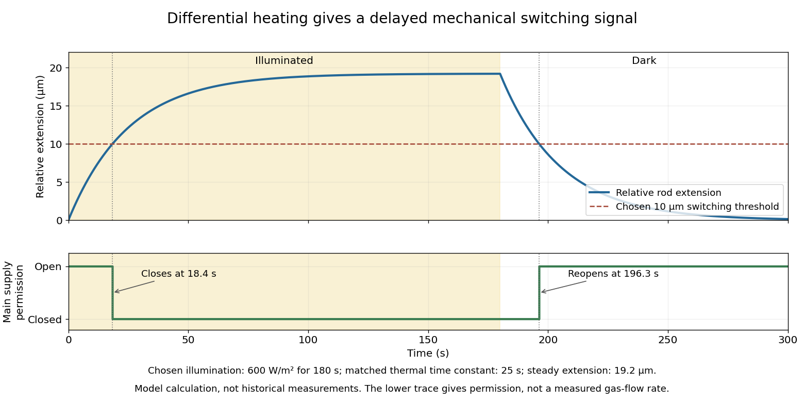

# Engineering

↑ **Parent:** [Codex Wiki](README.md)  
ⓦ [Wiki](https://en.wikipedia.org/wiki/Engineering)

**Table of contents**

- [Energizer](#energizer)
  - [Work by Energizer](#work-by-energizer)
- [MEMS and Nanotechnology Exchange](#mems-and-nanotechnology-exchange)
  - [Work by MEMS and Nanotechnology Exchange](#work-by-mems-and-nanotechnology-exchange)
- [Lake Shore Cryotronics](#lake-shore-cryotronics)
  - [Work by Lake Shore Cryotronics](#work-by-lake-shore-cryotronics)
- [Cambridge University Engineering Department](#cambridge-university-engineering-department)
  - [Work by Cambridge University Engineering Department](#work-by-cambridge-university-engineering-department)
- [ASML](#asml)
  - [Work by ASML](#work-by-asml)
- [Sensor](#sensor)
  - [Wireless sensor node](#wireless-sensor-node)
- [Bruker](#bruker)
  - [Work by Bruker](#work-by-bruker)
- [Nuclear engineering](#nuclear-engineering)
  - [Radiation shielding](#radiation-shielding)
    - [Radiation buildup factor](#radiation-buildup-factor)
  - [Radioactive material confinement](#radioactive-material-confinement)
  - [Reactor thermal hydraulics](#reactor-thermal-hydraulics)
    - [Loss-of-coolant accident](#loss-of-coolant-accident)
      - [Emergency core cooling system](#emergency-core-cooling-system)
    - [Fuel linear heat rate](#fuel-linear-heat-rate)
    - [Core power density](#core-power-density)
  - [Nuclear material accountancy](#nuclear-material-accountancy)
  - [Radioactive contamination](#radioactive-contamination)
  - [Nuclear decommissioning](#nuclear-decommissioning)
    - [Nuclear decommissioning end state](#nuclear-decommissioning-end-state)
    - [Radiological clearance](#radiological-clearance)
    - [Entombment of a nuclear facility](#entombment-of-a-nuclear-facility)
    - [Deferred dismantling](#deferred-dismantling)
    - [Immediate dismantling](#immediate-dismantling)
  - [Radioactive waste management](#radioactive-waste-management)
    - [Radioactive effluent](#radioactive-effluent)
    - [Decontamination](#decontamination)
    - [Criticality control in radioactive waste](#criticality-control-in-radioactive-waste)
    - [Radioactive decay storage](#radioactive-decay-storage)
    - [Radioactive gas holdup](#radioactive-gas-holdup)
    - [Radioactive liquid waste treatment](#radioactive-liquid-waste-treatment)
      - [Chemical precipitation treatment of radioactive waste](#chemical-precipitation-treatment-of-radioactive-waste)
      - [Evaporation of radioactive liquid waste](#evaporation-of-radioactive-liquid-waste)
    - [Radioactive waste conditioning](#radioactive-waste-conditioning)
      - [Radioactive waste package](#radioactive-waste-package)
      - [Nuclear waste vitrification](#nuclear-waste-vitrification)
        - [Waste-glass corrosion](#waste-glass-corrosion)
          - [Secondary phase formation during glass corrosion](#secondary-phase-formation-during-glass-corrosion)
          - [Batch glass leach test](#batch-glass-leach-test)
          - [Incongruent glass dissolution](#incongruent-glass-dissolution)
          - [Residual glass alteration rate](#residual-glass-alteration-rate)
          - [Glass alteration gel](#glass-alteration-gel)
          - [Forward glass dissolution rate](#forward-glass-dissolution-rate)
          - [Single-pass flow-through leach test](#single-pass-flow-through-leach-test)
          - [Congruent glass dissolution](#congruent-glass-dissolution)
          - [Normalised elemental release](#normalised-elemental-release)
    - [Radioactive waste form](#radioactive-waste-form)
      - [Synthetic mineral waste form](#synthetic-mineral-waste-form)
        - [Perovskite waste-form phase](#perovskite-waste-form-phase)
        - [Hollandite waste-form phase](#hollandite-waste-form-phase)
        - [Synroc](#synroc)
          - [Synroc-C](#synroc-c)
    - [Radioactive waste](#radioactive-waste)
  - [Nuclear fuel cycle](#nuclear-fuel-cycle)
    - [Nuclear fuel cycle length](#nuclear-fuel-cycle-length)
    - [Uranium enrichment](#uranium-enrichment)
      - [Gas centrifuge enrichment](#gas-centrifuge-enrichment)
      - [Gaseous diffusion enrichment](#gaseous-diffusion-enrichment)
    - [Separative work unit](#separative-work-unit)
      - [Separative value function](#separative-value-function)
    - [Enrichment tails](#enrichment-tails)
    - [Fuel enrichment assay](#fuel-enrichment-assay)
    - [Uranium oxide concentrate](#uranium-oxide-concentrate)
    - [Closed nuclear fuel cycle](#closed-nuclear-fuel-cycle)
    - [Open nuclear fuel cycle](#open-nuclear-fuel-cycle)
    - [Nuclear fuel reprocessing](#nuclear-fuel-reprocessing)
      - [Reprocessed uranium](#reprocessed-uranium)
    - [Spent nuclear fuel](#spent-nuclear-fuel)
  - [Nuclear engineering bibliography](#nuclear-engineering-bibliography)
    - [Backgrounder on Uranium Enrichment by the United States Nuclear Regulatory Commission](#backgrounder-on-uranium-enrichment-by-the-united-states-nuclear-regulatory-commission)
    - [Insights into the mechanisms controlling the residual corrosion rate of borosilicate glasses by Stephane Gin and others](#insights-into-the-mechanisms-controlling-the-residual-corrosion-rate-of-borosilicate-glasses-by-stephane-gin-and-others)
    - [Atomistic origin of the passivation effect in hydrated silicate glasses by Tao Du and others](#atomistic-origin-of-the-passivation-effect-in-hydrated-silicate-glasses-by-tao-du-and-others)
    - [Effects of Microstructural Factors on Irradiation Growth in Zirconium-Base Alloys by Noriyuki Sadaoka and Motomasa Fuse](#effects-of-microstructural-factors-on-irradiation-growth-in-zirconium-base-alloys-by-noriyuki-sadaoka-and-motomasa-fuse)
    - [Thermal Cycling of Uranium by Nathaniel Stetson and Melbourne L. Winton](#thermal-cycling-of-uranium-by-nathaniel-stetson-and-melbourne-l-winton)
    - [Alpha radiation damage in the actinide dioxides by R. P. Turcotte](#alpha-radiation-damage-in-the-actinide-dioxides-by-r-p-turcotte)
    - [Molecular dynamics simulation of the α-recoil nucleus displacement cascade in zirconolite by L. Veiller and others](#molecular-dynamics-simulation-of-the-alpha-recoil-nucleus-displacement-cascade-in-zirconolite-by-l-veiller-and-others)
    - [Chemistry, microstructure, and alpha decay damage of natural brannerite by G. R. Lumpkin and others](#chemistry-microstructure-and-alpha-decay-damage-of-natural-brannerite-by-g-r-lumpkin-and-others)
    - [Reactor glossary by the United States Nuclear Regulatory Commission](#reactor-glossary-by-the-united-states-nuclear-regulatory-commission)
    - [Thermodynamics, Heat Transfer, and Fluid Flow, Volume 3 by the United States Department of Energy](#thermodynamics-heat-transfer-and-fluid-flow-volume-3-by-the-united-states-department-of-energy)
    - [Nuclear Physics and Reactor Theory, Volume 2 by the United States Department of Energy](#nuclear-physics-and-reactor-theory-volume-2-by-the-united-states-department-of-energy)
    - [ANSTO Synroc Radioactive Waste Treatment Technology by the Australian Nuclear Science and Technology Organisation](#ansto-synroc-radioactive-waste-treatment-technology-by-the-australian-nuclear-science-and-technology-organisation)
    - [Predisposal Management of Radioactive Waste from Nuclear Power Plants and Research Reactors by the International Atomic Energy Agency](#predisposal-management-of-radioactive-waste-from-nuclear-power-plants-and-research-reactors-by-the-international-atomic-energy-agency)
    - [Decommissioning of Facilities by the International Atomic Energy Agency](#decommissioning-of-facilities-by-the-international-atomic-energy-agency)
    - [Decommissioning of Facilities Using Radioactive Material by the International Atomic Energy Agency](#decommissioning-of-facilities-using-radioactive-material-by-the-international-atomic-energy-agency)
    - [Measurement of kinetic rate law parameters on a Na-Ca-Al borosilicate glass for low-activity waste by B. P. McGrail and others](#measurement-of-kinetic-rate-law-parameters-on-a-na-ca-al-borosilicate-glass-for-low-activity-waste-by-b-p-mcgrail-and-others)
    - [Immobilisation of Higher Activity Wastes from Nuclear Reactor Production of 99Mo by M. W. A. Stewart and others](#immobilisation-of-higher-activity-wastes-from-nuclear-reactor-production-of-99mo-by-m-w-a-stewart-and-others)
    - [JAERI/ANSTO co-operative research on radiation damage and actinide behaviour in Synroc by S. Muraoka and others](#jaeri-ansto-co-operative-research-on-radiation-damage-and-actinide-behaviour-in-synroc-by-s-muraoka-and-others)
    - [Structural Effect of Pu Substitutions on the Zr-Site in Zirconolite by B. D. Begg and others](#structural-effect-of-pu-substitutions-on-the-zr-site-in-zirconolite-by-b-d-begg-and-others)
    - [Crystal chemistry and phase manipulation in Synroc by E. R. Vance and others](#crystal-chemistry-and-phase-manipulation-in-synroc-by-e-r-vance-and-others)
    - [Immobilisation of high level nuclear reactor wastes in SYNROC by A. E. Ringwood and others](#immobilisation-of-high-level-nuclear-reactor-wastes-in-synroc-by-a-e-ringwood-and-others)
- [Coolant](#coolant)
  - [Reactor coolant](#reactor-coolant)
- [Microelectromechanical system](#microelectromechanical-system)
- [Nanotechnology](#nanotechnology)
  - [Surface micromachining](#surface-micromachining)
    - [Sacrificial layer](#sacrificial-layer)
      - [Vapor-phase release etch](#vapor-phase-release-etch)
  - [Nanoimprint lithography](#nanoimprint-lithography)
  - [Self-assembly](#self-assembly)
    - [Self-assembled monolayer](#self-assembled-monolayer)
  - [Nanostructure](#nanostructure)
  - [Nanoparticle](#nanoparticle)
    - [Cluster-beam deposition](#cluster-beam-deposition)
    - [Multiply twinned nanoparticle](#multiply-twinned-nanoparticle)
      - [Icosahedral nanoparticle](#icosahedral-nanoparticle)
      - [Decahedral nanoparticle](#decahedral-nanoparticle)
    - [Spray pyrolysis](#spray-pyrolysis)
    - [Bimetallic nanoparticle](#bimetallic-nanoparticle)
    - [Nanoparticle ink](#nanoparticle-ink)
  - [Reactive-ion etching](#reactive-ion-etching)
    - [Deep reactive-ion etching](#deep-reactive-ion-etching)
  - [Nanowire](#nanowire)
    - [Polyol process](#polyol-process)
    - [Silver nanowire](#silver-nanowire)
      - [Fivefold-twinned silver nanowire](#fivefold-twinned-silver-nanowire)
    - [Vapor–solid growth](#vapor-solid-growth)
    - [Vapor–liquid–solid growth](#vapor-liquid-solid-growth)
  - [Nanocrystal](#nanocrystal)
    - [Nanocrystal growth](#nanocrystal-growth)
      - [Face-selective electrostatic growth inhibition](#face-selective-electrostatic-growth-inhibition)
      - [Symmetry breaking in nanocrystal growth](#symmetry-breaking-in-nanocrystal-growth)
      - [Oriented attachment](#oriented-attachment)
      - [Monomer-addition crystal growth](#monomer-addition-crystal-growth)
  - [Focused ion beam milling](#focused-ion-beam-milling)
    - [Focused-ion-beam curtaining](#focused-ion-beam-curtaining)
  - [Carbon nanosphere](#carbon-nanosphere)
  - [Gold nanoparticle](#gold-nanoparticle)
    - [Ligand shell](#ligand-shell)
  - [Physical vapor deposition](#physical-vapor-deposition)
    - [Step coverage](#step-coverage)
      - [Deposition shadowing](#deposition-shadowing)
    - [Evaporative deposition](#evaporative-deposition)
  - [Chemical vapor deposition](#chemical-vapor-deposition)
    - [Floating-catalyst chemical vapor deposition](#floating-catalyst-chemical-vapor-deposition)
      - [Direct spinning of carbon nanotube fiber](#direct-spinning-of-carbon-nanotube-fiber)
    - [Atomic layer deposition](#atomic-layer-deposition)
    - [Plasma-enhanced chemical vapor deposition](#plasma-enhanced-chemical-vapor-deposition)
    - [Reaction-limited deposition](#reaction-limited-deposition)
    - [Mass-transfer-limited deposition](#mass-transfer-limited-deposition)
  - [Photolithography](#photolithography)
    - [Etching](#etching)
      - [Hard mask](#hard-mask)
      - [Plasma ashing](#plasma-ashing)
      - [Isotropic etch](#isotropic-etch)
    - [Multiple patterning](#multiple-patterning)
    - [Proximity photolithography](#proximity-photolithography)
    - [Projection lithography](#projection-lithography)
      - [Double patterning](#double-patterning)
        - [Litho-etch-litho-etch double patterning](#litho-etch-litho-etch-double-patterning)
      - [Optical proximity correction](#optical-proximity-correction)
      - [Off-axis illumination](#off-axis-illumination)
      - [Phase-shift mask](#phase-shift-mask)
    - [Reflective extreme-ultraviolet lithography](#reflective-extreme-ultraviolet-lithography)
    - [Electron beam lithography](#electron-beam-lithography)
      - [Proximity effects in electron-beam lithography](#proximity-effects-in-electron-beam-lithography)
      - [Electron-beam proximity effect](#electron-beam-proximity-effect)
      - [Electron-beam forward scattering](#electron-beam-forward-scattering)
      - [Electron beam proximity correction](#electron-beam-proximity-correction)
    - [Immersion lithography](#immersion-lithography)
    - [Etch selectivity](#etch-selectivity)
    - [Lift-off process](#lift-off-process)
    - [Depth of focus](#depth-of-focus)
    - [Photoresist](#photoresist)
      - [Photoresist development](#photoresist-development)
      - [Positive photoresist](#positive-photoresist)
      - [Negative photoresist](#negative-photoresist)
      - [Exposure dose](#exposure-dose)
      - [Photoresist contrast](#photoresist-contrast)
        - [Critical modulation for a photoresist](#critical-modulation-for-a-photoresist)
- [Civil engineering](#civil-engineering)
  - [Civil engineer](#civil-engineer)
    - [List of civil engineers](#list-of-civil-engineers)
      - [John T. Germaine](#john-t-germaine)
        - [Work by John T. Germaine](#work-by-john-t-germaine)
- [Engineer](#engineer)
  - [List of engineers](#list-of-engineers)
    - [Jinn-Wen Hwang](#jinn-wen-hwang)
      - [Work by Jinn-Wen Hwang](#work-by-jinn-wen-hwang)
    - [A. F. Bower](#a-f-bower)
      - [Work by A. F. Bower](#work-by-a-f-bower)
    - [Gérard Roger](#gerard-roger)
      - [Work by Gérard Roger](#work-by-gerard-roger)
- [Materials science](#materials-science)
  - [Brazing](#brazing)
  - [Textile linear density](#textile-linear-density)
    - [Tex unit](#tex-unit)
  - [Recrystallisation](#recrystallisation)
  - [Microstructure](#microstructure)
    - [Line fraction estimate of phase volume](#line-fraction-estimate-of-phase-volume)
    - [Microconstituent](#microconstituent)
  - [Hydrogen embrittlement](#hydrogen-embrittlement)
  - [Corrosion](#corrosion)
    - [Stress corrosion cracking](#stress-corrosion-cracking)
  - [Ductility](#ductility)
  - [Yield strength](#yield-strength)
  - [Radiation damage in materials](#radiation-damage-in-materials)
    - [Helium accumulation in nuclear materials](#helium-accumulation-in-nuclear-materials)
      - [Helium bubble in nuclear material](#helium-bubble-in-nuclear-material)
    - [Radiation-induced swelling](#radiation-induced-swelling)
    - [Radiation-enhanced diffusion](#radiation-enhanced-diffusion)
    - [Irradiation softening](#irradiation-softening)
    - [Helium embrittlement](#helium-embrittlement)
    - [Radiation-induced amorphization](#radiation-induced-amorphization)
      - [Amorphous fraction](#amorphous-fraction)
      - [Direct-impact amorphization model](#direct-impact-amorphization-model)
        - [Effective amorphization volume per decay](#effective-amorphization-volume-per-decay)
        - [Cumulative alpha-decay event density](#cumulative-alpha-decay-event-density)
    - [Void swelling](#void-swelling)
      - [Swelling rate per displacement dose](#swelling-rate-per-displacement-dose)
      - [Swelling incubation](#swelling-incubation)
      - [Irradiation void](#irradiation-void)
      - [Cawthorne-Fulton observation of voids in irradiated steel](#cawthorne-fulton-observation-of-voids-in-irradiated-steel)
      - [Void swelling volume fraction relation](#void-swelling-volume-fraction-relation)
    - [Irradiation hardening](#irradiation-hardening)
    - [Irradiation growth](#irradiation-growth)
      - [Texture averaging of irradiation growth](#texture-averaging-of-irradiation-growth)
        - [Irradiation growth texture factor](#irradiation-growth-texture-factor)
    - [Radiation damage rate theory](#radiation-damage-rate-theory)
    - [Defect sink](#defect-sink)
      - [Interstitial bias](#interstitial-bias)
      - [Sink strength](#sink-strength)
    - [Displacement damage](#displacement-damage)
      - [Atomic displacement](#atomic-displacement)
      - [Recombination of irradiation defects](#recombination-of-irradiation-defects)
      - [Ballistic radiation damage](#ballistic-radiation-damage)
      - [Threshold displacement energy](#threshold-displacement-energy)
      - [Displacements per atom](#displacements-per-atom)
        - [Displacement dose rate](#displacement-dose-rate)
      - [Displacement cascade](#displacement-cascade)
      - [Primary knock-on atom](#primary-knock-on-atom)
  - [Nuclear materials](#nuclear-materials)
    - [Thermal cycling growth](#thermal-cycling-growth)
      - [Thermal ratcheting](#thermal-ratcheting)
    - [Nuclear fuel](#nuclear-fuel)
      - [Nuclear fuel performance](#nuclear-fuel-performance)
        - [Fission gas](#fission-gas)
      - [Fuel lattice pitch](#fuel-lattice-pitch)
      - [Nuclear fuel burnup](#nuclear-fuel-burnup)
        - [Discharge burnup](#discharge-burnup)
      - [Heavy-metal mass of nuclear fuel](#heavy-metal-mass-of-nuclear-fuel)
      - [Accident-tolerant fuel](#accident-tolerant-fuel)
      - [TRISO fuel](#triso-fuel)
      - [Uranium nitride](#uranium-nitride)
      - [Uranium silicide](#uranium-silicide)
      - [Nuclear fuel cladding](#nuclear-fuel-cladding)
        - [Zirconium alloys](#zirconium-alloys)
        - [Pellet-cladding mechanical interaction](#pellet-cladding-mechanical-interaction)
      - [Oxide nuclear fuel](#oxide-nuclear-fuel)
        - [Plutonium dioxide](#plutonium-dioxide)
        - [Oxygen-to-metal ratio](#oxygen-to-metal-ratio)
        - [Mixed oxide fuel](#mixed-oxide-fuel)
          - [Actinide redistribution in oxide fuel](#actinide-redistribution-in-oxide-fuel)
        - [Uranium dioxide](#uranium-dioxide)
          - [Doped uranium dioxide](#doped-uranium-dioxide)
  - [Thin film](#thin-film)
    - [Film drainage](#film-drainage)
    - [Line-of-sight deposition](#line-of-sight-deposition)
    - [Gravure printing](#gravure-printing)
    - [Slot-die coating](#slot-die-coating)
    - [Transparent conducting electrode](#transparent-conducting-electrode)
      - [Metal nanowire percolation](#metal-nanowire-percolation)
        - [Nanowire junction resistance](#nanowire-junction-resistance)
  - [Ferroelectricity](#ferroelectricity)
    - [Ferroelectric poling](#ferroelectric-poling)
    - [Ferroelectric domain](#ferroelectric-domain)
  - [Heat treatment](#heat-treatment)
    - [Calcination](#calcination)
  - [Creep (deformation)](#creep-deformation)
    - [Deformation mechanism map](#deformation-mechanism-map)
    - [Dislocation creep](#dislocation-creep)
    - [Water weakening of rocks](#water-weakening-of-rocks)
    - [Steady-state creep rate](#steady-state-creep-rate)
    - [Diffusion creep](#diffusion-creep)
      - [Coble creep](#coble-creep)
      - [Nabarro-Herring creep](#nabarro-herring-creep)
    - [Power-law creep](#power-law-creep)
    - [Homologous temperature](#homologous-temperature)
    - [Grain-boundary cavitation](#grain-boundary-cavitation)
    - [Grain-boundary sliding](#grain-boundary-sliding)
    - [Irradiation creep](#irradiation-creep)
      - [Radiation-induced creep](#radiation-induced-creep)
      - [Radiation-enhanced creep](#radiation-enhanced-creep)
      - [Stress-induced preferential absorption](#stress-induced-preferential-absorption)
  - [Mechanical fatigue](#mechanical-fatigue)
  - [Tensile strength](#tensile-strength)
  - [Compressive strength](#compressive-strength)
  - [Materials science bibliography](#materials-science-bibliography)
    - [Thermal expansion of nickel and iron, and the influence of nitrogen on the lattice parameter of iron at the Curie temperature by Jinn-Wen Hwang](#thermal-expansion-of-nickel-and-iron-and-the-influence-of-nitrogen-on-the-lattice-parameter-of-iron-at-the-curie-temperature-by-jinn-wen-hwang)
    - [Crystal Structures by R. W. G. Wyckoff](#crystal-structures-by-r-w-g-wyckoff)
    - [Applied Mechanics of Solids by A. F. Bower](#applied-mechanics-of-solids-by-a-f-bower)
    - [Grain Selection in a High-Efficiency 2D Grain Selector During Casting of Single-Crystal Superalloys by Xintao Zhu and others](#grain-selection-in-a-high-efficiency-2d-grain-selector-during-casting-of-single-crystal-superalloys-by-xintao-zhu-and-others)
    - [Nickel based superalloy: dislocation structure by H. K. D. H. Bhadeshia](#nickel-based-superalloy-dislocation-structure-by-h-k-d-h-bhadeshia)
    - [Dielectric and optical properties of melt-grown BaTiO3 by S. H. Wemple and others](#dielectric-and-optical-properties-of-melt-grown-batio3-by-s-h-wemple-and-others)
    - [TEL-X-Ometer X-Ray System Manual by Joseph Dohm](#tel-x-ometer-x-ray-system-manual-by-joseph-dohm)
    - [Dislocation Densities and Velocities within the γ Channels of an SX Superalloy during In Situ High-Temperature Creep Tests by T. Schenk and others](#dislocation-densities-and-velocities-within-the-gamma-channels-of-an-sx-superalloy-during-in-situ-high-temperature-creep-tests-by-t-schenk-and-others)
    - [Materials Data Book by Cambridge University Engineering Department](#materials-data-book-by-cambridge-university-engineering-department)
    - [The influence of cold-work level on the irradiation creep and swelling of AISI 316 stainless steel by E. R. Gilbert and F. A. Garner](#the-influence-of-cold-work-level-on-the-irradiation-creep-and-swelling-of-aisi-316-stainless-steel-by-e-r-gilbert-and-f-a-garner)
    - [NIST Software Package for Obtaining Charpy Transition Curves by Enrico Lucon and others](#nist-software-package-for-obtaining-charpy-transition-curves-by-enrico-lucon-and-others)
    - [High-temperature Embrittlement of Stainless Steel irradiated in Fast Fluxes by A. S. Fraser and others](#high-temperature-embrittlement-of-stainless-steel-irradiated-in-fast-fluxes-by-a-s-fraser-and-others)
    - [Accident-tolerant fuel development awards by the United States Department of Energy](#accident-tolerant-fuel-development-awards-by-the-united-states-department-of-energy)
    - [United States Nuclear Regulatory Commission fuel-damage criteria](#united-states-nuclear-regulatory-commission-fuel-damage-criteria)
    - [Plutonium redistribution in fast reactor mixed oxide fuel pins by M. Bober and others](#plutonium-redistribution-in-fast-reactor-mixed-oxide-fuel-pins-by-m-bober-and-others)
    - [An atomistic modelling study of the properties of dislocation loops in zirconium by Rory Hulse and Christopher P. Race](#an-atomistic-modelling-study-of-the-properties-of-dislocation-loops-in-zirconium-by-rory-hulse-and-christopher-p-race)
    - [Voids in irradiated stainless steel by C. Cawthorne and E. J. Fulton](#voids-in-irradiated-stainless-steel-by-c-cawthorne-and-e-j-fulton)
    - [Examples of Materials Selection by Wright State University](#examples-of-materials-selection-by-wright-state-university)
  - [Material selection](#material-selection)
    - [Materials selection chart](#materials-selection-chart)
    - [Material performance index](#material-performance-index)
      - [Specific strength](#specific-strength)
  - [Toughness](#toughness)
    - [Charpy impact test](#charpy-impact-test)
  - [Hardness](#hardness)
  - [Tensile testing](#tensile-testing)
    - [Crosshead displacement](#crosshead-displacement)
    - [Extensometer](#extensometer)
      - [Gauge length](#gauge-length)
  - [Materials scientist](#materials-scientist)
    - [Egon Orowan](#egon-orowan)
    - [Michael Ashby](#michael-ashby)
    - [Erich Schmid](#erich-schmid)
    - [Frank Nabarro](#frank-nabarro)
    - [Frederick Charles Frank](#frederick-charles-frank)
    - [Yanzhong Pei](#yanzhong-pei)
    - [Bed Poudel](#bed-poudel)
    - [Hans J. Queisser](#hans-j-queisser)
    - [Margaret J. Sobkowicz](#margaret-j-sobkowicz)
    - [Heinrich Kirchauer](#heinrich-kirchauer)
    - [List of materials scientists](#list-of-materials-scientists)
      - [Andreas Bührig-Polaczek](#andreas-buhrig-polaczek)
        - [Work by Andreas Bührig-Polaczek](#work-by-andreas-buhrig-polaczek)
      - [Dexin Ma](#dexin-ma)
        - [Work by Dexin Ma](#work-by-dexin-ma)
      - [Fu Wang](#fu-wang)
        - [Work by Fu Wang](#work-by-fu-wang)
      - [Xintao Zhu](#xintao-zhu)
        - [Work by Xintao Zhu](#work-by-xintao-zhu)
      - [Yanhui Zhang](#yanhui-zhang)
        - [Work by Yanhui Zhang](#work-by-yanhui-zhang)
      - [H. K. D. H. Bhadeshia](#h-k-d-h-bhadeshia)
        - [Work by H. K. D. H. Bhadeshia](#work-by-h-k-d-h-bhadeshia)
      - [Olga Bubnova](#olga-bubnova)
        - [Work by Olga Bubnova](#work-by-olga-bubnova)
      - [F. A. Garner](#f-a-garner)
        - [Work by F. A. Garner](#work-by-f-a-garner)
      - [E. R. Gilbert](#e-r-gilbert)
        - [Work by E. R. Gilbert](#work-by-e-r-gilbert)
      - [Enrico Lucon](#enrico-lucon)
        - [Work by Enrico Lucon](#work-by-enrico-lucon)
      - [A. S. Fraser](#a-s-fraser)
        - [Work by A. S. Fraser](#work-by-a-s-fraser)
      - [M. Bober](#m-bober)
        - [Work by M. Bober](#work-by-m-bober)
      - [Christopher P. Race](#christopher-p-race)
        - [Work by Christopher P. Race](#work-by-christopher-p-race)
      - [Rory Hulse](#rory-hulse)
        - [Work by Rory Hulse](#work-by-rory-hulse)
      - [E. J. Fulton](#e-j-fulton)
        - [Work by E. J. Fulton](#work-by-e-j-fulton)
      - [C. Cawthorne](#c-cawthorne)
        - [Work by C. Cawthorne](#work-by-c-cawthorne)
      - [Shunsuke Sakurai](#shunsuke-sakurai)
        - [Work by Shunsuke Sakurai](#work-by-shunsuke-sakurai)
      - [Neha Arora](#neha-arora)
        - [Work by Neha Arora](#work-by-neha-arora)
      - [Ashish K. Khandpur](#ashish-k-khandpur)
        - [Work by Ashish K. Khandpur](#work-by-ashish-k-khandpur)
      - [Adrianus I. Aria](#adrianus-i-aria)
        - [Work by Adrianus I. Aria](#work-by-adrianus-i-aria)
      - [Xinran Wang](#xinran-wang)
        - [Work by Xinran Wang](#work-by-xinran-wang)
      - [Robert F. Cook](#robert-f-cook)
        - [Work by Robert F. Cook](#work-by-robert-f-cook)
      - [Arthur Gossard](#arthur-gossard)
        - [Work by Arthur Gossard](#work-by-arthur-gossard)
  - [Atomic force microscopy](#atomic-force-microscopy)
    - [Frequency-modulation atomic force microscopy](#frequency-modulation-atomic-force-microscopy)
      - [Small-amplitude AFM frequency shift](#small-amplitude-afm-frequency-shift)
    - [Piezoelectric scanner](#piezoelectric-scanner)
    - [Kelvin probe force microscopy](#kelvin-probe-force-microscopy)
    - [LiftMode](#liftmode)
    - [Conductive atomic force microscopy](#conductive-atomic-force-microscopy)
      - [Spreading resistance microscopy](#spreading-resistance-microscopy)
    - [Contact-mode atomic force microscopy](#contact-mode-atomic-force-microscopy)
    - [Tip-change artefact](#tip-change-artefact)
    - [Scanning capacitance microscopy](#scanning-capacitance-microscopy)
    - [Quantitative nanomechanical mapping](#quantitative-nanomechanical-mapping)
    - [Tunnelling atomic force microscopy](#tunnelling-atomic-force-microscopy)
    - [AFM feedback artefact](#afm-feedback-artefact)
    - [AFM tip convolution](#afm-tip-convolution)
    - [AFM force curve](#afm-force-curve)
    - [AFM probe](#afm-probe)
      - [AFM cantilever](#afm-cantilever)
        - [Cantilever spring constant](#cantilever-spring-constant)
    - [AFM image flattening](#afm-image-flattening)
    - [Scanner bow](#scanner-bow)
    - [PeakForce quantitative nanomechanical mapping](#peakforce-quantitative-nanomechanical-mapping)
    - [Jump-to-contact](#jump-to-contact)
    - [Imaging trace and retrace](#imaging-trace-and-retrace)
    - [Tip convolution](#tip-convolution)
    - [Friction force microscopy](#friction-force-microscopy)
    - [Piezoresponse force microscopy](#piezoresponse-force-microscopy)
    - [AFM tip-convolution artefact](#afm-tip-convolution-artefact)
      - [Double-tip artefact](#double-tip-artefact)
    - [Critical-dimension atomic force microscopy](#critical-dimension-atomic-force-microscopy)
    - [Tapping-mode atomic force microscopy](#tapping-mode-atomic-force-microscopy)
    - [Colloidal probe technique](#colloidal-probe-technique)
    - [Atomic force microscope](#atomic-force-microscope)
  - [Crystal growth](#crystal-growth)
  - [Epitaxy](#epitaxy)
    - [Metalorganic vapour-phase epitaxy](#metalorganic-vapour-phase-epitaxy)
    - [Selective-area epitaxy](#selective-area-epitaxy)
    - [Molecular beam epitaxy](#molecular-beam-epitaxy)
  - [Ceramic](#ceramic)
  - [Sintering](#sintering)
    - [Hot pressing](#hot-pressing)
      - [Hot isostatic pressing](#hot-isostatic-pressing)
  - [Sputtering](#sputtering)
    - [Magnetron sputtering](#magnetron-sputtering)
    - [Ion milling](#ion-milling)
  - [Annealing (materials science)](#annealing-materials-science)
- [Mechanical engineering](#mechanical-engineering)
  - [Thin-walled pressure vessel](#thin-walled-pressure-vessel)
    - [Axial membrane stress](#axial-membrane-stress)
    - [Hoop stress](#hoop-stress)
  - [Gasket](#gasket)
  - [Mechanical engineer](#mechanical-engineer)
    - [List of mechanical engineers](#list-of-mechanical-engineers)
      - [Leon van Dommelen](#leon-van-dommelen)
        - [Work by Leon van Dommelen](#work-by-leon-van-dommelen)
      - [Gustaf Dalén](#gustaf-dalen)
        - [Work by Gustaf Dalén](#work-by-gustaf-dalen)
  - [Piston](#piston)
  - [Valve](#valve)
    - [Sun valve](#sun-valve)
      - [Differential thermal model of a sun valve](#differential-thermal-model-of-a-sun-valve)
      - [Testing a differential thermal actuator](#testing-a-differential-thermal-actuator)
- [Lighthouse](#lighthouse)
  - [Dalén light](#dalen-light)
    - [Gas flasher in a Dalén light](#gas-flasher-in-a-dalen-light)
- [Manufacturing](#manufacturing)
  - [Welding](#welding)
    - [Plasmonic nanowelding](#plasmonic-nanowelding)
- [Chemical engineering](#chemical-engineering)
  - [Residence time distribution](#residence-time-distribution)
    - [Residence time](#residence-time)
    - [Well-mixed flow reactor](#well-mixed-flow-reactor)
    - [Plug flow](#plug-flow)
  - [Chemical engineer](#chemical-engineer)
    - [List of chemical engineers](#list-of-chemical-engineers)
      - [Yannis G. Kevrekidis](#yannis-g-kevrekidis)
        - [Work by Yannis G. Kevrekidis](#work-by-yannis-g-kevrekidis)
      - [Anthony E. Butterfield](#anthony-e-butterfield)
        - [Work by Anthony E. Butterfield](#work-by-anthony-e-butterfield)
      - [Ah-Hyung Alissa Park](#ah-hyung-alissa-park)
        - [Work by Ah-Hyung Alissa Park](#work-by-ah-hyung-alissa-park)
      - [Marco Mazzotti](#marco-mazzotti)
        - [Work by Marco Mazzotti](#work-by-marco-mazzotti)
  - [Separation process](#separation-process)
    - [Leaching](#leaching)
    - [Ion exchange](#ion-exchange)
      - [Ion-exchange resin](#ion-exchange-resin)
    - [Solvent extraction](#solvent-extraction)
- [Aerospace engineering](#aerospace-engineering)
  - [Aerospace engineer](#aerospace-engineer)
    - [List of aerospace engineers](#list-of-aerospace-engineers)
      - [Raymond S. Castner](#raymond-s-castner)
        - [Work by Raymond S. Castner](#work-by-raymond-s-castner)
      - [Tom Benson](#tom-benson)
        - [Work by Tom Benson](#work-by-tom-benson)
      - [Nancy Hall](#nancy-hall)
        - [Work by Nancy Hall](#work-by-nancy-hall)

## Energizer

↑ **Parent:** [Engineering](engineering.md)

### Work by Energizer

↑ **Parent:** [Energizer](#energizer)

## MEMS and Nanotechnology Exchange

↑ **Parent:** [Engineering](engineering.md)

### Work by MEMS and Nanotechnology Exchange

↑ **Parent:** [MEMS and Nanotechnology Exchange](#mems-and-nanotechnology-exchange)

## Lake Shore Cryotronics

↑ **Parent:** [Engineering](engineering.md)

### Work by Lake Shore Cryotronics

↑ **Parent:** [Lake Shore Cryotronics](#lake-shore-cryotronics)

## Cambridge University Engineering Department

↑ **Parent:** [Engineering](engineering.md)

### Work by Cambridge University Engineering Department

↑ **Parent:** [Cambridge University Engineering Department](#cambridge-university-engineering-department)

## ASML

↑ **Parent:** [Engineering](engineering.md)

### Work by ASML

↑ **Parent:** [ASML](#asml)

## Sensor

↑ **Parent:** [Engineering](engineering.md)

### Wireless sensor node

↑ **Parent:** [Sensor](#sensor)

A device combining sensing, local processing, a radio and a power subsystem. An [energy](energy.md) budget must account for sleep leakage, active operation, startup and peak communication current; stored [energy](energy.md) can bridge intermittent harvesting.

## Bruker

↑ **Parent:** [Engineering](engineering.md)

Manufacturer of scientific instruments, including [atomic force microscopes](#atomic-force-microscope).

### Work by Bruker

↑ **Parent:** [Bruker](#bruker)

## Nuclear engineering

↑ **Parent:** [Engineering](engineering.md)

Engineering of systems using nuclear reactions or managing radioactive materials, including reactor energy conversion, materials performance and waste management.

### Radiation shielding

↑ **Parent:** [Nuclear engineering](#nuclear-engineering)

Attenuation of an ionising radiation field by intervening material. A shield can reduce external exposure without preventing contamination from a released radioactive substance.

#### Radiation buildup factor

↑ **Parent:** [Radiation shielding](#radiation-shielding)

A factor accounting for scattered radiation that contributes to a specified response beyond the uncollided [exponential attenuation](electromagnetic-radiation.md#exponential-attenuation). It depends on material, geometry, spectrum and the response being counted; $B(x)=1+x$ is a stipulated simple model, not a universal law.

### Radioactive material confinement

↑ **Parent:** [Nuclear engineering](#nuclear-engineering)

Prevention of unwanted dispersal of radioactive material by barriers, enclosures and controlled transfers. It differs from shielding, which attenuates a radiation field without necessarily retaining the radioactive source.

### Reactor thermal hydraulics

↑ **Parent:** [Nuclear engineering](#nuclear-engineering)

The coupled analysis of heat generation, [heat transfer](heat.md#heat-transfer) and coolant [fluid mechanics](fluid-mechanics.md) in a [nuclear reactor](physics.md#nuclear-reactor). A change in fuel geometry can affect [neutron moderation](neutron.md#neutron-moderation), hydraulic resistance and thermal margins together, so holding one quantity fixed does not generally hold the others fixed.

#### Loss-of-coolant accident

↑ **Parent:** [Reactor thermal hydraulics](#reactor-thermal-hydraulics)

An accident involving loss of reactor coolant through a breach of its pressure boundary. Depressurization, loss of inventory and changes in heat removal require a transient assessment; stopping the fission chain reaction does not remove [decay heat](physics.md#decay-heat).

##### Emergency core cooling system

↑ **Parent:** [Loss-of-coolant accident](#loss-of-coolant-accident)

A system intended to supply emergency cooling to limit fuel damage and maintain heat removal following a coolant-loss event. Its performance depends on the accident conditions and flow paths as well as nominal injection capability.

#### Fuel linear heat rate

↑ **Parent:** [Reactor thermal hydraulics](#reactor-thermal-hydraulics)

Thermal power generated per unit axial fuel-rod length, measured in $\mathrm{W\,m^{-1}}$. At fixed rod radius and material state, it controls the conductive fuel-to-surface temperature rise; coolant conditions determine the surface temperature from which that rise begins.

#### Core power density

↑ **Parent:** [Reactor thermal hydraulics](#reactor-thermal-hydraulics)

Thermal power per active-core volume under a stated volume convention. Coolant channels can be included in that core volume even when excluded from fuel volume, so core and fuel power densities need not change together.

### Nuclear material accountancy

↑ **Parent:** [Nuclear engineering](#nuclear-engineering)

Recording and reconciliation of nuclear-material inventories and transfers. This is a management concept, not a procedure for producing or separating [fissile material](physics.md#fissile-material).

### Radioactive contamination

↑ **Parent:** [Nuclear engineering](#nuclear-engineering)

Unwanted radioactive material on or in an object, substance or environment. It is distinct from activation of the object itself.

### Nuclear decommissioning

↑ **Parent:** [Nuclear engineering](#nuclear-engineering)

Administrative and technical actions bringing a permanently shut-down nuclear facility to a demonstrated end state permitting removal of some or all regulatory controls. Waste management and site-release evidence are integral to completion.

#### Nuclear decommissioning end state

↑ **Parent:** [Nuclear decommissioning](#nuclear-decommissioning)

The specified condition at completion of [nuclear decommissioning](#nuclear-decommissioning), supported by final characterisation and records. It can permit unrestricted reuse or retain defined restrictions.

#### Radiological clearance

↑ **Parent:** [Nuclear decommissioning](#nuclear-decommissioning)

Removal of materials or objects from further radiological regulatory control under specified criteria. Absence of an obvious radiation signal is not sufficient evidence of clearance.

#### Entombment of a nuclear facility

↑ **Parent:** [Nuclear decommissioning](#nuclear-decommissioning)

Encasement of radioactive structures in a long-lived material. Historical classifications included it as a third strategy; IAEA GSR Part 6 excludes it for planned permanent shutdown, allowing consideration only in exceptional circumstances.

#### Deferred dismantling

↑ **Parent:** [Nuclear decommissioning](#nuclear-decommissioning)

A strategy maintaining a facility safely for a period before final dismantling. [radioactive decay](physics.md#radioactive-decay) can reduce later dose, while surveillance, deterioration and knowledge retention remain obligations.

#### Immediate dismantling

↑ **Parent:** [Nuclear decommissioning](#nuclear-decommissioning)

A strategy beginning dismantling and [decontamination](#decontamination) soon after permanent shutdown, making early use of operating knowledge and enabling earlier site reuse.

### Radioactive waste management

↑ **Parent:** [Nuclear engineering](#nuclear-engineering)

Control of [radioactive wastes](#radioactive-waste) from generation through treatment, conditioning, storage and disposal. Concentrating a radionuclide in a smaller stream changes its location, not its [radioactive decay](physics.md#radioactive-decay) law.

#### Radioactive effluent

↑ **Parent:** [Radioactive waste management](#radioactive-waste-management)

A liquid or gaseous outflow containing radionuclides. Its measured inventory and treatment history are distinct from whether release is authorised under the applicable discharge controls.

#### Decontamination

↑ **Parent:** [Radioactive waste management](#radioactive-waste-management)

Removal of contamination from a surface or material. The cleaning residues and wash solutions become part of the waste inventory.

#### Criticality control in radioactive waste

↑ **Parent:** [Radioactive waste management](#radioactive-waste-management)

Prevention of an unintended self-sustaining [nuclear fission](physics.md#nuclear-fission) chain reaction in waste management. [neutron](neutron.md) absorbers, fissile-isotope dilution and their long-term geochemical retention are relevant; a cross-section comparison is not a criticality assessment.

#### Radioactive decay storage

↑ **Parent:** [Radioactive waste management](#radioactive-waste-management)

Storage that allows short-lived radioactive constituents to [radioactive decay](physics.md#radioactive-decay) before subsequent handling or discharge. A clearance or discharge decision still requires the applicable measurement and acceptance criteria.

#### Radioactive gas holdup

↑ **Parent:** [Radioactive waste management](#radioactive-waste-management)

Temporary retention of radioactive gas so that nuclear [radioactive decay](physics.md#radioactive-decay) lowers the [radioactive activity](physics.md#radioactive-activity) released. A guaranteed minimum [residence time](#residence-time), an average [residence time](#residence-time) and a tank filling time are different design quantities.

#### Radioactive liquid waste treatment

↑ **Parent:** [Radioactive waste management](#radioactive-waste-management)

Separation or transformation of contaminants in liquid waste. [evaporation](critical-phenomenon.md#evaporation), [ion exchange](#ion-exchange) and chemical [precipitation](chemical-reaction.md#precipitation-chemistry) concentrate radionuclides into residues that need further management.

##### Chemical precipitation treatment of radioactive waste

↑ **Parent:** [Radioactive liquid waste treatment](#radioactive-liquid-waste-treatment)

Transfer of dissolved contaminants to separable solids by [precipitation](chemical-reaction.md#precipitation-chemistry), [coprecipitation](chemical-reaction.md#coprecipitation) or surface uptake. The resulting sludge requires separation and conditioning; residual dissolved [radioactive activity](physics.md#radioactive-activity) must be measured.

##### Evaporation of radioactive liquid waste

↑ **Parent:** [Radioactive liquid waste treatment](#radioactive-liquid-waste-treatment)

Removal of water vapour to concentrate mainly nonvolatile contaminants. Entrainment and volatile radionuclides can contaminate the condensate; a smaller concentrate volume does not guarantee a clean distillate.

#### Radioactive waste conditioning

↑ **Parent:** [Radioactive waste management](#radioactive-waste-management)

Operations producing a stable waste form and suitable package, for example immobilisation in cement, [glass](chemical-substance.md#glass) or [ceramic](#ceramic). Treatment residues and secondary wastes must be included in the waste inventory.

##### Radioactive waste package

↑ **Parent:** [Radioactive waste conditioning](#radioactive-waste-conditioning)

A waste form together with its container and any associated internal barriers prepared for handling, storage or disposal.

##### Nuclear waste vitrification

↑ **Parent:** [Radioactive waste conditioning](#radioactive-waste-conditioning)

Immobilisation of [radioactive waste](#radioactive-waste) in a [glass](chemical-substance.md#glass) matrix. [glass](chemical-substance.md#glass) composition, durability, secondary phases and the complete package affect performance.

###### Waste-glass corrosion

↑ **Parent:** [Nuclear waste vitrification](#nuclear-waste-vitrification)

Interaction of waste [glass](chemical-substance.md#glass) with water through [ion exchange](#ion-exchange), network dissolution and alteration-product formation. Dissolved-element release need not equal the total extent of [glass](chemical-substance.md#glass) alteration.

###### Secondary phase formation during glass corrosion

↑ **Parent:** [Waste-glass corrosion](#waste-glass-corrosion)

Formation of new solids during [glass](chemical-substance.md#glass) alteration. Such phases can retain selected elements or consume dissolved network constituents, changing the apparent release and reaction rate.

###### Batch glass leach test

↑ **Parent:** [Waste-glass corrosion](#waste-glass-corrosion)

A glass-durability test with a finite initially specified leachant inventory. Dissolved products, [pH](acid-base-chemistry.md#ph) and alteration layers evolve, so the test does not maintain the same conditions as continuous fresh-water flow.

###### Incongruent glass dissolution

↑ **Parent:** [Waste-glass corrosion](#waste-glass-corrosion)

Element release departing from bulk [glass](chemical-substance.md#glass) proportions. Selective [ion exchange](#ion-exchange), retention in an alteration layer, sorption and secondary [precipitation](chemical-reaction.md#precipitation-chemistry) can all produce noncoincident normalised solution releases.

###### Residual glass alteration rate

↑ **Parent:** [Waste-glass corrosion](#waste-glass-corrosion)

A low continuing rate after alteration products or solution chemistry have slowed the initial reaction. It need not be zero or represent thermodynamic equilibrium of the original [glass](chemical-substance.md#glass).

###### Glass alteration gel

↑ **Parent:** [Waste-glass corrosion](#waste-glass-corrosion)

A hydrated, compositionally modified interfacial layer formed during [glass](chemical-substance.md#glass) [corrosion](#corrosion). Its [porosity](porous-media-flow.md#porosity), transport properties and continuing reactions can affect the residual alteration rate.

###### Forward glass dissolution rate

↑ **Parent:** [Waste-glass corrosion](#waste-glass-corrosion)

The dilute-solution dissolution rate at specified [temperature](temperature.md), [pH](acid-base-chemistry.md#ph) and composition, before dissolved reaction products suppress the chemical driving force. It is not a maximum across all [temperatures](temperature.md) and [pH](acid-base-chemistry.md#ph) values.

###### Single-pass flow-through leach test

↑ **Parent:** [Waste-glass corrosion](#waste-glass-corrosion)

A continuously refreshed leach test used to measure dissolution under controlled dilute conditions. At steady state the elemental normalised rate is $r_e=Q(c_{e,\rm out}-c_{e,\rm in})/(f_eS)$. Varying $Q/S$ helps identify solution-affinity effects.

###### Congruent glass dissolution

↑ **Parent:** [Waste-glass corrosion](#waste-glass-corrosion)

Dissolution releasing [glass](chemical-substance.md#glass) constituents in their bulk proportions. Element-normalised releases then coincide if [precipitation](chemical-reaction.md#precipitation-chemistry), sorption and analytical losses do not selectively remove released constituents.

###### Normalised elemental release

↑ **Parent:** [Waste-glass corrosion](#waste-glass-corrosion)

The solution-released mass of an element divided by its initial [glass](chemical-substance.md#glass) [mass fraction](mixture.md#mass-fraction) and the exposed [glass](chemical-substance.md#glass) area: $NL_e=m_e/(f_eS)$. It has units of glass-equivalent mass per area; it does not alone establish congruent dissolution.

#### Radioactive waste form

↑ **Parent:** [Radioactive waste management](#radioactive-waste-management)

The physical and chemical form in which [radioactive waste](#radioactive-waste) is immobilised for handling, storage or disposal. Its durability is distinct from that of its container and surrounding engineered barriers.

##### Synthetic mineral waste form

↑ **Parent:** [Radioactive waste form](#radioactive-waste-form)

A waste form designed using durable [mineral](planetary-science.md#mineral) structures as hosts. A natural analogue motivates a design but does not substitute for tests of the actual radioactive composition.

###### Perovskite waste-form phase

↑ **Parent:** [Synthetic mineral waste form](#synthetic-mineral-waste-form)

A titanate host represented by $\mathrm{CaTiO_3}$. [strontium](chemical-substance.md#strontium) can replace [calcium](chemical-substance.md#calcium); other [ions](chemistry.md#ion) require suitable charge balance.

###### Hollandite waste-form phase

↑ **Parent:** [Synthetic mineral waste form](#synthetic-mineral-waste-form)

A tunnel-structured titanate host, represented by $\mathrm{BaAl_2Ti_6O_{16}}$, used to incorporate large [cations](chemistry.md#cation) such as [caesium](chemical-substance.md#caesium) with appropriate [charge compensation in a crystal](chemical-substance.md#charge-compensation-in-a-crystal).

###### Synroc

↑ **Parent:** [Synthetic mineral waste form](#synthetic-mineral-waste-form)

A family of mineral-analogue [ceramic](#ceramic) waste forms. Different titanate phases accept different waste [ions](chemistry.md#ion) by [solid solution](chemical-substance.md#solid-solution); phase assemblage is tailored to the waste inventory.

###### Synroc-C

↑ **Parent:** [Synroc](#synroc)

A multiphase [Synroc](#synroc) formulation with [zirconolite](planetary-science.md#zirconolite), hollandite, perovskite and titanium-oxide phases. The [mineral](planetary-science.md#mineral) hosts distribute different radionuclides rather than requiring one lattice to accept the entire inventory.

#### Radioactive waste

↑ **Parent:** [Radioactive waste management](#radioactive-waste-management)

Material containing radionuclides for which no further use is foreseen and which is subject to radiological control under the applicable framework.

### Nuclear fuel cycle

↑ **Parent:** [Nuclear engineering](#nuclear-engineering)

The linked production, use and subsequent management of [nuclear fuel](#nuclear-fuel). A closed cycle recovers some material for reuse; it still generates [radioactive wastes](#radioactive-waste).

#### Nuclear fuel cycle length

↑ **Parent:** [Nuclear fuel cycle](#nuclear-fuel-cycle)

The operating interval between specified refuelling events. It must be distinguished from the full material [nuclear fuel cycle](#nuclear-fuel-cycle) and from an individual fuel batch's multi-cycle residence time. Reactivity history, thermal limits and fuel management constrain the achievable interval.

#### Uranium enrichment

↑ **Parent:** [Nuclear fuel cycle](#nuclear-fuel-cycle)

An increase in the fraction of a specified [uranium](chemical-substance.md#uranium) [isotope](chemical-substance.md#isotope). Fuel-cycle accounting tracks feed, product, [enrichment tails](#enrichment-tails) and separative work; it does not specify an [uranium enrichment](#uranium-enrichment) plant or its operating conditions.

##### Gas centrifuge enrichment

↑ **Parent:** [Uranium enrichment](#uranium-enrichment)

A technology exploiting mass-dependent redistribution of gas under rotation. It became the dominant commercial uranium-enrichment technology with much lower electricity consumption than gaseous [diffusion](thermodynamics.md#diffusion). No operating conditions or equipment specifications are supplied.

##### Gaseous diffusion enrichment

↑ **Parent:** [Uranium enrichment](#uranium-enrichment)

A historical isotope-enrichment technology using the different transport of isotopic gas molecules through a barrier. It was displaced commercially by much less electricity-intensive centrifuge technology. This is a historical principle, not a plant design or operating procedure.

#### Separative work unit

↑ **Parent:** [Nuclear fuel cycle](#nuclear-fuel-cycle)

A unit of isotope-separation work used in fuel-cycle accounting. If stream masses are in kilograms and $x$ is [isotope](chemical-substance.md#isotope) [mass fraction](mixture.md#mass-fraction), $S=PV(x_p)+WV(x_w)-FV(x_f)$ is in kg-SWU, with $V(x)=(1-2x)\log[(1-x)/x]$. This is a resource-accounting relation, not equipment or cascade design.

##### Separative value function

↑ **Parent:** [Separative work unit](#separative-work-unit)

The dimensionless composition function $V(x)=(1-2x)\log[(1-x)/x]$ used in separative-work accounting.

#### Enrichment tails

↑ **Parent:** [Nuclear fuel cycle](#nuclear-fuel-cycle)

The depleted material stream in [isotope](chemical-substance.md#isotope) [uranium enrichment](#uranium-enrichment). [enrichment tails](#enrichment-tails) retain [uranium](chemical-substance.md#uranium), so gross feed demand exceeds the enriched product mass.

#### Fuel enrichment assay

↑ **Parent:** [Nuclear fuel cycle](#nuclear-fuel-cycle)

The stated mass or atom fraction of a selected fuel [isotope](chemical-substance.md#isotope). An [isotope](chemical-substance.md#isotope) balance requires all streams to use the same convention; a [mass fraction](mixture.md#mass-fraction) is not interchangeable with an atom fraction without conversion.

#### Uranium oxide concentrate

↑ **Parent:** [Nuclear fuel cycle](#nuclear-fuel-cycle)

A concentrated uranium-bearing product of ore processing. Resource accounts must distinguish mass of [uranium](chemical-substance.md#uranium) from gross mass of its oxide concentrate.

#### Closed nuclear fuel cycle

↑ **Parent:** [Nuclear fuel cycle](#nuclear-fuel-cycle)

A fuel cycle returning recovered constituents to fuel manufacture. Recovery losses, additional waste streams and recycled-fuel specifications affect the resource and cost balance.

#### Open nuclear fuel cycle

↑ **Parent:** [Nuclear fuel cycle](#nuclear-fuel-cycle)

A once-through fuel cycle in which [spent nuclear fuel](#spent-nuclear-fuel) is managed without recovering its constituents for a further fuel irradiation.

#### Nuclear fuel reprocessing

↑ **Parent:** [Nuclear fuel cycle](#nuclear-fuel-cycle)

Chemical treatment of [spent nuclear fuel](#spent-nuclear-fuel) to partition reusable constituents from wastes. Recovery does not eliminate the need for waste conditioning and disposal. This article concerns concepts and material accounting, not operational fissile-separation procedures.

##### Reprocessed uranium

↑ **Parent:** [Nuclear fuel reprocessing](#nuclear-fuel-reprocessing)

[uranium](chemical-substance.md#uranium) recovered from [spent nuclear fuel](#spent-nuclear-fuel). Its isotopic composition differs from natural [uranium](chemical-substance.md#uranium); [uranium-236](chemical-substance.md#uranium-236) can impose an additional fuel-performance penalty.

#### Spent nuclear fuel

↑ **Parent:** [Nuclear fuel cycle](#nuclear-fuel-cycle)

Irradiated [nuclear fuel](#nuclear-fuel) removed from a reactor. Residual [actinides](chemical-substance.md#actinide) coexist with [fission products](physics.md#fission-product) and activation products; radioactivity and [decay heat](physics.md#decay-heat) continue after shutdown.

### Nuclear engineering bibliography

↑ **Parent:** [Nuclear engineering](#nuclear-engineering)

#### Backgrounder on Uranium Enrichment by the United States Nuclear Regulatory Commission

↑ **Parent:** [Nuclear engineering bibliography](#nuclear-engineering-bibliography)  
🏷️ **Tags:** [Work by United States Nuclear Regulatory Commission](physics-author.md#work-by-united-states-nuclear-regulatory-commission)

[https://www.nrc.gov/regulations-legislation/fact-sheets-brochures/backgrounder-on-uranium-enrichment](https://www.nrc.gov/regulations-legislation/fact-sheets-brochures/backgrounder-on-uranium-enrichment)

Historical background on the replacement of gaseous [diffusion](thermodynamics.md#diffusion) by gas centrifuges and diffusion-plant closures. The later webpage is not used to assign present-day plant counts to 2019.

#### Insights into the mechanisms controlling the residual corrosion rate of borosilicate glasses by Stephane Gin and others

↑ **Parent:** [Nuclear engineering bibliography](#nuclear-engineering-bibliography)  
🏷️ **Tags:** [Work by Stephane Gin](planetary-science.md#work-by-stephane-gin)

[https://doi.org/10.1038/s41529-020-00145-2](https://doi.org/10.1038/s41529-020-00145-2)

npj Materials Degradation 4, article 41, published 11 December 2020. Solution and solid depth-profile measurements show that [boron](chemical-substance.md#boron) can be retained in alteration gels.

#### Atomistic origin of the passivation effect in hydrated silicate glasses by Tao Du and others

↑ **Parent:** [Nuclear engineering bibliography](#nuclear-engineering-bibliography)  
🏷️ **Tags:** [Work by Tao Du](chemistry.md#work-by-tao-du)

[https://doi.org/10.1038/s41529-019-0070-9](https://doi.org/10.1038/s41529-019-0070-9)

npj Materials Degradation 3, article 6, published 7 February 2019. Atomistic simulations examine restructuring and transport in hydrated gels; this is not a universal measured leach law.

#### Effects of Microstructural Factors on Irradiation Growth in Zirconium-Base Alloys by Noriyuki Sadaoka and Motomasa Fuse

↑ **Parent:** [Nuclear engineering bibliography](#nuclear-engineering-bibliography)  
🏷️ **Tags:** [Work by Motomasa Fuse](physicist.md#work-by-motomasa-fuse), [Work by Noriyuki Sadaoka](physicist.md#work-by-noriyuki-sadaoka)

[https://doi.org/10.2320/matertrans1960.29.970](https://doi.org/10.2320/matertrans1960.29.970)

Transactions of the Japan Institute of Metals 29, 970–976. The model and comparison with experimental specimens distinguish [grain size](thermodynamics.md#grain-size), aspect ratio and [dislocation](physical-chemistry.md#dislocation) [density](fluid-mechanics.md#density).

#### Thermal Cycling of Uranium by Nathaniel Stetson and Melbourne L. Winton

↑ **Parent:** [Nuclear engineering bibliography](#nuclear-engineering-bibliography)  
🏷️ **Tags:** [Work by Melbourne L. Winton](physicist.md#work-by-melbourne-l-winton), [Work by Nathaniel Stetson](physicist.md#work-by-nathaniel-stetson)

[https://www.osti.gov/servlets/purl/4090548](https://www.osti.gov/servlets/purl/4090548)

ORNL-1386, August 1952. Primary thermal-cycling investigation; the opening discussion describes dimensional instability, surface distortion and preferred orientation.

#### Alpha radiation damage in the actinide dioxides by R. P. Turcotte

↑ **Parent:** [Nuclear engineering bibliography](#nuclear-engineering-bibliography)  
🏷️ **Tags:** [Work by R. P. Turcotte](chemistry.md#work-by-r-p-turcotte)

[https://www.osti.gov/servlets/purl/4172799](https://www.osti.gov/servlets/purl/4172799)

BNWL-SA-5333; CONF-750915-21. Primary comparison of alpha irradiation, self-damage and [annealing](#annealing-materials-science); the alpha contribution is small relative to recoil damage but is not zero.

<h4 id="molecular-dynamics-simulation-of-the-alpha-recoil-nucleus-displacement-cascade-in-zirconolite-by-l-veiller-and-others">Molecular dynamics simulation of the α-recoil nucleus displacement cascade in zirconolite by L. Veiller and others</h4>

↑ **Parent:** [Nuclear engineering bibliography](#nuclear-engineering-bibliography)  
🏷️ **Tags:** [Work by L. Veiller](physicist.md#work-by-l-veiller)

[https://doi.org/10.1016/S0022-3115(02)01134-0](https://doi.org/10.1016/S0022-3115(02)01134-0)

Journal of Nuclear Materials 306, 61–72. Simulation study using empirical potentials; a disordered cascade core and surrounding [point defects](physical-chemistry.md#point-defect) are distinguished.

#### Chemistry, microstructure, and alpha decay damage of natural brannerite by G. R. Lumpkin and others

↑ **Parent:** [Nuclear engineering bibliography](#nuclear-engineering-bibliography)  
🏷️ **Tags:** [Work by G. R. Lumpkin](planetary-science.md#work-by-g-r-lumpkin)

[https://doi.org/10.1016/j.chemgeo.2011.09.008](https://doi.org/10.1016/j.chemgeo.2011.09.008)

Chemical Geology 291, 55–68. Primary natural-sample study and stopping/damage simulations; Table 5 compares alpha and recoil displacement yields. Open institutional copy: [https://apo.ansto.gov.au/server/api/core/bitstreams/12f621b9-8bb2-4e4c-84a0-8dc31a548213/content](https://apo.ansto.gov.au/server/api/core/bitstreams/12f621b9-8bb2-4e4c-84a0-8dc31a548213/content)

#### Reactor glossary by the United States Nuclear Regulatory Commission

↑ **Parent:** [Nuclear engineering bibliography](#nuclear-engineering-bibliography)  
🏷️ **Tags:** [Work by United States Nuclear Regulatory Commission](physics-author.md#work-by-united-states-nuclear-regulatory-commission)

The regulator's entries provide definitions for reactor and safety terminology.

[https://www.nrc.gov/education-regulatory-research/glossary/doppler-coefficient](https://www.nrc.gov/education-regulatory-research/glossary/doppler-coefficient)

[https://www.nrc.gov/reading-rm/basic-ref/glossary/departure-from-nucleate-boiling-ratio-dnbr](https://www.nrc.gov/reading-rm/basic-ref/glossary/departure-from-nucleate-boiling-ratio-dnbr)

[https://www.nrc.gov/reading-rm/basic-ref/glossary/loss-of-coolant-accident-loca](https://www.nrc.gov/reading-rm/basic-ref/glossary/loss-of-coolant-accident-loca)

#### Thermodynamics, Heat Transfer, and Fluid Flow, Volume 3 by the United States Department of Energy

↑ **Parent:** [Nuclear engineering bibliography](#nuclear-engineering-bibliography)  
🏷️ **Tags:** [Work by United States Department of Energy](physics-author.md#work-by-united-states-department-of-energy)

[https://www.energy.gov/sites/default/files/2026-04/DOE-HDBK-1012-92_VOL3.pdf](https://www.energy.gov/sites/default/files/2026-04/DOE-HDBK-1012-92_VOL3.pdf)

Module HT-03 covers [fluid mechanics](fluid-mechanics.md), hydraulic losses and [centrifugal pumps](fluid-mechanics.md#centrifugal-pump). Printed pp.51–53 explain the system characteristic curve and [pump operating point](fluid-mechanics.md#pump-operating-point). The date in the current hosting path does not change the handbook's original publication year.

#### Nuclear Physics and Reactor Theory, Volume 2 by the United States Department of Energy

↑ **Parent:** [Nuclear engineering bibliography](#nuclear-engineering-bibliography)  
🏷️ **Tags:** [Work by United States Department of Energy](physics-author.md#work-by-united-states-department-of-energy)

[https://archives.standards.doxcelerate.com/documents/doe-hdbk-1019-2-93-doe-fundamentals-handbook-nuclear-physics-and-reactor-theory-volume-2-of-2/@@download/file](https://archives.standards.doxcelerate.com/documents/doe-hdbk-1019-2-93-doe-fundamentals-handbook-nuclear-physics-and-reactor-theory-volume-2-of-2/@@download/file)

An archival reproduction of the original Department of Energy handbook. Module NP-03, pp.24–27, explains moderation and temperature feedback. The repository is independently operated by Doxcelerate, rather than a current government web service.

#### ANSTO Synroc Radioactive Waste Treatment Technology by the Australian Nuclear Science and Technology Organisation

↑ **Parent:** [Nuclear engineering bibliography](#nuclear-engineering-bibliography)  
🏷️ **Tags:** [Work by Australian Nuclear Science and Technology Organisation](physics-author.md#work-by-australian-nuclear-science-and-technology-organisation)

[https://www.ansto.gov.au/products/ansto-synroc](https://www.ansto.gov.au/products/ansto-synroc)

Waste-form characterisation, process development and [hot isostatic pressing](#hot-isostatic-pressing); current status is not used as a 2021 historical claim.

#### Predisposal Management of Radioactive Waste from Nuclear Power Plants and Research Reactors by the International Atomic Energy Agency

↑ **Parent:** [Nuclear engineering bibliography](#nuclear-engineering-bibliography)  
🏷️ **Tags:** [Work by International Atomic Energy Agency](physics-author.md#work-by-international-atomic-energy-agency)

[https://nucleus.iaea.org/sites/nss-oui/Published%20Collections/m_07c4e2eb-201e-452d-be87-ad6c2fd082b0/m_07c4e2eb-201e-452d-be87-ad6c2fd082b0__25_0.Html](https://nucleus.iaea.org/sites/nss-oui/Published%20Collections/m_07c4e2eb-201e-452d-be87-ad6c2fd082b0/m_07c4e2eb-201e-452d-be87-ad6c2fd082b0__25_0.Html)

SSG-40; section 6 covers treatment, conditioning and gaseous-waste management.

#### Decommissioning of Facilities by the International Atomic Energy Agency

↑ **Parent:** [Nuclear engineering bibliography](#nuclear-engineering-bibliography)  
🏷️ **Tags:** [Work by International Atomic Energy Agency](physics-author.md#work-by-international-atomic-energy-agency)

[https://www-pub.iaea.org/MTCD/Publications/PDF/Pub1652web-83896570.pdf](https://www-pub.iaea.org/MTCD/Publications/PDF/Pub1652web-83896570.pdf)

GSR Part 6; paragraphs 1.9–1.10 distinguish planned strategies from exceptional [entombment of a nuclear facility](#entombment-of-a-nuclear-facility).

#### Decommissioning of Facilities Using Radioactive Material by the International Atomic Energy Agency

↑ **Parent:** [Nuclear engineering bibliography](#nuclear-engineering-bibliography)  
🏷️ **Tags:** [Work by International Atomic Energy Agency](physics-author.md#work-by-international-atomic-energy-agency)

[https://www-pub.iaea.org/MTCD/Publications/PDF/Pub1274_web.pdf](https://www-pub.iaea.org/MTCD/Publications/PDF/Pub1274_web.pdf)

WS-R-5; historical, superseded by GSR Part 6; paragraph 1.5.

#### Measurement of kinetic rate law parameters on a Na-Ca-Al borosilicate glass for low-activity waste by B. P. McGrail and others

↑ **Parent:** [Nuclear engineering bibliography](#nuclear-engineering-bibliography)  
🏷️ **Tags:** [Work by B. P. McGrail](chemistry.md#work-by-b-p-mcgrail)

[https://doi.org/10.1016/S0022-3115(97)00213-4](https://doi.org/10.1016/S0022-3115(97)00213-4)

Journal of Nuclear Materials 249, 175–189; flow-through dissolution, blanks and flow dependence.

#### Immobilisation of Higher Activity Wastes from Nuclear Reactor Production of 99Mo by M. W. A. Stewart and others

↑ **Parent:** [Nuclear engineering bibliography](#nuclear-engineering-bibliography)  
🏷️ **Tags:** [Work by M. W. A. Stewart](chemistry.md#work-by-m-w-a-stewart)

[https://doi.org/10.1155/2013/926026](https://doi.org/10.1155/2013/926026)

Waste-form development paper; section on long-term uranium-daughter criticality and [neutron](neutron.md) absorbers.

<h4 id="jaeri-ansto-co-operative-research-on-radiation-damage-and-actinide-behaviour-in-synroc-by-s-muraoka-and-others">JAERI/ANSTO co-operative research on radiation damage and actinide behaviour in Synroc by S. Muraoka and others</h4>

↑ **Parent:** [Nuclear engineering bibliography](#nuclear-engineering-bibliography)  
🏷️ **Tags:** [Work by S. Muraoka](chemistry.md#work-by-s-muraoka)

[https://apo.ansto.gov.au/items/94b31af1-3f8b-45f3-83e4-1085fa4f2ad0](https://apo.ansto.gov.au/items/94b31af1-3f8b-45f3-83e4-1085fa4f2ad0)

Primary conference record; lead author [S. Muraoka](chemistry.md#s-muraoka), with H. Mitamura, S. Matsumoto, [E. R. Vance](chemistry.md#e-r-vance) and K. P. Hart.

#### Structural Effect of Pu Substitutions on the Zr-Site in Zirconolite by B. D. Begg and others

↑ **Parent:** [Nuclear engineering bibliography](#nuclear-engineering-bibliography)  
🏷️ **Tags:** [Work by B. D. Begg](chemistry.md#work-by-b-d-begg)

[https://doi.org/10.1557/PROC-663-259](https://doi.org/10.1557/PROC-663-259)

MRS Proceedings 663, 259; abstract reports 2M, 4M and pyrochlore transitions.

#### Crystal chemistry and phase manipulation in Synroc by E. R. Vance and others

↑ **Parent:** [Nuclear engineering bibliography](#nuclear-engineering-bibliography)  
🏷️ **Tags:** [Work by E. R. Vance](chemistry.md#work-by-e-r-vance)

[https://apo.ansto.gov.au/items/e5496923-bcaa-493d-8ae6-979a482462cb](https://apo.ansto.gov.au/items/e5496923-bcaa-493d-8ae6-979a482462cb)

Key Engineering Materials 48–50, 717–721; ANSTO primary research record.

#### Immobilisation of high level nuclear reactor wastes in SYNROC by A. E. Ringwood and others

↑ **Parent:** [Nuclear engineering bibliography](#nuclear-engineering-bibliography)  
🏷️ **Tags:** [Work by A. E. Ringwood](planetary-science.md#work-by-a-e-ringwood)

[https://doi.org/10.1038/278219a0](https://doi.org/10.1038/278219a0)

Nature 278, 219–223; abstract and natural-analogue rationale.

## Coolant

↑ **Parent:** [Engineering](engineering.md)

A fluid used to carry [heat](heat.md) away from a system.

### Reactor coolant

↑ **Parent:** [Coolant](#coolant)

A material carrying heat from a reactor core. [heat capacity](heat.md#heat-capacity), transport properties, chemical compatibility, [neutron](neutron.md) interactions and stability must be considered together.

## Microelectromechanical system

↑ **Parent:** [Engineering](engineering.md)

A device combining micromachined mechanical elements with electrical actuation or detection.

## Nanotechnology

↑ **Parent:** [Engineering](engineering.md)

Engineering of structures, materials and devices with important nanoscale dimensions.

### Surface micromachining

↑ **Parent:** [Nanotechnology](#nanotechnology)

Fabrication of small structures from deposited, patterned surface films. A structural layer can be built on a [sacrificial layer](#sacrificial-layer) and released by selective removal of that support while retaining anchors. Film thickness sets a vertical dimension; residual stress, access to the sacrificial material and release-induced [stiction](continuum-mechanics.md#stiction) require separate control.

#### Sacrificial layer

↑ **Parent:** [Surface micromachining](#surface-micromachining)

A temporary material supporting another structure during fabrication, then removed selectively. In an oxide-supported [polysilicon](chemical-substance.md#polysilicon) beam, selective oxide removal makes an air gap while protected substrate contacts retain anchors. Removal must reach beneath the structure without destroying it; a purely vertical etch may not release a lateral overhang.

##### Vapor-phase release etch

↑ **Parent:** [Sacrificial layer](#sacrificial-layer)

Selective removal of a [sacrificial layer](#sacrificial-layer) using gaseous reactants rather than a bulk [liquid](thermodynamics.md#liquid) bath. A compatible vapor-phase oxide etch can avoid the [liquid](thermodynamics.md#liquid) drying step responsible for one form of [stiction](continuum-mechanics.md#stiction). Selectivity, byproducts, humidity and access to the undercut region still matter.

### Nanoimprint lithography

↑ **Parent:** [Nanotechnology](#nanotechnology)

Replication of a patterned master into a deformable or curable material to define nanoscale features. A subsequent filling, etching or transfer step can turn the replicated geometry into a functional structure. Master defects, residual layers, shrinkage and release damage must be controlled in repeated large-area fabrication.

### Self-assembly

↑ **Parent:** [Nanotechnology](#nanotechnology)

Organization of interacting building blocks into a structure through their own dynamics under specified environmental conditions. A useful description states the components, interactions, environment and reversible transport/rearrangement mechanisms. A favourable [thermodynamic equilibrium](thermodynamics.md#thermodynamic-equilibrium) structure can still fail to form if aggregation or glassy arrest prevents defect correction.

#### Self-assembled monolayer

↑ **Parent:** [Self-assembly](#self-assembly)

A molecular layer formed through [adsorption](physical-chemistry.md#adsorption) and lateral organization at a substrate. Anchoring groups, chain packing and exposed terminal chemistry jointly determine its properties. Hydroxyl-terminated alkanethiol films on [gold](chemical-substance.md#gold) provide a nonbiological example with controllable [water](chemical-substance.md#water) wetting.

### Nanostructure

↑ **Parent:** [Nanotechnology](#nanotechnology)

A structure whose relevant features have nanometre-scale dimensions.

### Nanoparticle

↑ **Parent:** [Nanotechnology](#nanotechnology)

A particle with dimensions on the nanometre scale.

#### Cluster-beam deposition

↑ **Parent:** [Nanoparticle](#nanoparticle)

Deposition of clusters produced in a gas-phase aggregation source. Source conditions control the size distribution, and optional [mass](classical-mechanics.md#mass) selection narrows it. Landing [energy](energy.md) and substrate interactions can change the structure delivered to a surface.

#### Multiply twinned nanoparticle

↑ **Parent:** [Nanoparticle](#nanoparticle)

A [nanoparticle](#nanoparticle) formed from several crystallographic domains joined by twin boundaries. Low-energy external facets can compensate the internal boundary and elastic-strain cost; fivefold motifs cannot extend as an unstrained periodic bulk crystal.

##### Icosahedral nanoparticle

↑ **Parent:** [Multiply twinned nanoparticle](#multiply-twinned-nanoparticle)

A multiply twinned particle containing twenty approximately tetrahedral domains around a common centre. Its idealized exterior has twenty triangular facets; surface-energy reduction competes with strain and twin-boundary costs.

##### Decahedral nanoparticle

↑ **Parent:** [Multiply twinned nanoparticle](#multiply-twinned-nanoparticle)

A fivefold-twinned particle with five approximately tetrahedral domains sharing an axis. Five ideal fcc tetrahedral wedge angles leave an angular deficit of about $7.36^\circ$, accommodated by strain and defects.

#### Spray pyrolysis

↑ **Parent:** [Nanoparticle](#nanoparticle)

Formation of particles or films by delivering precursor droplets into a heated environment where solvent evaporation and precursor decomposition occur. Drying and reaction within droplets can produce dense or porous particles.

#### Bimetallic nanoparticle

↑ **Parent:** [Nanoparticle](#nanoparticle)

A nanoscale particle containing two metallic elements. Spatial arrangements include disordered [alloys](chemical-substance.md#alloy), chemically ordered [alloys](chemical-substance.md#alloy), core-shell structures and segregated domains; composition alone does not specify the arrangement.

#### Nanoparticle ink

↑ **Parent:** [Nanoparticle](#nanoparticle)

A processable dispersion of [nanoparticles](#nanoparticle) with a [solvent](mixture.md#solvent) and any stabilizers or binders. For a metallic printed conductor, drying, [ligand](protein.md#ligand-biochemistry) removal and consolidation must turn the deposited particles into a connected low-resistance structure without damaging the substrate.

### Reactive-ion etching

↑ **Parent:** [Nanotechnology](#nanotechnology)

Patterned material removal by chemically reactive [plasma](physics.md#plasma-physics) species and directional [ion](chemistry.md#ion) bombardment.

#### Deep reactive-ion etching

↑ **Parent:** [Reactive-ion etching](#reactive-ion-etching)

Directional plasma [etching](#etching) used for deep, high-aspect-ratio features. Alternating fluorine-based [silicon](chemical-substance.md#silicon) [etching](#etching) and sidewall [passivation](electrochemistry.md#passivation) is one implementation; transport, mask erosion, charging, scallops and aspect-ratio-dependent etch rate constrain the achievable structure.

### Nanowire

↑ **Parent:** [Nanotechnology](#nanotechnology)

An elongated structure with nanoscale transverse dimensions. Crystal structure, growth direction, sidewall facets and surface chemistry determine its properties and morphology.

#### Polyol process

↑ **Parent:** [Nanowire](#nanowire)

A solution route in which a polyol serves as [solvent](mixture.md#solvent) and reducing medium for metal [nucleation](critical-phenomenon.md#nucleation) and growth. For [silver](chemical-substance.md#silver) wires, controlled seed structure and capping chemistry can favour axial growth. [Temperature](temperature.md), [reduction](chemical-reaction.md#reduction-chemistry) rate, seed population, halides, oxygen and [ligand](protein.md#ligand-biochemistry) coverage act together; the method is not defined by a single universal recipe.

#### Silver nanowire

↑ **Parent:** [Nanowire](#nanowire)

A high-aspect-ratio [silver](chemical-substance.md#silver) structure with nanoscale cross section. Low intrinsic metal resistivity and sparse network connectivity make such wires useful for flexible transparent conductors, but [nanowire junction resistance](#nanowire-junction-resistance), insulating [ligands](protein.md#ligand-biochemistry), tarnish and mechanical connectivity can dominate device performance.

##### Fivefold-twinned silver nanowire

↑ **Parent:** [Silver nanowire](#silver-nanowire)

A [silver](chemical-substance.md#silver) wire composed of five twinned fcc domains around its axis, commonly with a pentagonal cross section. Sidewall passivation and atom addition at ends can favour one-dimensional growth from a multiply twinned seed. Cross-sectional microscopy and [diffraction](quantum-scattering.md#diffraction) are stronger evidence for this structure than the outer wire outline alone.[Microtomed cross sections and fivefold-twin evidence](physics-bibliography.md#polyol-synthesis-of-uniform-silver-nanowires-a-plausible-growth-mechanism-and-the-supporting-evidence-by-yugang-sun-and-others)

<h4 id="vapor-solid-growth">Vapor–solid growth</h4>

↑ **Parent:** [Nanowire](#nanowire)

Growth by direct incorporation of vapour-derived species into a solid, without the defining liquid reservoir of [vapor–liquid–solid growth](#vapor-liquid-solid-growth). It can thicken a nanowire sidewall during tip growth.

<h4 id="vapor-liquid-solid-growth">Vapor–liquid–solid growth</h4>

↑ **Parent:** [Nanowire](#nanowire)

Growth in which vapour supplies a liquid catalyst or reservoir and solid material precipitates at its interface. A cooled solid catalyst residue need not reproduce the liquid growth state.

### Nanocrystal

↑ **Parent:** [Nanotechnology](#nanotechnology)

A crystalline particle with nanoscale dimensions. Its shape and growth kinetics depend on exposed interfaces, defects and material supply, not just its bulk [crystal structure](physical-chemistry.md#crystal-structure).

#### Nanocrystal growth

↑ **Parent:** [Nanocrystal](#nanocrystal)

Addition or rearrangement of material in a [nanocrystal](#nanocrystal). Solute addition, [Ostwald ripening](critical-phenomenon.md#ostwald-ripening) and [oriented attachment](#oriented-attachment) are distinct mechanisms that can coexist.

##### Face-selective electrostatic growth inhibition

↑ **Parent:** [Nanocrystal growth](#nanocrystal-growth)

Preferential adsorption of charged species onto particular crystal faces, reducing their normal incorporation rates. Both solution speciation and actual surface charge matter; crystallographic polarity alone does not fix adsorption selectivity.

##### Symmetry breaking in nanocrystal growth

↑ **Parent:** [Nanocrystal growth](#nanocrystal-growth)

Selection of unequal growth along otherwise equivalent directions, through defects, selective adsorption, kinetics or external asymmetry. A lower-symmetry shape need not imply a different bulk lattice.

##### Oriented attachment

↑ **Parent:** [Nanocrystal growth](#nanocrystal-growth)

Joining of crystallites after compatible crystallographic alignment. Elimination of exposed interface drives the process; incomplete rotation and healing can leave defects.

##### Monomer-addition crystal growth

↑ **Parent:** [Nanocrystal growth](#nanocrystal-growth)

Growth by incorporation of dissolved individual atoms, ions or molecular units into a crystal, driven by [supersaturation](extremal-graph-theory.md#supersaturation) and limited by transport or attachment kinetics.

### Focused ion beam milling

↑ **Parent:** [Nanotechnology](#nanotechnology)

Removal of material with a focused ion beam, for example to prepare a thin [transmission electron microscopy](optics.md#transmission-electron-microscopy) specimen. Implantation, amorphization and redeposition can require a low-energy finishing step.

#### Focused-ion-beam curtaining

↑ **Parent:** [Focused ion beam milling](#focused-ion-beam-milling)

Stripe-like thickness variations caused by nonuniform milling through regions with different sputtering response.

### Carbon nanosphere

↑ **Parent:** [Nanotechnology](#nanotechnology)

A nanoscale, approximately spherical carbon structure. Surface oxidation and grafting can change dispersion without requiring any biological processing.

### Gold nanoparticle

↑ **Parent:** [Nanotechnology](#nanotechnology)

A nanoscale gold particle whose optical, surface and colloidal behavior depends on size, shape and surface chemistry.

#### Ligand shell

↑ **Parent:** [Gold nanoparticle](#gold-nanoparticle)

Surface-bound molecules surrounding a nanoparticle. Solvation and interactions between outer groups influence dispersibility and aggregation.

### Physical vapor deposition

↑ **Parent:** [Nanotechnology](#nanotechnology)

Deposition through physical release and transport of material, including evaporation and sputtering.

#### Step coverage

↑ **Parent:** [Physical vapor deposition](#physical-vapor-deposition)

Thickness deposited on a feature sidewall or bottom relative to a reference planar surface. Geometry, arrival directions, sticking and surface mobility all influence it.

##### Deposition shadowing

↑ **Parent:** [Step coverage](#step-coverage)

Exclusion of arriving material from a region by an intervening feature. A broad incident angular distribution can reduce shadowing but does not guarantee conformality.

#### Evaporative deposition

↑ **Parent:** [Physical vapor deposition](#physical-vapor-deposition)

Deposition from a heated or electron-beam-evaporated source. High-vacuum transport is strongly directional and can give poor recessed-feature coverage.

### Chemical vapor deposition

↑ **Parent:** [Nanotechnology](#nanotechnology)

Film deposition through chemical reactions of gas-phase precursors at a surface. Surface kinetics and delivery through a boundary layer can separately limit growth.

#### Floating-catalyst chemical vapor deposition

↑ **Parent:** [Chemical vapor deposition](#chemical-vapor-deposition)

A [chemical vapor deposition](#chemical-vapor-deposition) route in which catalyst particles form or travel in the gas stream rather than remaining on a macroscopic support. For [carbon nanotubes](chemical-substance.md#carbon-nanotube), particle nucleation, tube growth and aggregation can occur in one flowing reactor. Product withdrawal becomes possible when the growing network is sufficiently connected.

##### Direct spinning of carbon nanotube fiber

↑ **Parent:** [Floating-catalyst chemical vapor deposition](#floating-catalyst-chemical-vapor-deposition)

Continuous withdrawal and consolidation of a connected [carbon nanotube](chemical-substance.md#carbon-nanotube) aerogel from a synthesis reactor. It differs from later spinning of a prepared liquid dispersion and from drawing a pre-grown substrate-supported forest.[2004, furnace synthesis and continuous withdrawal](physics-bibliography.md#direct-spinning-of-carbon-nanotube-fibers-from-chemical-vapor-deposition-synthesis-by-ya-li-li-and-others)

#### Atomic layer deposition

↑ **Parent:** [Chemical vapor deposition](#chemical-vapor-deposition)

Cyclic film deposition using separated, ideally self-limiting surface reactions. Precursor saturation and purge steps help control conformality and thickness.

#### Plasma-enhanced chemical vapor deposition

↑ **Parent:** [Chemical vapor deposition](#chemical-vapor-deposition)

Deposition in which a plasma activates gaseous precursors, permitting film growth at reduced substrate temperature. Plasma damage, composition and surface chemistry still need control.

#### Reaction-limited deposition

↑ **Parent:** [Chemical vapor deposition](#chemical-vapor-deposition)

Growth limited principally by surface reaction kinetics. Uniform substrate temperature and controlled reactant concentrations help obtain uniform thickness.

#### Mass-transfer-limited deposition

↑ **Parent:** [Chemical vapor deposition](#chemical-vapor-deposition)

Growth limited principally by transport of reactants to a surface, rather than their surface reaction rate.

### Photolithography

↑ **Parent:** [Nanotechnology](#nanotechnology)

Transfer of a light-defined pattern into a resist and then into a material.

#### Etching

↑ **Parent:** [Photolithography](#photolithography)

Controlled removal of a material by a chemical, plasma or physical process. [etch selectivity](#etch-selectivity) compares removal rates for different materials; directionality compares removal rates along different geometric directions. High selectivity does not imply a vertical profile, and high directionality does not guarantee an undamaged surface.

##### Hard mask

↑ **Parent:** [Etching](#etching)

A durable patterned layer used to protect underlying material during an etch. Its thickness and [etch selectivity](#etch-selectivity) must survive the intended depth; erosion and lateral bias can change final feature dimensions even when the starting pattern is correct.

##### Plasma ashing

↑ **Parent:** [Etching](#etching)

Chemical stripping of organic material, commonly [photoresist](#photoresist), by reactive species produced in a plasma. [oxygen](chemical-substance.md#oxygen) radicals convert suitable organic material into volatile [oxidation](chemical-reaction.md#oxidation) products. A remote source reduces direct energetic [ion](chemistry.md#ion) bombardment, but exposed materials can still oxidize and inorganic residue can remain.

##### Isotropic etch

↑ **Parent:** [Etching](#etching)

An etch that removes a material in different directions without a strongly preferred geometrical direction. It can undercut an overhang and release a [sacrificial layer](#sacrificial-layer), but can also widen a patterned opening. Access and transport can make the realized undercut nonuniform even with locally isotropic chemistry.

#### Multiple patterning

↑ **Parent:** [Photolithography](#photolithography)

Creating a dense final pattern through several less-dense exposures or through additional pattern-transfer and pitch-division steps. Overlay and etch control replace part of the burden that would otherwise fall on single-exposure optical resolution.

#### Proximity photolithography

↑ **Parent:** [Photolithography](#photolithography)

Mask-based optical pattern transfer across a small noncontact gap. [Fresnel diffraction](physical-optics.md#fresnel-diffraction) across the gap blurs edges; a common resolution estimate is $w=k\sqrt{\lambda g}$ for wavelength $\lambda$, gap $g$ and process factor $k$.

#### Projection lithography

↑ **Parent:** [Photolithography](#photolithography)

Imaging a patterned mask onto a resist-coated substrate using projection optics.

##### Double patterning

↑ **Parent:** [Projection lithography](#projection-lithography)

Splitting a final pattern between separate lithographic steps to reduce the feature density that each exposure must resolve. The steps need a suitable intervening fixation, transfer or spacer process. Minimum single-feature width, pattern decomposition and overlay remain limitations.

###### Litho-etch-litho-etch double patterning

↑ **Parent:** [Double patterning](#double-patterning)

A sequence that exposes and transfers one sparse pattern, then applies fresh resist and transfers a second aligned pattern. Their union defines a denser final mask or etched layer. Pattern transfer between exposures prevents simple addition of optical dose from replacing two independently resolved exposures.

##### Optical proximity correction

↑ **Parent:** [Projection lithography](#projection-lithography)

Pattern-dependent modification of mask edges or assist features to compensate the finite imaging and pattern-transfer process. It is assessed by the resulting printed dimensions, not by similarity of the mask to the desired layout.

##### Off-axis illumination

↑ **Parent:** [Projection lithography](#projection-lithography)

Illumination using noncentral pupil directions to place useful mask [diffraction](quantum-scattering.md#diffraction) orders inside a projection lens. Grating orientation, coherence and process window affect the benefit.

##### Phase-shift mask

↑ **Parent:** [Projection lithography](#projection-lithography)

A lithographic mask that controls optical phase as well as transmission to improve useful interference contrast. Benefits and phase conflicts depend on the pattern.

#### Reflective extreme-ultraviolet lithography

↑ **Parent:** [Photolithography](#photolithography)

Pattern projection using extreme-ultraviolet radiation, multilayer reflective optics and a reflective mask.

#### Electron beam lithography

↑ **Parent:** [Photolithography](#photolithography)

Direct pattern writing by a scanned [electron](physics.md#electron) beam in an electron-sensitive [photoresist](#photoresist).

##### Proximity effects in electron-beam lithography

↑ **Parent:** [Electron beam lithography](#electron-beam-lithography)

Unintended exposure near a written feature caused by [electron](physics.md#electron) scattering in the resist and substrate. The deposited-energy distribution is broader than the incident probe, requiring dose or geometry correction for dense and isolated patterns.

##### Electron-beam proximity effect

↑ **Parent:** [Electron beam lithography](#electron-beam-lithography)

Nonlocal dose deposition that changes developed features through scattering and neighboring exposures.

##### Electron-beam forward scattering

↑ **Parent:** [Electron beam lithography](#electron-beam-lithography)

Small-angle scattering that broadens an incident [electron](physics.md#electron) probe as it travels through resist.

##### Electron beam proximity correction

↑ **Parent:** [Electron beam lithography](#electron-beam-lithography)

Adjustment of exposure dose or shape to compensate for [energy](energy.md) deposited outside the intended write location.

#### Immersion lithography

↑ **Parent:** [Photolithography](#photolithography)

Projection lithography using a liquid between the final lens and wafer to increase [numerical aperture](point-spread-function.md#numerical-aperture) through its refractive index, with stringent optical and chemical compatibility requirements.

#### Etch selectivity

↑ **Parent:** [Photolithography](#photolithography)

The ratio of etch rates of a target and a protected or underlying material. Endpoint control and surface damage matter as well as this ratio.

#### Lift-off process

↑ **Parent:** [Photolithography](#photolithography)

Patterning a deposited film by dissolving an underlying patterned sacrificial resist. Film in exposed openings remains while film on the resist is removed.

#### Depth of focus

↑ **Parent:** [Photolithography](#photolithography)

The axial image-side range over which a specified image criterion remains satisfied. Lithographic scaling is often written $\mathrm{DOF}=k_2\lambda/\mathrm{NA}^2$; specify whether a quoted range is full width or one-sided.

#### Photoresist

↑ **Parent:** [Photolithography](#photolithography)

A radiation-sensitive patterning film. Positive resist becomes more soluble after suitable exposure; processing sets its dose response.

##### Photoresist development

↑ **Parent:** [Photoresist](#photoresist)

Selective dissolution of resist after exposure to reveal the written pattern.

##### Positive photoresist

↑ **Parent:** [Photoresist](#photoresist)

A [photoresist](#photoresist) whose exposed regions dissolve faster in the developer than unexposed regions.

##### Negative photoresist

↑ **Parent:** [Photoresist](#photoresist)

A [photoresist](#photoresist) whose exposed regions become less soluble in developer over the relevant process window, so adequately exposed regions remain after development.

##### Exposure dose

↑ **Parent:** [Photoresist](#photoresist)

Radiant energy per exposed area. For steady intensity $I$ and exposure duration $\tau$, $D=I\tau$; the developed [photoresist](#photoresist) profile also depends on chemical processing.

##### Photoresist contrast

↑ **Parent:** [Photoresist](#photoresist)

The inverse logarithmic dose range between retention and clearing, $\gamma=[\log_{10}(D_c/D_r)]^{-1}$. Larger contrast permits a smaller aerial-image intensity ratio.

###### Critical modulation for a photoresist

↑ **Parent:** [Photoresist contrast](#photoresist-contrast)

The smallest aerial-image modulation that permits full clearing in bright regions while preserving the initial thickness in dark regions.

## Civil engineering

↑ **Parent:** [Engineering](engineering.md)  
ⓦ [Wiki](https://en.wikipedia.org/wiki/Civil_engineering)

### Civil engineer

↑ **Parent:** [Civil engineering](#civil-engineering)

#### List of civil engineers

↑ **Parent:** [Civil engineer](#civil-engineer)

##### John T. Germaine

↑ **Parent:** [List of civil engineers](#list-of-civil-engineers)

A [civil engineer](#civil-engineer) who researches the mechanical properties of soils.[Biography: research professor in Civil and Environmental Engineering; experimental geotechnical analysis](physics-bibliography.md#john-germaine-by-tufts-university)

###### Work by John T. Germaine

↑ **Parent:** [John T. Germaine](#john-t-germaine)

## Engineer

↑ **Parent:** [Engineering](engineering.md)  
ⓦ [Wiki](https://en.wikipedia.org/wiki/Engineer)

### List of engineers

↑ **Parent:** [Engineer](#engineer)

#### Jinn-Wen Hwang

↑ **Parent:** [List of engineers](#list-of-engineers)

##### Work by Jinn-Wen Hwang

↑ **Parent:** [Jinn-Wen Hwang](#jinn-wen-hwang)

#### A. F. Bower

↑ **Parent:** [List of engineers](#list-of-engineers)

##### Work by A. F. Bower

↑ **Parent:** [A. F. Bower](#a-f-bower)

<h4 id="gerard-roger">Gérard Roger</h4>

↑ **Parent:** [List of engineers](#list-of-engineers)

An [engineer](#engineer) who developed [laser](laser.md) instrumentation at Laboratoire Charles Fabry.[Printed p. 5, departing permanent staff; p. 50, Lasers group engineering support.](physics-bibliography.md#professional-profile-of-gerard-roger-lcf-institutoptique-fr)

<h5 id="work-by-gerard-roger">Work by Gérard Roger</h5>

↑ **Parent:** [Gérard Roger](#gerard-roger)

## Materials science

↑ **Parent:** [Engineering](engineering.md)

[Materials science](#materials-science) relates the preparation and internal structure of materials to their properties and uses. [Crystal structure](physical-chemistry.md#crystal-structure), [elasticity](elasticity-physics.md) and [electrical conductivity](electric-charge.md#electrical-conductivity) describe different aspects of that connection.

### Brazing

↑ **Parent:** [Materials science](#materials-science)

Joining by a liquid filler metal that wets and fills a gap while the parent pieces remain solid. A filler alloy with a suitable [eutectic temperature](thermodynamic-potential.md#eutectic-temperature) can provide a lower and narrow melting interval.

### Textile linear density

↑ **Parent:** [Materials science](#materials-science)

[Mass](classical-mechanics.md#mass) per unit length of a filament or yarn. The [tex unit](#tex-unit) equals one gram per kilometre, or $10^{-6}\,\mathrm{kg\,m^{-1}}$.

#### Tex unit

↑ **Parent:** [Textile linear density](#textile-linear-density)

A unit of [mass](classical-mechanics.md#mass) per length, equal to $1\,\mathrm{g/km}$. [Force](force.md) divided by a linear [density](fluid-mechanics.md#density) stated in tex gives tensile tenacity in newtons per tex.

### Recrystallisation

↑ **Parent:** [Materials science](#materials-science)

Formation and growth of new [crystal grains](thermodynamics.md#grain-in-a-polycrystal) during microstructural recovery, commonly changing [dislocation](physical-chemistry.md#dislocation) structure and [crystallographic texture](physical-chemistry.md#crystallographic-texture). It is not identical to recovery without new-grain formation.

### Microstructure

↑ **Parent:** [Materials science](#materials-science)

The arrangement of a material's constituents and [crystallographic defects](physical-chemistry.md#crystallographic-defect) at scales relevant to its properties.

#### Line fraction estimate of phase volume

↑ **Parent:** [Microstructure](#microstructure)

Estimating a phase [volume fraction](continuum-mechanics.md#volume-fraction) from the proportion of a representative line assigned to that phase. Sampling, orientation and phase identification must be appropriate. The width of a height feature on a differentially etched surface need not equal the phase intersection on the original flat section.

#### Microconstituent

↑ **Parent:** [Microstructure](#microstructure)

A recognizable constituent of a [microstructure](#microstructure), which can itself contain more than one thermodynamic phase. Primary Bi-rich crystals and a two-phase [eutectic microstructure](thermodynamic-potential.md#eutectic-microstructure) are different [microconstituents](#microconstituent); counting them differs from counting the total Bi-rich and Sn-rich phase amounts.

### Hydrogen embrittlement

↑ **Parent:** [Materials science](#materials-science)

Loss of resistance to cracking associated with hydrogen in a material. Mechanisms are material-dependent; brittle hydride precipitation is particularly relevant to [zirconium alloys](#zirconium-alloys).

### Corrosion

↑ **Parent:** [Materials science](#materials-science)

Chemical or electrochemical degradation of a material through interaction with its environment. Protective surface films can reduce the rate, while film breakdown can localize attack.

#### Stress corrosion cracking

↑ **Parent:** [Corrosion](#corrosion)

Cracking promoted by the combination of tensile stress, a susceptible material and a relevant chemical environment. Neither a corrosion rate alone nor an unexposed tensile test fully characterizes susceptibility.

### Ductility

↑ **Parent:** [Materials science](#materials-science)

Capacity to sustain plastic deformation before fracture. Its measurement and practical significance depend on specimen geometry, stress state, temperature and deformation rate.

### Yield strength

↑ **Parent:** [Materials science](#materials-science)

A stress characterizing the onset of permanent plastic deformation under a specified test convention. A proof-stress definition is often used when there is no sharp yield point.

### Radiation damage in materials

↑ **Parent:** [Materials science](#materials-science)

Changes in a material caused by irradiation, including displacement defects, chemical changes and their subsequent microstructural evolution. A nominal dose does not uniquely specify the surviving defect population or final material response.

#### Helium accumulation in nuclear materials

↑ **Parent:** [Radiation damage in materials](#radiation-damage-in-materials)

Retention of [helium](chemical-substance.md#helium) produced by [alpha decay](physics.md#alpha-decay) or [nuclear reactions](physics.md#nuclear-reaction). [helium](chemical-substance.md#helium) can be trapped at defects and form bubbles; its long-term effects are distinct from the immediate ballistic collision cascade.

##### Helium bubble in nuclear material

↑ **Parent:** [Helium accumulation in nuclear materials](#helium-accumulation-in-nuclear-materials)

A helium-containing cavity in an irradiated material. [helium](chemical-substance.md#helium) helps stabilise small cavities and can accumulate at [grain boundaries](physical-chemistry.md#grain-boundary), contributing to embrittlement.

#### Radiation-induced swelling

↑ **Parent:** [Radiation damage in materials](#radiation-damage-in-materials)

Volume increase caused by irradiation-induced defects and microstructure changes. Accumulating [helium](chemical-substance.md#helium) and defect clusters can contribute; [radiation-induced swelling](#radiation-induced-swelling) is not identical to [radiation-induced amorphization](#radiation-induced-amorphization).

#### Radiation-enhanced diffusion

↑ **Parent:** [Radiation damage in materials](#radiation-damage-in-materials)

Transport accelerated by irradiation-maintained populations of mobile [point defects](physical-chemistry.md#point-defect). It can change precipitation, segregation and recovery. Its consequences depend on defect production, recombination and [defect sinks](#defect-sink), rather than simply on the nominal [displacement dose](#displacements-per-atom).

#### Irradiation softening

↑ **Parent:** [Radiation damage in materials](#radiation-damage-in-materials)

A reduction in resistance to plastic deformation associated with [irradiation](physics.md#irradiation). Removal of pre-existing strengthening obstacles can exceed new [irradiation hardening](#irradiation-hardening), for example when an initially hardened [microstructure](#microstructure) undergoes recovery or precipitate dissolution. Compare an appropriate thermal control before attributing a measured change to radiation.

#### Helium embrittlement

↑ **Parent:** [Radiation damage in materials](#radiation-damage-in-materials)

Loss of mechanical integrity associated with retained [helium](chemical-substance.md#helium), including the growth and coalescence of gas-containing cavities at [grain boundaries](physical-chemistry.md#grain-boundary). Gas location, trapping, [temperature](temperature.md), [stress](continuum-mechanics.md#stress) and the initial [microstructure](#microstructure) influence the result. It can occur in austenitic [steel](chemical-substance.md#steel) without the ferritic [ductile-to-brittle transition](elasticity-physics.md#ductile-to-brittle-transition).[Abstract: helium production and boundary-bubble interpretation of high-temperature ductility loss](#high-temperature-embrittlement-of-stainless-steel-irradiated-in-fast-fluxes-by-a-s-fraser-and-others)

#### Radiation-induced amorphization

↑ **Parent:** [Radiation damage in materials](#radiation-damage-in-materials)

Loss of long-range crystalline order through irradiation damage. [radiation-induced amorphization](#radiation-induced-amorphization) does not itself demonstrate loss of chemical containment or a specified radionuclide release rate.

##### Amorphous fraction

↑ **Parent:** [Radiation-induced amorphization](#radiation-induced-amorphization)

The fraction of a material lacking the specified long-range crystalline order. It is a structural measure, not directly a dissolved [mass fraction](mixture.md#mass-fraction) or radionuclide release fraction.

##### Direct-impact amorphization model

↑ **Parent:** [Radiation-induced amorphization](#radiation-induced-amorphization)

A random-overlap model in which each independent [radioactive decay](physics.md#radioactive-decay) damages a fixed volume. At constant event rate density $R$ and damaged volume $v$, the surviving crystalline fraction is $e^{-Rvt}$ and the amorphous fraction is $1-e^{-Rvt}$.

###### Effective amorphization volume per decay

↑ **Parent:** [Direct-impact amorphization model](#direct-impact-amorphization-model)

The effective volume converted to an amorphous state by one independent [radioactive decay](physics.md#radioactive-decay) event in a direct-impact model. The subscript alpha can index the event without identifying the emitted [alpha particle](atomic-nucleus.md#alpha-particle) as the dominant source of [ballistic radiation damage](#ballistic-radiation-damage).

###### Cumulative alpha-decay event density

↑ **Parent:** [Direct-impact amorphization model](#direct-impact-amorphization-model)

The number of [alpha decay](physics.md#alpha-decay) events per material volume accumulated over time. For constant [alpha-decay event rate density](physics.md#alpha-decay-event-rate-density) $R$, $D=Rt$; otherwise $D(t)=\int_0^t R(s)\,ds$. Multiplying by a damaged volume per event gives a dimensionless overlap parameter.

#### Void swelling

↑ **Parent:** [Radiation damage in materials](#radiation-damage-in-materials)

Macroscopic volume increase caused by a population of growing cavities in a material. Stable nucleation, defect supersaturation and competition among sinks determine its onset and evolution.

##### Swelling rate per displacement dose

↑ **Parent:** [Void swelling](#void-swelling)

The derivative of volume [void swelling](#void-swelling) with respect to displacement dose, $dS/dD$. It differs from a time rate; conversion requires a dose rate and a specified irradiation history.

##### Swelling incubation

↑ **Parent:** [Void swelling](#void-swelling)

The transient dose interval before substantial measurable cavity [void swelling](#void-swelling). Nucleation and evolution of competing [defect sinks](#defect-sink) make it sensitive to starting [microstructure](#microstructure) and irradiation conditions.

##### Irradiation void

↑ **Parent:** [Void swelling](#void-swelling)

A vacancy-rich cavity generated under irradiation. Its growth is governed by the balance of [vacancy](physical-chemistry.md#vacancy) and interstitial fluxes and differs from a strongly gas-pressure-stabilised bubble.

##### Cawthorne-Fulton observation of voids in irradiated steel

↑ **Parent:** [Void swelling](#void-swelling)

In 1967, [C. Cawthorne](#c-cawthorne) and [E. J. Fulton](#e-j-fulton) reported electron-microscope thin-foil examinations of type316 stainless-steel fuel cladding and mechanical-test specimens irradiated in the Dounreay Fast Reactor. The work helped identify microscopic cavities in the dimensional-instability problem.[Opening description of the specimens, reactor and thin-foil examination](#voids-in-irradiated-stainless-steel-by-c-cawthorne-and-e-j-fulton)

##### Void swelling volume fraction relation

↑ **Parent:** [Void swelling](#void-swelling)

If a fixed matrix volume $V_0$ acquires cavity volume $V_c$, then $S=V_c/V_0$ and the cavity fraction of the current total volume is $f=V_c/(V_0+V_c)$. Eliminating $V_c$ gives $S=f/(1-f)$; for small cavity fractions, $S\simeq f$.

#### Irradiation hardening

↑ **Parent:** [Radiation damage in materials](#radiation-damage-in-materials)

An increase in resistance to plastic flow caused by irradiation-produced obstacles to [dislocation glide](physical-chemistry.md#dislocation-glide), including loops, clusters and precipitates. Increased strength can coexist with reduced ductility.

#### Irradiation growth

↑ **Parent:** [Radiation damage in materials](#radiation-damage-in-materials)

An irradiation-induced dimensional change that can occur without external stress, often through anisotropic defect accumulation in a textured crystal. Opposite strains along different directions can leave a small net volume change.

##### Texture averaging of irradiation growth

↑ **Parent:** [Irradiation growth](#irradiation-growth)

An ideal orientation average $\overline{\boldsymbol\varepsilon}=\sum_g v_gR_g\boldsymbol\varepsilon^{(g)}R_g^T$. Random orientation averages a traceless single-grain growth tensor to zero, while [crystallographic texture](physical-chemistry.md#crystallographic-texture) can retain a directional bulk [strain](continuum-mechanics.md#strain). [crystal grain](thermodynamics.md#grain-in-a-polycrystal) constraints can modify this simple independent-grain estimate.

###### Irradiation growth texture factor

↑ **Parent:** [Texture averaging of irradiation growth](#texture-averaging-of-irradiation-growth)

In an ideal axisymmetric volume-conserving [crystal grain](thermodynamics.md#grain-in-a-polycrystal) model, directional growth is proportional to $1-3\langle\cos^2\theta\rangle$, where $\theta$ is the angle between that direction and the crystal c-axis. Random [crystallographic texture](physical-chemistry.md#crystallographic-texture) has $\langle\cos^2\theta\rangle=1/3$.

#### Radiation damage rate theory

↑ **Parent:** [Radiation damage in materials](#radiation-damage-in-materials)

A population-balance description of defects and clusters during irradiation. Production, recombination, diffusion to sinks, emission and changes in cluster size are represented by coupled rate equations. Parameter and population choices determine which regimes the model can describe.

#### Defect sink

↑ **Parent:** [Radiation damage in materials](#radiation-damage-in-materials)

A feature that absorbs mobile [point defects](physical-chemistry.md#point-defect), such as a free surface, grain boundary, [dislocation](physical-chemistry.md#dislocation) or cavity. Capture efficiency and relative preference for defect types are as important as visible size or number.

##### Interstitial bias

↑ **Parent:** [Defect sink](#defect-sink)

Preferential absorption of [self-interstitials](physical-chemistry.md#self-interstitial) relative to [vacancies](physical-chemistry.md#vacancy) by a sink. Dislocation bias contributes to the unequal defect fluxes that can sustain [void swelling](#void-swelling).

##### Sink strength

↑ **Parent:** [Defect sink](#defect-sink)

In a mean-field diffusion model, an effective inverse-area measure for removal of mobile defects. The loss rate $Dk^2c$ has number-density-per-time units when $D$ is diffusivity and $c$ is defect number density.

#### Displacement damage

↑ **Parent:** [Radiation damage in materials](#radiation-damage-in-materials)

Damage initiated when energetic particles transfer enough momentum to displace lattice atoms. A recoil can generate a [displacement cascade](#displacement-cascade), while many displaced atoms recombine during the ensuing relaxation.

##### Atomic displacement

↑ **Parent:** [Displacement damage](#displacement-damage)

Removal of an atom from its original lattice site. Whether it leaves a surviving defect depends on subsequent collisions, recombination and relaxation.

##### Recombination of irradiation defects

↑ **Parent:** [Displacement damage](#displacement-damage)

Annihilation of a [vacancy](physical-chemistry.md#vacancy) and an interstitial, or related relaxation of irradiation defects. The surviving damage after a cascade can be much smaller than its initial number of [atomic displacements](#atomic-displacement).

##### Ballistic radiation damage

↑ **Parent:** [Displacement damage](#displacement-damage)

[atomic displacements](#atomic-displacement) produced by collision-driven [momentum](momentum.md) transfer. It differs from the much larger electronic energy deposition that a fast [alpha particle](atomic-nucleus.md#alpha-particle) can produce along its track.

##### Threshold displacement energy

↑ **Parent:** [Displacement damage](#displacement-damage)

The minimum recoil energy required, for a specified atom and direction or a stated averaging convention, to produce a surviving displacement defect. It depends on material, direction and the defect-survival criterion.

##### Displacements per atom

↑ **Parent:** [Displacement damage](#displacement-damage)

A dimensionless estimate of displacement events per target atom under a specified damage model. It does not count the vacancies still present after recombination and microstructural evolution.

###### Displacement dose rate

↑ **Parent:** [Displacements per atom](#displacements-per-atom)

The rate of accumulation of [displacements per atom](#displacements-per-atom). Equal final displacement dose reached at different rates can produce different defect populations because diffusion and recovery continue in elapsed time.

##### Displacement cascade

↑ **Parent:** [Displacement damage](#displacement-damage)

A sequence of atomic recoils and local relaxation following an energetic impact in a solid. It can leave isolated [Frenkel pairs](physical-chemistry.md#frenkel-pair), clusters and regions of altered local structure, rather than one permanent defect per initial collision.

##### Primary knock-on atom

↑ **Parent:** [Displacement damage](#displacement-damage)

A lattice atom given a recoil by an incident particle. Its subsequent collisions can generate a [displacement cascade](#displacement-cascade); its energy distribution depends on the incident radiation and material.

### Nuclear materials

↑ **Parent:** [Materials science](#materials-science)

Materials whose properties and performance are considered in a nuclear-energy or radiation environment. [Radiation damage in materials](#radiation-damage-in-materials), coolant compatibility and temperature-dependent properties are coupled to the component's mechanical function.

#### Thermal cycling growth

↑ **Parent:** [Nuclear materials](#nuclear-materials)

Permanent dimensional change accumulated over [temperature](temperature.md) cycles. [anisotropic thermal expansion](thermodynamics.md#anisotropic-thermal-expansion) can create mismatch [stresses](continuum-mechanics.md#stress) in a [polycrystalline material](thermodynamics.md#polycrystalline-material), but noncancelling irreversible accommodation is needed for net growth; a freely expanding, uniformly heated elastic [single crystal](thermodynamics.md#single-crystal) returns to its original dimensions.

##### Thermal ratcheting

↑ **Parent:** [Thermal cycling growth](#thermal-cycling-growth)

Progressive residual deformation over thermal cycles when thermal mismatch or constraints are accommodated irreversibly in a noncancelling way. [plasticity](continuum-mechanics.md#plasticity-physics), [creep](#creep-deformation) or damage may contribute; not every cyclic plastic response ratchets indefinitely.

#### Nuclear fuel

↑ **Parent:** [Nuclear materials](#nuclear-materials)

A material that supplies energy through a [nuclear reaction](physics.md#nuclear-reaction), usually [nuclear fission](physics.md#nuclear-fission) in a power [nuclear reactor](physics.md#nuclear-reactor). Its usable performance depends on its thermal and mechanical response as well as its nuclear composition.

##### Nuclear fuel performance

↑ **Parent:** [Nuclear fuel](#nuclear-fuel)

The coupled thermal, mechanical, chemical and irradiation response determining whether fuel retains its intended function and containment during service.

###### Fission gas

↑ **Parent:** [Nuclear fuel performance](#nuclear-fuel-performance)

Gaseous fission-product constituents, notably xenon and krypton. Retention, bubble formation and release can change fuel [void swelling](#void-swelling) and internal pressure.

##### Fuel lattice pitch

↑ **Parent:** [Nuclear fuel](#nuclear-fuel)

The center-to-center spacing of neighboring rods or other repeating elements in a specified fuel lattice. Changing pitch at fixed rod dimensions changes the coolant-to-fuel volume ratio; its effect on core size additionally depends on rod count and layout.

##### Nuclear fuel burnup

↑ **Parent:** [Nuclear fuel](#nuclear-fuel)

Energy released per initial heavy-metal mass, commonly $\mathrm{MW\,d\,t^{-1}}$. For thermal energy production $E$ and [burnup](#nuclear-fuel-burnup) $B$, the corresponding initial fuel mass is $M=E/B$.

###### Discharge burnup

↑ **Parent:** [Nuclear fuel burnup](#nuclear-fuel-burnup)

The [burnup](#nuclear-fuel-burnup) accumulated by a fuel batch when it is removed from its specified irradiation service. Its residence can span more than one operating cycle, so it is not generally the increment of burnup accumulated in a single cycle.

##### Heavy-metal mass of nuclear fuel

↑ **Parent:** [Nuclear fuel](#nuclear-fuel)

The mass of heavy fuel elements, excluding oxygen, cladding and other structural materials. [burnup](#nuclear-fuel-burnup) and fuel-cycle prices must use a stated heavy-metal reference basis.

##### Accident-tolerant fuel

↑ **Parent:** [Nuclear fuel](#nuclear-fuel)

A fuel-and-cladding system designed for improved performance under specified accident conditions while maintaining acceptable normal-operation behavior. Improvements to pellet and cladding materials address different parts of the system's response.

##### TRISO fuel

↑ **Parent:** [Nuclear fuel](#nuclear-fuel)

A coated-particle fuel architecture with multiple layers surrounding a small fuel kernel. Retention depends on coating integrity and the conditions experienced by the particle and its surrounding compact.

##### Uranium nitride

↑ **Parent:** [Nuclear fuel](#nuclear-fuel)

A uranium–nitrogen compound investigated as [nuclear fuel](#nuclear-fuel). High uranium loading and thermal conductivity are attractive, while chemical and irradiation compatibility constrain applications.

##### Uranium silicide

↑ **Parent:** [Nuclear fuel](#nuclear-fuel)

A uranium–silicon compound considered in nuclear-fuel applications, including $\mathrm{U_3Si_2}$. High uranium loading and thermal conductivity motivate study; chemical compatibility and irradiation behavior remain essential qualifications.

##### Nuclear fuel cladding

↑ **Parent:** [Nuclear fuel](#nuclear-fuel)

The structural layer enclosing [nuclear fuel](#nuclear-fuel), retaining fuel and [fission products](physics.md#fission-product) while transferring heat to a coolant. Its pressure loading, chemical compatibility and irradiation response must remain consistent with its required geometry and integrity.

###### Zirconium alloys

↑ **Parent:** [Nuclear fuel cladding](#nuclear-fuel-cladding)  
ⓦ [Wiki](https://en.wikipedia.org/wiki/Zirconium_alloys)

Alloys based on [zirconium](chemical-substance.md#zirconium), widely used for water-reactor [nuclear fuel cladding](#nuclear-fuel-cladding) because of their useful combination of low neutron absorption and material properties. Corrosion, hydrogen uptake, creep and irradiation-induced dimensional changes limit performance.

###### Pellet-cladding mechanical interaction

↑ **Parent:** [Nuclear fuel cladding](#nuclear-fuel-cladding)

Mechanical contact and load transfer between expanding or cracking fuel pellets and their enclosing [nuclear fuel cladding](#nuclear-fuel-cladding). Local stress depends on clearance, fuel deformation and the cladding's evolving material properties.

##### Oxide nuclear fuel

↑ **Parent:** [Nuclear fuel](#nuclear-fuel)

[Nuclear fuel](#nuclear-fuel) based on metal oxides. Chemical composition and the [oxygen-to-metal ratio](#oxygen-to-metal-ratio) affect transport, stability and compatibility with surrounding materials.

###### Plutonium dioxide

↑ **Parent:** [Oxide nuclear fuel](#oxide-nuclear-fuel)

A [plutonium](chemical-substance.md#plutonium) oxide, $\mathrm{PuO_2}$, used as a component of mixed [oxide nuclear fuel](#oxide-nuclear-fuel). Its use requires attention to [decay heat](physics.md#decay-heat), chemical compatibility and the distribution of [fissile material](physics.md#fissile-material); no fabrication recipe is specified.

###### Oxygen-to-metal ratio

↑ **Parent:** [Oxide nuclear fuel](#oxide-nuclear-fuel)

The number ratio of oxygen atoms to metal atoms in an oxide. Departures from a reference stoichiometry change defect populations, oxidation states and chemical potentials; these can influence transport and compatibility.

###### Mixed oxide fuel

↑ **Parent:** [Oxide nuclear fuel](#oxide-nuclear-fuel)

[Oxide nuclear fuel](#oxide-nuclear-fuel) containing more than one metal oxide; in the usual power-reactor context it refers to uranium–plutonium oxide fuel. Its initial averaged composition does not preclude local variations or [actinide redistribution in oxide fuel](#actinide-redistribution-in-oxide-fuel) during service.

###### Actinide redistribution in oxide fuel

↑ **Parent:** [Mixed oxide fuel](#mixed-oxide-fuel)

Spatial changes in actinide composition during service. Temperature gradients, chemical potentials, oxygen chemistry and transport through the solid or across pores can contribute. A temperature gradient alone does not determine a unique plutonium migration direction.

###### Uranium dioxide

↑ **Parent:** [Oxide nuclear fuel](#oxide-nuclear-fuel)

A ceramic uranium oxide used as [nuclear fuel](#nuclear-fuel). Its thermal conductivity, gas retention and microstructure evolve with temperature and irradiation.

###### Doped uranium dioxide

↑ **Parent:** [Uranium dioxide](#uranium-dioxide)

Uranium-dioxide fuel modified by controlled dopant additions to influence properties such as grain structure and deformation. Irradiated behavior must be assessed for the actual modified material.

### Thin film

↑ **Parent:** [Materials science](#materials-science)  
ⓦ [Wiki](https://en.wikipedia.org/wiki/Thin_film)

A material layer whose thickness is small relative to its lateral extent. Initial surface nucleation and later growth on the deposited material can obey different chemical conditions.

#### Film drainage

↑ **Parent:** [Thin film](#thin-film)

Liquid outflow from a narrowing film between nearby surfaces or droplets. [viscosity](dynamic-viscosity.md), pressure gradients, surface [mobility](critical-phenomenon.md#order-parameter-mobility) and intermolecular [forces](force.md) affect its rate and possible rupture.

#### Line-of-sight deposition

↑ **Parent:** [Thin film](#thin-film)

Deposition in which material travels approximately ballistically from a source to the substrate. Shadowing produces poor coverage of hidden surfaces; [gas](thermodynamics.md#gas) [mean free path](ideal-gas.md#mean-free-path) must substantially exceed the relevant source-substrate path.

#### Gravure printing

↑ **Parent:** [Thin film](#thin-film)

Transfer of liquid from patterned recesses in a printing surface onto a substrate. It can repeatedly coat or pattern a moving flexible web. Ink rheology, cell filling, transfer, [wetting](surface-tension.md#wetting) and drying determine resolution and film uniformity.

#### Slot-die coating

↑ **Parent:** [Thin film](#thin-film)

Metered delivery of a liquid film from a slot onto a moving substrate. It can support continuous web production, but uniform wet-film thickness, ink rheology, drying, substrate [wetting](surface-tension.md#wetting) and particle orientation affect the final coating.

#### Transparent conducting electrode

↑ **Parent:** [Thin film](#thin-film)

A conducting coating or patterned network designed to transmit a specified optical band while carrying current. Its [transmittance](radiometry.md#transmittance), [sheet resistance](electric-charge.md#sheet-resistance), thickness, [optical haze](radiometry.md#optical-haze), substrate reference, pattern geometry and mechanical durability must be specified together. A material name alone does not establish that every processed film meets a device specification.

##### Metal nanowire percolation

↑ **Parent:** [Transparent conducting electrode](#transparent-conducting-electrode)

Formation of a sample-spanning conducting path in a network of metal wires. Connectivity depends on wire number density, [aspect ratio](physics.md#aspect-ratio), orientation and the sample's finite dimensions; resistance also depends on the quality and number of wire junctions. A barely spanning network can have poor reliability even when individual wire resistivity is low.

###### Nanowire junction resistance

↑ **Parent:** [Metal nanowire percolation](#metal-nanowire-percolation)

[Electrical resistance](electric-charge.md#electrical-resistance) associated with transfer between intersecting [nanowires](#nanowire). Contact geometry, adsorbed [ligand](protein.md#ligand-biochemistry) and oxide layers, [welding](#welding) and pressure affect it. Reducing [nanowire junction resistance](#nanowire-junction-resistance) can improve a transparent network's [sheet resistance](electric-charge.md#sheet-resistance) without increasing its metal coverage.

### Ferroelectricity

↑ **Parent:** [Materials science](#materials-science)

The existence of a spontaneous electric polarization that can be reversed by an applied [electric field](electric-field.md). A polar material is not necessarily switchable under useful conditions.

#### Ferroelectric poling

↑ **Parent:** [Ferroelectricity](#ferroelectricity)

Application of an [electric field](electric-field.md) to favour [ferroelectric domains](#ferroelectric-domain) whose polarization aligns with the field, leaving a net remanent polarization. In a ceramic the [crystal grains](thermodynamics.md#grain-in-a-polycrystal) remain differently oriented; domain switching does not align their crystallographic axes.

#### Ferroelectric domain

↑ **Parent:** [Ferroelectricity](#ferroelectricity)

A region with a consistent orientation of spontaneous electric polarization. Antiparallel domains can give opposite signs of [piezoresponse force microscopy](#piezoresponse-force-microscopy) response.

### Heat treatment

↑ **Parent:** [Materials science](#materials-science)

Controlled heating, holding and cooling to change a material's microstructure and properties. [Precipitation hardening](chemical-substance.md#precipitation-hardening) and [steel tempering](chemical-substance.md#tempering-metallurgy) are examples.

#### Calcination

↑ **Parent:** [Heat treatment](#heat-treatment)

Heating a solid to cause decomposition or other chemical transformation, commonly producing an oxide-bearing powder. In waste-form manufacture it prepares the feed for later consolidation.

### Creep (deformation)

↑ **Parent:** [Materials science](#materials-science)

Time-dependent deformation under sustained mechanical load. Its rate depends on stress, temperature and microstructure.

#### Deformation mechanism map

↑ **Parent:** [Creep (deformation)](#creep-deformation)

A [deformation mechanism map](#deformation-mechanism-map) shows which deformation process dominates in a specified range of [stress](continuum-mechanics.md#stress), [homologous temperature](#homologous-temperature) and other controlled variables. Boundaries shift with [grain size](thermodynamics.md#grain-size), composition, pressure, water content and the constitutive laws; they are not universal lines determined by [homologous temperature](#homologous-temperature) alone.

#### Dislocation creep

↑ **Parent:** [Creep (deformation)](#creep-deformation)

[Dislocation creep](#dislocation-creep) is time-dependent crystal deformation through motion and interactions of dislocations. A common constitutive model is $\dot\epsilon=A\sigma^n\exp[-(E^*+PV^*)/(RT)]$ with $n>1$, giving stress-dependent effective [viscosity](dynamic-viscosity.md). Unlike [diffusion creep](#diffusion-creep), it often has weak grain-size dependence over the regime being modelled.

#### Water weakening of rocks

↑ **Parent:** [Creep (deformation)](#creep-deformation)

[Water weakening of rocks](#water-weakening-of-rocks) denotes the reduction of mechanical strength or increase of [material creep](#creep-deformation) rate produced by water or hydrogen-related defects under specified conditions. The effect depends on mineralogy, water activity, [temperature](temperature.md) and deformation mechanism; atmospheric dryness alone does not measure a planet's interior water content.

#### Steady-state creep rate

↑ **Parent:** [Creep (deformation)](#creep-deformation)

The approximately constant [strain](continuum-mechanics.md#strain) rate in secondary [material creep](#creep-deformation) at specified [stress](continuum-mechanics.md#stress), [temperature](temperature.md) and material state. A lifetime estimate $t\simeq\varepsilon_f/\dot\varepsilon$ assumes that rate remains representative; evolving area, damage and tertiary [material creep](#creep-deformation) can shorten it.

#### Diffusion creep

↑ **Parent:** [Creep (deformation)](#creep-deformation)

Permanent shape change driven by stress-biased atomic or [vacancy diffusion](thermodynamics.md#vacancy-diffusion). Different [chemical potentials](chemical-potential.md) at differently stressed grain surfaces drive material transfer, requiring grain-shape accommodation. Bulk and boundary transport give different grain-size dependencies.

##### Coble creep

↑ **Parent:** [Diffusion creep](#diffusion-creep)

Diffusional [material creep](#creep-deformation) dominated by grain-boundary transport. An ideal scaling is $\dot\varepsilon\sim C\delta D_{GB}\Omega\sigma/(k_BT d^3)$. Its stronger grain-size dependence and typically lower transport [activation energy](chemical-kinetics.md#activation-energy) distinguish it from bulk-diffusion [material creep](#creep-deformation).

##### Nabarro-Herring creep

↑ **Parent:** [Diffusion creep](#diffusion-creep)

Diffusional [material creep](#creep-deformation) dominated by transport through grain interiors. For an equiaxed-grain model, $\dot\varepsilon\sim C D_V\Omega\sigma/(k_BT d^2)$, with geometric factor $C$, atomic [volume](geometry-and-topology.md#volume) $\Omega$ and [grain size](thermodynamics.md#grain-size) $d$. It is linear in [stress](continuum-mechanics.md#stress) in this ideal limit.

#### Power-law creep

↑ **Parent:** [Creep (deformation)](#creep-deformation)

A regime in which the steady [material creep](#creep-deformation) rate varies approximately as a [power](energy.md#power) of [stress](continuum-mechanics.md#stress), $\dot\varepsilon\propto\sigma^n$, with thermally activated coefficients. In ordinary dislocation-creep fields, glide, climb and recovery give an exponent greater than the linear-stress diffusion-creep limit.

#### Homologous temperature

↑ **Parent:** [Creep (deformation)](#creep-deformation)

The absolute [temperature](temperature.md) divided by an appropriate melting [temperature](temperature.md), $T/T_m$. It is a useful scale for comparing thermally activated deformation; Celsius [temperatures](temperature.md) cannot be used directly in the ratio.

#### Grain-boundary cavitation

↑ **Parent:** [Creep (deformation)](#creep-deformation)

[nucleation](critical-phenomenon.md#nucleation) and growth of cavities on [grain boundaries](physical-chemistry.md#grain-boundary) under high-temperature [stress](continuum-mechanics.md#stress). Coalescence can cause [creep](#creep-deformation) rupture. This is distinct from vapour-bubble formation in a liquid.

#### Grain-boundary sliding

↑ **Parent:** [Creep (deformation)](#creep-deformation)

Relative tangential motion of neighbouring [crystal grains](thermodynamics.md#grain-in-a-polycrystal) along their boundary, requiring accommodation to avoid incompatibility and damage. It can contribute to high-temperature [creep](#creep-deformation).

#### Irradiation creep

↑ **Parent:** [Creep (deformation)](#creep-deformation)

Time-dependent strain under load that is enhanced or driven by irradiation-produced defects. Stress changes defect capture and dislocation motion; the dependence need not match ordinary thermal creep.

##### Radiation-induced creep

↑ **Parent:** [Irradiation creep](#irradiation-creep)

Stress-directed deformation generated by irradiation-defect processes that can operate where ordinary [creep](#creep-deformation) is small. The terminology overlaps with [irradiation creep](#irradiation-creep) in the literature; the mechanism and reference condition should be stated.

##### Radiation-enhanced creep

↑ **Parent:** [Irradiation creep](#irradiation-creep)

Enhancement of a stress-driven [creep](#creep-deformation) mechanism by irradiation-maintained point-defect populations, for example accelerated [diffusion](thermodynamics.md#diffusion) or [dislocation climb](physical-chemistry.md#dislocation-climb). It need not have the [creep](#creep-deformation) rate of an unirradiated specimen.

##### Stress-induced preferential absorption

↑ **Parent:** [Irradiation creep](#irradiation-creep)

An [irradiation creep](#irradiation-creep) mechanism in which applied [stress](continuum-mechanics.md#stress) makes differently oriented [dislocations](physical-chemistry.md#dislocation) or [dislocation loops](physical-chemistry.md#dislocation-loop) absorb [point defects](physical-chemistry.md#point-defect) at different rates. The resulting directional strain is distinct from stress-free [void swelling](#void-swelling).

### Mechanical fatigue

↑ **Parent:** [Materials science](#materials-science)

Damage and possible failure under repeated loading, including crack initiation and growth at stresses below a single-load strength limit.

### Tensile strength

↑ **Parent:** [Materials science](#materials-science)

### Compressive strength

↑ **Parent:** [Materials science](#materials-science)

A limiting compressive stress measured under specified conditions. Failure can involve yielding, crushing, splitting or instability; a slender specimen can buckle before its intrinsic compression limit is reached.

### Materials science bibliography

↑ **Parent:** [Materials science](#materials-science)

#### Thermal expansion of nickel and iron, and the influence of nitrogen on the lattice parameter of iron at the Curie temperature by Jinn-Wen Hwang

↑ **Parent:** [Materials science bibliography](#materials-science-bibliography)  
🏷️ **Tags:** [Work by Jinn-Wen Hwang](#work-by-jinn-wen-hwang)

Original 1972 thesis, University of Missouri-Rolla. Its abstract reports a pure-nickel [lattice parameter](physical-chemistry.md#lattice-constant) of $0.352389\,\mathrm{nm}$ at $25^\circ\mathrm C$, from X-ray measurements: [https://scholarsmine.mst.edu/masters_theses/5049/](https://scholarsmine.mst.edu/masters_theses/5049/) .

#### Crystal Structures by R. W. G. Wyckoff

↑ **Parent:** [Materials science bibliography](#materials-science-bibliography)  
🏷️ **Tags:** [Work by R. W. G. Wyckoff](physical-chemistry.md#work-by-r-w-g-wyckoff)

Second edition, volume1, 1963. The [magnesium](chemical-substance.md#magnesium) parameters reproduced in Crystallography Open Database entry9008506 are $a=0.320927\,\mathrm{nm}$ and $c=0.521033\,\mathrm{nm}$: [https://www.crystallography.net/cod/9008506.html](https://www.crystallography.net/cod/9008506.html) . These independently documented values do not identify which data-book edition accompanied an examination.

#### Applied Mechanics of Solids by A. F. Bower

↑ **Parent:** [Materials science bibliography](#materials-science-bibliography)  
🏷️ **Tags:** [Work by A. F. Bower](#work-by-a-f-bower)

Author-maintained online text: [https://solidmechanics.org](https://solidmechanics.org) . Section3.12 discusses single-crystal plasticity, tensile-axis rotation and the relationship between secondary slip and hardening: [https://solidmechanics.org/Text/Chapter3_12/Chapter3_12.htm](https://solidmechanics.org/Text/Chapter3_12/Chapter3_12.htm)

#### Grain Selection in a High-Efficiency 2D Grain Selector During Casting of Single-Crystal Superalloys by Xintao Zhu and others

↑ **Parent:** [Materials science bibliography](#materials-science-bibliography)  
🏷️ **Tags:** [Work by Xintao Zhu](#work-by-xintao-zhu)

Primary casting experiments comparing selector geometry, with optical microscopy and electron-backscatter diffraction used to track surviving [crystal grain](thermodynamics.md#grain-in-a-polycrystal) orientations; Materials 12, 789. [https://doi.org/10.3390/ma12050789](https://doi.org/10.3390/ma12050789)

#### Nickel based superalloy: dislocation structure by H. K. D. H. Bhadeshia

↑ **Parent:** [Materials science bibliography](#materials-science-bibliography)  
🏷️ **Tags:** [Work by H. K. D. H. Bhadeshia](#work-by-h-k-d-h-bhadeshia)

Cambridge institutional account with a transmission-electron micrograph supplied by [Yanhui Zhang](#yanhui-zhang), showing paired [dislocation](physical-chemistry.md#dislocation) loops after [creep](#creep-deformation) testing. It explains order restoration by two matrix [dislocations](physical-chemistry.md#dislocation). [https://brearley.msm.cam.ac.uk/2002/Zhang.html](https://brearley.msm.cam.ac.uk/2002/Zhang.html)

#### Dielectric and optical properties of melt-grown BaTiO3 by S. H. Wemple and others

↑ **Parent:** [Materials science bibliography](#materials-science-bibliography)  
🏷️ **Tags:** [Work by S. H. Wemple](physicist.md#work-by-s-h-wemple)

Primary measurements of [dielectric](permittivity.md#dielectric) response, [spontaneous polarization](electromagnetism.md#spontaneous-polarization) and optical properties of melt-grown single-domain crystals; Journal of Physics and Chemistry of Solids 29, 1797–1803. [https://doi.org/10.1016/0022-3697(68)90164-9](https://doi.org/10.1016/0022-3697(68)90164-9)

#### TEL-X-Ometer X-Ray System Manual by Joseph Dohm

↑ **Parent:** [Materials science bibliography](#materials-science-bibliography)  
🏷️ **Tags:** [Work by Joseph Dohm](physics-author.md#work-by-joseph-dohm)

Manufacturer manual. Sections 3.5 and 7.1 describe the coupled crystal/detector geometry; section 4.6 gives the [copper](chemical-substance.md#copper) characteristic wavelengths. [https://community.wvu.edu/~miholcomb/New%2C%20TEL-X-Ometer_Manual_V1.0.1.pdf](https://community.wvu.edu/~miholcomb/New%2C%20TEL-X-Ometer_Manual_V1.0.1.pdf)

<h4 id="dislocation-densities-and-velocities-within-the-gamma-channels-of-an-sx-superalloy-during-in-situ-high-temperature-creep-tests-by-t-schenk-and-others">Dislocation Densities and Velocities within the γ Channels of an SX Superalloy during In Situ High-Temperature Creep Tests by T. Schenk and others</h4>

↑ **Parent:** [Materials science bibliography](#materials-science-bibliography)  
🏷️ **Tags:** [Work by T. Schenk](physicist.md#work-by-t-schenk)

Primary in-situ synchrotron diffraction measurements during stress-jump [creep](#creep-deformation) tests of a rafted AM1 [single crystal](thermodynamics.md#single-crystal); Materials 11, 1527. [https://doi.org/10.3390/ma11091527](https://doi.org/10.3390/ma11091527)

#### Materials Data Book by Cambridge University Engineering Department

↑ **Parent:** [Materials science bibliography](#materials-science-bibliography)  
🏷️ **Tags:** [Work by Cambridge University Engineering Department](#work-by-cambridge-university-engineering-department)

[https://teaching.eng.cam.ac.uk/sites/teaching.eng.cam.ac.uk/files/Documents/Databooks/MATERIALS%20DATABOOK%20%282011%29%20version%20for%20Moodle.pdf](https://teaching.eng.cam.ac.uk/sites/teaching.eng.cam.ac.uk/files/Documents/Databooks/MATERIALS%20DATABOOK%20%282011%29%20version%20for%20Moodle.pdf)

The inspected official PDF identifies itself as a book for Engineering Tripos materials courses. Printed p.6 gives fracture-mechanics formulas. It has not been established as the Data Book supplied for the2018NSTMaterials examination, so its generic material ranges must not be presented as exact historical exam values.

#### The influence of cold-work level on the irradiation creep and swelling of AISI 316 stainless steel by E. R. Gilbert and F. A. Garner

↑ **Parent:** [Materials science bibliography](#materials-science-bibliography)  
🏷️ **Tags:** [Work by E. R. Gilbert](#work-by-e-r-gilbert), [Work by F. A. Garner](#work-by-f-a-garner)

[https://doi.org/10.1016/j.jnucmat.2007.03.059](https://doi.org/10.1016/j.jnucmat.2007.03.059)

[https://www.pnnl.gov/publications/influence-cold-work-level-irradiation-creep-and-swelling-aisi-316-stainless-steel](https://www.pnnl.gov/publications/influence-cold-work-level-irradiation-creep-and-swelling-aisi-316-stainless-steel)

Journal of Nuclear Materials 367–370, pp.954–959. The official laboratory abstract describes pressurized-tube measurements separating [irradiation creep](#irradiation-creep), [void swelling](#void-swelling), precipitation and plastic strain. The source's full title continues “Irradiated as Pressurized Tubes in the EBR-II Fast Reactor”.

#### NIST Software Package for Obtaining Charpy Transition Curves by Enrico Lucon and others

↑ **Parent:** [Materials science bibliography](#materials-science-bibliography)  
🏷️ **Tags:** [Work by Enrico Lucon](#work-by-enrico-lucon)

[https://doi.org/10.6028/NIST.TN.2158](https://doi.org/10.6028/NIST.TN.2158)

[https://nvlpubs.nist.gov/nistpubs/TechnicalNotes/NIST.TN.2158.pdf](https://nvlpubs.nist.gov/nistpubs/TechnicalNotes/NIST.TN.2158.pdf)

An official technical note explaining [Charpy impact test](#charpy-impact-test) transition curves. Section2 describes absorbed energy, lateral expansion and fracture-appearance measures of the [ductile-to-brittle transition](elasticity-physics.md#ductile-to-brittle-transition).

#### High-temperature Embrittlement of Stainless Steel irradiated in Fast Fluxes by A. S. Fraser and others

↑ **Parent:** [Materials science bibliography](#materials-science-bibliography)  
🏷️ **Tags:** [Work by A. S. Fraser](#work-by-a-s-fraser), [Work by C. Cawthorne](#work-by-c-cawthorne)

[https://doi.org/10.1038/211291a0](https://doi.org/10.1038/211291a0)

Nature 211, pp.291–292. The accessible abstract discusses reduced high-temperature [ductility](#ductility), thin-foil observations of bubbles and a [helium embrittlement](#helium-embrittlement) mechanism involving [grain boundaries](physical-chemistry.md#grain-boundary). The abstract was inspected; the subscription-only full article was not required for the stated claim.

#### Accident-tolerant fuel development awards by the United States Department of Energy

↑ **Parent:** [Materials science bibliography](#materials-science-bibliography)

[https://www.energy.gov/ne/articles/doe-awards-111-million-us-vendors-develop-accident-tolerant-nuclear-fuels](https://www.energy.gov/ne/articles/doe-awards-111-million-us-vendors-develop-accident-tolerant-nuclear-fuels)

Program announcement describing development of doped oxide, silicide and alternative cladding concepts with work planned through 2021.

#### United States Nuclear Regulatory Commission fuel-damage criteria

↑ **Parent:** [Materials science bibliography](#materials-science-bibliography)

[https://www.nrc.gov/sr0933/section-3-new-generic-issues/issue-170-fuel-damage-criteria-high-burnup-fuel](https://www.nrc.gov/sr0933/section-3-new-generic-issues/issue-170-fuel-damage-criteria-high-burnup-fuel)

NRC discussion of high-burnup fuel damage and the established peak-cladding-temperature and oxidation criteria.

#### Plutonium redistribution in fast reactor mixed oxide fuel pins by M. Bober and others

↑ **Parent:** [Materials science bibliography](#materials-science-bibliography)  
🏷️ **Tags:** [Work by M. Bober](#work-by-m-bober)

[https://doi.org/10.1016/0022-3115(73)90101-3](https://doi.org/10.1016/0022-3115(73)90101-3)

Journal of Nuclear Materials 47, 187–197. The abstract describes autoradiographs of RAPSODIE-irradiated pins and effects of thermal diffusion, evaporation–condensation and oxygen chemistry.

#### An atomistic modelling study of the properties of dislocation loops in zirconium by Rory Hulse and Christopher P. Race

↑ **Parent:** [Materials science bibliography](#materials-science-bibliography)  
🏷️ **Tags:** [Work by Christopher P. Race](#work-by-christopher-p-race), [Work by Rory Hulse](#work-by-rory-hulse)

[https://arxiv.org/abs/2009.05340](https://arxiv.org/abs/2009.05340)

[https://doi.org/10.1016/j.jnucmat.2020.152752](https://doi.org/10.1016/j.jnucmat.2020.152752)

Atomistic construction and relaxation of several loop types in zirconium, examining orientation, energy and shape.

#### Voids in irradiated stainless steel by C. Cawthorne and E. J. Fulton

↑ **Parent:** [Materials science bibliography](#materials-science-bibliography)  
🏷️ **Tags:** [Work by C. Cawthorne](#work-by-c-cawthorne), [Work by E. J. Fulton](#work-by-e-j-fulton)

[https://doi.org/10.1038/216575a0](https://doi.org/10.1038/216575a0)

Nature 216, 575–576. The opening description identifies Dounreay-irradiated type316 specimens and thin-foil electron microscopy.

#### Examples of Materials Selection by Wright State University

↑ **Parent:** [Materials science bibliography](#materials-science-bibliography)

[https://cecs.wright.edu/~rsrin/Courses/Materials-Selection/Web%20Course%20for%20Lieh/Unit-5.htm](https://cecs.wright.edu/~rsrin/Courses/Materials-Selection/Web%20Course%20for%20Lieh/Unit-5.htm)

The course examples connect [material performance indices](#material-performance-index) to [materials selection charts](#materials-selection-chart); the shaft and flywheel examples identify [carbon-fibre-reinforced polymers](continuum-mechanics.md#carbon-fibre-reinforced-polymer) among candidates with high [specific strength](#specific-strength). Their numerical properties concern specified examples and should not be treated as universal beam compression allowables.

### Material selection

↑ **Parent:** [Materials science](#materials-science)  
ⓦ [Wiki](https://en.wikipedia.org/wiki/Material_selection)

#### Materials selection chart

↑ **Parent:** [Material selection](#material-selection)

A plot comparing material property ranges, often on logarithmic axes. Constant [material performance index](#material-performance-index) values appear as straight guidelines when the index is a product of powers of the plotted properties. A family region is a screening aid, not a certified property value for every grade or loading direction.

#### Material performance index

↑ **Parent:** [Material selection](#material-selection)

A combination of material properties to maximize or minimize after eliminating free geometric variables from an engineering objective and constraints. Changing a geometric constraint can change the index: strength-limited rectangular cantilevers give $\sigma_f/\rho$ with fixed height, but $\sqrt{\sigma_f}/\rho$ with fixed width.

##### Specific strength

↑ **Parent:** [Material performance index](#material-performance-index)

### Toughness

↑ **Parent:** [Materials science](#materials-science)

Capacity to absorb mechanical energy before fracture. [Fracture toughness](elasticity-physics.md#fracture-toughness) is a more specific measure of resistance to propagation of an existing crack.

#### Charpy impact test

↑ **Parent:** [Toughness](#toughness)

A pendulum impact test on a specified notched specimen, commonly used to measure absorbed energy as a function of [temperature](temperature.md). A transition curve characterizes a [ductile-to-brittle transition](elasticity-physics.md#ductile-to-brittle-transition), but its energy is not itself a [fracture toughness](elasticity-physics.md#fracture-toughness) value.[§2, Background: measured transition quantities and their dependence on temperature](#nist-software-package-for-obtaining-charpy-transition-curves-by-enrico-lucon-and-others)

### Hardness

↑ **Parent:** [Materials science](#materials-science)

Resistance to localized indentation or scratching; its measurement depends on the test geometry and load.

### Tensile testing

↑ **Parent:** [Materials science](#materials-science)  
ⓦ [Wiki](https://en.wikipedia.org/wiki/Tensile_testing)

[Tensile testing](#tensile-testing) measures the response of a specimen to an axial pulling [force](force.md). A [tensile modulus experiment](elasticity-physics.md#tensile-modulus-experiment) uses the initial proportional response to infer [Young's modulus](elasticity-physics.md#young-s-modulus).

#### Crosshead displacement

↑ **Parent:** [Tensile testing](#tensile-testing)

[Crosshead displacement](#crosshead-displacement) is the measured travel of a testing machine's moving crosshead. Depending on the readout and apparatus, it includes deformation outside the specimen segment measured by an [extensometer](#extensometer). It is affected by [machine compliance](elasticity-physics.md#machine-compliance).

#### Extensometer

↑ **Parent:** [Tensile testing](#tensile-testing)  
ⓦ [Wiki](https://en.wikipedia.org/wiki/Extensometer)

An [extensometer](#extensometer) measures the change in distance between two specimen points. Its [gauge length](#gauge-length) defines the reference length used to calculate [engineering strain](continuum-mechanics.md#engineering-strain).

##### Gauge length

↑ **Parent:** [Extensometer](#extensometer)

The [gauge length](#gauge-length) is the initial separation of the points whose extension defines a reported [engineering strain](continuum-mechanics.md#engineering-strain). It need not equal the full deforming length between grips.

### Materials scientist

↑ **Parent:** [Materials science](#materials-science)

#### Egon Orowan

↑ **Parent:** [Materials scientist](#materials-scientist)

#### Michael Ashby

↑ **Parent:** [Materials scientist](#materials-scientist)

#### Erich Schmid

↑ **Parent:** [Materials scientist](#materials-scientist)

#### Frank Nabarro

↑ **Parent:** [Materials scientist](#materials-scientist)

#### Frederick Charles Frank

↑ **Parent:** [Materials scientist](#materials-scientist)

#### Yanzhong Pei

↑ **Parent:** [Materials scientist](#materials-scientist)

#### Bed Poudel

↑ **Parent:** [Materials scientist](#materials-scientist)

#### Hans J. Queisser

↑ **Parent:** [Materials scientist](#materials-scientist)

#### Margaret J. Sobkowicz

↑ **Parent:** [Materials scientist](#materials-scientist)

#### Heinrich Kirchauer

↑ **Parent:** [Materials scientist](#materials-scientist)

#### List of materials scientists

↑ **Parent:** [Materials scientist](#materials-scientist)

<h5 id="andreas-buhrig-polaczek">Andreas Bührig-Polaczek</h5>

↑ **Parent:** [List of materials scientists](#list-of-materials-scientists)

<h6 id="work-by-andreas-buhrig-polaczek">Work by Andreas Bührig-Polaczek</h6>

↑ **Parent:** [Andreas Bührig-Polaczek](#andreas-buhrig-polaczek)

##### Dexin Ma

↑ **Parent:** [List of materials scientists](#list-of-materials-scientists)

###### Work by Dexin Ma

↑ **Parent:** [Dexin Ma](#dexin-ma)

##### Fu Wang

↑ **Parent:** [List of materials scientists](#list-of-materials-scientists)

###### Work by Fu Wang

↑ **Parent:** [Fu Wang](#fu-wang)

##### Xintao Zhu

↑ **Parent:** [List of materials scientists](#list-of-materials-scientists)

###### Work by Xintao Zhu

↑ **Parent:** [Xintao Zhu](#xintao-zhu)

##### Yanhui Zhang

↑ **Parent:** [List of materials scientists](#list-of-materials-scientists)

###### Work by Yanhui Zhang

↑ **Parent:** [Yanhui Zhang](#yanhui-zhang)

##### H. K. D. H. Bhadeshia

↑ **Parent:** [List of materials scientists](#list-of-materials-scientists)

###### Work by H. K. D. H. Bhadeshia

↑ **Parent:** [H. K. D. H. Bhadeshia](#h-k-d-h-bhadeshia)

##### Olga Bubnova

↑ **Parent:** [List of materials scientists](#list-of-materials-scientists)

###### Work by Olga Bubnova

↑ **Parent:** [Olga Bubnova](#olga-bubnova)

##### F. A. Garner

↑ **Parent:** [List of materials scientists](#list-of-materials-scientists)

###### Work by F. A. Garner

↑ **Parent:** [F. A. Garner](#f-a-garner)

##### E. R. Gilbert

↑ **Parent:** [List of materials scientists](#list-of-materials-scientists)

###### Work by E. R. Gilbert

↑ **Parent:** [E. R. Gilbert](#e-r-gilbert)

##### Enrico Lucon

↑ **Parent:** [List of materials scientists](#list-of-materials-scientists)

###### Work by Enrico Lucon

↑ **Parent:** [Enrico Lucon](#enrico-lucon)

##### A. S. Fraser

↑ **Parent:** [List of materials scientists](#list-of-materials-scientists)

###### Work by A. S. Fraser

↑ **Parent:** [A. S. Fraser](#a-s-fraser)

##### M. Bober

↑ **Parent:** [List of materials scientists](#list-of-materials-scientists)

###### Work by M. Bober

↑ **Parent:** [M. Bober](#m-bober)

##### Christopher P. Race

↑ **Parent:** [List of materials scientists](#list-of-materials-scientists)

###### Work by Christopher P. Race

↑ **Parent:** [Christopher P. Race](#christopher-p-race)

##### Rory Hulse

↑ **Parent:** [List of materials scientists](#list-of-materials-scientists)

###### Work by Rory Hulse

↑ **Parent:** [Rory Hulse](#rory-hulse)

##### E. J. Fulton

↑ **Parent:** [List of materials scientists](#list-of-materials-scientists)

###### Work by E. J. Fulton

↑ **Parent:** [E. J. Fulton](#e-j-fulton)

##### C. Cawthorne

↑ **Parent:** [List of materials scientists](#list-of-materials-scientists)

###### Work by C. Cawthorne

↑ **Parent:** [C. Cawthorne](#c-cawthorne)

##### Shunsuke Sakurai

↑ **Parent:** [List of materials scientists](#list-of-materials-scientists)

###### Work by Shunsuke Sakurai

↑ **Parent:** [Shunsuke Sakurai](#shunsuke-sakurai)

##### Neha Arora

↑ **Parent:** [List of materials scientists](#list-of-materials-scientists)

###### Work by Neha Arora

↑ **Parent:** [Neha Arora](#neha-arora)

##### Ashish K. Khandpur

↑ **Parent:** [List of materials scientists](#list-of-materials-scientists)

###### Work by Ashish K. Khandpur

↑ **Parent:** [Ashish K. Khandpur](#ashish-k-khandpur)

##### Adrianus I. Aria

↑ **Parent:** [List of materials scientists](#list-of-materials-scientists)

###### Work by Adrianus I. Aria

↑ **Parent:** [Adrianus I. Aria](#adrianus-i-aria)

##### Xinran Wang

↑ **Parent:** [List of materials scientists](#list-of-materials-scientists)

###### Work by Xinran Wang

↑ **Parent:** [Xinran Wang](#xinran-wang)

##### Robert F. Cook

↑ **Parent:** [List of materials scientists](#list-of-materials-scientists)

A [materials scientist](#materials-scientist) researching the mechanical behaviour of brittle materials.[About the authors, p.15: materials-mechanics research](physics-bibliography.md#stress-measurements-in-alumina-by-optical-fluorescence-revisited-by-robert-f-cook-and-chris-a-michaels)

###### Work by Robert F. Cook

↑ **Parent:** [Robert F. Cook](#robert-f-cook)

##### Arthur Gossard

↑ **Parent:** [List of materials scientists](#list-of-materials-scientists)

A [materials scientist](#materials-scientist) who studied [semiconductor](semiconductor.md) growth at Santa Barbara.[Independent professional identity](physics-bibliography.md#professional-profile-of-arthur-gossard)

###### Work by Arthur Gossard

↑ **Parent:** [Arthur Gossard](#arthur-gossard)

### Atomic force microscopy

↑ **Parent:** [Materials science](#materials-science)  
ⓦ [Wiki](https://en.wikipedia.org/wiki/Atomic_force_microscopy)

#### Frequency-modulation atomic force microscopy

↑ **Parent:** [Atomic force microscopy](#atomic-force-microscopy)

Dynamic [atomic force microscopy](#atomic-force-microscopy) using the resonance-frequency change of an oscillating cantilever as the interaction-sensitive signal. Small-amplitude oscillations and weak force gradients give the [small-amplitude AFM frequency shift](#small-amplitude-afm-frequency-shift); larger amplitudes require an averaged interaction analysis.

##### Small-amplitude AFM frequency shift

↑ **Parent:** [Frequency-modulation atomic force microscopy](#frequency-modulation-atomic-force-microscopy)

At equilibrium separation $z_0$, expanding the tip force gives $m_{\rm eff}\ddot x=-[c-F'(z_0)]x$. Thus $\omega/\omega_0=\sqrt{1-F'(z_0)/c}$, and Taylor expansion gives the displayed result for $|F'|\ll c$. The displacement convention takes positive $z$ away from the surface. A positive gradient of an attractive force softens the resonance; a large-amplitude oscillation samples more than the local gradient.

#### Piezoelectric scanner

↑ **Parent:** [Atomic force microscopy](#atomic-force-microscopy)

A positioner using the converse effect of [piezoelectricity](quantum-mechanics.md#piezoelectricity) to move a probe or specimen. Its calibrated motion can form an [atomic force microscopy](#atomic-force-microscopy) height image under [closed-loop control](control-theory.md#closed-loop-control). [piezoelectric hysteresis](quantum-mechanics.md#piezoelectric-hysteresis), [piezoelectric scanner creep](quantum-mechanics.md#piezoelectric-scanner-creep), travel and control bandwidth limit faithful motion.

#### Kelvin probe force microscopy

↑ **Parent:** [Atomic force microscopy](#atomic-force-microscopy)

An electrostatic null method that adjusts probe–sample bias to cancel an alternating [force](force.md) or force-gradient component. The compensation [voltage](random-walk.md#voltage) estimates a spatially weighted [contact potential difference](quantum-mechanics.md#contact-potential-difference), with the sign set by the electrode-bias convention. Calibration and surface-state effects matter for work-function interpretation.

#### LiftMode

↑ **Parent:** [Atomic force microscopy](#atomic-force-microscopy)

A two-pass scan method recording topography first, then retracing it at an offset height to measure a longer-range interaction with reduced contact contributions. It is a Bruker mode name.[LiftMode description](physics-bibliography.md#scanning-probe-microscopy-modes-by-bruker)

#### Conductive atomic force microscopy

↑ **Parent:** [Atomic force microscopy](#atomic-force-microscopy)

Mapping electrical current through a conducting probe contact while recording topography. Local current depends on bias, contact geometry, surface layers and contact resistance as well as the specimen's electrical response.

##### Spreading resistance microscopy

↑ **Parent:** [Conductive atomic force microscopy](#conductive-atomic-force-microscopy)

An electrical scanning-probe technique measuring resistance associated with current spreading from a small probe contact into a specimen. Inferring carrier concentration or conductivity requires appropriate contact conditions and calibration.

#### Contact-mode atomic force microscopy

↑ **Parent:** [Atomic force microscopy](#atomic-force-microscopy)

A force-microscopy mode keeping the probe in contact while monitoring [cantilever](elasticity-physics.md#cantilever) deflection. Constant-deflection feedback records the vertical actuator motion needed to maintain an approximate normal-force setpoint; finite probe geometry and specimen deformation still affect the image.

#### Tip-change artefact

↑ **Parent:** [Atomic force microscopy](#atomic-force-microscopy)

An apparent image change caused by alteration of the effective probe apex during acquisition. A shifted height baseline may be corrected using a suitable reference, but changed geometric access, duplicated features and lost data are not generally repaired by [AFM image flattening](#afm-image-flattening).

#### Scanning capacitance microscopy

↑ **Parent:** [Atomic force microscopy](#atomic-force-microscopy)

Scanning-probe mapping of local [capacitance](electromagnetism.md#capacitance) response. Conventional [semiconductor](semiconductor.md) dopant profiling measures a bias-modulated $dC/dV$ signal involving an insulating layer and a changing [semiconductor](semiconductor.md) depletion region; an electrically isolated conducting flake on [glass](chemical-substance.md#glass) is not automatically that device geometry.

#### Quantitative nanomechanical mapping

↑ **Parent:** [Atomic force microscopy](#atomic-force-microscopy)

Mapping of local mechanical response from calibrated [AFM force curves](#afm-force-curve). Deformation, [adhesion](continuum-mechanics.md#adhesion) and a model-dependent contact [elastic modulus](elasticity-physics.md#elastic-modulus) can be separated more directly than by interpreting oscillation phase alone. Tip radius, indentation depth, loading rate and substrate response constrain quantitative interpretation.

#### Tunnelling atomic force microscopy

↑ **Parent:** [Atomic force microscopy](#atomic-force-microscopy)

Current-sensitive [atomic force microscopy](#atomic-force-microscopy) using a conducting tip and a low-current amplifier. A steady conductivity map requires a complete electrical path through the contacted specimen region, even when force-based topography can be recorded without it.

#### AFM feedback artefact

↑ **Parent:** [Atomic force microscopy](#atomic-force-microscopy)

A scan distortion caused by the finite bandwidth or instability of the height-control loop. Streaks, lag and ringing can be diagnosed by changing speed, controller gains and scan direction and comparing trace with retrace.

#### AFM tip convolution

↑ **Parent:** [Atomic force microscopy](#atomic-force-microscopy)

Geometrical broadening of a surface feature by the finite shape of an [AFM probe](#afm-probe). The measured height envelope is more precisely a morphological dilation than an ordinary linear convolution. Repeated identical particle outlines can be tip images; inaccessible sidewalls prevent a unique inverse reconstruction.

#### AFM force curve

↑ **Parent:** [Atomic force microscopy](#atomic-force-microscopy)

A measured tip–sample [force](force.md) versus displacement or separation during approach and withdrawal. Contact deformation, [adhesion](continuum-mechanics.md#adhesion) and instrumental compliance must be separated before extracting a material property.

#### AFM probe

↑ **Parent:** [Atomic force microscopy](#atomic-force-microscopy)

A sharp tip carried by a calibrated [AFM cantilever](#afm-cantilever) and brought near a surface to sense [forces](force.md). Tip geometry and contamination influence both lateral resolution and mechanical or electrical measurements.

##### AFM cantilever

↑ **Parent:** [AFM probe](#afm-probe)

A compliant beam whose deflection senses tip–sample [force](force.md) in [atomic force microscopy](#atomic-force-microscopy). In its calibrated linear range, normal [force](force.md) is $F=k_c\delta_c$.

###### Cantilever spring constant

↑ **Parent:** [AFM cantilever](#afm-cantilever)

The normal restoring-force coefficient of an [AFM cantilever](#afm-cantilever), $k_c=F/\delta_c$, with units $\mathrm{N\,m^{-1}}$. A quantitative [force](force.md) measurement requires both this stiffness and the optical deflection sensitivity.

#### AFM image flattening

↑ **Parent:** [Atomic force microscopy](#atomic-force-microscopy)

Subtraction of fitted background planes or polynomials from an AFM height image. This removes tilt or scanner curvature only to the extent that the chosen fit represents the instrument rather than real specimen topography.

#### Scanner bow

↑ **Parent:** [Atomic force microscopy](#atomic-force-microscopy)

A curved height background caused by coupling of lateral scanner displacement to vertical motion, particularly the arc followed by a bending piezoelectric tube. A real curved specimen and instrumental bow cannot be separated from one height image without additional information.

#### PeakForce quantitative nanomechanical mapping

↑ **Parent:** [Atomic force microscopy](#atomic-force-microscopy)

A force-curve mapping mode that controls the peak repulsive normal [force](force.md) during repeated low-frequency tip-surface contacts. Calibrated [force](force.md) curves provide topography and spatial maps of [adhesion](continuum-mechanics.md#adhesion), deformation, modulus and dissipated energy. Mechanical-property accuracy depends on tip geometry, [cantilever](elasticity-physics.md#cantilever) [calibration](differential-geometry.md#calibration-differential-geometry) and the contact model.

#### Jump-to-contact

↑ **Parent:** [Atomic force microscopy](#atomic-force-microscopy)

An instability in a compliant [force](force.md) probe when the attractive [force](force.md) gradient exceeds the restoring stiffness of the [cantilever](elasticity-physics.md#cantilever). The tip then jumps from a noncontact branch into contact; the missing branch cannot be followed quasistatically with that stiffness.

#### Imaging trace and retrace

↑ **Parent:** [Atomic force microscopy](#atomic-force-microscopy)

Signals acquired in the two opposite scan directions, registered to common laboratory coordinates.

#### Tip convolution

↑ **Parent:** [Atomic force microscopy](#atomic-force-microscopy)

Broadening or narrowing of measured surface features because a finite-sized probe cannot contact every geometrical point of the surface.

#### Friction force microscopy

↑ **Parent:** [Atomic force microscopy](#atomic-force-microscopy)

Measurement of lateral tip–surface forces from torsion of an atomic-force-microscope [cantilever](elasticity-physics.md#cantilever).

#### Piezoresponse force microscopy

↑ **Parent:** [Atomic force microscopy](#atomic-force-microscopy)

A contact measurement of electrically driven local surface displacement, detected by cantilever bending or torsion and often demodulated by a [lock-in amplifier](electrical-circuit.md#lock-in-amplifier). Electrostatic and contact-mechanical cross-talk must be separated from [converse piezoelectric effect](quantum-mechanics.md#converse-piezoelectric-effect) response.

#### AFM tip-convolution artefact

↑ **Parent:** [Atomic force microscopy](#atomic-force-microscopy)

A distortion caused by the finite shape or multiple contact points of a scanning tip. For a single-valued sample height $h$ and a tip profile $t$ measured upward from its apex, nonpenetration requires the indicated apex height to satisfy $z(x)\geq h(u)-t(u-x)$ for every $u$. The ideal accessible envelope is consequently $z(x)=\max_u[h(u)-t(u-x)]$. This geometric operation is distinct from an ordinary linear convolution and from feedback lag.

##### Double-tip artefact

↑ **Parent:** [AFM tip-convolution artefact](#afm-tip-convolution-artefact)

Duplicated or distorted surface features arising when more than one effective apex contributes to the measured envelope. Attachment or loss of a particle can change the image abruptly without changing the sample.

#### Critical-dimension atomic force microscopy

↑ **Parent:** [Atomic force microscopy](#atomic-force-microscopy)

An AFM approach using calibrated side-sensitive tip geometry and position control to measure steep or reentrant features. A flared tip can reach surfaces that an ordinary tapered probe cannot; calibration must account for its effective width.[Flared probes, lateral sensing and effective tip width](physics-bibliography.md#effects-of-lateral-tip-control-in-cd-afm-width-metrology-by-ronald-g-dixson-and-others)

#### Tapping-mode atomic force microscopy

↑ **Parent:** [Atomic force microscopy](#atomic-force-microscopy)

An oscillatory probe mode in which a controller uses changes in the cantilever amplitude to adjust probe-surface separation. The recorded topography depends on both tip geometry and tracking dynamics.

#### Colloidal probe technique

↑ **Parent:** [Atomic force microscopy](#atomic-force-microscopy)

Attach a sphere to an [atomic force microscope](#atomic-force-microscope) cantilever and approach a planar surface in a controlled fluid. Calibrated cantilever bending measures force as a function of corrected surface separation. The sphere's known curvature allows comparison with planar interaction models through the [Derjaguin approximation](mixture.md#derjaguin-approximation). Approach speed, charge, roughness, hydration and jump-to-contact can limit interpretation.

A 1991 demonstration used a $3.5\,\mu\mathrm m$ radius silica sphere against a plane in sodium chloride solutions. The reported double-layer agreement and short-range deviations illustrate both the method and the need to distinguish electrostatic forces from a presumed purely dispersive interaction.[Nature 353, pp. 239–241, institutional abstract: attached silica sphere, planar geometry and NaCl solutions](chemistry-bibliography.md#direct-measurement-of-colloidal-forces-using-an-atomic-force-microscope-by-william-a-ducker-and-others)

#### Atomic force microscope

↑ **Parent:** [Atomic force microscopy](#atomic-force-microscopy)

An atomic force microscope measures interactions through the deflection or dynamics of a calibrated compliant cantilever. In a static force curve, calibrated deflection $d$ and spring constant $k_c$ give $F=k_cd$; converting stage position to a surface gap also requires the bending correction and a contact reference. The [colloidal probe technique](#colloidal-probe-technique) replaces a sharp probe with a sphere of controlled radius.

### Crystal growth

↑ **Parent:** [Materials science](#materials-science)  
ⓦ [Wiki](https://en.wikipedia.org/wiki/Crystal_growth)

### Epitaxy

↑ **Parent:** [Materials science](#materials-science)

#### Metalorganic vapour-phase epitaxy

↑ **Parent:** [Epitaxy](#epitaxy)  
ⓦ [Wiki](https://en.wikipedia.org/wiki/Metalorganic_vapour-phase_epitaxy)

Epitaxial growth using volatile metal-organic precursors delivered in the gas phase. Precursor decomposition and surface incorporation grow a crystalline compound layer or nanostructure; [temperature](temperature.md) and [mass](classical-mechanics.md#mass) transport influence composition.

#### Selective-area epitaxy

↑ **Parent:** [Epitaxy](#epitaxy)

Epitaxial crystal growth confined to exposed substrate regions defined by a growth-inhibiting mask. Pattern position and pitch can control wire [nucleation](critical-phenomenon.md#nucleation), while transport and facet-dependent incorporation influence [growth rate](dispersion-relation.md#growth-rate) and composition.

#### Molecular beam epitaxy

↑ **Parent:** [Epitaxy](#epitaxy)

### Ceramic

↑ **Parent:** [Materials science](#materials-science)

A [ceramic](#ceramic) is an inorganic, nonmetallic [solid](thermodynamics.md#solid), often formed by heating and cooling. [Ceramics](#ceramic) may contain several [chemical compounds](chemical-substance.md#chemical-compound) and need not have a single [crystal structure](physical-chemistry.md#crystal-structure).

### Sintering

↑ **Parent:** [Materials science](#materials-science)

[Sintering](#sintering) joins particles into a coherent [solid](thermodynamics.md#solid) by heating, sometimes with applied [pressure](pressure.md), without completely [melting](critical-phenomenon.md#melting) the material. It is used to consolidate powders of [ceramics](#ceramic) and [metals](chemical-substance.md#metal).

#### Hot pressing

↑ **Parent:** [Sintering](#sintering)

Consolidation of a powder under simultaneous heating and applied pressure. Phase formation, density and connected [porosity](porous-media-flow.md#porosity) must be checked separately.

##### Hot isostatic pressing

↑ **Parent:** [Hot pressing](#hot-pressing)

Consolidation under approximately equal applied pressure in all directions at elevated [temperature](temperature.md). In waste treatment it can produce a dense [ceramic](#ceramic) inside a containment can.

### Sputtering

↑ **Parent:** [Materials science](#materials-science)

[Sputtering](#sputtering) ejects surface [chemical atoms](physics.md#atom-physics) from a [solid](thermodynamics.md#solid) through bombardment by energetic incident [particles](physics.md#particle-physics), often [ions](chemistry.md#ion).

#### Magnetron sputtering

↑ **Parent:** [Sputtering](#sputtering)

A sputter-deposition method using a magnetic field near a target to confine [electrons](physics.md#electron) and sustain ionization efficiently. Multiple targets permit co-deposition. A local flux proportional to target [power](energy.md#power) is a useful calibration model over a restricted range, rather than a universal linear law for composition or thickness.

#### Ion milling

↑ **Parent:** [Sputtering](#sputtering)

Removal of material by bombardment with energetic ions. Directional [sputtering](#sputtering) can transfer a mask pattern with less undercut than an isotropic wet etch; mask erosion, redeposition and surface damage remain possible.

### Annealing (materials science)

↑ **Parent:** [Materials science](#materials-science)

[Annealing](#annealing-materials-science) uses controlled heating and cooling to change a [solid](thermodynamics.md#solid)'s internal structure and properties. Its outcome depends on the [temperature](temperature.md), duration and cooling history.

## Mechanical engineering

↑ **Parent:** [Engineering](engineering.md)  
ⓦ [Wiki](https://en.wikipedia.org/wiki/Mechanical_engineering)

### Thin-walled pressure vessel

↑ **Parent:** [Mechanical engineering](#mechanical-engineering)

A pressure-containing shell whose thickness is small relative to its curvature radius, allowing a membrane-stress approximation. For a cylindrical closed-end tube, pressure [force](force.md) balance gives [hoop stress](#hoop-stress) $Pr/t$ and axial [stress](continuum-mechanics.md#stress) $Pr/(2t)$, with the same radius convention and neglected end disturbances.

#### Axial membrane stress

↑ **Parent:** [Thin-walled pressure vessel](#thin-walled-pressure-vessel)

The longitudinal membrane [stress](continuum-mechanics.md#stress) carried by a shell. A thin cylindrical tube supporting its closed-end pressure load has $\sigma_z=Pr/(2t)$; external end loading or an open end changes that balance.

#### Hoop stress

↑ **Parent:** [Thin-walled pressure vessel](#thin-walled-pressure-vessel)

The circumferential normal [stress](continuum-mechanics.md#stress) in a cylindrical or curved structure. In a thin cylindrical wall under internal pressure its membrane value is approximately $Pr/t$. It differs from axial and through-thickness stresses.

### Gasket

↑ **Parent:** [Mechanical engineering](#mechanical-engineering)  
ⓦ [Wiki](https://en.wikipedia.org/wiki/Gasket)

A [gasket](#gasket) is a deformable component that closes a leakage path between contacting surfaces. In a [diamond anvil cell](pressure.md#diamond-anvil-cell), its hole also confines the sample laterally.

### Mechanical engineer

↑ **Parent:** [Mechanical engineering](#mechanical-engineering)

#### List of mechanical engineers

↑ **Parent:** [Mechanical engineer](#mechanical-engineer)

##### Leon van Dommelen

↑ **Parent:** [List of mechanical engineers](#list-of-mechanical-engineers)

A [mechanical engineer](#mechanical-engineer) and emeritus professor whose research concerns [boundary layer](continuum-mechanics.md#boundary-layer) separation and [fluid mechanics](fluid-mechanics.md).[Opening appointment paragraph and subsequent fluid-mechanics research paragraphs](physics-bibliography.md#leon-van-dommelen-biography)

###### Work by Leon van Dommelen

↑ **Parent:** [Leon van Dommelen](#leon-van-dommelen)

<h5 id="gustaf-dalen">Gustaf Dalén</h5>

↑ **Parent:** [List of mechanical engineers](#list-of-mechanical-engineers)  
ⓦ [Wiki](https://en.wikipedia.org/wiki/Gustaf_Dalén)

A [mechanical engineer](#mechanical-engineer) whose work connected gas lighting to automatic operation. Chalmers records his mechanical-engineering qualification in 1896.[Gustaf Dalén, Mechanical Engineering 1896: qualification and engineering career](https://www.chalmers.se/en/about-chalmers/alumni/wall-of-fame/) After an accident left him blind in 1912, he returned to AGA in 1913 and continued leading the company.[The accident; Willpower and optimism: loss of sight, return and subsequent engineering work](physics-bibliography.md#gustaf-dalen-beacon-lighting-by-tekniska-museet)

The [sun valve](#sun-valve) links [radiometric absorptance](radiometry.md#radiometric-absorptance), [thermal expansion](thermodynamics.md#thermal-expansion) and mechanical motion to a useful decision: whether a beacon should receive its main gas supply. The [Dalén light](#dalen-light) combines this daylight response with repeated flashes. The [Nobel Prize in Physics in 1912](nobel-prize-in-physics.md#nobel-prize-in-physics-in-1912) recognized his automatic regulators for lighthouse and buoy lighting.

**[Figure 1](#image-portrait-of-gustaf-dalen-via-wikimedia-commons). Portrait of Gustaf Dalén, via Wikimedia Commons**. [Source](https://commons.wikimedia.org/wiki/File:Nils_Gustaf_Dal%C3%A9n.jpg).

<h6 id="work-by-gustaf-dalen">Work by Gustaf Dalén</h6>

↑ **Parent:** [Gustaf Dalén](#gustaf-dalen)

### Piston

↑ **Parent:** [Mechanical engineering](#mechanical-engineering)  
ⓦ [Wiki](https://en.wikipedia.org/wiki/Piston)

### Valve

↑ **Parent:** [Mechanical engineering](#mechanical-engineering)  
ⓦ [Wiki](https://en.wikipedia.org/wiki/Valve)

A device that regulates a [fluid flow](fluid-mechanics.md#fluid-flow) by opening, closing or restricting a passage.

#### Sun valve

↑ **Parent:** [Valve](#valve)  
ⓦ [Wiki](https://en.wikipedia.org/wiki/Sun_valve)

A [sun valve](#sun-valve) automatically restricts a gas light's supply in daylight and allows it again as illumination falls. In [Gustaf Dalén](#gustaf-dalen)'s design, a blackened rod and three polished rods respond differently to sunlight. Their relative [thermal expansion](thermodynamics.md#thermal-expansion) operates the gas valve through a membrane; a pilot flame permits relighting. The museum dates this design to 1907.[Sun valve: date, black rod, three polished rods, membrane and daylight/night operation](physics-bibliography.md#gustaf-dalen-beacon-lighting-by-tekniska-museet)

The useful comparison is between two thermal responses. Both kinds of rod expand when warmed; a dark surface can absorb more incident [radiant power](radiometry.md#radiant-flux), so its [temperature](temperature.md) rises more. Comparing their extensions can reject a common ambient-[temperature](temperature.md) change while responding to illumination. The mechanism converts [light](optics.md#light) into [heat](heat.md), [heat](heat.md) into a difference of [length](physics.md#length), and that difference into a change of gas flow. [Differential thermal model of a sun valve](#differential-thermal-model-of-a-sun-valve) makes those assumptions quantitative.

**[Figure 2](#image-differential-rod-expansion-controls-daylight-shutoff-in-a-gas-lighting-system). Differential rod expansion controls daylight shutoff in a gas-lighting system**. Original functional schematic, not a scale reconstruction or copied patent drawing. The three polished rods supply a mechanical reference for the dark rod. Daylight shutoff, pilot ignition and repeated flashing have separate functions. The linkage is symbolic; no historical rod dimensions or measured displacements are specified.

##### Differential thermal model of a sun valve

↑ **Parent:** [Sun valve](#sun-valve)

Take a stipulated pair of effective rods with common [length](physics.md#length) $L$, [linear thermal expansion coefficient](thermodynamics.md#linear-thermal-expansion-coefficient) $\alpha_L$, [heat capacity](heat.md#heat-capacity) $C$, projected illuminated [area](differential-geometry.md#surface-area) $A$, and [thermal conductance](heat.md#thermal-conductance) $G$ to an environment at constant [temperature](temperature.md) $T_a$. One reference represents the symmetric polished-rod assembly. Write $\theta_b=T_b-T_a$ and $\theta_r=T_r-T_a$. Let their effective [radiometric absorptances](radiometry.md#radiometric-absorptance) be $a_b>a_r$ for a fixed incident [optical spectrum](optics.md#optical-spectrum), and let $E(t)$ be the common [irradiance](radiometry.md#irradiance). A spatially uniform, linear heat-balance model gives

$$
C\dot\theta_b=a_bAE(t)-G\theta_b,\qquad
C\dot\theta_r=a_rAE(t)-G\theta_r.
$$

Here $G$ includes a linear approximation to the relevant losses; changing the surface treatment can also change those losses in a real device. We stipulate equal $C$ and $G$ to isolate the response to absorbed illumination, with thermal coupling from the burner neglected. Small, mechanically unconstrained extensions then give a differential displacement

$$
\delta=\alpha_LL(\theta_b-\theta_r),\qquad
\dot\delta+\frac{\delta}{\tau}
=\frac{\alpha_LLA(a_b-a_r)}{C}E(t),\qquad
\tau=\frac CG.
$$

The [time constant](analysis.md#time-constant) $\tau$ describes thermal memory. A common imposed [temperature](temperature.md) shift cancels from the extension difference under the matched-coefficient assumptions; mismatched materials, geometry or thermal coupling can spoil that cancellation.

For a step from darkness to constant [irradiance](radiometry.md#irradiance) $E_0$, with initially equal rod [temperatures](temperature.md), the [first-order linear differential equation](linear-ordinary-differential-equation.md#first-order-linear-differential-equation) gives

$$
\boxed{\delta(t)=\delta_\infty(1-e^{-t/\tau}),\qquad
\delta_\infty=\frac{\alpha_LLA(a_b-a_r)E_0}{G}.}
$$

Choose $L=0.20\,\mathrm m$, $\alpha_L=20\times10^{-6}\,\mathrm{K^{-1}}$, $A=0.0020\,\mathrm{m^2}$, $a_b=0.9$, $a_r=0.1$, $C=5.0\,\mathrm{J\,K^{-1}}$, $G=0.20\,\mathrm{W\,K^{-1}}$ and $E_0=600\,\mathrm{W\,m^{-2}}$. The calculated difference of absorbed [powers](energy.md#power) is $0.96\,\mathrm W$, giving

$$
\boxed{\tau=25\,\mathrm s,\qquad
T_b-T_r\longrightarrow4.8\,\mathrm K,\qquad
\delta_\infty=19.2\,\mathrm{\mu m}.}
$$

For an illustrative ideal valve that closes at $\delta=g=10\,\mathrm{\mu m}$, the closing time is

$$
t_{\rm close}=-\tau\log\left(1-\frac{g}{\delta_\infty}\right)
\simeq18.4\,\mathrm s.
$$

This threshold is crossed only when $0<g<\delta_\infty$. These are chosen model parameters, not a fit to a historical valve.

**[Figure 3](#image-thermal-memory-delays-both-closing-and-reopening-in-a-chosen-sun-valve-model). Thermal memory delays both closing and reopening in a chosen sun-valve model**. Calculated response to $600\,\mathrm{W\,m^{-2}}$ illumination for $180\,\mathrm s$, followed by darkness. Equal thermal [time constants](analysis.md#time-constant) isolate differential absorption. The $10\,\mathrm{\mu m}$ switching threshold and all material parameters are stipulated; the curves are not historical measurements. The gas trace represents permission to supply the main burner, rather than a measured flow rate.

After illumination stops at $t=t_1$, the displacement decays as $\delta(t)=\delta(t_1)e^{-(t-t_1)/\tau}$. With $t_1=180\,\mathrm s$, the model reopens about $16.3\,\mathrm s$ later. Thus a [sun valve](#sun-valve) responds to the thermal history of illumination; it does not read a clock or directly measure the beacon's brightness.

##### Testing a differential thermal actuator

↑ **Parent:** [Sun valve](#sun-valve)

A proposed bench test can isolate the mechanism without a gas burner. Illuminate a blackened and a polished sample of matched material and geometry, record both [temperatures](temperature.md) and their relative displacement, then block the beam. Measure incident [irradiance](radiometry.md#irradiance) separately. Swap the surface treatments, hold the ambient [temperature](temperature.md) fixed for the illumination test, and change it with the beam blocked for a common-heating control. This is a model-based experiment proposal, not a report of measurements.

A larger response of the dark sample would support a difference in absorbed [power](energy.md#power); the displacement and cooling curves test the assumed [linear thermal expansion coefficient](thermodynamics.md#linear-thermal-expansion-coefficient) and [time constant](analysis.md#time-constant). A stable illumination step that never reaches the switching gap challenges the chosen parameter model rather than the existence of [thermal expansion](thermodynamics.md#thermal-expansion). Nonuniform sample [temperature](temperature.md), unequal losses and mechanical friction can separate the physical device from the ideal equations.

## Lighthouse

↑ **Parent:** [Engineering](engineering.md)  
ⓦ [Wiki](https://en.wikipedia.org/wiki/Lighthouse)

<h3 id="dalen-light">Dalén light</h3>

↑ **Parent:** [Lighthouse](#lighthouse)  
ⓦ [Wiki](https://en.wikipedia.org/wiki/Dalén_light)

An automatic gas-lighting system associated with [Gustaf Dalén](#gustaf-dalen). The [sun valve](#sun-valve) decides whether daylight permits the main supply; a separate flashing mechanism determines the repeated light pattern. Keeping those functions distinct is useful when identifying what an apparatus actually controls.

<h4 id="gas-flasher-in-a-dalen-light">Gas flasher in a Dalén light</h4>

↑ **Parent:** [Dalén light](#dalen-light)

Dalén's 1910 patent describes gas entering a diaphragm chamber. When its [pressure](pressure.md) overcomes a spring and magnetic restraint, a valve opens and the pilot ignites the burner. Escape of gas lowers the [pressure](pressure.md), letting the valve close. A ratchet and cam alter an additional feed to create groups of flashes. This specification describes a pressure-driven flashing mechanism, rather than the [sun valve](#sun-valve)'s daylight sensor.[Description, figures 1–4: diaphragm-pressure cycle, pilot flame and additional-feed grouping mechanism; published 15 March 1910](physics-bibliography.md#light-signal-apparatus-us952420a-by-gustaf-dalen)

The patent is evidence of the proposed mechanism, not an independent endurance or fuel-consumption test. For a simple original budget, suppose the pilot consumes gas at a steady rate $q_p$, the main burner consumes $q_m$ while lit, daylight shutoff permits operation for fraction $f$ of the day, and flashes occupy fraction $d$ of that permitted time. Then the daily mean consumption is

$$
\boxed{\overline q=q_p+fdq_m.}
$$

For stipulated $f=1/2$, $d=0.10$ and $q_p=0.02q_m$, this is $0.07q_m$, compared with $1.02q_m$ for a continuously lit main burner with the same pilot. The calculated saving is about $93.1\%$. The arithmetic explains the two independent opportunities for saving fuel; it does not establish those fractions or that performance for an actual lighthouse.

## Manufacturing

↑ **Parent:** [Engineering](engineering.md)  
ⓦ [Wiki](https://en.wikipedia.org/wiki/Manufacturing)

### Welding

↑ **Parent:** [Manufacturing](#manufacturing)  
ⓦ [Wiki](https://en.wikipedia.org/wiki/Welding)

#### Plasmonic nanowelding

↑ **Parent:** [Welding](#welding)

Localized optical heating at a nanoscale metal junction can fuse a contact. In the demonstrated silver-wire process, the initial gap concentrates light; once electrical/physical contact forms, the optical hotspot changes and limits further heating. Comparing local morphology and [electrical resistance](electric-charge.md#electrical-resistance) with unwelded or uniformly heated controls tests whether contacts improve without broad substrate damage.[Abstract and junction-localized heating mechanism](physics-bibliography.md#self-limited-plasmonic-welding-of-silver-nanowire-junctions-by-erik-c-garnett-and-others)

## Chemical engineering

↑ **Parent:** [Engineering](engineering.md)  
ⓦ [Wiki](https://en.wikipedia.org/wiki/Chemical_engineering)

### Residence time distribution

↑ **Parent:** [Chemical engineering](#chemical-engineering)

The probability density $E(t)$ of times spent in a flowing system. The surviving fraction of a first-order decaying solute is $\int_0^\infty E(t)e^{-\lambda t}\,dt$; it is generally not the [exponential function](calculus.md#exponential-function) evaluated at the mean [residence time](#residence-time).

#### Residence time

↑ **Parent:** [Residence time distribution](#residence-time-distribution)

The time a material element spends in a system. In ideal [plug flow](#plug-flow) it equals the volume divided by volumetric flow rate; in a mixed vessel that ratio is a mean and does not guarantee the age of every discharged element.

#### Well-mixed flow reactor

↑ **Parent:** [Residence time distribution](#residence-time-distribution)

A continuous reactor with uniform contents. At steady state for first-order [radioactive decay](physics.md#radioactive-decay), $a_{\rm out}/a_{\rm in}=1/(1+\lambda V/Q)$; young material can leave before the mean [residence time](#residence-time).

#### Plug flow

↑ **Parent:** [Residence time distribution](#residence-time-distribution)

An ideal flow model in which all fluid elements have the same transit time. For first-order [radioactive decay](physics.md#radioactive-decay) the outlet-to-inlet [radioactive activity](physics.md#radioactive-activity) [concentration](mathematical-physics.md#concentration) ratio is $e^{-\lambda\tau}$.

### Chemical engineer

↑ **Parent:** [Chemical engineering](#chemical-engineering)

#### List of chemical engineers

↑ **Parent:** [Chemical engineer](#chemical-engineer)

##### Yannis G. Kevrekidis

↑ **Parent:** [List of chemical engineers](#list-of-chemical-engineers)

**[Figure 4](#image-portrait-of-yannis-g-kevrekidis). Portrait of Yannis G. Kevrekidis**. Portrait identified on the [Johns Hopkins University profile](https://kevrekidis.wse.jhu.edu/).

###### Work by Yannis G. Kevrekidis

↑ **Parent:** [Yannis G. Kevrekidis](#yannis-g-kevrekidis)

##### Anthony E. Butterfield

↑ **Parent:** [List of chemical engineers](#list-of-chemical-engineers)

A [chemical engineer](#chemical-engineer).[Biography: degrees in chemical engineering and portrait caption identifying Anthony E. Butterfield](https://my.che.utah.edu/~tony/old_index.php)

**[Figure 5](#image-portrait-of-anthony-e-butterfield). Portrait of Anthony E. Butterfield**. Institutional portrait identified on the University of Utah chemical engineering outreach website.

###### Work by Anthony E. Butterfield

↑ **Parent:** [Anthony E. Butterfield](#anthony-e-butterfield)

##### Ah-Hyung Alissa Park

↑ **Parent:** [List of chemical engineers](#list-of-chemical-engineers)

A [chemical engineer](#chemical-engineer).[Faculty profile: Chemical and Biomolecular Engineering and biography](https://samueli.ucla.edu/people/ah-hyung-alissa-park/)

**[Figure 6](#image-portrait-of-ah-hyung-alissa-park). Portrait of Ah-Hyung Alissa Park**. Institutional portrait identified on the UCLA Samueli faculty profile.

###### Work by Ah-Hyung Alissa Park

↑ **Parent:** [Ah-Hyung Alissa Park](#ah-hyung-alissa-park)

##### Marco Mazzotti

↑ **Parent:** [List of chemical engineers](#list-of-chemical-engineers)

A [chemical engineer](#chemical-engineer) who has worked on [separation processes](#separation-process). He is credited as publisher of the Hyper-TVT teaching site; that role does not establish authorship of its individual chapters.

Institutional profile: [https://mavt.ethz.ch/news-and-events/d-mavt-news/2024/11/an-applied-mathematician.html](https://mavt.ethz.ch/news-and-events/d-mavt-news/2024/11/an-applied-mathematician.html)

Site imprint: [https://www.hyper-tvt.ethz.ch/tvt_imprint.html](https://www.hyper-tvt.ethz.ch/tvt_imprint.html)

###### Work by Marco Mazzotti

↑ **Parent:** [Marco Mazzotti](#marco-mazzotti)

### Separation process

↑ **Parent:** [Chemical engineering](#chemical-engineering)  
ⓦ [Wiki](https://en.wikipedia.org/wiki/Separation_process)

#### Leaching

↑ **Parent:** [Separation process](#separation-process)

Transfer of constituents from a solid into a contacting liquid. A measured solution inventory can underestimate total solid alteration when secondary [precipitation](chemical-reaction.md#precipitation-chemistry) or sorption retains released constituents.

#### Ion exchange

↑ **Parent:** [Separation process](#separation-process)

Reversible exchange of [ions](chemistry.md#ion) between a solution and an ion-bearing solid. Selectivity, competing dissolved [ions](chemistry.md#ion) and the solid exchange capacity control contaminant removal.

##### Ion-exchange resin

↑ **Parent:** [Ion exchange](#ion-exchange)

A polymeric [ion](chemistry.md#ion) exchanger with fixed charged sites and mobile counterions. Exhausted resin is a secondary waste; [ion exchange](#ion-exchange) is not an unrestricted removal method for neutral dissolved molecules.

#### Solvent extraction

↑ **Parent:** [Separation process](#separation-process)

Transfer of a solute between immiscible liquid phases according to its relative chemical affinities. [complexation](chemistry.md#complexation) and [oxidation state](chemical-reaction.md#oxidation-state) can change the distribution; selective back-extraction is often called stripping. Extraction efficiency alone does not establish separation from a second solute.

## Aerospace engineering

↑ **Parent:** [Engineering](engineering.md)  
ⓦ [Wiki](https://en.wikipedia.org/wiki/Aerospace_engineering)

### Aerospace engineer

↑ **Parent:** [Aerospace engineering](#aerospace-engineering)

#### List of aerospace engineers

↑ **Parent:** [Aerospace engineer](#aerospace-engineer)

##### Raymond S. Castner

↑ **Parent:** [List of aerospace engineers](#list-of-aerospace-engineers)

[https://ntrs.nasa.gov/api/citations/20100019443/downloads/20100019443.pdf?attachment=true](https://ntrs.nasa.gov/api/citations/20100019443/downloads/20100019443.pdf?attachment=true)

###### Work by Raymond S. Castner

↑ **Parent:** [Raymond S. Castner](#raymond-s-castner)

##### Tom Benson

↑ **Parent:** [List of aerospace engineers](#list-of-aerospace-engineers)

[https://www.grc.nasa.gov/www/k-12/airplane/benson.html](https://www.grc.nasa.gov/www/k-12/airplane/benson.html)

**[Figure 7](#image-portrait-of-tom-benson). Portrait of Tom Benson**.

###### Work by Tom Benson

↑ **Parent:** [Tom Benson](#tom-benson)

##### Nancy Hall

↑ **Parent:** [List of aerospace engineers](#list-of-aerospace-engineers)

[https://www.grc.nasa.gov/WWW/K-12/DLN/descriptions/NancyHall.htm](https://www.grc.nasa.gov/WWW/K-12/DLN/descriptions/NancyHall.htm)

**[Figure 8](#image-portrait-of-nancy-hall). Portrait of Nancy Hall**.

###### Work by Nancy Hall

↑ **Parent:** [Nancy Hall](#nancy-hall)

## ↑ Ancestors (1)

1. [Codex Wiki](README.md)
