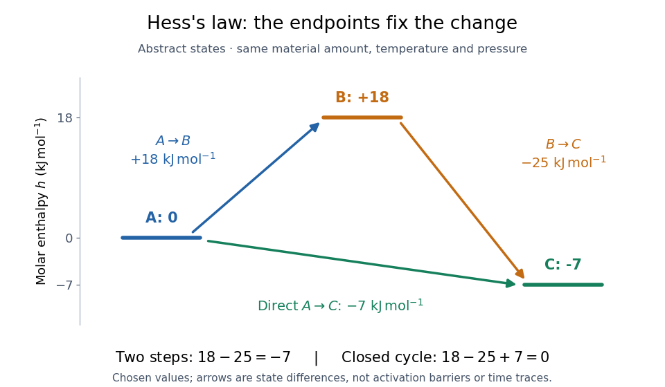

# Enthalpy cycle

↑ **Parent:** [Hess's law](hess-s-law.md)

An [enthalpy cycle](enthalpy-cycle.md) is a collection of compatible [thermodynamic processes](thermodynamic-process.md) that returns the entire material inventory to its initial [thermodynamic state](thermodynamic-state.md). Its signed [enthalpy](enthalpy-split.md) changes sum to zero. This supplies a consistency check and lets a missing change be recovered from the others.

Consider three abstract [thermodynamic states](thermodynamic-state.md) $A,B,C$ of the same conserved material inventory at common [temperature](temperature-split.md) and [pressure](pressure-split.md). Choose their [molar enthalpies](molar-enthalpy.md), on the same one-[mole](mole-unit.md) basis, as

$$
h_A=0,\qquad h_B=18\,\mathrm{kJ\,mol^{-1}},\qquad h_C=-7\,\mathrm{kJ\,mol^{-1}}.
$$

These are constructed values, not material measurements. Endpoint subtraction gives

$$
\begin{aligned}
\Delta h_{AB}&=h_B-h_A=+18\,\mathrm{kJ\,mol^{-1}},\\
\Delta h_{BC}&=h_C-h_B=-25\,\mathrm{kJ\,mol^{-1}},\\
\Delta h_{AC}&=h_C-h_A=-7\,\mathrm{kJ\,mol^{-1}}.
\end{aligned}
$$

Thus $+18-25=-7$: the two-step route and the direct route have the same [molar enthalpy](molar-enthalpy.md) change. Closing the route with $C\to A$ gives $+18-25+7=0$. Shifting every $h$ by the same arbitrary reference constant leaves all these differences unchanged.

**[Figure 8](#image-hess-law-enthalpy-state-paths). Two routes between the same thermodynamic states give the same enthalpy change**. Original abstract states with [molar enthalpies](molar-enthalpy.md) $0$, $18$, and $-7\,\mathrm{kJ\,mol^{-1}}$ on one common basis. Arrows show signed endpoint differences, not an [activation energy](activation-energy.md) curve, a [reaction mechanism](reaction-mechanism.md), or elapsed time.

The short proof is cancellation:

$$
(H_B-H_A)+(H_C-H_B)=H_C-H_A.
$$

Adding any finite number of consecutive endpoint differences works the same way. For a closed [enthalpy cycle](enthalpy-cycle.md) the final $H_A$ cancels the initial $H_A$. A nonzero experimental residual can therefore expose mismatched states or measurement error; it does not identify which individual input is responsible.

## ↑ Ancestors (4)

1. [Hess's law](hess-s-law.md)
2. [Thermochemistry](thermochemistry.md)
3. [Chemistry](chemistry-split.md)
4. [Codex Wiki](split.md)

## ← Incoming links (1)

- [Enthalpy cycle](enthalpy-cycle.md)
