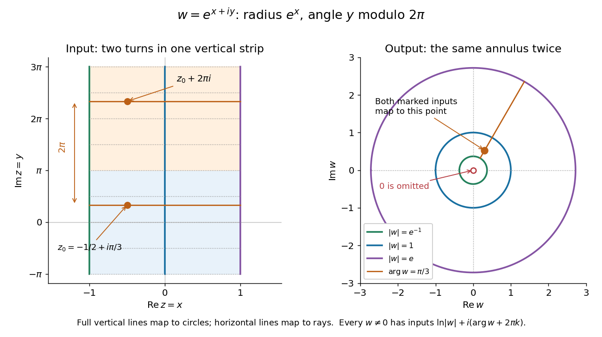

# Entire function

↑ **Parent:** [Holomorphic function](holomorphic-function-split.md)  
ⓦ [Wiki](https://en.wikipedia.org/wiki/Entire_function)

An [entire function](entire-function.md) is a [holomorphic function](holomorphic-function-split.md) whose [domain of a function](domain-of-a-function.md) is the whole [complex plane](complex-plane.md). Its [derivative](derivative.md) exists at every $z\in\mathbb C$. Every [polynomial](polynomial-split.md), the [complex exponential function](complex-exponential-function.md) $e^z$, the product $ze^z$, and the [complex sine function](complex-sine-function.md) $\sin z$ are [entire functions](entire-function.md). The [Taylor series](taylor-series.md) of an [entire function](entire-function.md) about any finite centre converges throughout the [complex plane](complex-plane.md).

The [complex exponential function](complex-exponential-function.md) is a particularly revealing [entire function](entire-function.md). Writing $z=x+iy$, [Euler's formula](euler-s-formula.md) gives

$$
e^{x+iy}=e^x(\cos y+i\sin y),\qquad |e^{x+iy}|=e^x>0.
$$

Thus the [complex exponential function](complex-exponential-function.md) never takes the value zero. Conversely, for any $w\ne0$, choose an [argument](argument-complex-analysis.md) $\theta$ of $w$. All its [preimages](preimage.md) under the [complex exponential function](complex-exponential-function.md) are

$$
z_k=\ln|w|+i(\theta+2\pi k),\qquad k\in\mathbb Z.
$$

Here $\ln|w|$ is the real [natural logarithm](natural-logarithm.md), and $k$ ranges over the [integers](integer-split.md). Substitution gives $e^{z_k}=|w|e^{i\theta}=w$; equality of [moduli](modulus.md) and [arguments](argument-complex-analysis.md) shows these are all the solutions. The [complex exponential function](complex-exponential-function.md) therefore has [image](image-of-a-function.md) exactly $\mathbb C\setminus\{0\}$, with infinitely many [preimages](preimage.md) for each nonzero value.

**[Figure 6](#image-under-the-complex-exponential-vertical-lines-become-circles-horizontal-lines-become-rays-and-inputs-separated-by-2-pi-i-have-the-same-image). Under the complex exponential, vertical lines become circles, horizontal lines become rays, and inputs separated by 2 pi i have the same image**.

In the pictured vertical strip $-1\le x\le1$, the [real part](real-part.md) sets the [modulus](modulus.md) between $e^{-1}$ and $e$, while the [imaginary part](imaginary-part.md) sets the [argument](argument-complex-analysis.md) modulo $2\pi$. The two drawn bands each make one full turn around the same [annulus](annulus-mathematics.md); their corresponding points differ by $2\pi i$ and have identical [images](image-of-a-function.md). Allowing all real $x$ gives every positive [modulus](modulus.md), so the whole [complex plane](complex-plane.md) covers every nonzero output.

An [entire function](entire-function.md) has exceptionally strong global constraints. The [Liouville theorem](liouville-theorem.md) says that a [bounded function](bounded-function.md) which is also an [entire function](entire-function.md) must be a [constant function](constant-function.md). Accordingly, the nonconstant [entire functions](entire-function.md) above are unbounded somewhere in the [complex plane](complex-plane.md), even when their restrictions to the real axis are bounded: the [complex sine function](complex-sine-function.md) satisfies $\sin(iy)=i\sinh y$, growing through the [hyperbolic sine](hyperbolic-sine.md). The [Little Picard theorem](little-picard-theorem.md) adds a different constraint: an unbounded nonconstant [entire function](entire-function.md) still cannot leave two distinct complex values out of its [image](image-of-a-function.md). These results make [entire functions](entire-function.md) useful when global bounds or restrictions on the [image](image-of-a-function.md) can establish rigidity without solving for the [function](function-split.md) explicitly.

In the opening of his 1880 memoir, Émile Picard credits Karl Weierstrass with the terminology of [entire functions](entire-function.md) and describes them by everywhere-convergent [power series](power-series.md). [Picard, Mémoire sur les fonctions entières (1880), p. 145](https://numdam.org/articles/10.24033/asens.187/)

**Table of contents**

- [Injective entire functions are affine](injective-entire-functions-are-affine.md)
- [Exponential polynomial](exponential-polynomial.md)
- [Order of an entire function](order-of-an-entire-function.md)
- [Entire function of exponential type](entire-function-of-exponential-type.md)
- [Weierstrass factorization theorem](weierstrass-factorization-theorem.md)
  - [Canonical product](canonical-product.md)
    - [Canonical product construction for zeros escaping to the disk boundary](canonical-product-construction-for-zeros-escaping-to-the-disk-boundary.md)
    - [Boundary-adapted holomorphic zero factor](boundary-adapted-holomorphic-zero-factor.md)
  - [Hadamard factorization theorem](hadamard-factorization-theorem.md)
  - [Entire functions with the same zero divisor](entire-functions-with-the-same-zero-divisor.md)
- [Pointwise vanishing derivative criterion for a polynomial](pointwise-vanishing-derivative-criterion-for-a-polynomial.md)
- [Picard theorem](picard-theorem.md)
  - [Omitted value](omitted-value.md)
  - [Little Picard theorem](little-picard-theorem.md)
    - [Great Picard theorem](great-picard-theorem.md)

## ↑ Ancestors (6)

1. [Holomorphic function](holomorphic-function-split.md)
2. [Complex analysis](complex-analysis-split.md)
3. [Analysis](analysis-split.md)
4. [Area of mathematics](area-of-mathematics.md)
5. [Mathematics](mathematics-split.md)
6. [Codex Wiki](split.md)

## ← Incoming links (155)

- [Backward-sign Airy half-line global relation](backward-sign-airy-half-line-global-relation.md)
- [Cancellation of positive-integer gamma singularities on a Hankel contour](cancellation-of-positive-integer-gamma-singularities-on-a-hankel-contour.md)
- [Canonical product](canonical-product.md)
- [Compact-disk algebra norm on entire functions](compact-disk-algebra-norm-on-entire-functions.md)
- [Complementary error function](complementary-error-function.md)
- [Completed Dirichlet L-function](completed-dirichlet-l-function.md)
- [Complex plane is not conformally equivalent to the upper half-plane](complex-plane-is-not-conformally-equivalent-to-the-upper-half-plane.md)
- [Cubic exponential integral Stokes sectors](cubic-exponential-integral-stokes-sectors.md)
- [Dolbeault cohomology of the projective line times the affine line](dolbeault-cohomology-of-the-projective-line-times-the-affine-line.md)
- [Entire function](entire-function.md)
- [Entire function algebra admits no complete algebra norm](entire-function-algebra-admits-no-complete-algebra-norm.md)
- [Entire function confined to a half-plane is constant](entire-function-confined-to-a-half-plane-is-constant.md)
- [Entire function of exponential type](entire-function-of-exponential-type.md)
- [Entire functions with the same zero divisor](entire-functions-with-the-same-zero-divisor.md)
- [Equality in the Cauchy coefficient estimate](equality-in-the-cauchy-coefficient-estimate.md)
- [Error function](error-function.md)
- [Exponential polynomial](exponential-polynomial.md)
- [Faddeeva function](faddeeva-function.md)
- [Finite-time spectral boundary transform](finite-time-spectral-boundary-transform.md)
- [Frobenius series for the Laguerre differential equation](frobenius-series-for-the-laguerre-differential-equation.md)
- [Functional equation of the Riemann zeta function](functional-equation-of-the-riemann-zeta-function.md)
- [Great Picard theorem](great-picard-theorem.md)
- [Hadamard factorization theorem](hadamard-factorization-theorem.md)
- [Half-line linear dispersive Stokes global relation](half-line-linear-dispersive-stokes-global-relation.md)
- [Hyperbolic-sine infinite product](hyperbolic-sine-infinite-product.md)
- [Injective entire functions are affine](injective-entire-functions-are-affine.md)
- [Lattice zeros force quadratic exponential growth](lattice-zeros-force-quadratic-exponential-growth.md)
- [Little Picard theorem](little-picard-theorem.md)
- [Mellin continuation of a noncuspidal modular form](mellin-continuation-of-a-noncuspidal-modular-form.md)
- [Mellin continuation of a nonprincipal Dirichlet L-function](mellin-continuation-of-a-nonprincipal-dirichlet-l-function.md)
- [Mellin transform of an interval indicator](mellin-transform-of-an-interval-indicator.md)
- [Mollifier regularization for contour recovery of support](mollifier-regularization-for-contour-recovery-of-support.md)
- [Nonconstant elliptic function has a pole](nonconstant-elliptic-function-has-a-pole.md)
- [Nonemptiness of the Banach-algebra spectrum](nonemptiness-of-the-banach-algebra-spectrum.md)
- [Nonpolynomial entire function has a centre with no zero Taylor coefficient](nonpolynomial-entire-function-has-a-centre-with-no-zero-taylor-coefficient.md)
- [Nonvanishing of a nonprincipal Dirichlet L-function at one](nonvanishing-of-a-nonprincipal-dirichlet-l-function-at-one.md)
- [One-sided product bound for an entire function](one-sided-product-bound-for-an-entire-function.md)
- [Order of an entire function](order-of-an-entire-function.md)
- [Solution](past-exam-of-the-mathematics-course-of-the-university-of-cambridge/2001/ib/paper-2/13a/solution.md)
- [Solution](past-exam-of-the-mathematics-course-of-the-university-of-cambridge/2001/ib/paper-4/13b/solution.md)
- [Solution](past-exam-of-the-mathematics-course-of-the-university-of-cambridge/2001/iii/paper-7/1/solution.md)
- [Solution](past-exam-of-the-mathematics-course-of-the-university-of-cambridge/2001/iii/paper-8/2/solution.md)
- [Solution](past-exam-of-the-mathematics-course-of-the-university-of-cambridge/2002/ib/paper-2/4g/solution.md)
- [Solution](past-exam-of-the-mathematics-course-of-the-university-of-cambridge/2002/iii/paper-25/2/solution.md)
- [Solution](past-exam-of-the-mathematics-course-of-the-university-of-cambridge/2002/iii/paper-25/3/solution.md)
- [Solution](past-exam-of-the-mathematics-course-of-the-university-of-cambridge/2002/iii/paper-26/5/solution.md)
- [Solution](past-exam-of-the-mathematics-course-of-the-university-of-cambridge/2003/ib/paper-3/3e/a/solution.md)
- [Solution](past-exam-of-the-mathematics-course-of-the-university-of-cambridge/2003/ib/paper-3/3e/b/solution.md)
- [Solution](past-exam-of-the-mathematics-course-of-the-university-of-cambridge/2003/iii/paper-24/2/i/solution.md)
- [Solution](past-exam-of-the-mathematics-course-of-the-university-of-cambridge/2003/iii/paper-24/3/iii/solution.md)
- [Solution](past-exam-of-the-mathematics-course-of-the-university-of-cambridge/2003/iii/paper-24/4/ii/solution.md)
- [Solution](past-exam-of-the-mathematics-course-of-the-university-of-cambridge/2003/iii/paper-6/3/solution.md)
- [Solution](past-exam-of-the-mathematics-course-of-the-university-of-cambridge/2003/iii/paper-6/4/solution.md)
- [Solution](past-exam-of-the-mathematics-course-of-the-university-of-cambridge/2003/iii/paper-61/1/b/solution.md)
- [Solution](past-exam-of-the-mathematics-course-of-the-university-of-cambridge/2005/ib/paper-3/14a/solution.md)
- [Solution](past-exam-of-the-mathematics-course-of-the-university-of-cambridge/2005/ii/paper-2/8a/solution.md)
- [Solution](past-exam-of-the-mathematics-course-of-the-university-of-cambridge/2005/iii/paper-28/1/solution.md)
- [Solution](past-exam-of-the-mathematics-course-of-the-university-of-cambridge/2005/iii/paper-28/2/i/solution.md)
- [Solution](past-exam-of-the-mathematics-course-of-the-university-of-cambridge/2005/iii/paper-29/4/solution.md)
- [Solution](past-exam-of-the-mathematics-course-of-the-university-of-cambridge/2005/iii/paper-6/3/solution.md)
- [Solution](past-exam-of-the-mathematics-course-of-the-university-of-cambridge/2005/iii/paper-67/1/b/solution.md)
- [Solution](past-exam-of-the-mathematics-course-of-the-university-of-cambridge/2005/iii/paper-79/2/solution.md)
- [Solution](past-exam-of-the-mathematics-course-of-the-university-of-cambridge/2006/ii/paper-2/31e/solution.md)
- [Solution](past-exam-of-the-mathematics-course-of-the-university-of-cambridge/2006/ii/paper-2/8e/solution.md)
- [Solution](past-exam-of-the-mathematics-course-of-the-university-of-cambridge/2006/iii/paper-28/3/solution.md)
- [Solution](past-exam-of-the-mathematics-course-of-the-university-of-cambridge/2006/iii/paper-6/3/solution.md)
- [Solution](past-exam-of-the-mathematics-course-of-the-university-of-cambridge/2006/iii/paper-82/2/a/solution.md)
- [Solution](past-exam-of-the-mathematics-course-of-the-university-of-cambridge/2006/iii/paper-86/1/b/solution.md)
- [Solution](past-exam-of-the-mathematics-course-of-the-university-of-cambridge/2006/iii/paper-88/1/solution.md)
- [Solution](past-exam-of-the-mathematics-course-of-the-university-of-cambridge/2006/iii/paper-88/3/solution.md)
- [Solution](past-exam-of-the-mathematics-course-of-the-university-of-cambridge/2006/iii/paper-88/4/solution.md)
- [Solution](past-exam-of-the-mathematics-course-of-the-university-of-cambridge/2007/ib/paper-3/14h/solution.md)
- [Solution](past-exam-of-the-mathematics-course-of-the-university-of-cambridge/2007/ii/paper-2/8b/solution.md)
- [Solution](past-exam-of-the-mathematics-course-of-the-university-of-cambridge/2007/iii/paper-10/7/solution.md)
- [Solution](past-exam-of-the-mathematics-course-of-the-university-of-cambridge/2007/iii/paper-30/1/solution.md)
- [Solution](past-exam-of-the-mathematics-course-of-the-university-of-cambridge/2007/iii/paper-8/3/solution.md)
- [Solution](past-exam-of-the-mathematics-course-of-the-university-of-cambridge/2008/ib/paper-4/4e/solution.md)
- [Solution](past-exam-of-the-mathematics-course-of-the-university-of-cambridge/2008/ii/paper-2/14c/i/solution.md)
- [Solution](past-exam-of-the-mathematics-course-of-the-university-of-cambridge/2008/ii/paper-2/14c/ii/solution.md)
- [Solution](past-exam-of-the-mathematics-course-of-the-university-of-cambridge/2008/iii/paper-12/4/solution.md)
- [Solution](past-exam-of-the-mathematics-course-of-the-university-of-cambridge/2008/iii/paper-33/3/solution.md)
- [Solution](past-exam-of-the-mathematics-course-of-the-university-of-cambridge/2009/ib/paper-3/14e/solution.md)
- [Solution](past-exam-of-the-mathematics-course-of-the-university-of-cambridge/2009/iii/paper-7/3/b/solution.md)
- [Solution](past-exam-of-the-mathematics-course-of-the-university-of-cambridge/2009/iii/paper-71/1/b/solution.md)
- [Solution](past-exam-of-the-mathematics-course-of-the-university-of-cambridge/2009/iii/paper-71/3/solution.md)
- [Solution](past-exam-of-the-mathematics-course-of-the-university-of-cambridge/2010/ii/paper-2/14e/solution.md)
- [Solution](past-exam-of-the-mathematics-course-of-the-university-of-cambridge/2010/ii/paper-2/8e/solution.md)
- [Solution](past-exam-of-the-mathematics-course-of-the-university-of-cambridge/2010/iii/paper-70/1/a/solution.md)
- [Solution](past-exam-of-the-mathematics-course-of-the-university-of-cambridge/2011/ii/paper-1/23g/solution.md)
- [Solution](past-exam-of-the-mathematics-course-of-the-university-of-cambridge/2011/ii/paper-1/2f/ii/solution.md)
- [Solution](past-exam-of-the-mathematics-course-of-the-university-of-cambridge/2011/ii/paper-3/8e/solution.md)
- [Solution](past-exam-of-the-mathematics-course-of-the-university-of-cambridge/2012/iii/paper-76/1/b/solution.md)
- [Solution](past-exam-of-the-mathematics-course-of-the-university-of-cambridge/2013/iii/paper-23/3/a/solution.md)
- [Solution](past-exam-of-the-mathematics-course-of-the-university-of-cambridge/2013/iii/paper-60/2/solution.md)
- [Solution](past-exam-of-the-mathematics-course-of-the-university-of-cambridge/2013/iii/paper-8/3/a/solution.md)
- [Solution](past-exam-of-the-mathematics-course-of-the-university-of-cambridge/2013/iii/paper-8/4/b/solution.md)
- [Solution](past-exam-of-the-mathematics-course-of-the-university-of-cambridge/2014/ib/paper-4/4g/solution.md)
- [Solution](past-exam-of-the-mathematics-course-of-the-university-of-cambridge/2014/iii/paper-17/1/c/solution.md)
- [Solution](past-exam-of-the-mathematics-course-of-the-university-of-cambridge/2014/iii/paper-5/1/c/solution.md)
- [Solution](past-exam-of-the-mathematics-course-of-the-university-of-cambridge/2014/iii/paper-69/1/ii/solution.md)
- [Solution](past-exam-of-the-mathematics-course-of-the-university-of-cambridge/2015/iii/paper-77/2/b/solution.md)
- [Solution](past-exam-of-the-mathematics-course-of-the-university-of-cambridge/2016/iii/paper-105/1/iii/solution.md)
- [Solution](past-exam-of-the-mathematics-course-of-the-university-of-cambridge/2016/iii/paper-106/1/solution.md)
- [Solution](past-exam-of-the-mathematics-course-of-the-university-of-cambridge/2016/iii/paper-124/1/c/solution.md)
- [Solution](past-exam-of-the-mathematics-course-of-the-university-of-cambridge/2016/iii/paper-126/1/solution.md)
- [Solution](past-exam-of-the-mathematics-course-of-the-university-of-cambridge/2016/iii/paper-327/2/solution.md)
- [Solution](past-exam-of-the-mathematics-course-of-the-university-of-cambridge/2016/iii/paper-328/3/iv/solution.md)
- [Solution](past-exam-of-the-mathematics-course-of-the-university-of-cambridge/2016/iii/paper-336/1/b/ii/solution.md)
- [Solution](past-exam-of-the-mathematics-course-of-the-university-of-cambridge/2017/ib/paper-3/13f/solution.md)
- [Solution](past-exam-of-the-mathematics-course-of-the-university-of-cambridge/2017/ii/paper-1/13e/solution.md)
- [Solution](past-exam-of-the-mathematics-course-of-the-university-of-cambridge/2017/ii/paper-1/23f/solution.md)
- [Solution](past-exam-of-the-mathematics-course-of-the-university-of-cambridge/2017/iii/paper-137/1/solution.md)
- [Solution](past-exam-of-the-mathematics-course-of-the-university-of-cambridge/2017/iii/paper-137/2/solution.md)
- [Solution](past-exam-of-the-mathematics-course-of-the-university-of-cambridge/2017/iii/paper-304/1/iv/solution.md)
- [Solution](past-exam-of-the-mathematics-course-of-the-university-of-cambridge/2017/iii/paper-306/3/solution.md)
- [Solution](past-exam-of-the-mathematics-course-of-the-university-of-cambridge/2017/iii/paper-327/1/solution.md)
- [Solution](past-exam-of-the-mathematics-course-of-the-university-of-cambridge/2018/ii/paper-2/23f/solution.md)
- [Solution](past-exam-of-the-mathematics-course-of-the-university-of-cambridge/2018/ii/paper-3/2f/solution.md)
- [Solution](past-exam-of-the-mathematics-course-of-the-university-of-cambridge/2019/ii/paper-3/21h/c/solution.md)
- [Solution](past-exam-of-the-mathematics-course-of-the-university-of-cambridge/2019/ii/paper-3/23f/solution.md)
- [Solution](past-exam-of-the-mathematics-course-of-the-university-of-cambridge/2019/iii/paper-327/3/solution.md)
- [Solution](past-exam-of-the-mathematics-course-of-the-university-of-cambridge/2021/ii/paper-1/14e/c/solution.md)
- [Solution](past-exam-of-the-mathematics-course-of-the-university-of-cambridge/2021/ii/paper-1/24f/d/solution.md)
- [Solution](past-exam-of-the-mathematics-course-of-the-university-of-cambridge/2021/ii/paper-2/7e/c/solution.md)
- [Solution](past-exam-of-the-mathematics-course-of-the-university-of-cambridge/2021/iii/paper-150/2/b/solution.md)
- [Solution](past-exam-of-the-mathematics-course-of-the-university-of-cambridge/2022/iii/paper-117/2/a/solution.md)
- [Solution](past-exam-of-the-mathematics-course-of-the-university-of-cambridge/2022/iii/paper-327/3/solution.md)
- [Solution](past-exam-of-the-mathematics-course-of-the-university-of-cambridge/2023/ib/paper-2/12b/b/i/solution.md)
- [Solution](past-exam-of-the-mathematics-course-of-the-university-of-cambridge/2023/ib/paper-4/3g/i/solution.md)
- [Solution](past-exam-of-the-mathematics-course-of-the-university-of-cambridge/2023/ib/paper-4/3g/ii/solution.md)
- [Solution](past-exam-of-the-mathematics-course-of-the-university-of-cambridge/2023/ii/paper-2/13e/d/solution.md)
- [Solution](past-exam-of-the-mathematics-course-of-the-university-of-cambridge/2023/ii/paper-3/2f/i/solution.md)
- [Solution](past-exam-of-the-mathematics-course-of-the-university-of-cambridge/2024/ii/paper-1/25f/solution.md)
- [Solution](past-exam-of-the-mathematics-course-of-the-university-of-cambridge/2024/ii/paper-3/7d/b/solution.md)
- [Solution](past-exam-of-the-mathematics-course-of-the-university-of-cambridge/2025/ib/paper-3/13e/solution.md)
- [Solution](past-exam-of-the-mathematics-course-of-the-year-2-of-the-natural-sciences-course-of-the-university-of-cambridge/2011/paper-1/7/solution.md)
- [Solution](past-exam-of-the-mathematics-course-of-the-year-2-of-the-natural-sciences-course-of-the-university-of-cambridge/2011/paper-1/8/solution.md)
- [Solution](past-exam-of-the-mathematics-course-of-the-year-2-of-the-natural-sciences-course-of-the-university-of-cambridge/2018/paper-1/8/d/solution.md)
- [Solution](past-exam-of-the-mathematics-course-of-the-year-2-of-the-natural-sciences-course-of-the-university-of-cambridge/2018/paper-2/4/b/solution.md)
- [Solution](past-exam-of-the-mathematics-course-of-the-year-2-of-the-natural-sciences-course-of-the-university-of-cambridge/2019/paper-2/4/b/solution.md)
- [Solution](past-exam-of-the-mathematics-course-of-the-year-2-of-the-natural-sciences-course-of-the-university-of-cambridge/2019/paper-2/5/a/solution.md)
- [Solution](past-exam-of-the-mathematics-course-of-the-year-2-of-the-natural-sciences-course-of-the-university-of-cambridge/2021/paper-1/7/c/solution.md)
- [Solution](past-exam-of-the-mathematics-course-of-the-year-2-of-the-natural-sciences-course-of-the-university-of-cambridge/2025/paper-1/7/b/solution.md)
- [Picard theorem](picard-theorem.md)
- [Pointwise vanishing derivative criterion for a polynomial](pointwise-vanishing-derivative-criterion-for-a-polynomial.md)
- [Pole-subtracted theta integral for the completed zeta function](pole-subtracted-theta-integral-for-the-completed-zeta-function.md)
- [Polynomial division preservation of exponential type](polynomial-division-preservation-of-exponential-type.md)
- [Polynomial growth forces a meromorphic function to be rational](polynomial-growth-forces-a-meromorphic-function-to-be-rational.md)
- [Riemann xi function](riemann-xi-function.md)
- [Scaled lower incomplete gamma integral](scaled-lower-incomplete-gamma-integral.md)
- [Simply periodic entire function without an algebraic addition theorem](simply-periodic-entire-function-without-an-algebraic-addition-theorem.md)
- [Smooth-data instability of the Cauchy-Riemann Cauchy problem](smooth-data-instability-of-the-cauchy-riemann-cauchy-problem.md)
- [Vanishing moments and Fourier zeros](vanishing-moments-and-fourier-zeros.md)
- [Weierstrass elliptic differential equation](weierstrass-elliptic-differential-equation.md)
- [Weierstrass factorization theorem](weierstrass-factorization-theorem.md)
