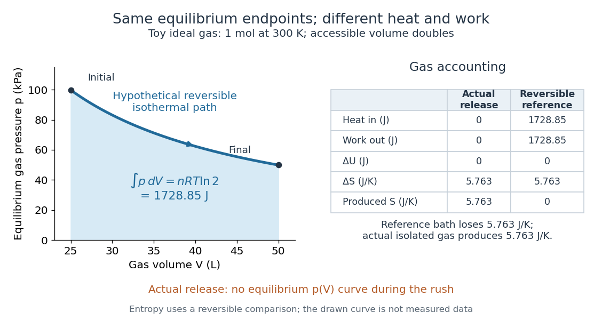

# Entropy change in free expansion

↑ **Parent:** [Free expansion](free-expansion.md)

For the insulated gas-only [free expansion](free-expansion.md) of an [ideal gas](ideal-gas-split.md), the equilibrium endpoints are $(T,V_1)$ and $(T,V_2)$ with $V_2>V_1$. Because [entropy](entropy-split.md) is a [state function](state-function.md), calculate their difference along a hypothetical [reversible thermodynamic process](reversible-thermodynamic-process.md): an [isothermal expansion](isothermal-expansion.md) using a frictionless piston and a [thermal reservoir](heat-bath.md) at $T$. This comparison process receives [heat](heat-split.md) and delivers [work](work.md), even though the actual [free expansion](free-expansion.md) does neither. Its reversible [heat](heat-split.md) increment is $\delta Q_{\rm rev}=p\,dV=nRT\,dV/V$, so

$$
\Delta S=\int_1^2\frac{\delta Q_{\rm rev}}{T}
=nR\int_{V_1}^{V_2}\frac{dV}{V}
=nR\ln\frac{V_2}{V_1}>0.
$$

Here $R$ is the [molar gas constant](molar-gas-constant.md), and the [logarithm](logarithm.md) acts on a dimensionless ratio. The reversible reference gives the correct endpoint [entropy](entropy-split.md) difference because [entropy](entropy-split.md) is a [state function](state-function.md); putting the actual $Q=0$ into $\Delta S=Q/T$ would misuse a relation requiring reversible [heat](heat-split.md) transfer. For the actual isolated gas, all this increase is [entropy production](entropy-production.md). Thus an [adiabatic process](adiabatic-process.md) can increase [entropy](entropy-split.md) and need not be an [isentropic process](isentropic-process.md). [OpenStax, section 4.6: reversible reference path for the entropy change of free expansion](https://openstax.org/books/university-physics-volume-2/pages/4-6-entropy)

**[Figure 10](#image-the-reversible-reference-calculates-entropy-without-supplying-a-path-for-the-actual-free-expansion). The reversible reference calculates entropy without supplying a path for the actual free expansion**. Toy [ideal gas](ideal-gas-split.md) example with $n=1\,\mathrm{mol}$, $T=300\,\mathrm K$, $V_1=0.025\,\mathrm{m^3}$ and stipulated $R=8.314\,\mathrm{J\,mol^{-1}\,K^{-1}}$. The plotted curve belongs only to the hypothetical reversible [isothermal expansion](isothermal-expansion.md); the actual release has the same equilibrium endpoints but no equilibrium curve between them. The table refers to the [gas](gas.md), with [work](work.md) positive outward. No points are experimental data.

In the figure's volume doubling, the [ideal gas law](ideal-gas-law.md) gives $p_1=99.768\,\mathrm{kPa}$ and $p_2=49.884\,\mathrm{kPa}$, while $\Delta S=R\ln2\simeq5.763\,\mathrm{J\,K^{-1}}$. The reference process receives and delivers $nRT\ln2\simeq1728.85\,\mathrm J$ as [heat](heat-split.md) and [work](work.md); its [thermal reservoir](heat-bath.md) loses the same [entropy](entropy-split.md) that the [gas](gas.md) gains. The actual [free expansion](free-expansion.md) has $Q_{\rm in}=W_{\rm out}=0$ and produces that [entropy](entropy-split.md) internally. Reversibly compressing the [gas](gas.md) back at $300\,\mathrm K$ would require $1728.85\,\mathrm J$ of [work](work.md) input and rejection of equal [heat](heat-split.md). Restoring the gas alone therefore changes the surroundings: the actual release is irreversible.

For a [real gas](real-gas.md) the final [temperature](temperature-split.md) may differ, so the ideal-gas [logarithm](logarithm.md) formula cannot simply be copied. Evaluate $S(T_2,V_2)-S(T_1,V_1)$ using that gas's equilibrium properties or a suitable reversible comparison path. If the walls and water exchange [heat](heat-split.md) with it, the [Second law of thermodynamics](second-law-of-thermodynamics-split.md) constrains the total [entropy](entropy-split.md) of the isolated apparatus; the gas alone is then not an [isolated system](isolated-system.md).

## ↑ Ancestors (6)

1. [Free expansion](free-expansion.md)
2. [Thermodynamics](thermodynamics-split.md)
3. [Statistical physics](statistical-physics-split.md)
4. [Branches of physics](branches-of-physics.md)
5. [Physics](physics-split.md)
6. [Codex Wiki](split.md)

## ← Incoming links (3)

- [Adiabatic process](adiabatic-process.md)
- [Free expansion](free-expansion.md)
- [Isothermal expansion](isothermal-expansion.md)
