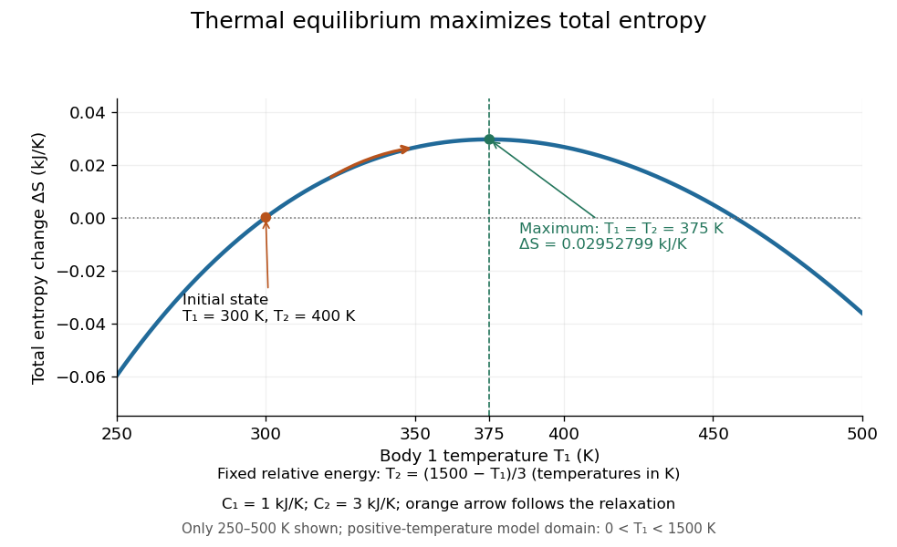

# Entropy maximization under thermal contact

↑ **Parent:** [Thermal equilibrium](thermal-equilibrium-split.md)

At fixed [volumes](volume.md) and material inventories, two internally equilibrated bodies that exchange only [heat](heat-split.md) within an [isolated system](isolated-system.md) have fixed total [internal energy](internal-energy-split.md) $E=E_1+E_2$. Their total [entropy](entropy-split.md) is

$$
S_{\mathrm{tot}}(E_1)=S_1(E_1)+S_2(E-E_1).
$$

Using $1/T_i=(\partial S_i/\partial E_i)_{V_i,N_i}$, an interior stationary point obeys

$$
\frac{dS_{\rm tot}}{dE_1}=\frac1{T_1}-\frac1{T_2}=0.
$$

Thus [entropy](entropy-split.md) stationarity requires matching [thermodynamic temperatures](thermodynamic-temperature.md). Positive values of [heat capacity at constant volume](heat-capacity-at-constant-volume.md) make this a strict local maximum because

$$
\frac{d^2S_{\rm tot}}{dE_1^2}=-\frac1{C_1T_1^2}-\frac1{C_2T_2^2}<0.
$$

For bodies with positive [heat capacities](heat-capacity.md) throughout the accessible range, this [concavity](concave-function.md) gives at most one interior maximum. This is the stability check behind the equal-[temperature](temperature-split.md) condition; see [entropy concavity and positive heat capacity](entropy-concavity-and-positive-heat-capacity.md). [David Tong, Statistical Physics, sections 1.2.1–1.2.2: entropy maximization, temperature and heat capacity](statistical-physics-by-david-tong/1-the-fundamentals-of-statistical-mechanics.md)

For [thermal equilibration of two finite bodies](thermal-equilibration-of-two-finite-bodies.md), [entropy from heat capacity](entropy-from-heat-capacity.md) gives

$$
\Delta S_{\rm tot}=C_1\ln\frac{T_f}{T_{1,0}}+C_2\ln\frac{T_f}{T_{2,0}}
=\left(\ln\frac{375}{300}+3\ln\frac{375}{400}\right)\mathrm{kJ\,K^{-1}}
\simeq0.02952799\,\mathrm{kJ\,K^{-1}}>0.
$$

Body 1 gains about $0.22314355\,\mathrm{kJ\,K^{-1}}$ of [entropy](entropy-split.md), while body 2 loses about $0.19361556\,\mathrm{kJ\,K^{-1}}$. Total [energy](energy-split.md) is conserved even though total [entropy](entropy-split.md) increases. The [entropy](entropy-split.md) calculation uses reversible comparison paths between the endpoint states; actual exchange across a finite [temperature](temperature-split.md) difference is irreversible.

**[Figure 4](#image-at-fixed-total-energy-matching-temperatures-maximize-total-entropy). At fixed total energy, matching temperatures maximize total entropy**. The curve is total [entropy](entropy-split.md) relative to the initial $300\,\mathrm K$, $400\,\mathrm K$ state. Every point satisfies $C_1T_1+C_2T_2=1500\,\mathrm{kJ}$. Only $250\le T_1/\mathrm K\le500$ is shown; the mathematical model's positive-[temperature](temperature-split.md) domain is $0<T_1/\mathrm K<1500$.

To construct the plot, vary $T_1$ while enforcing the [energy](energy-split.md) constraint, rather than holding $T_2$ fixed. In numerical units of [kelvin](kelvin.md), $T_2/\mathrm K=(1500-T_1/\mathrm K)/3$, and the plotted function is

$$
\mathcal S(T_1)=C_1\ln\frac{T_1}{300\,\mathrm K}+C_2\ln\frac{T_2(T_1)}{400\,\mathrm K},\qquad
\frac{dT_2}{dT_1}=-\frac{C_1}{C_2}.
$$

Here $\mathcal S$ means $S_{\rm tot}-S_{\rm tot,initial}$, so its zero is a reference choice. The [chain rule](chain-rule.md) yields

$$
\mathcal S'(T_1)=\frac{C_1}{T_1}-\frac{C_1}{T_2},\qquad
\mathcal S''(T_1)=-\frac{C_1}{T_1^2}-\frac{C_1^2}{C_2T_2^2}<0.
$$

The unique maximum is at $T_1=T_2=375\,\mathrm K$. The physical trajectory starts at $T_1=300\,\mathrm K$ and moves toward that maximum; the rest of the curve compares other possible [energy](energy-split.md) partitions, not later times in the trajectory.

The contact model also proves the direction of change directly:

$$
\dot S_{\rm tot}=G(T_2-T_1)\left(\frac1{T_1}-\frac1{T_2}\right)
=\frac{G(T_2-T_1)^2}{T_1T_2}\ge0.
$$

For $G>0$ and positive [temperatures](temperature-split.md), equality holds exactly at [thermal equilibrium](thermal-equilibrium-split.md). The appealing link is that a dynamical [heat transfer](heat-transfer.md) law moves the system uphill on the constrained [entropy](entropy-split.md) curve, while conservation of [energy](energy-split.md) keeps it on that curve. This predicts both why the endpoint is stable and why the reverse separation into hot and cold bodies cannot happen spontaneously in the [isolated system](isolated-system.md).

## ↑ Ancestors (6)

1. [Thermal equilibrium](thermal-equilibrium-split.md)
2. [Thermodynamics](thermodynamics-split.md)
3. [Statistical physics](statistical-physics-split.md)
4. [Branches of physics](branches-of-physics.md)
5. [Physics](physics-split.md)
6. [Codex Wiki](split.md)

## ← Incoming links (5)

- [Additivity of Boltzmann entropy](additivity-of-boltzmann-entropy.md)
- [Finite heat bath](finite-heat-bath.md)
- [Solution](past-exam-of-the-mathematics-course-of-the-university-of-cambridge/2020/ii/paper-1/36a/solution.md)
- [Temperature](temperature-split.md)
- [Thermodynamics](thermodynamics-split.md)
