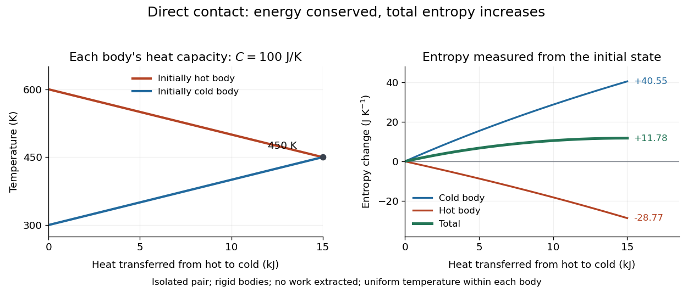
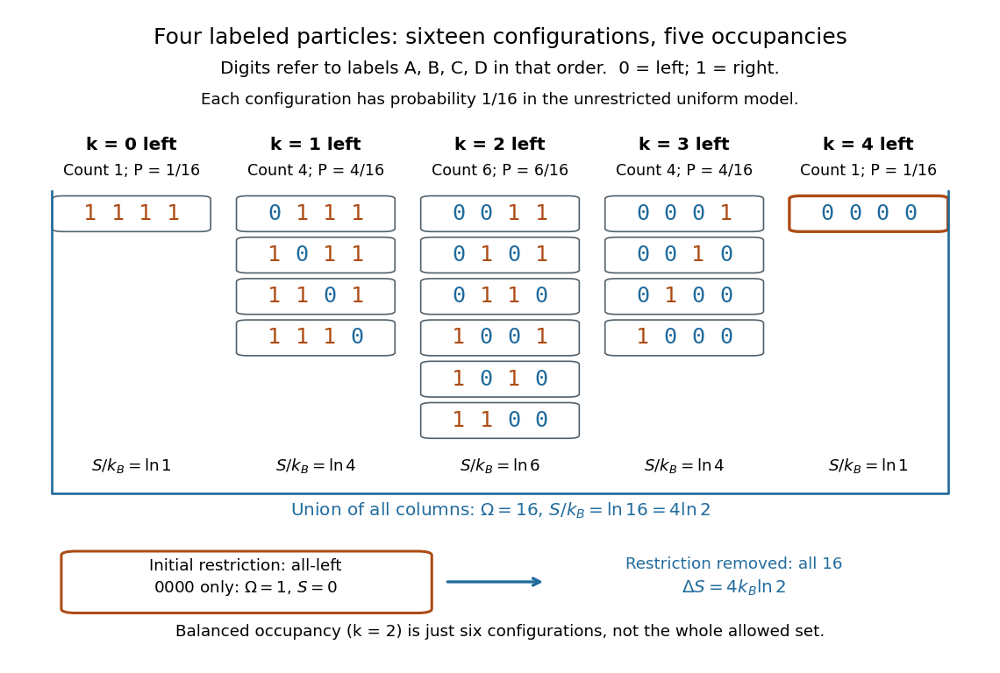

# Entropy

↑ **Parent:** [Thermodynamics](thermodynamics.md)  
ⓦ [Wiki](https://en.wikipedia.org/wiki/Entropy)

Entropy is an [extensive quantity](thermodynamics.md#extensive-quantity) and a [state function](thermodynamics.md#state-function) of an equilibrium system, measured in $\mathrm{J\,K^{-1}}$. Differences between equilibrium states are calculated along a [reversible thermodynamic process](second-law-of-thermodynamics.md#reversible-thermodynamic-process):

$$
S_2-S_1=\int_1^2\frac{\delta Q_{\rm rev}}{T}.
$$

Here [heat](heat.md) entering the system is positive and $T$ is its absolute [thermodynamic temperature](second-law-of-thermodynamics.md#thermodynamic-temperature). The reversible path used for calculation need not be the path actually taken. Dividing the actual [heat](heat.md) by a single [temperature](temperature.md) generally fails for an irreversible process.

For example, put two rigid bodies, each with constant [heat capacity](heat.md#heat-capacity) $C=100\,\mathrm{J\,K^{-1}}$, at $600\,\mathrm K$ and $300\,\mathrm K$ in an otherwise [isolated system](thermodynamics.md#isolated-system). Assume each body has a uniform internal [temperature](temperature.md), no [phase transition](critical-phenomenon.md#phase-transition) occurs, and no [work](energy.md#work) is extracted. Their final [thermal equilibrium](thermal-equilibrium.md) is at $450\,\mathrm K$, because the [internal energy](internal-energy.md) lost by one equals that gained by the other. Using [entropy from heat capacity](heat.md#entropy-from-heat-capacity),

$$
\Delta S_h=C\log(450/600)=-28.77\,\mathrm{J\,K^{-1}},\qquad
\Delta S_c=C\log(450/300)=40.55\,\mathrm{J\,K^{-1}},
$$

so $\Delta S_{\rm tot}=C\log(9/8)=11.78\,\mathrm{J\,K^{-1}}$. One body's [entropy](entropy.md) decreases while the total increases. [MIT, Entropy changes and the hot-brick problem](https://web.mit.edu/16.unified/www/FALL/thermodynamics/notes/node41.html)

**[Figure 1](#image-thermal-equilibration-of-two-finite-bodies-conserves-energy-and-increases-total-entropy). Thermal equilibration of two finite bodies conserves energy and increases total entropy**.

In [statistical mechanics](statistical-physics.md#statistical-mechanics), [Boltzmann's entropy formula](#boltzmann-s-entropy-formula) counts equally likely [microstates](statistical-physics.md#microstate) compatible with a [macrostate](statistical-physics.md#macrostate); [Gibbs entropy](statistical-physics.md#gibbs-entropy) handles a specified [probability distribution](probability-distribution.md) over [microstates](statistical-physics.md#microstate). If the number of equally likely [microstates](statistical-physics.md#microstate) doubles, [entropy](entropy.md) increases by $k_B\log2$. The [logarithm](calculus.md#logarithm) makes multiplicative counts additive for independent systems. These are precise statements about states and probabilities, not a universal measure of visible messiness. Calling [entropy](entropy.md) merely "disorder" obscures the thermal calculation above and hides which [microstates](statistical-physics.md#microstate) are being counted. [MIT, Statistical entropy and randomness](https://web.mit.edu/16.unified/www/FALL/thermodynamics/notes/node57.html)

The usefulness of [entropy](entropy.md) is that measurable [heat capacities](heat.md#heat-capacity) determine its changes, and the [Second law of thermodynamics](second-law-of-thermodynamics.md) turns those changes into constraints on processes. It also connects macroscopic measurements to microscopic descriptions without requiring us to track every particle.

**Table of contents**

- [Translational entropy](#translational-entropy)
- [Reaction entropy](#reaction-entropy)
- [Standard molar entropy](#standard-molar-entropy)
- [Entropy generated by cooling a finite body in a reservoir](#entropy-generated-by-cooling-a-finite-body-in-a-reservoir)
- [Residual entropy](#residual-entropy)
- [Specific entropy](#specific-entropy)
- [Boltzmann's entropy formula](#boltzmann-s-entropy-formula)
  - [Microstate multiplier from photon absorption](#microstate-multiplier-from-photon-absorption)
  - [Configurational entropy](#configurational-entropy)
    - [Equiatomic configurational entropy](#equiatomic-configurational-entropy)
  - [Boltzmann entropy of a two-box occupancy](#boltzmann-entropy-of-a-two-box-occupancy)
  - [Boltzmann entropy when a restriction is removed](#boltzmann-entropy-when-a-restriction-is-removed)
  - [Additivity of Boltzmann entropy](#additivity-of-boltzmann-entropy)
  - [Scope of Boltzmann's entropy formula](#scope-of-boltzmann-s-entropy-formula)
- [Entropy density](#entropy-density)
  - [Comoving entropy](#comoving-entropy)
  - [Entropy density at zero chemical potential](#entropy-density-at-zero-chemical-potential)
    - [Nonrelativistic entropy at zero chemical potential](#nonrelativistic-entropy-at-zero-chemical-potential)

## Translational entropy

↑ **Parent:** [Entropy](entropy.md)

[entropy](entropy.md) associated with positions of independently translating objects. Connecting segments into one [polymer](polymer.md) leaves fewer independently translating objects than treating the same segments as separate molecules; this reduces mixing [entropy](entropy.md) per segment.

## Reaction entropy

↑ **Parent:** [Entropy](entropy.md)

The [entropy](entropy.md) change per specified extent of a reaction, equal to the stoichiometric product-minus-reactant sum of partial molar entropies.

## Standard molar entropy

↑ **Parent:** [Entropy](entropy.md)

Molar entropy in a specified standard state. Absolute entropies of elemental reference substances are generally not zero, unlike their conventional standard formation enthalpies.

## Entropy generated by cooling a finite body in a reservoir

↑ **Parent:** [Entropy](entropy.md)

For a body of constant [heat capacity](heat.md#heat-capacity) $C$ cooling from $T_i$ to a [thermal reservoir](thermal-equilibrium.md#heat-bath) at $T_0>0$, the body's [entropy](entropy.md) change is $C\ln(T_0/T_i)$, while the reservoir gains $C(T_i-T_0)/T_0$. Their sum is nonnegative because $r-1-\ln r\geq0$ for $r=T_i/T_0>0$. The logarithmic body contribution is computed along a hypothetical reversible path; the actual finite-temperature-difference heat transfer is irreversible.

## Residual entropy

↑ **Parent:** [Entropy](entropy.md)  
ⓦ [Wiki](https://en.wikipedia.org/wiki/Residual_entropy)

[Residual entropy](#residual-entropy) is [entropy](entropy.md) remaining in the zero-temperature limit. An equilibrium ground-state degeneracy $g_0$ gives $S_0=k_B\ln g_0$ for the complete system; an extensive [residual entropy](#residual-entropy) requires a correspondingly large state count. Frozen configurational disorder can also leave an experimentally inferred [residual entropy](#residual-entropy) when a sample fails to equilibrate. The zero-entropy perfect-crystal form of the [third law of thermodynamics](thermodynamics.md#third-law-of-thermodynamics) assumes a unique, fully ordered equilibrium [ground state](quantum-mechanics.md#ground-state).

## Specific entropy

↑ **Parent:** [Entropy](entropy.md)

Specific entropy is [entropy](entropy.md) per unit mass. For a [perfect gas](ideal-gas.md) with constant [specific heat capacity](heat.md#specific-heat-capacity) $c_v$ at constant volume and [specific-heat ratio](ideal-gas.md#heat-capacity-ratio) $\gamma$, differences obey

$$
s_2-s_1=c_v\log\left[\frac{p_2}{p_1}\left(\frac{\rho_1}{\rho_2}\right)^\gamma\right],
$$

where $p$ is [pressure](pressure.md) and $\rho$ is [mass density](fluid-mechanics.md#density). Thus a [homentropic flow](compressible-flow.md#homentropic-flow) has constant $p/\rho^\gamma$.

<h2 id="boltzmann-s-entropy-formula">Boltzmann's entropy formula</h2>

↑ **Parent:** [Entropy](entropy.md)  
ⓦ [Wiki](https://en.wikipedia.org/wiki/Boltzmann's_entropy_formula)

Why does a [gas](thermodynamics.md#gas) spread through an available container? One part of the answer is counting: a nearly uniform [macrostate](statistical-physics.md#macrostate) can be realized by vastly more [microstates](statistical-physics.md#microstate) than a [macrostate](statistical-physics.md#macrostate) with every particle crowded into one corner. [Boltzmann's entropy formula](#boltzmann-s-entropy-formula) turns that multiplicity into [entropy](entropy.md). The useful insight is that a large [entropy](entropy.md) measures how many microscopic realizations fit a specified macroscopic description, rather than how untidy a picture looks.

For a specified [macrostate](statistical-physics.md#macrostate) $M$ containing $\Omega(M)$ accessible, equally likely [microstates](statistical-physics.md#microstate), write

$$
S(M)=k_B\ln\Omega(M),\qquad p_i=\frac1{\Omega(M)}\quad(i\text{ compatible with }M).
$$

Here $k_B$ is the [Boltzmann constant](thermodynamics.md#boltzmann-constant), and $\ln$ is the [natural logarithm](calculus.md#natural-logarithm), also written $\log$ in this article's title. The count $\Omega(M)$ is dimensionless; [entropy](entropy.md) has units of [energy](energy.md) divided by [temperature](temperature.md). Always specify the [macrostate](statistical-physics.md#macrostate), the constraints and the model's microscopic resolution before counting. A [microcanonical ensemble](statistical-physics.md#microcanonical-ensemble) provides a familiar equilibrium setting for the equal-[probability](probability-theory.md#probability) assumption. [MIT, §7.4: equiprobable microstates and S = k ln Ω](https://web.mit.edu/16.unified/www/FALL/thermodynamics/notes/node57.html)

The [natural logarithm](calculus.md#natural-logarithm) compresses an enormous count into a manageable number and makes products of counts into sums of [entropies](entropy.md); see [additivity of Boltzmann entropy](#additivity-of-boltzmann-entropy). With this counting convention, one allowed [microstate](statistical-physics.md#microstate) has zero [Boltzmann entropy](#boltzmann-s-entropy-formula). This zero refers to the chosen model and resolution; it does not by itself assign an absolute [entropy](entropy.md) to a real material.

### Microstate multiplier from photon absorption

↑ **Parent:** [Boltzmann's entropy formula](#boltzmann-s-entropy-formula)

A single [photon](quantum-mechanics.md#photon) thermalized in a macroscopic body adds [energy](energy.md) $hc/\lambda$. If its [heat capacity](heat.md#heat-capacity) is sufficiently large that the [temperature](temperature.md) change is negligible, the [entropy](entropy.md) increase is $hc/(\lambda T)$. The [Boltzmann entropy](#boltzmann-s-entropy-formula) then gives the displayed ratio of accessible [microstates](statistical-physics.md#microstate). The exponential can be enormous even though the deposited [energy](energy.md) is macroscopically tiny.

### Configurational entropy

↑ **Parent:** [Boltzmann's entropy formula](#boltzmann-s-entropy-formula)

The part of [entropy](entropy.md) associated with the number of distinct spatial or occupancy arrangements consistent with chosen macroscopic constraints. For equally weighted configurations, the [Boltzmann entropy](#boltzmann-s-entropy-formula) formula gives the displayed expression. Unequal probabilities require $-k_B\sum_i p_i\ln p_i$ over configurations. For $n$ indistinguishable empty sites among $M$ otherwise occupied sites, $\Omega_{\rm conf}=\binom{M}{n}$. Vibrational or internal degrees of freedom can contribute additional entropy even at fixed site arrangement.

#### Equiatomic configurational entropy

↑ **Parent:** [Configurational entropy](#configurational-entropy)

Randomly distributing $n$ species with equal fractions over $N$ sites gives $\Omega=N!/[(N/n)!]^n$. Stirling approximation gives $S=k_BN\ln n$, or $R\ln n$ per mole of sites. [Configurational entropy](#configurational-entropy) alone does not decide whether a multicomponent alloy is a stable single [thermodynamic phase](thermodynamics.md#thermodynamic-phase).

### Boltzmann entropy of a two-box occupancy

↑ **Parent:** [Boltzmann's entropy formula](#boltzmann-s-entropy-formula)

Take $N=20$ distinguishable, labeled particles and two boxes of equal [volume](geometry-and-topology.md#volume). Retain only whether each particle is in the left or right box: use a [bit](information-theory.md#bit) $0$ for left and $1$ for right. Each length-20 string is one coarse [microstate](statistical-physics.md#microstate) of this toy model. Assume the labels make [independent](random-variable.md#independent-random-variables) side choices with equal [probability](probability-theory.md#probability), so the $2^{20}=1\,048\,576$ strings are equiprobable. Equal [volumes](geometry-and-topology.md#volume) motivate these weights for noninteracting particles with no preference for either box; equal [volumes](geometry-and-topology.md#volume) alone would not establish them for an arbitrary interacting [gas](thermodynamics.md#gas).

Now retain only the number $k$ in the left box as the [macrostate](statistical-physics.md#macrostate). Choosing which $k$ labels are left gives a [binomial coefficient](binomial-coefficient.md), so

$$
\Omega(k)=\binom{20}{k}=\frac{20!}{k!(20-k)!},\qquad
S(k)=k_B\ln\binom{20}{k},\qquad
P(k)=\frac{\binom{20}{k}}{2^{20}}.
$$

The [factorials](combinatorics.md#factorial) count assignments to labels; the [probability](probability-theory.md#probability) of a [macrostate](statistical-physics.md#macrostate) sums the [probabilities](probability-theory.md#probability) of its constituent [microstates](statistical-physics.md#microstate). This is the [binomial distribution](discrete-probability-distribution.md#binomial-distribution) with parameters $20$ and $1/2$. The same [binomial coefficient](binomial-coefficient.md) appears in the counting of distinguishable [two-level systems](canonical-ensemble.md#two-level-system), although here the [macrostate](statistical-physics.md#macrostate) records occupancy rather than [energy](energy.md). [Mehran Kardar, MIT 8.333 (2013), lecture 12, §IV.C, equations IV.17–18: binomial microstate counts](https://ocw.mit.edu/courses/8-333-statistical-mechanics-i-statistical-mechanics-of-particles-fall-2013/0cb99318c2ed889316cdcff839759e8d_MIT8_333F13_Lec12.pdf)

The largest [binomial coefficient](binomial-coefficient.md) occurs at $k=10$, the balanced [macrostate](statistical-physics.md#macrostate). All-left means $k=20$ and supplies just one string. Thus

$$
\begin{aligned}
\Omega(10)&=184\,756,& S(10)/k_B&=\ln184\,756\approx12.126791,\\
\Omega(20)&=1,& S(20)/k_B&=0,\\
P(10)&\approx0.176197,& P(20)&=2^{-20}\approx9.53674\times10^{-7}.
\end{aligned}
$$

There are $184\,756$ balanced strings for every all-left string, even though each individual string has the same [probability](probability-theory.md#probability). Exact balance has about $17.6\%$ of the total [probability](probability-theory.md#probability); equilibrium reasoning concerns the many [macrostates](statistical-physics.md#macrostate) near balance too, rather than certainty of exactly ten particles on each side. The diagram compares the counts with their [natural logarithms](calculus.md#natural-logarithm).

**[Figure 2](#image-counts-and-boltzmann-entropies-of-the-occupancy-macrostates-of-twenty-labeled-particles). Counts and Boltzmann entropies of the occupancy macrostates of twenty labeled particles**.

Four fair, [independent](random-variable.md#independent-random-variables) coins give a smaller worked example with the same [binomial distribution](discrete-probability-distribution.md#binomial-distribution). If $k$ is the number of heads, the five [macrostates](statistical-physics.md#macrostate) $k=0,1,2,3,4$ contain respectively $1,4,6,4,1$ [microstates](statistical-physics.md#microstate). Their [probabilities](probability-theory.md#probability) are respectively $1/16,4/16,6/16,4/16,1/16$. In particular, two heads is one [macrostate](statistical-physics.md#macrostate) containing six ordered coin sequences, with [Boltzmann entropy](#boltzmann-s-entropy-formula) $k_B\ln6$ in this counting analogy. A prescribed ordered sequence has one realization. The next diagram enumerates the same sixteen strings as left/right assignments.

### Boltzmann entropy when a restriction is removed

↑ **Parent:** [Boltzmann's entropy formula](#boltzmann-s-entropy-formula)

In [Boltzmann entropy of a two-box occupancy](#boltzmann-entropy-of-a-two-box-occupancy), impose an initial restriction that all labels are left. There is one allowed coarse [microstate](statistical-physics.md#microstate). Remove that restriction, allowing all occupancy values: the allowed set is now the union of every occupancy [macrostate](statistical-physics.md#macrostate), containing $2^N$ strings. If the final description assigns equal [probability](probability-theory.md#probability) to this whole set, its [Boltzmann entropy](#boltzmann-s-entropy-formula) change is

$$
\Omega_i=1,\qquad \Omega_f=\sum_{k=0}^N\binom Nk=2^N,\qquad
\Delta S=k_B\ln\frac{\Omega_f}{\Omega_i}=Nk_B\ln2.
$$

The counting identity is the [binomial theorem](binomial-coefficient.md#binomial-theorem). For twenty labels, $\Delta S=20k_B\ln2\approx13.862944k_B$. This final description fixes neither box occupancy; it is coarser than the particular [macrostate](statistical-physics.md#macrostate) $k=10$, whose [Boltzmann entropy](#boltzmann-s-entropy-formula) is $k_B\ln184\,756$. The two counts answer different questions, so substituting the balanced [macrostate](statistical-physics.md#macrostate) for the full allowed set would change the calculation.

For four labels, the initial all-left string is `0000`; removing the restriction makes all sixteen strings available. The $k=2$ column has only six strings. Accordingly, the whole allowed set has [Boltzmann entropy](#boltzmann-s-entropy-formula) $k_B\ln16=4k_B\ln2$, while the balanced [macrostate](statistical-physics.md#macrostate) has [Boltzmann entropy](#boltzmann-s-entropy-formula) $k_B\ln6$.

**[Figure 3](#image-sixteen-configurations-of-four-labeled-particles-grouped-by-left-occupancy-compared-with-the-all-left-restriction). Sixteen configurations of four labeled particles grouped by left occupancy, compared with the all-left restriction**.

Removing a barrier changes the allowed set immediately, but it does not instantaneously randomize the actual [probability distribution](probability-distribution.md). Motion and equilibration must make those configurations accessible. The counting result illustrates the configurational contribution to [free expansion](thermodynamics.md#free-expansion); it does not describe the relaxation time or every contribution to the [entropy](entropy.md) of a real [gas](thermodynamics.md#gas).

### Additivity of Boltzmann entropy

↑ **Parent:** [Boltzmann's entropy formula](#boltzmann-s-entropy-formula)

For two subsystems with independently specified [macrostates](statistical-physics.md#macrostate), suppose every allowed [microstate](statistical-physics.md#microstate) of $A$ can be paired with every allowed [microstate](statistical-physics.md#microstate) of $B$. Their allowed set is a [Cartesian product](set-theory.md#cartesian-product). With equal [probability](probability-theory.md#probability) for each pair, [Boltzmann's entropy formula](#boltzmann-s-entropy-formula) gives

$$
\Omega_{AB}=\Omega_A\Omega_B,\qquad
S_{AB}=k_B\ln(\Omega_A\Omega_B)=S_A+S_B.
$$

For example, take two [independent](random-variable.md#independent-random-variables) copies of the toy model, each with two labels choosing between its two boxes. Each copy has four configurations and [Boltzmann entropy](#boltzmann-s-entropy-formula) $k_B\ln4$. Combining their [independent](random-variable.md#independent-random-variables) labels gives sixteen configurations and [Boltzmann entropy](#boltzmann-s-entropy-formula) $k_B\ln16=2k_B\ln4$. This explains why [entropy](entropy.md) adds even though microscopic counts multiply. [MIT, §7.4, equation 7.17: independent state counts multiply](https://web.mit.edu/16.unified/www/FALL/thermodynamics/notes/node57.html)

The product assumption matters. A constraint shared between the subsystems can forbid some pairs; for example, fixing only their combined [energy](energy.md) generally requires summing over its possible divisions. See [entropy maximization under thermal contact](thermal-equilibrium.md#entropy-maximization-under-thermal-contact) for how [thermal equilibrium](thermal-equilibrium.md) selects the dominant division. Statistical [independence](random-variable.md#independent-random-variables) cannot be inferred merely from drawing a boundary between two parts.

<h3 id="scope-of-boltzmann-s-entropy-formula">Scope of Boltzmann's entropy formula</h3>

↑ **Parent:** [Boltzmann's entropy formula](#boltzmann-s-entropy-formula)

The strings in [Boltzmann entropy of a two-box occupancy](#boltzmann-entropy-of-a-two-box-occupancy) are complete [microstates](statistical-physics.md#microstate) only within the binary toy model. They retain a [coarse-grained variable](statistical-physics.md#coarse-grained-variable) for each particle and omit its exact [position](classical-mechanics.md#position) within a box and its [momentum](momentum.md). An actual classical [gas](thermodynamics.md#gas) instead occupies continuous [phase space](hamiltonian-mechanics.md#phase-space); obtaining a dimensionless count from a [phase space](hamiltonian-mechanics.md#phase-space) volume requires a specified cell convention and the appropriate treatment of particle identity. A [quantum state](quantum-system.md#quantum-state) count must respect the allowed [quantum states](quantum-system.md#quantum-state) and [quantum statistics](quantum-ideal-gas-statistics.md). Thus $2^N$ is not a general count of [microstates](statistical-physics.md#microstate) for a [gas](thermodynamics.md#gas) obeying [quantum ideal-gas statistics](quantum-ideal-gas-statistics.md). [Kardar, MIT 8.333 (2013), lecture 13, §§IV.D–E: gas phase space and particle counting](https://ocw.mit.edu/courses/8-333-statistical-mechanics-i-statistical-mechanics-of-particles-fall-2013/0cdb670a825c6aaea7e229ac40776cbf_MIT8_333F13_Lec13.pdf)

For a discrete [probability distribution](probability-distribution.md) with unequal weights, use the existing [Gibbs entropy](statistical-physics.md#gibbs-entropy) article; its equal-weight case gives [Boltzmann's entropy formula](#boltzmann-s-entropy-formula). [Shannon entropy](information-entropy.md) uses the corresponding information measure, with the logarithm base setting its units. A count alone cannot replace the specified [probability distribution](probability-distribution.md), as the [Boltzmann distribution](thermodynamics.md#boltzmann-distribution) examples demonstrate. [MIT, §7.3: statistical entropy for general microstate probabilities](https://web.mit.edu/16.unified/www/FALL/thermodynamics/notes/node56.html)

Overwhelming multiplicity explains why [thermodynamic equilibrium](thermodynamics.md#thermodynamic-equilibrium) is overwhelmingly probable in macroscopic systems under the appropriate statistical assumptions. It does not make low-[entropy](entropy.md) [thermal fluctuations](statistical-physics.md#thermal-fluctuation) logically impossible. Nor does counting alone derive irreversible macroscopic evolution: one also needs dynamics, an initial preparation, and a reason the system samples the allowed [microstates](statistical-physics.md#microstate) on the timescale of interest. [Kardar, lecture 12, §§IV.A–B: statistical equilibrium and the limits of counting arguments](https://ocw.mit.edu/courses/8-333-statistical-mechanics-i-statistical-mechanics-of-particles-fall-2013/0cb99318c2ed889316cdcff839759e8d_MIT8_333F13_Lec12.pdf)

Historically, Boltzmann's 1877 paper counted microscopic arrangements, called complexions, and related the [natural logarithm](calculus.md#natural-logarithm) of their number to [entropy](entropy.md). The Sharp and Matschinsky translation appeared in _Entropy_ 17 (2015), pages 1971–2009, DOI 10.3390/e17041971. Its notation differs from ours: Boltzmann's permutability measure $\Omega$ is already logarithmic, whereas here $\Omega$ is the count. [Boltzmann (1877), translated by Kim Sharp and Franz Matschinsky (2015), §III after equation 34 and §V](https://gilles.montambaux.com/files/histoire-physique/Boltzmann-1877-entropy.pdf) [Josiah Willard Gibbs](mathematics.md#josiah-willard-gibbs)'s _Elementary Principles in Statistical Mechanics_ (1902) developed the [statistical ensemble](thermodynamics.md#statistical-ensemble) framework; Chapter XIV compares several statistical definitions of [entropy](entropy.md) with [thermodynamics](thermodynamics.md). [Gibbs (1902), title page and preface](https://en.wikisource.org/wiki/Elementary_Principles_in_Statistical_Mechanics) [Gibbs (1902), Chapter XIV: discussion of thermodynamic analogies](https://en.wikisource.org/wiki/Elementary_Principles_in_Statistical_Mechanics/Chapter_XIV)

## Entropy density

↑ **Parent:** [Entropy](entropy.md)  
ⓦ [Wiki](https://en.wikipedia.org/wiki/Entropy_density)

For a homogeneous equilibrium system with [energy density](statistical-physics.md#energy-density) $\rho$, [pressure](pressure.md) $P$, [chemical potential](chemical-potential.md) $\mu$, and [number density](statistical-physics.md#number-density) $n$, the entropy density is

$$
s=\frac{\rho+P-\mu n}{T}.
$$

### Comoving entropy

↑ **Parent:** [Entropy density](#entropy-density)

Comoving entropy is the [entropy density](#entropy-density) multiplied by the physical volume factor $a^3$ for a fixed comoving region in an expanding homogeneous universe. In adiabatic expansion it is conserved. Separate decoupled radiation sectors conserve their own comoving entropy, so disappearance of massive species can heat the still-equilibrated sector relative to a decoupled species.

### Entropy density at zero chemical potential

↑ **Parent:** [Entropy density](#entropy-density)

For an extensive equilibrium system, the [thermodynamic Euler relation](thermodynamics.md#euler-relation-in-thermodynamics) gives $E=TS-PV+\mu N$. At zero [chemical potential](chemical-potential.md), divide by $V$ to obtain $s=(\rho+P)/T$. Equivalently, $dP=(\rho+P)dT/T$ makes

$$
d\left(\frac{(\rho+P)V}{T}\right)=\frac{d(\rho V)+P\,dV}{T}.
$$

The [first law of thermodynamics](first-law-of-thermodynamics.md) identifies this as $dS$; the [thermodynamic Euler relation](thermodynamics.md#euler-relation-in-thermodynamics) fixes the entropy normalization. For adiabatic expansion satisfying the [cosmological perfect-fluid continuity equation](cosmology.md#cosmological-perfect-fluid-continuity-equation), the numerator on the right vanishes, proving [cosmological entropy conservation](cosmology.md#cosmological-entropy-conservation).

#### Nonrelativistic entropy at zero chemical potential

↑ **Parent:** [Entropy density at zero chemical potential](#entropy-density-at-zero-chemical-potential)

For a dilute nonrelativistic gas with $x=m/T\gg1$ and zero [chemical potential](chemical-potential.md), the [Bose-Einstein distribution](quantum-ideal-gas-statistics.md#bose-einstein-distribution) approaches the [Maxwell-Boltzmann distribution](quantum-ideal-gas-statistics.md#maxwell-boltzmann-distribution). Expanding $E=m+p^2/(2m)+\cdots$ in the [number density](statistical-physics.md#number-density) integral gives $n\sim g(mT/(2\pi))^{3/2}e^{-x}$. Since $\rho=mn+3nT/2+\cdots$ and $P=nT$, the [entropy density at zero chemical potential](#entropy-density-at-zero-chemical-potential) gives $s=n(x+5/2+\cdots)$ and hence the displayed leading expression. This includes the internal multiplicity $g$; a single real [scalar field](classical-field-theory.md#scalar-field) has $g=1$.

## ↑ Ancestors (5)

1. [Thermodynamics](thermodynamics.md)
2. [Statistical physics](statistical-physics.md)
3. [Branches of physics](physics.md#branches-of-physics)
4. [Physics](physics.md)
5. [Codex Wiki](README.md)

## ← Incoming links (453)

- [Absolute zero](temperature.md#absolute-zero)
- [Activation energy](chemical-kinetics.md#activation-energy)
- [Additivity of Boltzmann entropy](#additivity-of-boltzmann-entropy)
- [Adenosine triphosphate](molecule.md#adenosine-triphosphate)
- [Adiabat](first-law-of-thermodynamics.md#adiabat)
- [Adiabatic demagnetization](temperature.md#adiabatic-demagnetization)
- [Adiabatic expansion](first-law-of-thermodynamics.md#adiabatic-expansion)
- [Adiabatic process](first-law-of-thermodynamics.md#adiabatic-process)
- [Adiabatic work in a comoving volume](cosmology.md#adiabatic-work-in-a-comoving-volume)
- [Availability curvature and equilibrium fluctuations](thermodynamic-potential.md#availability-curvature-and-equilibrium-fluctuations)
- [Battery load power and efficiency](electrical-circuit.md#battery-load-power-and-efficiency)
- [Biased-step entropy production model](stochastic-thermodynamics.md#biased-step-entropy-production-model)
- [Binomial entropy of independent two-level particles](canonical-ensemble.md#binomial-entropy-of-independent-two-level-particles)
- [Boltzmann entropy when a restriction is removed](#boltzmann-entropy-when-a-restriction-is-removed)
- [Boltzmann H functional](boltzmann-equation.md#boltzmann-h-functional)
- [Boltzmann's entropy formula](#boltzmann-s-entropy-formula)
- [Bragg-Williams free energy of the Ising model](spin-model.md#bragg-williams-free-energy-of-the-ising-model)
- [Canonical entropy formula](canonical-ensemble.md#canonical-entropy-formula)
- [Canonical partition function](canonical-ensemble.md#canonical-partition-function)
- [Carnot cycle](second-law-of-thermodynamics.md#carnot-cycle)
- [Carnot's theorem](second-law-of-thermodynamics.md#carnot-s-theorem)
- [Chemical equilibrium](chemical-potential.md#chemical-equilibrium)
- [Chemical potential](chemical-potential.md)
- [Chemical potential and Helmholtz free energy](chemical-potential.md#chemical-potential-and-helmholtz-free-energy)
- [Classical ideal-gas entropy limits](ideal-gas.md#classical-ideal-gas-entropy-limits)
- [Classical ideal gas in a homogeneous soft trap](canonical-ensemble.md#classical-ideal-gas-in-a-homogeneous-soft-trap)
- [Clausius-Clapeyron relation](thermodynamic-potential.md#clausius-clapeyron-relation)
- [Clausius inequality](second-law-of-thermodynamics.md#clausius-inequality)
- [Clausius statement of the second law](second-law-of-thermodynamics.md#clausius-statement-of-the-second-law)
- [Coarse-grained variable](statistical-physics.md#coarse-grained-variable)
- [Coefficient of performance](thermodynamics.md#coefficient-of-performance)
- [Coefficient of thermal expansion](thermodynamics.md#coefficient-of-thermal-expansion)
- [Colloidal crystal](mixture.md#colloidal-crystal)
- [Comoving entropy conservation](cosmology.md#comoving-entropy-conservation)
- [Compressibility](thermodynamics.md#compressibility)
- [Configurational entropy](#configurational-entropy)
- [Conservative energy flux of a polytropic ideal gas](euler-equations-for-an-inviscid-fluid.md#conservative-energy-flux-of-a-polytropic-ideal-gas)
- [Conserved cosmological relic abundance](cosmology.md#conserved-cosmological-relic-abundance)
- [Constant-entropy magnetic cooling example](temperature.md#constant-entropy-magnetic-cooling-example)
- [Daniell cell voltage and load experiment](electrochemistry.md#daniell-cell-voltage-and-load-experiment)
- [Demagnetization with a linear-heat-capacity load](temperature.md#demagnetization-with-a-linear-heat-capacity-load)
- [Dissipation](thermodynamics.md#dissipation)
- [Ehrenfest entropy-continuity relation](critical-phenomenon.md#ehrenfest-entropy-continuity-relation)
- [Elastomer](polymer.md#elastomer)
- [Electronic partition function](canonical-ensemble.md#electronic-partition-function)
- [Enthalpy](enthalpy.md)
- [Entropic force](force.md#entropic-force)
- [Entropic polymer depletion near nonadsorbing walls](polymer.md#entropic-polymer-depletion-near-nonadsorbing-walls)
- [Entropy](entropy.md)
- [Entropy balance of a thermostatted resistor](electric-charge.md#entropy-balance-of-a-thermostatted-resistor)
- [Entropy change in free expansion](thermodynamics.md#entropy-change-in-free-expansion)
- [Entropy concavity and positive heat capacity](heat.md#entropy-concavity-and-positive-heat-capacity)
- [Entropy degrees of freedom](cosmology.md#entropy-degrees-of-freedom)
- [Entropy density of a photon gas](statistical-physics.md#entropy-density-of-a-photon-gas)
- [Entropy dependence of a polytropic mass-radius relation](stellar-structure.md#entropy-dependence-of-a-polytropic-mass-radius-relation)
- [Entropy-driven hard-sphere crystallization](statistical-physics.md#entropy-driven-hard-sphere-crystallization)
- [Entropy gain from impact and thermal equilibration](stochastic-thermodynamics.md#entropy-gain-from-impact-and-thermal-equilibration)
- [Entropy generated by cooling a finite body in a reservoir](#entropy-generated-by-cooling-a-finite-body-in-a-reservoir)
- [Entropy generation by mixing equal thermal masses](second-law-of-thermodynamics.md#entropy-generation-by-mixing-equal-thermal-masses)
- [Entropy generation in finite-temperature heat transfer](second-law-of-thermodynamics.md#entropy-generation-in-finite-temperature-heat-transfer)
- [Entropy maximization under thermal contact](thermal-equilibrium.md#entropy-maximization-under-thermal-contact)
- [Entropy mode](ideal-magnetohydrodynamics.md#entropy-mode)
- [Entropy of a finite magnetic multiplet](temperature.md#entropy-of-a-finite-magnetic-multiplet)
- [Entropy of a two-species classical ideal gas](mixture.md#entropy-of-a-two-species-classical-ideal-gas)
- [Entropy of activation](chemical-kinetics.md#entropy-of-activation)
- [Entropy of mixing](mixture.md#entropy-of-mixing)
- [Entropy production in successive weak shocks](compressible-flow.md#entropy-production-in-successive-weak-shocks)
- [Euler relation in thermodynamics](thermodynamics.md#euler-relation-in-thermodynamics)
- [Exergy](thermodynamic-potential.md#exergy)
- [Extensive quantity](thermodynamics.md#extensive-quantity)
- [Finite heat bath](thermal-equilibrium.md#finite-heat-bath)
- [Finite-micelle aggregation-number distribution](physical-chemistry.md#finite-micelle-aggregation-number-distribution)
- [Finite-size rounding](statistical-physics.md#finite-size-rounding)
- [Finite trajectory entropy production](stochastic-thermodynamics.md#finite-trajectory-entropy-production)
- [First law of thermodynamics](first-law-of-thermodynamics.md)
- [Five quadratic cascade invariants of anisotropic magnetohydrodynamic turbulence](ideal-magnetohydrodynamics.md#five-quadratic-cascade-invariants-of-anisotropic-magnetohydrodynamic-turbulence)
- [Fixed-particle-number Gibbs minimum](thermodynamic-potential.md#fixed-particle-number-gibbs-minimum)
- [Fourth-power thermal boundary model](temperature.md#fourth-power-thermal-boundary-model)
- [Fractional entropy of a relativistically decoupled species](cosmology.md#fractional-entropy-of-a-relativistically-decoupled-species)
- [Free expansion](thermodynamics.md#free-expansion)
- [Gibbs-Duhem equation](thermodynamics.md#gibbs-duhem-equation)
- [Gibbs free energy](thermodynamic-potential.md#gibbs-free-energy)
- [Gibbs free energy of an ideal-gas mixture](thermodynamic-potential.md#gibbs-free-energy-of-an-ideal-gas-mixture)
- [Gibbs free energy of mixing](mixture.md#gibbs-free-energy-of-mixing)
- [Gibbs paradox](canonical-ensemble.md#gibbs-paradox)
- [Hard sphere](statistical-physics.md#hard-sphere)
- [Heat](heat.md)
- [Heat bath relaxation with finite capacity](thermal-equilibrium.md#heat-bath-relaxation-with-finite-capacity)
- [Heat capacity](heat.md#heat-capacity)
- [Heat capacity ratio](ideal-gas.md#heat-capacity-ratio)
- [Heat-pump calorimetry](thermodynamics.md#heat-pump-calorimetry)
- [Helmholtz free energy](thermodynamic-potential.md#helmholtz-free-energy)
- [Horizon-density monopole abundance bound](cosmology.md#horizon-density-monopole-abundance-bound)
- [Hydrophobic effect](physical-chemistry.md#hydrophobic-effect)
- [Identity-operator contribution to renormalization-group free energy](critical-phenomenon.md#identity-operator-contribution-to-renormalization-group-free-energy)
- [Independent-spin magnetic entropy](electromagnetism.md#independent-spin-magnetic-entropy)
- [Instantaneous-reheating horizon matching](cosmic-inflation.md#instantaneous-reheating-horizon-matching)
- [Intensive and extensive thermodynamic quantities](thermodynamics.md#intensive-and-extensive-thermodynamic-quantities)
- [Isenthalpic process](enthalpy.md#isenthalpic-process)
- [Isentropic compressibility](thermodynamics.md#isentropic-compressibility)
- [Isentropic decompression of a spherical linear trap](canonical-ensemble.md#isentropic-decompression-of-a-spherical-linear-trap)
- [Isentropic nozzle flow](fluid-mechanics.md#isentropic-nozzle-flow)
- [Isentropic process](first-law-of-thermodynamics.md#isentropic-process)
- [Isentropic temperature-volume derivative](thermodynamics.md#isentropic-temperature-volume-derivative)
- [Ising-chain decimation constant](critical-phenomenon.md#ising-chain-decimation-constant)
- [Isobaric-isochoric-adiabatic heat engine](thermodynamics.md#isobaric-isochoric-adiabatic-heat-engine)
- [Isolated system](thermodynamics.md#isolated-system)
- [Isothermal expansion](second-law-of-thermodynamics.md#isothermal-expansion)
- [Joule-Thomson effect](enthalpy.md#joule-thomson-effect)
- [Kelvin-Planck statement of the second law](second-law-of-thermodynamics.md#kelvin-planck-statement-of-the-second-law)
- [Kinetic equilibrium](thermal-equilibrium.md#kinetic-equilibrium)
- [Lagrangian entropy inequality](continuum-mechanics.md#lagrangian-entropy-inequality)
- [Lagrangian perturbation of a fluid variable](fluid-mechanics.md#lagrangian-perturbation-of-a-fluid-variable)
- [Latent heat](thermodynamic-potential.md#latent-heat)
- [Latent heat of a temperature-dependent cubic-quartic Landau transition](critical-phenomenon.md#latent-heat-of-a-temperature-dependent-cubic-quartic-landau-transition)
- [Latent heat of fusion](statistical-physics.md#latent-heat-of-fusion)
- [Limits of adiabatic demagnetization](temperature.md#limits-of-adiabatic-demagnetization)
- [Linear displacement equations for a magnetized atmosphere](ideal-magnetohydrodynamics.md#linear-displacement-equations-for-a-magnetized-atmosphere)
- [Long-chain limit of polymer-blend miscibility](mixture.md#long-chain-limit-of-polymer-blend-miscibility)
- [Low-temperature Gibbs free-energy expansion](thermodynamics.md#low-temperature-gibbs-free-energy-expansion)
- [Magnetic entropy](temperature.md#magnetic-entropy)
- [Magnetic entropy deficit](temperature.md#magnetic-entropy-deficit)
- [Magnetic-entropy demagnetization adiabat](temperature.md#magnetic-entropy-demagnetization-adiabat)
- [Mass cancellation in sharp-freeze-out number dilution](cosmology.md#mass-cancellation-in-sharp-freeze-out-number-dilution)
- [Material conservation of cross-helicity density](ideal-magnetohydrodynamics.md#material-conservation-of-cross-helicity-density)
- [Maxwell relations](thermodynamics.md#maxwell-relations)
- [Micelle](physical-chemistry.md#micelle)
- [Microstate multiplier from photon absorption](#microstate-multiplier-from-photon-absorption)
- [Onsager excluded-volume mechanism](critical-phenomenon.md#onsager-excluded-volume-mechanism)
- [Solution](past-exam-of-the-astrophysical-fluid-dynamics-course-of-the-university-of-cambridge/2012/paper-1.md#1/a/solution)
- [Solution](past-exam-of-the-astrophysical-fluid-dynamics-course-of-the-university-of-cambridge/2012/paper-1.md#2/c/solution)
- [Solution](past-exam-of-the-astrophysical-fluid-dynamics-course-of-the-university-of-cambridge/2012/paper-1.md#3/solution)
- [Solution](past-exam-of-the-astrophysical-fluid-dynamics-course-of-the-university-of-cambridge/2013/paper-1.md#2/c/solution)
- [Paper 1](past-exam-of-the-astrophysical-fluid-dynamics-course-of-the-university-of-cambridge/2014/paper-1.md)
- [Solution](past-exam-of-the-astrophysical-fluid-dynamics-course-of-the-university-of-cambridge/2014/paper-1.md#3/solution)
- [Solution](past-exam-of-the-astrophysical-fluid-dynamics-course-of-the-university-of-cambridge/2014/paper-1.md#4/solution)
- [Solution](past-exam-of-the-astrophysical-fluid-dynamics-course-of-the-university-of-cambridge/2015/paper-1.md#3/solution)
- [Solution](past-exam-of-the-astrophysical-fluid-dynamics-course-of-the-university-of-cambridge/2016/paper-1.md#1/c/solution)
- [Solution](past-exam-of-the-astrophysical-fluid-dynamics-course-of-the-university-of-cambridge/2016/paper-1.md#2/b/solution)
- [Solution](past-exam-of-the-astrophysical-fluid-dynamics-course-of-the-university-of-cambridge/2016/paper-1.md#3/a/solution)
- [Solution](past-exam-of-the-astrophysical-fluid-dynamics-course-of-the-university-of-cambridge/2016/paper-1.md#4/a/solution)
- [Solution](past-exam-of-the-astrophysical-fluid-dynamics-course-of-the-university-of-cambridge/2016/paper-1.md#4/b/solution)
- [Solution](past-exam-of-the-astrophysical-fluid-dynamics-course-of-the-university-of-cambridge/2018.md#section-b/b2/solution)
- [Solution](past-exam-of-the-astrophysical-fluid-dynamics-course-of-the-university-of-cambridge/2019.md#section-b/5/solution)
- [Solution](past-exam-of-the-astrophysical-fluid-dynamics-course-of-the-university-of-cambridge/2021.md#section-b/4/a/solution)
- [Solution](past-exam-of-the-astrophysical-fluid-dynamics-course-of-the-university-of-cambridge/2022.md#section-b/5/a/solution)
- [Solution](past-exam-of-the-atmospheric-physics-course-of-the-university-of-cambridge/2012/paper-1.md#1/b/solution)
- [Solution](past-exam-of-the-atomic-and-optical-physics-course-of-the-university-of-cambridge/2012/paper-1.md#2/c/solution)
- [Solution](past-exam-of-the-atomic-and-optical-physics-course-of-the-university-of-cambridge/2012/paper-1.md#3/a/solution)
- [Solution](past-exam-of-the-atomic-and-optical-physics-course-of-the-university-of-cambridge/2013/paper-1.md#3/b/solution)
- [Solution](past-exam-of-the-chemistry-a-course-of-the-university-of-cambridge/2022/paper-2.md#a6/d/solution)
- [Solution](past-exam-of-the-chemistry-a-course-of-the-university-of-cambridge/2022/paper-2.md#a7/c/solution)
- [Solution](past-exam-of-the-chemistry-a-course-of-the-university-of-cambridge/2022/paper-2.md#a8/a/i/solution)
- [Solution](past-exam-of-the-chemistry-a-course-of-the-university-of-cambridge/2025/paper-2.md#a7/a/i/solution)
- [Solution](past-exam-of-the-chemistry-a-course-of-the-university-of-cambridge/2025/paper-2.md#a7/a/ii/solution)
- [Solution](past-exam-of-the-chemistry-a-course-of-the-university-of-cambridge/2025/paper-2.md#a7/b/i/solution)
- [Solution](past-exam-of-the-chemistry-a-course-of-the-university-of-cambridge/2025/paper-2.md#a7/b/ii/solution)
- [Solution](past-exam-of-the-chemistry-a-course-of-the-university-of-cambridge/2025/paper-2.md#a7/b/iii/solution)
- [Solution](past-exam-of-the-chemistry-a-course-of-the-university-of-cambridge/2025/paper-2.md#a7/c/solution)
- [Solution](past-exam-of-the-chemistry-b-course-of-the-university-of-cambridge/2021/paper-1.md#b5/b/iii/solution)
- [Solution](past-exam-of-the-chemistry-b-course-of-the-university-of-cambridge/2022/paper-1.md#b5/a/ii/solution)
- [Solution](past-exam-of-the-chemistry-b-course-of-the-university-of-cambridge/2022/paper-1.md#b5/a/iii/solution)
- [Solution](past-exam-of-the-chemistry-b-course-of-the-university-of-cambridge/2023/paper-1.md#b5/a/ii/solution)
- [Solution](past-exam-of-the-chemistry-b-course-of-the-university-of-cambridge/2024/paper-2.md#b8/a/ii/solution)
- [Solution](past-exam-of-the-chemistry-course-of-the-year-1-of-the-natural-sciences-course-of-the-university-of-cambridge/2021/paper-1.md#4/c/solution)
- [Solution](past-exam-of-the-chemistry-course-of-the-year-1-of-the-natural-sciences-course-of-the-university-of-cambridge/2022/paper-1.md#4/a/vi/solution)
- [Solution](past-exam-of-the-chemistry-course-of-the-year-1-of-the-natural-sciences-course-of-the-university-of-cambridge/2022/paper-1.md#4/b/i/solution)
- [Solution](past-exam-of-the-chemistry-course-of-the-year-1-of-the-natural-sciences-course-of-the-university-of-cambridge/2022/paper-1.md#4/b/ii/solution)
- [Solution](past-exam-of-the-chemistry-course-of-the-year-1-of-the-natural-sciences-course-of-the-university-of-cambridge/2022/paper-1.md#6/a/iii/solution)
- [Solution](past-exam-of-the-chemistry-course-of-the-year-1-of-the-natural-sciences-course-of-the-university-of-cambridge/2022/paper-1.md#6/a/iv/solution)
- [Solution](past-exam-of-the-chemistry-course-of-the-year-1-of-the-natural-sciences-course-of-the-university-of-cambridge/2023/paper-1.md#2/a/v/solution)
- [Solution](past-exam-of-the-chemistry-course-of-the-year-1-of-the-natural-sciences-course-of-the-university-of-cambridge/2023/paper-1.md#4/c/solution)
- [Solution](past-exam-of-the-chemistry-course-of-the-year-1-of-the-natural-sciences-course-of-the-university-of-cambridge/2023/paper-1.md#4/d/solution)
- [Solution](past-exam-of-the-chemistry-course-of-the-year-3-of-the-natural-sciences-course-of-the-university-of-cambridge/2022/paper-3.md#37/a/i/solution)
- [Solution](past-exam-of-the-chemistry-course-of-the-year-4-of-the-natural-sciences-course-of-the-university-of-cambridge/2022/paper-1.md#4/b/solution)
- [Solution](past-exam-of-the-chemistry-course-of-the-year-4-of-the-natural-sciences-course-of-the-university-of-cambridge/2022/paper-1.md#4/c/i/solution)
- [Solution](past-exam-of-the-chemistry-course-of-the-year-4-of-the-natural-sciences-course-of-the-university-of-cambridge/2022/paper-1.md#5/a/solution)
- [Solution](past-exam-of-the-chemistry-course-of-the-year-4-of-the-natural-sciences-course-of-the-university-of-cambridge/2022/paper-2.md#section-a/18/a/solution)
- [Solution](past-exam-of-the-chemistry-course-of-the-year-4-of-the-natural-sciences-course-of-the-university-of-cambridge/2022/paper-2.md#section-a/19/e/solution)
- [Solution](past-exam-of-the-chemistry-course-of-the-year-4-of-the-natural-sciences-course-of-the-university-of-cambridge/2022/paper-2.md#section-d/25/d/iii/solution)
- [Solution](past-exam-of-the-chemistry-course-of-the-year-4-of-the-natural-sciences-course-of-the-university-of-cambridge/2022/paper-2.md#section-e/26/a/ii/solution)
- [Solution](past-exam-of-the-chemistry-course-of-the-year-4-of-the-natural-sciences-course-of-the-university-of-cambridge/2022/paper-2.md#section-e/26/d/ii/solution)
- [Solution](past-exam-of-the-formation-of-structure-in-the-universe-course-of-the-university-of-cambridge/2016/paper-1.md#3/a/solution)
- [Solution](past-exam-of-the-genetics-course-of-the-university-of-cambridge/2024/paper-1.md#7/c/solution)
- [Solution](past-exam-of-the-materials-science-course-of-the-university-of-cambridge/2015/paper-1.md#4/a/solution)
- [Solution](past-exam-of-the-materials-science-course-of-the-university-of-cambridge/2015/paper-1.md#6/a/solution)
- [Solution](past-exam-of-the-materials-science-course-of-the-university-of-cambridge/2015/paper-1.md#6/d/solution)
- [Solution](past-exam-of-the-materials-science-course-of-the-university-of-cambridge/2018/paper-1.md#7/b/solution)
- [Solution](past-exam-of-the-materials-science-course-of-the-university-of-cambridge/2018/paper-1.md#7/c/solution)
- [Solution](past-exam-of-the-mathematics-course-of-the-university-of-cambridge/2001/iii/paper-35.md#4/solution)
- [Solution](past-exam-of-the-mathematics-course-of-the-university-of-cambridge/2001/iii/paper-70.md#3/c/iii/solution)
- [Solution](past-exam-of-the-mathematics-course-of-the-university-of-cambridge/2001/iii/paper-72.md#1/c/solution)
- [Solution](past-exam-of-the-mathematics-course-of-the-university-of-cambridge/2002/iii/paper-64.md#1/b/solution)
- [Solution](past-exam-of-the-mathematics-course-of-the-university-of-cambridge/2002/iii/paper-64.md#2/solution)
- [Solution](past-exam-of-the-mathematics-course-of-the-university-of-cambridge/2003/iii/paper-50.md#5/a/solution)
- [Solution](past-exam-of-the-mathematics-course-of-the-university-of-cambridge/2004/iii/paper-57.md#1/solution)
- [Solution](past-exam-of-the-mathematics-course-of-the-university-of-cambridge/2004/iii/paper-64.md#2/solution)
- [Solution](past-exam-of-the-mathematics-course-of-the-university-of-cambridge/2005/ii/paper-2.md#34d/solution)
- [Solution](past-exam-of-the-mathematics-course-of-the-university-of-cambridge/2005/ii/paper-4.md#33b/solution)
- [Solution](past-exam-of-the-mathematics-course-of-the-university-of-cambridge/2005/ii/paper-4.md#34d/solution)
- [Solution](past-exam-of-the-mathematics-course-of-the-university-of-cambridge/2005/ii/paper-4.md#4j/solution)
- [Solution](past-exam-of-the-mathematics-course-of-the-university-of-cambridge/2005/iii/paper-51.md#1/b/solution)
- [Solution](past-exam-of-the-mathematics-course-of-the-university-of-cambridge/2005/iii/paper-51.md#2/solution)
- [Solution](past-exam-of-the-mathematics-course-of-the-university-of-cambridge/2005/iii/paper-61.md#4/solution)
- [Solution](past-exam-of-the-mathematics-course-of-the-university-of-cambridge/2005/iii/paper-70.md#1/solution)
- [Solution](past-exam-of-the-mathematics-course-of-the-university-of-cambridge/2005/iii/paper-70.md#3/solution)
- [Solution](past-exam-of-the-mathematics-course-of-the-university-of-cambridge/2005/iii/paper-78.md#3/solution)
- [Solution](past-exam-of-the-mathematics-course-of-the-university-of-cambridge/2006/ii/paper-2.md#10d/solution)
- [Solution](past-exam-of-the-mathematics-course-of-the-university-of-cambridge/2006/ii/paper-4.md#10d/solution)
- [Solution](past-exam-of-the-mathematics-course-of-the-university-of-cambridge/2006/ii/paper-4.md#34d/solution)
- [Solution](past-exam-of-the-mathematics-course-of-the-university-of-cambridge/2006/ii/paper-4.md#38c/solution)
- [Solution](past-exam-of-the-mathematics-course-of-the-university-of-cambridge/2006/iii/paper-62.md#3/a/solution)
- [Solution](past-exam-of-the-mathematics-course-of-the-university-of-cambridge/2006/iii/paper-70.md#1/b/solution)
- [Solution](past-exam-of-the-mathematics-course-of-the-university-of-cambridge/2006/iii/paper-70.md#1/c/solution)
- [Solution](past-exam-of-the-mathematics-course-of-the-university-of-cambridge/2006/iii/paper-70.md#3/a/solution)
- [Solution](past-exam-of-the-mathematics-course-of-the-university-of-cambridge/2007/iii/paper-65.md#1/b/solution)
- [Solution](past-exam-of-the-mathematics-course-of-the-university-of-cambridge/2007/iii/paper-65.md#2/a/solution)
- [Solution](past-exam-of-the-mathematics-course-of-the-university-of-cambridge/2007/iii/paper-65.md#2/c/i/solution)
- [Solution](past-exam-of-the-mathematics-course-of-the-university-of-cambridge/2007/iii/paper-65.md#3/b/solution)
- [Solution](past-exam-of-the-mathematics-course-of-the-university-of-cambridge/2007/iii/paper-75.md#3/b/solution)
- [Solution](past-exam-of-the-mathematics-course-of-the-university-of-cambridge/2007/iii/paper-75.md#3/c/solution)
- [Solution](past-exam-of-the-mathematics-course-of-the-university-of-cambridge/2008/ii/paper-3.md#10e/solution)
- [Solution](past-exam-of-the-mathematics-course-of-the-university-of-cambridge/2008/ii/paper-3.md#34e/solution)
- [Solution](past-exam-of-the-mathematics-course-of-the-university-of-cambridge/2008/iii/paper-62.md#3/iii/solution)
- [Solution](past-exam-of-the-mathematics-course-of-the-university-of-cambridge/2009/ii/paper-2.md#10d/b/solution)
- [Solution](past-exam-of-the-mathematics-course-of-the-university-of-cambridge/2009/ii/paper-2.md#31b/a/solution)
- [Solution](past-exam-of-the-mathematics-course-of-the-university-of-cambridge/2009/ii/paper-2.md#31b/b/solution)
- [Solution](past-exam-of-the-mathematics-course-of-the-university-of-cambridge/2009/iii/paper-64.md#3/a/solution)
- [Solution](past-exam-of-the-mathematics-course-of-the-university-of-cambridge/2009/iii/paper-64.md#3/b/i/solution)
- [Solution](past-exam-of-the-mathematics-course-of-the-university-of-cambridge/2009/iii/paper-64.md#3/b/iii/solution)
- [Solution](past-exam-of-the-mathematics-course-of-the-university-of-cambridge/2010/ii/paper-2.md#10d/solution)
- [Solution](past-exam-of-the-mathematics-course-of-the-university-of-cambridge/2010/iii/paper-67.md#2/solution)
- [Solution](past-exam-of-the-mathematics-course-of-the-university-of-cambridge/2012/iii/paper-49.md#1/ii/solution)
- [Solution](past-exam-of-the-mathematics-course-of-the-university-of-cambridge/2012/iii/paper-49.md#2/solution)
- [Solution](past-exam-of-the-mathematics-course-of-the-university-of-cambridge/2012/iii/paper-62.md#1/solution)
- [Solution](past-exam-of-the-mathematics-course-of-the-university-of-cambridge/2012/iii/paper-7.md#4/solution)
- [Solution](past-exam-of-the-mathematics-course-of-the-university-of-cambridge/2013/iii/paper-6.md#5/d/solution)
- [Solution](past-exam-of-the-mathematics-course-of-the-university-of-cambridge/2014/iii/paper-42.md#1/ii/solution)
- [Solution](past-exam-of-the-mathematics-course-of-the-university-of-cambridge/2014/iii/paper-42.md#2/solution)
- [Solution](past-exam-of-the-mathematics-course-of-the-university-of-cambridge/2014/iii/paper-75.md#1/a/solution)
- [Solution](past-exam-of-the-mathematics-course-of-the-university-of-cambridge/2014/iii/paper-75.md#1/b/solution)
- [Solution](past-exam-of-the-mathematics-course-of-the-university-of-cambridge/2014/iii/paper-75.md#3/b/solution)
- [Solution](past-exam-of-the-mathematics-course-of-the-university-of-cambridge/2015/iii/paper-58.md#2/a/solution)
- [Solution](past-exam-of-the-mathematics-course-of-the-university-of-cambridge/2015/iii/paper-58.md#3/b/solution)
- [Solution](past-exam-of-the-mathematics-course-of-the-university-of-cambridge/2015/iii/paper-59.md#3/a/solution)
- [Solution](past-exam-of-the-mathematics-course-of-the-university-of-cambridge/2015/iii/paper-59.md#3/b/solution)
- [Solution](past-exam-of-the-mathematics-course-of-the-university-of-cambridge/2015/iii/paper-59.md#4/j/solution)
- [Solution](past-exam-of-the-mathematics-course-of-the-university-of-cambridge/2016/iii/paper-303.md#1/a/solution)
- [Solution](past-exam-of-the-mathematics-course-of-the-university-of-cambridge/2017/ii/paper-1.md#34d/solution)
- [Solution](past-exam-of-the-mathematics-course-of-the-university-of-cambridge/2017/ii/paper-2.md#34d/b/i/solution)
- [Solution](past-exam-of-the-mathematics-course-of-the-university-of-cambridge/2017/iii/paper-310.md#3/a/solution)
- [Solution](past-exam-of-the-mathematics-course-of-the-university-of-cambridge/2017/iii/paper-310.md#3/d/solution)
- [Solution](past-exam-of-the-mathematics-course-of-the-university-of-cambridge/2017/iii/paper-311.md#4/solution)
- [Solution](past-exam-of-the-mathematics-course-of-the-university-of-cambridge/2017/iii/paper-315.md#2/b/ii/solution)
- [Solution](past-exam-of-the-mathematics-course-of-the-university-of-cambridge/2017/iii/paper-315.md#3/a/ii/solution)
- [Solution](past-exam-of-the-mathematics-course-of-the-university-of-cambridge/2017/iii/paper-315.md#4/h/solution)
- [Solution](past-exam-of-the-mathematics-course-of-the-university-of-cambridge/2017/iii/paper-315.md#4/i/solution)
- [Solution](past-exam-of-the-mathematics-course-of-the-university-of-cambridge/2017/iii/paper-317.md#2/solution)
- [Solution](past-exam-of-the-mathematics-course-of-the-university-of-cambridge/2018/iii/paper-344.md#1/c/solution)
- [Solution](past-exam-of-the-mathematics-course-of-the-university-of-cambridge/2019/ii/paper-3.md#35d/solution)
- [Solution](past-exam-of-the-mathematics-course-of-the-university-of-cambridge/2019/iii/paper-303.md#2/a/solution)
- [Solution](past-exam-of-the-mathematics-course-of-the-university-of-cambridge/2019/iii/paper-314.md#1/a/solution)
- [Solution](past-exam-of-the-mathematics-course-of-the-university-of-cambridge/2019/iii/paper-314.md#1/b/solution)
- [Solution](past-exam-of-the-mathematics-course-of-the-university-of-cambridge/2020/ii/paper-1.md#36a/solution)
- [Solution](past-exam-of-the-mathematics-course-of-the-university-of-cambridge/2021/ii/paper-1.md#36c/c/solution)
- [Solution](past-exam-of-the-mathematics-course-of-the-university-of-cambridge/2022/ii/paper-4.md#35a/b/i/solution)
- [Solution](past-exam-of-the-mathematics-course-of-the-university-of-cambridge/2023/ii/paper-4.md#35a/d/i/solution)
- [Solution](past-exam-of-the-mathematics-course-of-the-university-of-cambridge/2024/ii/paper-2.md#37b/a/solution)
- [Solution](past-exam-of-the-mathematics-course-of-the-university-of-cambridge/2024/ii/paper-4.md#35b/a/solution)
- [Solution](past-exam-of-the-mathematics-course-of-the-university-of-cambridge/2024/ii/paper-4.md#3k/b/solution)
- [Solution](past-exam-of-the-mathematics-course-of-the-university-of-cambridge/2024/ii/paper-4.md#9d/a/solution)
- [Solution](past-exam-of-the-mathematics-course-of-the-university-of-cambridge/2024/ii/paper-4.md#9d/b/solution)
- [Solution](past-exam-of-the-mathematics-course-of-the-university-of-cambridge/2024/ii/paper-4.md#9d/c/solution)
- [Solution](past-exam-of-the-mathematics-course-of-the-university-of-cambridge/2026/ii/paper-3.md#35e/d/solution)
- [Solution](past-exam-of-the-mathematics-course-of-the-year-1-of-the-natural-sciences-course-of-the-university-of-cambridge/2013/paper-2.md#17/b/solution)
- [Solution](past-exam-of-the-mphil-in-micro-and-nanotechnology-enterprise-course-of-the-university-of-cambridge/2017/paper-1.md#section-a-iii/6/i/solution)
- [Solution](past-exam-of-the-mphil-in-micro-and-nanotechnology-enterprise-course-of-the-university-of-cambridge/2017/paper-1.md#section-a-iii/6/ii/solution)
- [Solution](past-exam-of-the-mphil-in-micro-and-nanotechnology-enterprise-course-of-the-university-of-cambridge/2017/paper-2.md#section-b/23a/ii/solution)
- [Solution](past-exam-of-the-mphil-in-micro-and-nanotechnology-enterprise-course-of-the-university-of-cambridge/2021/paper-1.md#10/ii/e/solution)
- [Solution](past-exam-of-the-mphil-in-micro-and-nanotechnology-enterprise-course-of-the-university-of-cambridge/2021/paper-2.md#section-a-iii/18/iii/solution)
- [Solution](past-exam-of-the-mphil-in-micro-and-nanotechnology-enterprise-course-of-the-university-of-cambridge/2023/paper-2.md#section-a-iii/18/i/solution)
- [Solution](past-exam-of-the-mphil-in-micro-and-nanotechnology-enterprise-course-of-the-university-of-cambridge/2023/paper-2.md#section-b/23/iii/solution)
- [Solution](past-exam-of-the-particle-astrophysics-course-of-the-university-of-cambridge/2012/paper-1.md#2/solution)
- [Solution](past-exam-of-the-particle-astrophysics-course-of-the-university-of-cambridge/2013/paper-1.md#2/a/solution)
- [Solution](past-exam-of-the-particle-astrophysics-course-of-the-university-of-cambridge/2015/paper-1.md#1/solution)
- [Solution](past-exam-of-the-particle-astrophysics-course-of-the-university-of-cambridge/2015/paper-1.md#2/solution)
- [Solution](past-exam-of-the-particle-astrophysics-course-of-the-university-of-cambridge/2016/paper-1.md#2/solution)
- [Solution](past-exam-of-the-phase-transitions-and-collective-phenomena-course-of-the-university-of-cambridge/2012/paper-1.md#2/c/solution)
- [Solution](past-exam-of-the-phase-transitions-and-collective-phenomena-course-of-the-university-of-cambridge/2012/paper-1.md#3/c/solution)
- [Solution](past-exam-of-the-physics-a-course-of-the-university-of-cambridge/2011/paper-2.md#section-c/c10/solution)
- [Solution](past-exam-of-the-physics-a-course-of-the-university-of-cambridge/2015/paper-1.md#section-c/c10/solution)
- [Solution](past-exam-of-the-physics-b-course-of-the-university-of-cambridge/2010/paper-1.md#section-a/3/solution)
- [Solution](past-exam-of-the-physics-b-course-of-the-university-of-cambridge/2010/paper-1.md#section-c/c10/a/solution)
- [Solution](past-exam-of-the-physics-b-course-of-the-university-of-cambridge/2010/paper-1.md#section-c/c10/b/solution)
- [Solution](past-exam-of-the-physics-b-course-of-the-university-of-cambridge/2010/paper-1.md#section-c/c11/solution)
- [Solution](past-exam-of-the-physics-b-course-of-the-university-of-cambridge/2010/paper-1.md#section-c/c13/solution)
- [Solution](past-exam-of-the-physics-b-course-of-the-university-of-cambridge/2010/paper-2a.md#section-a/4/solution)
- [Solution](past-exam-of-the-physics-b-course-of-the-university-of-cambridge/2011/paper-1.md#section-c/c10/solution)
- [Solution](past-exam-of-the-physics-b-course-of-the-university-of-cambridge/2011/paper-1.md#section-c/c11/solution)
- [Solution](past-exam-of-the-physics-b-course-of-the-university-of-cambridge/2011/paper-1.md#section-c/c12/solution)
- [Solution](past-exam-of-the-physics-b-course-of-the-university-of-cambridge/2011/paper-1.md#section-c/c13/solution)
- [Solution](past-exam-of-the-physics-b-course-of-the-university-of-cambridge/2011/paper-2.md#section-a/a1/solution)
- [Solution](past-exam-of-the-physics-b-course-of-the-university-of-cambridge/2012/paper-2.md#section-c/c10/solution)
- [Solution](past-exam-of-the-physics-b-course-of-the-university-of-cambridge/2012/paper-2.md#section-c/c13/solution)
- [Solution](past-exam-of-the-physics-b-course-of-the-university-of-cambridge/2013/paper-1.md#section-a/a3/solution)
- [Solution](past-exam-of-the-physics-b-course-of-the-university-of-cambridge/2013/paper-2.md#section-a/a5/solution)
- [Solution](past-exam-of-the-physics-b-course-of-the-university-of-cambridge/2013/paper-2.md#section-c/c13/solution)
- [Solution](past-exam-of-the-physics-b-course-of-the-university-of-cambridge/2014/paper-2.md#section-c/c10/a/solution)
- [Solution](past-exam-of-the-physics-b-course-of-the-university-of-cambridge/2014/paper-2.md#section-c/c10/b/solution)
- [Solution (cycle calculations)](past-exam-of-the-physics-b-course-of-the-university-of-cambridge/2014/paper-2.md#section-c/c10/solution-cycle-calculations)
- [Solution](past-exam-of-the-physics-b-course-of-the-university-of-cambridge/2014/paper-2.md#section-c/c11/a/solution)
- [Solution](past-exam-of-the-physics-b-course-of-the-university-of-cambridge/2014/paper-2.md#section-c/c11/b/solution)
- [Solution](past-exam-of-the-physics-b-course-of-the-university-of-cambridge/2014/paper-2.md#section-c/c11/c/solution)
- [Solution](past-exam-of-the-physics-b-course-of-the-university-of-cambridge/2015/paper-1.md#section-a/a5/solution)
- [Solution](past-exam-of-the-physics-b-course-of-the-university-of-cambridge/2015/paper-2.md#section-c/c13/solution)
- [Solution](past-exam-of-the-physics-b-course-of-the-university-of-cambridge/2016/paper-2.md#section-a/a1/solution)
- [Solution](past-exam-of-the-physics-b-course-of-the-university-of-cambridge/2017/paper-2.md#section-a/a2/solution)
- [Solution](past-exam-of-the-physics-b-course-of-the-university-of-cambridge/2017/paper-2.md#section-c/c10/solution)
- [Solution](past-exam-of-the-physics-b-course-of-the-university-of-cambridge/2017/paper-2.md#section-c/c11/a/solution)
- [Solution](past-exam-of-the-physics-b-course-of-the-university-of-cambridge/2017/paper-2.md#section-c/c11/c/solution)
- [Solution](past-exam-of-the-physics-b-course-of-the-university-of-cambridge/2018/paper-2.md#section-a/a2/solution)
- [Solution](past-exam-of-the-physics-b-course-of-the-university-of-cambridge/2018/paper-2.md#section-c/c10/a/solution)
- [Solution](past-exam-of-the-physics-b-course-of-the-university-of-cambridge/2018/paper-2.md#section-c/c10/b/solution)
- [Solution](past-exam-of-the-physics-b-course-of-the-university-of-cambridge/2018/paper-2.md#section-c/c10/c/solution)
- [Solution](past-exam-of-the-physics-b-course-of-the-university-of-cambridge/2018/paper-2.md#section-c/c10/reversible-adiabats/solution)
- [Solution](past-exam-of-the-physics-b-course-of-the-university-of-cambridge/2018/paper-2.md#section-c/c13/solution)
- [Solution](past-exam-of-the-physics-b-course-of-the-university-of-cambridge/2019/paper-2.md#section-a/a1/a/solution)
- [Solution](past-exam-of-the-physics-b-course-of-the-university-of-cambridge/2019/paper-2.md#section-a/a1/b/solution)
- [Solution](past-exam-of-the-physics-b-course-of-the-university-of-cambridge/2019/paper-2.md#section-a/a2/solution)
- [Solution](past-exam-of-the-physics-b-course-of-the-university-of-cambridge/2019/paper-2.md#section-c/c10/solution)
- [Solution](past-exam-of-the-physics-b-course-of-the-university-of-cambridge/2019/paper-2.md#section-c/c11/solution)
- [Solution](past-exam-of-the-physics-b-course-of-the-university-of-cambridge/2019/paper-2.md#section-c/c12/solution)
- [Solution](past-exam-of-the-physics-b-course-of-the-university-of-cambridge/2019/paper-2.md#section-c/c13/solution)
- [Solution](past-exam-of-the-physics-b-course-of-the-university-of-cambridge/2021/paper-2.md#section-a/a2/solution)
- [Solution](past-exam-of-the-physics-b-course-of-the-university-of-cambridge/2021/paper-2.md#section-c/c8/e/solution)
- [Solution](past-exam-of-the-physics-b-course-of-the-university-of-cambridge/2022/paper-2.md#section-a/a3/solution)
- [Solution](past-exam-of-the-physics-b-course-of-the-university-of-cambridge/2022/paper-2.md#section-c/c8/b/solution)
- [Solution](past-exam-of-the-physics-b-course-of-the-university-of-cambridge/2022/paper-2.md#section-c/c8/c/solution)
- [Solution](past-exam-of-the-physics-course-of-the-year-4-of-the-natural-sciences-course-of-the-university-of-cambridge/2012/paper-1.md#section-a/a6/solution)
- [Solution](past-exam-of-the-physics-course-of-the-year-4-of-the-natural-sciences-course-of-the-university-of-cambridge/2013/paper-1.md#section-b/b4/solution)
- [Solution](past-exam-of-the-physics-course-of-the-year-4-of-the-natural-sciences-course-of-the-university-of-cambridge/2014/paper-1.md#b1/solution)
- [Solution](past-exam-of-the-physics-course-of-the-year-4-of-the-natural-sciences-course-of-the-university-of-cambridge/2015/paper-1.md#section-b/b2/c/solution)
- [Solution](past-exam-of-the-physics-course-of-the-year-4-of-the-natural-sciences-course-of-the-university-of-cambridge/2016/paper-1.md#section-b/b2/b/solution)
- [Solution](past-exam-of-the-quantum-condensed-matter-course-of-the-university-of-cambridge/2004.md#section-b/b7/b/solution)
- [Solution](past-exam-of-the-quantum-condensed-matter-course-of-the-university-of-cambridge/2004.md#section-b/b8/solution)
- [Solution](past-exam-of-the-quantum-condensed-matter-course-of-the-university-of-cambridge/2005.md#section-a/a1/a/solution)
- [Solution](past-exam-of-the-quantum-condensed-matter-course-of-the-university-of-cambridge/2006.md#section-a/a1/a/solution)
- [Solution](past-exam-of-the-quantum-condensed-matter-course-of-the-university-of-cambridge/2006.md#section-a/a1/b/solution)
- [Solution](past-exam-of-the-quantum-condensed-matter-course-of-the-university-of-cambridge/2006.md#section-a/a3/e/solution)
- [Solution](past-exam-of-the-quantum-condensed-matter-course-of-the-university-of-cambridge/2007.md#section-a/a2/a/solution)
- [Solution](past-exam-of-the-quantum-condensed-matter-course-of-the-university-of-cambridge/2008.md#section-a/a2/c/solution)
- [Solution](past-exam-of-the-quantum-condensed-matter-course-of-the-university-of-cambridge/2008.md#section-a/a4/e/solution)
- [Solution](past-exam-of-the-quantum-condensed-matter-course-of-the-university-of-cambridge/2009.md#section-a/a2/a/solution)
- [Solution](past-exam-of-the-quantum-condensed-matter-course-of-the-university-of-cambridge/2009.md#section-a/a3/solution)
- [Solution](past-exam-of-the-quantum-condensed-matter-course-of-the-university-of-cambridge/2009.md#section-a/a4/solution)
- [Solution](past-exam-of-the-quantum-information-course-of-the-university-of-cambridge/2012/paper-1.md#2/solution)
- [Solution](past-exam-of-the-soft-condensed-matter-course-of-the-university-of-cambridge/2012/paper-1.md#2/b/solution)
- [Solution](past-exam-of-the-soft-condensed-matter-course-of-the-university-of-cambridge/2014/paper-1.md#3/solution)
- [Solution](past-exam-of-the-soft-condensed-matter-course-of-the-university-of-cambridge/2015/paper-1.md#2/b/solution)
- [Solution](past-exam-of-the-soft-condensed-matter-course-of-the-university-of-cambridge/2015/paper-1.md#3/solution)
- [Solution](past-exam-of-the-soft-condensed-matter-course-of-the-university-of-cambridge/2015/paper-1.md#4/solution)
- [Solution](past-exam-of-the-soft-condensed-matter-course-of-the-university-of-cambridge/2016/paper-1.md#2/b/solution)
- [Solution](past-exam-of-the-soft-condensed-matter-course-of-the-university-of-cambridge/2016/paper-1.md#2/c/solution)
- [Solution](past-exam-of-the-soft-condensed-matter-course-of-the-university-of-cambridge/2016/paper-1.md#3/solution)
- [Solution](past-exam-of-the-soft-condensed-matter-course-of-the-university-of-cambridge/2016/paper-1.md#4/solution)
- [Solution](past-exam-of-the-soft-condensed-matter-course-of-the-university-of-cambridge/2017.md#1/a/solution)
- [Solution](past-exam-of-the-soft-condensed-matter-course-of-the-university-of-cambridge/2017.md#2/b/solution)
- [Solution](past-exam-of-the-soft-condensed-matter-course-of-the-university-of-cambridge/2017.md#4/solution)
- [Solution](past-exam-of-the-soft-condensed-matter-course-of-the-university-of-cambridge/2019.md#section-a/3/solution)
- [Solution](past-exam-of-the-soft-condensed-matter-course-of-the-university-of-cambridge/2021.md#section-b/6/a/solution)
- [Solution](past-exam-of-the-soft-condensed-matter-course-of-the-university-of-cambridge/2021.md#section-b/6/c/solution)
- [Solution](past-exam-of-the-soft-condensed-matter-course-of-the-university-of-cambridge/2022.md#section-b/4/b/solution)
- [Solution](past-exam-of-the-soft-condensed-matter-course-of-the-university-of-cambridge/2022.md#section-b/4/d/solution)
- [Solution](past-exam-of-the-soft-condensed-matter-course-of-the-university-of-cambridge/2022.md#section-b/6/f/solution)
- [Solution](past-exam-of-the-soft-matter-and-biological-physics-course-of-the-university-of-cambridge/2014/paper-1.md#3/solution)
- [Solution](past-exam-of-the-soft-matter-and-biological-physics-course-of-the-university-of-cambridge/2015/paper-1.md#1/solution)
- [Solution](past-exam-of-the-soft-matter-and-biological-physics-course-of-the-university-of-cambridge/2015/paper-1.md#2/b/solution)
- [Solution](past-exam-of-the-theoretical-physics-i-course-of-the-university-of-cambridge/2013/paper-1.md#6/d/solution)
- [Solution](past-exam-of-the-theoretical-physics-i-course-of-the-university-of-cambridge/2016/paper-1.md#4/a/solution)
- [Solution](past-exam-of-the-theoretical-physics-ii-course-of-the-university-of-cambridge/2012/paper-1.md#2/e/solution)
- [Solution](past-exam-of-the-thermal-and-statistical-physics-course-of-the-university-of-cambridge/2012/paper-1.md#1/c/solution)
- [Solution](past-exam-of-the-thermal-and-statistical-physics-course-of-the-university-of-cambridge/2012/paper-1.md#2/a/solution)
- [Solution](past-exam-of-the-thermal-and-statistical-physics-course-of-the-university-of-cambridge/2012/paper-1.md#4/solution)
- [Solution](past-exam-of-the-thermal-and-statistical-physics-course-of-the-university-of-cambridge/2014/paper-1.md#2/b/solution)
- [Solution](past-exam-of-the-thermal-and-statistical-physics-course-of-the-university-of-cambridge/2015/paper-1.md#3/solution)
- [Solution](past-exam-of-the-thermal-and-statistical-physics-course-of-the-university-of-cambridge/2016/paper-1.md#1/b/solution)
- [Solution](past-exam-of-the-thermal-and-statistical-physics-course-of-the-university-of-cambridge/2016/paper-1.md#4/solution)
- [Solution](past-exam-of-the-thermal-and-statistical-physics-course-of-the-university-of-cambridge/2017.md#3/b/solution)
- [Solution](past-exam-of-the-thermal-and-statistical-physics-course-of-the-university-of-cambridge/2017.md#4/solution)
- [Solution](past-exam-of-the-thermal-and-statistical-physics-course-of-the-university-of-cambridge/2018.md#section-a/a1/c/solution)
- [Solution](past-exam-of-the-thermal-and-statistical-physics-course-of-the-university-of-cambridge/2018.md#section-b/b4/solution)
- [Solution](past-exam-of-the-thermal-and-statistical-physics-course-of-the-university-of-cambridge/2019.md#section-b/4/solution)
- [Solution](past-exam-of-the-thermal-and-statistical-physics-course-of-the-university-of-cambridge/2019.md#section-b/5/solution)
- [Solution](past-exam-of-the-thermal-and-statistical-physics-course-of-the-university-of-cambridge/2021.md#section-b/5/d/solution)
- [Physical properties of salts](ionic-bonding.md#physical-properties-of-salts)
- [Polymer adsorption](polymer.md#polymer-adsorption)
- [Polymer brush](polymer.md#polymer-brush)
- [Pomeranchuk cooling](statistical-physics.md#pomeranchuk-cooling)
- [Pomeranchuk entropy-balance model](statistical-physics.md#pomeranchuk-entropy-balance-model)
- [Power-law planetary cooling](stellar-astrophysics.md#power-law-planetary-cooling)
- [Pressure](pressure.md)
- [Quasistatic process](thermodynamics.md#quasistatic-process)
- [Radiative shock](transport-equation.md#radiative-shock)
- [Reaction entropy](#reaction-entropy)
- [Residual entropy](#residual-entropy)
- [Reversible heat engine](thermodynamics.md#reversible-heat-engine)
- [Reversible thermodynamic process](second-law-of-thermodynamics.md#reversible-thermodynamic-process)
- [Ring-opening metathesis polymerization](polymer.md#ring-opening-metathesis-polymerization)
- [Rotational entropy](canonical-ensemble.md#rotational-entropy)
- [Rotational symmetry number](molecule.md#rotational-symmetry-number)
- [Rubber elasticity](polymer.md#rubber-elasticity)
- [Scope of Boltzmann's entropy formula](#scope-of-boltzmann-s-entropy-formula)
- [Second law of thermodynamics](second-law-of-thermodynamics.md)
- [Second sound](statistical-physics.md#second-sound)
- [Separately conserved visible and dark entropy](cosmology.md#separately-conserved-visible-and-dark-entropy)
- [Sherrington-Kirkpatrick model](spin-model.md#sherrington-kirkpatrick-model)
- [Shock polar](compressible-flow.md#shock-polar)
- [Simple compressible system](thermodynamics.md#simple-compressible-system)
- [Single-vortex energy-entropy balance](critical-phenomenon.md#single-vortex-energy-entropy-balance)
- [Slow and entropy fluctuations in reduced magnetohydrodynamics](ideal-magnetohydrodynamics.md#slow-and-entropy-fluctuations-in-reduced-magnetohydrodynamics)
- [Solid-phase Clapeyron slope from cell volumes](thermodynamic-potential.md#solid-phase-clapeyron-slope-from-cell-volumes)
- [Solubility](ionic-bonding.md#solubility)
- [Solvation thermodynamic balance](ionic-bonding.md#solvation-thermodynamic-balance)
- [Specific entropy](#specific-entropy)
- [Stagnation enthalpy](enthalpy.md#stagnation-enthalpy)
- [Stagnation temperature](compressible-flow.md#stagnation-temperature)
- [State function](thermodynamics.md#state-function)
- [Statistical physics](statistical-physics.md)
- [Steady-state asymptotic fluctuation theorem](stochastic-thermodynamics.md#steady-state-asymptotic-fluctuation-theorem)
- [Stellar thermal-wind balance](stellar-astrophysics.md#stellar-thermal-wind-balance)
- [Superfluidity](statistical-physics.md#superfluidity)
- [Temperature](temperature.md)
- [Thermal relic](cosmology.md#thermal-relic)
- [Thermodynamic entropy flux](stochastic-thermodynamics.md#thermodynamic-entropy-flux)
- [Thermodynamic equilibrium](thermodynamics.md#thermodynamic-equilibrium)
- [Thermodynamic force conjugate to an internal variable](continuum-mechanics.md#thermodynamic-force-conjugate-to-an-internal-variable)
- [Thermodynamic free energy](thermodynamic-potential.md#thermodynamic-free-energy)
- [Thermodynamics](thermodynamics.md)
- [Thermodynamics of High Polymer Solutions by Paul J. Flory](chemistry-bibliography.md#thermodynamics-of-high-polymer-solutions-by-paul-j-flory)
- [Thermoelastic Maxwell relation for a stretched band](continuum-mechanics.md#thermoelastic-maxwell-relation-for-a-stretched-band)
- [Thermoelectric cooler energy balance](thermoelectric-effect.md#thermoelectric-cooler-energy-balance)
- [Translational entropy](#translational-entropy)
- [Translational partition function](canonical-ensemble.md#translational-partition-function)
- [Triple point](thermodynamic-potential.md#triple-point)
- [Two-fluid model of superfluidity](statistical-physics.md#two-fluid-model-of-superfluidity)
- [Two-level paramagnetic cooling model](temperature.md#two-level-paramagnetic-cooling-model)
- [Two reversible ideal-gas paths between the same states](thermodynamics.md#two-reversible-ideal-gas-paths-between-the-same-states)
- [Two-sublattice Ising variational free energy](spin-model.md#two-sublattice-ising-variational-free-energy)
- [Unattainability of absolute zero](thermodynamics.md#unattainability-of-absolute-zero)
- [Vibrational entropy](canonical-ensemble.md#vibrational-entropy)
- [Vibrational partition function](canonical-ensemble.md#vibrational-partition-function)
- [Water dimer](chemical-bond.md#water-dimer)
- [Zero-point motion](quantum-harmonic-oscillator.md#zero-point-motion)
