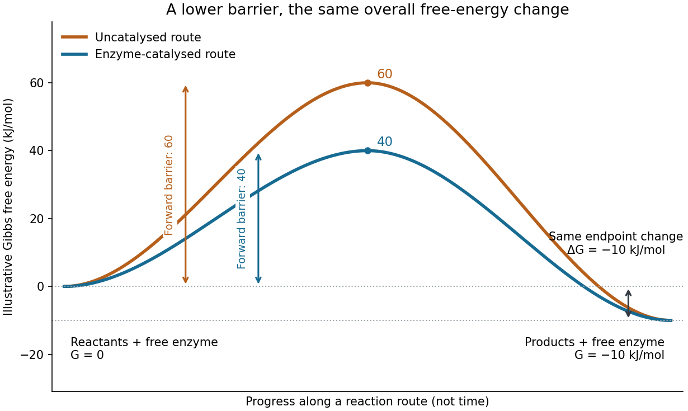
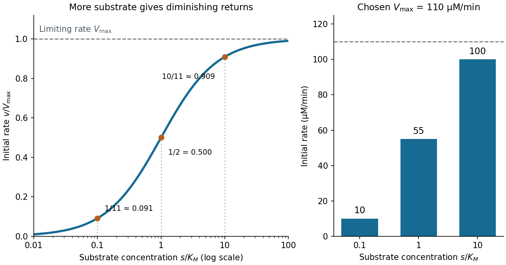

# Enzyme

↑ **Parent:** [Biology](biology-split.md)  
ⓦ [Wiki](https://en.wikipedia.org/wiki/Enzyme)

An [enzyme](enzyme-split.md) is a biological [catalyst](catalyst.md): it accelerates a [chemical reaction](chemical-reaction-split.md) and is regenerated after a successful catalytic cycle. Most [enzymes](enzyme-split.md) are [proteins](protein-split.md), but catalytic [RNA](ribonucleic-acid.md) molecules, called [ribozymes](ribozyme.md), also exist. Many reactions needed by a [biological cell](biological-cell-split.md) would proceed too slowly under its ordinary conditions without [enzymes](enzyme-split.md). See [Cooper, The Cell: the central role of enzymes as biological catalysts](https://www.ncbi.nlm.nih.gov/books/NBK9921/).

The biological beauty is selective speed. A [biological cell](biological-cell-split.md) contains many possible [reactants](reactant.md); its [enzymes](enzyme-split.md) help determine which transformations happen on a useful timescale. In [metabolism](metabolism.md), one step's [reaction product](product-chemistry.md) can become another step's [substrate](substrate-biochemistry.md), so selective catalysts support an organized flow of material.

The [ribosome](ribosome.md) is a striking biological example: the machinery that builds [proteins](protein-split.md) has [RNA](ribonucleic-acid.md) at its catalytic centre. The complete [ribosome](ribosome.md) contains both [RNA](ribonucleic-acid.md) and [proteins](protein-split.md), but its bond-forming [active site](active-site.md) is built from [RNA](ribonucleic-acid.md). Structural evidence established this distinction in [Nissen et al., The structural basis of ribosome activity in peptide bond synthesis, Science 289, 920–930 (2000)](https://pubmed.ncbi.nlm.nih.gov/10937990/).

Selection occurs at an [active site](active-site.md), the region where [substrate](substrate-biochemistry.md) binding and catalytic chemistry take place. Shape and chemical interactions favour some [substrates](substrate-biochemistry.md) over others; binding can also reshape the [enzyme](enzyme-split.md), an [induced fit](induced-fit.md). Recognition alone is insufficient: holding a [substrate](substrate-biochemistry.md) extremely tightly need not make it react quickly. Catalysis requires a favourable route through the [transition state](transition-state.md), the high-barrier configuration between [reactants](reactant.md) and [reaction products](product-chemistry.md). Positioning reactive groups and stabilizing this configuration relative to the bound [substrate](substrate-biochemistry.md) can lower that barrier. Specificity is often strong, but need not mean exactly one acceptable [substrate](substrate-biochemistry.md). See [Cooper, The Cell: mechanisms of enzymatic catalysis](https://www.ncbi.nlm.nih.gov/books/NBK9921/).

**[Figure 1](#image-enzymes-lower-reaction-barriers-while-leaving-the-overall-gibbs-free-energy-difference-unchanged). Enzymes lower reaction barriers while leaving the overall Gibbs free energy difference unchanged**. Original illustrative profiles, with the free [enzyme](enzyme-split.md) included in both endpoint states. The horizontal coordinate orders configurations along each route; it is neither elapsed time nor a measured distance. Actual catalytic mechanisms can have several intermediates and barriers.

Read the diagram numerically. Its chosen [Gibbs free energies](gibbs-free-energy.md) are $0$ for the [reactants](reactant.md) and $-10\,\mathrm{kJ\,mol^{-1}}$ for the [reaction products](product-chemistry.md). The uncatalysed peak is $60\,\mathrm{kJ\,mol^{-1}}$, whereas the catalysed peak is $40\,\mathrm{kJ\,mol^{-1}}$. The forward free-energy barriers are therefore $60$ and $40\,\mathrm{kJ\,mol^{-1}}$; viewed from the [reaction products](product-chemistry.md), the reverse barriers are $70$ and $50\,\mathrm{kJ\,mol^{-1}}$. Both decrease by $20\,\mathrm{kJ\,mol^{-1}}$, while the endpoint difference stays $-10\,\mathrm{kJ\,mol^{-1}}$. These are constructed values, not measurements of a particular [enzyme](enzyme-split.md).

This separates [chemical kinetics](chemical-kinetics-split.md) from [chemical equilibrium](chemical-equilibrium.md). An [enzyme](enzyme-split.md) changes how rapidly the system approaches [chemical equilibrium](chemical-equilibrium.md); it does not change the [equilibrium constant](equilibrium-constant.md) for the same overall [chemical reaction](chemical-reaction-split.md) under the same conditions. Faster catalysis therefore supplies no extra driving [energy](energy-split.md). In a [biological cell](biological-cell-split.md), continuing supply of [reactants](reactant.md) and removal of [reaction products](product-chemistry.md) can nevertheless sustain a net flow: the surroundings keep that system away from [chemical equilibrium](chemical-equilibrium.md). See [IUBMB, Symbolism and terminology in enzyme kinetics: basic definitions](https://iubmb.qmul.ac.uk/kinetics/ek1t3.html).

Some [enzymes](enzyme-split.md) require a [cofactor](cofactor-biochemistry.md), an additional nonprotein component such as a metal [ion](ion.md) or a small organic molecule. Organic helpers are often called [coenzymes](coenzyme.md); they can assist transfers that the [protein](protein-split.md) alone cannot readily perform. The [cofactor](cofactor-biochemistry.md) may remain bound or exchange with the surroundings, depending on the system. A [coenzyme](coenzyme.md) can be chemically changed in one reaction and regenerated by another: regeneration of the [enzyme](enzyme-split.md) does not mean every helper is unchanged in that individual reaction. Some [enzymes](enzyme-split.md) need no additional [cofactor](cofactor-biochemistry.md). See [Alberts et al., Molecular Biology of the Cell: small molecules associated with proteins](https://www.ncbi.nlm.nih.gov/books/NBK26911/) and [Alberts et al., activated carriers and their regeneration](https://www.ncbi.nlm.nih.gov/books/NBK26838/).

How much faster does adding [substrate](substrate-biochemistry.md) make a reaction? [Enzyme kinetics](enzyme-kinetics.md) gives a quantitative answer when a model's assumptions fit. For an illustrative reaction obeying [Michaelis-Menten kinetics](michaelis-menten-kinetics.md), use the [Michaelis-Menten equation](michaelis-menten-equation.md) with [substrate](substrate-biochemistry.md) [concentration](concentration.md) $s$, limiting [reaction rate](reaction-rate.md) $V_{\max}$ and [Michaelis constant](michaelis-constant.md) $K_M$. At $s/K_M=0.1$, substitution gives $v/V_{\max}=0.1/1.1=1/11\approx0.0909$. At $s/K_M=1$, it gives $1/2$; at $s/K_M=10$, it gives $10/11\approx0.9091$. Thus a hundredfold increase in [substrate](substrate-biochemistry.md) between the first and last examples yields only a tenfold increase in [reaction rate](reaction-rate.md).

**[Figure 2](#image-illustrative-michaelis-menten-kinetics-s-k-m-0-1-1-10-gives-v-v-max-1-11-1-2-10-11). Illustrative Michaelis-Menten kinetics: $s/K_M=0.1,1,10$ gives $v/V_{\max}=1/11,1/2,10/11$**. Original normalized curve and computed examples, with a logarithmic concentration axis to separate the three values. The dashed upper line is a limiting rate approached at high [substrate](substrate-biochemistry.md) [concentration](concentration.md), not reached at a finite concentration in this model.

For a chosen $V_{\max}=110\,\mathrm{\mu M\,min^{-1}}$, those fractions mean [reaction rates](reaction-rate.md) of $10$, $55$ and $100\,\mathrm{\mu M\,min^{-1}}$. Doubling [substrate](substrate-biochemistry.md) from $10K_M$ to $20K_M$ raises the normalized rate only from $10/11$ to $20/21\approx0.9524$, a relative increase of about $4.76\%$. In this simplest model, the catalytic machinery is already nearly fully occupied. Doubling the amount of active [enzyme](enzyme-split.md) instead doubles $V_{\max}$ and the predicted [reaction rates](reaction-rate.md) at fixed free [substrate](substrate-biochemistry.md) [concentration](concentration.md), provided the other conditions are unchanged. This distinction helps decide whether additional [substrate](substrate-biochemistry.md) or additional catalytic capacity could improve throughput.

The interpretation has limits. The simplest [Michaelis-Menten kinetics](michaelis-menten-kinetics.md) assumes a single [substrate](substrate-biochemistry.md), fixed active [enzyme](enzyme-split.md) amount, a suitable [quasi-steady-state approximation](quasi-steady-state-approximation.md), and initial measurements with negligible reverse reaction from accumulated [reaction product](product-chemistry.md). Substantial depletion, interacting binding sites, or inhibition by excess [substrate](substrate-biochemistry.md) can invalidate this model. Within it, $K_M$ is the [substrate](substrate-biochemistry.md) [concentration](concentration.md) giving half the limiting [reaction rate](reaction-rate.md); it is not generally the binding [dissociation constant](dissociation-constant.md) $K_d$. See [IUBMB, enzyme kinetics: steady-state approximation and substrate dissociation](https://iubmb.qmul.ac.uk/kinetics/ek1t3.html) and [IUBMB, Michaelis-Menten and non-Michaelis-Menten kinetics](https://iubmb.qmul.ac.uk/kinetics/ek4t6.html). Measuring activity also requires specified [temperature](temperature-split.md), [pH](ph.md) and necessary [cofactor](cofactor-biochemistry.md) availability: a weak signal can reflect unsuitable conditions rather than little [enzyme](enzyme-split.md). See [Brooks et al., Assay Guidance Manual: basics of enzymatic assays for HTS](https://www.ncbi.nlm.nih.gov/books/NBK92007/).

**Table of contents**

- [Micrococcal nuclease](micrococcal-nuclease.md)
- [NADPH oxidase](nadph-oxidase.md)
- [PhzS](phzs.md)
- [PhzM](phzm.md)
- [Autolysin](autolysin.md)
- [Penicillin-binding protein](penicillin-binding-protein.md)
- [Acyltransferase](acyltransferase.md)
- [Fatty acid synthase](fatty-acid-synthase.md)
- [Cytochrome P450](cytochrome-p450.md)
  - [CYP79A1](cyp79a1.md)
  - [P450 compound I](p450-compound-i.md)
- [Exonuclease](exonuclease.md)
- [Drosha](drosha.md)
- [Aconitase](aconitase.md)
- [ALAS2](alas2.md)
- [Cyclophilin A](cyclophilin-a.md)
- [Adenosine deaminase](adenosine-deaminase.md)
- [GTPase](gtpase.md)
  - [Tem1](tem1.md)
- [Phosphodiesterase](phosphodiesterase.md)
- [Ferredoxin-NADP reductase](ferredoxin-nadp-reductase.md)
- [Glucose-6-phosphatase](glucose-6-phosphatase.md)
- [Pyruvate carboxylase](pyruvate-carboxylase.md)
- [Catalytic triad](catalytic-triad.md)
- [Beta-galactosidase](beta-galactosidase.md)
- [METTL3](mettl3.md)
- [Mechanism-based inhibition](mechanism-based-inhibition.md)
- [5α-reductase](5-alpha-reductase.md)
- [Catalase](catalase.md)
- [Caspase](caspase.md)
- [AceK](acek.md)
- [Malate synthase](malate-synthase.md)
- [Isocitrate lyase](isocitrate-lyase.md)
- [IDH (Pseudomonas aeruginosa)](idh-pseudomonas-aeruginosa.md)
  - [IDH1](idh1.md)
- [ICD (Pseudomonas aeruginosa)](icd-pseudomonas-aeruginosa.md)
- [Cellulase](cellulase.md)
- [Lytic polysaccharide monooxygenase](lytic-polysaccharide-monooxygenase.md)
- [Beta-glucosidase](beta-glucosidase.md)
- [Cellobiohydrolase](cellobiohydrolase.md)
- [Endoglucanase](endoglucanase.md)
- [Fatty acid elongase](fatty-acid-elongase.md)
- [Fatty acid desaturase](fatty-acid-desaturase.md)
- [Cellulose synthase](cellulose-synthase.md)
- [PglB](pglb.md)
- [Oligosaccharyltransferase](oligosaccharyltransferase.md)
- [Glycosyltransferase](glycosyltransferase.md)
- [Lysyl oxidase](lysyl-oxidase.md)
- [PI3K-C2α](pi3k-c2-alpha.md)
- [Synaptojanin](synaptojanin.md)
- [Firefly luciferase](firefly-luciferase.md)
- [Renilla luciferase](renilla-luciferase.md)
- [Phosphatase](phosphatase.md)
- [Beta-lactamase](beta-lactamase.md)
  - [TEM-52](tem-52.md)
  - [TEM-1](tem-1.md)
- [Hydrogenase](hydrogenase.md)
- [Adenylate kinase](adenylate-kinase.md)
- [Acyl-enzyme intermediate](acyl-enzyme-intermediate.md)
- [Poly(A) polymerase](poly-a-polymerase.md)
- [STN7 kinase](stn7-kinase.md)
- [Violaxanthin de-epoxidase](violaxanthin-de-epoxidase.md)
- [Creatine kinase](creatine-kinase.md)
- [Glycogen synthase](glycogen-synthase.md)
- [Protein phosphatase 1](protein-phosphatase-1.md)
- [Kemp eliminase](kemp-eliminase.md)
- [Subtilisin E](subtilisin-e.md)
- [Histone acetyltransferase](histone-acetyltransferase.md)
- [DNA helicase](dna-helicase.md)
- [Telomerase](telomerase.md)
- [FEN1](fen1.md)
- [DNA topoisomerase II](dna-topoisomerase-ii.md)
- [DNA topoisomerase](dna-topoisomerase.md)
- [Ornithine decarboxylase](ornithine-decarboxylase.md)
- [RelA](rela.md)
- [Aminoacyl-tRNA synthetase](aminoacyl-trna-synthetase.md)
  - [Aminoacyl-tRNA synthetase editing](aminoacyl-trna-synthetase-editing.md)
- [Histone demethylase](histone-demethylase.md)
  - [ELF6](elf6.md)
- [Histone deacetylase](histone-deacetylase.md)
- [Histone methyltransferase](histone-methyltransferase.md)
  - [SETDB1](setdb1.md)
  - [Clr4](clr4.md)
- [Topoisomerase](topoisomerase.md)
- [Endonuclease](endonuclease.md)
- [Recombinase](recombinase.md)
- [Dihydrofolate reductase](dihydrofolate-reductase.md)
- [Nuclease](nuclease.md)
- [Ribonuclease](ribonuclease.md)
  - [Zucchini](zucchini.md)
  - [Dicer](dicer.md)
    - [DCL3](dcl3.md)
- [Protein kinase](protein-kinase.md)
  - [LATS kinase](lats-kinase.md)
  - [SnRK2 kinase](snrk2-kinase.md)
    - [OST1](ost1.md)
  - [Calcium and calmodulin-dependent protein kinase](calcium-and-calmodulin-dependent-protein-kinase.md)
  - [CBL-interacting protein kinase](cbl-interacting-protein-kinase.md)
  - [Calcium-dependent protein kinase](calcium-dependent-protein-kinase.md)
  - [Atypical protein kinase C](atypical-protein-kinase-c.md)
  - [Par-1](par-1.md)
  - [Elm1](elm1.md)
  - [Kin4](kin4.md)
  - [Cdc5](cdc5.md)
  - [cGMP-dependent protein kinase](cgmp-dependent-protein-kinase.md)
  - [BCR-ABL](bcr-abl.md)
  - [Mechanistic target of rapamycin](mechanistic-target-of-rapamycin.md)
  - [Raf](raf.md)
  - [AMP-activated protein kinase](amp-activated-protein-kinase.md)
  - [JAK2](jak2.md)
  - [JAK1](jak1.md)
  - [Chk1](chk1.md)
  - [ATR](atr.md)
  - [Dbf4-dependent kinase](dbf4-dependent-kinase.md)
  - [Aurora B](aurora-b.md)
  - [Cyclin-dependent kinase](cyclin-dependent-kinase.md)
  - [S6 kinase](s6-kinase.md)
  - [GCN2](gcn2.md)
  - [Src](src.md)
  - [Autophosphorylation](autophosphorylation.md)
    - [Trans-autophosphorylation](trans-autophosphorylation.md)
- [Protein phosphatase](protein-phosphatase.md)
  - [Protein phosphatase 2C](protein-phosphatase-2c.md)
    - [ABI1](abi1.md)
  - [Cdc14](cdc14.md)
  - [Protein tyrosine phosphatase](protein-tyrosine-phosphatase.md)
- [Phosphoinositide 3-kinase](phosphoinositide-3-kinase.md)
  - [PI3K regulatory subunit p85](pi3k-regulatory-subunit-p85.md)
- [Protein kinase B](protein-kinase-b.md)
- [Adenylyl cyclase](adenylyl-cyclase.md)
- [Protein kinase A](protein-kinase-a.md)
- [Phosphorylase kinase](phosphorylase-kinase.md)
- [Glycogen phosphorylase](glycogen-phosphorylase.md)
- [Ribozyme](ribozyme.md)
- [Ribonuclease P](ribonuclease-p.md)
- [Active site](active-site.md)
  - [Induced fit](induced-fit.md)
  - [Enzyme-substrate complex](enzyme-substrate-complex.md)
  - [Conformational selection](conformational-selection.md)
- [Hexokinase](hexokinase.md)
  - [Glucokinase regulatory protein](glucokinase-regulatory-protein.md)
  - [Glucokinase](glucokinase.md)
- [Cofactor (biochemistry)](cofactor-biochemistry.md)
  - [Coenzyme](coenzyme.md)
- [Substrate (biochemistry)](substrate-biochemistry.md)
- [Phospholipase C](phospholipase-c.md)
- [Collagenase](collagenase.md)
- [ATP synthase](atp-synthase.md)
  - [ATP synthase rotary mechanism](atp-synthase-rotary-mechanism.md)
  - [ATP synthase energy and proton budget](atp-synthase-energy-and-proton-budget.md)
  - [Single-molecule observation of F1 rotation](single-molecule-observation-of-f1-rotation.md)
- [Pyruvate kinase](pyruvate-kinase.md)
- [Lactate dehydrogenase](lactate-dehydrogenase.md)
- [Papain](papain.md)
- [Trypsin](trypsin.md)
  - [Trypsin cleavage specificity](trypsin-cleavage-specificity.md)
    - [Missed trypsin cleavage](missed-trypsin-cleavage.md)
  - [Trypsin colorimetric assay](trypsin-colorimetric-assay.md)
- [Protease](protease.md)
  - [Granzyme](granzyme.md)
  - [Serine protease](serine-protease.md)
    - [Subtilisin](subtilisin.md)
    - [Elastase](elastase.md)
    - [Chymotrypsin](chymotrypsin.md)
- [Enzyme inhibitor](enzyme-inhibitor.md)
  - [Triptolide](triptolide.md)
  - [Reversible enzyme inhibition](reversible-enzyme-inhibition.md)
    - [Inhibition constant](inhibition-constant.md)
    - [Competitive inhibition](competitive-inhibition.md)
    - [Mixed inhibition](mixed-inhibition.md)
      - [Pure noncompetitive inhibition](pure-noncompetitive-inhibition.md)
    - [Uncompetitive inhibition](uncompetitive-inhibition.md)
  - [Enzyme inhibition initial-rate assay](enzyme-inhibition-initial-rate-assay.md)
- [Restriction enzyme](restriction-enzyme.md)
  - [Restriction digest](restriction-digest.md)
  - [EcoRI](ecori.md)
- [Acid hydrolase](acid-hydrolase.md)
- [Acid phosphatase](acid-phosphatase.md)
- [Pyruvate dehydrogenase complex](pyruvate-dehydrogenase-complex.md)
- [DNA ligase](dna-ligase.md)

## ↑ Ancestors (2)

1. [Biology](biology-split.md)
2. [Codex Wiki](split.md)

## ← Incoming links (187)

- [aceA](acea.md)
- [AceK](acek.md)
- [Acid hydrolase](acid-hydrolase.md)
- [Active site](active-site.md)
- [Acyl-enzyme intermediate](acyl-enzyme-intermediate.md)
- [Adenylate kinase](adenylate-kinase.md)
- [Aerobic respiration](aerobic-respiration.md)
- [Aminoacyl-tRNA synthetase](aminoacyl-trna-synthetase.md)
- [Antibody equilibrium occupancy](antibody-equilibrium-occupancy.md)
- [ATP-driven sugar phosphorylation](atp-driven-sugar-phosphorylation.md)
- [ATP synthase](atp-synthase.md)
- [ATP synthase energy and proton budget](atp-synthase-energy-and-proton-budget.md)
- [Autophagosome](autophagosome.md)
- [Beta-lactamase](beta-lactamase.md)
- [Biochemistry](biochemistry-split.md)
- [Biological cell](biological-cell-split.md)
- [Biomass pretreatment](biomass-pretreatment.md)
- [Biosynthesis](biosynthesis.md)
- [Burst kinetics](burst-kinetics.md)
- [Caspase](caspase.md)
- [Catalase](catalase.md)
- [Catalyst](catalyst.md)
- [Catalytic selectivity](catalytic-selectivity.md)
- [Cell-free extract](cell-free-extract.md)
- [Cell-free fermentation as a biochemical experiment](cell-free-fermentation-as-a-biochemical-experiment.md)
- [CheA](chea.md)
- [CheB](cheb.md)
- [Chemical synapse](chemical-synapse.md)
- [CheR](cher.md)
- [CheZ](chez.md)
- [Chloroplast](chloroplast.md)
- [Chloroplast stroma](chloroplast-stroma.md)
- [Cisternal maturation](cisternal-maturation.md)
- [Coenzyme](coenzyme.md)
- [Coupled-enzyme readout of glycolytic ATP formation](coupled-enzyme-readout-of-glycolytic-atp-formation.md)
- [Covalent catalysis](covalent-catalysis.md)
- [Cytoplasm](cytoplasm.md)
- [Deoxyribonucleic acid](deoxyribonucleic-acid.md)
- [Dialysis (biochemistry)](dialysis-biochemistry.md)
- [Dialysis salt-removal and protein-retention experiments](dialysis-salt-removal-and-protein-retention-experiments.md)
- [Dicer](dicer.md)
- [DNA ligase](dna-ligase.md)
- [DNA polymerase](dna-polymerase.md)
- [Drosha](drosha.md)
- [Energy coupling](energy-coupling.md)
- [Enzyme](enzyme-split.md)
- [Enzyme conformational ensemble](enzyme-conformational-ensemble.md)
- [Enzyme inhibitor](enzyme-inhibitor.md)
- [Ethanol fermentation](ethanol-fermentation.md)
- [Evolutionary game theory](evolutionary-game-theory.md)
- [Fatty acid elongase](fatty-acid-elongase.md)
- [Firefly luciferase](firefly-luciferase.md)
- [G protein-coupled receptor](g-protein-coupled-receptor.md)
- [Glycogen](glycogen.md)
- [Glycogen phosphorylase](glycogen-phosphorylase.md)
- [Glycolysis](glycolysis.md)
- [Glycolysis carbon and ATP ledger](glycolysis-carbon-and-atp-ledger.md)
- [Golgi apparatus](golgi-apparatus.md)
- [Golgi cargo processing](golgi-cargo-processing.md)
- [Golgi lumen](golgi-lumen.md)
- [Histone deacetylase](histone-deacetylase.md)
- [Histone demethylase](histone-demethylase.md)
- [Histone methyltransferase](histone-methyltransferase.md)
- [Hydrogenase](hydrogenase.md)
- [Induced fit](induced-fit.md)
- [Inhibition constant](inhibition-constant.md)
- [Inner mitochondrial membrane](inner-mitochondrial-membrane.md)
- [Insulin](insulin.md)
- [Ionotropic receptor](ionotropic-receptor.md)
- [Lysosomal enzyme latency](lysosomal-enzyme-latency.md)
- [Lysosome](lysosome.md)
- [Lysozyme](lysozyme.md)
- [Lytic polysaccharide monooxygenase](lytic-polysaccharide-monooxygenase.md)
- [Metabolic flux](metabolic-flux.md)
- [Metabolic pathway](metabolic-pathway.md)
- [Metabolism](metabolism.md)
- [Metabotropic receptor](metabotropic-receptor.md)
- [Minimum inhibitory concentration](minimum-inhibitory-concentration.md)
- [Mitochondrial matrix](mitochondrial-matrix.md)
- [Mixed inhibition](mixed-inhibition.md)
- [Model organism evidence transfer](model-organism-evidence-transfer.md)
- [Monosaccharide](monosaccharide.md)
- [Mutational analysis of active site residues of human adenosine deaminase by D. Bhaumik and others](mutational-analysis-of-active-site-residues-of-human-adenosine-deaminase-by-d-bhaumik-and-others.md)
- [MutH](muth.md)
- [Neurotransmitter clearance](neurotransmitter-clearance.md)
- [Nuclease](nuclease.md)
- [Nucleic acid double helix](nucleic-acid-double-helix.md)
- [Nucleotide-sugar transporter](nucleotide-sugar-transporter.md)
- [Oxyanion](oxyanion.md)
- [Pancreatic IP3 store fractionation experiment](pancreatic-ip3-store-fractionation-experiment.md)
- [Papain](papain.md)
- [Solution](past-exam-of-the-biochemistry-and-molecular-biology-course-of-the-university-of-cambridge/2025/paper-1/section-b/5/solution.md)
- [Solution](past-exam-of-the-biochemistry-and-molecular-biology-course-of-the-university-of-cambridge/2025/paper-2/section-a/3/solution.md)
- [Solution](past-exam-of-the-biochemistry-and-molecular-biology-course-of-the-university-of-cambridge/2025/paper-2/section-b/11/a/solution.md)
- [Solution](past-exam-of-the-biochemistry-and-molecular-biology-course-of-the-university-of-cambridge/2025/paper-2/section-b/11/b/solution.md)
- [Solution](past-exam-of-the-biochemistry-and-molecular-biology-course-of-the-university-of-cambridge/2025/paper-2/section-b/11/d/solution.md)
- [Solution](past-exam-of-the-biochemistry-and-molecular-biology-course-of-the-university-of-cambridge/2025/paper-2/section-b/11/f/solution.md)
- [Solution](past-exam-of-the-biochemistry-and-molecular-biology-course-of-the-university-of-cambridge/2025/paper-2/section-b/11/h/solution.md)
- [Solution](past-exam-of-the-biochemistry-course-of-the-university-of-cambridge/2024/paper-1/section-i/1/solution.md)
- [Solution](past-exam-of-the-biochemistry-course-of-the-university-of-cambridge/2024/paper-1/section-i/2/solution.md)
- [Solution](past-exam-of-the-biochemistry-course-of-the-university-of-cambridge/2024/paper-1/section-ii/4/solution.md)
- [Solution](past-exam-of-the-biochemistry-course-of-the-university-of-cambridge/2024/paper-1/section-ii/6/solution.md)
- [Solution](past-exam-of-the-biochemistry-course-of-the-university-of-cambridge/2024/paper-1/section-ii/7/solution.md)
- [Solution](past-exam-of-the-biochemistry-course-of-the-university-of-cambridge/2024/paper-3/section-i/2/solution.md)
- [Solution](past-exam-of-the-biochemistry-course-of-the-university-of-cambridge/2024/paper-3/section-ii/6/solution.md)
- [Solution](past-exam-of-the-biochemistry-course-of-the-university-of-cambridge/2024/paper-3/section-ii/7/solution.md)
- [Solution](past-exam-of-the-biochemistry-course-of-the-university-of-cambridge/2025/paper-1/section-i/2/solution.md)
- [Solution](past-exam-of-the-biochemistry-course-of-the-university-of-cambridge/2025/paper-2/section-i/2/solution.md)
- [Solution](past-exam-of-the-biochemistry-course-of-the-university-of-cambridge/2025/paper-2/section-ii/7/solution.md)
- [Solution](past-exam-of-the-biochemistry-course-of-the-university-of-cambridge/2025/paper-4/section-i/1/solution.md)
- [Solution](past-exam-of-the-biochemistry-course-of-the-university-of-cambridge/2025/paper-4/section-ii/4/solution.md)
- [Solution](past-exam-of-the-biochemistry-course-of-the-university-of-cambridge/2025/paper-4/section-ii/5/solution.md)
- [Solution](past-exam-of-the-biochemistry-course-of-the-university-of-cambridge/2025/paper-4/section-iii/6/solution.md)
- [Solution](past-exam-of-the-biochemistry-course-of-the-university-of-cambridge/2025/paper-4/section-iii/7/solution.md)
- [Solution](past-exam-of-the-biochemistry-course-of-the-university-of-cambridge/2025/paper-4/section-iv/10/solution.md)
- [Solution](past-exam-of-the-biochemistry-course-of-the-university-of-cambridge/2025/paper-4/section-iv/11/solution.md)
- [Solution](past-exam-of-the-biochemistry-course-of-the-university-of-cambridge/2025/paper-4/section-iv/9/solution.md)
- [Solution](past-exam-of-the-chemistry-b-course-of-the-university-of-cambridge/2024/paper-2/b10/b/solution.md)
- [Solution](past-exam-of-the-chemistry-b-course-of-the-university-of-cambridge/2024/paper-2/b10/c/solution.md)
- [Solution](past-exam-of-the-chemistry-b-course-of-the-university-of-cambridge/2024/paper-2/b10/d/i/solution.md)
- [Solution](past-exam-of-the-chemistry-b-course-of-the-university-of-cambridge/2024/paper-2/b10/d/ii/solution.md)
- [Solution](past-exam-of-the-chemistry-b-course-of-the-university-of-cambridge/2024/paper-2/b10/d/iii/solution.md)
- [Solution](past-exam-of-the-chemistry-b-course-of-the-university-of-cambridge/2024/paper-2/b10/d/iv/solution.md)
- [Solution](past-exam-of-the-chemistry-b-course-of-the-university-of-cambridge/2024/paper-2/b10/e/solution.md)
- [Solution](past-exam-of-the-genetics-course-of-the-university-of-cambridge/2024/paper-2/7/solution.md)
- [Solution](past-exam-of-the-systems-biology-course-of-the-university-of-cambridge/2024/paper-1/section-i/1-1/solution.md)
- [Solution](past-exam-of-the-systems-biology-course-of-the-university-of-cambridge/2024/paper-1/section-i/1-2/solution.md)
- [Solution](past-exam-of-the-systems-biology-course-of-the-university-of-cambridge/2024/paper-1/section-ii/2-3/solution.md)
- [Solution](past-exam-of-the-zoology-course-of-the-university-of-cambridge/2025/paper-zl1/2/solution.md)
- [PCR extension](pcr-extension.md)
- [PCR thermal cycle](pcr-thermal-cycle.md)
- [Phosphatase](phosphatase.md)
- [Phosphorylation](phosphorylation.md)
- [Plasmid](plasmid.md)
- [Plasmid restriction mapping](plasmid-restriction-mapping.md)
- [Poly(A) polymerase](poly-a-polymerase.md)
- [Positive feedback](positive-feedback.md)
- [Pre-steady-state kinetics](pre-steady-state-kinetics.md)
- [Protein](protein-split.md)
- [Protein binding site](protein-binding-site.md)
- [Protein folding](protein-folding.md)
- [Protein glycosylation](protein-glycosylation.md)
- [Protein kinase](protein-kinase.md)
- [Protein phosphatase](protein-phosphatase.md)
- [Protoplast](protoplast.md)
- [Rat-liver acid-phosphatase latency experiment](rat-liver-acid-phosphatase-latency-experiment.md)
- [RccR](rccr.md)
- [Receptor phosphorylation assay](receptor-phosphorylation-assay.md)
- [Receptor tyrosine kinase](receptor-tyrosine-kinase.md)
- [Recombinase](recombinase.md)
- [RelA](rela.md)
- [Renilla luciferase](renilla-luciferase.md)
- [Respiratory control](respiratory-control.md)
- [Reverse transcriptase](reverse-transcriptase.md)
- [Reversible enzyme inhibition](reversible-enzyme-inhibition.md)
- [Ribonuclease](ribonuclease.md)
- [Ribonuclease A](ribonuclease-a.md)
- [Ribonuclease P](ribonuclease-p.md)
- [Ribonucleic acid](ribonucleic-acid.md)
- [Ribozyme](ribozyme.md)
- [RNA polymerase](rna-polymerase.md)
- [RNase H1](rnase-h1.md)
- [Saccharomyces cerevisiae](saccharomyces-cerevisiae.md)
- [Sanger's insulin sequencing experiment](sanger-s-insulin-sequencing-experiment.md)
- [Second messenger](second-messenger.md)
- [Selective biochemical reaction pathways](selective-biochemical-reaction-pathways.md)
- [Sequential two-site enzyme reaction network](sequential-two-site-enzyme-reaction-network.md)
- [Signal amplification](signal-amplification.md)
- [Signal transduction](signal-transduction-split.md)
- [Signaling feedback](signaling-feedback.md)
- [Single-molecule observation of F1 rotation](single-molecule-observation-of-f1-rotation.md)
- [Substrate (biochemistry)](substrate-biochemistry.md)
- [Substrate (chemistry)](substrate-chemistry.md)
- [Substrate-level phosphorylation](substrate-level-phosphorylation.md)
- [Thermodynamic free energy](thermodynamic-free-energy.md)
- [Topoisomerase](topoisomerase.md)
- [Trans-Golgi network](trans-golgi-network.md)
- [Trypsin](trypsin.md)
- [Trypsin colorimetric assay](trypsin-colorimetric-assay.md)
- [Trypsinogen](trypsinogen.md)
- [Turnover number](turnover-number.md)
- [Type II fatty acid synthesis](type-ii-fatty-acid-synthesis.md)
- [Western blot antibody detection](western-blot-antibody-detection.md)
- [Western blot band interpretation](western-blot-band-interpretation.md)
- [Western blot response saturation](western-blot-response-saturation.md)
- [Yeast](yeast.md)
- [Yeast cross-species complementation experiment](yeast-cross-species-complementation-experiment.md)
