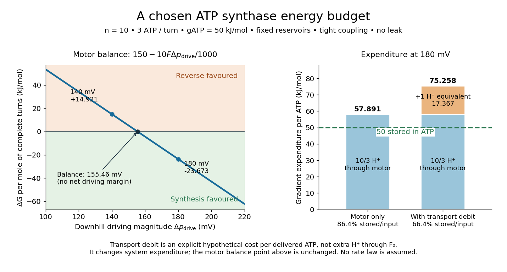
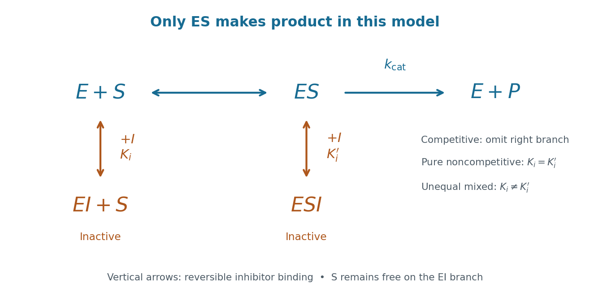

# Enzyme

↑ **Parent:** [Biology](biology.md)  
ⓦ [Wiki](https://en.wikipedia.org/wiki/Enzyme)

An [enzyme](enzyme.md) is a biological [catalyst](chemical-kinetics.md#catalyst): it accelerates a [chemical reaction](chemical-reaction.md) and is regenerated after a successful catalytic cycle. Most [enzymes](enzyme.md) are [proteins](protein.md), but catalytic [RNA](polymer.md#ribonucleic-acid) molecules, called [ribozymes](#ribozyme), also exist. Many reactions needed by a [biological cell](biological-cell.md) would proceed too slowly under its ordinary conditions without [enzymes](enzyme.md). See [Cooper, The Cell: the central role of enzymes as biological catalysts](https://www.ncbi.nlm.nih.gov/books/NBK9921/).

The biological beauty is selective speed. A [biological cell](biological-cell.md) contains many possible [reactants](chemical-reaction.md#reactant); its [enzymes](enzyme.md) help determine which transformations happen on a useful timescale. In [metabolism](biology.md#metabolism), one step's [reaction product](chemical-reaction.md#product-chemistry) can become another step's [substrate](#substrate-biochemistry), so selective catalysts support an organized flow of material.

The [ribosome](biological-cell.md#ribosome) is a striking biological example: the machinery that builds [proteins](protein.md) has [RNA](polymer.md#ribonucleic-acid) at its catalytic centre. The complete [ribosome](biological-cell.md#ribosome) contains both [RNA](polymer.md#ribonucleic-acid) and [proteins](protein.md), but its bond-forming [active site](#active-site) is built from [RNA](polymer.md#ribonucleic-acid). Structural evidence established this distinction in [Nissen et al., The structural basis of ribosome activity in peptide bond synthesis, Science 289, 920–930 (2000)](https://pubmed.ncbi.nlm.nih.gov/10937990/).

Selection occurs at an [active site](#active-site), the region where [substrate](#substrate-biochemistry) binding and catalytic chemistry take place. Shape and chemical interactions favour some [substrates](#substrate-biochemistry) over others; binding can also reshape the [enzyme](enzyme.md), an [induced fit](#induced-fit). Recognition alone is insufficient: holding a [substrate](#substrate-biochemistry) extremely tightly need not make it react quickly. Catalysis requires a favourable route through the [transition state](chemical-kinetics.md#transition-state), the high-barrier configuration between [reactants](chemical-reaction.md#reactant) and [reaction products](chemical-reaction.md#product-chemistry). Positioning reactive groups and stabilizing this configuration relative to the bound [substrate](#substrate-biochemistry) can lower that barrier. Specificity is often strong, but need not mean exactly one acceptable [substrate](#substrate-biochemistry). See [Cooper, The Cell: mechanisms of enzymatic catalysis](https://www.ncbi.nlm.nih.gov/books/NBK9921/).

**[Figure 1](#image-enzymes-lower-reaction-barriers-while-leaving-the-overall-gibbs-free-energy-difference-unchanged). Enzymes lower reaction barriers while leaving the overall Gibbs free energy difference unchanged**. Original illustrative profiles, with the free [enzyme](enzyme.md) included in both endpoint states. The horizontal coordinate orders configurations along each route; it is neither elapsed time nor a measured distance. Actual catalytic mechanisms can have several intermediates and barriers.

Read the diagram numerically. Its chosen [Gibbs free energies](thermodynamic-potential.md#gibbs-free-energy) are $0$ for the [reactants](chemical-reaction.md#reactant) and $-10\,\mathrm{kJ\,mol^{-1}}$ for the [reaction products](chemical-reaction.md#product-chemistry). The uncatalysed peak is $60\,\mathrm{kJ\,mol^{-1}}$, whereas the catalysed peak is $40\,\mathrm{kJ\,mol^{-1}}$. The forward free-energy barriers are therefore $60$ and $40\,\mathrm{kJ\,mol^{-1}}$; viewed from the [reaction products](chemical-reaction.md#product-chemistry), the reverse barriers are $70$ and $50\,\mathrm{kJ\,mol^{-1}}$. Both decrease by $20\,\mathrm{kJ\,mol^{-1}}$, while the endpoint difference stays $-10\,\mathrm{kJ\,mol^{-1}}$. These are constructed values, not measurements of a particular [enzyme](enzyme.md).

This separates [chemical kinetics](chemical-kinetics.md) from [chemical equilibrium](chemical-potential.md#chemical-equilibrium). An [enzyme](enzyme.md) changes how rapidly the system approaches [chemical equilibrium](chemical-potential.md#chemical-equilibrium); it does not change the [equilibrium constant](chemical-potential.md#equilibrium-constant) for the same overall [chemical reaction](chemical-reaction.md) under the same conditions. Faster catalysis therefore supplies no extra driving [energy](energy.md). In a [biological cell](biological-cell.md), continuing supply of [reactants](chemical-reaction.md#reactant) and removal of [reaction products](chemical-reaction.md#product-chemistry) can nevertheless sustain a net flow: the surroundings keep that system away from [chemical equilibrium](chemical-potential.md#chemical-equilibrium). See [IUBMB, Symbolism and terminology in enzyme kinetics: basic definitions](https://iubmb.qmul.ac.uk/kinetics/ek1t3.html).

Some [enzymes](enzyme.md) require a [cofactor](#cofactor-biochemistry), an additional nonprotein component such as a metal [ion](chemistry.md#ion) or a small organic molecule. Organic helpers are often called [coenzymes](#coenzyme); they can assist transfers that the [protein](protein.md) alone cannot readily perform. The [cofactor](#cofactor-biochemistry) may remain bound or exchange with the surroundings, depending on the system. A [coenzyme](#coenzyme) can be chemically changed in one reaction and regenerated by another: regeneration of the [enzyme](enzyme.md) does not mean every helper is unchanged in that individual reaction. Some [enzymes](enzyme.md) need no additional [cofactor](#cofactor-biochemistry). See [Alberts et al., Molecular Biology of the Cell: small molecules associated with proteins](https://www.ncbi.nlm.nih.gov/books/NBK26911/) and [Alberts et al., activated carriers and their regeneration](https://www.ncbi.nlm.nih.gov/books/NBK26838/).

How much faster does adding [substrate](#substrate-biochemistry) make a reaction? [Enzyme kinetics](mathematical-biology.md#enzyme-kinetics) gives a quantitative answer when a model's assumptions fit. For an illustrative reaction obeying [Michaelis-Menten kinetics](mathematical-biology.md#michaelis-menten-kinetics), use the [Michaelis-Menten equation](mathematical-biology.md#michaelis-menten-equation) with [substrate](#substrate-biochemistry) [concentration](mathematical-physics.md#concentration) $s$, limiting [reaction rate](chemical-kinetics.md#reaction-rate) $V_{\max}$ and [Michaelis constant](mathematical-biology.md#michaelis-constant) $K_M$. At $s/K_M=0.1$, substitution gives $v/V_{\max}=0.1/1.1=1/11\approx0.0909$. At $s/K_M=1$, it gives $1/2$; at $s/K_M=10$, it gives $10/11\approx0.9091$. Thus a hundredfold increase in [substrate](#substrate-biochemistry) between the first and last examples yields only a tenfold increase in [reaction rate](chemical-kinetics.md#reaction-rate).

**[Figure 2](#image-illustrative-michaelis-menten-kinetics-s-k-m-0-1-1-10-gives-v-v-max-1-11-1-2-10-11). Illustrative Michaelis-Menten kinetics: $s/K_M=0.1,1,10$ gives $v/V_{\max}=1/11,1/2,10/11$**. Original normalized curve and computed examples, with a logarithmic concentration axis to separate the three values. The dashed upper line is a limiting rate approached at high [substrate](#substrate-biochemistry) [concentration](mathematical-physics.md#concentration), not reached at a finite concentration in this model.

For a chosen $V_{\max}=110\,\mathrm{\mu M\,min^{-1}}$, those fractions mean [reaction rates](chemical-kinetics.md#reaction-rate) of $10$, $55$ and $100\,\mathrm{\mu M\,min^{-1}}$. Doubling [substrate](#substrate-biochemistry) from $10K_M$ to $20K_M$ raises the normalized rate only from $10/11$ to $20/21\approx0.9524$, a relative increase of about $4.76\%$. In this simplest model, the catalytic machinery is already nearly fully occupied. Doubling the amount of active [enzyme](enzyme.md) instead doubles $V_{\max}$ and the predicted [reaction rates](chemical-kinetics.md#reaction-rate) at fixed free [substrate](#substrate-biochemistry) [concentration](mathematical-physics.md#concentration), provided the other conditions are unchanged. This distinction helps decide whether additional [substrate](#substrate-biochemistry) or additional catalytic capacity could improve throughput.

The interpretation has limits. The simplest [Michaelis-Menten kinetics](mathematical-biology.md#michaelis-menten-kinetics) assumes a single [substrate](#substrate-biochemistry), fixed active [enzyme](enzyme.md) amount, a suitable [quasi-steady-state approximation](mathematical-biology.md#quasi-steady-state-approximation), and initial measurements with negligible reverse reaction from accumulated [reaction product](chemical-reaction.md#product-chemistry). Substantial depletion, interacting binding sites, or inhibition by excess [substrate](#substrate-biochemistry) can invalidate this model. Within it, $K_M$ is the [substrate](#substrate-biochemistry) [concentration](mathematical-physics.md#concentration) giving half the limiting [reaction rate](chemical-kinetics.md#reaction-rate); it is not generally the binding [dissociation constant](chemical-potential.md#dissociation-constant) $K_d$. See [IUBMB, enzyme kinetics: steady-state approximation and substrate dissociation](https://iubmb.qmul.ac.uk/kinetics/ek1t3.html) and [IUBMB, Michaelis-Menten and non-Michaelis-Menten kinetics](https://iubmb.qmul.ac.uk/kinetics/ek4t6.html). Measuring activity also requires specified [temperature](temperature.md), [pH](acid-base-chemistry.md#ph) and necessary [cofactor](#cofactor-biochemistry) availability: a weak signal can reflect unsuitable conditions rather than little [enzyme](enzyme.md). See [Brooks et al., Assay Guidance Manual: basics of enzymatic assays for HTS](https://www.ncbi.nlm.nih.gov/books/NBK92007/).

**Table of contents**

- [Micrococcal nuclease](#micrococcal-nuclease)
- [NADPH oxidase](#nadph-oxidase)
- [PhzS](#phzs)
- [PhzM](#phzm)
- [Autolysin](#autolysin)
- [Penicillin-binding protein](#penicillin-binding-protein)
- [Acyltransferase](#acyltransferase)
- [Fatty acid synthase](#fatty-acid-synthase)
- [Cytochrome P450](#cytochrome-p450)
  - [CYP79A1](#cyp79a1)
  - [P450 compound I](#p450-compound-i)
- [Exonuclease](#exonuclease)
- [Drosha](#drosha)
- [Aconitase](#aconitase)
- [ALAS2](#alas2)
- [Cyclophilin A](#cyclophilin-a)
- [Adenosine deaminase](#adenosine-deaminase)
- [GTPase](#gtpase)
  - [Tem1](#tem1)
- [Phosphodiesterase](#phosphodiesterase)
- [Ferredoxin-NADP reductase](#ferredoxin-nadp-reductase)
- [Glucose-6-phosphatase](#glucose-6-phosphatase)
- [Pyruvate carboxylase](#pyruvate-carboxylase)
- [Catalytic triad](#catalytic-triad)
- [Beta-galactosidase](#beta-galactosidase)
- [METTL3](#mettl3)
- [Mechanism-based inhibition](#mechanism-based-inhibition)
- [5α-reductase](#5-alpha-reductase)
- [Catalase](#catalase)
- [Caspase](#caspase)
- [AceK](#acek)
- [Malate synthase](#malate-synthase)
- [Isocitrate lyase](#isocitrate-lyase)
- [IDH (Pseudomonas aeruginosa)](#idh-pseudomonas-aeruginosa)
  - [IDH1](#idh1)
- [ICD (Pseudomonas aeruginosa)](#icd-pseudomonas-aeruginosa)
- [Cellulase](#cellulase)
- [Lytic polysaccharide monooxygenase](#lytic-polysaccharide-monooxygenase)
- [Beta-glucosidase](#beta-glucosidase)
- [Cellobiohydrolase](#cellobiohydrolase)
- [Endoglucanase](#endoglucanase)
- [Fatty acid elongase](#fatty-acid-elongase)
- [Fatty acid desaturase](#fatty-acid-desaturase)
- [Cellulose synthase](#cellulose-synthase)
- [PglB](#pglb)
- [Oligosaccharyltransferase](#oligosaccharyltransferase)
- [Glycosyltransferase](#glycosyltransferase)
- [Lysyl oxidase](#lysyl-oxidase)
- [PI3K-C2α](#pi3k-c2-alpha)
- [Synaptojanin](#synaptojanin)
- [Firefly luciferase](#firefly-luciferase)
- [Renilla luciferase](#renilla-luciferase)
- [Phosphatase](#phosphatase)
- [Beta-lactamase](#beta-lactamase)
  - [TEM-52](#tem-52)
  - [TEM-1](#tem-1)
- [Hydrogenase](#hydrogenase)
- [Adenylate kinase](#adenylate-kinase)
- [Acyl-enzyme intermediate](#acyl-enzyme-intermediate)
- [Poly(A) polymerase](#poly-a-polymerase)
- [STN7 kinase](#stn7-kinase)
- [Violaxanthin de-epoxidase](#violaxanthin-de-epoxidase)
- [Creatine kinase](#creatine-kinase)
- [Glycogen synthase](#glycogen-synthase)
- [Protein phosphatase 1](#protein-phosphatase-1)
- [Kemp eliminase](#kemp-eliminase)
- [Subtilisin E](#subtilisin-e)
- [Histone acetyltransferase](#histone-acetyltransferase)
- [DNA helicase](#dna-helicase)
- [Telomerase](#telomerase)
- [FEN1](#fen1)
- [DNA topoisomerase II](#dna-topoisomerase-ii)
- [DNA topoisomerase](#dna-topoisomerase)
- [Ornithine decarboxylase](#ornithine-decarboxylase)
- [RelA](#rela)
- [Aminoacyl-tRNA synthetase](#aminoacyl-trna-synthetase)
  - [Aminoacyl-tRNA synthetase editing](#aminoacyl-trna-synthetase-editing)
- [Histone demethylase](#histone-demethylase)
  - [ELF6](#elf6)
- [Histone deacetylase](#histone-deacetylase)
- [Histone methyltransferase](#histone-methyltransferase)
  - [SETDB1](#setdb1)
  - [Clr4](#clr4)
- [Topoisomerase](#topoisomerase)
- [Endonuclease](#endonuclease)
- [Recombinase](#recombinase)
- [Dihydrofolate reductase](#dihydrofolate-reductase)
- [Nuclease](#nuclease)
- [Ribonuclease](#ribonuclease)
  - [Zucchini](#zucchini)
  - [Dicer](#dicer)
    - [DCL3](#dcl3)
- [Protein kinase](#protein-kinase)
  - [LATS kinase](#lats-kinase)
  - [SnRK2 kinase](#snrk2-kinase)
    - [OST1](#ost1)
  - [Calcium and calmodulin-dependent protein kinase](#calcium-and-calmodulin-dependent-protein-kinase)
  - [CBL-interacting protein kinase](#cbl-interacting-protein-kinase)
  - [Calcium-dependent protein kinase](#calcium-dependent-protein-kinase)
  - [Atypical protein kinase C](#atypical-protein-kinase-c)
  - [Par-1](#par-1)
  - [Elm1](#elm1)
  - [Kin4](#kin4)
  - [Cdc5](#cdc5)
  - [cGMP-dependent protein kinase](#cgmp-dependent-protein-kinase)
  - [BCR-ABL](#bcr-abl)
  - [Mechanistic target of rapamycin](#mechanistic-target-of-rapamycin)
  - [Raf](#raf)
  - [AMP-activated protein kinase](#amp-activated-protein-kinase)
  - [JAK2](#jak2)
  - [JAK1](#jak1)
  - [Chk1](#chk1)
  - [ATR](#atr)
  - [Dbf4-dependent kinase](#dbf4-dependent-kinase)
  - [Aurora B](#aurora-b)
  - [Cyclin-dependent kinase](#cyclin-dependent-kinase)
  - [S6 kinase](#s6-kinase)
  - [GCN2](#gcn2)
  - [Src](#src)
  - [Autophosphorylation](#autophosphorylation)
    - [Trans-autophosphorylation](#trans-autophosphorylation)
- [Protein phosphatase](#protein-phosphatase)
  - [Protein phosphatase 2C](#protein-phosphatase-2c)
    - [ABI1](#abi1)
  - [Cdc14](#cdc14)
  - [Protein tyrosine phosphatase](#protein-tyrosine-phosphatase)
- [Phosphoinositide 3-kinase](#phosphoinositide-3-kinase)
  - [PI3K regulatory subunit p85](#pi3k-regulatory-subunit-p85)
- [Protein kinase B](#protein-kinase-b)
- [Adenylyl cyclase](#adenylyl-cyclase)
- [Protein kinase A](#protein-kinase-a)
- [Phosphorylase kinase](#phosphorylase-kinase)
- [Glycogen phosphorylase](#glycogen-phosphorylase)
- [Ribozyme](#ribozyme)
- [Ribonuclease P](#ribonuclease-p)
- [Active site](#active-site)
  - [Induced fit](#induced-fit)
  - [Enzyme-substrate complex](#enzyme-substrate-complex)
  - [Conformational selection](#conformational-selection)
- [Hexokinase](#hexokinase)
  - [Glucokinase regulatory protein](#glucokinase-regulatory-protein)
  - [Glucokinase](#glucokinase)
- [Cofactor (biochemistry)](#cofactor-biochemistry)
  - [Coenzyme](#coenzyme)
- [Substrate (biochemistry)](#substrate-biochemistry)
- [Phospholipase C](#phospholipase-c)
- [Collagenase](#collagenase)
- [ATP synthase](#atp-synthase)
  - [ATP synthase rotary mechanism](#atp-synthase-rotary-mechanism)
  - [ATP synthase energy and proton budget](#atp-synthase-energy-and-proton-budget)
  - [Single-molecule observation of F1 rotation](#single-molecule-observation-of-f1-rotation)
- [Pyruvate kinase](#pyruvate-kinase)
- [Lactate dehydrogenase](#lactate-dehydrogenase)
- [Papain](#papain)
- [Trypsin](#trypsin)
  - [Trypsin cleavage specificity](#trypsin-cleavage-specificity)
    - [Missed trypsin cleavage](#missed-trypsin-cleavage)
  - [Trypsin colorimetric assay](#trypsin-colorimetric-assay)
- [Protease](#protease)
  - [Granzyme](#granzyme)
  - [Serine protease](#serine-protease)
    - [Subtilisin](#subtilisin)
    - [Elastase](#elastase)
    - [Chymotrypsin](#chymotrypsin)
- [Enzyme inhibitor](#enzyme-inhibitor)
  - [Triptolide](#triptolide)
  - [Reversible enzyme inhibition](#reversible-enzyme-inhibition)
    - [Inhibition constant](#inhibition-constant)
    - [Competitive inhibition](#competitive-inhibition)
    - [Mixed inhibition](#mixed-inhibition)
      - [Pure noncompetitive inhibition](#pure-noncompetitive-inhibition)
    - [Uncompetitive inhibition](#uncompetitive-inhibition)
  - [Enzyme inhibition initial-rate assay](#enzyme-inhibition-initial-rate-assay)
- [Restriction enzyme](#restriction-enzyme)
  - [Restriction digest](#restriction-digest)
  - [EcoRI](#ecori)
- [Acid hydrolase](#acid-hydrolase)
- [Acid phosphatase](#acid-phosphatase)
- [Pyruvate dehydrogenase complex](#pyruvate-dehydrogenase-complex)
- [DNA ligase](#dna-ligase)

## Micrococcal nuclease

↑ **Parent:** [Enzyme](enzyme.md)

## NADPH oxidase

↑ **Parent:** [Enzyme](enzyme.md)

An enzyme transferring electrons from NADPH to oxygen. Plant respiratory-burst oxidase homologues can generate extracellular reactive oxygen species participating in [redox signalling](signal-transduction.md#redox-signalling).

## PhzS

↑ **Parent:** [Enzyme](enzyme.md)

A flavin-dependent phenazine-modifying monooxygenase participating in pyocyanin biosynthesis.

## PhzM

↑ **Parent:** [Enzyme](enzyme.md)

A phenazine-modifying methyltransferase participating in pyocyanin biosynthesis.

## Autolysin

↑ **Parent:** [Enzyme](enzyme.md)

A peptidoglycan-cleaving enzyme used in controlled cell-wall remodeling and separation; unregulated activity can cause lysis.

## Penicillin-binding protein

↑ **Parent:** [Enzyme](enzyme.md)

A family of bacterial envelope enzymes including peptidoglycan transpeptidases and other activities. The specific catalytic repertoire differs among members.

## Acyltransferase

↑ **Parent:** [Enzyme](enzyme.md)

An enzyme transferring an acyl group to an acceptor; substrate specificity contributes to lipid molecular-species diversity.

## Fatty acid synthase

↑ **Parent:** [Enzyme](enzyme.md)

The enzyme machinery that assembles fatty-acid chains from activated carbon units through repeated condensation and reduction.

## Cytochrome P450

↑ **Parent:** [Enzyme](enzyme.md)

A heme-thiolate enzyme superfamily whose members catalyse diverse oxidative transformations. The name originates from the characteristic approximately 450 nm absorption of the reduced carbon-monoxide-bound form.

### CYP79A1

↑ **Parent:** [Cytochrome P450](#cytochrome-p450)

A sorghum P450 catalysing conversion of tyrosine toward p-hydroxyphenylacetaldoxime in dhurrin biosynthesis. It has served as a model for photosynthesis-powered heterologous P450 activity.

### P450 compound I

↑ **Parent:** [Cytochrome P450](#cytochrome-p450)

The highly oxidizing ferryl/porphyrin-radical intermediate used in many P450 oxygenations; its subsequent reactions depend on the substrate and enzyme.

## Exonuclease

↑ **Parent:** [Enzyme](enzyme.md)

## Drosha

↑ **Parent:** [Enzyme](enzyme.md)

An RNase III [enzyme](enzyme.md) contributing to canonical nuclear [microRNA](polymer.md#microrna) precursor processing. A global processing perturbation affects many RNAs rather than testing one miRNA specifically.

## Aconitase

↑ **Parent:** [Enzyme](enzyme.md)

An iron–sulfur enzyme. The cytosolic form associated with [IRP1](biology.md#irp1) illustrates switching between enzymatic and RNA-binding functions.

## ALAS2

↑ **Parent:** [Enzyme](enzyme.md)

The erythroid aminolevulinate-synthase isoform, with an iron-responsive [RNA](polymer.md#ribonucleic-acid) element coupling its synthesis to [iron](chemical-substance.md#iron) supply for the [haem](chemical-substance.md#haem) pathway.

## Cyclophilin A

↑ **Parent:** [Enzyme](enzyme.md)

A peptidyl-prolyl isomerase used to study connections between conformational exchange and [catalysis](chemical-kinetics.md#catalysis).[NMR exchange measurements](biology-bibliography.md#intrinsic-dynamics-of-an-enzyme-underlies-catalysis-by-elan-z-eisenmesser-and-others)

## Adenosine deaminase

↑ **Parent:** [Enzyme](enzyme.md)

[Adenosine deaminase](#adenosine-deaminase) catalyzes conversion of [adenosine](molecule.md#adenosine) and [water](chemical-substance.md#water) into [inosine](molecule.md#inosine) and [ammonia](chemical-substance.md#ammonia). Its zinc-containing [active site](#active-site) activates [water](chemical-substance.md#water) and stabilizes the reacting configuration; [proton transfers](acid-base-chemistry.md#proton-transfer) assist addition and leaving-group departure. Mutation kinetics constrain catalytic roles but do not uniquely locate every proton.

## GTPase

↑ **Parent:** [Enzyme](enzyme.md)

An enzyme hydrolysing [GTP](molecule.md#guanosine-triphosphate) to [GDP](molecule.md#guanosine-diphosphate) and phosphate. Many act as nucleotide-controlled switches: hydrolysis changes the state, and nucleotide exchange restores a GTP-bound population for another cycle.

### Tem1

↑ **Parent:** [GTPase](#gtpase)

A small GTPase upstream of the budding-yeast [mitotic exit network](cell-cycle.md#mitotic-exit-network). Its regulation helps couple mitotic exit to spindle position.

## Phosphodiesterase

↑ **Parent:** [Enzyme](enzyme.md)

An enzyme cleaving a phosphodiester linkage. Cyclic-nucleotide phosphodiesterases reduce cyclic AMP or cyclic GMP signals, so inhibiting them can prolong a messenger response.

## Ferredoxin-NADP reductase

↑ **Parent:** [Enzyme](enzyme.md)

An enzyme coupling electrons from reduced ferredoxin to NADP reduction, producing NADPH on the stromal side of the chloroplast electron-transfer system.

## Glucose-6-phosphatase

↑ **Parent:** [Enzyme](enzyme.md)

An enzyme system hydrolysing glucose-6-phosphate to glucose and phosphate. The hepatic catalytic site faces the endoplasmic-reticulum lumen, so substrate transport is integral to glucose production.

## Pyruvate carboxylase

↑ **Parent:** [Enzyme](enzyme.md)

A mitochondrial enzyme converting pyruvate into oxaloacetate using bicarbonate and ATP. It supplies gluconeogenesis and replenishes metabolic intermediates; compartmentation requires suitable subsequent transport routes.

## Catalytic triad

↑ **Parent:** [Enzyme](enzyme.md)

A spatially organized group of three catalytic residues. Serine proteases commonly use serine, histidine and aspartate, but similar geometry in different folds can reflect convergent evolution.

## Beta-galactosidase

↑ **Parent:** [Enzyme](enzyme.md)

An enzyme hydrolysing beta-galactosides. In the [lac operon](molecular-genetics.md#lac-operon) system, its processing of lactose includes production of [allolactose](chemical-substance.md#allolactose), which regulates [LacI](molecular-genetics.md#laci).

## METTL3

↑ **Parent:** [Enzyme](enzyme.md)

## Mechanism-based inhibition

↑ **Parent:** [Enzyme](enzyme.md)

In [mechanism-based inhibition](#mechanism-based-inhibition), catalytic processing of an inhibitor generates the species responsible for sustained inhibition. The covalent bond can be between inhibitor and cofactor rather than to an amino acid side chain; persistence must be described on the relevant timescale.

<h2 id="5-alpha-reductase">5α-reductase</h2>

↑ **Parent:** [Enzyme](enzyme.md)

Steroid [5α-reductase](#5-alpha-reductase) reduces the conjugated double bond of particular steroids using [NADPH](chemical-substance.md#nadph). Human type 2 can convert [testosterone](chemical-substance.md#testosterone) to [dihydrotestosterone](chemical-substance.md#dihydrotestosterone) and generate an inhibitory cofactor adduct from [finasteride](chemical-substance.md#finasteride).

## Catalase

↑ **Parent:** [Enzyme](enzyme.md)

An [enzyme](enzyme.md) catalysing decomposition of [hydrogen peroxide](chemical-substance.md#hydrogen-peroxide) into water and oxygen. Compartment-specific activity can be used to test contributions of peroxide buffering.

## Caspase

↑ **Parent:** [Enzyme](enzyme.md)

A family of proteolytic [enzymes](enzyme.md) involved in processes including [apoptosis](biological-cell.md#apoptosis). A caspase reporter is evidence about pathway activity and should be interpreted together with cellular morphology and subsequent fate.

## AceK

↑ **Parent:** [Enzyme](enzyme.md)

[AceK](#acek) is a bifunctional isocitrate-dehydrogenase kinase/phosphatase. Metabolic effectors regulate its competing activities; in [Pseudomonas aeruginosa](organism.md#pseudomonas-aeruginosa) it controls ICD but not the separate IDH [enzyme](enzyme.md).

## Malate synthase

↑ **Parent:** [Enzyme](enzyme.md)

[malate synthase](#malate-synthase) combines [glyoxylate](chemical-substance.md#glyoxylate) with an acetyl unit from acetyl-CoA to form malate. Together with [isocitrate lyase](#isocitrate-lyase) it provides the characteristic carbon-conserving route of the [glyoxylate shunt](biochemistry.md#glyoxylate-shunt).

## Isocitrate lyase

↑ **Parent:** [Enzyme](enzyme.md)

[isocitrate lyase](#isocitrate-lyase) cleaves [isocitrate](chemical-substance.md#isocitrate) into succinate and [glyoxylate](chemical-substance.md#glyoxylate). It competes with [isocitrate](chemical-substance.md#isocitrate) dehydrogenases for the branchpoint substrate and initiates the [glyoxylate shunt](biochemistry.md#glyoxylate-shunt).

## IDH (Pseudomonas aeruginosa)

↑ **Parent:** [Enzyme](enzyme.md)

In the [Pseudomonas aeruginosa](organism.md#pseudomonas-aeruginosa) branchpoint discussed here, [IDH](#idh-pseudomonas-aeruginosa) denotes the [isocitrate](chemical-substance.md#isocitrate) dehydrogenase activity insensitive to [AceK](#acek) [phosphorylation](chemical-reaction.md#phosphorylation) and regulated allosterically by metabolic effectors. The abbreviation is context-dependent across organisms.

### IDH1

↑ **Parent:** [IDH (Pseudomonas aeruginosa)](#idh-pseudomonas-aeruginosa)

A cytosolic isocitrate-dehydrogenase isoform. Certain cancer-associated variants acquire an altered catalytic activity producing [2-hydroxyglutarate](biochemistry.md#2-hydroxyglutarate).[Biochemical characterization of mutant enzyme](biology-bibliography.md#cancer-associated-idh1-mutations-produce-2-hydroxyglutarate-by-lenny-dang-and-others)

## ICD (Pseudomonas aeruginosa)

↑ **Parent:** [Enzyme](enzyme.md)

In the [Pseudomonas aeruginosa](organism.md#pseudomonas-aeruginosa) branchpoint discussed here, [ICD](#icd-pseudomonas-aeruginosa) is the [isocitrate](chemical-substance.md#isocitrate) dehydrogenase susceptible to AceK-dependent [phosphorylation](chemical-reaction.md#phosphorylation). It must be distinguished from the separate IDH activity, which is not regulated by that [phosphorylation](chemical-reaction.md#phosphorylation) route.

## Cellulase

↑ **Parent:** [Enzyme](enzyme.md)

A [cellulase](#cellulase) contributes to [cellulose](chemical-substance.md#cellulose) hydrolysis. Activity on a soluble [cellulose](chemical-substance.md#cellulose) derivative need not predict activity on an ordered microfibril or a lignified wall.

## Lytic polysaccharide monooxygenase

↑ **Parent:** [Enzyme](enzyme.md)

A [lytic polysaccharide monooxygenase](#lytic-polysaccharide-monooxygenase) is a copper-dependent [enzyme](enzyme.md) that cleaves polysaccharides oxidatively. Its performance depends on substrate access, reduction and oxidant supply; uncontrolled peroxide can damage the catalyst.

## Beta-glucosidase

↑ **Parent:** [Enzyme](enzyme.md)

A [beta-glucosidase](#beta-glucosidase) hydrolyzes beta-glucosidic substrates. Conversion of cellobiose to [glucose](chemical-substance.md#glucose) can reduce product accumulation during [cellulose](chemical-substance.md#cellulose) saccharification.

## Cellobiohydrolase

↑ **Parent:** [Enzyme](enzyme.md)

A [cellobiohydrolase](#cellobiohydrolase) releases cellobiose units from glucan chains, often through processive cleavage at an accessible chain end. Chain binding and extraction from an ordered substrate can limit activity.

## Endoglucanase

↑ **Parent:** [Enzyme](enzyme.md)

An [endoglucanase](#endoglucanase) cleaves internal bonds in an accessible glucan chain. On [cellulose](chemical-substance.md#cellulose) it can generate new chain ends for complementary processive enzymes.

## Fatty acid elongase

↑ **Parent:** [Enzyme](enzyme.md)

A [fatty acid elongase](#fatty-acid-elongase) participates in acyl-chain extension. An [enzyme](enzyme.md) acting on an acyl-CoA substrate may not directly access a chain held in a [phospholipid](chemical-substance.md#phospholipid).

## Fatty acid desaturase

↑ **Parent:** [Enzyme](enzyme.md)

A [fatty acid desaturase](#fatty-acid-desaturase) introduces a double bond into an acyl substrate. Chain length, double-bond position, carrier preference and electron-supply compatibility matter when transferring the activity between organisms.

## Cellulose synthase

↑ **Parent:** [Enzyme](enzyme.md)

[cellulose synthase](#cellulose-synthase) polymerizes [glucose](chemical-substance.md#glucose) into [cellulose](chemical-substance.md#cellulose) using an activated donor. Membrane-associated systems can couple chain elongation to extrusion through a membrane channel.

## PglB

↑ **Parent:** [Enzyme](enzyme.md)

[PglB](#pglb) is a bacterial oligosaccharyltransferase whose structural characterization supplies a model for protein-acceptor recognition. Its donor and complete pathway should not be assumed identical to those of eukaryotic ER glycosylation.

## Oligosaccharyltransferase

↑ **Parent:** [Enzyme](enzyme.md)

[oligosaccharyltransferase](#oligosaccharyltransferase) transfers an assembled oligosaccharide from a lipid-linked donor to a [protein](protein.md) acceptor. Recognition of an accessible acceptor sequence is distinct from synthesis of the donor.

## Glycosyltransferase

↑ **Parent:** [Enzyme](enzyme.md)

A [glycosyltransferase](#glycosyltransferase) transfers a glycosyl group from a donor to an acceptor. Donor recognition, acceptor position and stereochemical outcome distinguish different enzymes.

## Lysyl oxidase

↑ **Parent:** [Enzyme](enzyme.md)

[lysyl oxidase](#lysyl-oxidase) contributes to covalent cross-link formation in extracellular matrix proteins. Perturbing its activity can change matrix mechanics and chemistry together, which matters when interpreting mechanotransduction experiments.

<h2 id="pi3k-c2-alpha">PI3K-C2α</h2>

↑ **Parent:** [Enzyme](enzyme.md)

[PI3K-C2α](#pi3k-c2-alpha) is a class II [phosphoinositide](chemical-substance.md#phosphoinositide) 3-kinase implicated in local [phosphoinositide](chemical-substance.md#phosphoinositide) production during [endocytosis](cell-membrane.md#endocytosis). Catalytic rescue and lipid measurements help distinguish its enzymatic role from other consequences of its depletion.

## Synaptojanin

↑ **Parent:** [Enzyme](enzyme.md)

[synaptojanin](#synaptojanin) is a [phosphoinositide](chemical-substance.md#phosphoinositide) phosphatase involved in endocytic lipid turnover. Loss of its activity can affect coat removal and [synaptic vesicle recycling](cell-membrane.md#synaptic-vesicle-recycling); genetic defects need to be separated from secondary developmental changes.

## Firefly luciferase

↑ **Parent:** [Enzyme](enzyme.md)

A luminescent reporter [enzyme](enzyme.md) whose output can report promoter activity under controlled expression and assay conditions.

## Renilla luciferase

↑ **Parent:** [Enzyme](enzyme.md)

A luminescent reporter [enzyme](enzyme.md) often used as a separately measured reference in a dual-luciferase assay. Valid normalization requires a reference insensitive to the experimental manipulation.

## Phosphatase

↑ **Parent:** [Enzyme](enzyme.md)

An [enzyme](enzyme.md) removing a phosphate group from an appropriate substrate. In a phosphorylation assay, inhibition preserves the starting state while controlled phosphatase treatment can test phospho-dependent detection.

## Beta-lactamase

↑ **Parent:** [Enzyme](enzyme.md)

An [enzyme](enzyme.md) that hydrolyzes the [beta-lactam](chemical-substance.md#beta-lactam) ring of susceptible antibiotics. Substrate specificity and catalytic mechanisms vary among classes and variants.

### TEM-52

↑ **Parent:** [Beta-lactamase](#beta-lactamase)

A TEM-family [beta-lactamase](#beta-lactamase) variant whose structure and substrate specificity differ from [TEM-1](#tem-1). Controlled comparisons distinguish access remodeling, catalytic behavior and altered expression.[Abstract](biology-bibliography.md#predicting-the-emergence-of-antibiotic-resistance-by-directed-evolution-and-structural-analysis-by-m-c-orencia-and-others)

### TEM-1

↑ **Parent:** [Beta-lactamase](#beta-lactamase)

A reference TEM-family class A [beta-lactamase](#beta-lactamase) against which altered-spectrum variants can be compared.

## Hydrogenase

↑ **Parent:** [Enzyme](enzyme.md)

An [enzyme](enzyme.md) catalyzing reactions involving molecular [hydrogen](chemical-substance.md#hydrogen), including disposal of reducing equivalents in certain anaerobic metabolic pathways.

## Adenylate kinase

↑ **Parent:** [Enzyme](enzyme.md)

An [enzyme](enzyme.md) interconverting [ATP](molecule.md#adenosine-triphosphate), [ADP](molecule.md#adenosine-diphosphate) and [AMP](molecule.md#adenosine-monophosphate) through $2\mathrm{ADP}\rightleftharpoons\mathrm{ATP}+\mathrm{AMP}$. Near equilibrium, [AMP](molecule.md#adenosine-monophosphate):[ATP](molecule.md#adenosine-triphosphate) is proportional to the square of [ADP](molecule.md#adenosine-diphosphate):[ATP](molecule.md#adenosine-triphosphate) under fixed conditions.

## Acyl-enzyme intermediate

↑ **Parent:** [Enzyme](enzyme.md)

A covalent [enzyme](enzyme.md) intermediate bearing an acyl group during catalysis. Its formation and breakdown can occur at different rates, producing [burst kinetics](mathematical-biology.md#burst-kinetics) if the first released [reaction product](chemical-reaction.md#product-chemistry) reports a fast step.

<h2 id="poly-a-polymerase">Poly(A) polymerase</h2>

↑ **Parent:** [Enzyme](enzyme.md)

An [enzyme](enzyme.md) that adds adenosine residues to an [RNA](polymer.md#ribonucleic-acid) $3'$ end using [ATP](molecule.md#adenosine-triphosphate). Supplying a correctly pre-cleaved substrate separates the extension reaction from the preceding cleavage step.

## STN7 kinase

↑ **Parent:** [Enzyme](enzyme.md)

[STN7 kinase](#stn7-kinase) is required for plant LHCII phosphorylation associated with state transitions. Mutant and complementation experiments can separate its regulatory role from general loss of photosynthetic competence.

## Violaxanthin de-epoxidase

↑ **Parent:** [Enzyme](enzyme.md)

[Violaxanthin de-epoxidase](#violaxanthin-de-epoxidase) catalyses steps of conversion from violaxanthin towards zeaxanthin under suitable thylakoid-lumen conditions. Its activity links lumen acidification to a change in antenna pigment composition.

## Creatine kinase

↑ **Parent:** [Enzyme](enzyme.md)

[Creatine kinase](#creatine-kinase) catalyses reversible transfer between phosphocreatine and ADP to yield creatine and ATP. Inferring free ADP from this reaction requires an appropriate equilibrium model and information about pH, magnesium and the creatine pool.

## Glycogen synthase

↑ **Parent:** [Enzyme](enzyme.md)

[Glycogen synthase](#glycogen-synthase) extends glycogen using activated glucose donors. Its activity is regulated by phosphorylation and metabolites, and its activation can be coordinated with inactivation of glycogen phosphorylase.

## Protein phosphatase 1

↑ **Parent:** [Enzyme](enzyme.md)

[Protein phosphatase 1](#protein-phosphatase-1) catalyses protein dephosphorylation in regulated complexes. Association with targeting partners matters: effects on one substrate do not imply indiscriminate dephosphorylation of all cellular proteins.

## Kemp eliminase

↑ **Parent:** [Enzyme](enzyme.md)

A [Kemp eliminase](#kemp-eliminase) is a catalyst for Kemp elimination. Computationally designed protein examples allow tests of active-site construction and subsequent optimization by directed evolution.

## Subtilisin E

↑ **Parent:** [Enzyme](enzyme.md)

[Subtilisin E](#subtilisin-e) is a protease used as a model in protein-engineering experiments. Sequential mutagenesis and screening for activity in organic solvent illustrate optimization without requiring a complete predictive model of every substitution.

## Histone acetyltransferase

↑ **Parent:** [Enzyme](enzyme.md)

A [histone acetyltransferase](#histone-acetyltransferase) catalyses acetyl-group transfer to histone residues. The resulting changes in charge and reader-protein recruitment can influence chromatin accessibility; the effect depends on the modified site and regulatory context.

## DNA helicase

↑ **Parent:** [Enzyme](enzyme.md)

An enzyme that separates [DNA](polymer.md#deoxyribonucleic-acid) strands using chemical energy, enabling replication and other [DNA](polymer.md#deoxyribonucleic-acid) transactions.

## Telomerase

↑ **Parent:** [Enzyme](enzyme.md)

A reverse-transcriptase-containing enzyme that extends telomeric [DNA](polymer.md#deoxyribonucleic-acid) using an associated [RNA](polymer.md#ribonucleic-acid) template, contributing to chromosome-end maintenance in many [eukaryotes](organism.md#eukaryote).

## FEN1

↑ **Parent:** [Enzyme](enzyme.md)

Flap endonuclease 1, involved in processing displaced [DNA](polymer.md#deoxyribonucleic-acid) structures during [eukaryotic](organism.md#eukaryote) lagging-strand maturation and other [DNA](polymer.md#deoxyribonucleic-acid) transactions.

## DNA topoisomerase II

↑ **Parent:** [Enzyme](enzyme.md)

A topoisomerase that transiently breaks both strands of one [DNA](polymer.md#deoxyribonucleic-acid) duplex to permit another segment to pass, contributing to resolution of replicated [chromosome](genetics.md#chromosome) interlinks.

## DNA topoisomerase

↑ **Parent:** [Enzyme](enzyme.md)

An enzyme that changes [DNA](polymer.md#deoxyribonucleic-acid) topology through controlled strand breakage and rejoining, helping resolve supercoiling and molecular interlinking.

## Ornithine decarboxylase

↑ **Parent:** [Enzyme](enzyme.md)  
ⓦ [Wiki](https://en.wikipedia.org/wiki/Ornithine_decarboxylase)

## RelA

↑ **Parent:** [Enzyme](enzyme.md)

An [Escherichia coli](organism.md#escherichia-coli) [enzyme](enzyme.md) activated on starved [ribosomes](biological-cell.md#ribosome) that produces [(p)ppGpp](molecule.md#p-ppgpp).[Abstract](biology-bibliography.md#ribosome-dependent-activation-of-stringent-control-by-alan-brown-and-others)

## Aminoacyl-tRNA synthetase

↑ **Parent:** [Enzyme](enzyme.md)

An [enzyme](enzyme.md) attaching an appropriate [amino acid](chemical-substance.md#amino-acid) to a cognate [transfer RNA](polymer.md#transfer-rna). Reduced charging can slow decoding even if [ribosome](biological-cell.md#ribosome) initiation remains active.

### Aminoacyl-tRNA synthetase editing

↑ **Parent:** [Aminoacyl-tRNA synthetase](#aminoacyl-trna-synthetase)

Correction of inappropriate [amino-acid](chemical-substance.md#amino-acid) activation or tRNA charging. Correct [codon](molecular-genetics.md#codon) recognition cannot repair a tRNA charged with the wrong [amino acid](chemical-substance.md#amino-acid).

## Histone demethylase

↑ **Parent:** [Enzyme](enzyme.md)

An [enzyme](enzyme.md) that removes particular [histone](protein.md#histone) methyl marks.

### ELF6

↑ **Parent:** [Histone demethylase](#histone-demethylase)

An [Arabidopsis thaliana](biology.md#arabidopsis-thaliana) H3K27 demethylase involved in resetting [FLC](biology.md#flowering-locus-c) after [vernalization](biology.md#vernalization).

## Histone deacetylase

↑ **Parent:** [Enzyme](enzyme.md)

An [enzyme](enzyme.md) that removes acetyl groups from [histones](protein.md#histone). Its local recruitment can oppose [histone acetylation](molecular-genetics.md#histone-acetylation) and favor repressive [chromatin](molecular-genetics.md#chromatin).

## Histone methyltransferase

↑ **Parent:** [Enzyme](enzyme.md)

An [enzyme](enzyme.md) that adds methyl groups to specified [histone](protein.md#histone) residues. Its presence alone does not specify repression, because distinct modified sites can have different regulatory roles.

### SETDB1

↑ **Parent:** [Histone methyltransferase](#histone-methyltransferase)

A [histone methyltransferase](#histone-methyltransferase) contributing to repressive [H3K9 methylation](molecular-genetics.md#h3k9-methylation), including at targets associated with [KAP1](protein.md#kap1).

### Clr4

↑ **Parent:** [Histone methyltransferase](#histone-methyltransferase)

The fission-yeast [histone methyltransferase](#histone-methyltransferase) responsible for [H3K9 methylation](molecular-genetics.md#h3k9-methylation). Its [chromodomain](protein.md#chromodomain) couples recognition of an existing mark to further writing.

## Topoisomerase

↑ **Parent:** [Enzyme](enzyme.md)

An [enzyme](enzyme.md) that changes nucleic-acid topology by transient strand cleavage and resealing. Activity on [DNA](polymer.md#deoxyribonucleic-acid) can change [DNA supercoiling](polymer.md#dna-supercoiling).

## Endonuclease

↑ **Parent:** [Enzyme](enzyme.md)

A [nuclease](#nuclease) that cuts internal bonds of a nucleic-acid chain. For an [RNA](polymer.md#ribonucleic-acid) substrate, internal cleavage can create new ends for further degradation.

## Recombinase

↑ **Parent:** [Enzyme](enzyme.md)

A [recombinase](#recombinase) is an [enzyme](enzyme.md) that catalyzes a genetic recombination reaction. The [RecA](protein.md#reca) family performs homology-dependent [DNA strand exchange](molecular-genetics.md#dna-strand-exchange); the term also includes enzymes with other recombination mechanisms.

## Dihydrofolate reductase

↑ **Parent:** [Enzyme](enzyme.md)

[dihydrofolate reductase](#dihydrofolate-reductase) catalyzes reduction of dihydrofolate to tetrahydrofolate using [NADPH](chemical-substance.md#nadph). Its catalytic cycle is a model for connecting [protein dynamics](protein.md#protein-dynamics), binding and release.[pp. 1638–1642, dynamic states across the catalytic cycle](biology-bibliography.md#the-dynamic-energy-landscape-of-dihydrofolate-reductase-catalysis-by-david-d-boehr-and-others)

## Nuclease

↑ **Parent:** [Enzyme](enzyme.md)

A [nuclease](#nuclease) is an [enzyme](enzyme.md) that cleaves [nucleic acids](polymer.md#nucleic-acid). [ribonucleases](#ribonuclease) act on [RNA](polymer.md#ribonucleic-acid); other activities act on [DNA](polymer.md#deoxyribonucleic-acid). Nuclease sensitivity can reveal a nucleic-acid-dependent assembly, but loss of association can also reflect secondary structural disruption.

## Ribonuclease

↑ **Parent:** [Enzyme](enzyme.md)  
ⓦ [Wiki](https://en.wikipedia.org/wiki/Ribonuclease)

An [enzyme](enzyme.md) that cleaves [RNA](polymer.md#ribonucleic-acid). [Ribonuclease A](protein.md#ribonuclease-a) is one example.

### Zucchini

↑ **Parent:** [Ribonuclease](#ribonuclease)

A [nuclease](#nuclease) participating in primary [piRNA](polymer.md#piwi-interacting-rna) processing in [Drosophila](organism.md#drosophila), distinct from the [Dicer](#dicer) cleavage pathway.

### Dicer

↑ **Parent:** [Ribonuclease](#ribonuclease)

An [enzyme](enzyme.md) that processes appropriate double-stranded [RNA](polymer.md#ribonucleic-acid) substrates into small guide-[RNA](polymer.md#ribonucleic-acid) precursors in several [RNA interference](molecular-genetics.md#rna-interference) pathways.

#### DCL3

↑ **Parent:** [Dicer](#dicer)

A Dicer-like protein that processes canonical precursors into 24-nucleotide [siRNAs](molecular-genetics.md#small-interfering-rna).

## Protein kinase

↑ **Parent:** [Enzyme](enzyme.md)  
ⓦ [Wiki](https://en.wikipedia.org/wiki/Protein_kinase)

A [protein kinase](#protein-kinase) is an [enzyme](enzyme.md) that catalyzes [phosphorylation](chemical-reaction.md#phosphorylation) of a [protein](protein.md). In [receptor tyrosine kinase](protein.md#receptor-tyrosine-kinase) signaling, [ATP](molecule.md#adenosine-triphosphate) supplies the transferred [phosphate](chemical-substance.md#phosphate) group.

### LATS kinase

↑ **Parent:** [Protein kinase](#protein-kinase)

A kinase family in [Hippo signalling](signal-transduction.md#hippo-signalling). Phosphorylation of [YAP](molecular-genetics.md#yap) can limit its nuclear transcriptional activity.

### SnRK2 kinase

↑ **Parent:** [Protein kinase](#protein-kinase)

Plant sucrose non-fermenting-1-related protein kinase 2 family. Several members mediate [abscisic acid](signal-transduction.md#abscisic-acid) responses, including [OST1](#ost1) in guard cells.

#### OST1

↑ **Parent:** [SnRK2 kinase](#snrk2-kinase)

The Arabidopsis kinase also called SnRK2.6, important for ABA-dependent control of [guard cell](biology.md#guard-cell) transport. Its activity is restrained by selected [protein phosphatase 2C](#protein-phosphatase-2c) enzymes.

### Calcium and calmodulin-dependent protein kinase

↑ **Parent:** [Protein kinase](#protein-kinase)

The plant symbiotic kinase CCaMK integrates calcium binding and [calmodulin](protein.md#calmodulin)-dependent regulation. Its activation can connect nuclear [calcium signaling](signal-transduction.md#calcium-signaling) to symbiotic developmental programs.

### CBL-interacting protein kinase

↑ **Parent:** [Protein kinase](#protein-kinase)

A plant kinase recruited and regulated by a [calcineurin B-like protein](signal-transduction.md#calcineurin-b-like-protein). The separate sensor and kinase provide a modular route from [calcium signaling](signal-transduction.md#calcium-signaling) to regulation of transport and other targets.

### Calcium-dependent protein kinase

↑ **Parent:** [Protein kinase](#protein-kinase)

A kinase with an intrinsic calcium-sensing regulatory region. Calcium binding can relieve autoinhibition and couple [calcium signaling](signal-transduction.md#calcium-signaling) to substrate [phosphorylation](chemical-reaction.md#phosphorylation).

### Atypical protein kinase C

↑ **Parent:** [Protein kinase](#protein-kinase)

### Par-1

↑ **Parent:** [Protein kinase](#protein-kinase)

A polarity-associated kinase. In fly male [germline stem cells](biological-cell.md#germline-stem-cell), it contributes to the [centrosome orientation checkpoint](cell-cycle.md#centrosome-orientation-checkpoint) and regulation of [cyclin A](protein.md#cyclin-a) localization.

### Elm1

↑ **Parent:** [Protein kinase](#protein-kinase)

A budding-yeast kinase with roles in morphogenesis and cell-cycle regulation, including activation of [Kin4](#kin4).

### Kin4

↑ **Parent:** [Protein kinase](#protein-kinase)

A budding-yeast kinase contributing to the [spindle position checkpoint](cell-cycle.md#spindle-position-checkpoint) through regulation of the [Bub2-Bfa1 complex](cell-cycle.md#bub2-bfa1-complex). Its activation and location are both relevant.

### Cdc5

↑ **Parent:** [Protein kinase](#protein-kinase)

The budding-yeast Polo-like kinase, with multiple mitotic functions including regulation of the [Bub2-Bfa1 complex](cell-cycle.md#bub2-bfa1-complex).

### cGMP-dependent protein kinase

↑ **Parent:** [Protein kinase](#protein-kinase)

A kinase regulated by cyclic guanosine monophosphate, implicated in several physiological and behavioural processes.

### BCR-ABL

↑ **Parent:** [Protein kinase](#protein-kinase)

An oncogenic fusion protein with deregulated tyrosine-kinase activity, classically associated with chronic myeloid leukaemia. Its signalling can be inhibited by drugs including [imatinib](chemical-substance.md#imatinib).

### Mechanistic target of rapamycin

↑ **Parent:** [Protein kinase](#protein-kinase)

A [protein kinase](#protein-kinase) participating in distinct regulatory complexes, including [mTORC1](signal-transduction.md#mtorc1). Total [mTOR](#mechanistic-target-of-rapamycin) abundance and phosphorylation of a specified site are separate measurements.

### Raf

↑ **Parent:** [Protein kinase](#protein-kinase)

A family of signaling [protein kinases](#protein-kinase) downstream of [Ras](protein.md#ras) and upstream of [MEK](signal-transduction.md#mek) in a major growth-regulatory cascade.

### AMP-activated protein kinase

↑ **Parent:** [Protein kinase](#protein-kinase)

An energy-responsive [protein kinase](#protein-kinase) regulated by adenine nucleotide status and upstream inputs. It helps adjust cellular demand and supply when energetic conditions change.

### JAK2

↑ **Parent:** [Protein kinase](#protein-kinase)

A Janus kinase involved in cytokine-receptor signalling, including interferon-gamma responses in relevant cells.

### JAK1

↑ **Parent:** [Protein kinase](#protein-kinase)

A Janus kinase participating in cytokine-receptor signalling, including interferon responses relevant to [tumour](biology.md#tumour)–immune interactions.

### Chk1

↑ **Parent:** [Protein kinase](#protein-kinase)

A checkpoint kinase that helps couple [DNA](polymer.md#deoxyribonucleic-acid) replication stress and damage responses to cell-cycle progression.

### ATR

↑ **Parent:** [Protein kinase](#protein-kinase)

A kinase participating in [eukaryotic](organism.md#eukaryote) responses to replication stress and certain [DNA](polymer.md#deoxyribonucleic-acid) lesions, including signalling to [Chk1](#chk1).

### Dbf4-dependent kinase

↑ **Parent:** [Protein kinase](#protein-kinase)

A kinase complex that promotes [eukaryotic](organism.md#eukaryote) replication initiation through phosphorylation of the MCM complex and related regulatory events.

### Aurora B

↑ **Parent:** [Protein kinase](#protein-kinase)

A kinase involved in mitotic chromosome-attachment error correction and later coordination of [cytokinesis](cell-cycle.md#cytokinesis), including responses to [chromatin](molecular-genetics.md#chromatin) bridges.

### Cyclin-dependent kinase

↑ **Parent:** [Protein kinase](#protein-kinase)

A kinase activated and regulated through association with a [cyclin](protein.md#cyclin). Changing activity helps impose the order of replication, [mitosis](cell-cycle.md#mitosis) and mitotic exit.

### S6 kinase

↑ **Parent:** [Protein kinase](#protein-kinase)

A [protein kinase](#protein-kinase) regulated downstream of [mTORC1](signal-transduction.md#mtorc1), linking nutrient signaling to growth and translational control.

### GCN2

↑ **Parent:** [Protein kinase](#protein-kinase)

A stress-responsive [protein kinase](#protein-kinase) linking [amino acid starvation](molecular-genetics.md#amino-acid-starvation) and starved-[ribosome](biological-cell.md#ribosome) signals to [eIF2](molecular-genetics.md#eif2) [phosphorylation](chemical-reaction.md#phosphorylation).

### Src

↑ **Parent:** [Protein kinase](#protein-kinase)

A [protein kinase](#protein-kinase) whose substrates include regulatory [proteins](protein.md) involved in [cell migration](biological-cell.md#cell-migration) and local [biological translation](molecular-genetics.md#translation-biology).

### Autophosphorylation

↑ **Parent:** [Protein kinase](#protein-kinase)  
ⓦ [Wiki](https://en.wikipedia.org/wiki/Autophosphorylation)

[Autophosphorylation](#autophosphorylation) is [phosphorylation](chemical-reaction.md#phosphorylation) of a [protein kinase](#protein-kinase) by its own catalytic activity or that of another member of the same [protein kinase](#protein-kinase) assembly. Distinguish modification within one chain from [trans-autophosphorylation](#trans-autophosphorylation) between partners.

#### Trans-autophosphorylation

↑ **Parent:** [Autophosphorylation](#autophosphorylation)

In [trans-autophosphorylation](#trans-autophosphorylation), one [protein kinase](#protein-kinase) chain phosphorylates another partner chain. “Auto” therefore does not require the modified site and catalytic [active site](#active-site) to be on the same chain. The [insulin receptor](protein.md#insulin-receptor) provides an activation-loop example; [EGFR](protein.md#epidermal-growth-factor-receptor) shows why [autophosphorylation](#autophosphorylation) and catalytic activation need not be the same event.

## Protein phosphatase

↑ **Parent:** [Enzyme](enzyme.md)  
ⓦ [Wiki](https://en.wikipedia.org/wiki/Protein_phosphatase)

A [protein phosphatase](#protein-phosphatase) is an [enzyme](enzyme.md) that removes a [phosphate](chemical-substance.md#phosphate) group from a modified [protein](protein.md) through [hydrolysis](chemical-reaction.md#hydrolysis). This restores a modifiable site rather than regenerating [ATP](molecule.md#adenosine-triphosphate) by simply running [protein kinase](#protein-kinase) chemistry backward.

### Protein phosphatase 2C

↑ **Parent:** [Protein phosphatase](#protein-phosphatase)

A family of metal-dependent phosphatases. Selected clade-A members inhibit ABA signaling; this role should not be generalized to every member of the family.

#### ABI1

↑ **Parent:** [Protein phosphatase 2C](#protein-phosphatase-2c)

A clade-A Arabidopsis phosphatase that negatively regulates ABA responses, including kinase activation in [guard cells](biology.md#guard-cell).

### Cdc14

↑ **Parent:** [Protein phosphatase](#protein-phosphatase)

A phosphatase promoting reversal of mitotic CDK phosphorylation and exit from mitosis in budding yeast.

### Protein tyrosine phosphatase

↑ **Parent:** [Protein phosphatase](#protein-phosphatase)  
ⓦ [Wiki](https://en.wikipedia.org/wiki/Protein_tyrosine_phosphatase)

A [protein tyrosine phosphatase](#protein-tyrosine-phosphatase) acts on [phosphotyrosine residues](protein.md#phosphotyrosine-residue). Removal can undo a particular receptor modification; its consequences for the whole [signal transduction](signal-transduction.md) pathway depend on the target.

## Phosphoinositide 3-kinase

↑ **Parent:** [Enzyme](enzyme.md)  
ⓦ [Wiki](https://en.wikipedia.org/wiki/Phosphoinositide_3-kinase)

### PI3K regulatory subunit p85

↑ **Parent:** [Phosphoinositide 3-kinase](#phosphoinositide-3-kinase)

A regulatory subunit associated with a class I [phosphoinositide 3-kinase](#phosphoinositide-3-kinase) complex. A band of its approximate mass does not establish its identity or whether a detected phosphorylation is activating.

## Protein kinase B

↑ **Parent:** [Enzyme](enzyme.md)  
ⓦ [Wiki](https://en.wikipedia.org/wiki/Protein_kinase_B)

## Adenylyl cyclase

↑ **Parent:** [Enzyme](enzyme.md)  
ⓦ [Wiki](https://en.wikipedia.org/wiki/Adenylyl_cyclase)

## Protein kinase A

↑ **Parent:** [Enzyme](enzyme.md)  
ⓦ [Wiki](https://en.wikipedia.org/wiki/Protein_kinase_A)

## Phosphorylase kinase

↑ **Parent:** [Enzyme](enzyme.md)  
ⓦ [Wiki](https://en.wikipedia.org/wiki/Phosphorylase_kinase)

## Glycogen phosphorylase

↑ **Parent:** [Enzyme](enzyme.md)  
ⓦ [Wiki](https://en.wikipedia.org/wiki/Glycogen_phosphorylase)

[Glycogen phosphorylase](#glycogen-phosphorylase) is an [enzyme](enzyme.md) involved in [glycogen](biology.md#glycogen) breakdown. Its activity is the readout in the extract-transfer experiment under [second messenger](signal-transduction.md#second-messenger); see that experiment's primary references. A change in [enzyme](enzyme.md) activity need not mean production of more [enzyme](enzyme.md) [protein](protein.md).

## Ribozyme

↑ **Parent:** [Enzyme](enzyme.md)  
ⓦ [Wiki](https://en.wikipedia.org/wiki/Ribozyme)

A [ribozyme](#ribozyme) is an [RNA](polymer.md#ribonucleic-acid) [molecule](molecule.md) whose folded structure provides [catalysis](chemical-kinetics.md#catalysis) of a [chemical reaction](chemical-reaction.md). A [protein](protein.md) [enzyme](enzyme.md) builds its [active site](#active-site) from an [amino acid](chemical-substance.md#amino-acid) chain; a [ribozyme](#ribozyme) builds a working [active site](#active-site) from [RNA](polymer.md#ribonucleic-acid), sometimes with metal [ions](chemistry.md#ion) and associated [proteins](protein.md). [Base pairing](polymer.md#base-pairing) can help recognize a [substrate](#substrate-biochemistry), but recognition alone does not establish [catalysis](chemical-kinetics.md#catalysis): the [RNA](polymer.md#ribonucleic-acid) must promote chemical conversion. A passive [messenger RNA](polymer.md#messenger-rna) template being read by a [ribosome](biological-cell.md#ribosome) is not thereby a [ribozyme](#ribozyme). See [Cech and Herschlag, Group I Ribozymes: Substrate Recognition, Catalytic Strategies, and Comparative Mechanistic Analysis, sections 1–3](https://herschlaglab.stanford.edu/s/39.pdf).

The surprise is that an information-bearing [polymer](polymer.md) can also perform chemistry. Examples include the self-splicing [group I intron](biology.md#group-i-catalytic-intron) of Tetrahymena thermophila and the catalytic [RNA](polymer.md#ribonucleic-acid) component of bacterial [RNase P](#ribonuclease-p), discussed below. The [ribosome](biological-cell.md#ribosome) supplies an everyday example: its [peptide bond](protein.md#peptide-bond)-forming [active site](#active-site) is made of [ribosomal RNA](polymer.md#ribosomal-rna), although the complete machine also contains [proteins](protein.md). Nissen and colleagues examined structures of a large [ribosome](biological-cell.md#ribosome) subunit with [substrate](#substrate-biochemistry) analogues and found [RNA](polymer.md#ribonucleic-acid) contacting those analogues at the catalytic centre. This supports an [RNA](polymer.md#ribonucleic-acid) [active site](#active-site), not a claim that isolated [ribosomal RNA](polymer.md#ribosomal-rna) can carry out all of [biological translation](molecular-genetics.md#translation-biology). See [Nissen, Hansen, Ban, Moore and Steitz, The structural basis of ribosome activity in peptide bond synthesis, Science 289 (2000), 920–930](https://pubmed.ncbi.nlm.nih.gov/10937990/).

For the Tetrahymena [group I intron](biology.md#group-i-catalytic-intron), [RNA splicing](biology.md#rna-splicing) removes the [intron](biology.md#intron) and joins its flanking [exons](biology.md#exon). The first chemical step uses the free $3'$ [hydroxyl group](chemistry.md#hydroxy-group) of an external [guanosine](biology.md#guanosine) to attack the [phosphodiester bond](covalent-bond.md#phosphodiester-bond) at the $5'$ splice junction. This releases the upstream [exon](biology.md#exon) with a free $3'$ [hydroxyl group](chemistry.md#hydroxy-group) and attaches the [guanosine](biology.md#guanosine) to the [intron](biology.md#intron). That newly freed [hydroxyl group](chemistry.md#hydroxy-group) then attacks the [phosphodiester bond](covalent-bond.md#phosphodiester-bond) at the other splice junction, joining the [exons](biology.md#exon) and releasing the linear [intron](biology.md#intron). Each step exchanges one backbone connection for another; it is not simply separation of [base pairs](polymer.md#base-pair). See [Cech, Zaug and Grabowski, 1981: the phosphoester-transfer mechanism](https://pubmed.ncbi.nlm.nih.gov/6101203/).

**[Figure 3](#image-group-i-intron-self-splicing-an-external-guanosine-starts-two-exchanges-of-phosphodiester-bonds). Group I intron self-splicing: an external guanosine starts two exchanges of phosphodiester bonds**. Original chemical-connectivity schematic, not an atomic structure or measured reaction trace. Orange junctions are the two bonds replaced; green junctions are the new bonds. The folded [RNA](polymer.md#ribonucleic-acid) [active site](#active-site) and [magnesium](chemical-substance.md#magnesium) [ions](chemistry.md#ion) are omitted. The linear excised [intron](biology.md#intron) is shown before any subsequent circularization.

The motivating experiment began with an unexpected control. As Cech recounts, Zaug purified a [ribosomal RNA](polymer.md#ribosomal-rna) precursor from Tetrahymena using a detergent and phenol extraction, then compared test tubes with and without added [cell nucleus](biological-cell.md#cell-nucleus) extract. Incubation in salts and [nucleotides](molecule.md#nucleotide) released the same amount of small [intron](biology.md#intron) [RNA](polymer.md#ribonucleic-acid) in both cases, detected by [gel electrophoresis](biology.md#gel-electrophoresis). Repetition made a missing ingredient or accidental omission less plausible. Activity also survived treatments intended to destroy [proteins](protein.md). Nevertheless, absence of added extract did not by itself exclude a tightly attached, resistant [protein](protein.md), or prove that the small [RNA](polymer.md#ribonucleic-acid) had been newly excised rather than released from an already processed complex. See [Thomas R. Cech, 1989 Nobel lecture, pp. 655–659: the unexpected control and alternative explanations](https://www.nobelprize.org/uploads/2018/06/cech-lecture.pdf).

An independent chemical readout addressed the latter problem. Cech mixed precursor [RNA](polymer.md#ribonucleic-acid) with [phosphorus](chemical-substance.md#phosphorus)-32-labelled [guanosine](biology.md#guanosine) bearing three [phosphate](chemical-substance.md#phosphate) groups (GTP), and used [gel electrophoresis](biology.md#gel-electrophoresis) followed by exposure to X-ray film to locate the label. Label appeared in the excised [intron](biology.md#intron) with [magnesium](chemical-substance.md#magnesium) present; it was absent when [magnesium](chemical-substance.md#magnesium) was omitted or labelled [ATP](molecule.md#adenosine-triphosphate) replaced the labelled [guanosine](biology.md#guanosine) reagent. This experiment is described in [Cech, 1989 Nobel lecture, pp. 657–658: labelled-guanosine controls](https://www.nobelprize.org/uploads/2018/06/cech-lecture.pdf). The 1981 study established attachment through the [guanosine](biology.md#guanosine) $3'$ [hydroxyl group](chemistry.md#hydroxy-group) and showed that [guanosine](biology.md#guanosine) without a triphosphate also supported excision: breaking down the added [nucleotide](molecule.md#nucleotide) to supply [energy](energy.md) was unnecessary. See [Cech, Zaug and Grabowski, In vitro splicing of the ribosomal RNA precursor of Tetrahymena, Cell 27 (1981), 487–496: primary abstract](https://pubmed.ncbi.nlm.nih.gov/6101203/). Separately, sequencing and terminal analysis found an extra $5'$ [guanosine](biology.md#guanosine) absent from the corresponding [DNA](polymer.md#deoxyribonucleic-acid) sequence. See [Zaug and Cech, The intervening sequence excised from the ribosomal RNA precursor of Tetrahymena contains a 5-terminal guanosine residue not encoded by the DNA, Nucleic Acids Research 10 (1982), 2823–2838](https://pubmed.ncbi.nlm.nih.gov/7099968/). Together, incorporation and sequence evidence support a new [covalent bond](covalent-bond.md), beyond a change in how [RNA](polymer.md#ribonucleic-acid) associates.

Kruger, Grabowski, Zaug, Sands, Gottschling and Cech's 1982 test removed dependence on a precursor purified from Tetrahymena. They cloned the [intron](biology.md#intron) and adjacent [exons](biology.md#exon) into a [DNA](polymer.md#deoxyribonucleic-acid) template, made precursor [RNA](polymer.md#ribonucleic-acid) with purified bacterial [RNA polymerase](molecular-genetics.md#rna-polymerase) under conditions suppressing [RNA splicing](biology.md#rna-splicing), and removed [proteins](protein.md) by detergent–phenol extraction. Denaturing [gel electrophoresis](biology.md#gel-electrophoresis) separated precursor species. Purified precursor was then incubated with the [guanosine](biology.md#guanosine) reagent, [magnesium](chemical-substance.md#magnesium) and salt; matched samples without this incubation supplied a precursor baseline. Their standard assay used $10\,\mathrm{mM}$ magnesium chloride, $0.1\,\mathrm{mM}$ of that [guanosine](biology.md#guanosine) reagent, $100\,\mathrm{mM}$ ammonium sulfate and a [buffer solution](acid-base-chemistry.md#buffer-solution) at [pH](acid-base-chemistry.md#ph) $7.5$, for $30$ minutes at [temperature](temperature.md) $37\,{}^{\circ}\mathrm C$, with specified variations in individual experiments. [Gel electrophoresis](biology.md#gel-electrophoresis) and radioactive-film detection showed excised [intron](biology.md#intron) [RNA](polymer.md#ribonucleic-acid); sequencing verified its $5'$ junction. See [Kruger et al., Self-Splicing RNA, Cell 31 (1982), 147–157, figures 3–4 and Experimental Procedures](https://dosequis.colorado.edu/courses/methodslogic/papers/Cech1982.pdf).

Excision alone could leave disconnected [exons](biology.md#exon). To test joining, the authors paired labelled [RNA](polymer.md#ribonucleic-acid) with [DNA](polymer.md#deoxyribonucleic-acid) spanning the joined-[exon](biology.md#exon) sequence, removed exposed [RNA](polymer.md#ribonucleic-acid) with [enzymes](enzyme.md), and separated the protected pieces by denaturing [gel electrophoresis](biology.md#gel-electrophoresis). Spliced samples yielded protected [RNA](polymer.md#ribonucleic-acid) long enough to span the junction. See [Kruger et al., 1982, figure 6: independent evidence for exon ligation](https://dosequis.colorado.edu/courses/methodslogic/papers/Cech1982.pdf). The experimental logic matters: an [intron](biology.md#intron)-sized band identifies a candidate product, while sequence and junction assays test its chemical identity.

These controls support sufficiency of the prepared [RNA](polymer.md#ribonucleic-acid) under the assay conditions. They do not show that every [RNA](polymer.md#ribonucleic-acid) self-splices, or that [proteins](protein.md) are dispensable inside a [biological cell](biological-cell.md). Many [group I introns](biology.md#group-i-catalytic-intron) use [proteins](protein.md) to help attain an active fold. See [Cech and Herschlag, Group I Ribozymes, section 6: protein facilitation](https://herschlaglab.stanford.edu/s/39.pdf). Nor does a failed assay necessarily identify an inactive [nucleotide sequence](polymer.md#nucleic-acid-sequence): unsuitable [ions](chemistry.md#ion), [pH](acid-base-chemistry.md#ph), or [temperature](temperature.md) can prevent a working [active site](#active-site) from forming.

The distinction between self-processing and repeated use became especially clear with bacterial [RNase P](#ribonuclease-p). In 1983 Guerrier-Takada, Gardiner, Marsh, Pace and Altman separated the [RNA](polymer.md#ribonucleic-acid) and [protein](protein.md) components of [RNase P](#ribonuclease-p) from two [bacteria](organism.md#bacteria). Purified [RNA](polymer.md#ribonucleic-acid) cleaved precursor [transfer RNA](polymer.md#transfer-rna) under conditions containing $60\,\mathrm{mM}$ [magnesium](chemical-substance.md#magnesium) [ions](chemistry.md#ion), or $10\,\mathrm{mM}$ [magnesium](chemical-substance.md#magnesium) [ions](chemistry.md#ion) plus $1\,\mathrm{mM}$ spermidine. The [protein](protein.md) components alone had no catalytic activity. At $5$–$10\,\mathrm{mM}$ [magnesium](chemical-substance.md#magnesium) without spermidine, both components were needed. Thus the comparison demonstrated an [RNA](polymer.md#ribonucleic-acid) [catalyst](chemical-kinetics.md#catalyst) while also explaining why [protein](protein.md) assistance could matter under other conditions. [RNase P](#ribonuclease-p) produces the mature $5'$ end of [transfer RNA](polymer.md#transfer-rna) by removing its leader; it acts on a separate [substrate](#substrate-biochemistry) and can be used again. See [Guerrier-Takada et al., The RNA moiety of ribonuclease P is the catalytic subunit of the enzyme, Cell 35 (1983), 849–857: primary abstract](https://pubmed.ncbi.nlm.nih.gov/6197186/).

Self-splicing demonstrates [RNA](polymer.md#ribonucleic-acid) chemistry, but one precursor completing one rearrangement is not yet evidence for catalytic turnover: repeated conversion of separate [substrates](#substrate-biochemistry) by a regenerated [catalyst](chemical-kinetics.md#catalyst). The self-splicing precursor changes its own connectivity and incorporates external [guanosine](biology.md#guanosine). In 1986 Zaug and Cech showed that a shortened Tetrahymena [intron](biology.md#intron) [RNA](polymer.md#ribonucleic-acid) could cleave and rejoin separate short [RNA](polymer.md#ribonucleic-acid) [substrates](#substrate-biochemistry) in a sequence-dependent reaction. This demonstrated an [RNA](polymer.md#ribonucleic-acid) [enzyme](enzyme.md) acting beyond its own self-processing. See [Zaug and Cech, The intervening sequence RNA of Tetrahymena is an enzyme, Science 231 (1986), 470–475: primary abstract](https://pubmed.ncbi.nlm.nih.gov/3941911/).

**[Figure 4](#image-stipulated-chemical-kinetics-models-one-self-processing-event-versus-repeated-ribozyme-turnover). Stipulated chemical kinetics models: one self-processing event versus repeated ribozyme turnover**. Original analytical illustration, with dimensionless time and amounts normalized by the initial [RNA](polymer.md#ribonucleic-acid) amount. Curves are calculated from the equations below, not experimental data or fits to Tetrahymena or [RNase P](#ribonuclease-p). Equal exponential timescales are a chosen teaching convention; the figure does not compare their biological speeds.

Read the second figure as a counting argument. In a stipulated model, $A$ denotes unprocessed precursor and $P_{\rm self}$ counts completed self-processing events. Set $A(0)=R_0$, $P_{\rm self}(0)=0$ and $dA/d\tau=-A$. The [exponential function](calculus.md#exponential-function) solution gives $P_{\rm self}/R_0=1-e^{-\tau}$, never exceeding one. Here [guanosine](biology.md#guanosine) and other necessary reagents are taken to be available in excess; $P_{\rm self}$ counts events, not every separate [reaction product](chemical-reaction.md#product-chemistry) [molecule](molecule.md).

For a second stipulated model, let an unchanged [ribozyme](#ribozyme) $R$ perform $R+S\longrightarrow R+P$ on a separate [substrate](#substrate-biochemistry) $S$. Assume the effective [law of mass action](mathematical-biology.md#law-of-mass-action) $dS/dt=-kRS$, no reverse reaction, no [ribozyme](#ribozyme) loss and no inhibited or long-lived bound states. Set $R=R_0$, $S(0)=5R_0$, $P(0)=0$ and $\tau=kR_0t$. Then $S/R_0=5e^{-\tau}$ and $P/R_0=5(1-e^{-\tau})$, with $S+P=5R_0$. At $\tau=1$, self-processing gives about $0.632$ completed events per initial [RNA](polymer.md#ribonucleic-acid), whereas the regenerated [ribozyme](#ribozyme) gives about $3.161$ [reaction product](chemical-reaction.md#product-chemistry) [molecules](molecule.md) per initial [ribozyme](#ribozyme). More than one [substrate](#substrate-biochemistry) conversion per initial [ribozyme](#ribozyme), with appropriate background and identity controls, is evidence for turnover. Product accumulation below that threshold alone cannot distinguish a reusable [catalyst](chemical-kinetics.md#catalyst) from one-shot chemistry. These models illustrate that distinction; actual [enzyme kinetics](mathematical-biology.md#enzyme-kinetics) can include folding delays, binding, saturation and product release.

## Ribonuclease P

↑ **Parent:** [Enzyme](enzyme.md)  
ⓦ [Wiki](https://en.wikipedia.org/wiki/Ribonuclease_P)

An [enzyme](enzyme.md) that processes the $5'$ end of precursor [transfer RNA](polymer.md#transfer-rna). The bacterial [RNase P](#ribonuclease-p) used in the discovery experiments contains catalytic [RNA](polymer.md#ribonucleic-acid) and a supporting [protein](protein.md); the [ribozyme](#ribozyme) body gives the conditions under which its [RNA](polymer.md#ribonucleic-acid) component works alone. This description concerns those bacterial complexes, not every form of [RNase P](#ribonuclease-p).

## Active site

↑ **Parent:** [Enzyme](enzyme.md)  
ⓦ [Wiki](https://en.wikipedia.org/wiki/Active_site)

An [active site](#active-site) is the region of an [enzyme](enzyme.md) where a [substrate](#substrate-biochemistry) binds and undergoes a [chemical reaction](chemical-reaction.md). In a [protein](protein.md) [enzyme](enzyme.md), it includes the [amino acid residues](protein.md#amino-acid-residue) that contact the [substrate](#substrate-biochemistry) and those that directly assist [catalysis](chemical-kinetics.md#catalysis). These roles can overlap: an [amino acid side chain](protein.md#amino-acid-side-chain) can both orient a [substrate](#substrate-biochemistry) and participate in chemistry. The [active site](#active-site) occupies only part of the folded [protein](protein.md); the remaining [amino acid residues](protein.md#amino-acid-residue) help establish its [protein structure](protein.md#protein-structure), stability and movement. An [active site](#active-site) need not be a consecutive stretch of [protein primary structure](protein.md#protein-primary-structure): [protein folding](protein.md#protein-folding) can bring distant [amino acid residues](protein.md#amino-acid-residue) together. A [ribozyme](#ribozyme) instead supplies an [RNA](polymer.md#ribonucleic-acid) [active site](#active-site). See [Alberts et al., Molecular Biology of the Cell, Protein Function: binding sites and catalytic sites](https://www.ncbi.nlm.nih.gov/books/NBK26911/).

Binding and [catalysis](chemical-kinetics.md#catalysis) answer different questions. A [protein binding site](protein.md#protein-binding-site) recognizes shape and chemistry through such interactions as [hydrogen bonds](chemical-bond.md#hydrogen-bond), [electrostatics](electrostatics.md) and the [hydrophobic effect](physical-chemistry.md#hydrophobic-effect). At an [active site](#active-site), appropriate positioning also helps a [substrate](#substrate-biochemistry) reach the [transition state](chemical-kinetics.md#transition-state) of a [chemical reaction](chemical-reaction.md). Some [amino acid side chains](protein.md#amino-acid-side-chain) transfer a [proton](physics.md#proton); others participate transiently in a [covalent bond](covalent-bond.md). The [enzyme-substrate complex](#enzyme-substrate-complex) is the associated [enzyme](enzyme.md) and [substrate](#substrate-biochemistry), before conversion to a [reaction product](chemical-reaction.md#product-chemistry). Merely accumulating this complex does not establish rapid [catalysis](chemical-kinetics.md#catalysis): stabilizing the bound [substrate](#substrate-biochemistry) without sufficiently stabilizing the [transition state](chemical-kinetics.md#transition-state) can leave a large barrier. The important complementarity is chemical as well as geometric. See [Geoffrey M. Cooper, The Cell, The Central Role of Enzymes as Biological Catalysts: substrate binding and transition-state stabilization](https://www.ncbi.nlm.nih.gov/books/NBK9921/).

**[Figure 5](#image-distant-amino-acid-residues-can-cooperate-at-an-active-site). Distant amino acid residues can cooperate at an active site**. Original twelve-residue [polypeptide chain](protein.md#polypeptide) cartoon, with the same order and eleven connections in both drawings. Positions 3, 7 and 10 approach a generic [substrate](#substrate-biochemistry) after an imagined fold. Blue means recognition, orange means catalytic chemistry, and purple means both; these assignments are invented for explanation. Dashed contacts represent cooperation, not specified [hydrogen bonds](chemical-bond.md#hydrogen-bond) or actual atomic coordinates. The other nine positions support the imagined [protein structure](protein.md#protein-structure); three highlighted positions are not a universal [active site](#active-site) size.

The cartoon makes a useful experimental distinction. Changing a contacting [amino acid residue](protein.md#amino-acid-residue) might weaken [substrate](#substrate-biochemistry) binding, change the [reaction rate](chemical-kinetics.md#reaction-rate), or do both. Changing a distant [amino acid residue](protein.md#amino-acid-residue) can also disrupt the [active site](#active-site) by changing [protein folding](protein.md#protein-folding). Therefore a loss of activity after a [mutation](genetics.md#mutation) alone does not locate a catalytic group: compare binding, [protein structure](protein.md#protein-structure) and [enzyme kinetics](mathematical-biology.md#enzyme-kinetics) as well. This is an interpretation guide, not a report of a particular [mutation](genetics.md#mutation) experiment.

A concrete example is [hexokinase](#hexokinase): it transfers the terminal [phosphate](chemical-substance.md#phosphate) group of [ATP](molecule.md#adenosine-triphosphate) to the $6$-position [hydroxyl group](chemistry.md#hydroxy-group) of a [sugar](chemical-substance.md#sugar) such as [glucose](chemical-substance.md#glucose). Specificity need not mean only one acceptable [substrate](#substrate-biochemistry): the [hexokinase](#hexokinase) reaction class includes several possible acceptor [sugars](chemical-substance.md#sugar). Which are used, and at what [reaction rates](chemical-kinetics.md#reaction-rate), depends on the particular [enzyme](enzyme.md) and conditions. See [Swiss Institute of Bioinformatics, ENZYME entry EC 2.7.1.1: hexokinase reaction and acceptor range](https://enzyme.expasy.org/EC/2.7.1.1).

Bennett and Steitz compared [yeast](organism.md#yeast) [hexokinase](#hexokinase) A crystallized with [glucose](chemical-substance.md#glucose) against [hexokinase](#hexokinase) B crystallized without [glucose](chemical-substance.md#glucose). [X-rays](electromagnetic-radiation.md#x-ray) scattered by the crystals supplied [diffraction](quantum-scattering.md#diffraction) measurements from which the authors reconstructed [protein structure](protein.md#protein-structure); comparing coordinates located movement, rather than measuring a [reaction rate](chemical-kinetics.md#reaction-rate). The [glucose](chemical-substance.md#glucose)-containing cleft was narrower: one lobe was rotated by about $12^\circ$ relative to the other, with some [protein backbone](protein.md#protein-backbone) displacements reaching $8\,\mathrm{\mathring A}$. This makes the [active site](#active-site) a moving arrangement of interacting groups, rather than a permanent hole. See [William S. Bennett Jr. and Thomas A. Steitz, Glucose-induced conformational change in yeast hexokinase, PNAS 75 (1978), 4848–4852](https://pmc.ncbi.nlm.nih.gov/articles/PMC336218/).

The structural comparison has two explicit limitations: different forms of [hexokinase](#hexokinase) and different crystal environments were compared, and static coordinates do not record the order of binding and movement. Closure is consistent with [induced fit](#induced-fit), but those structures alone cannot exclude [conformational selection](#conformational-selection). The solution experiment under [induced fit](#induced-fit) addresses whether compaction also occurs outside a crystal.

### Induced fit

↑ **Parent:** [Active site](#active-site)

In [induced fit](#induced-fit), a [substrate](#substrate-biochemistry) binds to an [enzyme](enzyme.md) and the resulting [enzyme-substrate complex](#enzyme-substrate-complex) subsequently changes its [protein structure](protein.md#protein-structure). This adjustment can position interacting groups at the [active site](#active-site) for [catalysis](chemical-kinetics.md#catalysis). The mechanistic claim concerns order: binding precedes the relevant change. In [conformational selection](#conformational-selection), the unbound [enzyme](enzyme.md) already visits an alternative [protein structure](protein.md#protein-structure), which the [substrate](#substrate-biochemistry) preferentially binds. Both processes can occur in one system. Let $E$ and $E^*$ denote two structures of the same [enzyme](enzyme.md), and $S$ a [substrate](#substrate-biochemistry). The limiting routes are

$$
\begin{aligned}
\text{induced fit:}\quad &E+S\rightleftharpoons ES\rightleftharpoons E^*S,\\
\text{conformational selection:}\quad &E\rightleftharpoons E^*,\qquad E^*+S\rightleftharpoons E^*S.
\end{aligned}
$$

The star labels a structure, not a different [protein primary structure](protein.md#protein-primary-structure), and does not by itself mean catalytic activity. Each reversible arrow abbreviates a step, not the whole catalytic cycle. See [Gordon G. Hammes, Yu-Chu Chang and Terrence G. Oas, Conformational selection or induced fit: a flux description of reaction mechanism, PNAS 106 (2009), 13737–13741](https://pmc.ncbi.nlm.nih.gov/articles/PMC2728963/).

A rigid lock-and-key cartoon usefully suggests selective [substrate](#substrate-biochemistry) recognition, but it suppresses movement of the [protein](protein.md) and chemical changes at the [active site](#active-site). Replacing it with two static drawings, “open” and “closed”, still does not establish [induced fit](#induced-fit): both routes above can end at $E^*S$. Also, if complete closure prevents a [substrate](#substrate-biochemistry) entering, the pre-existing structure selected in [conformational selection](#conformational-selection) might be partly open and undergo further [induced fit](#induced-fit) after binding. The usefulness of the distinction is that it turns an attractive shape story into questions about [enzyme kinetics](mathematical-biology.md#enzyme-kinetics). Relative traffic through the routes depends on populations, [rate constants](chemical-kinetics.md#rate-constant) and free [substrate](#substrate-biochemistry) [concentration](mathematical-physics.md#concentration), rather than affinity alone. See [Hammes, Chang and Oas, 2009: coupled pathways, their concentrations and the limitations of endpoint structures](https://pmc.ncbi.nlm.nih.gov/articles/PMC2728963/).

**[Figure 6](#image-induced-fit-and-conformational-selection-two-orders-one-bound-endpoint). Induced fit and conformational selection: two orders, one bound endpoint**. Original reaction-order schematic and an analytical first-event model, not a [hexokinase](#hexokinase) structure or measured data. In the upper square, horizontal steps bind or release a [substrate](#substrate-biochemistry); vertical steps change [protein structure](protein.md#protein-structure). In the lower plot, an initially unbound $E$ can bind with rate $a=k_{\mathrm{on}}s$ or change structure with rate $b$, for chosen $k_{\mathrm{on}}=1\,\mathrm{\mu M^{-1}s^{-1}}$ and $b=1\,\mathrm{s^{-1}}$. The plotted [probability](probability-theory.md#probability) $a/(a+b)$ concerns only the first event from $E$, not the fraction completing either full route. Subsequent binding, reversals and [catalysis](chemical-kinetics.md#catalysis) are not modelled by that curve.

For this analytical illustration, hold the free [substrate](#substrate-biochemistry) [concentration](mathematical-physics.md#concentration) $s$ constant and assume independent waiting times with [exponential distributions](continuous-probability-distribution.md#exponential-distribution) of constant rates. The [law of mass action](mathematical-biology.md#law-of-mass-action) gives the binding rate $a=k_{\mathrm{on}}s$; the competing change has rate $b$. The [probability density function](continuous-probability-distribution.md#probability-density-function) for binding to happen first at time $t$ is $a e^{-(a+b)t}$, because neither event has happened earlier. Its integral is

$$
P(\text{binding first})=\int_0^\infty a e^{-(a+b)t}\,dt=\frac{a}{a+b}.
$$

With the stated invented [rate constants](chemical-kinetics.md#rate-constant), $s=0.1,1,10\,\mathrm{\mu M}$ gives $1/11,1/2,10/11$, respectively. Raising free [substrate](#substrate-biochemistry) [concentration](mathematical-physics.md#concentration) makes binding more likely to win this initial competition. This [probability](probability-theory.md#probability) is deliberately narrower than a full-route fraction: returns to $E$, later changes and the binding properties of $E^*$ would all matter for the latter. The illustration explains why timing and [concentration](mathematical-physics.md#concentration) must accompany structural evidence, without assigning a binding mechanism to a real [enzyme](enzyme.md).

A motivating experiment tested the crystal interpretation in solution. McDonald, Steitz and Engelman prepared solutions of monomeric [yeast](organism.md#yeast) [hexokinase](#hexokinase) B and compared the unbound preparation with sugar-bound preparations. Their apparatus measured small-angle scattering of [X-rays](electromagnetic-radiation.md#x-ray); the spatial extent inferred from that readout was the [radius of gyration](polymer.md#radius-of-gyration), rather than a catalytic [reaction rate](chemical-kinetics.md#reaction-rate). Binding [glucose](chemical-substance.md#glucose) reduced the [radius of gyration](polymer.md#radius-of-gyration) by $0.95\pm0.24\,\mathrm{\mathring A}$; binding the phosphorylated [glucose](chemical-substance.md#glucose) product reduced it by $1.25\pm0.28\,\mathrm{\mathring A}$, as reported by the authors. The [glucose](chemical-substance.md#glucose) change agreed with the reduction calculated from the crystal coordinates. See [Robert C. McDonald, Thomas A. Steitz and Donald M. Engelman, Yeast hexokinase in solution exhibits a large conformational change upon binding glucose or glucose 6-phosphate, Biochemistry 18 (1979), 338–342: primary abstract](https://pubmed.ncbi.nlm.nih.gov/369601/).

The comparison without added [substrate](#substrate-biochemistry) supplies a baseline within the same form of [hexokinase](#hexokinase); the second bound preparation tests another binding condition. Together with the crystal comparison, solution compaction supports closure beyond crystal packing. It still gives an average spatial readout, not a movie of individual binding events, and product-associated compaction does not demonstrate ongoing [catalysis](chemical-kinetics.md#catalysis). Neither experiment alone proves that binding precedes movement. To distinguish [induced fit](#induced-fit) from [conformational selection](#conformational-selection), structural comparisons must be combined with measurements sensitive to timing and with a model of the relevant populations and [enzyme kinetics](mathematical-biology.md#enzyme-kinetics).

### Enzyme-substrate complex

↑ **Parent:** [Active site](#active-site)

### Conformational selection

↑ **Parent:** [Active site](#active-site)

## Hexokinase

↑ **Parent:** [Enzyme](enzyme.md)  
ⓦ [Wiki](https://en.wikipedia.org/wiki/Hexokinase)

### Glucokinase regulatory protein

↑ **Parent:** [Hexokinase](#hexokinase)

[Glucokinase regulatory protein](#glucokinase-regulatory-protein) binds and regulates hepatic glucokinase, including its sequestration in the nucleus under suitable conditions. Glucose and fructose-phosphate metabolites alter this interaction, coordinating enzyme availability with nutrient context.

### Glucokinase

↑ **Parent:** [Hexokinase](#hexokinase)

[Glucokinase](#glucokinase) phosphorylates glucose and has kinetic properties suited to sensing changing glucose availability in liver and pancreatic beta cells. Its activity is not strongly inhibited by glucose-6-phosphate, and tissue-specific regulation determines how that flux is used.

## Cofactor (biochemistry)

↑ **Parent:** [Enzyme](enzyme.md)  
ⓦ [Wiki](https://en.wikipedia.org/wiki/Cofactor_(biochemistry))

### Coenzyme

↑ **Parent:** [Cofactor (biochemistry)](#cofactor-biochemistry)

A small organic helper involved in an [enzyme](enzyme.md)'s [catalysis](chemical-kinetics.md#catalysis). It can be transformed in one [chemical reaction](chemical-reaction.md) and regenerated in another.

## Substrate (biochemistry)

↑ **Parent:** [Enzyme](enzyme.md)

A [reaction substrate](chemical-reaction.md#substrate-chemistry) on which an [enzyme](enzyme.md) acts in a [chemical reaction](chemical-reaction.md).

## Phospholipase C

↑ **Parent:** [Enzyme](enzyme.md)  
ⓦ [Wiki](https://en.wikipedia.org/wiki/Phospholipase_C)

## Collagenase

↑ **Parent:** [Enzyme](enzyme.md)  
ⓦ [Wiki](https://en.wikipedia.org/wiki/Collagenase)

## ATP synthase

↑ **Parent:** [Enzyme](enzyme.md)  
ⓦ [Wiki](https://en.wikipedia.org/wiki/ATP_synthase)

[ATP synthase](#atp-synthase) is a [molecular motor](biology.md#molecular-motor) that couples downhill [proton](physics.md#proton) movement across a [cell membrane](cell-membrane.md) to formation of [ATP](molecule.md#adenosine-triphosphate) from [ADP](molecule.md#adenosine-diphosphate) and [inorganic phosphate](chemical-substance.md#inorganic-phosphate). In [oxidative phosphorylation](biochemistry.md#oxidative-phosphorylation), this is the machinery that makes [chemiosmosis](biochemistry.md#chemiosmosis) productive: an [electrochemical gradient](chemical-potential.md#electrochemical-gradient) becomes reusable chemical driving capacity.[Watanabe, Rotary catalysis of FoF1-ATP synthase, 2013, p. 51, opening paragraphs](biology-bibliography.md#rotary-catalysis-of-fof1-atp-synthase-by-rikiya-watanabe)

Its usefulness is a conversion between currencies. A membrane-spanning [proton-motive force](chemical-potential.md#proton-motive-force) can power a local machine, while newly formed [ATP](molecule.md#adenosine-triphosphate) can participate in [energy coupling](chemical-reaction.md#energy-coupling) elsewhere. The [enzyme](enzyme.md) supplies a route between these forms of [free energy](thermodynamic-potential.md#thermodynamic-free-energy); it cannot make an energetically uphill total cycle favourable merely by accelerating its chemistry.

### ATP synthase rotary mechanism

↑ **Parent:** [ATP synthase](#atp-synthase)

The membrane motor $F_0$ contains a rotating ring of $c$ subunits beside stationary subunit $a$. Two offset water-accessible half-channels connect opposite membrane sides to the ring. A [proton](physics.md#proton) enters one half-channel and protonates a [glutamic acid residue](protein.md#glutamic-acid-residue) on a $c$ subunit; neutralization permits that site to enter the [hydrophobic](physical-chemistry.md#hydrophobicity) [lipid bilayer](mathematical-biology.md#lipid-bilayer). Rotation carries it around to the other half-channel, where it releases the [proton](physics.md#proton). A conserved [arginine](chemical-substance.md#arginine) in subunit $a$ helps separate the routes and promotes release. Downhill [proton](physics.md#proton) transfer biases rotation; this is not a freely open transmembrane pore.[Guo, Suzuki and Rubinstein, Structure of a bacterial ATP synthase, 2019, Figure 4B–D and Proton translocation through the FO region](biology-bibliography.md#structure-of-a-bacterial-atp-synthase-by-hui-guo-and-others)

The central shaft transmits [torque](momentum.md#torque) to $F_1$; a peripheral stalk prevents the catalytic head from simply co-rotating. Its three $\beta$ catalytic sites, within an $\alpha_3\beta_3$ head, cycle through different binding shapes. In the simplified binding-change picture, a loose site captures [ADP](molecule.md#adenosine-diphosphate) and [inorganic phosphate](chemical-substance.md#inorganic-phosphate), a tight site favours bound [ATP](molecule.md#adenosine-triphosphate), and opening releases [ATP](molecule.md#adenosine-triphosphate). Rotation changes binding and release as well as chemistry.[Guo and Rubinstein, Structure of ATP synthase under strain during catalysis, 2022, Introduction and Figure 1: binding-change cycle](biology-bibliography.md#structure-of-atp-synthase-under-strain-during-catalysis-by-hui-guo-and-john-l-rubinstein)

**[Figure 7](#image-atp-synthase-proton-transfer-shaft-rotation-and-three-catalytic-sites). ATP synthase: proton transfer, shaft rotation and three catalytic sites**. Original functional schematic, not an atomic structure. The side view separates rotor and stationary support; the inset separates the two half-channels. Ten $c$ subunits are a chosen example.

One complete, tightly coupled turn cycles each catalytic site once, producing three [ATP](molecule.md#adenosine-triphosphate) [molecules](molecule.md). If the ring has $n$ [proton](physics.md#proton)-binding subunits, the ideal motor budget is $n$ transferred [protons](physics.md#proton) per turn, or $n/3$ per [ATP](molecule.md#adenosine-triphosphate). Ring size varies between organisms; the worked example chooses $n=10$, as in the studied bacterial systems, rather than assigning ten to every [ATP synthase](#atp-synthase).[Watanabe, 2013, pp. 51–52: c-ring stoichiometry and H+/ATP ratio](biology-bibliography.md#rotary-catalysis-of-fof1-atp-synthase-by-rikiya-watanabe)

For this example the ring's repeat angle is $360^\circ/10=36^\circ$, whereas the three-site catalytic cycle repeats after $120^\circ$. Their ratio is $10/3$, not an integer. Counting complete turns avoids inventing a fixed integer [proton](physics.md#proton) count for every catalytic event. The schematic does not require both parts to advance simultaneously as rigid gears; [elasticity](elasticity-physics.md) allows temporary twisting while their cycles proceed.[Guo and Rubinstein, 2022, Introduction and Figure 1: symmetry mismatch and elastic coupling](biology-bibliography.md#structure-of-atp-synthase-under-strain-during-catalysis-by-hui-guo-and-john-l-rubinstein)

### ATP synthase energy and proton budget

↑ **Parent:** [ATP synthase](#atp-synthase)

Define side $P$ as the higher [proton](physics.md#proton) [electrochemical potential](chemical-potential.md#electrochemical-potential) reservoir and side $N$ as the synthesis-side reservoir. For transfer $P\to N$ at common [temperature](temperature.md) $T$, define the positive downhill [proton-motive force](chemical-potential.md#proton-motive-force) magnitude $\Delta p_{\rm drive}$ by

$$
\Delta\widetilde\mu_{P\to N}
=RT\ln\frac{a_N}{a_P}+F(\psi_N-\psi_P)
=-F\Delta p_{\rm drive}.
$$

Here $a$ is [thermodynamic activity](chemical-potential.md#thermodynamic-activity), $\psi$ is [electric potential](electric-field.md#electric-potential), $R$ is the [molar gas constant](ideal-gas.md#molar-gas-constant) and $F$ is the [Faraday constant](physics.md#faraday-constant). Thus both a higher [proton](physics.md#proton) [thermodynamic activity](chemical-potential.md#thermodynamic-activity) and a more positive [electric potential](electric-field.md#electric-potential) on side $P$ contribute to the driving magnitude. This definition fixes the sign; conventions for a signed [proton-motive force](chemical-potential.md#proton-motive-force) differ. The calculation under [chemiosmosis](biochemistry.md#chemiosmosis) separates these two contributions numerically.

Assume fixed reservoirs, tight mechanical [energy coupling](chemical-reaction.md#energy-coupling), one transported [proton](physics.md#proton) per $c$ subunit per revolution, and three [ATP](molecule.md#adenosine-triphosphate) produced per revolution. Neglect leaks, slipping and [membrane transport](cell-membrane.md#membrane-transport) of the chemical reagents. Let $g_{\rm ATP}>0$ be the local molar [Gibbs free energy](thermodynamic-potential.md#gibbs-free-energy) cost of [ATP](molecule.md#adenosine-triphosphate) formation at the stipulated composition, [pH](acid-base-chemistry.md#ph) and [magnesium](chemical-substance.md#magnesium)-binding convention. It is not necessarily the [standard state](chemical-potential.md#standard-state) value. Adding changes in the [state function](thermodynamics.md#state-function) gives, per mole of complete turns,

$$
\Delta G_{\rm turn}=3g_{\rm ATP}-nF\Delta p_{\rm drive}.
$$

For this model net synthesis is thermodynamically favoured when $\Delta G_{\rm turn}<0$. Equality is a reversible balance, not a promise of a useful [reaction rate](chemical-kinetics.md#reaction-rate). A negative value establishes an available driving margin; it does not specify how fast the [enzyme](enzyme.md) runs.

Choose $n=10$, $g_{\rm ATP}=50.0\,\mathrm{kJ\,mol^{-1}}$, $F=96485\,\mathrm{C\,mol^{-1}}$ and $\Delta p_{\rm drive}=0.180\,\mathrm V$. These are illustrative inputs, not measurements of the preparation in the experiment below. Then

$$
nF\Delta p_{\rm drive}=173.673\,\mathrm{kJ\,mol^{-1}},\qquad
3g_{\rm ATP}=150.0\,\mathrm{kJ\,mol^{-1}},
$$

and $\Delta G_{\rm turn}=-23.673\,\mathrm{kJ\,mol^{-1}}$. Per [ATP](molecule.md#adenosine-triphosphate), the ideal input is $57.891\,\mathrm{kJ\,mol^{-1}}$, leaving a driving margin of $7.891\,\mathrm{kJ\,mol^{-1}}$. The balance point is

$$
\Delta p_* =\frac{3g_{\rm ATP}}{nF}\approx0.15546\,\mathrm V.
$$

At $0.140\,\mathrm V$ the same synthesis cycle instead has $\Delta G_{\rm turn}=+14.921\,\mathrm{kJ\,mol^{-1}}$: the chosen reservoirs favour its reverse.

**[Figure 8](#image-chosen-ten-subunit-model-the-free-energy-balance-determines-the-favoured-direction). Chosen ten-subunit model: the free energy balance determines the favoured direction**. Original calculation, not experimental data. Fixed $g_{\rm ATP}=50$ kJ/mol, three [ATP](molecule.md#adenosine-triphosphate) per turn, no leak or reagent transport. The second panel adds an explicitly hypothetical one-[proton](physics.md#proton)-equivalent transport cost per delivered [ATP](molecule.md#adenosine-triphosphate).

The machine is reversible: sufficient [ATP](molecule.md#adenosine-triphosphate) [hydrolysis](chemical-reaction.md#hydrolysis) can drive opposite rotation and pump [protons](physics.md#proton) uphill. Actual direction also depends on inhibition and available [substrates](#substrate-biochemistry); a weak [proton-motive force](chemical-potential.md#proton-motive-force) need not make every intact [enzyme](enzyme.md) immediately run backward. [Respiratory uncoupling](biochemistry.md#respiratory-uncoupling) supplies a different failure mode: a parallel [proton](physics.md#proton) leak dissipates the gradient without productive shaft rotation.[Watanabe, 2013, p. 51 and Figure 2: reversal of the coupled motors](biology-bibliography.md#rotary-catalysis-of-fof1-atp-synthase-by-rikiya-watanabe)

The motor budget $10/3$ is not the whole cost of [ATP](molecule.md#adenosine-triphosphate) delivered outside a [mitochondrion](biological-cell.md#mitochondria). Import of [ADP](molecule.md#adenosine-diphosphate) and [inorganic phosphate](chemical-substance.md#inorganic-phosphate), and export of [ATP](molecule.md#adenosine-triphosphate), also draw on the [electrochemical gradient](chemical-potential.md#electrochemical-gradient).[Cooper, The Cell: A Molecular Approach, 2nd edition, Transport of Metabolites across the Inner Membrane, Figure 10.12](biology-bibliography.md#the-cell-a-molecular-approach-2nd-edition-by-geoffrey-m-cooper/the-mechanism-of-oxidative-phosphorylation) For a deliberately simplified system budget, assign these transports together one additional downhill-[proton](physics.md#proton) equivalent per delivered [ATP](molecule.md#adenosine-triphosphate), valued at the same $F\Delta p_{\rm drive}$. This is a chosen accounting convention, not a claim of one extra literal [proton](physics.md#proton) through $F_0$, nor a universal transport [stoichiometry](chemical-reaction.md#stoichiometry). The total becomes $10/3+1=13/3$ equivalents and $75.258\,\mathrm{kJ\,mol^{-1}}$ of gradient expenditure per delivered [ATP](molecule.md#adenosine-triphosphate) at $0.180\,\mathrm V$. The ratio of stored chemical [free energy](thermodynamic-potential.md#thermodynamic-free-energy) to that expenditure is $50/75.258\approx66.4\%$, compared with $50/57.891\approx86.4\%$ for the motor alone. This system budget changes the resource expenditure, not the motor's balance point $\Delta p_*$. Real transport terms require their own [electrochemical potentials](chemical-potential.md#electrochemical-potential), and leaks add further cost.

### Single-molecule observation of F1 rotation

↑ **Parent:** [ATP synthase](#atp-synthase)

In 1997, [Hiroyuki Noji](biology.md#hiroyuki-noji) and colleagues attached a fluorescent [actin](protein.md#actin) filament to the central $\gamma$ shaft of isolated $F_1$. With [ATP](molecule.md#adenosine-triphosphate) supplied, the marker made sustained rotations. This exposed rotation directly, but used [ATP](molecule.md#adenosine-triphosphate) [hydrolysis](chemical-reaction.md#hydrolysis): there was no membrane $F_0$ motor producing [ATP](molecule.md#adenosine-triphosphate) from a [proton-motive force](chemical-potential.md#proton-motive-force) in this assay.[Noji, Yasuda, Yoshida and Kinosita Jr., Direct observation of the rotation of F1-ATPase, Nature 386 (1997), 299–302, accessible primary abstract](biology-bibliography.md#direct-observation-of-the-rotation-of-f1-atpase-by-hiroyuki-noji-and-others)

A subsequent primary experiment made the optical readout much faster. Purified [Escherichia coli](organism.md#escherichia-coli) $F_1$ was immobilized on glass in a $30\,\mathrm{\mu m}$-deep flow cell, with a $60\,\mathrm{nm}$ [gold](chemical-substance.md#gold) bead attached to $\gamma$. With $2\,\mathrm{mM}$ [ATP](molecule.md#adenosine-triphosphate) and [magnesium](chemical-substance.md#magnesium) supplied, laser illumination and [dark-field microscopy](optical-instrument.md#dark-field-microscopy) recorded bead positions at $4000$ or $8000$ frames per second. The position trajectory resolved turns and intervening dwells. This apparatus follows a shaft-attached marker, rather than imaging the shaft's [chemical atoms](physics.md#atom-physics).[Sekiya et al., 2009, Experimental Procedures: Direct Observation of gamma Subunit Rotation; Results, Figure 1](biology-bibliography.md#temperature-dependence-of-single-molecule-rotation-of-the-escherichia-coli-atp-synthase-f1-sector-reveals-the-importance-of-gamma-beta-subunit-interactions-in-the-catalytic-dwell-by-mizuki-sekiya-and-others)

Controls addressed perturbation and chemical activity: comparison of $40$–$200\,\mathrm{nm}$ probes found similar rates for the two smallest sizes, supporting low [drag](fluid-mechanics.md#drag-physics); a separate coupled-[enzyme](enzyme.md) assay followed [ATP](molecule.md#adenosine-triphosphate) [hydrolysis](chemical-reaction.md#hydrolysis) through [NADH](chemical-substance.md#nadh) absorbance. But the rotational analysis excluded pauses longer than $0.1\,\mathrm s$, so it characterizes continuously active intervals, not total output including long inhibited periods. It neither counts transported [protons](physics.md#proton) nor measures simultaneous single-[molecule](molecule.md) [ATP](molecule.md#adenosine-triphosphate) synthesis.[Sekiya et al., 2009, Experimental Procedures: Assay methods and data selection; Results: Direct Observation of Rotation Using a 60-nm Gold Bead](biology-bibliography.md#temperature-dependence-of-single-molecule-rotation-of-the-escherichia-coli-atp-synthase-f1-sector-reveals-the-importance-of-gamma-beta-subunit-interactions-in-the-catalytic-dwell-by-mizuki-sekiya-and-others)

The experimental distinction is essential. Sustained directional marker motion tests a rotary mechanism. Demonstrating [proton](physics.md#proton)-driven synthesis additionally requires intact $F_0F_1$ in a membrane with a controlled [proton-motive force](chemical-potential.md#proton-motive-force) and a chemical [ATP](molecule.md#adenosine-triphosphate)-production readout; dependence on that driving force and inhibition or [respiratory uncoupling](biochemistry.md#respiratory-uncoupling) controls then test the proposed [energy coupling](chemical-reaction.md#energy-coupling). A rotation movie alone cannot establish the complete material and [free energy](thermodynamic-potential.md#thermodynamic-free-energy) ledger.

## Pyruvate kinase

↑ **Parent:** [Enzyme](enzyme.md)

[Pyruvate kinase](#pyruvate-kinase) catalyzes [phosphate](chemical-substance.md#phosphate) transfer from [phosphoenolpyruvate](chemical-substance.md#phosphoenolpyruvate) to [ADP](molecule.md#adenosine-diphosphate), producing [pyruvate](chemical-substance.md#pyruvate) and [ATP](molecule.md#adenosine-triphosphate) in [glycolysis](biochemistry.md#glycolysis).

## Lactate dehydrogenase

↑ **Parent:** [Enzyme](enzyme.md)

[Lactate dehydrogenase](#lactate-dehydrogenase) couples [pyruvate](chemical-substance.md#pyruvate)-to-[lactate](chemical-substance.md#lactate) [reduction](chemical-reaction.md#reduction-chemistry) to [NADH](chemical-substance.md#nadh)-to-[NAD+](chemical-substance.md#nad-plus) [oxidation](chemical-reaction.md#oxidation).

## Papain

↑ **Parent:** [Enzyme](enzyme.md)  
ⓦ [Wiki](https://en.wikipedia.org/wiki/Papain)

[Papain](#papain) is an [enzyme](enzyme.md) used for [proteolysis](biochemistry.md#proteolysis), including limited [Papain digestion of IgG](protein.md#papain-digestion-of-igg).

## Trypsin

↑ **Parent:** [Enzyme](enzyme.md)  
ⓦ [Wiki](https://en.wikipedia.org/wiki/Trypsin)

[Trypsin](#trypsin) is a [serine protease](#serine-protease): an [enzyme](enzyme.md) that performs [proteolysis](biochemistry.md#proteolysis) by catalysing [peptide bond](protein.md#peptide-bond) [hydrolysis](chemical-reaction.md#hydrolysis). It preferentially cuts on the [C-terminus](protein.md#c-terminus) side of [lysine](chemical-substance.md#lysine) and [arginine](chemical-substance.md#arginine) [amino acid residues](protein.md#amino-acid-residue), leaving the selected [amino acid residue](protein.md#amino-acid-residue) in the preceding fragment.[Trypsin from bovine pancreas, DPCC Treated, T1005 product information sheet, p. 1: Product Description, serine-protease family and C-terminal cleavage specificity](biology-bibliography.md#trypsin-from-bovine-pancreas-dpcc-treated-t1005-product-information-sheet-sigma-aldrich)

The bond being broken is the backbone [amide](chemical-substance.md#amide) linkage, rather than the [lysine](chemical-substance.md#lysine) or [arginine](chemical-substance.md#arginine) [amino acid side chain](protein.md#amino-acid-side-chain). A formal connectivity equation for [hydrolysis](chemical-reaction.md#hydrolysis) is

$$
\mathrm{R^1{-}C(=O){-}NH{-}R^2}+\mathrm{H_2O}
\longrightarrow
\mathrm{R^1{-}COOH}+\mathrm{H_2N{-}R^2}.
$$

Here $R^1$ and $R^2$ stand for the connected portions of the original [peptide](protein.md#peptide). Actual terminal [protonation](chemical-reaction.md#protonation) and [electric charge](electric-charge.md) depend on [pH](acid-base-chemistry.md#ph); the equation displays connectivity. [Water](chemical-substance.md#water) supplies the elements needed to form the two new ends, while the [enzyme](enzyme.md) is regenerated.

Selective cutting turns an unwieldy [protein](protein.md) into shorter [peptides](protein.md#peptide), making [peptide mapping](biochemistry.md#peptide-mapping) useful for comparing [proteins](protein.md). In [cell culture](biological-cell.md#cell-culture), [trypsin](#trypsin) also helps detach adherent [biological cells](biological-cell.md): the [HeLa culture viability experiment](biological-cell.md#hela-culture-viability-experiment) provides a concrete example of its use and subsequent stopping of [proteolysis](biochemistry.md#proteolysis). The same [enzyme](enzyme.md) can therefore serve both chemical analysis and preparation of a [biological cell](biological-cell.md) suspension.

### Trypsin cleavage specificity

↑ **Parent:** [Trypsin](#trypsin)

Write a [peptide](protein.md#peptide)'s [protein primary structure](protein.md#protein-primary-structure) from its [N-terminus](protein.md#n-terminus) toward its [C-terminus](protein.md#c-terminus). The usual simplified [trypsin cleavage specificity](#trypsin-cleavage-specificity) rule places a cut immediately after K ([lysine](chemical-substance.md#lysine)) or R ([arginine](chemical-substance.md#arginine)), unless the next [amino acid residue](protein.md#amino-acid-residue) is P ([proline](chemical-substance.md#proline)). The following [amino acid residue](protein.md#amino-acid-residue) is essential: a terminal K or R has no following [peptide bond](protein.md#peptide-bond) to cut. The inspected institutional documentation describes [proline](chemical-substance.md#proline) as usually blocking cleavage, and explicitly lists sequence contexts in which that blocking is negligible. It also warns that experimental results can differ from sequence-based predictions. Thus “never before [proline](chemical-substance.md#proline)” is too strong.[PeptideCutter: Cleavage specificities of selected enzymes and chemicals, General model; Establishing a specificity model; Trypsin; Cleavage rules and exceptions](biology-bibliography.md#peptidecutter-cleavage-specificities-of-selected-enzymes-and-chemicals-expasy)

For an original worked example, stipulate complete cleavage at all sites allowed by that simplified rule in the twelve-[amino acid residue](protein.md#amino-acid-residue) sequence

$$
\mathrm{AGKARPKAGRAK}\quad\longrightarrow\quad
\mathrm{AGK}\;|\;\mathrm{ARPK}\;|\;\mathrm{AGR}\;|\;\mathrm{AK}.
$$

A denotes [alanine](chemical-substance.md#alanine), G denotes [glycine](protein.md#glycine), and K, R and P have the meanings above. Cuts follow positions $3$, $7$ and $10$. Position $5$ is R, but its following P suppresses that cut in the stipulated rule; position $12$ is terminal K. Notice that the R in ARPK is retained inside the fragment, despite being a usually favoured [trypsin](#trypsin) target.

**[Figure 9](#image-trypsin-cleavage-specificity-three-selected-cuts-make-four-peptide-fragments). Trypsin cleavage specificity: three selected cuts make four peptide fragments**. Original sequence and prediction under the simplified K/R rule with suppression before [proline](chemical-substance.md#proline). Blue plus signs identify predominantly positive [lysine](chemical-substance.md#lysine) and [arginine](chemical-substance.md#arginine) [amino acid side chains](protein.md#amino-acid-side-chain) near neutral [pH](acid-base-chemistry.md#ph), not the net [electric charge](electric-charge.md) of each fragment. The example is constructed, not an observed digest.

Near neutral [pH](acid-base-chemistry.md#ph), the [lysine](chemical-substance.md#lysine) and [arginine](chemical-substance.md#arginine) [amino acid side chains](protein.md#amino-acid-side-chain) undergo predominant [protonation](chemical-reaction.md#protonation) and carry positive [electric charge](electric-charge.md). This helps distinguish those [amino acid residues](protein.md#amino-acid-residue) from the uncharged letter symbols used to write the sequence; those symbols specify identities, not whole-fragment [electric charges](electric-charge.md).[Organic Chemistry by John McMurry; Table 26.1, lysine and arginine rows; concluding classification paragraph, side-chain protonation at pH 7.3](chemistry-bibliography.md#organic-chemistry-by-john-mcmurry/26-1-structures-of-amino-acids)

Fragment accounting checks the prediction: lengths $3+4+3+2=12$ conserve the twelve [amino acid residues](protein.md#amino-acid-residue). The original linear chain has eleven [peptide bonds](protein.md#peptide-bond); the four fragments retain $2+3+2+1=8$, so three were hydrolysed. Three [water](chemical-substance.md#water) molecules are consumed per original chain in this formal [stoichiometry](chemical-reaction.md#stoichiometry). More generally, cutting $m$ distinct bonds of one linear [peptide](protein.md#peptide) makes $m+1$ fragments: each cut splits one connected piece into two. This argument assumes an unbranched chain without additional links joining the pieces.

A [missed trypsin cleavage](#missed-trypsin-cleavage) at position $7$ would instead give $\mathrm{AGK}\;|\;\mathrm{ARPKAGR}\;|\;\mathrm{AK}$, merging two neighbouring fragments without changing their order. Even a correct cleavage preference does not guarantee complete [proteolysis](biochemistry.md#proteolysis); predicted fragment boundaries describe a model, while actual boundaries require evidence from the digest.

#### Missed trypsin cleavage

↑ **Parent:** [Trypsin cleavage specificity](#trypsin-cleavage-specificity)

A predicted [trypsin](#trypsin) cleavage site that remains uncut in an actual digest. The resulting [peptide](protein.md#peptide) spans a boundary expected under the chosen [trypsin cleavage specificity](#trypsin-cleavage-specificity) model.

### Trypsin colorimetric assay

↑ **Parent:** [Trypsin](#trypsin)

A [trypsin colorimetric assay](#trypsin-colorimetric-assay) follows [enzyme](enzyme.md) activity through [absorbance](physical-chemistry.md#absorbance) at $405\,\mathrm{nm}$. [Trypsin](#trypsin) cleaves an [amide](chemical-substance.md#amide) bond in the synthetic [arginine](chemical-substance.md#arginine) derivative [BAPNA](chemical-substance.md#bapna), releasing [p-Nitroaniline](chemical-substance.md#4-nitroaniline).[Enzymatic Assay of APROTININ, Sigma quality-control procedure, p. 1: Principle and Conditions](biology-bibliography.md#enzymatic-assay-of-aprotinin-sigma-quality-control-test-procedure)

The inspected Sigma procedure prepares fresh [trypsin](#trypsin) in cold $1\,\mathrm{mM}$ [hydrochloric acid](acid-base-chemistry.md#hydrochloric-acid) and fully dissolves $1\,\mathrm{mg/ml}$ [BAPNA](chemical-substance.md#bapna). Its [buffer solution](acid-base-chemistry.md#buffer-solution) stock contains $200\,\mathrm{mM}$ [triethanolamine](chemical-substance.md#triethanolamine) and $20\,\mathrm{mM}$ [calcium chloride](ionic-bonding.md#calcium-chloride), at [pH](acid-base-chemistry.md#ph) $7.8$. Three $3.00\,\mathrm{ml}$ [cuvettes](optical-instrument.md#cuvette) compare [trypsin](#trypsin), [trypsin](#trypsin) plus the [enzyme inhibitor](#enzyme-inhibitor) [aprotinin](protein.md#aprotinin), and a blank replacing [trypsin](#trypsin) with its acid solvent. [Sodium chloride](chemical-substance.md#sodium-chloride) solution replaces [aprotinin](protein.md#aprotinin) in the uninhibited control. A thermostatted instrument for [spectrophotometry](optical-instrument.md#spectrophotometry) holds $25\,{}^\circ\mathrm C$ and a $1\,\mathrm{cm}$ light path. After equilibration, adding [BAPNA](chemical-substance.md#bapna) starts approximately five minutes of [absorbance](physical-chemistry.md#absorbance) recording. The uninhibited sample checks activity; the blank checks background; the inhibited sample tests suppression.[Enzymatic Assay of APROTININ, pp. 1–2: Reagents A–F, cuvette table and Procedure](biology-bibliography.md#enzymatic-assay-of-aprotinin-sigma-quality-control-test-procedure)

**[Figure 10](#image-trypsin-colorimetric-assay-controlled-absorbance-readout-and-an-original-numerical-model). Trypsin colorimetric assay: controlled absorbance readout and an original numerical model**. Original apparatus schematic and constructed straight-line traces. The traces illustrate blank subtraction and inhibition arithmetic; they are not measurements from Sigma's procedure. U is uninhibited, I inhibited, and B blank.

Let $s_U$, $s_I$ and $s_B$ denote the measured [absorbance](physical-chemistry.md#absorbance) [slopes](euclidean-geometry.md#slope) per minute over the same linear time interval. Blank subtraction gives $s_U-s_B$ and $s_I-s_B$. If [p-Nitroaniline](chemical-substance.md#4-nitroaniline) accounts for the changing [absorbance](physical-chemistry.md#absorbance), the [Beer-Lambert law](physical-chemistry.md#beer-lambert-law) gives

$$
A_{405}=\varepsilon l c,\qquad
\frac{dc}{dt}=\frac{s_U-s_B}{\varepsilon l}.
$$

Here $c$ is product [molar concentration](mathematical-physics.md#molar-concentration) and $l$ is the geometric light path through the [chemical solution](mixture.md#solution-chemistry). Sigma uses $\varepsilon=9.96\,\mathrm{mM^{-1}cm^{-1}}$.[Enzymatic Assay of APROTININ, p. 2: Calculations, millimolar extinction coefficient at 405 nm](biology-bibliography.md#enzymatic-assay-of-aprotinin-sigma-quality-control-test-procedure)

Choose original illustrative [slopes](euclidean-geometry.md#slope) $s_U=0.1036$, $s_I=0.0538$ and $s_B=0.0040\,\mathrm{min^{-1}}$. The corrected uninhibited [slope](euclidean-geometry.md#slope) is $0.0996\,\mathrm{min^{-1}}$, giving $dc/dt=0.0100\,\mathrm{mM\,min^{-1}}=10.0\,\mathrm{\mu M\,min^{-1}}$ at $l=1\,\mathrm{cm}$. In $3.00\,\mathrm{ml}$, the product [amount of substance](physics.md#amount-of-substance) increases at $0.0300\,\mathrm{\mu mol\,min^{-1}}$. The corrected inhibited [slope](euclidean-geometry.md#slope) is $0.0498\,\mathrm{min^{-1}}$, half as large. The relative suppression is therefore

$$
100\left(1-\frac{s_I-s_B}{s_U-s_B}\right)
=100\frac{s_U-s_I}{s_U-s_B}=50\%.
$$

The background cancels in the numerator, but remains essential in the denominator. Using uncorrected [slopes](euclidean-geometry.md#slope) would instead give about $48.07\%$. Differentiating $A_{405}=\varepsilon lc$ with fixed $\varepsilon$ and $l$ explains the rate conversion; [dimensional analysis](mathematical-physics.md#dimensional-analysis) checks it independently, since $\mathrm{min^{-1}}/(\mathrm{mM^{-1}cm^{-1}}\,\mathrm{cm})=\mathrm{mM\,min^{-1}}$.

The inference is a [reaction rate](chemical-kinetics.md#reaction-rate) on [BAPNA](chemical-substance.md#bapna) under the stated conditions, rather than a direct count of [trypsin](#trypsin) molecules or proof of every cut in a [protein](protein.md). Cloudiness, other absorbing [solutes](mixture.md#solute), or different product [protonation](chemical-reaction.md#protonation) can compromise the [Beer-Lambert law](physical-chemistry.md#beer-lambert-law) interpretation. A matched blank and a linear interval are therefore part of the measurement's meaning. A coloured [enzyme inhibitor](#enzyme-inhibitor) may require its own matched blank; a changed [substrate](#substrate-biochemistry) or [pH](acid-base-chemistry.md#ph) requires a fresh calibration. The constructed constant [slopes](euclidean-geometry.md#slope) above describe only that interval, not indefinite product accumulation.

## Protease

↑ **Parent:** [Enzyme](enzyme.md)  
ⓦ [Wiki](https://en.wikipedia.org/wiki/Protease)

### Granzyme

↑ **Parent:** [Protease](#protease)

A cytotoxic-lymphocyte protease acting in target cells to promote death. Directional secretion at an immune synapse helps restrict its action to recognized targets.

### Serine protease

↑ **Parent:** [Protease](#protease)  
ⓦ [Wiki](https://en.wikipedia.org/wiki/Serine_protease)

#### Subtilisin

↑ **Parent:** [Serine protease](#serine-protease)

A family of serine proteases with a fold distinct from the chymotrypsin family. Its Asp–His–Ser sequence order contrasts with His–Asp–Ser in chymotrypsin-like enzymes despite similar local catalytic chemistry.

#### Elastase

↑ **Parent:** [Serine protease](#serine-protease)

A protease whose chymotrypsin-family examples favour small substrate side chains through an obstructed specificity pocket. Related fold and catalytic architecture do not imply identical specificity.

#### Chymotrypsin

↑ **Parent:** [Serine protease](#serine-protease)  
ⓦ [Wiki](https://en.wikipedia.org/wiki/Chymotrypsin)

## Enzyme inhibitor

↑ **Parent:** [Enzyme](enzyme.md)  
ⓦ [Wiki](https://en.wikipedia.org/wiki/Enzyme_inhibitor)

An [enzyme inhibitor](#enzyme-inhibitor) lowers an [enzyme](enzyme.md)'s [reaction rate](chemical-kinetics.md#reaction-rate). In [reversible enzyme inhibition](#reversible-enzyme-inhibition), reducing free inhibitor [concentration](mathematical-physics.md#concentration) can restore activity; slow release can make this difficult to distinguish experimentally from irreversible inactivation. [Competitive inhibition](#competitive-inhibition) and [mixed inhibition](#mixed-inhibition) describe different changes in [enzyme kinetics](mathematical-biology.md#enzyme-kinetics); [pure noncompetitive inhibition](#pure-noncompetitive-inhibition) is a special case of [mixed inhibition](#mixed-inhibition), not a name for every inhibitor that binds away from an [active site](#active-site).[Symbolism and Terminology in Enzyme Kinetics, recommendation 1981, sections 6.1 and 6.4: reversibility and the ambiguity of non-competitive](biology-bibliography.md#symbolism-and-terminology-in-enzyme-kinetics-recommendation-1981-by-nomenclature-committee-of-the-international-union-of-biochemistry)

The useful question is how adding [substrate](#substrate-biochemistry) changes the inhibition. The model below connects binding to a measurable [reaction rate](chemical-kinetics.md#reaction-rate), predicts when more [substrate](#substrate-biochemistry) can overcome inhibition, and supplies examples for comparison with an [enzyme inhibition initial-rate assay](#enzyme-inhibition-initial-rate-assay). Its [inhibition constants](#inhibition-constant) are explicitly defined; neither a binding cartoon nor one reduced [reaction rate](chemical-kinetics.md#reaction-rate) by itself determines a mechanism.

**[Figure 11](#image-reversible-enzyme-inhibition-which-bound-states-can-form). Reversible enzyme inhibition: which bound states can form?** Original branching scheme for a single [substrate](#substrate-biochemistry). $E$ is free [enzyme](enzyme.md), $S$ free [substrate](#substrate-biochemistry), $I$ free inhibitor, $ES$ the productive [enzyme-substrate complex](#enzyme-substrate-complex), and $EI$ and $ESI$ inactive complexes. Reversible vertical arrows show inhibitor binding and release. In [competitive inhibition](#competitive-inhibition) the right-hand inhibitor-binding branch is absent. [Pure noncompetitive inhibition](#pure-noncompetitive-inhibition) retains both branches with equal [inhibition constants](#inhibition-constant); general [mixed inhibition](#mixed-inhibition) permits unequal constants. The drawing specifies populations and allowed steps, not an atomic binding-site geometry.

### Triptolide

↑ **Parent:** [Enzyme inhibitor](#enzyme-inhibitor)

A small molecule that inhibits [transcription](molecular-genetics.md#transcription-biology) through interaction with [XPB](molecular-genetics.md#xpb). Its known target supplies a biochemical comparator, not evidence that another compound has the same target.[Abstract](biology-bibliography.md#xpb-a-subunit-of-tfiih-is-a-target-of-the-natural-product-triptolide-by-denis-v-titov-and-others)

### Reversible enzyme inhibition

↑ **Parent:** [Enzyme inhibitor](#enzyme-inhibitor)

Construct a minimal model with one [substrate](#substrate-biochemistry) and no appreciable accumulated [reaction product](chemical-reaction.md#product-chemistry). Only the [enzyme-substrate complex](#enzyme-substrate-complex) $ES$ produces product, with catalytic [rate constant](chemical-kinetics.md#rate-constant) $k_{\rm cat}$; $EI$ and $ESI$ are inactive. Write $s=[S]$ and $I=[\mathrm I]$ for free [molar concentrations](mathematical-physics.md#molar-concentration), and $E_T$ for total [enzyme](enzyme.md) [molar concentration](mathematical-physics.md#molar-concentration). Assume a suitable [quasi-steady-state approximation](mathematical-biology.md#quasi-steady-state-approximation), rapid inhibitor binding and release relative to turnover, and negligible depletion of free inhibitor. In this construction the population relations are

$$
[ES]=[E]\frac{s}{K_M},\qquad
[EI]=[E]\frac{I}{K_i},\qquad
[ESI]=[ES]\frac{I}{K_i'},\qquad
\alpha=1+\frac{I}{K_i},\quad \alpha'=1+\frac{I}{K_i'}.
$$

Here $K_M$ is the uninhibited [Michaelis constant](mathematical-biology.md#michaelis-constant), and $K_i,K_i'$ are the [inhibition constants](#inhibition-constant) for the two indicated binding branches. The symbol $I$ denotes a free [concentration](mathematical-physics.md#concentration), not an amount added to the tube. Define $V_{\max}=k_{\rm cat}E_T$. Conservation of [enzyme](enzyme.md) gives an original short derivation:

$$
\begin{aligned}
E_T&=[E]+[EI]+[ES]+[ESI]
=[E]\left(\alpha+\alpha'\frac{s}{K_M}\right),\\
v&=k_{\rm cat}[ES]
=\frac{V_{\max}s}{\alpha K_M+\alpha's}
=\frac{(V_{\max}/\alpha')s}{(\alpha/\alpha')K_M+s}.
\end{aligned}
$$

Thus fitting a [Michaelis-Menten equation](mathematical-biology.md#michaelis-menten-equation) at a fixed $I$ would return the apparent parameters

$$
V_{\max,\rm app}=\frac{V_{\max}}{\alpha'},\qquad
K_{M,\rm app}=\frac{\alpha}{\alpha'}K_M.
$$

“Apparent” means conditional on that inhibitor [concentration](mathematical-physics.md#concentration). The uninhibited [Michaelis constant](mathematical-biology.md#michaelis-constant) has not been redefined. [Dimensional analysis](mathematical-physics.md#dimensional-analysis) checks the denominator: both $\alpha K_M$ and $\alpha's$ have units of [molar concentration](mathematical-physics.md#molar-concentration); the resulting $v$ has units of [reaction rate](chemical-kinetics.md#reaction-rate).

**[Figure 12](#image-chosen-competitive-inhibition-pure-noncompetitive-inhibition-and-mixed-inhibition-curves). Chosen competitive inhibition, pure noncompetitive inhibition and mixed inhibition curves**. Original calculations, not measured rates or fits to [trypsin](#trypsin). Every panel uses $V_{\max}=100\,\mathrm{\mu M\,min^{-1}}$, $K_M=20\,\mathrm{\mu M}$ and $K_i=10\,\mathrm{\mu M}$, with free $I=0,10,30\,\mathrm{\mu M}$. [Competitive inhibition](#competitive-inhibition) uses $\alpha'=1$; [pure noncompetitive inhibition](#pure-noncompetitive-inhibition) uses $K_i'=10\,\mathrm{\mu M}$; the unequal-constant [mixed inhibition](#mixed-inhibition) example uses $K_i'=30\,\mathrm{\mu M}$. Dots mark $s=20\,\mathrm{\mu M}$. Dotted horizontal lines are limiting rates, approached rather than reached at finite $s$.

The shared numerical choices make the mechanisms comparable. At $I=0$ and $s=20\,\mathrm{\mu M}$, all three models give $v=50\,\mathrm{\mu M\,min^{-1}}$. At $I=10\,\mathrm{\mu M}$, the respective [reaction rates](chemical-kinetics.md#reaction-rate) are $100/3$, $25$, and $30\,\mathrm{\mu M\,min^{-1}}$; at $I=30\,\mathrm{\mu M}$ they are $20$, $12.5$, and $50/3\,\mathrm{\mu M\,min^{-1}}$. These are independently chosen teaching models, not measured [inhibition constants](#inhibition-constant) for a named [enzyme](enzyme.md).

#### Inhibition constant

↑ **Parent:** [Reversible enzyme inhibition](#reversible-enzyme-inhibition)

An [inhibition constant](#inhibition-constant) sets an inhibitor [concentration](mathematical-physics.md#concentration) scale in an [enzyme kinetics](mathematical-biology.md#enzyme-kinetics) model. In the rapid-binding construction under [reversible enzyme inhibition](#reversible-enzyme-inhibition), $K_i=[E]I/[EI]$ and $K_i'=[ES]I/[ESI]$ are [dissociation constants](chemical-potential.md#dissociation-constant). Smaller values favour the corresponding bound population at fixed free inhibitor [concentration](mathematical-physics.md#concentration). More generally, fitted [inhibition constants](#inhibition-constant) need not be true binding [dissociation constants](chemical-potential.md#dissociation-constant); a mechanism must justify that interpretation.[Symbolism and Terminology in Enzyme Kinetics, section 6.4, final paragraphs: operational inhibition constants versus explicitly defined dissociation constants](biology-bibliography.md#symbolism-and-terminology-in-enzyme-kinetics-recommendation-1981-by-nomenclature-committee-of-the-international-union-of-biochemistry)

For example, choosing $I=K_i$ makes $[EI]=[E]$ in this model, but does not imply that half of all [enzyme](enzyme.md) is $EI$: $ES$ and $ESI$ also contribute to the total population.

#### Competitive inhibition

↑ **Parent:** [Reversible enzyme inhibition](#reversible-enzyme-inhibition)  
ⓦ [Wiki](https://en.wikipedia.org/wiki/Competitive_inhibition)

In the model of [reversible enzyme inhibition](#reversible-enzyme-inhibition), [competitive inhibition](#competitive-inhibition) makes [substrate](#substrate-biochemistry) binding and inhibitor binding mutually exclusive: $EI$ is allowed but $ESI$ is absent. Set $\alpha'=1$, equivalently take $K_i'\to\infty$. Then

$$
v=\frac{V_{\max}s}{\alpha K_M+s},\qquad
V_{\max,\rm app}=V_{\max},\quad K_{M,\rm app}=\alpha K_M.
$$

For the chosen $I=30\,\mathrm{\mu M}$, $\alpha=4$: the half-limiting [substrate](#substrate-biochemistry) [concentration](mathematical-physics.md#concentration) rises from $20$ to $80\,\mathrm{\mu M}$, while the limiting [reaction rate](chemical-kinetics.md#reaction-rate) remains $100\,\mathrm{\mu M\,min^{-1}}$. At $s=200\,\mathrm{\mu M}$ the inhibited [reaction rate](chemical-kinetics.md#reaction-rate) is $500/7\approx71.43\,\mathrm{\mu M\,min^{-1}}$, compared with the uninhibited $1000/11\approx90.91\,\mathrm{\mu M\,min^{-1}}$. “Overcome by [substrate](#substrate-biochemistry)” means that their ratio tends to one as $s\to\infty$, not that any finite addition removes the difference.

#### Mixed inhibition

↑ **Parent:** [Reversible enzyme inhibition](#reversible-enzyme-inhibition)  
ⓦ [Wiki](https://en.wikipedia.org/wiki/Mixed_inhibition)

In the branching model, [mixed inhibition](#mixed-inhibition) retains inhibitor binding to both free [enzyme](enzyme.md) and the [enzyme-substrate complex](#enzyme-substrate-complex). Unequal $K_i$ and $K_i'$ shift both apparent parameters; their equality gives [pure noncompetitive inhibition](#pure-noncompetitive-inhibition). For the chosen unequal case, $I=30\,\mathrm{\mu M}$ gives $\alpha=4$ and $\alpha'=2$, hence $V_{\max,\rm app}=50\,\mathrm{\mu M\,min^{-1}}$ and $K_{M,\rm app}=40\,\mathrm{\mu M}$. Because $K_i<K_i'$, binding favours free [enzyme](enzyme.md), and the apparent [Michaelis constant](mathematical-biology.md#michaelis-constant) increases. Reversing that inequality decreases it.

The limiting behaviour provides a useful diagnostic within this model:

$$
\lim_{s\to0}\frac{v}{s}=\frac{V_{\max}}{\alpha K_M},\qquad
\lim_{s\to\infty}v=\frac{V_{\max}}{\alpha'}.
$$

Low [substrate](#substrate-biochemistry) [concentration](mathematical-physics.md#concentration) isolates $\alpha$ through the initial [slope](euclidean-geometry.md#slope); high [substrate](#substrate-biochemistry) [concentration](mathematical-physics.md#concentration) isolates $\alpha'$ through the plateau. At $I=30\,\mathrm{\mu M}$, the chosen [competitive inhibition](#competitive-inhibition) and unequal [mixed inhibition](#mixed-inhibition) examples have the same low-$s$ [slope](euclidean-geometry.md#slope), $1.25\,\mathrm{min^{-1}}$, but different plateaus, $100$ and $50\,\mathrm{\mu M\,min^{-1}}$. Measuring only low [substrate](#substrate-biochemistry) [concentrations](mathematical-physics.md#concentration) would miss that distinction.

##### Pure noncompetitive inhibition

↑ **Parent:** [Mixed inhibition](#mixed-inhibition)

Set $K_i=K_i'$, so that $\alpha=\alpha'$. The [reversible enzyme inhibition](#reversible-enzyme-inhibition) equation reduces to

$$
v=\frac{1}{\alpha}\frac{V_{\max}s}{K_M+s},\qquad
V_{\max,\rm app}=\frac{V_{\max}}{\alpha},\quad K_{M,\rm app}=K_M.
$$

At the chosen $I=30\,\mathrm{\mu M}$, every [reaction rate](chemical-kinetics.md#reaction-rate) is one quarter of its uninhibited value. The plateau falls to $25\,\mathrm{\mu M\,min^{-1}}$, but half that plateau still occurs at $s=20\,\mathrm{\mu M}$. Increasing [substrate](#substrate-biochemistry) cannot restore the uninhibited plateau. An unchanged apparent [Michaelis constant](mathematical-biology.md#michaelis-constant) here expresses equality of the two binding effects, rather than an absence of inhibitor binding to the [enzyme-substrate complex](#enzyme-substrate-complex).

#### Uncompetitive inhibition

↑ **Parent:** [Reversible enzyme inhibition](#reversible-enzyme-inhibition)  
ⓦ [Wiki](https://en.wikipedia.org/wiki/Uncompetitive_inhibition)

The complementary limit of the branching model permits inhibitor binding only to the [enzyme-substrate complex](#enzyme-substrate-complex): set $K_i\to\infty$, hence $\alpha=1$, with finite $K_i'$. Then both $V_{\max,\rm app}$ and $K_{M,\rm app}$ decrease by $\alpha'$, while their ratio stays fixed. This limit helps distinguish preferential binding to $ES$ in [mixed inhibition](#mixed-inhibition) from exclusive binding to $ES$ in [uncompetitive inhibition](#uncompetitive-inhibition).

### Enzyme inhibition initial-rate assay

↑ **Parent:** [Enzyme inhibitor](#enzyme-inhibitor)

The protocol used in the [trypsin colorimetric assay](#trypsin-colorimetric-assay) requires $40$–$60\%$ inhibition and rejects hazy or yellow [BAPNA](chemical-substance.md#bapna) solution.[A6012, SPBAPN02.001, revised 22 December 1997, p. 3, Notes 1–2: target inhibition range and substrate-solution quality](biology-bibliography.md#enzymatic-assay-of-aprotinin-sigma-quality-control-test-procedure)

The [trypsin colorimetric assay](#trypsin-colorimetric-assay) explains blank subtraction and conversion to a [reaction rate](chemical-kinetics.md#reaction-rate) using the [Beer-Lambert law](physical-chemistry.md#beer-lambert-law). This protocol is an activity comparison at one [substrate](#substrate-biochemistry) level, not evidence that [aprotinin](protein.md#aprotinin) obeys any particular curve above. To test the model, an experimental extension would vary both free inhibitor and free [substrate](#substrate-biochemistry) [concentrations](mathematical-physics.md#concentration), estimate early linear [reaction rates](chemical-kinetics.md#reaction-rate) before appreciable depletion, and fit the whole collection by [nonlinear regression](statistical-modelling.md#nonlinear-regression). Include a no-inhibitor series and inhibitor-matched blanks: inhibitor-dependent [absorbance](physical-chemistry.md#absorbance) drift must not be mistaken for changed [catalysis](chemical-kinetics.md#catalysis).

There is a mathematical reason to collect more than one [reaction rate](chemical-kinetics.md#reaction-rate). At $s=20\,\mathrm{\mu M}$ with the chosen uninhibited parameters, measuring $v=25\,\mathrm{\mu M\,min^{-1}}$ would imply only $\alpha+\alpha'=4$. Both $(\alpha,\alpha')=(2,2)$ and $(3,1)$ satisfy that observation, although their high-$s$ limits differ. A broader [substrate](#substrate-biochemistry) range tests which model fits. Even a fitted curve leaves binding geometry unresolved. Check activity recovery after reducing inhibitor [concentration](mathematical-physics.md#concentration) separately; the simple equation also ceases to apply when free inhibitor is substantially depleted by binding or inhibitor exchange has not equilibrated during the measured interval.

## Restriction enzyme

↑ **Parent:** [Enzyme](enzyme.md)  
ⓦ [Wiki](https://en.wikipedia.org/wiki/Restriction_enzyme)

### Restriction digest

↑ **Parent:** [Restriction enzyme](#restriction-enzyme)

A [restriction digest](#restriction-digest) is cleavage of [DNA](polymer.md#deoxyribonucleic-acid) using a [restriction enzyme](#restriction-enzyme). Complete cutting at all specified sites and partial cutting can give different fragment patterns.

### EcoRI

↑ **Parent:** [Restriction enzyme](#restriction-enzyme)

[EcoRI](#ecori) is a [restriction enzyme](#restriction-enzyme) whose usual recognition sequence is GAATTC. Staggered cleavage produces complementary single-stranded ends.

## Acid hydrolase

↑ **Parent:** [Enzyme](enzyme.md)

An [acid hydrolase](#acid-hydrolase) is an [enzyme](enzyme.md) that catalyses [hydrolysis](chemical-reaction.md#hydrolysis) most effectively under acidic conditions; [lysosomes](biological-cell.md#lysosome) contain multiple kinds.

## Acid phosphatase

↑ **Parent:** [Enzyme](enzyme.md)  
ⓦ [Wiki](https://en.wikipedia.org/wiki/Acid_phosphatase)

An [acid phosphatase](#acid-phosphatase) catalyses [hydrolysis](chemical-reaction.md#hydrolysis) of phosphate esters under acidic conditions; its [lysosomal enzyme latency](biological-cell.md#lysosomal-enzyme-latency) supplied evidence for [lysosomes](biological-cell.md#lysosome).

## Pyruvate dehydrogenase complex

↑ **Parent:** [Enzyme](enzyme.md)

## DNA ligase

↑ **Parent:** [Enzyme](enzyme.md)

A [DNA ligase](#dna-ligase) is an [enzyme](enzyme.md) that joins appropriately juxtaposed [DNA](polymer.md#deoxyribonucleic-acid) ends by forming [phosphodiester bonds](covalent-bond.md#phosphodiester-bond).

## ↑ Ancestors (2)

1. [Biology](biology.md)
2. [Codex Wiki](README.md)

## ← Incoming links (187)

- [aceA](genetics.md#acea)
- [AceK](#acek)
- [Acid hydrolase](#acid-hydrolase)
- [Active site](#active-site)
- [Acyl-enzyme intermediate](#acyl-enzyme-intermediate)
- [Adenylate kinase](#adenylate-kinase)
- [Aerobic respiration](biology.md#aerobic-respiration)
- [Aminoacyl-tRNA synthetase](#aminoacyl-trna-synthetase)
- [Antibody equilibrium occupancy](protein.md#antibody-equilibrium-occupancy)
- [ATP-driven sugar phosphorylation](biochemistry.md#atp-driven-sugar-phosphorylation)
- [ATP synthase](#atp-synthase)
- [ATP synthase energy and proton budget](#atp-synthase-energy-and-proton-budget)
- [Autophagosome](biological-cell.md#autophagosome)
- [Beta-lactamase](#beta-lactamase)
- [Biochemistry](biochemistry.md)
- [Biological cell](biological-cell.md)
- [Biomass pretreatment](biochemistry.md#biomass-pretreatment)
- [Biosynthesis](biology.md#biosynthesis)
- [Burst kinetics](mathematical-biology.md#burst-kinetics)
- [Caspase](#caspase)
- [Catalase](#catalase)
- [Catalyst](chemical-kinetics.md#catalyst)
- [Catalytic selectivity](chemical-kinetics.md#catalytic-selectivity)
- [Cell-free extract](biochemistry.md#cell-free-extract)
- [Cell-free fermentation as a biochemical experiment](biochemistry.md#cell-free-fermentation-as-a-biochemical-experiment)
- [CheA](signal-transduction.md#chea)
- [CheB](signal-transduction.md#cheb)
- [Chemical synapse](neuroscience.md#chemical-synapse)
- [CheR](signal-transduction.md#cher)
- [CheZ](signal-transduction.md#chez)
- [Chloroplast](biological-cell.md#chloroplast)
- [Chloroplast stroma](biological-cell.md#chloroplast-stroma)
- [Cisternal maturation](biological-cell.md#cisternal-maturation)
- [Coenzyme](#coenzyme)
- [Coupled-enzyme readout of glycolytic ATP formation](biochemistry.md#coupled-enzyme-readout-of-glycolytic-atp-formation)
- [Covalent catalysis](chemical-kinetics.md#covalent-catalysis)
- [Cytoplasm](biological-cell.md#cytoplasm)
- [Deoxyribonucleic acid](polymer.md#deoxyribonucleic-acid)
- [Dialysis (biochemistry)](biochemistry.md#dialysis-biochemistry)
- [Dialysis salt-removal and protein-retention experiments](biochemistry.md#dialysis-salt-removal-and-protein-retention-experiments)
- [Dicer](#dicer)
- [DNA ligase](#dna-ligase)
- [DNA polymerase](molecular-genetics.md#dna-polymerase)
- [Drosha](#drosha)
- [Energy coupling](chemical-reaction.md#energy-coupling)
- [Enzyme](enzyme.md)
- [Enzyme conformational ensemble](protein.md#enzyme-conformational-ensemble)
- [Enzyme inhibitor](#enzyme-inhibitor)
- [Ethanol fermentation](biology.md#ethanol-fermentation)
- [Evolutionary game theory](game-theory.md#evolutionary-game-theory)
- [Fatty acid elongase](#fatty-acid-elongase)
- [Firefly luciferase](#firefly-luciferase)
- [G protein-coupled receptor](protein.md#g-protein-coupled-receptor)
- [Glycogen](biology.md#glycogen)
- [Glycogen phosphorylase](#glycogen-phosphorylase)
- [Glycolysis](biochemistry.md#glycolysis)
- [Glycolysis carbon and ATP ledger](biochemistry.md#glycolysis-carbon-and-atp-ledger)
- [Golgi apparatus](biological-cell.md#golgi-apparatus)
- [Golgi cargo processing](biological-cell.md#golgi-cargo-processing)
- [Golgi lumen](biological-cell.md#golgi-lumen)
- [Histone deacetylase](#histone-deacetylase)
- [Histone demethylase](#histone-demethylase)
- [Histone methyltransferase](#histone-methyltransferase)
- [Hydrogenase](#hydrogenase)
- [Induced fit](#induced-fit)
- [Inhibition constant](#inhibition-constant)
- [Inner mitochondrial membrane](biological-cell.md#inner-mitochondrial-membrane)
- [Insulin](protein.md#insulin)
- [Ionotropic receptor](protein.md#ionotropic-receptor)
- [Lysosomal enzyme latency](biological-cell.md#lysosomal-enzyme-latency)
- [Lysosome](biological-cell.md#lysosome)
- [Lysozyme](protein.md#lysozyme)
- [Lytic polysaccharide monooxygenase](#lytic-polysaccharide-monooxygenase)
- [Metabolic flux](biochemistry.md#metabolic-flux)
- [Metabolic pathway](biochemistry.md#metabolic-pathway)
- [Metabolism](biology.md#metabolism)
- [Metabotropic receptor](protein.md#metabotropic-receptor)
- [Minimum inhibitory concentration](biology.md#minimum-inhibitory-concentration)
- [Mitochondrial matrix](biological-cell.md#mitochondrial-matrix)
- [Mixed inhibition](#mixed-inhibition)
- [Model organism evidence transfer](biology.md#model-organism-evidence-transfer)
- [Monosaccharide](chemical-substance.md#monosaccharide)
- [Mutational analysis of active site residues of human adenosine deaminase by D. Bhaumik and others](chemistry-bibliography.md#mutational-analysis-of-active-site-residues-of-human-adenosine-deaminase-by-d-bhaumik-and-others)
- [MutH](molecular-genetics.md#muth)
- [Neurotransmitter clearance](neuroscience.md#neurotransmitter-clearance)
- [Nuclease](#nuclease)
- [Nucleic acid double helix](polymer.md#nucleic-acid-double-helix)
- [Nucleotide-sugar transporter](cell-membrane.md#nucleotide-sugar-transporter)
- [Oxyanion](chemistry.md#oxyanion)
- [Pancreatic IP3 store fractionation experiment](signal-transduction.md#pancreatic-ip3-store-fractionation-experiment)
- [Papain](#papain)
- [Solution](past-exam-of-the-biochemistry-and-molecular-biology-course-of-the-university-of-cambridge/2025/paper-1.md#section-b/5/solution)
- [Solution](past-exam-of-the-biochemistry-and-molecular-biology-course-of-the-university-of-cambridge/2025/paper-2.md#section-a/3/solution)
- [Solution](past-exam-of-the-biochemistry-and-molecular-biology-course-of-the-university-of-cambridge/2025/paper-2.md#section-b/11/a/solution)
- [Solution](past-exam-of-the-biochemistry-and-molecular-biology-course-of-the-university-of-cambridge/2025/paper-2.md#section-b/11/b/solution)
- [Solution](past-exam-of-the-biochemistry-and-molecular-biology-course-of-the-university-of-cambridge/2025/paper-2.md#section-b/11/d/solution)
- [Solution](past-exam-of-the-biochemistry-and-molecular-biology-course-of-the-university-of-cambridge/2025/paper-2.md#section-b/11/f/solution)
- [Solution](past-exam-of-the-biochemistry-and-molecular-biology-course-of-the-university-of-cambridge/2025/paper-2.md#section-b/11/h/solution)
- [Solution](past-exam-of-the-biochemistry-course-of-the-university-of-cambridge/2024/paper-1.md#section-i/1/solution)
- [Solution](past-exam-of-the-biochemistry-course-of-the-university-of-cambridge/2024/paper-1.md#section-i/2/solution)
- [Solution](past-exam-of-the-biochemistry-course-of-the-university-of-cambridge/2024/paper-1.md#section-ii/4/solution)
- [Solution](past-exam-of-the-biochemistry-course-of-the-university-of-cambridge/2024/paper-1.md#section-ii/6/solution)
- [Solution](past-exam-of-the-biochemistry-course-of-the-university-of-cambridge/2024/paper-1.md#section-ii/7/solution)
- [Solution](past-exam-of-the-biochemistry-course-of-the-university-of-cambridge/2024/paper-3.md#section-i/2/solution)
- [Solution](past-exam-of-the-biochemistry-course-of-the-university-of-cambridge/2024/paper-3.md#section-ii/6/solution)
- [Solution](past-exam-of-the-biochemistry-course-of-the-university-of-cambridge/2024/paper-3.md#section-ii/7/solution)
- [Solution](past-exam-of-the-biochemistry-course-of-the-university-of-cambridge/2025/paper-1.md#section-i/2/solution)
- [Solution](past-exam-of-the-biochemistry-course-of-the-university-of-cambridge/2025/paper-2.md#section-i/2/solution)
- [Solution](past-exam-of-the-biochemistry-course-of-the-university-of-cambridge/2025/paper-2.md#section-ii/7/solution)
- [Solution](past-exam-of-the-biochemistry-course-of-the-university-of-cambridge/2025/paper-4.md#section-i/1/solution)
- [Solution](past-exam-of-the-biochemistry-course-of-the-university-of-cambridge/2025/paper-4.md#section-ii/4/solution)
- [Solution](past-exam-of-the-biochemistry-course-of-the-university-of-cambridge/2025/paper-4.md#section-ii/5/solution)
- [Solution](past-exam-of-the-biochemistry-course-of-the-university-of-cambridge/2025/paper-4.md#section-iii/6/solution)
- [Solution](past-exam-of-the-biochemistry-course-of-the-university-of-cambridge/2025/paper-4.md#section-iii/7/solution)
- [Solution](past-exam-of-the-biochemistry-course-of-the-university-of-cambridge/2025/paper-4.md#section-iv/10/solution)
- [Solution](past-exam-of-the-biochemistry-course-of-the-university-of-cambridge/2025/paper-4.md#section-iv/11/solution)
- [Solution](past-exam-of-the-biochemistry-course-of-the-university-of-cambridge/2025/paper-4.md#section-iv/9/solution)
- [Solution](past-exam-of-the-chemistry-b-course-of-the-university-of-cambridge/2024/paper-2.md#b10/b/solution)
- [Solution](past-exam-of-the-chemistry-b-course-of-the-university-of-cambridge/2024/paper-2.md#b10/c/solution)
- [Solution](past-exam-of-the-chemistry-b-course-of-the-university-of-cambridge/2024/paper-2.md#b10/d/i/solution)
- [Solution](past-exam-of-the-chemistry-b-course-of-the-university-of-cambridge/2024/paper-2.md#b10/d/ii/solution)
- [Solution](past-exam-of-the-chemistry-b-course-of-the-university-of-cambridge/2024/paper-2.md#b10/d/iii/solution)
- [Solution](past-exam-of-the-chemistry-b-course-of-the-university-of-cambridge/2024/paper-2.md#b10/d/iv/solution)
- [Solution](past-exam-of-the-chemistry-b-course-of-the-university-of-cambridge/2024/paper-2.md#b10/e/solution)
- [Solution](past-exam-of-the-genetics-course-of-the-university-of-cambridge/2024/paper-2.md#7/solution)
- [Solution](past-exam-of-the-systems-biology-course-of-the-university-of-cambridge/2024/paper-1.md#section-i/1-1/solution)
- [Solution](past-exam-of-the-systems-biology-course-of-the-university-of-cambridge/2024/paper-1.md#section-i/1-2/solution)
- [Solution](past-exam-of-the-systems-biology-course-of-the-university-of-cambridge/2024/paper-1.md#section-ii/2-3/solution)
- [Solution](past-exam-of-the-zoology-course-of-the-university-of-cambridge/2025/paper-zl1.md#2/solution)
- [PCR extension](molecular-genetics.md#pcr-extension)
- [PCR thermal cycle](molecular-genetics.md#pcr-thermal-cycle)
- [Phosphatase](#phosphatase)
- [Phosphorylation](chemical-reaction.md#phosphorylation)
- [Plasmid](molecular-genetics.md#plasmid)
- [Plasmid restriction mapping](molecular-genetics.md#plasmid-restriction-mapping)
- [Poly(A) polymerase](#poly-a-polymerase)
- [Positive feedback](signal-transduction.md#positive-feedback)
- [Pre-steady-state kinetics](mathematical-biology.md#pre-steady-state-kinetics)
- [Protein](protein.md)
- [Protein binding site](protein.md#protein-binding-site)
- [Protein folding](protein.md#protein-folding)
- [Protein glycosylation](biochemistry.md#protein-glycosylation)
- [Protein kinase](#protein-kinase)
- [Protein phosphatase](#protein-phosphatase)
- [Protoplast](biological-cell.md#protoplast)
- [Rat-liver acid-phosphatase latency experiment](biological-cell.md#rat-liver-acid-phosphatase-latency-experiment)
- [RccR](molecular-genetics.md#rccr)
- [Receptor phosphorylation assay](protein.md#receptor-phosphorylation-assay)
- [Receptor tyrosine kinase](protein.md#receptor-tyrosine-kinase)
- [Recombinase](#recombinase)
- [RelA](#rela)
- [Renilla luciferase](#renilla-luciferase)
- [Respiratory control](biochemistry.md#respiratory-control)
- [Reverse transcriptase](molecular-genetics.md#reverse-transcriptase)
- [Reversible enzyme inhibition](#reversible-enzyme-inhibition)
- [Ribonuclease](#ribonuclease)
- [Ribonuclease A](protein.md#ribonuclease-a)
- [Ribonuclease P](#ribonuclease-p)
- [Ribonucleic acid](polymer.md#ribonucleic-acid)
- [Ribozyme](#ribozyme)
- [RNA polymerase](molecular-genetics.md#rna-polymerase)
- [RNase H1](molecular-genetics.md#rnase-h1)
- [Saccharomyces cerevisiae](organism.md#saccharomyces-cerevisiae)
- [Sanger's insulin sequencing experiment](protein.md#sanger-s-insulin-sequencing-experiment)
- [Second messenger](signal-transduction.md#second-messenger)
- [Selective biochemical reaction pathways](biochemistry.md#selective-biochemical-reaction-pathways)
- [Sequential two-site enzyme reaction network](mathematical-biology.md#sequential-two-site-enzyme-reaction-network)
- [Signal amplification](signal-transduction.md#signal-amplification)
- [Signal transduction](signal-transduction.md)
- [Signaling feedback](signal-transduction.md#signaling-feedback)
- [Single-molecule observation of F1 rotation](#single-molecule-observation-of-f1-rotation)
- [Substrate (biochemistry)](#substrate-biochemistry)
- [Substrate (chemistry)](chemical-reaction.md#substrate-chemistry)
- [Substrate-level phosphorylation](biochemistry.md#substrate-level-phosphorylation)
- [Thermodynamic free energy](thermodynamic-potential.md#thermodynamic-free-energy)
- [Topoisomerase](#topoisomerase)
- [Trans-Golgi network](biological-cell.md#trans-golgi-network)
- [Trypsin](#trypsin)
- [Trypsin colorimetric assay](#trypsin-colorimetric-assay)
- [Trypsinogen](protein.md#trypsinogen)
- [Turnover number](mathematical-biology.md#turnover-number)
- [Type II fatty acid synthesis](biochemistry.md#type-ii-fatty-acid-synthesis)
- [Western blot antibody detection](protein.md#western-blot-antibody-detection)
- [Western blot band interpretation](protein.md#western-blot-band-interpretation)
- [Western blot response saturation](protein.md#western-blot-response-saturation)
- [Yeast](organism.md#yeast)
- [Yeast cross-species complementation experiment](biology.md#yeast-cross-species-complementation-experiment)
