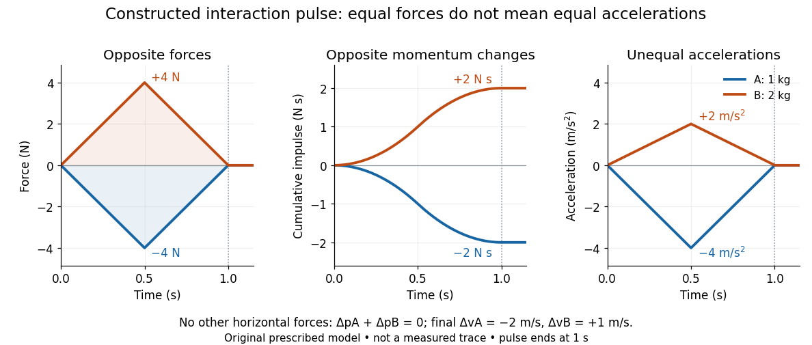

# Equal interaction forces and unequal accelerations

↑ **Parent:** [Newton's third law](newton-s-third-law.md)

Choose right as positive and let two carts have total moving [masses](mass.md) $m_A=1\,\mathrm{kg}$ and $m_B=2\,\mathrm{kg}$, including any attached apparatus. At an instant when their repulsive interaction has magnitude $4\,\mathrm N$, assume no other horizontal [forces](force-split.md). Then [Newton's third law](newton-s-third-law.md) gives $F_{B\mathrm{\ on\ }A}=-4\,\mathrm N$ and $F_{A\mathrm{\ on\ }B}=+4\,\mathrm N$, while [Newton's second law](newton-s-second-law.md) gives

$$
a_A=\frac{-4\,\mathrm N}{1\,\mathrm{kg}}=-4\,\mathrm{m/s^2},\qquad a_B=\frac{+4\,\mathrm N}{2\,\mathrm{kg}}=+2\,\mathrm{m/s^2}.
$$

The smaller [mass](mass.md) has the larger [acceleration](acceleration.md) magnitude. For a nonzero interaction and zero other horizontal [forces](force-split.md), $a_A/a_B=-m_B/m_A$. Meanwhile $d(p_A+p_B)/dt=m_Aa_A+m_Ba_B=-4+4=0$ in [force](force-split.md) units. The two carts' [velocities](velocity.md) change while total [momentum](momentum-split.md) stays constant.

To distinguish an instantaneous [force](force-split.md) from its accumulated [impulse](impulse.md), prescribe an original triangular interaction pulse lasting $T=1\,\mathrm s$:

$$
f(t)=\begin{cases}
8\,\mathrm{N/s}\;t,&0\leq t\leq T/2,\\
8\,\mathrm{N/s}\;(T-t),&T/2\leq t\leq T,\\
0,&\text{otherwise},
\end{cases}\qquad
F_{B\mathrm{\ on\ }A}(t)=-f(t),\quad F_{A\mathrm{\ on\ }B}(t)=f(t).
$$

This chosen pulse reaches $4\,\mathrm N$ at $t=0.5\,\mathrm s$; it is a constructed model, not an experimental trace or a claim about a particular bumper's material response. Its positive area is $\tfrac12(1\,\mathrm s)(4\,\mathrm N)=2\,\mathrm{N\,s}$. The [impulse-momentum theorem](impulse-momentum-theorem.md) therefore gives

$$
J_A=-2\,\mathrm{N\,s},\quad J_B=+2\,\mathrm{N\,s},\qquad \Delta v_A=-2\,\mathrm{m/s},\quad \Delta v_B=+1\,\mathrm{m/s}.
$$

Opposite [impulses](impulse.md) give opposite [momentum](momentum-split.md) changes, while the [velocity](velocity.md) changes differ because of the unequal [masses](mass.md). The cumulative positive [impulse](impulse.md) is $I(t)=4\,\mathrm{N/s}\;t^2$ during the first half and $I(t)=2\,\mathrm{N\,s}-4\,\mathrm{N/s}\;(T-t)^2$ during the second half. Thus $J_A(t)=-I(t)$ and $J_B(t)=I(t)$ cancel throughout the pulse, not merely at its endpoint.

**[Figure 6](#image-constructed-opposite-force-pulses-and-impulses-give-unequal-accelerations-for-unequal-masses). Constructed opposite force pulses and impulses give unequal accelerations for unequal masses**. Original prescribed triangular pulse, not measured data. Separate panels show signed [force](force-split.md), cumulative [impulse](impulse.md), and [acceleration](acceleration.md) for $m_A=1\,\mathrm{kg}$ and $m_B=2\,\mathrm{kg}$ with no other horizontal [forces](force-split.md). Total [momentum](momentum-split.md) change is zero throughout.

## ↑ Ancestors (7)

1. [Newton's third law](newton-s-third-law.md)
2. [Newton's laws of motion](newton-s-laws-of-motion.md)
3. [Force](force-split.md)
4. [Classical mechanics](classical-mechanics-split.md)
5. [Branches of physics](branches-of-physics.md)
6. [Physics](physics-split.md)
7. [Codex Wiki](split.md)
