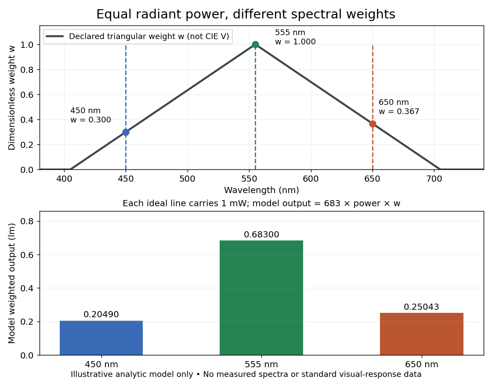

# Equal radiant power under visual weighting

↑ **Parent:** [Photometry (optics)](photometry-optics.md)

An original declared model makes the distinction visible without substituting invented numbers for the [photopic luminous efficiency function](photopic-luminous-efficiency-function.md). Define a triangular weight

$$
w(\lambda)=\max\!\left(0,1-\frac{|\lambda-555\,\mathrm{nm}|}{150\,\mathrm{nm}}\right),\qquad
\widetilde\Phi_v=(683\,\mathrm{lm\,W^{-1}})\int w(\lambda)\Phi_{e,\lambda}(\lambda)\,d\lambda.
$$

This $w$ is an illustrative function, not a fit or table of $V$. Three ideal spectral lines, each carrying [radiant flux](radiant-flux.md) $1\,\mathrm{mW}$, at $450$, $555$ and $650\,\mathrm{nm}$ have weights $3/10$, $1$ and $11/30$. Their model weighted outputs are respectively $0.2049$, $0.6830$ and approximately $0.25043\,\mathrm{lm}$. These are model calculations, not standard [luminous fluxes](luminous-flux.md) or measured data. For mixtures of these lines the model outputs add, just as the [integral](integral-split.md) adds independent spectral contributions.

**[Figure 5](#photometry-declared-spectral-weighting). Equal radiant fluxes give different outputs under a declared spectral weight**. Original triangular weighting model, not CIE data. Each ideal line carries $1\,\mathrm{mW}$; its drawn height represents line [power](power.md), not a finite spectral density. The lower bars apply the stipulated $683\,\mathrm{lm\,W^{-1}}$ model scale. The model demonstrates the mechanism without supplying calibration data for actual [photometry](photometry-optics.md).

## ↑ Ancestors (5)

1. [Photometry (optics)](photometry-optics.md)
2. [Optics](optics-split.md)
3. [Branches of physics](branches-of-physics.md)
4. [Physics](physics-split.md)
5. [Codex Wiki](split.md)

## ← Incoming links (1)

- [Calibrated photometer model](calibrated-photometer-model.md)
