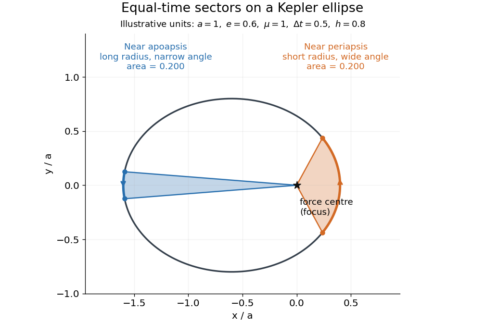

# Equal-time sectors of a Kepler ellipse

↑ **Parent:** [Areal velocity](areal-velocity.md)

Take an illustrative [elliptic Kepler orbit](elliptic-orbit.md) with [semi-major axis](semi-major-axis.md) $a=1$, [orbital eccentricity](orbital-eccentricity.md) $e=0.6$ and [gravitational parameter](standard-gravitational-parameter.md) $\mu=1$, in consistent dimensionless units. Its [semi-minor axis](semi-minor-axis.md) is $b=a\sqrt{1-e^2}=0.8$, [mean motion](mean-motion.md) is $n=\sqrt{\mu/a^3}=1$, and [specific angular momentum](specific-angular-momentum.md) magnitude is $h=\sqrt{\mu a(1-e^2)}=0.8$. About the attracting focus,

$$
\dot A=0.4,\qquad \Delta A=0.4\,\Delta t.
$$

The two sectors below each span $\Delta t=0.5$, giving $\Delta A=0.2$. Near [periapsis](periapsis.md) the short radius sweeps a wide [angle](angle.md); near [apoapsis](apoapsis.md) the long radius sweeps a narrow [angle](angle.md). Constant [areal velocity](areal-velocity.md) therefore does not require constant [angular velocity](angular-velocity.md) or constant [speed](speed.md).

**[Figure 7](#image-equal-time-intervals-sweep-equal-areas-about-the-focus-of-an-illustrative-elliptic-kepler-orbit). Equal time intervals sweep equal areas about the focus of an illustrative elliptic Kepler orbit**.

To compute the sectors without mistaking equal [angles](angle.md) for equal [times](time-in-physics.md), parametrize the [ellipse](ellipse.md) by [eccentric anomaly](eccentric-anomaly.md) $E$:

$$
x=a(\cos E-e),\qquad y=b\sin E,\qquad
A(E_2)-A(E_1)=\frac{ab}{2}\bigl(E_2-E_1-e(\sin E_2-\sin E_1)\bigr).
$$

This follows by integrating $\tfrac12(x\,dy-y\,dx)$. [Kepler's equation](kepler-s-equation.md) gives $E-e\sin E=M=n(t-t_{\mathrm p})$, with [mean anomaly](mean-anomaly.md) $M$ measured from [periapsis](periapsis.md) [time](time-in-physics.md) $t_{\mathrm p}$. Consequently $\Delta A=abn\Delta t/2=h\Delta t/2$. The displayed sectors use [mean anomaly](mean-anomaly.md) intervals $[-0.25,0.25]$ and $[\pi-0.25,\pi+0.25]$, rather than equal [eccentric anomaly](eccentric-anomaly.md) increments.

## ↑ Ancestors (7)

1. [Areal velocity](areal-velocity.md)
2. [Angular momentum](angular-momentum.md)
3. [Momentum](momentum-split.md)
4. [Classical mechanics](classical-mechanics-split.md)
5. [Branches of physics](branches-of-physics.md)
6. [Physics](physics-split.md)
7. [Codex Wiki](split.md)
