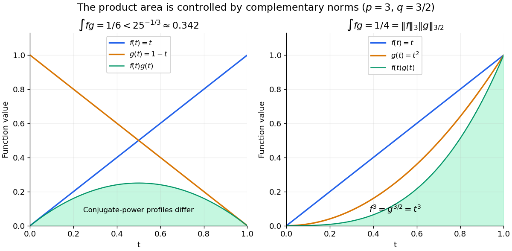

<h1 id="equality-in-holder-s-inequality">Equality in Hölder's inequality</h1>

↑ **Parent:** [Hölder's inequality](holder-s-inequality.md)

For $1<p,q<\infty$ and nonzero factors in their respective [Lp spaces](lp-space.md), equality in the product-integral bound holds precisely when

$$
\frac{|f|^p}{\lVert f\rVert_p^p}
=\frac{|g|^q}{\lVert g\rVert_q^q}
\quad\text{almost everywhere}.
$$

In other words, the normalized powers match. Zero factors give the trivial equality separately. For real [vectors](vector.md), equality for the signed finite [sum](sum.md) also needs the nonzero coordinate products to have a common sign; otherwise the preceding [triangle inequality](triangle-inequality.md) loses information.

For $f(t)=t$ and $g(t)=1-t$ on $[0,1]$, with $p=3$, $q=3/2$,

$$
\int_0^1 f(t)g(t)\,dt=\frac16,
\qquad
\lVert f\rVert_3\lVert g\rVert_{3/2}
=\left(\frac14\right)^{1/3}\left(\frac25\right)^{2/3}
=25^{-1/3}\approx0.341995.
$$

Changing only $g$ to $t^2$ gives $f^3=g^{3/2}=t^3$, and both sides become $1/4$. The factors need not be equal: their conjugate powers are what must agree after normalization.

**[Figure 21](#image-matching-conjugate-powers-makes-the-integral-bound-exact). Matching conjugate powers makes the integral bound exact**. Original [function graphs](graph-of-a-function.md) on $[0,1]$. The green [area](surface-area.md) is the [integral](integral-split.md) of the product. For $g=1-t$, the normalized powers differ and the bound is strict. For $g=t^2$, $f^3=g^{3/2}$ pointwise, so the product [integral](integral-split.md) attains the [Hölder's inequality](holder-s-inequality.md) bound.

The proof outline makes the equality condition natural. Normalize $u=|f|/\lVert f\rVert_p$ and $v=|g|/\lVert g\rVert_q$. The [Young inequality](young-s-inequality-for-products.md) gives $uv\leq u^p/p+v^q/q$; integration yields $\int uv\leq1/p+1/q=1$. Equality requires $u^p=v^q$ [almost everywhere](almost-everywhere.md). The endpoint proof uses the [essential supremum](essential-supremum.md) directly, so it does not need division by $p-1$ at $p=1$.

## ↑ Ancestors (7)

1. [Hölder's inequality](holder-s-inequality.md)
2. [Lp norm](lp-norm.md)
3. [Real analysis](real-analysis-split.md)
4. [Analysis](analysis-split.md)
5. [Area of mathematics](area-of-mathematics.md)
6. [Mathematics](mathematics-split.md)
7. [Codex Wiki](split.md)
