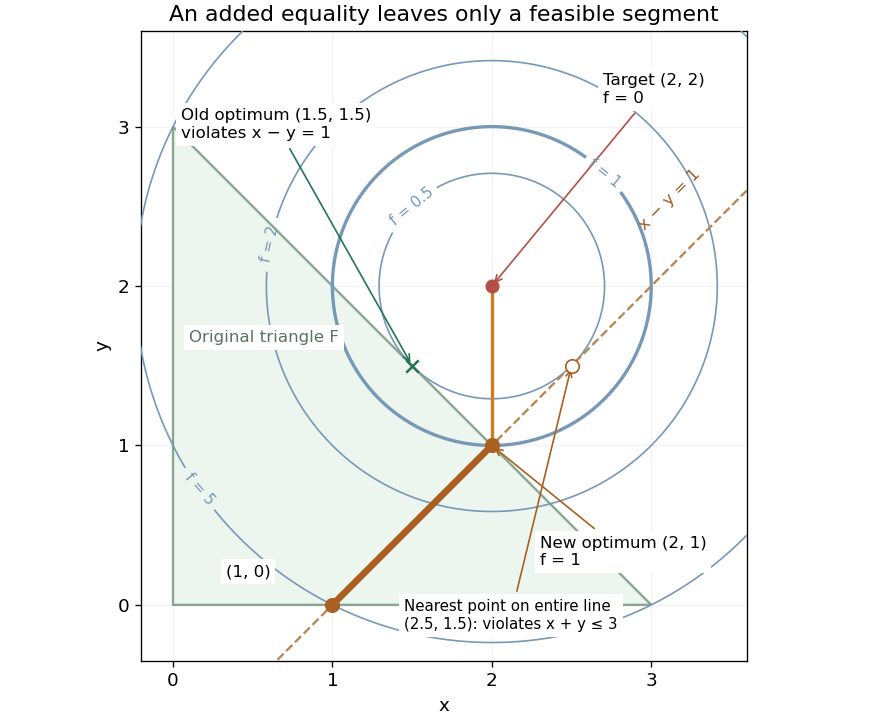

# Equality slice of a feasible triangle

↑ **Parent:** [Feasible region](feasible-region.md)

Keep the [feasible triangle with a squared-distance objective](feasible-triangle-with-a-squared-distance-objective.md), but add the [equation](equation.md) $x-y=1$. An equality requires an exact relation, whereas an [inequality](inequality-mathematics.md) allows a range. Here the equality selects a [line](straight-line.md), and intersecting that [line](straight-line.md) with the original [feasible region](feasible-region.md) leaves just the [line segment](line-segment.md) from $(1,0)$ to $(2,1)$:

$$
(x,y)=(t+1,t),\qquad0\leq t\leq1.
$$

The lower bound comes from $y\geq0$; the upper bound comes from $x+y=2t+1\leq3$. This is a nonempty [closed set](closed-set.md) even though it has empty [interior](interior-topology.md) in the plane. An equality can reduce the [dimension](dimension-vector-space.md) of the allowed decisions without making the [feasible region](feasible-region.md) empty.

The old optimum $(1.5,1.5)$ violates the added equality. On the surviving [line segment](line-segment.md), the [objective function](objective-function.md) is

$$
q(t)=(t-1)^2+(t-2)^2=2(t-3/2)^2+1/2,
\qquad q'(t)=4t-6<0\quad(0\leq t\leq1).
$$

The [derivative](derivative.md) shows that the unique [global minimum](global-minimum.md) is at $t=1$, giving $(x,y)=(2,1)$ and value $1$. The nearest point on the entire equality [line](straight-line.md) would be $(2.5,1.5)$, at $t=1.5$ with value $0.5$, but it violates $x+y\leq3$. Both the equality and the original [inequalities](inequality-mathematics.md) must hold simultaneously.

**[Figure 7](#image-equality-slice-of-a-feasible-triangle-the-allowed-line-segment-ends-at-the-optimum-2-1-while-the-nearest-point-on-the-entire-line-is-infeasible). Equality slice of a feasible triangle: the allowed line segment ends at the optimum (2,1), while the nearest point on the entire line is infeasible**.

Use $g=x+y-3$ and $h=x-y-1$ to fix the multiplier sign convention in the [optimization Lagrangian](optimization-lagrangian.md) $L=f+\lambda g+\nu h$; the [Lagrange multipliers](lagrange-multiplier.md) of $-x$ and $-y$ are again zero. At $(2,1)$, [Karush-Kuhn-Tucker conditions](karush-kuhn-tucker-conditions.md) hold with $\lambda=1$ and $\nu=-1$:

$$
\nabla f(2,1)+\lambda\nabla g+\nu\nabla h
=(0,-2)+(1,1)-(1,-1)=(0,0).
$$

The [Lagrange multiplier](lagrange-multiplier.md) of an equality has no nonnegativity restriction. For an independent global certificate, [completing the square](completing-the-square.md) gives $f+g-h=(x-2)^2+(y-1)^2+1$. On the [feasible set](feasible-region.md), $h=0$ and $g\leq0$, so $f\geq1$, with equality exactly at $(2,1)$.

## ↑ Ancestors (6)

1. [Feasible region](feasible-region.md)
2. [Feasible point](feasible-point.md)
3. [Mathematical optimization](mathematical-optimization-split.md)
4. [Area of mathematics](area-of-mathematics.md)
5. [Mathematics](mathematics-split.md)
6. [Codex Wiki](split.md)

## ← Incoming links (2)

- [Empty and open feasible regions](empty-and-open-feasible-regions.md)
- [Equality slice of a feasible triangle](equality-slice-of-a-feasible-triangle.md)
