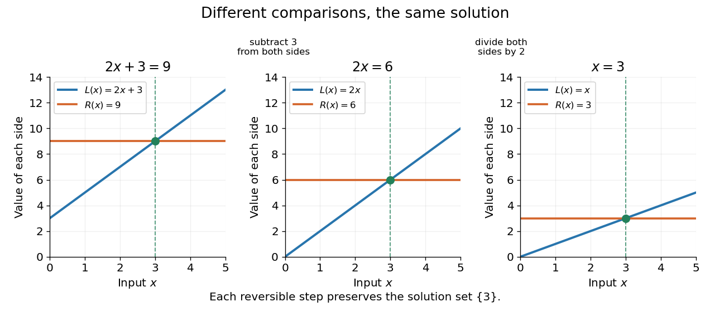

# Equation

↑ **Parent:** [Algebra](algebra-split.md)  
ⓦ [Wiki](https://en.wikipedia.org/wiki/Equation)

An [equation](equation.md) asserts that two [mathematical expressions](expression-mathematics.md) have the same value. Solving it means finding all allowed assignments to its [variables](variable-mathematics.md) that make that assertion true. It converts a relationship into a constraint: a measurement, a geometric intersection, or an [equilibrium](equilibrium-point-of-a-dynamical-system.md) model can leave an unknown value to determine.

The allowed values matter. The [equation](equation.md) $2x=1$ has [solution set](solution-set.md) $\{1/2\}$ over the [rational numbers](rational-number.md), but the [empty set](empty-set.md) over the [integers](integer.md). Over the [real numbers](real-number.md), $x^2=1$ has two solutions, $-1$ and $1$. A [mathematical identity](identity-mathematics.md), such as $(x+1)^2=x^2+2x+1$, holds for every permitted real $x$. The familiar equality sign therefore does not by itself say whether one is checking a particular value, solving for an unknown, or stating an identity.

For a worked [linear equation](linear-equation.md) over the [real numbers](real-number.md),

$$
2x+3=9
\quad\Longleftrightarrow\quad
2x=6
\quad\Longleftrightarrow\quad
x=3.
$$

The first step subtracts three from both sides; the second divides both sides by the nonzero number two. Reversing the steps recovers the original [equation](equation.md), so these are [equivalent equations](equivalent-equations.md) with the same [solution set](solution-set.md) $\{3\}$. Checking the value gives $2\cdot3+3=9$. The role of reversible operations and the classification by [solution sets](solution-set.md) are described in [College Algebra 2e, §2.2: Solving Linear Equations in One Variable](https://openstax.org/books/college-algebra-2e/pages/2-2-linear-equations-in-one-variable).

**[Figure 1](#image-reversible-operations-change-the-graphs-of-the-two-sides-but-preserve-the-intersection-s-input-value-x-3). Reversible operations change the graphs of the two sides but preserve the intersection's input value $x=3$**.

When the two sides define real-valued [functions](function-split.md) $f$ and $g$ on a common [domain of a function](domain-of-a-function.md), solutions are exactly the input values at which their [function graphs](graph-of-a-function.md) intersect. Equivalently, they are the [zeros of a function](zero-of-a-function.md) $f-g$. This gives a useful connection between symbolic [algebra](algebra-split.md) and geometry: rearranging an [equation](equation.md) can simplify the comparison without changing the inputs where equality holds.

Not every operation is reversible on every [domain of a function](domain-of-a-function.md). Dividing $x(x-1)=0$ by $x$ gives $x-1=0$ only after restricting to $x\ne0$; it loses the solution $x=0$ if that restriction is forgotten. Squaring both sides can instead introduce an [extraneous solution](extraneous-solution.md), because distinct [real numbers](real-number.md) can have the same square. The source [equation](equation.md), its [domain of a function](domain-of-a-function.md), and the direction of each implication should travel together.

**Table of contents**

- [Equivalent equations](equivalent-equations.md)
- [Extraneous solution](extraneous-solution.md)
- [Identity (mathematics)](identity-mathematics.md)

## ↑ Ancestors (4)

1. [Algebra](algebra-split.md)
2. [Area of mathematics](area-of-mathematics.md)
3. [Mathematics](mathematics-split.md)
4. [Codex Wiki](split.md)

## ← Incoming links (17)

- [Abstract syntax tree precedence example](abstract-syntax-tree-precedence-example.md)
- [Algebra](algebra-split.md)
- [Commutative ring](commutative-ring.md)
- [Equation](equation.md)
- [Equivalent equations](equivalent-equations.md)
- [Expression (mathematics)](expression-mathematics.md)
- [Extraneous solution](extraneous-solution.md)
- [Field with four elements](field-with-four-elements.md)
- [Horner's method](horner-s-method.md)
- [Identity (mathematics)](identity-mathematics.md)
- [Lagrange's four-square theorem](lagrange-s-four-square-theorem.md)
- [Möbius inversion formula](mobius-inversion-formula.md)
- [Number theory](number-theory-split.md)
- [Occurs check](occurs-check.md)
- [Set intersection](set-intersection.md)
- [Solution set](solution-set.md)
- [Type inference](type-inference.md)
