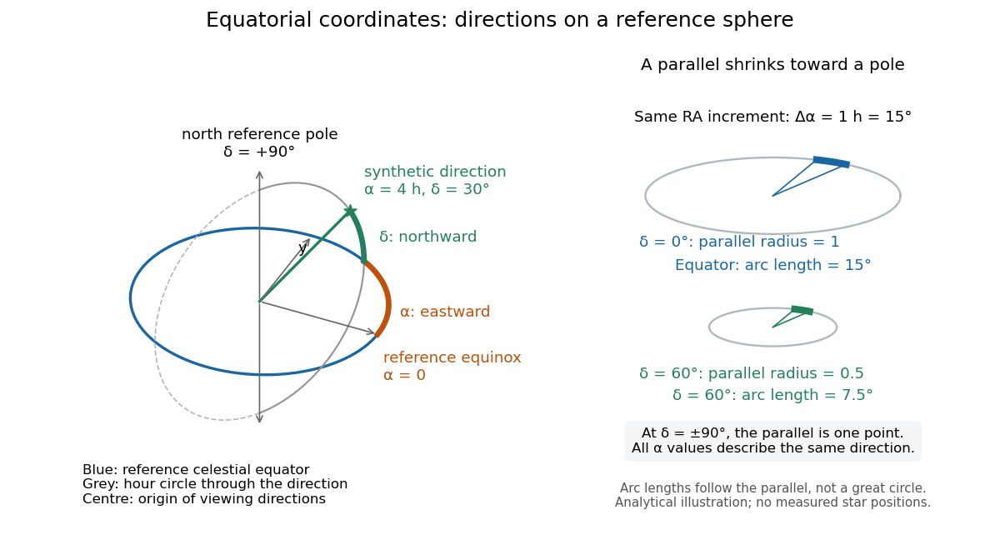

# Equatorial coordinate system

↑ **Parent:** [Astrophysics](astrophysics-split.md)  
ⓦ [Wiki](https://en.wikipedia.org/wiki/Equatorial_coordinate_system)

An [equatorial coordinate system](equatorial-coordinate-system.md) labels a viewing direction on the [celestial sphere](celestial-sphere.md) by [right ascension](right-ascension.md) $\alpha$, increasing eastward around the reference [celestial equator](celestial-equator.md), and [declination](declination.md) $\delta$, increasing northward from that [celestial equator](celestial-equator.md). These two [angles](angle.md) locate a direction, without specifying the object's [Euclidean distance](euclidean-distance.md). In the traditional convention, zero [right ascension](right-ascension.md) points toward the [reference equinox](equinox-celestial-coordinates.md), the northward crossing of the [Sun](sun.md)'s annual path through the [celestial equator](celestial-equator.md). An [hour circle](hour-circle.md) through the direction supplies the north-south arc on which [declination](declination.md) is measured. [Jeremy Tatum: Celestial mechanics, chapter 6, the celestial sphere](https://www.astro.uvic.ca/~tatum/celmechs/celm6.pdf).

For a concrete construction, choose [Cartesian coordinates](cartesian-coordinate-system.md) with $x$ pointing toward the [reference equinox](equinox-celestial-coordinates.md), $z$ toward the north reference [celestial pole](celestial-pole.md), and positive $y$ given by the [cross product](cross-product.md) of the positive $z$ and $x$ directions. The direction's [unit vector](unit-vector.md) is

$$
\mathbf n=(\cos\delta\cos\alpha,\ \cos\delta\sin\alpha,\ \sin\delta).
$$

This is a [spherical coordinate system](spherical-coordinate-system.md) with polar [angle](angle.md) $\pi/2-\delta$ and no radial coordinate. The [trigonometric functions](trigonometric-function.md) require consistent angular units: convert [right ascension](right-ascension.md) in hours to [radians](radian.md) before evaluating them. The synthetic direction $\alpha=4^{\rm h}=60^\circ$, $\delta=30^\circ$ gives $\mathbf n=(\sqrt3/4,3/4,1/2)$; its squared [norm](norm.md) is $3/16+9/16+1/4=1$. A change of reference axes applies a [rotation](rotation-mathematics.md) to this [unit vector](unit-vector.md) before recovering the two [angles](angle.md). Away from the [celestial poles](celestial-pole.md), recover [right ascension](right-ascension.md) using the quadrant-aware $\operatorname{atan2}(n_y,n_x)$ reduced modulo $2\pi$, and [declination](declination.md) using $\arcsin n_z$; a plain [arctangent](inverse-tangent.md) of $n_y/n_x$ loses the quadrant. Adding a common offset to every [right ascension](right-ascension.md) describes only the special case of a [rotation](rotation-mathematics.md) about the same polar axis.

**[Figure 6](#image-analytical-geometry-of-right-ascension-declination-and-the-shrinking-east-west-arc-toward-a-celestial-pole). Analytical geometry of right ascension, declination and the shrinking east-west arc toward a celestial pole**.

The reference specification matters. For an [equatorial coordinate system](equatorial-coordinate-system.md) tied to the [Earth](earth.md), [precession](precession.md) changes the reference [celestial equator](celestial-equator.md) and [reference equinox](equinox-celestial-coordinates.md), and [nutation](nutation.md) distinguishes their mean and true versions. The date specifying those axes is distinct from the [astronomical epoch](epoch-astronomy.md) at which a catalogue's source directions apply: advancing a [star](star.md)'s [proper motion](proper-motion.md) and changing reference axes are separate operations. A modern catalogue may instead use fixed [reference frame](reference-frame.md) axes, aligned approximately with the traditional J2000.0 axes, without a moving [reference equinox](equinox-celestial-coordinates.md). Thus a pair of numbers labelled merely "J2000" does not settle every convention. State the [reference frame](reference-frame.md), the [astronomical epoch](epoch-astronomy.md), and whether a direction is catalogued or apparent. [US Naval Observatory: Reference systems, catalogue epochs and fixed celestial axes](https://aa.usno.navy.mil/faq/ICRS_doc).

During one night's elementary fixed-direction approximation, a [star](star.md)'s [right ascension](right-ascension.md) and [declination](declination.md) remain constant while its [altitude](altitude.md), [azimuth](azimuth.md) and [hour angle](hour-angle.md) change because the [Earth](earth.md) turns. In angular units, with $\Theta$ the local [sidereal time](sidereal-time.md), west-positive [hour angle](hour-angle.md) $H$ obeys

$$
H=\Theta-\alpha\pmod{2\pi}.
$$

At upper [meridian transit](meridian-transit.md), $H=0$ and the local [sidereal time](sidereal-time.md) equals the transiting direction's [right ascension](right-ascension.md). Pair apparent [sidereal time](sidereal-time.md) with apparent [right ascension](right-ascension.md) referred to the true [celestial equator](celestial-equator.md) and [reference equinox](equinox-celestial-coordinates.md) of date; mean [sidereal time](sidereal-time.md) refers to the mean [reference equinox](equinox-celestial-coordinates.md). Raw fixed-frame catalogue coordinates require conversion before precision pointing. [US Naval Observatory: Mean and apparent sidereal time and the local longitude correction](https://aa.usno.navy.mil/faq/GAST).

This separation makes the [equatorial coordinate system](equatorial-coordinate-system.md) useful: a catalogue can identify a target independently of the observer's current [astronomical horizon](astronomical-horizon.md), while local [sidereal time](sidereal-time.md) tells the observer which [hour circle](hour-circle.md) is on the [celestial meridian](celestial-meridian.md). Precision observations also account for [proper motion](proper-motion.md), [stellar parallax](stellar-parallax.md), [aberration of light](relativistic-aberration.md) and [atmospheric refraction](atmospheric-refraction.md); the fixed-direction construction above omits those effects. A reference-axis [rotation](rotation-mathematics.md) preserves [angles](angle.md) between directions, whereas changing the observer or correcting [atmospheric refraction](atmospheric-refraction.md) is a different operation. [US Naval Observatory: Transforming catalogue directions into observable directions](https://aa.usno.navy.mil/faq/ICRS_doc).

**Table of contents**

- [Hour angle](hour-angle.md)
- [Parallactic angle](parallactic-angle.md)
- [Declination](declination.md)
- [Right ascension](right-ascension.md)
- [Equinox (celestial coordinates)](equinox-celestial-coordinates.md)
- [Epoch (astronomy)](epoch-astronomy.md)
- [Hour circle](hour-circle.md)
- [Meridian transit](meridian-transit.md)

## ↑ Ancestors (4)

1. [Astrophysics](astrophysics-split.md)
2. [Branches of physics](branches-of-physics.md)
3. [Physics](physics-split.md)
4. [Codex Wiki](split.md)

## ← Incoming links (6)

- [Astrometry](astrometry.md)
- [Epoch (astronomy)](epoch-astronomy.md)
- [Equatorial coordinate system](equatorial-coordinate-system.md)
- [Horizontal coordinate system](horizontal-coordinate-system.md)
- [Solution](past-exam-of-the-mathematics-course-of-the-university-of-cambridge/2017/iii/paper-338/1/a/ii/solution.md)
- [Sidereal time](sidereal-time.md)
