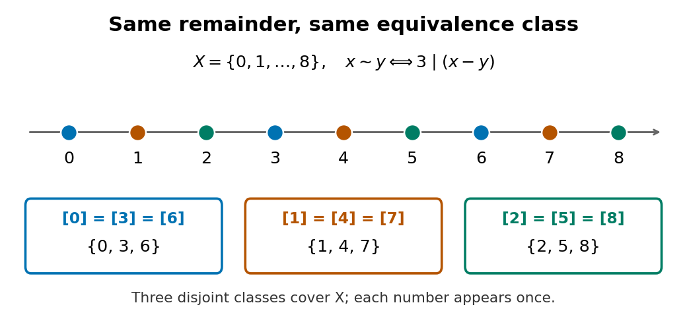

# Equivalence relation

↑ **Parent:** [Binary relation](binary-relation.md)  
ⓦ [Wiki](https://en.wikipedia.org/wiki/Equivalence_relation)

An equivalence relation says which [set elements](element-of-a-set.md) should count as the same for a particular purpose. In [modular arithmetic](modular-arithmetic-split.md), for example, distinct [integers](integer-split.md) with the same [remainder](remainder.md) are equivalent. The relation gathers interchangeable [set elements](element-of-a-set.md) into [equivalence classes](equivalence-class.md); the [quotient set](quotient-set.md) then treats each whole [equivalence class](equivalence-class.md) as one object.

Formally, an equivalence relation on a [set](set-split.md) $X$ is a [binary relation](binary-relation.md) $R\subseteq X\times X$, written $x\sim y$, satisfying three conditions for all $x,y,z\in X$:
- [Reflexivity](reflexive-relation.md): $x\sim x$.
- [Symmetric relation](symmetric-relation.md): $x\sim y$ implies $y\sim x$.
- [Transitivity](transitive-relation.md): $x\sim y$ and $y\sim z$ imply $x\sim z$.
These conditions make the [equivalence classes](equivalence-class.md) a [partition of a set](partition-of-a-set.md): each [set element](element-of-a-set.md) belongs to exactly one class. [Jiří Lebl, Basic Analysis, §0.3.4, Definitions 0.3.21 and 0.3.23 and Proposition 0.3.24](https://www.jirka.org/ra/html/sec_basicset.html)

For a worked example, take the [finite set](finite-set.md) $X=\{0,1,\ldots,8\}$ and restrict [integer congruence](integer-congruence.md) modulo three to $X$:

$$
x\sim y\quad\Longleftrightarrow\quad x\equiv y\pmod3\quad\Longleftrightarrow\quad3\mid(x-y).
$$

[Reflexivity](reflexive-relation.md) follows because $x-x=0$. The [symmetric relation](symmetric-relation.md) property follows by changing the sign of a difference, and [transitivity](transitive-relation.md) follows by adding $x-y$ and $y-z$: [divisibility](divisibility-split.md) by three is preserved in both steps. Thus $0\sim3$ and $3\sim6$ force $0\sim6$. The three [equivalence classes](equivalence-class.md) are $\{0,3,6\}$, $\{1,4,7\}$ and $\{2,5,8\}$. Their members alternate along the [number line](number-line.md); membership in an [equivalence class](equivalence-class.md) need not mean being close together.

**[Figure 1](#image-congruence-modulo-three-divides-the-integers-from-zero-through-eight-into-three-equivalence-classes). Congruence modulo three divides the integers from zero through eight into three equivalence classes**.

The [transitivity](transitive-relation.md) requirement rules out a tempting alternative. On $\{0,1,2\}$, define nearness by the [absolute value](absolute-value.md) condition $|x-y|\leq1$. This [binary relation](binary-relation.md) is [reflexive](reflexive-relation.md) and [symmetric](symmetric-relation.md), but $0$ is near $1$ and $1$ is near $2$ while $0$ is not near $2$. Its neighborhoods $\{0,1\}$, $\{0,1,2\}$ and $\{1,2\}$ overlap without being equal. They are not [equivalence classes](equivalence-class.md) or a [partition of a set](partition-of-a-set.md).

**Table of contents**

- [Composition of commuting equivalence relations](composition-of-commuting-equivalence-relations.md)
- [Commuting equivalence relations](commuting-equivalence-relations.md)
- [Equivalence closure](equivalence-closure.md)
- [Union of equivalence relations](union-of-equivalence-relations.md)
- [Intersection of equivalence relations](intersection-of-equivalence-relations.md)
- [Co-computably enumerable equivalence relation](co-computably-enumerable-equivalence-relation.md)
  - [Semidecidable least-representative transversal](semidecidable-least-representative-transversal.md)
- [Equivalence of partial functions modulo finite changes](equivalence-of-partial-functions-modulo-finite-changes.md)
- [Equivalence class](equivalence-class.md)
  - [Equivalence class representative](equivalence-class-representative.md)
- [Equivalence relation induced by a function](equivalence-relation-induced-by-a-function.md)
  - [Prime-support equivalence relation](prime-support-equivalence-relation.md)
- [Quotient set](quotient-set.md)
  - [Canonical projection of a quotient set](canonical-projection-of-a-quotient-set.md)

## ↑ Ancestors (6)

1. [Binary relation](binary-relation.md)
2. [Set theory](set-theory-split.md)
3. [Foundations of mathematics](foundations-of-mathematics-split.md)
4. [Area of mathematics](area-of-mathematics.md)
5. [Mathematics](mathematics-split.md)
6. [Codex Wiki](split.md)

## ← Incoming links (90)

- [Canonical arithmetic progression dichotomy](canonical-arithmetic-progression-dichotomy.md)
- [Canonical projection of a quotient set](canonical-projection-of-a-quotient-set.md)
- [Church-Rosser property of a reduction relation](church-rosser-property-of-a-reduction-relation.md)
- [Co-computably enumerable equivalence relation](co-computably-enumerable-equivalence-relation.md)
- [Communicating class](communicating-class.md)
- [Commuting equivalence relations](commuting-equivalence-relations.md)
- [Composition of commuting equivalence relations](composition-of-commuting-equivalence-relations.md)
- [Congruence modulo an ideal](congruence-modulo-an-ideal.md)
- [Congruence on a category](congruence-on-a-category.md)
- [Conjugacy class](conjugacy-class.md)
- [Conjugate subgroup](conjugate-subgroup.md)
- [Connected component](connected-component.md)
- [Connected component of a category](connected-component-of-a-category.md)
- [Coset](coset.md)
- [Disjoint-set data structure](disjoint-set-data-structure.md)
- [Empirical temperature](empirical-temperature.md)
- [Equality test](equality-test.md)
- [Equivalence class](equivalence-class.md)
- [Equivalence closure](equivalence-closure.md)
- [Equivalence relation induced by a function](equivalence-relation-induced-by-a-function.md)
- [Fiber of a function](fiber-of-a-function.md)
- [Finite symmetric difference](finite-symmetric-difference.md)
- [Groupoid](groupoid.md)
- [Hash table](hash-table.md)
- [Indifference relation](indifference-relation.md)
- [Integer congruence](integer-congruence.md)
- [Intersection of equivalence relations](intersection-of-equivalence-relations.md)
- [Key equality](key-equality.md)
- [Metric quotient of a pseudometric](metric-quotient-of-a-pseudometric.md)
- [Orbit (group theory)](orbit-group-theory.md)
- [Partition of a set](partition-of-a-set.md)
- [Solution](past-exam-of-the-mathematics-course-of-the-university-of-cambridge/2002/iii/paper-10/1/solution.md)
- [Solution](past-exam-of-the-mathematics-course-of-the-university-of-cambridge/2002/iii/paper-23/10/c/solution.md)
- [Solution](past-exam-of-the-mathematics-course-of-the-university-of-cambridge/2002/iii/paper-76/1/solution.md)
- [Solution](past-exam-of-the-mathematics-course-of-the-university-of-cambridge/2003/ia/paper-4/2c/i/solution.md)
- [Solution](past-exam-of-the-mathematics-course-of-the-university-of-cambridge/2003/ia/paper-4/2c/ii/solution.md)
- [Solution](past-exam-of-the-mathematics-course-of-the-university-of-cambridge/2003/ia/paper-4/2c/iii/solution.md)
- [Solution](past-exam-of-the-mathematics-course-of-the-university-of-cambridge/2003/ia/paper-4/2c/iv/solution.md)
- [Solution](past-exam-of-the-mathematics-course-of-the-university-of-cambridge/2003/ia/paper-4/2c/solution.md)
- [Solution](past-exam-of-the-mathematics-course-of-the-university-of-cambridge/2003/ib/paper-1/10f/solution.md)
- [Solution](past-exam-of-the-mathematics-course-of-the-university-of-cambridge/2004/iii/paper-36/1/c/solution.md)
- [Solution](past-exam-of-the-mathematics-course-of-the-university-of-cambridge/2005/ia/paper-4/6e/solution.md)
- [Solution](past-exam-of-the-mathematics-course-of-the-university-of-cambridge/2005/ib/paper-3/1c/solution.md)
- [Solution](past-exam-of-the-mathematics-course-of-the-university-of-cambridge/2005/iii/paper-26/1/solution.md)
- [Solution](past-exam-of-the-mathematics-course-of-the-university-of-cambridge/2006/ia/paper-4/5e/iii/solution.md)
- [Solution](past-exam-of-the-mathematics-course-of-the-university-of-cambridge/2006/ia/paper-4/5e/iv/solution.md)
- [Solution](past-exam-of-the-mathematics-course-of-the-university-of-cambridge/2006/ia/paper-4/5e/solution.md)
- [Solution](past-exam-of-the-mathematics-course-of-the-university-of-cambridge/2006/ia/paper-5/11/iii/solution.md)
- [Solution](past-exam-of-the-mathematics-course-of-the-university-of-cambridge/2006/ia/paper-5/11/iv/solution.md)
- [Solution](past-exam-of-the-mathematics-course-of-the-university-of-cambridge/2006/ia/paper-5/11/solution.md)
- [Solution](past-exam-of-the-mathematics-course-of-the-university-of-cambridge/2007/ib/paper-4/9c/solution.md)
- [Solution](past-exam-of-the-mathematics-course-of-the-university-of-cambridge/2007/iii/paper-14/4/solution.md)
- [Solution](past-exam-of-the-mathematics-course-of-the-university-of-cambridge/2007/iii/paper-6/2/solution.md)
- [Solution](past-exam-of-the-mathematics-course-of-the-university-of-cambridge/2008/ia/paper-4/2d/a/solution.md)
- [Solution](past-exam-of-the-mathematics-course-of-the-university-of-cambridge/2008/ia/paper-4/2d/b/solution.md)
- [Solution](past-exam-of-the-mathematics-course-of-the-university-of-cambridge/2008/iii/paper-26/1/solution.md)
- [Solution](past-exam-of-the-mathematics-course-of-the-university-of-cambridge/2009/ia/paper-4/1e/solution.md)
- [Solution](past-exam-of-the-mathematics-course-of-the-university-of-cambridge/2009/iii/paper-3/2/solution.md)
- [Solution](past-exam-of-the-mathematics-course-of-the-university-of-cambridge/2011/ia/paper-4/2e/solution.md)
- [Solution](past-exam-of-the-mathematics-course-of-the-university-of-cambridge/2012/ia/paper-4/2d/i/solution.md)
- [Solution](past-exam-of-the-mathematics-course-of-the-university-of-cambridge/2012/ia/paper-4/2d/ii/solution.md)
- [Solution](past-exam-of-the-mathematics-course-of-the-university-of-cambridge/2012/ia/paper-4/2d/solution.md)
- [Solution](past-exam-of-the-mathematics-course-of-the-university-of-cambridge/2013/iii/paper-20/5/solution.md)
- [Solution](past-exam-of-the-mathematics-course-of-the-university-of-cambridge/2014/iii/paper-21/2/i/solution.md)
- [Solution](past-exam-of-the-mathematics-course-of-the-university-of-cambridge/2014/iii/paper-21/3/solution.md)
- [Solution](past-exam-of-the-mathematics-course-of-the-university-of-cambridge/2015/ia/paper-4/5e/i/solution.md)
- [Solution](past-exam-of-the-mathematics-course-of-the-university-of-cambridge/2015/ia/paper-4/5e/ii/solution.md)
- [Solution](past-exam-of-the-mathematics-course-of-the-university-of-cambridge/2015/iii/paper-23/1/a/solution.md)
- [Solution](past-exam-of-the-mathematics-course-of-the-university-of-cambridge/2016/ib/paper-4/13e/a/solution.md)
- [Solution](past-exam-of-the-mathematics-course-of-the-university-of-cambridge/2017/ia/paper-4/2d/a/solution.md)
- [Solution](past-exam-of-the-mathematics-course-of-the-university-of-cambridge/2017/ia/paper-4/2d/b/i/solution.md)
- [Solution](past-exam-of-the-mathematics-course-of-the-university-of-cambridge/2018/ib/paper-2/2g/a/solution.md)
- [Solution](past-exam-of-the-mathematics-course-of-the-university-of-cambridge/2018/iii/paper-110/2/solution.md)
- [Solution](past-exam-of-the-mathematics-course-of-the-university-of-cambridge/2019/ia/paper-4/6e/c/solution.md)
- [Solution](past-exam-of-the-mathematics-course-of-the-university-of-cambridge/2019/ib/paper-4/13g/a/solution.md)
- [Solution](past-exam-of-the-mathematics-course-of-the-university-of-cambridge/2020/ia/paper-2/2d/i/solution.md)
- [Solution](past-exam-of-the-mathematics-course-of-the-university-of-cambridge/2021/ib/paper-3/8h/a/solution.md)
- [Solution](past-exam-of-the-mathematics-course-of-the-university-of-cambridge/2022/ia/paper-4/7f/c/solution.md)
- [Solution](past-exam-of-the-mathematics-course-of-the-university-of-cambridge/2023/ib/paper-4/10g/i/solution.md)
- [Solution](past-exam-of-the-mathematics-course-of-the-university-of-cambridge/2023/iii/paper-160/4/b/i/solution.md)
- [Solution](past-exam-of-the-mathematics-course-of-the-year-2-of-the-natural-sciences-course-of-the-university-of-cambridge/2010/paper-2/9/solution.md)
- [Path component](path-component.md)
- [Prime-support equivalence relation](prime-support-equivalence-relation.md)
- [Quotient set](quotient-set.md)
- [Quotient topology](quotient-topology.md)
- [Set partition](set-partition.md)
- [Union of equivalence relations](union-of-equivalence-relations.md)
- [Unreduced rational representation](unreduced-rational-representation.md)
- [Zeroth law of thermodynamics](zeroth-law-of-thermodynamics.md)
- [Zeroth-law thermometer comparison](zeroth-law-thermometer-comparison.md)
