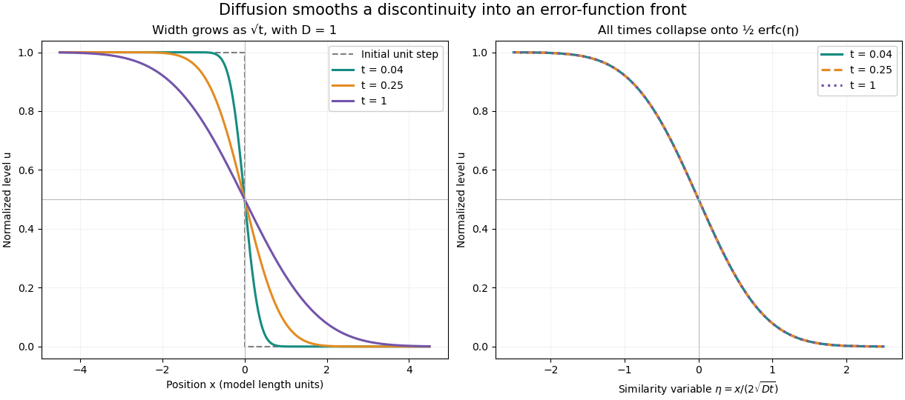

# Error-function diffusion front

↑ **Parent:** [Error function](error-function.md)

Consider the one-dimensional [diffusion equation](diffusion-equation-split.md) on the whole [real line](real-line.md),

$$
\frac{\partial u}{\partial t}=D\frac{\partial^2u}{\partial x^2},\qquad D>0,
$$

with initial value one for $x<0$ and zero for $x>0$. This is an idealized [Heaviside step function](heaviside-step-function.md) profile, not a measured material or an apparatus specification. The [heat kernel](heat-kernel.md) gives a [convolution](convolution.md) with the initial profile:

$$
u(x,t)=\int_{-\infty}^{0}\frac{e^{-(x-y)^2/(4Dt)}}{\sqrt{4\pi Dt}}\,dy
=\frac12\operatorname{erfc}\!\left(\frac{x}{2\sqrt{Dt}}\right),\qquad t>0.
$$

The [change of variables](change-of-variables-formula.md) $s=(x-y)/(2\sqrt{Dt})$ turns the [convolution](convolution.md) into a [Gaussian integral](gaussian-integral.md) tail. The resulting [similarity variable](similarity-variable.md) $\eta=x/(2\sqrt{Dt})$ shows that the transition width grows like $\sqrt{Dt}$: multiplying elapsed time by four doubles every fixed-profile distance from the original interface.

**[Figure 9](#image-diffusion-smooths-a-step-while-preserving-its-similarity-profile). Diffusion smooths a step while preserving its similarity profile**. Exact model curves for a unit jump with stipulated $D=1$ in consistent length and time units. Left: the transition broadens at $t=0.04$, $0.25$, and $1$. Right: plotting each against $x/(2\sqrt{Dt})$ collapses all three onto the same curve. No experimental measurements are plotted.

At every positive time, $u(0,t)=1/2$, while $u(x,t)\to1$ as $x\to-\infty$ and $u(x,t)\to0$ as $x\to+\infty$. For every fixed $x\ne0$, the limit as $t\to0^+$ returns the specified initial value. The value assigned at the single initial discontinuity does not change this [convolution](convolution.md). The [error function](error-function.md) therefore explains smoothing without pretending that a discontinuous initial profile remains sharp.

Direct [differentiation](differentiation.md) checks the [partial differential equation](partial-differential-equation-split.md). Writing $\eta=x/(2\sqrt{Dt})$ gives

$$
u_t=\frac{\eta e^{-\eta^2}}{2\sqrt\pi\,t},\qquad
D u_{xx}=\frac{\eta e^{-\eta^2}}{2\sqrt\pi\,t}.
$$

The model assumes constant [diffusion coefficient](diffusion-coefficient.md), no [advection](advection.md), and no finite-domain boundary effects. For an interpretation as [heat conduction](thermal-conduction.md), the [heat equation](heat-equation.md) applies to a normalized [temperature](temperature-split.md) difference under its own material assumptions.

## ↑ Ancestors (9)

1. [Error function](error-function.md)
2. [Gaussian integral](gaussian-integral.md)
3. [Integral](integral-split.md)
4. [Calculus](calculus-split.md)
5. [Real analysis](real-analysis-split.md)
6. [Analysis](analysis-split.md)
7. [Area of mathematics](area-of-mathematics.md)
8. [Mathematics](mathematics-split.md)
9. [Codex Wiki](split.md)

## ← Incoming links (3)

- [Complementary error function](complementary-error-function.md)
- [Error function](error-function.md)
- [Heat-kernel solution](heat-kernel-solution.md)
