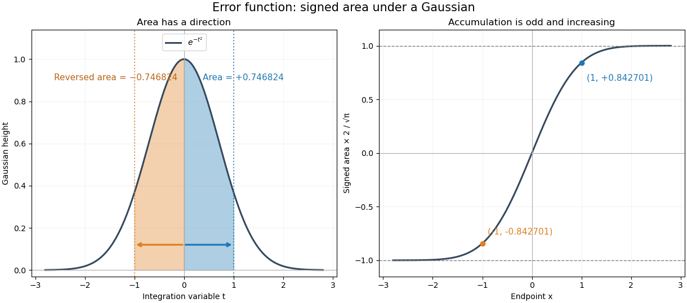

# Error function

↑ **Parent:** [Gaussian integral](gaussian-integral.md)  
ⓦ [Wiki](https://en.wikipedia.org/wiki/Error_function)

The error function records the signed area under a [Gaussian function](gaussian-function.md) between zero and a variable endpoint:

$$
\boxed{\operatorname{erf}(x)=\frac{2}{\sqrt\pi}\int_0^x e^{-t^2}\,dt.}
$$

For a negative [real number](real-number.md) $x$, reversing the [integration limits](integration-limit.md) makes this [integral](integral-split.md) negative. The normalization uses the [Gaussian integral](gaussian-integral.md): the full area of $e^{-t^2}$ is $\sqrt\pi$, so its positive half contributes one after multiplication by $2/\sqrt\pi$. The same definition extends to a [complex number](complex-number.md) $z$ along any path from zero to $z$, giving an [entire function](entire-function.md).[§7.2(i), equation 7.2.1, entire-function statement and real-axis limits in 7.2.4](nist-digital-library-of-mathematical-functions/7-2-definitions.md)

For example, $\operatorname{erf}(0)=0$, $\operatorname{erf}(1)\approx0.842701$, and $\operatorname{erf}(-1)\approx-0.842701$. A finite positive endpoint captures only part of the positive [Gaussian integral](gaussian-integral.md); $\operatorname{erf}(x)$ approaches one as $x\to+\infty$ but never reaches it at a finite real $x$.

**[Figure 8](#image-the-error-function-turns-signed-gaussian-area-into-a-bounded-increasing-curve). The error function turns signed Gaussian area into a bounded increasing curve**. Original computed real-axis curves. Blue shading represents integration from zero to $1$; orange shading represents the reversed integral from zero to $-1$. The right panel displays their signed values after normalization, not a probability density.

The useful idea is to name a recurring [integral](integral-split.md) once instead of carrying it through every calculation. The [error function and the normal distribution](error-function-and-the-normal-distribution.md) express [probabilities](probability.md) and [quantiles](quantile-function.md) through this area, while an [error-function diffusion front](error-function-diffusion-front.md) describes how [diffusion](diffusion.md) smooths a sharp jump. The [complementary error function](complementary-error-function.md) retains the small area left in the tail.

The [fundamental theorem of calculus](fundamental-theorem-of-calculus.md) gives

$$
\operatorname{erf}'(x)=\frac{2}{\sqrt\pi}e^{-x^2}>0.
$$

Thus the real-axis [error function](error-function.md) is [strictly increasing](strictly-increasing-function.md), with values in $(-1,1)$. Its [integrand](integrand.md) is an [even function](even-function.md), so the [error function](error-function.md) is an [odd function](odd-function.md), $\operatorname{erf}(-x)=-\operatorname{erf}(x)$. The derivative also gives $\operatorname{erf}''(x)=-4xe^{-x^2}/\sqrt\pi$: the curve is [concave](concave-function.md) for $x>0$ and [convex](convex-function.md) for $x<0$. These real-axis properties do not imply boundedness throughout the [complex plane](complex-plane.md); the existing [quadrant asymptotics of the error function](quadrant-asymptotics-of-the-error-function.md) describe a different behavior in other directions.

**Table of contents**

- [Error function and the normal distribution](error-function-and-the-normal-distribution.md)
- [Inverse error function](inverse-error-function.md)
- [Error-function diffusion front](error-function-diffusion-front.md)
- [Quadrant asymptotics of the error function](quadrant-asymptotics-of-the-error-function.md)
- [Complementary error function](complementary-error-function.md)
  - [Complementary error function tail bound](complementary-error-function-tail-bound.md)
  - [Faddeeva function](faddeeva-function.md)
    - [Gaussian pole integral](gaussian-pole-integral.md)

## ↑ Ancestors (8)

1. [Gaussian integral](gaussian-integral.md)
2. [Integral](integral-split.md)
3. [Calculus](calculus-split.md)
4. [Real analysis](real-analysis-split.md)
5. [Analysis](analysis-split.md)
6. [Area of mathematics](area-of-mathematics.md)
7. [Mathematics](mathematics-split.md)
8. [Codex Wiki](split.md)

## ← Incoming links (39)

- [Accidental coincidence](accidental-coincidence.md)
- [Brownian motion](brownian-motion-split.md)
- [Complementary error function](complementary-error-function.md)
- [Error function](error-function.md)
- [Error function and the normal distribution](error-function-and-the-normal-distribution.md)
- [Error-function diffusion front](error-function-diffusion-front.md)
- [Error-function isobaric cooling front](error-function-isobaric-cooling-front.md)
- [Faddeeva function](faddeeva-function.md)
- [Gaussian integral](gaussian-integral.md)
- [Gaussian interval mass](gaussian-interval-mass.md)
- [Gaussian pole transition for a large gamma parameter](gaussian-pole-transition-for-a-large-gamma-parameter.md)
- [Gaussian saddle coalescing with a simple pole](gaussian-saddle-coalescing-with-a-simple-pole.md)
- [Heat-kernel solution](heat-kernel-solution.md)
- [Interior layer at a simple zero of advection](interior-layer-at-a-simple-zero-of-advection.md)
- [Inverse error function](inverse-error-function.md)
- [Neumann solution of the Stefan problem](neumann-solution-of-the-stefan-problem.md)
- [Solution](past-exam-of-the-advanced-quantum-physics-course-of-the-university-of-cambridge/2014/paper-1/1/a/solution.md)
- [Solution](past-exam-of-the-mathematics-course-of-the-university-of-cambridge/2004/iii/paper-76/2/i/solution.md)
- [Solution](past-exam-of-the-mathematics-course-of-the-university-of-cambridge/2005/iii/paper-71/3/solution.md)
- [Solution](past-exam-of-the-mathematics-course-of-the-university-of-cambridge/2005/iii/paper-72/1/2/solution.md)
- [Solution](past-exam-of-the-mathematics-course-of-the-university-of-cambridge/2005/iii/paper-79/2/b/solution.md)
- [Solution](past-exam-of-the-mathematics-course-of-the-university-of-cambridge/2006/iii/paper-75/2/solution.md)
- [Solution](past-exam-of-the-mathematics-course-of-the-university-of-cambridge/2013/iii/paper-71/1/solution.md)
- [Solution](past-exam-of-the-mathematics-course-of-the-university-of-cambridge/2014/iii/paper-75/3/b/solution.md)
- [Solution](past-exam-of-the-mathematics-course-of-the-university-of-cambridge/2016/iii/paper-336/2/a/i/solution.md)
- [Solution](past-exam-of-the-mathematics-course-of-the-university-of-cambridge/2016/iii/paper-336/2/a/ii/solution.md)
- [Solution](past-exam-of-the-mathematics-course-of-the-university-of-cambridge/2018/iii/paper-310/2/solution.md)
- [Solution](past-exam-of-the-mathematics-course-of-the-university-of-cambridge/2018/iii/paper-333/2/solution.md)
- [Solution](past-exam-of-the-mathematics-course-of-the-university-of-cambridge/2018/iii/paper-336/2/ii/solution.md)
- [Solution](past-exam-of-the-mathematics-course-of-the-university-of-cambridge/2018/iii/paper-336/2/iii/solution.md)
- [Solution](past-exam-of-the-mathematics-course-of-the-university-of-cambridge/2021/ib/paper-4/14c/solution.md)
- [Solution](past-exam-of-the-mathematics-course-of-the-university-of-cambridge/2026/iii/paper-332/2/b/solution.md)
- [Solution](past-exam-of-the-mathematics-course-of-the-year-1-of-the-natural-sciences-course-of-the-university-of-cambridge/2023/paper-2/5/solution.md)
- [Solution](past-exam-of-the-mathematics-course-of-the-year-2-of-the-natural-sciences-course-of-the-university-of-cambridge/2010/paper-2/5/iv/solution.md)
- [Photon-recoil lag correlation](photon-recoil-lag-correlation.md)
- [Square-root boundary layer at a vanishing drift](square-root-boundary-layer-at-a-vanishing-drift.md)
- [Standard normal distribution function](standard-normal-distribution-function.md)
- [Strain-dominated mush temperature profile](strain-dominated-mush-temperature-profile.md)
- [Superheated two-phase Stefan similarity](superheated-two-phase-stefan-similarity.md)
