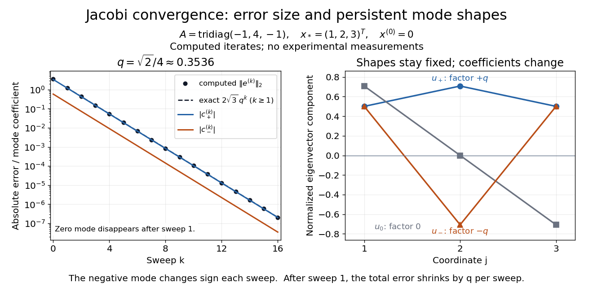

# Error modes of a three-variable Jacobi iteration

↑ **Parent:** [Jacobi iteration for a three-variable tridiagonal system](jacobi-iteration-for-a-three-variable-tridiagonal-system.md)

For the [Jacobi iteration for a three-variable tridiagonal system](jacobi-iteration-for-a-three-variable-tridiagonal-system.md),

$$
B=\frac14\begin{pmatrix}0&1&0\\1&0&1\\0&1&0\end{pmatrix}.
$$

An [orthonormal eigenbasis](orthonormal-eigenbasis.md) is

$$
u_+=\frac12\begin{pmatrix}1\\\sqrt2\\1\end{pmatrix},\qquad u_0=\frac1{\sqrt2}\begin{pmatrix}1\\0\\-1\end{pmatrix},\qquad u_-=\frac12\begin{pmatrix}1\\-\sqrt2\\1\end{pmatrix},
$$

with [eigenvalues](eigenvalue.md) $q=\sqrt2/4$, $0$, and $-q$, respectively. These are error modes: their shapes persist under the [iteration matrix](iteration-matrix.md), while their coefficients change. Direct multiplication verifies them, or expansion of the [determinant](determinant.md) gives $\det(tI-B)=t(t^2-1/8)$. Thus $\rho(B)=q<1$ and convergence holds for every starting [vector](vector.md).

With $x^{(0)}=0$, the initial [forward error](forward-error.md) has coefficients

$$
e^{(0)}=-x_*=c_+u_++c_0u_0+c_-u_-,\qquad c_+=-2-\sqrt2,\quad c_0=\sqrt2,\quad c_-=-2+\sqrt2.
$$

For $k\geq1$,

$$
e^{(k)}=c_+q^ku_++c_-(-q)^ku_-,\qquad \|e^{(k)}\|_2=2\sqrt3\,q^k.
$$

The zero mode disappears after one sweep; the negative mode alternates in sign. The [Euclidean norm](euclidean-norm.md) drops by exactly $q$ per sweep from $k=1$ onward. The first [norm](norm.md) drop is different because $\|e^{(0)}\|_2=\sqrt{14}$ includes the zero mode. A starting error proportional to $u_0$ would disappear entirely in one sweep, faster than the [spectral radius](spectral-radius.md) predicts for generic errors.

**[Figure 16](#image-computed-jacobi-method-error-curves-and-eigenvector-modes-for-the-original-three-variable-tridiagonal-matrix). Computed Jacobi method error curves and eigenvector modes for the original three-variable tridiagonal matrix**.

The curves are computed iterates and exact formulas for this [linear system](system-of-linear-equations.md). Since $A=4(I-B)$, the same [eigenvectors](eigenvector.md) have [eigenvalues](eigenvalue.md) $4-\sqrt2$, $4$, and $4+\sqrt2$ for $A$. They prove that $A$ is a [positive-definite matrix](positive-definite-matrix.md), and give the [condition number](condition-number.md) used in [residual and forward error in a stationary iteration](residual-and-forward-error-in-a-stationary-iteration.md).

## ↑ Ancestors (9)

1. [Jacobi iteration for a three-variable tridiagonal system](jacobi-iteration-for-a-three-variable-tridiagonal-system.md)
2. [Jacobi method](jacobi-method.md)
3. [Stationary iterative method for a linear system](stationary-iterative-method-for-a-linear-system.md)
4. [Numerical linear algebra](numerical-linear-algebra-split.md)
5. [Numerical analysis](numerical-analysis-split.md)
6. [Analysis](analysis-split.md)
7. [Area of mathematics](area-of-mathematics.md)
8. [Mathematics](mathematics-split.md)
9. [Codex Wiki](split.md)
